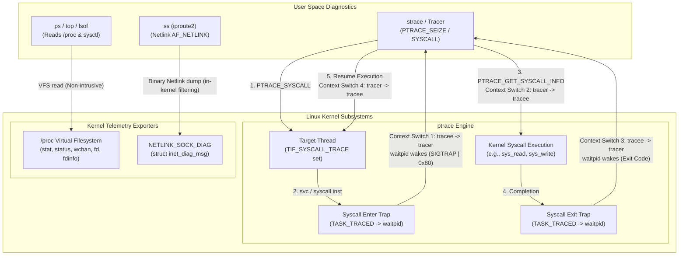
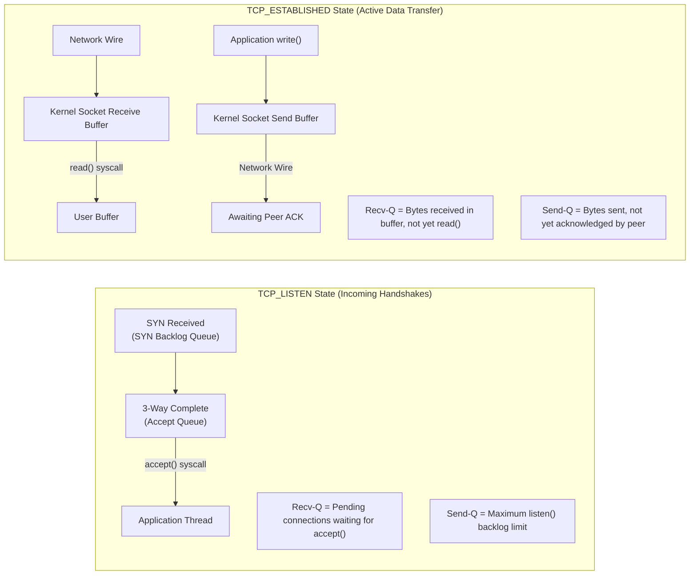
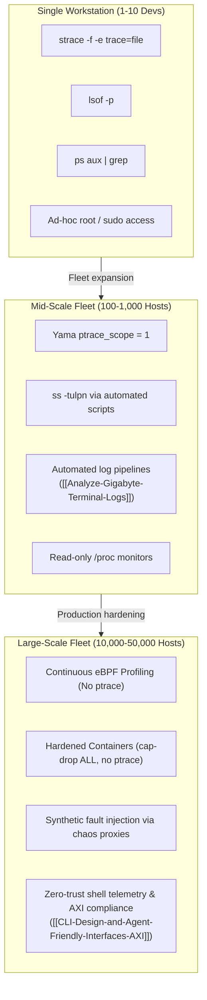

# System Inspection and Syscall Tracing From the Shell

> [!summary] Claim:
> Command-line system triage and tracing rely on distinct kernel observability boundaries: `/proc` exposes point-in-time process metrics, Netlink `sock_diag` provides binary socket queue states, and `ptrace(2)` intercepts boundary system calls by trapping thread execution.
> Intercepting system calls with `ptrace(PTRACE_SYSCALL)` stops the tracee twice per syscall (four tracer/tracee switches), which queues syscall-heavy threads behind one tracer and slowed a syscall-bound `dd` 442x in Brendan Gregg's 2014 measurement.
> High-signal triage requires selecting the least intrusive mechanism: reading `/proc/[pid]/wchan` and `/proc/[pid]/stack` to identify blocked kernel wait sites without stopping execution, querying Netlink socket backlogs to differentiate application stalls from network drops, and reserving dynamic syscall tracing for localized fault injection and path decoding.



## The Mechanism

Every inspection command executed in the shell operates across one of three operating system boundaries:
1. Virtual filesystem reflection (`/proc` on Linux, `sysctl` on macOS).
2. Binary control plane sockets (Netlink `sock_diag` on Linux).
3. Thread interception traps (`ptrace` on Linux, DTrace / `ktrace` on macOS).

Understanding the mechanical cost of each boundary dictates whether a triage command resolves a production incident or destabilizes a live cluster.

### 1. System Call Tracing via `ptrace`

The `ptrace(2)` system call allows a tracer process to observe and control the execution of a tracee thread, inspecting and modifying its memory and CPU registers.
The utility `strace` is built directly on this mechanism.

#### Attachment: `PTRACE_SEIZE` versus `PTRACE_ATTACH`

Historical tracers attached to running processes using `PTRACE_ATTACH`.
When a tracer issues `ptrace(PTRACE_ATTACH, pid, 0, 0)`, the kernel forces a `SIGSTOP` signal onto the target thread.
This design introduced severe race conditions:
- The target process stops immediately upon receiving the signal.
- The tracer cannot distinguish whether the intercepted `SIGSTOP` was generated by its own attachment or by an external process running `kill -STOP`.
- High-priority threads encounter unexpected signal delivery, disrupting real-time deadlines.

Modern `strace` (since version 4.8, released 2013-06-03, on Linux 3.4+) attaches using `PTRACE_SEIZE` (strace NEWS: "Implemented tracing using PTRACE_SEIZE API (when available)").
strace passes `PTRACE_O_TRACESYSGOOD | PTRACE_O_TRACEEXEC | PTRACE_O_TRACEEXIT` by default (`ptrace_setoptions` in `src/strace.c`), adds `PTRACE_O_TRACECLONE | PTRACE_O_TRACEFORK | PTRACE_O_TRACEVFORK` under `-f`, and adds `PTRACE_O_EXITKILL` under `--kill-on-exit` `(as of 2026-11, Linux)`:
```c
ptrace(PTRACE_SEIZE, pid, 0, PTRACE_O_TRACESYSGOOD | PTRACE_O_TRACEEXEC | PTRACE_O_TRACEEXIT);
```
`PTRACE_SEIZE` attaches to the target process without injecting a `SIGSTOP` signal.
The target continues running uninterrupted until the tracer explicitly halts it with `ptrace(PTRACE_INTERRUPT, pid, 0, 0)` or a traced event (signal delivery, `exec`, an enabled `PTRACE_EVENT_*`) stops it; only after such a stop can the tracer restart it with `PTRACE_SYSCALL`.
Furthermore, `PTRACE_SEIZE` accepts ptrace options directly in its `data` argument, eliminating the post-attach configuration window.

#### Syscall Trapping: `PTRACE_O_TRACESYSGOOD` and Stop Resolution

When tracing system calls, the tracer calls:
```c
ptrace(PTRACE_SYSCALL, pid, 0, 0);
```
The kernel sets a syscall-trace work flag on the target thread: `SYSCALL_WORK_SYSCALL_TRACE` in `thread_info.syscall_work` on generic-entry architectures such as x86 (`include/linux/entry-common.h`), and `TIF_SYSCALL_TRACE` in `thread_info.flags` on arm64, which still defines it in `arch/arm64/include/asm/thread_info.h` `(as of 2026-11, Linux)`.
Whenever the CPU executes a system call boundary (`svc` on ARM64, `syscall` on x86_64), the kernel entry code checks that flag.
If set, the kernel halts the thread, transitions its state to `TASK_TRACED`, records its register state, and wakes the tracer waiting in `waitpid()`.

Without explicit configuration, the kernel reports every ptrace stop to `waitpid()` with signal `SIGTRAP` (value 5).
Because a tracee can encounter `SIGTRAP` from genuine breakpoints (`int3` or `brk`), the tracer cannot differentiate between a breakpoint trap and a system call event.
To resolve this ambiguity, `strace` enables `PTRACE_O_TRACESYSGOOD`:
```c
ptrace(PTRACE_SETOPTIONS, pid, 0, PTRACE_O_TRACESYSGOOD);
```
When `PTRACE_O_TRACESYSGOOD` is active (since Linux 2.4.6), the kernel sets bit 7 in the stop signal for syscall-stops.
The stop signal extracted by `WSTOPSIG()` becomes:
$$\text{WSTOPSIG(status)} = \text{SIGTRAP} \;|\; 0\text{x}80 = 5 \;|\; 128 = 133 \quad (0\text{x}85)$$
The raw `waitpid()` status word is `0x857f` (stop signal in bits 8-15, `0x7f` marking a stop), measured on Linux 7.2 aarch64 in the lab container.
The macro evaluation `WIFSTOPPED(status) && (WSTOPSIG(status) == (SIGTRAP | 0x80))` proves that the thread is halted at a system call boundary.

#### Distinguishing Entry and Exit: `PTRACE_GET_SYSCALL_INFO`

A traced system call triggers two distinct ptrace stops:
1. Syscall-enter-stop: Halted immediately after register setup, before the kernel executes the underlying system call handler.
2. Syscall-exit-stop: Halted after handler completion, before returning control to user-space code.

Prior to Linux 5.3, the kernel did not expose an explicit flag indicating whether a stop was an entry or an exit.
Tracers had to maintain a private, stateful toggle boolean per thread.
If a thread encountered a signal trap or an unobserved event, the tracer's toggle became desynchronized, causing `strace` to confuse syscall arguments with return values.

Linux 5.3 introduced `PTRACE_GET_SYSCALL_INFO` to provide an architecture-independent, stateless inspection interface:
```c
#include <linux/ptrace.h>

struct ptrace_syscall_info info;
long ret = ptrace(PTRACE_GET_SYSCALL_INFO, pid, (void *)sizeof(info), &info);
```
The returned `struct ptrace_syscall_info` contains (current `include/uapi/linux/ptrace.h`; headers before Linux 6.16, such as Ubuntu 24.04's, spell the padding `__u8 pad[3]`, and Linux 6.16 added the inverse request `PTRACE_SET_SYSCALL_INFO` (0x4212), which strace uses since 6.16):
```c
struct ptrace_syscall_info {
    __u8  op;                   /* PTRACE_SYSCALL_INFO_NONE (0), ENTRY (1), EXIT (2), SECCOMP (3) */
    __u8  reserved;
    __u16 flags;
    __u32 arch;                 /* AUDIT_ARCH_* value (e.g., AUDIT_ARCH_AARCH64) */
    __u64 instruction_pointer;  /* PC at syscall boundary */
    __u64 stack_pointer;        /* SP value */
    union {
        struct {
            __u64 nr;           /* Syscall number */
            __u64 args[6];      /* Syscall arguments 0-5 */
        } entry;
        struct {
            __s64 rval;         /* Syscall return code */
            __u8  is_error;     /* 1 if return represents an error */
        } exit;
        struct {
            __u64 nr;
            __u64 args[6];
            __u32 ret_data;     /* Seccomp filter action return code */
            __u32 reserved2;
        } seccomp;
    };
};
```
If `info.op == PTRACE_SYSCALL_INFO_ENTRY`, the tracer reads `info.entry.nr` and `info.entry.args[0..5]`.
If `info.op == PTRACE_SYSCALL_INFO_EXIT`, the tracer reads `info.exit.rval` and `info.exit.is_error`.

### 2. The `ptrace` Overhead Tax

The mechanical cost of tracing with `ptrace` stems from the tracee stopping and the tracer being scheduled in and out around every syscall.
For each traced system call, four context switches occur:
1. Target thread executes `syscall` -> Kernel traps thread into `TASK_TRACED` -> Context switch to tracer.
2. Tracer wakes up in user space, reads syscall registers, formats strings -> Context switch to target thread.
3. Target thread runs the kernel syscall handler -> Kernel completes execution -> Context switch to tracer.
4. Tracer wakes up, reads return value registers -> Context switch back to target thread.

Measured on the lab VM (Apple M3 Pro host, 12 vCPUs, Linux 7.2 aarch64, unprivileged container, five runs; one VM, not a general constant) `(as of 2026-11, Linux)`:
- An untraced `syscall(SYS_getppid)` in a loop costs 95 to 96 ns per call.
- A pipe ping-pong between two processes costs 498 to 505 ns per switch, pinned to one CPU or not; that figure includes the `read` and `write` on each hop, so it bounds a bare switch from above.
- A tracee looping on `getppid` under a minimal `PTRACE_SYSCALL` tracer that only waits and resumes costs 2.27 us per syscall.
- The same loop costs 2.58 us per syscall when the tracer also calls `PTRACE_GET_SYSCALL_INFO` at each stop, 27x the untraced call.

Two stops per syscall means four tracer/tracee switches at roughly 0.5 us each, which accounts for the 2.3 to 2.6 us.
The benchmark source is not part of the lab, because its timings are machine dependent and cannot be diffed against a golden file.
Brendan Gregg measured `dd if=/dev/zero of=/dev/null bs=1 count=500k` slowing from 0.10 s to 45.96 s, 442x, under `strace -eaccept`, a filter that matches none of the calls `dd` makes, because every syscall still stops the tracee ("strace pauses your application twice for each syscall").
Furthermore, because a single `strace` process services the stops of every thread through one `wait`-driven event loop, threads that are stopped at syscall boundaries queue behind it; threads running user-space code keep running, but syscall-heavy servers collapse toward the throughput of that one tracer.

### 3. Kernel Security Boundaries: Yama `ptrace_scope`

Linux controls attachment permissions through the Yama Linux Security Module (LSM).
The file `/proc/sys/kernel/yama/ptrace_scope` enforces system-wide attachment policies:
- `0` (Classic): Any process can attach to any other process owned by the same UID, provided the target is dumpable (it has not transitioned UIDs, started privileged, or called `prctl(PR_SET_DUMPABLE, 0)`).
- `1` (Restricted, the kernel default when Yama is built in, and Ubuntu's default; Fedora ships `0` through elfutils' `10-default-yama-scope.conf`): A process can only attach to its descendants (children, grandchildren, and so on), and `PTRACE_TRACEME` is unchanged.
  Attaching to an arbitrary running process (`strace -p <PID>`) requires `CAP_SYS_PTRACE` (root) or an explicit authorization by the target via `prctl(PR_SET_PTRACER, tracer_pid, 0, 0, 0)`.
- `2` (Admin only): Only processes possessing `CAP_SYS_PTRACE` may use ptrace, through either `PTRACE_ATTACH` or children calling `PTRACE_TRACEME`.
  Unprivileged users cannot trace their own processes.
- `3` (No attach): Global kill switch.
  Once written, no process may use `PTRACE_ATTACH` (which `PTRACE_SEIZE` shares as an attach) or `PTRACE_TRACEME`.
  The Yama documentation says the value "cannot be changed" once set, so only a reboot clears it.

### 4. Non-Intrusive Process Triage: `/proc` Internals

To inspect processes without incurring `ptrace` context-switch overhead, engineers inspect the `/proc` virtual filesystem.
[[Proc-Filesystem-and-Process-Credentials]] details credential mappings and filesystem structures.

#### Process State Codes (`STAT`)

Process table listings generated by `ps` or `/proc/[pid]/stat` export single-character process execution states:

| Code | Kernel Macro | Architectural Meaning |
| :--- | :--- | :--- |
| `R` | `TASK_RUNNING` | The thread is actively executing on a CPU core or sitting on a scheduler runqueue awaiting a CPU timeslice. |
| `S` | `TASK_INTERRUPTIBLE` | Sleeping state. The thread is blocked waiting for an event (socket I/O, timer expiration, pipe buffer space) and will wake immediately upon signal receipt. |
| `D` | `TASK_UNINTERRUPTIBLE` | Uninterruptible sleep. The thread is blocked waiting on hardware I/O or a kernel mutex. It ignores all signals, including `SIGKILL`, except in `TASK_KILLABLE` waits, which also show as `D` but wake for fatal signals. |
| `Z` | `EXIT_ZOMBIE` | Defunct state. The thread has terminated via `exit_group()`, releasing its address space and open file descriptors, but its `struct task_struct` remains in the process table until its parent reads its termination status via `waitpid()`. |
| `T` | `TASK_STOPPED` | Halted by a job-control signal (`SIGSTOP`, `SIGTSTP`, `SIGTTIN`, `SIGTTOU`). |
| `t` | `TASK_TRACED` | Halted by a debugger or tracing engine (`ptrace`) at a breakpoint or system call trap. |
| `I` | `TASK_IDLE` | Idle kernel worker thread (reported as `I` since Linux 4.14: `fs/proc/array.c` has `"I (idle)"` in v4.14 and no idle entry in v4.13). `TASK_IDLE` is `TASK_UNINTERRUPTIBLE | TASK_NOLOAD`, so unlike `D` state, idle kernel threads do not contribute to system load average. |

State modifier suffixes append auxiliary attributes:
- `<`: High-priority process (negative nice value).
- `N`: Low-priority process (positive nice value).
- `L`: Pages locked into physical RAM via `mlock(2)`.
- `s`: Session leader (`getsid(0) == getpid()`).
- `l`: Multithreaded process (holds multiple tasks cloned with `CLONE_THREAD`).
- `+`: Member of the foreground process group on its controlling terminal.

#### Finding Kernel Bottlenecks: `wchan` and `stack`

When a thread enters `TASK_UNINTERRUPTIBLE` (`D` state) or sleeps unexpectedly (`S` state), the exact kernel function where the thread is suspended is readable without attaching a debugger:
```bash
cat /proc/<PID>/wchan
```
The file `/proc/[pid]/wchan` returns the kernel symbol corresponding to the thread's sleeping channel.
Symbol names change between kernel versions; these were read on Linux 7.2 aarch64 in the lab container `(as of 2026-11, Linux)`:
- `futex_wait`: Blocked waiting on a user-space mutex or condition variable contention (older kernels showed `futex_wait_queue_me`).
- `__arm64_sys_epoll_pwait` (the syscall entry symbol, arch-prefixed) / `do_select`: Blocked in an event loop waiting for network or pipe activity.
- `hrtimer_nanosleep` and `anon_pipe_read`: Blocked in `sleep()` and in a `read()` on an empty pipe.

Disk-bound and network-filesystem waits show other symbols that vary even more across kernel versions, so read them on the affected host instead of matching against a table.

`wchan` is gated by `ptrace_may_access(PTRACE_MODE_READ_FSCREDS)` in `fs/proc/base.c`, not by `kptr_restrict`: a reader who fails that check sees `0`.
With `CAP_SYS_ADMIN` in the initial user namespace, `/proc/[pid]/stack` exposes the full kernel backtrace; without it the read fails with `EACCES`, even on the reader's own process (measured in the lab container):
```bash
cat /proc/<PID>/stack
```

### 5. System Saturation and Resource Metrics

System-wide saturation tools monitor hardware resource exhaustion across CPUs, memory, and block devices.

#### The Linux Load Average Mechanism

Displayed by `uptime`, `top`, and `/proc/loadavg`, the 1, 5, and 15-minute load averages represent an exponentially damped moving average of active system demand.
Gregg (2017) describes load averages on other operating systems as CPU load averages, counting running plus runnable threads, and notes that Linux started out the same way.
In a patch emailed on 29 October 1993, Matthias Urlichs changed the Linux calculation so that load average also counts threads in `TASK_UNINTERRUPTIBLE` (`D` state) and the since-removed `TASK_SWAPPING`, as quoted by Brendan Gregg; the resulting demand measure is:
$$\text{Active Tasks} = N_{\text{TASK\_RUNNING}} + N_{\text{TASK\_UNINTERRUPTIBLE}}$$

The kernel updates this metric every 5 seconds plus one tick (`#define LOAD_FREQ (5*HZ+1)` in `include/linux/sched/loadavg.h`; the update itself lives in `kernel/sched/loadavg.c`) using fixed-point integer arithmetic with `FSHIFT = 11`:
$$\text{load}_{t} = \text{load}_{t-1} \times e^{-5/\tau} + \text{active} \times (1 - e^{-5/\tau})$$
The decay constants for 1, 5, and 15 minutes are:
- 1 minute ($\tau = 60$): $e^{-5/60} \approx 0.920044$ (fixed-point fraction: `EXP_1 = 1884` out of 2048)
- 5 minutes ($\tau = 300$): $e^{-5/300} \approx 0.983471$ (fixed-point fraction: `EXP_5 = 2014` out of 2048)
- 15 minutes ($\tau = 900$): $e^{-5/900} \approx 0.994460$ (fixed-point fraction: `EXP_15 = 2037` out of 2048)

Because `TASK_UNINTERRUPTIBLE` threads contribute to the load calculation, a server with 0% CPU utilization can register a load average of 80 if 80 threads are blocked on a frozen disk controller or an unresponsive NFS mount.

#### High-Speed System Telemetry: `vmstat` and `iostat`

`vmstat 1` outputs one-second interval metrics across subsystem boundaries:
- `procs / r`: Number of runnable threads, running or waiting for run time (vmstat(8)).
  If `r` exceeds the total CPU core count, the CPU scheduler is saturated.
- `procs / b`: Number of threads blocked in uninterruptible sleep (`D` state).
  If `b > 0`, system throughput is throttled by storage or memory wait queues.
- `memory / swpd`: Amount of swap space in use.
- `swap / si` and `so`: Memory swapped in from and out to disk per second, in KiB by default (`dataUnit = UNIT_K`, 1024, in procps-ng `src/vmstat.c`) and in the unit chosen by `-S`/`--unit` otherwise.
  Non-zero values over sustained intervals indicate severe memory pressure and page cache thrashing.
- `cpu / wa`: Percentage of CPU time that cores spent idle while at least one local disk I/O request was in flight.
  This metric does not measure I/O latency; it measures CPU idle opportunity cost.
- `cpu / st`: Hypervisor steal time.
  Indicates CPU cycles involuntarily withheld from the virtual machine by the host hypervisor.

`iostat -xz 1` exports extended block device metrics:
- `r_await` and `w_await`: Average read and write latency (in milliseconds) from request issuance to block device completion.
- `aqu-sz`: Average request queue length.
  For spinning disks, an `aqu-sz > 1.0` indicates queuing.
- `%util`: Percentage of wall-clock time that the device had requests in flight.
  On legacy mechanical disks, `%util > 80%` indicated mechanical saturation.
  On modern multi-queue NVMe solid-state drives, which serve many requests in parallel, `%util` reaches 100% with a single thread at queue depth 1, while the drive still possesses orders of magnitude of unutilized throughput; iostat(1) itself warns that for "devices serving requests in parallel, such as RAID arrays and modern SSDs, this number does not reflect their performance limits."

### 6. Network Socket Telemetry: Netlink `sock_diag` versus `/proc/net/tcp`

The command `netstat` historically parsed `/proc/net/tcp` line by line.
On busy production servers with 100,000 open connections, reading `/proc/net/tcp`:
1. Walks every bucket of the TCP hash tables, taking each listener bucket's `ilb2->lock` and each established bucket's `inet_ehash_lockp()` spinlock in turn (`net/ipv4/tcp_ipv4.c`), returning every socket in every state because the file cannot filter.
2. Incurs substantial string formatting overhead in kernel space, converting binary socket tables into ASCII text.
3. Drops the bucket locks between `read()` calls and resumes from a saved bucket and offset (`st->bucket`, `st->offset`, `tcp_seek_last_pos()`), so a large dump is not a consistent snapshot of the table.

The modern tool `ss` (Socket Statistics) bypasses `/proc` entirely by opening a Netlink socket with the `NETLINK_SOCK_DIAG` family (also known as `NETLINK_INET_DIAG`).
The user-space process sends a binary request header (`struct inet_diag_req_v2`) over the Netlink channel specifying the desired socket states (`idiag_states = (1 << TCP_LISTEN)`).
The kernel streams binary records back via `struct inet_diag_msg` payloads.
It still walks the hash under the same per-bucket locks (`spin_lock_bh(inet_ehash_lockp(...))` for established sockets and `spin_lock(&ilb->lock)` for listeners, in `net/ipv4/tcp_diag.c`); the win is in-kernel filtering by state and bytecode and the absence of text formatting, not lock avoidance.

#### Socket Queue Metrics: `Recv-Q` and `Send-Q`

The values displayed under `Recv-Q` and `Send-Q` in `ss` depend entirely on the socket's state:



For sockets in the `TCP_LISTEN` state:
- `Recv-Q`: The current count of fully established TCP connections (three-way handshake complete) currently sitting in the kernel accept queue waiting for the application to invoke `accept(2)`.
- `Send-Q`: The maximum backlog capacity configured for this socket via `listen(sfd, backlog)` (`sk_max_ack_backlog`; `Recv-Q` is `sk_ack_backlog`, per `tcp_diag_get_info()`).
  The accept queue counts as full only once `Recv-Q` exceeds `Send-Q`, so it holds `backlog + 1` connections: with `listen(fd, 1)` and four non-blocking connects, `Recv-Q` stopped at 2 (measured on Linux 7.2 aarch64), and later handshakes were not queued.
  SYN cookies relate to SYN-queue overflow, not to a full accept queue.

For sockets in the `TCP_ESTABLISHED` state:
- `Recv-Q`: The number of data payload bytes already received and acknowledged by the kernel network stack, currently buffered in kernel memory waiting for the application to invoke `read(2)` or `recv(2)`.
- `Send-Q`: The number of data payload bytes written by the application and not yet acknowledged (ACKed) by the remote peer, `write_seq - snd_una`, which includes bytes still waiting to be transmitted as well as bytes in flight.

### 7. File Descriptor Leak Detection: `lsof` and Deleted Inodes

A running process maintains an array of open file references in its kernel file descriptor table.
When a file is unlinked from the directory tree (`rm -f database.log`), the directory entry is removed immediately, but the underlying inode and data blocks are not reclaimed if a process retains an open file descriptor referencing that inode.

This condition creates a storage disparity during production incidents:
- `du -sh /var/log` walks directory trees and reports that the directory is empty.
- `df -h /var/log` queries the filesystem superblock (`statvfs`) and reports 100% disk usage.

The command to identify open files whose directory links have reached zero is:
```bash
lsof +L1
```
The parameter `+L1` instructs `lsof` to list open files possessing a link count of less than 1, that is, unlinked files; `+aL1 <file_system>` restricts that to one mounted file system (lsof(8)).
Alternatively, inspecting `/proc/*/fd/*` with `readlink` locates targets suffixed with `(deleted)`.
To reclaim the disk space without terminating the process:
```bash
truncate -s 0 /proc/<PID>/fd/<FD>
```
Truncation frees the blocks rather than zeroing them; a writer that did not open the file with `O_APPEND` keeps writing at its old offset, so the file becomes sparse rather than small.
The lab reproduces both facts (line `[5]`): after truncating an unlinked file through `/proc/self/fd/<FD>`, its size is 0 with 0 blocks, and a following write at the old offset 16384 leaves a size of 16385 with fewer allocated bytes than that.

### 8. macOS Observability Counterparts

macOS is built on the XNU kernel (combining Mach, BSD, and Apple I/O Kit primitives) and does not provide `/proc` or the Linux `ptrace(PTRACE_SYSCALL)` interface.
System inspection commands on macOS interact with distinct Mach APIs:

#### Process Listings: `sysctl` versus `/proc`
macOS `ps` does not parse files; it invokes `sysctl()` with a four-element management information base (MIB) path `{ CTL_KERN, KERN_PROC, what, flag }` in which `what` defaults to `KERN_PROC_ALL` (Apple's `adv_cmds` `ps/ps.c`).
The kernel returns an array of `struct kinfo_proc` records detailing process identifiers, parentage, memory utilization, and thread states.
The execution states on macOS differ from Linux (ps(1), macOS 27.2):
- `R`: Runnable (active or on runqueue).
- `S`: Sleeping for less than or equal to 20 seconds.
- `I`: Idle (sleeping for greater than 20 seconds).
- `U`: Uninterruptible wait (equivalent to Linux `D` state).
- `Z`: Zombie.
- `T`: Stopped.

#### File Descriptors: `proc_pidinfo`
macOS `lsof` queries the libproc API via `proc_pidinfo(pid, PROC_PIDLISTFDS, ...)` and `proc_pidfdinfo(pid, fd, PROC_PIDFDVNODEPATHINFO, ...)` (Apple's lsof sources, `dialects/darwin/libproc/dproc.c` and `dfile.c`).
This interface returns vnode path information and network socket descriptors without mounting a synthetic virtual filesystem.

#### Syscall Tracing: `dtruss`, `ktrace`, and `sc_usage`
- `dtruss`: A DTrace wrapper script tracing system calls via the `syscall:::entry` and `syscall:::return` probes.
  It needs root (dtruss(1), macOS 27.2).
  With default System Integrity Protection (SIP) settings, D programs may not read kernel addresses or kernel memory and may not use destructive actions (dtrace(1), macOS 27.2).
  `csrutil` carries a separate `dtrace` component ("DTrace Restrictions") that is changed from Recovery OS, where `csrutil enable` is available (csrutil usage and binary on macOS 27.2; the exact `--without dtrace` spelling was not run, because it changes the SIP configuration).
- `sc_usage`: A native command-line utility providing ongoing system call sampling and page-fault categorization (`ZERO_FILL`, `COW`, `CACHE_HIT`, `PAGE_IN`).
  It interacts directly with the kernel trace subsystem and requires root privileges (sc_usage(1), macOS 27.2).
- `fs_usage`: Monitors real-time filesystem operations (`open`, `read`, `write`, `stat`) across all system processes, exposing physical file paths and access latencies; it requires root (fs_usage(1), macOS 27.2).
- `ktrace`: Records kernel trace files (`ktrace trace`, `ktrace dump`, `ktrace info`) from the XNU kernel tracing buffer.

## Commands and Numbers to Know

Every entry reflects the default configuration and measured limits across platforms.

| Command or Constant | Platform | Metric or Flag Default | Architectural Meaning |
| :--- | :--- | :--- | :--- |
| `PTRACE_O_TRACESYSGOOD` | Linux | Signal `0x85` (133) | Sets bit 7 in `waitpid()` stop signal (`SIGTRAP \| 0x80`) to differentiate syscall traps from breakpoints `(as of 2026-11, Linux)`. |
| `strace -s <size>` | Linux | Default: 32 bytes | Maximum string printing limit before appending `...`. Increase to `-s 2048` when inspecting SQL queries or buffer contents; file names are not strings and always print in full `(as of 2026-11, Linux)`. |
| `strace -ff -o prefix` | Linux | File per thread/process | Writes trace streams to `prefix.<PID>` to eliminate multi-threaded stdout corruption and lock contention `(as of 2026-11, Linux)`. |
| `Context Switch Tax` | Linux | Measured: about 0.5 us per switch; 2.3 to 2.6 us per traced `getppid` | Pipe ping-pong switch cost and `PTRACE_SYSCALL` cost per traced syscall on the lab VM (Linux 7.2 aarch64, 12 vCPUs); two stops, so four switches, per syscall `(as of 2026-11, Linux)`. |
| `/proc/sys/kernel/yama/ptrace_scope` | Linux | Kernel default: 1 (Restricted); distro-dependent | Restricts `ptrace` attachment to descendants. Value 2 enforces admin-only; value 3 disables attach until reboot. The lab container's OrbStack 7.2 kernel reports 0 `(as of 2026-11, Linux)`. |
| `LOAD_FREQ` | Linux | Every 5 seconds plus one tick (`5*HZ+1`) | Interval at which `calc_load()` samples runnable (`TASK_RUNNING`) and uninterruptible (`TASK_UNINTERRUPTIBLE`) tasks `(as of 2026-11, Linux)`. |
| `vmstat 1` (First Line) | Linux | Since boot average | The first output row represents system averages calculated since system startup; subsequent rows are interval deltas `(as of 2026-11, Linux)`. |
| `ss -tulpn` | Linux | Netlink dump | Dumps TCP, UDP, listening sockets, process ownership, and numeric ports via `NETLINK_SOCK_DIAG` with in-kernel filtering and no text formatting `(as of 2026-11, Linux)`. |
| `lsof -n -P` | Both | Flag combination | Disables DNS hostname resolution (`-n`) and port name translation (`-P`) to prevent `lsof` from hanging on unresponsive DNS servers `(as of 2026-11, Both)`. |
| `lsof +L1` | Both | Link count `< 1` | Lists open files whose directory entry links have been deleted, identifying hidden disk storage leaks `(as of 2026-11, Both)`. |
| `sc_usage -e <PID>` | macOS | Root privilege required | Real-time system call and page fault sampler sorted by call frequency, backed by XNU kernel tracing `(as of 2026-11, macOS)`. |
| `fs_usage -w -f filesys` | macOS | Root privilege required | Real-time filesystem call stream: `-w` forces wide output, `-f filesys` keeps only filesystem events; `fs_usage` always excludes itself, Terminal, sshd, and the common shells by default `(as of 2026-11, macOS)`. |

## Multi-Language Comparison

Process inspection and telemetry mechanisms span compiled runtimes, standard libraries, and systems languages:

| Capability / Concern | C++ (POSIX / Linux) | Python (Standard Library & `psutil`) | Rust (`nix` & `procfs`) |
| :--- | :--- | :--- | :--- |
| **Syscall Interception** | Invokes `ptrace(2)` via `<sys/ptrace.h>`, `<sys/wait.h>`, and `sys/uio.h` for register tampering. | Requires `ctypes` or `cffi` bindings to `libc.ptrace`; rarely used for production tracing due to GIL overhead. | Uses `nix::sys::ptrace` and `nix::sys::wait` for type-safe tracer loops and register manipulation. |
| **Process Telemetry** | Reads `/proc/self/statm` or `/proc/self/status` via standard `<fstream>` or POSIX `read(2)`. | Uses `resource.getrusage(RUSAGE_SELF)` or the third-party `psutil.Process()` library. | Uses the `procfs` crate to parse `/proc/self/stat`, `status`, and `maps`. |
| **Socket Diagnostics** | Opens `socket(AF_NETLINK, SOCK_RAW, NETLINK_SOCK_DIAG)` and parses binary `struct inet_diag_msg`. | Low-level Netlink parsing via `socket.socket(socket.AF_NETLINK, ...)`; or parses `/proc/net/tcp`. | Implements Netlink streaming using `netlink-packet-sock-diag` or raw socket buffers. |
| **File Descriptor Audit** | Reads `/proc/self/fd/` entries using `opendir(3)` and resolves targets via `readlink(2)`. | Iterates `os.listdir('/proc/self/fd')` or uses `psutil.Process().open_files()`. | Traverses `/proc/self/fd` using `std::fs::read_dir` and inspects `std::fs::read_link`. |
| **Yama Authorization** | Calls `prctl(PR_SET_PTRACER, tracer_pid, 0, 0, 0)` to permit non-parent crash handler attachment. | Invokes `ctypes.CDLL(None).prctl(0x59616d61, tracer_pid, 0, 0, 0)` (`PR_SET_PTRACER`, ASCII "Yama"; value read from `<sys/prctl.h>` in the lab container). | `nix::sys::prctl` has no `PR_SET_PTRACER` wrapper (docs.rs), so call `libc::prctl(libc::PR_SET_PTRACER, pid, 0, 0, 0)` in an `unsafe` block (`PR_SET_PTRACER` is `0x59616d61` in the `libc` crate's `src/unix/linux_like/linux_l4re_shared.rs`). |

## Worked Lab Example

The laboratory in `code/01-Command-Line/strace_sys_inspect/` exercises the exact system inspection and syscall interception mechanisms used by production command-line utilities.

### 1. Lab Architecture

The lab binary `main.c` runs six measurements and prints one line for each.
Every value on those lines is read from the kernel; the only inputs it prints are `injected_errno` and `backlog_arg`, which the lab compares with what the kernel reports back.
The lab needs a Linux kernel and uapi headers of 5.3 or later (`PTRACE_GET_SYSCALL_INFO`) on aarch64 or x86_64.
The `# requires:` vocabulary cannot express the architecture or the header version, and `main.c` stops with a compile error on any other architecture.
The recording is aarch64; the x86_64 register code in the same file compiles from the same source but has not been run.

1. `test_ptrace_and_proc_status()`:
   Forks a child that issues `ptrace(PTRACE_TRACEME)` and raises `SIGSTOP`.
   While the child is halted, the parent reads `State:` and `TracerPid:` from `/proc/[child]/status`, sets `PTRACE_O_TRACESYSGOOD`, and loops on `PTRACE_SYSCALL`.
   At every stop it records the stop signal, and at every syscall stop it calls `PTRACE_GET_SYSCALL_INFO` and checks that the operations alternate entry, exit, entry, exit, that `info.arch` is the native audit architecture, and that the `getpid` exit value equals the child's pid.
   On entry to the first `openat()`, the tracer skips the call: it writes `-1` through the `NT_ARM_SYSTEM_CALL` regset on ARM64, or into `orig_rax` on x86_64.
   At the matching exit stop it writes `-ENOENT` (`-2`) into the return register (`x0` on ARM64, `rax` on x86_64).
   The child calls `openat(O_WRONLY|O_CREAT|O_EXCL)` twice on two fresh paths in a private temporary directory, the first one tampered with and the second left alone as a control.
   A skipped `O_CREAT` call leaves no file behind, so the parent can tell a skipped call from a call that ran and had its return value overwritten.
2. `test_proc_fd_inspection()`:
   Resolves a `/dev/null` descriptor through `/proc/self/fd`.
   Then it writes four 4096-byte blocks into a file, unlinks it while the descriptor stays open, and reads the `(deleted)` suffix of the link, the `pos:` and `flags:` lines of `/proc/self/fdinfo/<FD>`, and `st_nlink` from `fstat`.
   It truncates the unlinked file through the `/proc/self/fd/<FD>` link, then writes one byte at the old offset to show the hole.
3. `test_socket_queue_inspection()`:
   Binds a TCP server on `127.0.0.1` with `listen(sfd, 5)` and connects two clients without calling `accept()`.
   Opens a Netlink socket (`NETLINK_SOCK_DIAG`) and reads the listener's `idiag_state`, `idiag_rqueue`, and `idiag_wqueue`, then calls `accept()` once and reads them again.
   Finally one client writes 100 bytes that the server never reads, and a second dump for `TCP_ESTABLISHED` sockets reads the server-side socket's queues.

### 2. Execution and Golden Verification

The lab executes inside the deterministic container harness via `bash run.sh`:
```bash
cd code/01-Command-Line/strace_sys_inspect
bash run.sh
```

Recorded output from `code/01-Command-Line/strace_sys_inspect/expected/linux-aarch64.txt` (Linux 7.2 aarch64, the pinned lab container) `(as of 2026-11, Linux)`:
```text
[1] ptrace_syscall_interception: initial_sigstop=19 first_stop_sig=133 raw_status=0x857f getpid_seen=1 getpid_rval_is_child_pid=1
[2] ptrace_syscall_info_api: first_op=1 second_op=2 alternates=1 arch_ok=1 info_ok=1
[3] ptrace_fault_injection: injected_errno=2 child_ret=-1 child_errno=2 skipped_file_absent=1 control_ret_ok=1 control_file_present=1 tamper_ok=1 child_exit=0
[4] proc_process_state: state_during_ptrace_stop=t tracer_pid_matches=1
[5] proc_fd_and_fdinfo: devnull_resolves=1 pos=16384 flags_rdwr=1 deleted_suffix=1 nlink=0 size_before=16384 truncated=1 size_after_truncate=0 blocks_after_truncate=0 size_after_write=16385 sparse=1
[6] socket_queue_sock_diag: found_listener=1 tcp_listen_state=10 recv_q_pending=2 send_q_backlog=5 backlog_arg=5 recv_q_after_accept=1 found_estab=1 estab_state=1 estab_recv_q=100 estab_send_q=0
```

The output proves:
- `initial_sigstop=19` is the `SIGSTOP` signal-delivery-stop at the handshake.
- `first_stop_sig=133` and `raw_status=0x857f` are the measured stop signal and the raw `waitpid()` status of the first stop after `PTRACE_SYSCALL`, which is `SIGTRAP | 0x80` only because `PTRACE_O_TRACESYSGOOD` is set; without the option the same field reads `5`.
- `first_op=1 second_op=2 alternates=1` show that `PTRACE_GET_SYSCALL_INFO` reported an entry stop and then an exit stop, and kept alternating for the whole run, with no toggle bit kept by the tracer; `arch_ok=1` confirms `info.arch` is the native audit architecture, and `getpid_rval_is_child_pid=1` confirms that the exit stop carries the real return value.
- `child_ret=-1 child_errno=2` equal to `injected_errno=2` show that the injected return value reaches the child's `errno`.
- `skipped_file_absent=1` is the proof that the call never ran, because a real `O_CREAT|O_EXCL` would have created the file; `control_ret_ok=1 control_file_present=1` show that the next, untampered `openat` still worked.
  Writing `-1` into `x8` through `NT_PRSTATUS` instead leaves `skipped_file_absent=0` on ARM64, because the kernel keeps the syscall number in `regs->syscallno`.
- `state_during_ptrace_stop=t` proves the kernel process state transition to `TASK_TRACED`, and `tracer_pid_matches=1` that `TracerPid:` names the parent.
- In `[5]`, `deleted_suffix=1 nlink=0` is the unlinked-but-open state that `lsof +L1` reports, `pos=16384` is the four blocks written, `size_after_truncate=0 blocks_after_truncate=0` show that truncation through the proc link frees the blocks, and `size_after_write=16385 sparse=1` show that a writer without `O_APPEND` continues at its old offset and leaves a hole.
- In `[6]`, `tcp_listen_state=10 recv_q_pending=2 send_q_backlog=5` match two unaccepted connections and `listen(fd, 5)`, `recv_q_after_accept=1` shows the accept queue draining by one, and `estab_recv_q=100 estab_send_q=0` show the unread bytes of an established socket.

> [!warning] Pitfalls:
> - **Running `strace` on High-Throughput Production Services:** Because `ptrace` injects 4 context switches per system call and serializes multi-threaded event loops, attaching `strace` to a production database or proxy handling 50,000 requests/second will saturate CPU cores, induce cascading client timeouts, and trip load balancer health checks.
>   Use eBPF tools (`bpftrace`, `perf trace`) for production profiling.
> - **Executing `lsof` Without `-n -P` During Outages:** By default, `lsof` attempts to resolve IP addresses to hostnames via reverse DNS and maps port numbers to service names using `/etc/services`.
>   During a network degradation incident, running bare `lsof` will block on DNS timeouts, wedging the engineer's triage terminal.
>   Always run `lsof -n -P`.
> - **Misinterpreting `%wa` (iowait) as Storage Latency:** The `%wa` column in `top` and `vmstat` simply measures the percentage of time CPU cores were idle while at least one local disk I/O request was in flight.
>   A high `%wa` on a machine with a slow, single-threaded disk operation does not mean all CPUs are saturated; it means the CPUs had nothing else to run.
> - **Attempting to Kill Zombie Processes (`Z` State):** A zombie process has already terminated and released its memory and file descriptors.
>   Executing `kill -9 <PID>` has no effect because there is no task code running to receive signals.
>   To clear a zombie, its parent process must call `waitpid()`.
>   If the parent is hung, terminating the parent forces the `init` process (`PID 1`) to inherit and immediately reap the zombie.
> - **Detaching from `strace` via `SIGKILL`:** If an engineer kills a running `strace` process using `kill -9 <strace_pid>`, the tracer exits abruptly before calling `ptrace(PTRACE_DETACH, pid, ...)`.
>   ptrace(2) states that "if the tracer dies, all tracees are automatically detached and restarted, unless they were in group-stop"; those are left stopped until they receive `SIGCONT`.
>   The exception is `strace --kill-on-exit` (not allowed with `-p`), which sets `PTRACE_O_EXITKILL` so that the kernel sends `SIGKILL` to each tracee when the tracer exits; strace's own `cleanup()` returns early in that mode (`src/strace.c`, strace(1)).
>   Prefer `SIGINT` (`Ctrl+C`), which lets `strace` run its detachment cleanup handlers.

## At Scale

Operational trade-offs governing system inspection and tracing shift radically as an infrastructure footprint expands from a single workstation to 50,000 production hosts:



### Scale Decision Rules

1. **Workstation Development (1-10 Engineers):**
   - Use `strace -e trace=%file` to identify missing configuration files, shared library search paths (`LD_LIBRARY_PATH`), or permission errors.
   - Use `lsof -i :<PORT>` to identify local port conflicts during container or server startups.
   - Run `strace -T -c` to profile system call distributions before and after application optimization.

2. **Staging and Canary Clusters (100-1,000 Hosts):**
   - Restrict `ptrace` usage via Yama scope level 1 (`/proc/sys/kernel/yama/ptrace_scope = 1`).
   - Replace manual `ps` and `top` polling with structured data wrangling pipelines leveraging `jq` and coreutils as taught in [[Structured-Data-Wrangling-Jq-Yq-and-Coreutils]].
   - Prohibit bare `strace` execution on live traffic; restrict tracing to canary instances with isolated traffic shaping.
   - Enforce `lsof -n -P` in all operational automation scripts to prevent DNS hang hazards.

3. **Global Production Fleet (10,000-50,000 Hosts):**
   - Strip `CAP_SYS_PTRACE` from all container runtimes via Docker / Kubernetes security contexts (`securityContext.capabilities.drop: ["SYS_PTRACE"]`).
   - Implement continuous kernel tracing using eBPF ring buffers (`perf_event_open`, BPF tracepoints, and kprobes). eBPF programs execute sandboxed in-kernel logic without stopping the traced thread and switching to a tracer process, which removes the 4-context-switch ptrace penalty.
   - Prohibit manual shell debugging during Sev-1 outages; deploy automated diagnostics agents that conform to the Agent eXperience Interface principles codified in [[CLI-Design-and-Agent-Friendly-Interfaces-AXI]].
   - Configure Prometheus / OpenTelemetry node-exporters to poll Netlink `sock_diag` and `/proc` metrics at fixed intervals rather than spawning ad-hoc terminal processes.

## Practice Drill

> [!tip] Practice Drill:
> Execute the following reproducible shell script to simulate a network socket backlog saturation incident, inspect the queue transition using `ss`, and trace system call timing using `strace`.
> It needs `gcc`, `ss` (iproute2), and `python3`; step 4 runs only when `strace` is installed.
> 1. Launch a background TCP listener with an artificially constrained backlog of 1.
> 2. Open two concurrent client connections to saturate the accept queue.
> 3. Query socket queue lengths using `ss -tln` and confirm that `Recv-Q` reaches 2 while `Send-Q` displays 1.
> 4. The script starts the server under `strace -T -e trace=accept,accept4`, then queries `ss -tln` again after the server's `accept` call: `Recv-Q` drops to 1, and the trace shows `accept` returning at once, because the connection was already in the accept queue.
>    Starting the server under `strace` avoids attaching to a running process, which Yama `ptrace_scope` 1 would refuse for a sibling.

```bash
#!/usr/bin/env bash
set -euo pipefail

# Create temporary working directory
WORK_DIR=$(mktemp -d)
trap 'rm -rf "${WORK_DIR}"; kill $(jobs -p) 2>/dev/null || true' EXIT
cd "${WORK_DIR}"

# 1. Compile minimal TCP server with backlog=1
cat << "EOF" > server.c
#include <stdio.h>
#include <stdlib.h>
#include <unistd.h>
#include <sys/socket.h>
#include <netinet/in.h>

int main(void) {
    int sfd = socket(AF_INET, SOCK_STREAM, 0);
    struct sockaddr_in sin = {0};
    sin.sin_family = AF_INET;
    sin.sin_addr.s_addr = htonl(INADDR_LOOPBACK);
    sin.sin_port = htons(9876);
    int one = 1;
    setsockopt(sfd, SOL_SOCKET, SO_REUSEADDR, &one, sizeof(one)); // allow quick re-runs
    if (bind(sfd, (struct sockaddr *)&sin, sizeof(sin)) != 0) { perror("bind"); return 1; }
    if (listen(sfd, 1) != 0) { perror("listen"); return 1; } // Restrict backlog to 1
    printf("READY\n");
    fflush(stdout);

    // Sleep before accepting to build queue
    sleep(3);
    int cfd = accept(sfd, NULL, NULL);
    if (cfd >= 0) {
        sleep(2); // Hold the accepted connection while ss runs again
        close(cfd);
    }
    close(sfd);
    return 0;
}
EOF
gcc -O2 server.c -o server

# 2. Run server in background, under strace when it is installed
if command -v strace >/dev/null 2>&1; then
    TRACER=(strace -T -e trace=accept,accept4 -o strace.log)
else
    TRACER=()
fi
${TRACER[@]+"${TRACER[@]}"} ./server > server.log 2>&1 &
SERVER_PID=$!

# Wait for server readiness
while ! grep -q "READY" server.log 2>/dev/null; do
    kill -0 "${SERVER_PID}" 2>/dev/null || { cat server.log; exit 1; }
    sleep 0.1
done

# 3. Launch two background client connections
python3 -c "import socket, time; s = socket.socket(); s.connect(('127.0.0.1', 9876)); time.sleep(6)" &
python3 -c "import socket, time; s = socket.socket(); s.connect(('127.0.0.1', 9876)); time.sleep(6)" &

# Allow handshakes to register in kernel
sleep 0.5

# 4. Inspect queue saturation via ss, then again after the server has called accept (at about t=3s)
echo "--- Socket Queue Status (ss -tln) ---"
ss -tln 'sport = :9876'
sleep 3
echo "--- Socket Queue Status after accept (ss -tln) ---"
ss -tln 'sport = :9876'

wait "${SERVER_PID}"
if [ -f strace.log ]; then
    echo "--- strace -T on accept ---"
    cat strace.log
fi
echo "--- Drill Completed Successfully ---"
```

## Interview Questions

> [!question] L5: Explain what each character represents in the `ps` command output string `Ss+` and why those modifiers matter.
>
> > [!success]- Answer
> > The string `Ss+` decodes into three independent process attributes:
> > 1. `S`: The primary execution state is `TASK_INTERRUPTIBLE` sleep.
> > The process is waiting for an event (such as terminal input, a timer, or socket data) and will wake immediately if a signal is delivered.
> > 2. `s`: The process is a session leader (`getsid(0) == getpid()`).
> > This typically identifies login shells or daemon root processes that manage their own process groups.
> > 3. `+`: The process is a member of the foreground process group on its controlling terminal (`tcgetpgrp(0) == getpgrp()`).
> > It has direct read and write access to the terminal line discipline, and keyboard signals like `Ctrl+C` (`SIGINT`) or `Ctrl+Z` (`SIGTSTP`) will be delivered directly to this process.

> [!question] L5: Predict the output: A developer runs `strace -s 10 -e trace=write /bin/echo "Distinguished Engineer Curriculum"`.
> What exact string argument does `strace` print for the write buffer?
>
> > [!success]- Answer
> > `strace` prints:
> > `write(1, "Distinguis"..., 34) = 34`
> > The `-s 10` flag restricts string argument decoding to a maximum of 10 bytes.
> > The string `"Distinguished Engineer Curriculum\n"` contains 34 characters (including newline).
> > `strace` prints the first 10 characters `"Distinguis"`, truncates the rest, appends `...` outside the quotes, and prints the total requested length `34` followed by the return value `= 34`.

> [!question] L6: Walk through the four context switches incurred by `ptrace(PTRACE_SYSCALL)` on a single system call and explain why multi-threaded applications suffer severe serialization.
>
> > [!success]- Answer
> > When a thread is traced with `PTRACE_SYSCALL`, the kernel checks `TIF_SYSCALL_TRACE` at the entry and exit of every system call:
> > 1. **Context Switch 1 (Tracee to Tracer):** The tracee enters the kernel via `syscall`, transitions to `TASK_TRACED`, and deschedules.
> > The tracer wakes up from `waitpid()`.
> > 2. **Context Switch 2 (Tracer to Tracee):** The tracer inspects registers and calls `ptrace(PTRACE_SYSCALL)` to proceed.
> > The tracer deschedules and the kernel resumes the tracee.
> > 3. **Context Switch 3 (Tracee to Tracer):** The kernel executes the actual system call handler.
> > Upon completion, the kernel traps the tracee at the syscall exit boundary into `TASK_TRACED`.
> > The tracer wakes up from `waitpid()`.
> > 4. **Context Switch 4 (Tracer to Tracee):** The tracer reads the return value register, formats output, and calls `ptrace(PTRACE_SYSCALL)` to return the tracee to user space.
> > In a multi-threaded application, `strace` processes wait events through a single-threaded event loop.
> > When 32 threads make concurrent system calls, each one stops in `TASK_TRACED` and waits its turn for that one tracer, so the syscall-heavy part of the workload runs at the tracer's pace and multi-core concurrency collapses; threads not in a syscall keep running.

> [!question] L6: Debug this: A production alerts fires because a logging partition `/var/log` is at 100% capacity according to `df -h`.
> However, running `du -sh /var/log/*` accounts for only 4 GB on a 500 GB filesystem.
> Explain the root cause, the command to confirm it, and how to remediate without service downtime.
>
> > [!success]- Answer
> > **Root Cause:** A log rotation script or administrator executed `rm` on an active log file while a long-running service (e.g., Java application or Nginx) held an open file descriptor referencing it.
> > Unlinking removes the filename from the directory entry table (which is what `du` traverses), but the filesystem superblock allocator (`statvfs`, queried by `df`) cannot free the physical blocks and inode until all referencing file descriptors are closed.
> > **Confirmation:** Run `lsof -n -P +aL1 /var/log` when `/var/log` is its own mount point (or `lsof -n -P +L1 | grep /var/log`) to identify open files with a link count of zero; a plain directory argument without `+aL1` makes lsof report the directory itself, not files beneath it.
> > **Remediation:** Locate the process ID (`<PID>`) and file descriptor (`<FD>`) from the `lsof` output and truncate the file directly via the proc filesystem:
> > `truncate -s 0 /proc/<PID>/fd/<FD>`
> > This frees the file's blocks immediately without killing the running application or closing the file descriptor; a writer without `O_APPEND` continues at its old offset, leaving a sparse file.

> [!question] L6: How does `ss` query socket metrics via Netlink `sock_diag`, and what do `Recv-Q` and `Send-Q` represent on a listening socket versus an established socket?
>
> > [!success]- Answer
> > `ss` opens a Netlink socket (`socket(AF_NETLINK, SOCK_RAW, NETLINK_SOCK_DIAG)`) and transmits a binary request header (`struct inet_diag_req_v2`).
> > The kernel iterates through internal socket tables under the same per-bucket hash locks that any walk takes, filters by state in the kernel, and streams binary `struct inet_diag_msg` structures back over Netlink, avoiding the unfiltered full dump and the string formatting and parsing overhead of `/proc/net/tcp`.
> > - On a `TCP_LISTEN` socket: `Recv-Q` is the number of connections that completed the TCP 3-way handshake and are currently waiting in the kernel accept queue to be read by `accept()`.
> > `Send-Q` is the maximum backlog size configured by the application via `listen(fd, backlog)`.
> > - On a `TCP_ESTABLISHED` socket: `Recv-Q` is the count of bytes received over the network and buffered in kernel memory that have not yet been consumed by the application via `read()`.
> > `Send-Q` is the count of bytes written by the application and not yet acknowledged by the remote peer (`write_seq - snd_una`), whether or not they have been transmitted.

> [!question] L7: Why does the Linux load average include processes in `TASK_UNINTERRUPTIBLE` (`D` state) whereas traditional BSD load average does not?
> What operational anomaly does this produce?
>
> > [!success]- Answer
> > Matthias Urlichs's patch of 29 October 1993 added `TASK_UNINTERRUPTIBLE` to the load average calculation to reflect overall resource demand rather than pure CPU scheduling pressure (traced in Brendan Gregg, "Linux Load Averages: Solving the Mystery", 2017).
> > An application blocked waiting on disk I/O, swap paging, or kernel mutexes represents genuine computational demand; omitting blocked tasks makes a storage-bottlenecked system appear completely idle.
> > **Operational Anomaly:** Because load average updates every 5 seconds via `calc_load()` using an exponential moving decay of `N_RUNNING + N_UNINTERRUPTIBLE`, a machine can report a massive load average (e.g., 64 on an 8-core machine) with 0% CPU utilization if 64 threads become wedged in `D` state waiting on an unresponsive NFS mount, stalled SAN storage, or failing NVMe controller.
> > Operators unfamiliar with this mechanism incorrectly search for runaway CPU processes when the root failure is storage-layer lockup.

> [!question] L7: Explain how `strace -e inject=openat:error=ENOENT:when=3` implements system call fault injection at the machine register level across architectures.
>
> > [!success]- Answer
> > `strace` maintains a per-syscall invocation counter, and `when=3` selects only the third invocation.
> > Upon the 3rd syscall-enter-stop for `openat`:
> > 1. It halts the child and reads its registers (`PTRACE_GETREGSET` with `NT_PRSTATUS`).
> > 2. To prevent the kernel from executing the actual `openat` filesystem logic, it replaces the system call number with `-1` (an invalid system call, per strace(1)): `orig_rax = -1` on x86_64; on ARM64 it writes the `NT_ARM_SYSTEM_CALL` regset, because changing `x8` at a syscall-enter-stop does not change the syscall the kernel runs.
> > 3. It writes the registers back and issues `PTRACE_SYSCALL`; strace 6.16 and later can do this with `PTRACE_SET_SYSCALL_INFO` on Linux 6.16 and later.
> > 4. The kernel skips the system call handler; on x86_64 the return register still holds the `-ENOSYS` that `entry_64.S` preloads into `rax` (`PUSH_AND_CLEAR_REGS rax=$-ENOSYS`), because `do_syscall_64()` in `arch/x86/entry/syscall_64.c` finds no handler for the out-of-range number (read from kernel source; not run on x86_64 here), while on ARM64 `el0_svc_common` jumps to the exit trace with `x0` left as the tracer set it.
> > 5. Upon the subsequent syscall-exit-stop, `strace` intercepts the child before it returns to user space, overwrites the return value register (`rax` on x86_64, `x0` on ARM64) with `-ENOENT` (`-2`), and resumes the child.
> > 6. The user-space C library wrapper reads `-2`, sets thread-local `errno = 2` (`ENOENT`), and returns `-1` to the caller.

> [!question] L8+: Design a zero-impact production fleet observability strategy for 50,000 microservices that replaces `ptrace`-based tooling with eBPF while enforcing strict security boundaries.
>
> > [!success]- Answer
> > **1. Security Hardening:**
> > Strip `CAP_SYS_PTRACE` from all container execution profiles (`securityContext.capabilities.drop: ["ALL"]`) and set `/proc/sys/kernel/yama/ptrace_scope = 1` or `2` on the container host.
> > Deploy seccomp-bpf filters that block `ptrace` system call entry inside application containers to prevent lateral credential dumping.
> > **2. Observability Architecture:**
> > Deploy a host-level daemon running eBPF programs attached to kernel tracepoints (`sys_enter_*`, `sys_exit_*`) or raw tracepoints (`raw_syscalls:sys_enter`).
> > When a thread issues a system call, the eBPF program executes entirely in the kernel context, recording latency histograms, arguments, and return codes into an in-kernel BPF map (`BPF_MAP_TYPE_HASH` or `BPF_MAP_TYPE_PERF_EVENT_ARRAY`).
> > **3. Decoupled User-Space Export:**
> > A low-priority user-space agent asynchronously reads aggregated metrics from the BPF ring buffer, completely decoupled from the application execution path.
> > This eliminates the 4-context-switch ptrace penalty and the serialization of threads behind one tracer, and provides per-syscall latency histograms across the fleet; the per-event overhead must be measured on the target kernel and workload before rollout.

## Further Reading

- Michael Kerrisk, `ptrace(2)` (Linux Programmer's Manual): Normative specification of ptrace requests, signal architecture, options, and register handling.
- Dmitry V. Levin et al., `strace(1)` (strace 7.3): Comprehensive reference for syscall filtering (`-e trace=`), tampering (`-e inject=`), microsecond timing, and multi-process tracing.
- Linux Kernel Organization, `Yama LSM Documentation` (`Documentation/admin-guide/LSM/Yama.rst`): Authoritative guide to `ptrace_scope` security levels and attachment control.
- Linux Kernel Organization, `sock_diag(7)`: Binary Netlink protocol interface specification for socket monitoring and buffer inspection.
- Brendan Gregg, *Systems Performance: Enterprise and the Cloud*, 2nd Edition (2020): Definitive reference on system inspection methodologies, the USE method, and tool benchmarking.
- Brendan Gregg, "strace Wow Much Syscall" (2014): Seminal benchmark documenting a 442x slowdown of a syscall-bound `dd` under strace.
- Brendan Gregg, "Linux Load Averages: Solving the Mystery" (2017): Traces Matthias Urlichs's 1993 patch and the rationale for including `TASK_UNINTERRUPTIBLE` tasks in load average calculations (`kernel/sched/loadavg.c`).
- Apple Inc., macOS Developer Manuals: `sc_usage(1)`, `fs_usage(1)`, and `ktrace(1)`: Official documentation for XNU kernel tracing and real-time process monitoring.

## Related

- Prerequisites: [[Proc-Filesystem-and-Process-Credentials]]
- Next: [[Containers-and-VMs-for-macOS-Development]]
- See also: [[15-Technical-Whitepapers/01-Systems-Performance-and-Tracing/Linux-Tracing-and-Instrumentation|Linux Tracing and Instrumentation]], [[19-Shell-and-Unix-Engineering/20-Observability-and-Incident-Response/strace-for-Incidents|strace for Incidents]], [[19-Shell-and-Unix-Engineering/20-Observability-and-Incident-Response/lsof|lsof]], [[19-Shell-and-Unix-Engineering/20-Observability-and-Incident-Response/ps-and-Process-States|ps and Process States]]
- Lab: `code/01-Command-Line/strace_sys_inspect/` (requires: linux)
