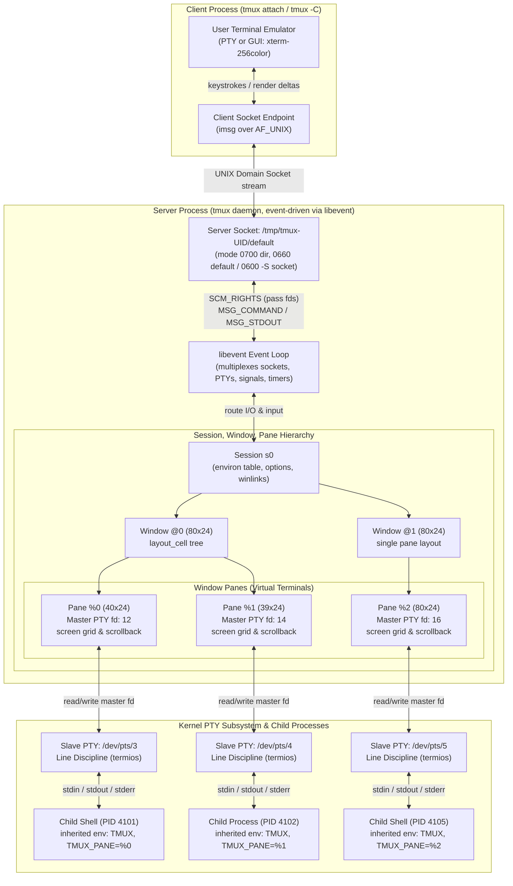

# Tmux Architecture and Session Persistence

> [!summary] Claim:
> A tmux deployment decouples terminal emulation from display rendering through a persistent daemon that communicates with ephemeral clients over a UNIX domain stream socket using the OpenBSD imsg protocol.
> Each pane owns an independent pseudo-terminal (PTY) pair managed by libevent, decoupling child process output from client network latency and preventing process termination when SSH sessions disconnect.
> Environment variables do not mutate across running process address spaces; tmux maintains global and session-scoped environment dictionaries, updating session state via `update-environment` while requiring explicit symlinks or shell hooks to refresh stale sockets like `SSH_AUTH_SOCK`.
> Headless orchestration is driven without screen scraping through native synchronization channels (`wait-for`), raw grid extractions (`capture-pane -p -J`), and the framed line protocol of control mode (`-C`).



## The Mechanism

[[TTYs-PTYs-and-Line-Discipline]] establishes how the operating system kernel connects physical hardware or virtual devices to processes via pseudo-terminal pairs.
Terminal multiplexers exist to break the one-to-one coupling between a user display session and the underlying controlling terminal.
Where legacy multiplexers like GNU Screen historically combined server logic, terminal emulation, and user display multiplexing inside a single architecture, tmux separates these concerns into a clean client-server architecture.
The tmux codebase, designed by Nicholas Marriott and imported into OpenBSD in 2009 (shipped in OpenBSD 4.6, replacing window(1), per https://www.openbsd.org/46.html), structures all multiplexing operations around non-blocking event loops, inter-process message passing, virtual screen grids, and hierarchical object ownership.
All architectural descriptions and structure layouts below are referenced from tmux version 3.8 source code and official OpenBSD manual specifications.

### 1. Client-Server Architecture and UNIX Domain Sockets

When a user executes `tmux`, the resulting binary behaves as a client by default.
It parses command-line arguments and determines the target UNIX domain socket path.
By default, the server socket is placed in a directory formatted as `${TMUX_TMPDIR:-/tmp}/tmux-<UID>/<socket-name>`, where `<socket-name>` defaults to `default` (or is specified via `-L <name>`), or an explicit path is supplied via `-S <path>`.
The directory is created with `mkdir(base, S_IRWXU)` (mode `0700`) and tmux refuses to use it if it is owned by another user or has any "other" permission bits (`tmux.c`, `TMUX_SOCK_PERM`).
The socket is bound under a umask that yields mode `0660` for the default socket and `0600` for a `-S` socket; `server_update_socket()` then adds the execute bits while any session is attached and clears them when none is (`server.c`; observed `srw-rw----` and `srw-------` on tmux 3.8, macOS, as of 2026-11).

```c
/* tmux-protocol.h (tmux 3.8): client and server IPC message types */
enum msgtype {
    MSG_VERSION = 12,

    MSG_IDENTIFY_FLAGS = 100,
    MSG_IDENTIFY_TERM,
    MSG_IDENTIFY_TTYNAME,
    MSG_IDENTIFY_OLDCWD, /* unused */
    MSG_IDENTIFY_STDIN,
    MSG_IDENTIFY_ENVIRON,
    MSG_IDENTIFY_DONE,
    MSG_IDENTIFY_CLIENTPID,
    MSG_IDENTIFY_CWD,
    MSG_IDENTIFY_FEATURES,
    MSG_IDENTIFY_STDOUT,
    MSG_IDENTIFY_LONGFLAGS,
    MSG_IDENTIFY_TERMINFO,

    MSG_COMMAND = 200,
    MSG_DETACH,
    MSG_DETACHKILL,
    MSG_EXIT,
    MSG_EXITED,
    MSG_EXITING,
    MSG_LOCK,
    MSG_READY,
    MSG_RESIZE,
    MSG_SHELL,
    MSG_SHUTDOWN,
    MSG_OLDSTDERR, /* unused */
    MSG_OLDSTDIN, /* unused */
    MSG_OLDSTDOUT, /* unused */
    MSG_SUSPEND,
    MSG_UNLOCK,
    MSG_WAKEUP,
    MSG_EXEC,
    MSG_FLAGS,

    MSG_READ_OPEN = 300,
    MSG_READ,
    MSG_READ_DONE,
    MSG_WRITE_OPEN,
    MSG_WRITE,
    MSG_WRITE_READY,
    MSG_WRITE_CLOSE,
    MSG_READ_CANCEL,
    MSG_WRITE_DONE
};
```

The connection and daemon startup workflow proceeds through five deterministic phases:

1. **Socket Connection Probe:**
   The client executes `socket(AF_UNIX, SOCK_STREAM, 0)` and issues `connect(2)` against the socket path.
   If `connect(2)` succeeds, the server is already active, and the client proceeds immediately to the protocol handshake.
2. **Server Daemon Forking (`server_start`):**
   If `connect(2)` fails with `ENOENT` or `ECONNREFUSED`, the command is one that starts a server (such as `new-session` or `start-server`), and `-N` is not given, the client takes an exclusive `flock(2)` on a `<socket>.lock` file so that concurrent clients do not race to start two servers (`client_get_lock()` in `client.c`).
   `server_start()` then calls `proc_fork_and_daemon()` (`proc.c`): it creates a `socketpair(AF_UNIX, SOCK_STREAM)`, calls `fork(2)`, and the child calls `daemon(1, 0)`, which detaches it with `setsid(2)` and redirects the standard descriptors to `/dev/null`.
   With top-level `-D` the server is not daemonized and `exit-empty` is turned off.
   The new server creates the listening socket with `server_create_socket()` and adopts the child end of the socketpair as its first client, so the starting client talks to the server over the socketpair rather than reconnecting to the path.
3. **Descriptor Passing via `SCM_RIGHTS`:**
   Communication over the UNIX domain socket is structured using the OpenBSD `imsg` messaging framework.
   Each message consists of a 16-byte header (`struct imsg_hdr`: `uint32_t type, len, peerid, pid`, `compat/imsg.h`), followed by the payload; tmux carries `PROTOCOL_VERSION` in the low byte of `peerid` on every message (`proc_send()` in `proc.c`).
   To permit the background server to write directly to the user physical terminal and read keyboard input, the client passes file descriptors over the socket using `sendmsg(2)` with `SCM_RIGHTS` ancillary control messages (`struct cmsghdr`).
   The client sends a `dup(2)` of standard input (`MSG_IDENTIFY_STDIN`) and of standard output (`MSG_IDENTIFY_STDOUT`).
4. **Identity and Environment Handshake:**
   `client_send_identify()` sends, in order: `MSG_IDENTIFY_LONGFLAGS`, `MSG_IDENTIFY_TERM` (terminal type string like `xterm-256color`), `MSG_IDENTIFY_FEATURES`, `MSG_IDENTIFY_TTYNAME`, `MSG_IDENTIFY_CWD`, `MSG_IDENTIFY_TERMINFO` entries, `MSG_IDENTIFY_STDIN`, `MSG_IDENTIFY_STDOUT`, `MSG_IDENTIFY_CLIENTPID`, one `MSG_IDENTIFY_ENVIRON` message per client environment variable, and finally `MSG_IDENTIFY_DONE`.
   The client does not send `MSG_VERSION`; instead `peer_check_version()` in `proc.c` compares the version in each header with `PROTOCOL_VERSION` (8 in tmux 3.8, `tmux-protocol.h`) and replies with `MSG_VERSION` on a mismatch, which makes the client exit.
5. **Event Loop Multiplexing (`server_loop`):**
   The server process runs a single-threaded asynchronous event loop driven by `libevent`.
   It registers callbacks for the listening socket (`server_accept`), active client sockets (`server_client_dispatch`), all open master PTY file descriptors (`window_pane_read_callback`), and POSIX signals (`SIGCHLD`, `SIGWINCH`, `SIGTERM`, `SIGUSR1`).
   Because execution is single-threaded and event-driven, tmux operations avoid multithreaded locking overhead while guaranteeing that command processing and screen state updates are atomic with respect to other clients.

### 2. Session, Window, and Pane PTY Hierarchy

The internal object model of tmux is strictly hierarchical, forming a tree of sessions, windows, and panes.

```text
Server Process (Singleton Daemon)
  \-- sessions (RB-tree of struct session)
        +-- Session "$0" ("dev")
        |     +-- environ (key-value table)
        |     \-- windows (RB-tree of struct winlink)
        |           +-- Winlink 0 -> Window "@0" ("editor")
        |           |     +-- layout_cell Tree (nested split geometry)
        |           |     \-- panes (TAILQ of struct window_pane)
        |           |           +-- Pane "%0" (Master PTY fd 12, PID 4101)
        |           |           \-- Pane "%1" (Master PTY fd 14, PID 4102)
        |           \-- Winlink 1 -> Window "@1" ("build")
        |                 \-- Pane "%2" (Master PTY fd 16, PID 4105)
        \-- Session "$1" ("monitoring")
              \-- Winlink 0 -> Window "@0" (Shared link to Window "@0")
```

The data structures in `tmux.h` define these relationships:

- **`struct session` (Session):**
  Identified by an internal integer ID prefixed by `$` (for example `$0`) and an alphanumeric name.
  A session represents a named collection of windows.
  It owns an independent session environment table (`session->environ`), session options (`session->options`), a reference to the current window, and a count of attached clients (`session->attached`, a `u_int` in `tmux.h`).
- **`struct winlink` and `struct window` (Window):**
  A window represents a single virtual rectangular screen canvas, identified by an internal ID prefixed by `@` (for example `@0`).
  A window is not owned exclusively by one session.
  Instead, sessions reference windows via `struct winlink` nodes.
  This allows multiple independent sessions to link to the same underlying window (`tmux link-window`), enabling multi-user pair programming or cross-session monitoring.
  Each window maintains an absolute size (`sx`, `sy`), an active pane pointer, and a layout tree (`struct layout_cell`, whose interior nodes hold a `TAILQ` of child cells split left-right or top-bottom, so a node can have more than two children) defining how space is divided.
- **`struct window_pane` (Pane):**
  The leaf node of the hierarchy, identified by an internal ID prefixed by `%` (for example `%0`).
  A pane corresponds to exactly one visible rectangular slice of a window.
  Critically, every pane owns an allocated pseudo-terminal (PTY) pair:
  - The server holds the master file descriptor (`pane->fd`), returned by `fdforkpty()` in `spawn.c`, which on non-OpenBSD systems is a thin wrapper over `forkpty(3)` (`compat/fdforkpty.c`).
  - The child process (such as a shell `bash`, `zsh`, or compiler) runs attached to the slave device (`/dev/pts/X` on Linux, `/dev/ttysXXX` on macOS) as its controlling terminal.
  - The server stores the child process identifier (`pane->pid`).
  - The pane maintains its own terminal emulator state (`struct screen` and `struct grid`).

### 3. Terminal Emulation, Virtual Grids, and I/O Decoupling

A major reason why processes running under tmux survive network drops lies in terminal I/O decoupling.
In a conventional terminal workflow over SSH, the shell writes output directly to the SSH server's slave PTY.
The SSH daemon reads the master PTY and transmits packets over TCP to the local client.
If the client disconnects or the network drops, the SSH daemon terminates, closing the master PTY.
When a process attempts to write to a slave PTY whose master has been closed, the write fails with `EIO` (terminals do not raise `SIGPIPE`), and the hangup of the controlling terminal delivers `SIGHUP` to the session leader, which by default terminates the shell and its jobs.

Unlike standard shell pipelines analyzed in [[Pipelines-Subshells-Redirection-and-Process-Substitution]], where intermediate processes block on kernel pipe capacities when downstream consumers stall, a multiplexer pane decouples child writes from downstream display consumers.
Where libc stdio block buffering introduces latency in non-interactive pipelines as detailed in [[Pipe-Buffering-and-Stdbuf]], the child process attached to a tmux pane PTY runs in line-buffered mode because `isatty(3)` returns true.
Tmux inserts a persistent buffering virtual terminal between the child process and the client:

1. **Kernel Master PTY Buffering:**
   When a child process writes output to standard output or standard error, it writes to its dedicated slave PTY.
   The kernel transfers these bytes across the line discipline into the master PTY buffer.
   The master file descriptor is registered in the tmux daemon's `libevent` event base.
2. **Virtual Grid Update (`input.c` and `grid.c`):**
   The master is wrapped in a libevent `bufferevent` (`window_pane_set_event()` in `window.c`); when data arrives, libevent fills the bufferevent input buffer and calls `window_pane_read_callback()`.
   tmux sets no read chunk size of its own; how many bytes one read takes is libevent's choice.
   The callback copies new bytes to any control-mode clients and to `pipe-pane`, then calls `input_parse_pane()` (`input.c`), a state machine that parses ANSI, VT100, and xterm escape sequences.
   The parser updates the pane's in-memory grid (`struct grid`).
   The grid's `linedata` array holds `hsize` history lines followed by the `sy` visible lines; when history reaches `history-limit` (default 2,000 lines, `options-table.c`), `grid_collect_history()` drops the oldest 10% in one step rather than acting as a ring buffer.
   Each cell is stored as a packed 5-byte `struct grid_cell_entry` (attribute, 256-color fg and bg, one ASCII byte, flags); cells with UTF-8 wider than one byte, RGB color, or other extended attributes spill into a separate `grid_extd_entry` array (`tmux.h`, `grid.c`).
3. **Display Rendering and Redraw:**
   The child process does not know or care whether any human is currently watching.
   It is throttled only by how fast the tmux server drains the master PTY.
   If an attached client is present, every screen write that changes a visible pane is translated into terminal output for that client (`screen-write.c` to `tty.c`), and whole panes or the status line are redrawn when needed (`server_redraw_*`); there is no diff against a per-client display cache.
   If a terminal client cannot keep up, `tty_block_maybe()` in `tty.c` discards the pending output and schedules a full redraw instead of blocking the pane.
   Pane reading stops only when every attached client is a control-mode client that cannot accept more data (`server-client.c`).
   If the client detaches, the tmux server closes the client socket but leaves all pane master PTY descriptors open.
   The child process continues executing without receiving `EIO` or `SIGHUP`.

### 4. Environment Variable Propagation and the Stale Socket Problem

One of the most frequent operational failure modes in persistent terminal workflows is the stale environment variable problem, particularly affecting `SSH_AUTH_SOCK` and `DISPLAY`.

```text
Timeline of the Stale SSH_AUTH_SOCK Problem:

Monday (Initial Login):
  SSH Client -> sshd (allocates /tmp/ssh-AAAA/agent.100)
    \-- bash -> tmux attach
          \-- tmux server creates pane %0 -> forks bash (PID 4101)
                \-- Shell PID 4101 memory space: SSH_AUTH_SOCK=/tmp/ssh-AAAA/agent.100
  [User detaches from tmux; SSH session terminates; /tmp/ssh-AAAA/agent.100 is deleted by sshd]

Tuesday (Second Login):
  SSH Client -> sshd (allocates NEW agent socket: /tmp/ssh-BBBB/agent.200)
    \-- bash -> tmux attach
          +-- tmux receives client environment via MSG_IDENTIFY_ENVIRON
          \-- update-environment copies SSH_AUTH_SOCK=/tmp/ssh-BBBB/agent.200
                into tmux Session Environment ("$0")
          
  [CRITICAL ARCHITECTURAL GAP]
  UNIX process memory isolation prevents tmux from writing into Shell PID 4101's address space!
  
  Running Shell PID 4101 STILL holds: SSH_AUTH_SOCK=/tmp/ssh-AAAA/agent.100
  Result: "ssh git@github.com" fails with:
  "Could not open a connection to your authentication agent."
```

#### The Three-Tier Environment Model

Tmux manages environment variables across three distinct tiers:

1. **Global Environment (`tmux show-environment -g`):**
   Populated from the environment of the initial client process that spawned the server daemon.
   It acts as the fallback default for all sessions.
2. **Session Environment (`tmux show-environment -t <session>`):**
   Each session maintains an independent key-value table.
   When a new window or pane is spawned, the session environment is merged on top of the global environment.
   Variables set here override global definitions.
   The resulting merged environment is passed as `char **envp` to `execve(2)` when creating the pane's child process, along with tmux-specific identifiers:
   - `TMUX`: formatted as `<socket-path>,<server-pid>,<session-id>` (e.g. `/tmp/tmux-501/default,21993,0`), indicating to child programs that they are running inside tmux.
   - `TMUX_PANE`: the unique pane identifier (e.g. `%0`).
   - `TERM`: the `default-terminal` server option, whose build-time default is `tmux-256color` when the host terminfo has it and otherwise `tmux`, `screen-256color`, or `screen` (`configure.ac`; `tmux-256color` observed on tmux 3.8, macOS, as of 2026-11).
3. **Child Process Environment (`/proc/<PID>/environ` or process memory):**
   Once a process is spawned via `execve(2)`, its environment array resides entirely inside its private user-space virtual memory.
   Under POSIX security semantics, no external process (including the parent tmux daemon) can unilaterally alter the environment memory of an already running process.

#### The `update-environment` Mechanism

When a user attaches to an existing session (`tmux attach-session`), the attaching client transmits its local environment variables to the server.
The session option `update-environment` defines an array of variable names that tmux copies from the client into the session environment when a session is created or attached; variables absent from the client are marked for removal, as with `set-environment -r` (tmux(1)).
By default (tmux 3.8 `options-table.c`, as of 2026-11), `update-environment` contains thirteen variables:
`DISPLAY`, `KRB5CCNAME`, `MSYSTEM`, `SSH_ASKPASS`, `SSH_AUTH_SOCK`, `SSH_AGENT_PID`, `SSH_CONNECTION`, `WAYLAND_DISPLAY`, `WINDOWID`, `XAUTHORITY`, `XDG_CURRENT_DESKTOP`, `XDG_SESSION_DESKTOP`, and `XDG_SESSION_TYPE`.

While `update-environment` successfully updates the session environment table so that any *new* panes created after attachment inherit the valid `SSH_AUTH_SOCK`, it cannot touch *existing* long-running shells in pre-existing panes.
Two production patterns resolve this gap:

##### Pattern A: Predictable Static Symlink (Workstation Paved Road)

In this pattern, the volatile, randomized SSH agent path is mapped to a static, predictable filesystem path.
On SSH connection, the shell startup or `~/.ssh/rc` updates a persistent symlink pointing to the live agent socket:

```bash
# Executed on SSH login (e.g. in ~/.ssh/rc or workstation login wrapper)
if [ -n "${SSH_AUTH_SOCK}" ] && [ "${SSH_AUTH_SOCK}" != "${HOME}/.ssh/ssh_auth_sock" ]; then
    mkdir -p "${HOME}/.ssh"
    ln -sf "${SSH_AUTH_SOCK}" "${HOME}/.ssh/ssh_auth_sock"
fi
```

Inside `.tmux.conf` or shell initialization files, `SSH_AUTH_SOCK` is permanently pointed to the fixed symlink:

```tmux
# ~/.tmux.conf
set-environment -g SSH_AUTH_SOCK "$HOME/.ssh/ssh_auth_sock"
```

Because running shells permanently point to `$HOME/.ssh/ssh_auth_sock`, every `ssh` invocation traverses the symlink to whatever live socket was recorded during the most recent login, completely eliminating stale socket failures without restarting running processes.

##### Pattern B: Dynamic Prompt Hooks via `show-environment -s`

If filesystem symlinks are prohibited by security policy or multi-tenant home directory constraints, the running shell can query the tmux session environment dynamically before displaying each command prompt.
The `tmux show-environment -s` command emits variable definitions formatted directly as Bourne shell commands:

```bash
# Output of: tmux show-environment -s SSH_AUTH_SOCK
SSH_AUTH_SOCK="/tmp/ssh-BBBB/agent.200"; export SSH_AUTH_SOCK;
```

In Bash, this is wired via `PROMPT_COMMAND`; in Zsh, via `precmd_functions`:

```bash
# In ~/.bashrc or ~/.zshrc
_refresh_tmux_ssh_agent() {
    if [ -n "${TMUX:-}" ]; then
        eval "$(tmux show-environment -s SSH_AUTH_SOCK 2>/dev/null)"
    fi
}
if [ -n "${BASH_VERSION:-}" ]; then
    PROMPT_COMMAND="_refresh_tmux_ssh_agent${PROMPT_COMMAND:+; $PROMPT_COMMAND}"
elif [ -n "${ZSH_VERSION:-}" ]; then
    autoload -Uz add-zsh-hook
    add-zsh-hook precmd _refresh_tmux_ssh_agent
fi
```

### 5. Headless Automation and Control Mode (-C) Protocol

Tmux provides extensive primitives for non-interactive scripting, CI/CD pipeline automation, and integration with autonomous AI coding agents.

#### Input Injection (`send-keys`)

The `send-keys` command injects keystrokes directly into the input queue of target panes.
It supports two primary operational modes:

- **Key Translation Mode (Default):**
  Each argument is first looked up as a key name (such as `Enter`, `C-c`, `Up`, `BSpace`); an argument that is not a key name is sent as literal characters (`cmd-send-keys.c`).
  Named keys are encoded by tmux's own key tables for the pane's current input modes, not by terminfo lookups, before being written to the pane's master PTY.
- **Literal Mode (`-l`):**
  Key-name lookup is disabled and every argument is sent as literal UTF-8 characters (tmux(1)).
  This matters when a payload could equal a key name such as `Enter` or `Space`; it does not change tmux command parsing, which happens before `send-keys` sees its arguments.
- **Terminal Reset (`-R`):**
  Resets the pane's emulated terminal state inside tmux (tmux(1)); it does not touch the kernel line discipline or termios settings.

#### Output Inspection (`capture-pane`)

The `capture-pane` command extracts text directly from the pane's in-memory grid rather than relying on terminal capture drivers:

- `-p`: Streams extracted lines directly to standard output instead of copying them into a tmux paste buffer.
- `-J`: Joins wrapped lines and preserves trailing spaces; `-J` implies `-T` (tmux(1)).
  Without `-J`, a logical line that wrapped is emitted as several physical lines, each cut at the pane width, with trailing spaces trimmed (a 30-character line in a 20-column pane comes out as 20 then 10 characters; checked on tmux 3.8, macOS, as of 2026-11).
  With `-J`, the wrapped line is emitted once, as continuous text, which is what log parsing usually wants.
- `-e`: Includes escape sequences for text and background attributes, allowing linters and test harnesses to inspect terminal colors and text styles.
- `-S <start>` and `-E <end>`: Specifies start and end line numbers, where zero is the first visible line.
  Negative values reference lines in the scrollback history buffer.
  Passing `-S -` starts at the beginning of history and `-E -` ends at the end of the visible pane; by default only the visible pane is captured (tmux(1)).

#### Event Synchronization (`wait-for`)

A common anti-pattern in shell automation is inserting arbitrary `sleep` commands while waiting for a background build or long-running command to complete inside a multiplexer pane.
Tmux provides native synchronization channels via `wait-for`:

- `tmux wait-for <channel>`: The calling client process blocks on the UNIX domain socket until another process signals the specified channel name.
  The server registers the client in a waiting queue and puts its socket watcher in a suspended state, consuming zero CPU cycles.
- `tmux wait-for -S <channel>`: Signals the channel and wakes every waiting client (`cmd_wait_for_signal()` walks the whole waiter list in `cmd-wait-for.c`); a signal sent before anyone waits is remembered, so a later `wait-for` returns at once.
- `tmux wait-for -L <channel>` / `tmux wait-for -U <channel>`: Implements cooperative mutual exclusion locks, enabling concurrent automation workers to coordinate access to shared terminal resources without external lockfiles.

#### Control Mode Protocol (`-C` and `-CC`)

Control mode (`tmux -C` or `tmux -CC`, where `-CC` disables local echo) replaces the human terminal user interface with a line-oriented, framed text protocol designed for machine parsing.
Major terminal emulators (such as iTerm2) and automated agent harnesses use control mode to drive tmux as an underlying terminal engine.

When running in control mode, commands sent over standard input generate framed response blocks on standard output:

```text
%begin <timestamp> <command_number> <flags>
<command stdout payload>
%end <timestamp> <command_number> <flags>
```

If the command fails, the block terminates with `%error` instead of `%end`:

```text
%begin 1794037357 315 0
can't find window: nonexistent
%error 1794037357 315 0
%exit
```

Simultaneously, the tmux server emits asynchronous notifications whenever state changes occur within the multiplexer.
These notifications never appear inside a `%begin ... %end` block:

| Notification | Parameters | Meaning |
| :--- | :--- | :--- |
| `%output` | `<pane-id> <value>` | Pane generated output; non-printable bytes and backslash are octal-escaped (`\xxx`) |
| `%extended-output` | `<pane-id> <age> ... : <value>` | Form of `%output` sent when the `pause-after` client flag is set; `<age>` is how long tmux buffered the output, in milliseconds |
| `%layout-change` | `<window-id> <window-layout> <window-visible-layout> <window-flags>` | Window geometry or split proportions changed |
| `%window-add` | `<window-id>` | A new window was linked to the session |
| `%window-close` | `<window-id>` | A window was closed |
| `%session-changed` | `<session-id> <name>` | Active session changed |
| `%exit` | `[reason]` | The control client is exiting (not attached to any session, or an error occurred) |

Control mode allows an AI agent or GUI wrapper to inspect terminal output in real time by streaming `%output` events, parse command exit statuses without fragile prompt regex matching, and resize windows programmatically without touching local pseudo-terminals.
This text-oriented, framed control architecture aligns with the principles codified in [[CLI-Design-and-Agent-Friendly-Interfaces-AXI]], eliminating escape sequence ambiguities and providing machine-actionable event streams.

### 6. Failure Modes, Signal Handling, and Socket Recovery

The tmux daemon registers dedicated handlers for POSIX signals to maintain resilience against operational accidents:

- **`SIGUSR1` (Socket Recreation):**
  Temporary filesystem cleanup utilities (such as `systemd-tmpfiles-clean` or `tmpwatch`) frequently sweep `/tmp` and delete UNIX domain sockets that have not updated their file modification timestamps.
  When the socket file is unlinked, existing connected clients remain attached because their open file descriptors point directly to the active socket inode.
  However, new clients attempting `tmux attach` fail with `error connecting to /tmp/tmux-UID/default (No such file or directory)`; the `no server running on ...` message is printed only for `ECONNREFUSED` (`client.c`; observed on tmux 3.8, macOS, as of 2026-11).
  Sending `SIGUSR1` to the server PID makes `server_signal()` in `server.c` call `server_create_socket()`, which unlinks the path, binds and listens on a fresh socket, and swaps it in as the accept socket, restoring connectivity without disturbing any running sessions, windows, or processes.
- **`SIGWINCH` (Window Resizing):**
  When an attached client's physical terminal window is resized, the client receives `SIGWINCH` and transmits a `MSG_RESIZE` packet over the socket (`client.c`).
  The server recalculates the layout tree, resizes the affected window grids, and executes `ioctl(wp->fd, TIOCSWINSZ, &ws)` for each pane whose size changed (`window.c`).
  The kernel in turn delivers `SIGWINCH` to that terminal's foreground process group, prompting full-screen programs (like `vim`, `less`, or `htop`) to redraw their interfaces.
- **`SIGTERM` and `SIGHUP`:**
  The server catches `SIGHUP` but `server_signal()` has no case for it, so it is ignored.
  `SIGTERM` (and `SIGINT`) sets `server_exit` and calls `server_send_exit()`, which tells every client to exit and destroys every session, closing the pane master PTYs so the kernel hangs up each pane's terminal.
  The socket file is not removed: after `kill -TERM` the server exits and a stale socket remains on disk (observed on tmux 3.8, macOS, as of 2026-11).

## Commands and Numbers to Know

Every default below was checked against tmux 3.8 `options-table.c` and, where marked, against a running tmux 3.8 on macOS (as of 2026-11); compiled-in defaults are the same on Linux, but no Linux run was made.

| Option / Parameter | Default Value | Platform and Date | Operational Role |
| :--- | :--- | :--- | :--- |
| `update-environment` | 13 variables (`DISPLAY`, `SSH_AUTH_SOCK`, ...) | Both (as of 2026-11) | Environment variables synchronized from client to session environment on attach |
| `history-limit` | `2000` lines | Both (as of 2026-11) | Scrollback history lines buffered in memory per pane |
| `default-size` | `80x24` | Both (as of 2026-11) | Default geometry for new windows when created detached (`-d`) |
| `window-size` | `latest` (default since tmux 3.1, CHANGES; observed on macOS) | Both (as of 2026-11) | Determines window geometry constraint: `latest`, `largest`, `smallest`, or `manual` |
| `aggressive-resize` | `off` | Both (as of 2026-11) | Sizes the window by the sessions for which it is the *current* window (per `window-size`) rather than every session it is linked to |
| `exit-empty` | `on` | Both (as of 2026-11) | Automatically terminates the server daemon when all sessions are destroyed |
| `exit-unattached` | `off` | Both (as of 2026-11) | Automatically terminates the server daemon when no clients are attached |
| `escape-time` | `10` ms (reduced from 500 ms in tmux 3.5, CHANGES; observed on macOS) | Both (as of 2026-11) | Milliseconds tmux waits after an Escape byte to distinguish escape sequences from standalone Esc |
| `base-index` | `0` | Both (as of 2026-11) | Initial window index in session window lists |
| `pane-base-index` | `0` | Both (as of 2026-11) | Initial pane index within a window |
| `status-interval` | `15` seconds | Both (as of 2026-11) | Frequency at which the status line is refreshed |
| Socket path format | `${TMUX_TMPDIR:-/tmp}/tmux-<UID>/<name>` | Both (as of 2026-11) | Default filesystem path for server UNIX domain stream socket |
| Socket directory permissions | `0700` (`rwx------`) | Both (as of 2026-11) | Filesystem mode enforced on socket parent directory to prevent cross-user snooping |
| Socket file mode | `0660` default socket, `0600` with `-S`; owner `x` bit set while a session is attached | Both (as of 2026-11) | `server_create_socket()` umask and `server_update_socket()` in `server.c`; observed on macOS |
| Protocol version | `PROTOCOL_VERSION 8` | Both (as of 2026-11) | Wire protocol version defined in `tmux-protocol.h` |
| Server recovery signal | `SIGUSR1` | Both (as of 2026-11) | Recreates deleted UNIX domain socket file on disk without dropping sessions |
| Master PTY read size | not set by tmux | Both (as of 2026-11) | The pane fd is a libevent `bufferevent`; libevent chooses the per-read size, and tmux defines no read-size constant (`window.c`) |

## Multi-Language Comparison: Multiplexer Control and Automation

When building software that programmatically creates, monitors, and orchestrates terminal multiplexers, different language ecosystems interact with tmux through distinct API tiers:

| Concern | C / C++ (Native POSIX & libevent) | Python (`libtmux`) | Rust (`tmux_interface`) |
| :--- | :--- | :--- | :--- |
| Socket IPC Connection | Connects directly to the `AF_UNIX` stream socket; uses the OpenBSD `imsg` protocol | Runs the tmux CLI through `subprocess.Popen` (`libtmux.common.tmux_cmd`) | Builds a `std::process::Command` for the tmux CLI (`Tmux::into_command()`, `Tmux::output()`) |
| File Descriptor Passing | Native `sendmsg`/`recvmsg` with `SCM_RIGHTS` control headers | Not exposed; the tmux CLI child process does it | Not exposed; the tmux CLI child process does it |
| Command Execution | Sends a `MSG_COMMAND` payload over the imsg socket | `Server.cmd()`, `Session.cmd()`, `Window.cmd()`, `Pane.cmd()`, each returning a `tmux_cmd` | `Tmux::new().command(...)` or `Tmux::with_command(...)` with typed command builders |
| Output Streaming & Parsing | Reads libevent master PTY descriptors or control mode `%output` | Object attributes are read through `-F` format strings; `Pane.capture_pane()` wraps `capture-pane` | `ControlModeOutput` wraps the `Lines` of a child tmux process opened in control mode; its `send()` returns an `OutputBlock` |
| Process & State Model | Low-level pointers to `struct session`, `struct window`, `struct window_pane` | Object hierarchy `Server` -> `Session` -> `Window` -> `Pane` | Command builders plus plain data structs for format variables (`Session`, `Window`, `Pane` in `variables`) |
| Synchronization | `wait-for` imsg message dispatch or POSIX condition variables | `server.cmd('wait-for', channel)` (`wait-for` takes no target), or polling `pane.capture_pane()` | `Tmux::with_command(Wait::new().woken().channel(chan)).output()`; `Wait` is an alias of `WaitFor` |

The Python column was checked against the `libtmux` 0.62.0 wheel and the Rust column against the `tmux_interface` 0.4.0 crate (both read as source, as of 2026-11).
`tmux_interface` 0.4.0 declares no `serde` dependency and no `tokio` dependency, so neither is a property of the crate.

## Worked Lab Example

The reproducible lab for this note is located at `code/01-Command-Line/tmux_control_script/`.
It executes completely within an isolated environment, spawning an independent tmux server on a private temporary socket path so it never touches or alters existing user multiplexer sessions.

The lab driver (`run.sh`) verifies the core architectural mechanisms in sequence:

1. **Socket Lifecycle:** Starts a detached tmux daemon on an isolated socket (`-S "$SOCK" -f /dev/null`), failing the run unless the path is a socket, printing its octal mode from `stat`, and requiring that the server PID reported by `display-message` is alive (`kill -0`).
2. **PTY Hierarchy Construction:** Builds a two-window hierarchy, splitting window 0 horizontally into two panes (`40x24` and `39x24` columns) and window 1 into a single full-screen pane (`80x24`), querying and displaying session IDs (`$0`), window IDs (`@0`, `@1`), and pane IDs (`%0`, `%1`, `%2`), then counting the distinct `pane_tty` paths and how many of them are character devices.
3. **Headless Automation:** Executes a background workload in pane 0.1, synchronizing cleanly with the test harness using `wait-for -S sync_channel` without arbitrary sleeps, and verifying output retrieval via `capture-pane -p`.
4. **Environment Propagation:** Starts the server with `SSH_AUTH_SOCK=agent_v1.sock` so the first pane's shell holds a stale value, then updates the session environment with `set-environment`, shows that the running shell still reports `agent_v1.sock`, and shows that evaluating `show-environment -s` inside that shell moves it to `agent_v2.sock` without restarting the process.
5. **Control Mode Protocol:** Executes a command via control mode (`tmux -C`), capturing the structured `%begin`, output payload, `%end`, and `%exit` framing.
6. **Socket Recreation Resilience:** Unlinks the server socket from the filesystem (`rm -f "$SOCK"`), issues `SIGUSR1` to the server PID, confirms socket recreation on disk, and verifies that all windows survived and that the set of pane process IDs is identical before and after.

To run the lab:

```bash
cd code/01-Command-Line/tmux_control_script
bash run.sh
```

### Verified output

Recorded on `darwin-arm64` (macOS 27.2 / tmux 3.8) and verified by `python3 -m _harness.verify` (re-run PASS, 2026-11-07); no Linux expected file exists yet:

```text
1. Socket Lifecycle: stream socket created, mode 600
   Server daemon: active
2. Hierarchy:
   session s0: id=$0 windows=2
   window 0 (win0): id=@0 panes=2
   window 1 (win1): id=@1 panes=1
   pane 0: id=%0 size=40x24 pty=allocated
   pane 1: id=%1 size=39x24 pty=allocated
   pane 0: id=%2 size=80x24 pty=allocated
   distinct slave PTYs: 3 of 3 panes, 3 character devices
3. Headless Automation:
   wait-for synchronization: unblocked
   capture-pane output: TASK_COMPLETED
4. Environment Propagation:
   tmux session environment: SSH_AUTH_SOCK=agent_v2.sock
   shell BEFORE=agent_v1.sock
   shell UNCHANGED=agent_v1.sock
   shell AFTER=agent_v2.sock
5. Control Mode Protocol:
%begin <TIMESTAMP> <CMD_NUM> 0
CONTROL_MODE_STREAM_OK
%end <TIMESTAMP> <CMD_NUM> 0
%exit
6. Resilience and Recovery:
   socket state after unlink: unlinked
   socket state after SIGUSR1: recreated
   survived windows over restored socket: 2
   pane processes after restore: unchanged
```

### Reading the result

- In block 1, the daemon starts detached without requiring a controlling terminal and creates a UNIX domain socket at the `-S` path with mode `600`, which is the `server.c` behavior for a `-S` socket while no client is attached (the default socket is `660`, and the owner `x` bit is set while a client is attached).
- In block 2, the window geometry math is verified: splitting an 80-column window horizontally produces pane `%0` of 40 columns and pane `%1` of 39 columns, separated by a single vertical column border ($40 + 1 + 39 = 80$).
  The three panes report three distinct tty paths and all three are character devices, so each pane owns its own slave PTY.
- In block 3, `wait-for sync_channel` blocks the runner until the child process completes its task and signals the channel, proving race-free coordination.
  `capture-pane -p` retrieves the exact text from the virtual terminal grid.
- In block 4, the session environment reads `agent_v2.sock` after `set-environment`, yet the running shell still reports `agent_v1.sock` (`UNCHANGED`), which is the stale-agent failure of the first pitfall below.
  Only evaluating `tmux show-environment -s` inside the shell moves it to `agent_v2.sock` (`AFTER`), without restarting the shell process.
- In block 5, control mode frames the output cleanly inside `%begin` and `%end` headers, enabling automated parsers to decouple payload data from terminal escape formatting.
- In block 6, the unlinked socket is restored via `SIGUSR1`, the subsequent `list-windows` call over the restored socket shows both windows, and the pane process IDs are unchanged, so no shell was restarted.

### Lab checks that were mutation-tested

Each check was proven able to fail by breaking its mechanism and confirming `python3 -m _harness.verify` reports FAIL (macOS 27.2, tmux 3.8, 2026-11-07):

| Check | Mutation applied | Result |
| :--- | :--- | :--- |
| Socket mode `600` | `chmod 644` on the socket | FAIL |
| Server PID alive | PID replaced by a dead one | FAIL |
| Split geometry 40 and 39 | `split-window` removed; width 81 instead of 80 | FAIL both |
| Second window | `new-window` removed | FAIL |
| Distinct slave PTYs | every pane reports the same tty path | FAIL |
| `wait-for` and `capture-pane` | workload prints a different token | FAIL |
| Stale value before the eval | server started with `agent_v2.sock` | FAIL |
| Eval refreshes the shell | `eval` replaced by a no-op | FAIL |
| `set-environment` | removed | FAIL |
| Control mode framing | `-C` removed | FAIL |
| Socket unlink | `rm -f` removed | FAIL |
| `SIGUSR1` recreation | signal not sent | FAIL |
| Window survival | one window killed before the count | FAIL |
| Pane process survival | a pane respawned before the PID comparison | FAIL |

The lab declares no `# requires:` token because the harness has none for tmux; it needs `bash` and `tmux` on `PATH` (recorded with tmux 3.8), and only `darwin-arm64` is recorded.

## Pitfalls

> [!warning] Pitfall: Stale `SSH_AUTH_SOCK` in Long-Running Shells After Reattachment
> Relying solely on `update-environment` leaves running shells inside pre-existing panes pointing to defunct, unlinked SSH agent sockets.
> Even though tmux updates its session environment on attach, UNIX process memory isolation prevents modifying the `environ` pointer of active child processes.
> Subsequent `git push` or `ssh` operations fail with authentication errors.
> This failure mode is diagnosed and recovered under hands-on incident conditions in [[Drill-Command-Line-SSH-Multiplexing-and-Broken-PTY]].
> Fix this by deploying a static symlink pattern (e.g. `SSH_AUTH_SOCK="$HOME/.ssh/ssh_auth_sock"`) updated on login, or adding an `eval "$(tmux show-environment -s SSH_AUTH_SOCK)"` hook to `PROMPT_COMMAND` or `precmd`.

> [!warning] Pitfall: Race Conditions from Using `sleep` Instead of `wait-for` in Scripts
> Automation scripts that inject commands via `send-keys` and then execute arbitrary `sleep 2` before calling `capture-pane` create brittle, flaky pipelines.
> Under heavy CPU load or I/O contention, the command may take longer than the sleep duration, causing `capture-pane` to capture incomplete output or wrong command prompts.
> Always synchronize headless automation using native tmux channels: append `; tmux wait-for -S <token>` to the injected command and block the controller with `tmux wait-for <token>`.

> [!warning] Pitfall: Unintended Token Splitting and Key Escaping in `send-keys`
> Without `-l`, tmux looks up each whole argument of `send-keys` as a key name and sends it literally only if the lookup fails, so an argument that happens to be `Enter`, `Space`, or `C-c` becomes a key press instead of text (`cmd-send-keys.c`).
> Separately, tmux's command-line parser treats any argument that ends in an unescaped `;` as a command separator, dropping the `;` and running the next arguments as a new tmux command (`cmd_parse_from_arguments()` in `cmd-parse.y`); a `;` inside an argument, as in `"echo a; echo b"`, is passed through unchanged, and `-l` does not affect this parsing.
> Escape a trailing semicolon as `\;`.
> Use `send-keys -l` for raw string payloads, and send `Enter` as a separate call or argument without `-l` to submit the command line.

> [!warning] Pitfall: Window Size Clamping from Forgotten Stale or Small Attached Clients
> When multiple clients attach to the same session or window, tmux before 3.1 constrained the window dimensions to the smallest attached client display by default.
> If an engineer leaves an attached session open on an 80x24 laptop terminal and later attaches from a 200x50 workstation monitor, the display remains clamped to 80x24 with vast unused borders.
> To prevent this, keep `window-size latest` (the default since tmux 3.1, CHANGES) or enable `set-window-option -g aggressive-resize on`, which sizes a window by the sessions for which it is the current window rather than every session it is linked to (tmux(1)).

> [!warning] Pitfall: Accidental Socket Deletion by System Temp Cleaners
> Sockets residing in `/tmp/tmux-<UID>/` are vulnerable to periodic cleanup scripts (`systemd-tmpfiles-clean` on Linux, `periodic daily` on macOS) because UNIX domain sockets rarely update their inode modification timestamps after creation.
> When the socket is unlinked, running sessions continue executing in memory but new clients cannot attach.
> If this occurs, do not kill the server.
> Locate the server PID via `pgrep -u $UID -f "tmux"` and send `kill -USR1 <PID>`.
> The daemon recreates the socket file immediately.
> To prevent recurrence, set `TMUX_TMPDIR` to a directory no cleaner sweeps (such as `~/.tmux/tmp`, mode `0700`) in your login environment.
> `$XDG_RUNTIME_DIR` is safe from age-based cleaners but pam_systemd removes it on the user's final logout, which would also delete the socket of a detached server unless lingering is enabled (`loginctl enable-linger`).

> [!warning] Pitfall: Unintended Server Termination When Closing the Last Window
> By default, the option `exit-empty` is set to `on`.
> When the last window in a session is closed (e.g. typing `exit` or pressing `Ctrl-D` in the final pane), tmux destroys the session.
> If no other sessions exist, the tmux server daemon terminates immediately, dropping all global environment variables, paste buffers, and server configuration.
> In headless daemon environments where tmux is expected to remain running as a background service, explicitly set `set-option -s exit-empty off`.

> [!warning] Pitfall: Control Mode Buffer Bloat from High-Throughput Pane Output
> When driving tmux via control mode (`-C`) with an external agent or GUI, a child process generating massive stdout output (e.g. `cat /dev/urandom` or unbuffered compilation logs) can flood the UNIX domain socket with `%output` notifications.
> If the controlling agent does not consume the stream fast enough, tmux buffers the output per client rather than stalling its event loop; once a client without `pause-after` is more than 300 seconds behind (`CONTROL_MAXIMUM_AGE` in `control.c`), tmux disconnects it with `%exit too far behind`.
> Set `refresh-client -f pause-after=<seconds>` so tmux instead pauses a lagging pane and emits `%pause`, then resume it with `refresh-client -A '%0:continue'`; `-A <pane>:off` stops output for a pane entirely (tmux(1)).

## At Scale

At personal workstation scale, terminal multiplexers are simple conveniences for keeping a few shells alive across laptop sleep cycles.
At enterprise scale, from 1,000 to 50,000 engineers developing on remote cloud devboxes (such as Coder, DevPod, or cloud workstations), tmux becomes a critical piece of developer platform infrastructure.

### Architectural Decision Rules

1. **Workstation Ephemerality vs Remote Persistence:**
   In cloud devbox environments, individual developer laptops are treated as dumb terminals.
   All compilation, language server protocol (LSP) indexing, and test executions run on high-core remote Linux instances.
   Standardize a paved-road remote connection script that connects via SSH and automatically invokes `tmux new-session -A -s main`.
   The `-A` flag attaches to an existing session if `main` exists, or creates it transparently if it does not, ensuring engineers reconnect to their active workspace after VPN drops or machine switches.
   Workstation configurations, tool version pinning, and directory hooks should be maintained hermetically across devboxes using the strategies outlined in [[Dotfiles-Nix-Direnv-Mise-and-Devcontainers]].
2. **Socket Isolation in Multi-Tenant Environments:**
   On shared compute nodes or build bastions where multiple engineers share access, never leave `TMUX_TMPDIR` defaulting to `/tmp`.
   In multi-user Linux environments, misconfigured permissions in `/tmp` can lead to denial-of-service or socket collision attacks.
   Enforce `export TMUX_TMPDIR="$XDG_RUNTIME_DIR"` in system `/etc/profile.d/tmux.sh`, which places sockets under `/run/user/<UID>`, a per-user `0700` directory created by pam_systemd; because pam_systemd removes it on the user's final logout, pair this with `loginctl enable-linger` for users whose tmux servers must outlive their last SSH session.
3. **Scrollback Memory Budgeting:**
   Every pane allocates a scrollback grid in server memory.
   Measured on macOS 27.2 with tmux 3.8 (as of 2026-11): one 200-column pane with `history-limit 50000`, filled by `yes <199 characters> | head -n 120000`, reported `#{history_bytes}` of 52002370 (about 52 MB, matching 5 B per cell plus a per-line header) while the server's resident set grew from 4 MB to 145 MB.
   Treat `history_bytes` as the grid's own accounting: the measured resident growth was about 2.8 times it, which I attribute to allocator overhead and to the trimming of the oldest 10% of history as the pane scrolls (`grid.c`), but I did not isolate the cause, and the multiple is one macOS measurement, not a Linux figure.
   Across an engineering fleet where a developer opens 30 panes across 5 sessions, an unconstrained `history-limit` can cause the tmux daemon to consume several gigabytes of resident memory, eventually triggering the kernel Out-Of-Memory (OOM) killer.
   Enforce a sane paved-road default of `set-option -g history-limit 10000` in the corporate `/etc/tmux.conf`, reserving 50,000+ limits for explicit debug sessions.
   The memory math is straightforward:
   $$\text{Cell storage per pane} \approx \text{history\_limit} \times \text{columns} \times \text{sizeof(struct grid\_cell\_entry)} \approx 10{,}000 \times 120 \times 5\,\text{B} \approx 6\,\text{MB}$$
   This estimates cell storage only, not resident memory: tmux stores only the cells a line actually used, adds a per-line `struct grid_line` header, and adds a `grid_extd_entry` for each Unicode or RGB cell (`tmux.h`, `grid.c`).
4. **Agent Forwarding Security and Socket Propagation:**
   In compliance-hardened environments (SOC2, FedRAMP), SSH agent forwarding (`ssh -A`) is strictly prohibited due to host-compromise lateral movement risks as detailed in [[SSH-In-Depth-Keys-Forwarding-Certificates-and-FIDO2]].
   Organizations deploying remote devboxes should migrate to short-lived SSH certificates, hardware security keys (FIDO2 `ed25519-sk`), or vault-backed credential helpers rather than relying on forwarded agents that become stale across reattachments.
5. **Headless Agent Harnesses and CI Testing:**
   When running end-to-end integration tests or automated AI agent evaluation loops that drive interactive CLI programs (such as interactive debuggers, modal editors, or shell prompts), drive tmux via `-C` (control mode) inside isolated Linux containers.
   This eliminates the need for headless X11 servers (Xvfb) or fragile pseudo-terminal scraping libraries, providing structured `%output` event streams and deterministic command exit statuses.

## Practice Drill

> [!tip] Practice Drill: Socket Unlink Recovery and Stale Agent Emulation
> In this drill, you will simulate a production incident where a background cleanup utility deletes your tmux socket file, and your SSH authentication agent is replaced while your session remains running.
>
> 1. Start an isolated tmux session with a unique socket:
>    `tmux -S /tmp/drill_tmux.sock new-session -d -s drill_sess "bash --noprofile --norc"`
> 2. Inside the pane, verify the initial `SSH_AUTH_SOCK`:
>    `tmux -S /tmp/drill_tmux.sock send-keys -t drill_sess "export SSH_AUTH_SOCK=/tmp/agent.111; echo INITIAL=\$SSH_AUTH_SOCK" Enter`
> 3. Delete the socket file to simulate an aggressive temp cleaner:
>    `rm /tmp/drill_tmux.sock`
> 4. Try running `tmux -S /tmp/drill_tmux.sock list-sessions`.
>    Observe the failure: `error connecting to /tmp/drill_tmux.sock (No such file or directory)`.
> 5. Find the server PID using `ps` or `pgrep`:
>    `PID=$(pgrep -f "drill_tmux.sock")`
> 6. Send `SIGUSR1` to the server PID:
>    `kill -USR1 "$PID"`
> 7. Verify that `/tmp/drill_tmux.sock` is immediately recreated on disk!
> 8. Reconnect and inspect the session:
>    `tmux -S /tmp/drill_tmux.sock list-sessions`
> 9. Now simulate a reattachment with a new agent:
>    `tmux -S /tmp/drill_tmux.sock set-environment -t drill_sess SSH_AUTH_SOCK "/tmp/agent.222"`
> 10. In the running pane, inspect `$SSH_AUTH_SOCK`: notice it is still `/tmp/agent.111`.
> 11. Execute the dynamic refresh hook inside the pane:
>     `tmux -S /tmp/drill_tmux.sock send-keys -t drill_sess "eval \$(tmux -S /tmp/drill_tmux.sock show-environment -s -t drill_sess SSH_AUTH_SOCK); echo UPDATED=\$SSH_AUTH_SOCK" Enter`
> 12. Capture the pane output and confirm that `$SSH_AUTH_SOCK` has successfully refreshed to `/tmp/agent.222`:
>     `tmux -S /tmp/drill_tmux.sock capture-pane -p -t drill_sess`
> 13. Clean up the drill server:
>     `tmux -S /tmp/drill_tmux.sock kill-server`

## Interview Questions

> [!question] L5: Explain the architectural difference between a tmux client and the tmux server daemon.
>
> > [!success]- Answer
> > The tmux client and server are completely separate processes that communicate over a UNIX domain stream socket using the OpenBSD imsg message protocol.
> > The client is an ephemeral frontend process launched in the user terminal.
> > It passes standard file descriptors or the controlling terminal descriptor to the server using `sendmsg(2)` with `SCM_RIGHTS`, forwards keystrokes, and receives screen redraw escape sequences.
> > The server daemon is a long-running background process managed by libevent.
> > It owns all sessions, windows, and panes, manages an independent pseudo-terminal (PTY) pair for every pane, parses ANSI escape sequences into virtual screen grids, and maintains child processes even if every client detaches or disconnects.

> [!question] L5: Predict the output: A script runs `tmux set-environment -t s0 FOO bar` while a shell is running in pane `s0:0.0`. What does `echo $FOO` output inside that shell?
>
> > [!success]- Answer
> > `echo $FOO` inside the already running shell outputs an empty line (or whatever previous value `$FOO` had prior to the command).
> > The `set-environment` command modifies only the tmux session environment table in the server daemon's memory.
> > Because UNIX operating system security enforces process memory isolation, an external process cannot modify the environment pointer (`environ`) or stack memory of an already executing process.
> > Only *new* windows or panes spawned after the `set-environment` invocation will inherit `$FOO=bar`.
> > For existing shells to see the new value, they must explicitly evaluate `eval $(tmux show-environment -s -t s0 FOO)`.

> [!question] L6: Walk through the exact system call sequence that occurs when tmux creates a new pane.
>
> > [!success]- Answer
> > The `struct window_pane`, with its `struct screen` and `struct grid`, already exists when `spawn_pane()` in `spawn.c` runs; it then executes:
> > 1. The child environment is built by merging global, session, and tmux-specific variables (`TMUX`, `TMUX_PANE`, `TERM`), with all signals blocked around the fork.
> > 2. `fdforkpty()`, which on non-OpenBSD systems is `forkpty(3)` (`compat/fdforkpty.c`): it allocates the master/slave pair (`openpty(3)`), calls `fork(2)`, and in the child makes the slave the controlling terminal and stdin, stdout, and stderr (`login_tty(3)`: `setsid(2)`, `TIOCSCTTY`, `dup2(2)`), closing the slave in the parent.
> > 3. In the child process:
> >    - It changes to the pane's working directory and applies tmux's termios settings with `tcsetattr(3)`.
> >    - `proc_clear_signals()` resets signal handlers, the signal mask is restored, and `closefrom(3)` closes every descriptor above 2.
> >    - `environ_push()` installs the built environment, and `execvp(3)` or `execl(3)` runs the configured shell or command.
> > 4. In the parent server:
> >    - The child PID is stored in `wp->pid` and the master in `wp->fd`.
> >    - `window_pane_set_event()` (`window.c`) sets the master non-blocking (`setblocking(wp->fd, 0)`) and wraps it in a libevent `bufferevent` whose read callback is `window_pane_read_callback`.

> [!question] L6: Debug this: Why did a build process inside tmux terminate with SIGHUP after SSH disconnection?
> An engineer runs a long-running build inside tmux on a remote server.
> Their SSH connection drops.
> When they reconnect and run `tmux attach`, they find the build process was killed with `SIGHUP`.
> What multiplexer configuration caused this termination?
>
> > [!success]- Answer
> > Under standard tmux operation, child processes do not receive `SIGHUP` when a client detaches because their controlling terminal is the pane's master PTY, which remains open in the background server daemon.
> > However, this failure occurs if the session option `destroy-unattached` was set to `on`, or if the server option `exit-unattached` was enabled.
> > When the SSH connection dropped, the client process terminated, causing tmux to detach the client.
> > With `destroy-unattached on`, tmux immediately destroys the session when the last client disconnects.
> > Destroying the session closes all pane master PTY descriptors.
> > Closing the master PTY causes the kernel line discipline to send `SIGHUP` to the child process group running on the slave PTY, terminating the build.
> > Ensure `destroy-unattached off` and `exit-unattached off` are configured in `.tmux.conf`.

> [!question] L7: Why does tmux use OpenBSD imsg with `SCM_RIGHTS` instead of having the server open the user TTY directly?
>
> > [!success]- Answer
> > The server daemon runs in the background, completely detached from any controlling terminal (`setsid`).
> > It does not have access to the client process's `/dev/tty` or standard input/output streams by file path alone, especially in multi-user environments, sandboxed containers, or across different pseudo-terminal namespaces where `/dev/pts/X` permissions restrict opening slave PTYs from outside the owning user session.
> > By utilizing `sendmsg(2)` with `SCM_RIGHTS` ancillary control messages (`struct cmsghdr`), the client process transmits its already open file descriptors (stdin, stdout, and tty) across the UNIX domain socket to the server.
> > The kernel creates new file descriptor entries in the server process table that reference the exact same underlying file descriptions.
> > This grants the server direct write access to the client display and direct read access to user keystrokes without requiring elevated privileges, setuid binaries, or brittle filesystem path lookups.

> [!question] L7: Explain how tmux decouples child process terminal I/O from network latency, and what happens when the master PTY buffer fills up.
>
> > [!success]- Answer
> > Child processes write output directly to the slave PTY device in kernel space.
> > The tmux server reads from the master PTY descriptor via libevent and parses ANSI escape codes directly into an in-memory 2D character matrix (`struct grid`).
> > This decouples child execution from network throughput: the child is limited by how fast the server drains and parses the master, not by whether the user is on a high-latency 300 ms satellite connection or detached entirely.
> > When attached, each screen write is translated into terminal output for the client (`screen-write.c` to `tty.c`); if a terminal client falls behind, `tty_block_maybe()` discards the backlog and schedules a full redraw instead of stalling the pane.
> > If a child emits output faster than the tmux server's event loop can consume it from the master PTY, the kernel PTY buffer fills up; the size is fixed by the OS, and this note quotes no figure for it.
> > Once full, the child's `write(2)` call to stdout blocks in the kernel (or returns `EAGAIN` if non-blocking).
> > This applies natural backpressure directly to the child process without dropping bytes or corrupting terminal state.

> [!question] L8+: Design a multi-layered architectural defense against periodic socket deletion across 10,000 cloud instances.
> A platform team manages 10,000 developer cloud instances.
> Periodic tmpwatch cron jobs delete the tmux UNIX socket in `/tmp`, breaking reattachment.
> How would you architect a resilient defense across socket location, daemon signal recovery, and operating system configuration?
>
> > [!success]- Answer
> > A distinguished infrastructure defense addresses root-cause isolation, operational recovery, and automated telemetry:
> > 1. **Root-Cause Socket Relocation:** Move the socket directory out of volatile `/tmp`.
> >    In `/etc/profile.d/tmux_paved_road.sh`, set `export TMUX_TMPDIR="$XDG_RUNTIME_DIR"`, placing sockets under `/run/user/<UID>`, a per-user tmpfs that `tmpwatch` and the default `systemd-tmpfiles-clean` rules do not age out; because pam_systemd removes it on the user's final logout, enable lingering (`loginctl enable-linger`) for every devbox user so detached servers keep their socket.
> > 2. **Automated Kernel Recovery Daemon:** For instances where `/tmp` cannot be changed immediately, implement an automated watchdog or recovery hook.
> >    Because existing connected clients still hold open descriptors, the daemon process remains running.
> >    If `test -S "$SOCK"` fails while `pgrep -u $UID tmux` succeeds, issue `kill -USR1 <SERVER_PID>`, causing `server_signal()` in `server.c` to call `server_create_socket()` and re-bind the socket on disk instantly.
> > 3. **Tmpfiles Configuration Exemption:** Add an explicit systemd-tmpfiles override at `/etc/tmpfiles.d/tmux.conf` containing `x /tmp/tmux-*` to exclude all tmux socket directories from age-based cleanup sweeps.
> > 4. **Telemetry:** Emit an alert metric whenever a socket unlink or `SIGUSR1` recreation is triggered to track drift across the workstation fleet.

> [!question] L8+: Design an automated test harness that drives interactive terminal programs (e.g. gdb or vim) inside tmux using control mode (`-C`). Address synchronization, output parsing, and race conditions.
>
> > [!success]- Answer
> > An agent-friendly test harness driving tmux in control mode requires three core architectural components:
> > 1. **Framed Transport Driver:** Launch tmux via `tmux -C attach -t <session>` with bidirectional pipes connected to stdin and stdout.
> >    Commands are issued as newline-terminated strings.
> >    The driver uses a state machine to parse responses strictly within `%begin <timestamp> <cmd_num> <flags>` and `%end <timestamp> <cmd_num> <flags>` (or `%error`) frames, mapping responses to specific command invocations via `cmd_num`.
> > 2. **Asynchronous Output Streaming:** The driver consumes `%output <pane_id> <escaped_bytes>` and `%extended-output` notifications outside command blocks.
> >    A dedicated parser unescapes octal sequences (`\xxx`) and appends bytes to an in-memory virtual terminal buffer (such as `pyte` or a custom grid).
> >    This eliminates fragile stdout scraping and race conditions between prompt rendering and command execution.
> > 3. **Deterministic Synchronization:** Instead of polling or sleeping:
> >    - For shell commands, append `; tmux wait-for -S <unique_token>` to the command string and issue `wait-for <unique_token>` over the control channel.
> >    - For interactive programs like `gdb` or `vim`, subscribe to format updates using `refresh-client -B` or parse `%output` streams until a known semantic boundary (such as `(gdb) ` or vim status line changes) appears in the virtual terminal model.

## Further Reading

- Nicholas Marriott, *The tmux terminal multiplexer*, Proceedings of AsiaBSDCon 2011: The seminal paper by tmux's creator detailing its initial motivation, architecture, data structures, and OpenBSD integration.
- Nicholas Marriott and OpenBSD Contributors, `tmux(1)` Manual Page: The authoritative normative reference for all command flags, configuration directives, format variables, and control mode notifications.
- Niels Provos and Nick Mathewson, *libevent Reference Manual*: Documents the underlying event loop, asynchronous I/O abstractions, and signal multiplexing powering the tmux server daemon.
- OpenBSD Project, `imsg_init(3)` and `imsg_compose(3)` Manual Pages: Specification of the structured inter-process messaging framework used across the tmux client-server UNIX domain socket.
- IEEE Std 1003.1-2024 (POSIX.1-2024), Terminal Interfaces and Pseudo-Terminals: Defines the POSIX terminal model, line disciplines, `openpty`, `posix_openpt`, and termios control operations.
- OpenSSH Project, `ssh-agent(1)` and `ssh(1)` Manual Pages: Specifications covering SSH agent socket allocation, forwarding protocols, and `SSH_AUTH_SOCK` lifecycle management.

## Related

- Prerequisites: [[TTYs-PTYs-and-Line-Discipline]]
- Next: [[SSH-In-Depth-Keys-Forwarding-Certificates-and-FIDO2]]
- See also: [[19-Shell-and-Unix-Engineering/02-Terminals-and-Job-Control/Terminal-Multiplexers-tmux-and-screen|Terminal Multiplexers tmux and screen]], [[Drill-Command-Line-SSH-Multiplexing-and-Broken-PTY]], [[CLI-Design-and-Agent-Friendly-Interfaces-AXI]]
- Lab: `code/01-Command-Line/tmux_control_script/`
