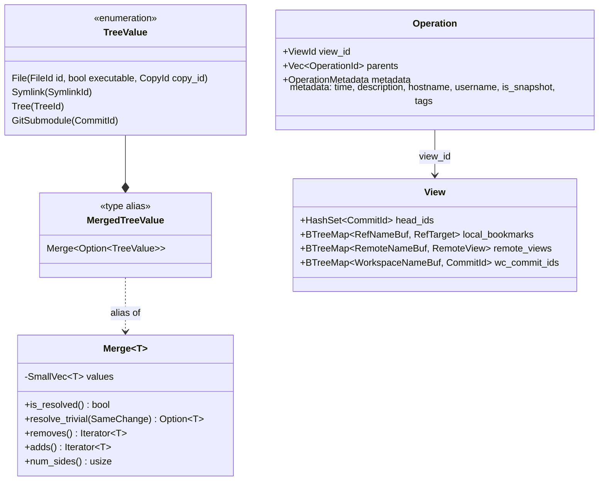
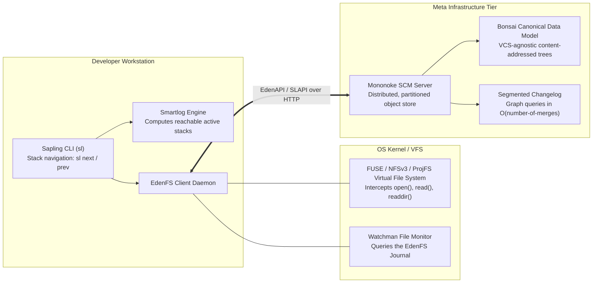
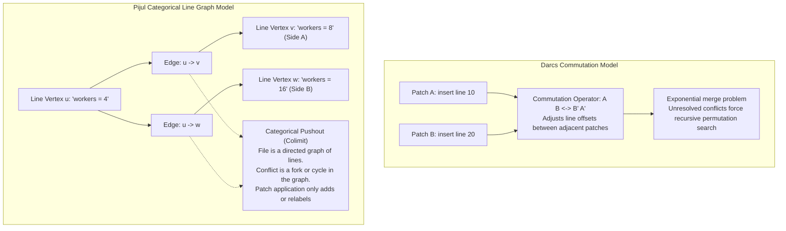
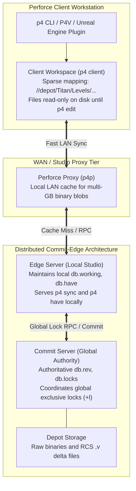

# Beyond Git: Jujutsu, Sapling, and Commutative Patch Theory

> [!summary] Claim:
> Git's model couples snapshots to an ephemeral staging index and halts graph operations whenever three-way merge heuristics encounter conflicting hunks.
> Modern version control systems break this limitation across three distinct architectural vectors.
> Jujutsu (`jj`) models conflicts as first-class algebraic tree values within an append-only operation DAG, permitting continuous rebasing and lock-free concurrency without aborting for conflict resolution.
> Meta Sapling (`sl`) decouples the client UI into stack-aware Smartlogs while deferring file I/O to the EdenFS virtual file system and history queries to a Segmented Changelog, served by Mononoke, at tens-of-millions-of-files scale.
> Commutative patch systems (Darcs and Pijul) replace linear history with formal patch algebras and directed line graphs where merges are category-theoretic pushouts, while centralized systems like Perforce P4 (formerly Helix Core) use pessimistic locking (`+l`) to govern multi-terabyte unmergeable binary assets.

```mermaid
flowchart TD
    subgraph GIT["Traditional Git Architecture: Ephemeral and Blocking"]
        G_INDEX["Git Index / Staging (.git/index)<br/>Temporary staging stat cache"]
        G_MERGE["3-Way Merge (diff3 / ORT)<br/>Non-associative heuristic"]
        G_BLOCK["Conflict Event<br/>STOPS rebase/cherry-pick (exit 1)<br/>Working tree dirtied with markers"]
        G_INDEX --> G_MERGE --> G_BLOCK
    end

    subgraph JJ["Jujutsu (jj): First-Class Algebraic Conflicts"]
        JJ_WC["Working Copy as Commit (@)<br/>Automatic snapshotting, no index"]
        JJ_TREE["Tree Value: Merge&lt;Option&lt;TreeValue&gt;&gt;<br/>n-sided conflict: n adds + (n-1) removes"]
        JJ_NONBLOCK["Conflict Event<br/>NON-BLOCKING: Stored in commit tree<br/>Rebase and children continue cleanly"]
        JJ_OPLOG["Operation DAG (jj op log)<br/>Append-only View snapshots<br/>Lock-free concurrency and instant undo"]
        JJ_WC --> JJ_TREE --> JJ_NONBLOCK
        JJ_NONBLOCK -.-> JJ_OPLOG
    end

    subgraph SAPLING["Meta Sapling (sl): Stacked Monorepo Scale"]
        SL_SMART["Smartlog CLI / VS Code<br/>Stack-oriented change navigation"]
        SL_EDEN["EdenFS Virtual File System<br/>FUSE / NFSv3 / ProjFS lazy fetch"]
        SL_MONO["Mononoke Server<br/>Bonsai content model + segmented changelog"]
        SL_SMART --> SL_EDEN --> SL_MONO
    end

    subgraph PATCH["Commutative Patch Theory (Darcs / Pijul)"]
        DARCS["Darcs Commutation<br/>A B &harr; B' A'<br/>Exponential conflict search O(2^n)"]
        PIJUL["Pijul Line DAG<br/>Files as directed order graphs<br/>Merges as Categorical Pushouts"]
        DARCS -.->|Formalized by Mimram &amp; Di Giusto| PIJUL
    end

    subgraph P4["Perforce Helix Core: Pessimistic Binary SCM"]
        P4_META["Central Metadata (db.rev, db.locks)<br/>Relational B-Tree state in P4ROOT"]
        P4_LOCK["Pessimistic Exclusive Open (+l)<br/>Global lock prevents concurrent edits"]
        P4_TOPOLOGY["Commit-Edge Topology<br/>Commit Server coords locks; Edges cache local WIP"]
        P4_META --> P4_LOCK --> P4_TOPOLOGY
    end
```



## The Mechanism

### 1. Jujutsu and First-Class Conflict Trees

In traditional distributed version control systems governed by [[Git-Object-Model-and-Content-Addressing]] and [[Git-Three-Way-Merge-ORT-and-Diff-Algorithms]], a merge conflict is a catastrophic state machine disruption.
When `git merge`, `git rebase`, or `git cherry-pick` encounters incompatible edits across two branches sharing a common merge base, the toolchain writes raw conflict markers into working tree files, leaves conflicted hashes across stages 1, 2, and 3 in `.git/index`, and stops with exit status 1 (reproduced with `git rebase` on git 2.55.0).
The user is left in a paused operational state where branch switching (`fatal: cannot switch branch while rebasing`) and new rebases are blocked until the conflict is resolved and the operation is continued or aborted.

Jujutsu (`jj`), created by Martin von Zweigbergk, solves this architectural bottleneck by treating conflicts as first-class, persistent algebraic objects stored directly inside the tree and commit objects.
In `jj-lib`, the core data structure representing directory entries is not a single resolved file pointer, but rather a `MergedTreeValue`, a type alias for `Merge<Option<TreeValue>>` (`core/src/backend.rs`, v0.47.1).
The generic container `Merge<T>` (`core/src/merge.rs`) stores a `SmallVec` of alternating added and removed terms, an algebraic combination of sides and bases:

$$\text{State} = \text{Side}_0 + \sum_{i=1}^{n-1} (\text{Side}_{i} - \text{Base}_{i})$$

A clean, non-conflicted file entry is represented as a `Merge<Option<TreeValue>>` holding a single `Some(TreeValue)`.
When a three-way merge occurs between base $B$ and conflicting modifications $A$ and $C$, `jj-lib` does not abort.
Instead, it constructs a three-element `Merge` slice:
- Negative (removed) terms: $[B]$ (the common ancestor base).
- Positive (added) terms: $[A, C]$ (the divergent modifications).

If a rebase moves this conflicted commit onto a new upstream target $D$ where $B$ was modified to $D$, the conflict simplifies or expands algebraically.
A multi-way merge conflict with $k$ sides contains $2k - 1$ terms ($k - 1$ bases subtracted, $k$ sides added).
Because the conflict is encoded as data within the commit's root tree, the commit hash is computed, the revision receives a permanent Change ID, and the command exits with status code 0.
Descendant commits can immediately be created on top of a conflicted commit without resolving the conflict first.
When a user checks out the working copy or runs `jj diff`, Jujutsu materializes snapshot diff conflict markers dynamically on demand; each label carries the change ID, the commit ID, the quoted description, and the term's role (format reproduced on jj 0.47.1):

```text
<<<<<<< conflict 1 of 1
%%%%%%% diff from: <change_id> <commit_id> "<base_description>" (parents of rebased revision)
\\\\\\\        to: <change_id> <commit_id> "<side_a_description>" (rebase destination)
-line in base
+line in side A
+++++++ <change_id> <commit_id> "<side_b_description>" (rebased revision)
line in side B
>>>>>>> conflict 1 of 1 ends
```

When Jujutsu operates with its Git storage backend (`.jj/repo/store/git`), Git object primitives cannot natively deserialize a commit pointing to multiple root trees.
To maintain backward compatibility with Git packfiles while storing `MergedTreeValue` states, `jj-lib` implements a dual-representation mapping:
1. It injects a custom commit header named `jj:trees` containing the ordered list of Git tree object IDs encoding the multi-tree conflict state, plus a `jj:conflict-labels` header holding the marker labels and a `change-id` header (constants in `git-backend/src/git_backend.rs`, v0.47.1).
2. It synthesizes dummy directory entries inside the Git root tree (`.jjconflict-base-0/`, `.jjconflict-side-0/`, and `.jjconflict-side-1/` for a two-sided conflict, plus a `JJ-CONFLICT-README` blob, observed with `git ls-tree` on jj 0.47.1) referencing all constituent subtree OIDs to protect them from garbage collection runs by `git gc` ([[Git-GC-Maintenance-MIDX-and-Commit-Graph]]).



### 2. Working Copy as Commit and the Operation DAG

Git maintains three distinct local environments: the working tree files on disk, the index staging cache (`.git/index` documented in [[Git-Index-Stat-Cache-and-Fsmonitor]]), and the immutable object database (`.git/objects`).
This tri-state model forces engineers to execute manual staging ceremonies (`git add`, `git commit`) and introduces failure modes such as accidental working-tree clobbering during `git checkout` or `git reset --hard` ([[Recover-Lost-Git-Work]]).

Jujutsu eliminates the staging index entirely by defining the working copy itself as a first-class commit in the revision graph, designated by the `@` symbol.
Every command executed against the repository implicitly snapshots the working directory beforehand.
When a file is modified on disk, Jujutsu records the change into `@` at that next snapshot, with no `add` step.
Running `jj new` closes the current working-copy commit and creates a new, empty child commit designated as the new `@`.

To decouple logical code evolution from cryptographic identity, Jujutsu introduces two distinct identifiers for every revision:
- **Commit ID:** A cryptographic hash of the tree, parent commit IDs, author metadata, committer timestamp, and description; with the Git backend it is the Git commit hash.
  Any rewrite, rebase, or amend produces a completely new Commit ID.
- **Change ID:** A stable, randomly generated 128-bit identifier (`CHANGE_ID_LENGTH = 16` bytes in `git_backend.rs`, rendered as 32 reverse-hex letters `k` to `z`, shortened to 8 in default `jj log` and 12 by `change_id.short()`; stored in a `change-id` Git commit header) that remains invariant across rewrites, rebases, squashes, and amendments.

Repository state mutations in Jujutsu are not tracked via linear reflogs ([[Git-Refs-Reflog-and-Reftable]]).
Instead, Jujutsu implements an append-only Directed Acyclic Graph (DAG) of repository operations, inspected via `jj op log`.
Every operation records:
- The executing user and hostname.
- Start and end timestamps (`jj op log` prints durations such as `lasted 6 milliseconds`).
- The exact command-line arguments executed (an `args:` tag).
- Parent operation IDs.
- The ID of the resulting repository `View` (`view_id`), which is stored as a complete snapshot.

The `View` object records the mapping of all bookmarks, remote tracking references, repository visible heads, and working-copy attachments for all workspaces.
Because the operation log is a DAG rather than a single file lock, Jujutsu supports concurrent command execution across multiple terminal sessions.
Concurrent mutations branch the operation DAG into divergent heads, which Jujutsu automatically merges on the subsequent command invocation.
Any accidental command (including catastrophic rebases or branch deletions) is reversed by a single new operation via `jj undo` or `jj op restore <operation_id>`, rolling back the global repository view without touching unrelated filesystem state; since jj 0.33.0 `jj undo` is sequential (repeated invocations walk further back, and `jj redo` moves forward).

### 3. Meta Sapling: Smartlog, Stacked Diffs, and the Monorepo Tier

At extreme enterprise scales (such as Meta's monorepo, which the Sapling introduction puts at tens of millions of files, commits, and branches), Git's fundamental algorithmic assumptions collapse.
Running `git status` or `git checkout` requires traversing the local filesystem stat cache in $O(N)$ time relative to the number of files in the tree ([[Git-Index-Stat-Cache-and-Fsmonitor]]).
Cloning or fetching requires transferring commit-graph connectivity structures and packfile deltas that exceed consumer workstation memory limits ([[Git-Packfiles-and-Delta-Compression]], [[Git-At-Scale-VFS-Scalar-and-Monorepos]]).

Meta designed Sapling (`sl`) to replace Git and Mercurial workflows while retaining backwards compatibility with upstream Git hosting.
Sapling partitions source control into a three-tier distributed architecture:



#### The Client Tier: Smartlog and Stacked Diffs
Traditional Git branching models promote wide, divergent branch topologies that lead to merge queue congestion and review fatigue ([[Git-Branching-Models-Merge-Queues-and-Code-Review]]).
Sapling is built around a linear stacked-commit workflow.
The central interface is `sl smartlog` (aliased as `sl sl`).
Instead of displaying thousands of irrelevant upstream trunk commits, Smartlog isolates only:
1. Public trunk heads (`remote/main` in the Smartlog docs).
2. The developer's in-flight stack of linear commits.
3. The current working-copy position (`@`).

Developers navigate stacks using relative primitives (`sl prev`, `sl next`, `sl goto`).
Each commit in a stack corresponds to an isolated, atomic pull request submitted via `sl pr` on GitHub (or Phabricator inside Meta).
When an intermediate commit in a stack is amended via `sl amend`, Sapling automatically rebases all descendant commits in the stack without manual interactive rebase interventions ([[Git-Rebase-Internals-and-Stacked-Branches]]); if that rebase would conflict, the descendants are left for `sl restack`, and `--no-rebase` opts out (`sl amend` docs).

#### The Virtualization Tier: EdenFS
EdenFS is a cross-platform user-space virtual file system (using FUSE on Linux, NFSv3 on macOS, and Microsoft's Projected File System on Windows, per the EdenFS Overview).
A full checkout of a very large monorepo writes every file to local disk, which is the cost a virtual file system avoids.
EdenFS projects the entire repository tree into the directory structure virtually.
Directories and files appear instantly on disk with correct permissions and sizes, but zero file content bytes are downloaded during checkout.
When a compiler, build tool, or editor issues an `open()` or `read()` system call:
1. The kernel redirects the file access to the user-space EdenFS daemon (via `/dev/fuse` on Linux, an NFS RPC on macOS, or a ProjFS callback on Windows).
2. EdenFS checks its in-memory caches and its backing store; EdenFS has no on-disk object store of its own, and for Sapling repositories blobs, trees, and aux data are cached in the `hgcache` shared with the Sapling CLI (EdenFS `Caching.md`).
3. On a cache miss, the backing store fetches the blob from Mononoke over EdenAPI (also called SLAPI, Mononoke's HTTP protocol for Sapling clients), and EdenFS returns control to the calling system call.
4. Because every write passes through the mount, EdenFS records modifying I/O in its Journal, and Watchman answers change queries from that Journal (`getFilesChangedSince()`) rather than from kernel `inotify` or `kqueue` streams (EdenFS `Glossary.md`).
Consequently, `sl status` and `sl diff` execute in $O(\text{modified files})$ rather than $O(\text{total files})$ (Sapling scaling docs: "O(files-you-have-changed)").

#### The Server Tier: Mononoke and the Bonsai Data Model
Traditional Git servers rely on packed object directories and loose object fanouts governed by `pack-objects` ([[Git-Packfiles-and-Delta-Compression]]).
At scale, Git's packfile generation requires massive server CPU memory windows and suffers from reference advertisement latency ([[Git-Transfer-Protocol-and-Partial-Clone]]).
Meta's Mononoke server replaces packfile architecture with **Bonsai**, a VCS-agnostic, content-addressed data model: every commit, whether it came from Git, Mercurial, or Sapling, is stored as a Bonsai changeset.
A Bonsai changeset records parents, author and committer metadata, the message, and a flat list of path-to-change file entries rather than nested trees (Mononoke `2.1-bonsai-data-model.md`).
History is stored in a **Segmented Changelog**, used by both the Sapling client and the server:
the commit graph is represented as segments that each cover a large swath of linear history, so the whole graph fits in a few megabytes.
Graph queries that require long commit-graph walks in Git run in $O(\text{number-of-merges})$ time, a few milliseconds even in a large monorepo (Sapling `scale/axes` docs).
Trees, manifests, and other indexes are derived data, computed asynchronously off the critical write path and regenerable from the inherent Bonsai data.

### 4. Commutative Patch Theory: Darcs, Pushouts, and Pijul

Snapshot-based version control systems (Git, Mercurial, Jujutsu, and Sapling) record complete tree states at points in time.
Differences between revisions are computed after the fact by running heuristic string diff algorithms (Myers, Histogram, or Patience diffs described in [[Git-Three-Way-Merge-ORT-and-Diff-Algorithms]]).
These heuristic diffs are notoriously fragile:
1. Git three-way merge is **non-associative**:

   $$(A \text{ merge } B) \text{ merge } C \neq A \text{ merge } (B \text{ merge } C)$$

   The output of merging three branches depends entirely on the sequential order in which merges were performed, because intermediate synthetic snapshots alter the computed common ancestor.
2. Git merges are **non-commutative**: merging branch $X$ into branch $Y$ produces an asymmetric commit object whose first parent is $Y$ and second parent is $X$, which permanently biases future merge base calculations and `git log --first-parent` walks.

Commutative patch theory discards snapshots entirely.
History is defined strictly as an unordered or partially ordered set of independent transformations called **patches**.



#### Darcs and the Exponential Commutation Trap
David Roundy introduced the theory of patches with Darcs and presented it at the 2005 ACM SIGPLAN Haskell Workshop ("Darcs: distributed version management in haskell", doi:10.1145/1088348.1088349).
In Darcs, a patch $P$ is an invertible function mapping repository state $S_1$ to $S_2$:

$$S_2 = P(S_1), \quad S_1 = P^{-1}(S_2)$$

Two sequential patches $A$ and $B$ commute if they can be reordered such that applying $B'$ followed by $A'$ produces the identical final repository state:

$$A B \longleftrightarrow B' A'$$

If patch $A$ inserts a line at line 10 and patch $B$, applied after $A$, inserts a line at line 20, then $B'$ (applied before $A$) inserts at line 19 because $A$'s line is no longer there, and $A'$ still inserts at line 10.
Merging two concurrent branches that diverged from state $O$ via patches $A$ and $B$ is computed by commuting the inverse of $A$ with $B$:

$$A^{-1} B \longleftrightarrow B' (A')^{-1} \implies A B' = B A'$$

While theoretically elegant, Darcs suffered from a fatal computational failure mode known as the **exponential merge problem** (Pijul manual, "Why Pijul?").
When two patches modify the same file region in incompatible ways, they do not commute cleanly.
Darcs represented conflicts by creating explicit conflictor patch structures.
When commuting a patch past a set of conflicting patches, Darcs was forced to recursively explore all alternative commutation permutations across the history graph.
Under adversarial or complex rebase conditions, the commutation search space grew exponentially, which the Pijul manual describes as taking "several hours to merge even a two-lines change".

#### Mimram and Di Giusto: Categorical Theory of Patches
In 2013, Samuel Mimram and Cinzia Di Giusto published "A Categorical Theory of Patches" (arXiv:1311.3903), establishing the rigorous mathematical foundation for modern patch algebra.
Their model:
- Repository states are **objects** in a category $\mathcal{C}$.
- Patches are **morphisms** (arrows) between objects: $f: X \to Y$.
- The sequential composition of patches is morphism composition: $g \circ f$.
- Merging two independent patches $f: Z \to X$ and $g: Z \to Y$ originating from a common ancestor $Z$ corresponds to finding the **pushout** (the universal colimit) of the span $X \stackrel{f}{\leftarrow} Z \stackrel{g}{\to} Y$:

```text
        Z ---- g ----> Y
        |              |
        f              f'
        |              |
        v              v
        X ---- g' ---> P
```

Here, the pushout object $P = X \sqcup_Z Y$ represents the merged repository state, and $f'$ ($f$ ported past $g$) and $g'$ ($g$ ported past $f$) represent the ported patches.
Because two patches can be incompatible, such a pushout does not necessarily exist in the category of files, so Mimram and Di Giusto construct the free completion of that category under finite colimits: its objects are finite sets labeled by lines equipped with a transitive relation, and its morphisms are partial functions respecting labeling and relations, so conflicting states become representable objects (arXiv:1311.3903 abstract).

#### Pijul: Line Graphs and Associative Pushouts
Pijul, created by Pierre-Etienne Meunier and Florent Becker, implements this categorical pushout model in Rust.
Pijul discards the flat-file representation entirely.
Internally, every file in Pijul is stored as a **directed graph of lines** $G = (V, E)$ in which each edge is labelled with the change that introduced it (Pijul manual, "Theory"); conflicts can make the graph cyclic, so it is not guaranteed to be a DAG.
- Vertices represent immutable byte slices.
- Directed edges represent relative ordering constraints ("line $u$ precedes line $v$").
- A clean file is a linear path through the graph: $v_1 \to v_2 \to \dots \to v_n$.

A patch in Pijul consists strictly of two operations:
1. Adding new vertices (introducing new lines of code).
2. Adding new directed edges between existing vertices, or relabelling existing edges from alive to dead (deletions).

Applying a patch to a repository therefore behaves like a **set union** of the patch's vertices and edges with the repository's existing line graph, plus edge relabelling; the manual notes this makes Pijul a conflict-free replicated datatype (CRDT).
The union intuition is associative and commutative:

$$(A \cup B) \cup C = A \cup (B \cup C), \quad A \cup B = B \cup A$$

The Pijul manual states that change application is associative and that independently written changes commute.
The order in which patches are pulled, reordered, or merged has zero impact on the final repository state.
When two developers concurrently insert different lines between $v_1$ and $v_2$, Pijul adds both sets of edges: $v_1 \to v_{\text{sideA}} \to v_2$ and $v_1 \to v_{\text{sideB}} \to v_2$.
The conflict is not a failure; it is a state of the graph: two alive vertices with no path between them (a fork), paths in both directions (a cycle), or zombie vertices (Pijul manual, "Theory").
No exponential search is triggered; the manual adds "pseudo-edges" to keep the alive subgraph connected so that applying changes does not require traversing the whole graph (the manual states no complexity bound).
Pijul persists these line graphs using **Sanakirja**, a Rust crate of copy-on-write data structures storable on disk (crates.io description).

### 5. Centralized Monolithic SCM: Perforce P4 and Binary Assets

While distributed systems (Git, Jujutsu, Sapling, Pijul) dominate software source code, AAA game development studios (running Unreal Engine 5, Unity, and proprietary engines), virtual production facilities, and industrial simulation pipelines rely heavily on **Perforce P4** (formerly Helix Core; the 2026.1 documentation banner reads "Helix Core is now P4").

The technical requirement for Perforce is driven by the physical characteristics of digital assets:
1. **Unmergeable Binary Formats:** Game repositories contain multi-terabyte assets: 3D geometry (`.fbx`, `.ma`), 8K textures (`.exr`, `.dds`), raw audio banks (`.wem`), and compiled game engine packages (`.uasset`, `.umap`).
   Binary formats cannot be diffed or merged using three-way text algorithms.
   Attempting to merge two divergent branches of a binary level file results in corrupted file headers and pointer misalignment, destroying work.
2. **Repository Size:** A modern AAA game repository can grow to many terabytes of active data.
   Cloning such history over distributed DVCS protocols would exhaust workstation NVMe drives and saturate enterprise WAN connections.



#### Pessimistic Locking: The `+l` Filetype Modifier
To prevent concurrent modifications of unmergeable binary assets, Perforce P4 implements **pessimistic locking** via filetype modifiers:
- Files are marked with the `+l` (exclusive open) attribute, for example `binary+l`; the file type reference defines it as "only one user at a time can open a file for editing".
- By default, files synced to a client workspace are marked read-only on the local file system (`0444` permissions).
- When an artist or level designer begins editing an asset, the client tool (or Unreal Engine editor plugin) issues:
  `p4 edit <file>`
- The server checks its centralized database.
  If the file has the `+l` modifier, the server grants an **exclusive open** to that user and client workspace, and `p4 opened` shows it with lock status `*exclusive*`.
  The local file system permissions are flipped to writable (`0644`).
- If another developer attempts to run `p4 edit` on that same file, the server immediately rejects the request:
  `//depot/Titan/Levels/Alpha.umap - can't edit exclusive file already opened for edit`, followed by `//depot/Titan/Levels/Alpha.umap - also opened by <user>@<workspace>` (wording as reproduced in a published test, https://dev.classmethod.jp/en/articles/perforce-exclusive-lock-behavior/; that test also saw exit status 0, so scripts must parse the output)
- Concurrent edits are physically prevented before any modification occurs.
  The lock is released only when the changelist is submitted (`p4 submit`) or reverted (`p4 revert`).

#### Centralized Database Internals and Commit-Edge Topologies
Perforce servers maintain zero metadata inside working directories.
All repository state is tracked in a relational database engine situated in `$P4ROOT` composed of proprietary binary B-tree tables (`db.*`):
- `db.rev`: Authoritative revision table mapping every file, revision number, change number, digest, and archive depot path.
- `db.working`: In-flight records of all files currently opened across every workspace globally.
- `db.locks`: Active exclusive lock table tracking `+l` reservations.
- `db.have`: Exact client cache inventory recording every file revision present on every workstation disk.

To scale globally across international studios (e.g., Montreal, London, and Tokyo), Perforce deploys a **Commit-Edge Architecture**:
- **Commit Server:** The central single source of truth.
  It coordinates global write transactions, changelist sequence numbers, and global exclusive locks (`+l`).
- **Edge Servers:** Deployed locally inside regional studio datacenters.
  Edge servers maintain replicated copies of `db.rev` and host local copies of `db.working` and `db.have` for regional developers.
  Commands such as `p4 sync`, `p4 have`, and `p4 add` execute entirely against the local Edge Server at LAN latency.
  When an engineer runs `p4 edit` on a `+l` binary file, the Edge Server communicates upstream with the Commit Server via transactional RPC to verify and register the global exclusive lock across all edge nodes worldwide.
- **Perforce Proxy (`p4p`):** Caches immutable multi-gigabyte binary blobs on local LAN storage, ensuring that hundred-gigabyte builds do not repeatedly traverse cross-continental WAN links.

## Commands and Numbers to Know

| Parameter or Command | Production Default | Scope / Platform | Engineering Significance |
|---|---|---|---|
| `jj git init --colocate` | Co-located `.jj` and `.git` | Both `(as of 2026-11)` | Colocation is the default since jj 0.34.0 (`git.colocate`), so the flag is a no-op unless that is `false`; enables bi-directional [[Git-Object-Model-and-Content-Addressing]] sharing without duplicating disk object stores |
| `jj op log` | Graph of operations | Both `(as of 2026-11)` | Displays append-only transaction DAG; tracks user, command arguments, duration, and repo view |
| `jj undo` | Reverts last operation | Both `(as of 2026-11)` | Restores the parent operation's `View` as a new operation; repeated `jj undo` walks further back since jj 0.33.0, `jj redo` moves forward |
| `jj config set --user ...` | `~/.config/jj/config.toml` | Both `(as of 2026-11)` | Central configuration file for user name, email, revset aliases, and merge tools |
| `sl smartlog` (`sl sl`) | Active commit stacks | Both `(as of 2026-11)` | Hides thousands of main-branch commits; displays only `remote/main`, other important branches, and your in-flight stacked changes |
| `sl amend` | In-place commit amend | Both `(as of 2026-11)` | Amends the current commit and automatically rebases its descendants; conflicting descendants are left for `sl restack`, `--no-rebase` opts out |
| `sl pr` | Stack submission | Both `(as of 2026-11)` | Submits entire stack of commits as individual, chained pull requests on GitHub |
| `EdenFS readdir()` latency | No published figure | Linux / macOS `(as of 2026-11)` | Virtualized traversal (FUSE on Linux, NFSv3 on macOS) returning projected file attributes without fetching blob payloads |
| `Darcs merge complexity` | Exponential worst case | Both `(as of 2026-11)` | The "exponential merge problem" during unresolved conflicting patch permutations (Pijul manual) |
| `Pijul merge complexity` | Graph union; no published bound | Both `(as of 2026-11)` | Pushout colimit over a directed line graph; pseudo-edges avoid traversing the whole graph |
| `p4 edit -t +l <file>` | Exclusive lock filetype | Both `(as of 2026-11)` | Enforces pessimistic locking; server rejects concurrent opens across global commit-edge topology (the `p4 edit` reference shows the modifier-only form `p4 edit -t +l //depotname/...`; `-t binary+l` is the full form) |
| `P4 standard port` | `1666` | Both `(as of 2026-11)` | Default `P4PORT` for the P4 Server (`p4d`) and P4 Proxy (`perforce:1666` for the client) |
| `p4 client` view spec | Explicit mapping | Both `(as of 2026-11)` | Maps arbitrary depot subpaths to local disk, preventing a full clone of a very large depot |

## Multi-Language Comparison: SCM Internal Implementations

| Engineering Vector | C++ (Perforce P4 / libgit2) | Python (Mercurial / Sapling Client) | Rust (Jujutsu `jj-lib` / Pijul `libpijul`) |
|---|---|---|---|
| **Conflict Representation** | Ephemeral index stage buffers (`git_index_entry` stages 1-3 in libgit2); server lock failure in P4 | Tuples of file revisions in dirstate; smartlog stack rebase tracking | Algebraic enum `Merge<Option<TreeValue>>` in `jj-lib`; directed line DAG forks in `libpijul` |
| **Concurrency & Storage** | Proprietary binary B-tree tables (`db.*`) in P4; create-exclusive `index.lock` lockfile for `.git/index` | Append-only changelog revlogs; lock files (`.hg/wlock`) | Lock-free append-only Operation DAG in `jj`; Copy-on-Write B-trees via Sanakirja in Pijul |
| **Filesystem Interaction** | Direct `stat()` / `open()` system calls; manual sparse-checkout cone filters | Rust-accelerated status plus the `fsmonitor` extension (formerly `hgwatchman`) querying Watchman | Virtual filesystem abstraction (`EdenFS` C++/Rust over FUSE, NFSv3, or ProjFS); memory-mapped B-trees |
| **Change Identity** | Monotonically increasing changelist integer in P4; 40-hex Git commit OID | Mercurial 20-byte SHA-1 node hash; revset index positions | Invariant random 128-bit `ChangeId` in Jujutsu; cryptographic hash of patch content in Pijul |
| **Rebase Mechanics** | Interactive cherry-pick script; halts on conflict and leaves dirty working tree | In-memory rebase with automatic stack restacking | Automatic algebraic tree propagation; non-blocking commits with unresolved conflict markers |

## Worked Lab Example

The following hands-on verification reproduces first-class conflict recording, non-blocking stack authoring, operation log inspection, and algebraic undo using the Jujutsu (`jj`) lab located at `code/02-Version-Control/jj_conflict_demo/`.
The lab executes against a real repository with a Git storage backend, creating parallel divergent modifications to `service.cfg`, rebasing them, and inspecting the resulting internal data structures.

### Verified output

```text
=== Step 1: Initial Divergent Commit Graph ===
@  feature-b feature B: workers=16
| o  feature-a feature A: workers=8
|-/
o  base config
*  (empty)

=== Step 2: Non-Blocking Rebase (feature-b onto feature-a) ===
jj rebase exit code: 0 (conflict recorded in the commit, rebase completed)
git rebase exit code: 1 (rebase left in progress: True)

=== Step 3: First-Class Conflict Data Structure in Commit Tree ===
service.cfg: conflict=true, sides=2, removed=1, added=2

=== Step 4: Commit Graph with Inlined Conflict State ===
@  (conflict) feature-b feature B: workers=16
o  feature-a feature A: workers=8
o  base config
*  (empty)

=== Step 5: Working Copy Conflict Markers ===
port = 8080
<<<<<<< conflict 1 of 1
%%%%%%% diff from: <change> <commit> "base config" (parents of rebased revision)
\\\\\\\        to: <change> <commit> "feature A: workers=8" (rebase destination)
-workers = 4
+workers = 8
+++++++ <change> <commit> "feature B: workers=16" (rebased revision)
workers = 16
>>>>>>> conflict 1 of 1 ends
timeout = 30

=== Step 6: Non-Blocking Child Commit on Conflicted Parent ===
@  (conflict) dependent work on top of conflict
x  (conflict) feature-b feature B: workers=16
o  feature-a feature A: workers=8
o  base config
*  (empty)

=== Step 7: Resolve Parent Conflict ===
feature-b tree status:
service.cfg: conflict=false, sides=1, removed=0, added=1

=== Step 8: Auto-Rebased Child Commit Post-Resolution ===
o  dependent work on top of conflict
@  feature-b feature B: workers=24 (resolved)
o  feature-a feature A: workers=8
o  base config
*  (empty)

=== Step 9: Operation Log (Append-Only Transaction History) ===
@  describe commit <oid>
o  snapshot working copy
o  edit commit <oid>
o  snapshot working copy
o  new empty commit
o  rebase commit <oid> and descendants

=== Step 10: Undo Resolution via Operation Log ===
feature-b restored to conflicted tree status:
service.cfg: conflict=true, sides=2, removed=1, added=2
```
*(Recorded directly on `darwin-arm64` via `code/_harness/verify.py` against `jj 0.47.1`)*

### Reading the result

1. **Step 1 and Step 2 (Non-Blocking Rebase):**
   In Step 1, `feature-a` and `feature-b` diverge from `base config`.
   Both branches modify the `workers` parameter in `service.cfg` in incompatible ways (`workers = 8` versus `workers = 16`).
   When `jj rebase -b feature-b -d feature-a` executes in Step 2, the exit code is 0.
   In standard Git, the equivalent `git rebase` stops with exit status 1 after `CONFLICT (content): Merge conflict in service.cfg` and `error: could not apply <sha>... <subject>` (reproduced on git 2.55.0; the lab runs the same two-branch conflict through real Git and prints its exit code and whether the rebase was left in progress).
   Jujutsu successfully generates the rebased commit and commits it directly to the DAG.
   Since jj 0.36.0 `-d`/`--destination` is an alias of `-o`/`--onto`, which is the documented spelling.

2. **Step 3 and Step 4 (First-Class Conflict Structure):**
   Inspecting the `TreeEntry` data structure in Step 3 via Jujutsu's template engine reveals:
   `conflict=true, sides=2, removed=1, added=2`.
   The tree does not hold a text file with syntax markers; it holds an algebraic `Merge<Option<TreeValue>>` containing 1 subtracted base term (`workers = 4`) and 2 added conflicting terms (`workers = 8` and `workers = 16`).
   In Step 4, `jj log` indicates `(conflict)` on `feature-b`.

3. **Step 5 (Snapshot Diff Markers):**
   Viewing `service.cfg` on disk demonstrates Jujutsu's snapshot diff conflict syntax.
   Unlike Git's default `merge` conflict style, which omits the base unless `merge.conflictStyle` is `diff3` or `zdiff3`, Jujutsu explicitly prints the diff from the base to the destination (`%%%%%%% diff from: ... \\\\\\\ to: ...`) followed by the content introduced by the rebased revision (`+++++++`).
   The lab prints the marker lines as jj wrote them, replacing only the random change ID and commit ID in each label with `<change> <commit>`, so this step proves the marker structure, the label format, and the diff body.

4. **Step 6 (Non-Blocking Dependent Child Commit):**
   In Step 6, `jj new` authors a brand new child commit (`dependent work on top of conflict`) on top of the unresolved, conflicted parent.
   The working copy updates, and the child commit inherits the conflict cleanly without stopping development.
   This capability allows an engineer to rebase a large branch, hit conflicts in an upstream module, and continue authoring code in downstream modules without being blocked.

5. **Step 7 and Step 8 (Resolution and Automatic Restacking):**
   Resolving `service.cfg` on `feature-b` updates the tree entry to `conflict=false, sides=1, removed=0, added=1`.
   In Step 8, Jujutsu automatically restacks the child commit on top of the resolved parent revision without requiring manual rebase commands.

6. **Step 9 and Step 10 (Operation Log and Undo):**
   Step 9 displays the append-only operation log DAG.
   Every step (rebase, new commit, edit, describe) is recorded as an immutable operation node.
   In Step 10, two `jj undo` invocations (undoing the describe and then the working-copy snapshot, relying on sequential undo since jj 0.33.0) return `feature-b` to its exact conflicted state (`conflict=true, sides=2, removed=1, added=2`).

> [!warning] Pitfalls:
> 1. **Accidental Push of First-Class Conflicts to Git Remotes:**
>    Because Jujutsu permits commits with unresolved conflicts, developers may attempt to push a conflicted commit to GitHub or an internal Git remote via `jj git push`.
>    Jujutsu blocks pushing commits containing conflicts to remote Git branches by default (`Error: Won't push commit ... since it has conflicts`, reproduced on jj 0.47.1) unless overridden with `jj git push --allow-conflicts`, because Git clients pulling the ref would see the `.jjconflict-base-*` and `.jjconflict-side-*` directories and `JJ-CONFLICT-README` in the root tree and custom commit headers that standard Git toolchains do not understand.
> 2. **Orphaned Global Locks in Perforce Commit-Edge Architectures:**
>    In Perforce environments using `+l` exclusive locks, if an Edge Server experiences an extended network outage to the Commit Server while a user has a file opened for edit, the exclusive open can become orphaned on the Commit Server.
>    Other engineers across the globe are blocked from editing that asset until an administrator intervenes.
>    Administrators identify `+l` files open across all servers using `p4 opened -x` and release orphaned ones via `p4 unlock -x -f <file>` (the reference shows `p4 unlock -fx`).
> 3. **The Darcs Infinite Commute Hang:**
>    In repositories utilizing pure Darcs patch commutation, merging branches whose conflicting patches must be commuted past each other can trigger exponential path exploration (the "exponential merge problem").
>    Never use unconstrained Darcs patch theory for automated server-side merge queues; use Pijul's category-theoretic pushout line DAGs or Jujutsu's tree-based algebraic merges instead.
> 4. **EdenFS FUSE Context Switching Overheads:**
>    Running unoptimized compiler build trees directly inside an EdenFS virtual filesystem without Watchman caching can slow builds noticeably, and the size of the penalty depends on the workload and must be measured.
>    Every uncached file access triggers kernel-to-userspace round trips across the FUSE or NFS channel.
>    Production deployments must co-locate EdenFS with a local SSD block cache and configure build systems to write intermediate artifacts (`.o`, `.class`, `.target`) to local non-virtualized scratch filesystems.

## At Scale

| Dimension | Single Developer | Mid-Size Fleet (100-1,000 Engineers) | Enterprise Monorepo (1,000-50,000 Engineers) |
|---|---|---|---|
| **SCM Engine** | Git CLI or Jujutsu (`jj`) with colocated `.git` | Jujutsu over Git or Sapling CLI (`sl`) | Sapling + Mononoke + EdenFS, or Perforce Commit-Edge |
| **Conflict Strategy** | Resolve immediately via 3-way merge | Asynchronous first-class conflicts via Jujutsu | Automated merge queues with pre-merge conflict detection |
| **Working Tree I/O** | Native OS filesystem (`ext4`, `APFS`, `NTFS`) | Sparse checkout with cone mode ([[Git-At-Scale-VFS-Scalar-and-Monorepos]]) | User-space virtual filesystem (EdenFS / VFS for Git / Projected FS) |
| **History Navigation** | Standard `git log` and branch refs | Stacked changes (`jj log` / `sl smartlog`) | Segmented changelogs and Mononoke Bonsai distributed indexing |
| **Binary Assets** | Git LFS pointer files ([[Git-Submodules-Subtrees-LFS-and-Attributes]]) | Dedicated binary artifact repositories (Artifactory) | Centralized Perforce Helix Core with `+l` pessimistic locking and `p4p` |

### Architectural Decision Rules

1. **Adopt Jujutsu (`jj`) as a Git Frontend When:**
   - The team spends significant engineering hours resolving rebase interruptions across deep stacked pull requests ([[Git-Rebase-Internals-and-Stacked-Branches]]).
   - Engineers frequently lose uncommitted work or get trapped in detached HEAD states during complex cherry-picks ([[Recover-Lost-Git-Work]]).
   - Infrastructure relies on standard GitHub/GitLab remotes, meaning server-side changes are prohibited but client ergonomics can be upgraded immediately via co-located `.jj` repositories.

2. **Adopt Meta Sapling (`sl`) and EdenFS When:**
   - Native `git status` or `git checkout` stays unacceptably slow on your repository even with `fsmonitor` enabled (measure the threshold on your own hardware) ([[Git-Index-Stat-Cache-and-Fsmonitor]]).
   - The engineering organization adopts a strict trunk-based stacked diff workflow where individual commits represent atomic reviewable diffs ([[Git-Branching-Models-Merge-Queues-and-Code-Review]]).
   - Server infrastructure can support a Mononoke deployment that EdenFS and the Sapling client reach over EdenAPI (HTTP).

3. **Adopt Perforce Helix Core (P4) When:**
   - The project is an AAA game, virtual production, or CAD/simulation system whose binary assets are too large to clone into every workstation (textures, 3D models, audio banks).
   - Assets cannot be merged via three-way text diff algorithms.
   - Pessimistic locking (`+l`) at checkout time is strictly mandatory to prevent artists from clobbering each other's work.

> [!tip] Practice Drill:
> Clone an existing Git repository using `jj git clone --colocate <url>`.
> Create two parallel branches modifying the same line of a shared header file.
> Execute `jj rebase -b <branch_b> -d <branch_a>`, observe that the command exits 0, and inspect the resulting conflict structure with `jj file list -T 'path ++ " conflict=" ++ self.conflict()'`.
> Author a dependent child commit on top of the conflicted revision using `jj new`, verify that the child commit compiles or tests cleanly around the conflict, and subsequently resolve the parent conflict using `jj resolve`.
> Revert the entire workflow back to the starting point in a single command by finding the starting operation in `jj op log` and running `jj op restore <operation_id>` (one `jj undo` reverts only the last operation).

## Interview Questions

> [!question] L5: How does Jujutsu's working-copy commit model eliminate Git's detached HEAD state and index staging area?
>
> > [!success]- Answer
> > In Git, the working tree, the index stat cache (`.git/index`), and the commit DAG are separate entities.
> > Checking out an arbitrary commit hash moves HEAD off branch tips into a "detached HEAD" state, where new commits risk garbage collection if not manually tagged or branched.
> > Jujutsu eliminates both the staging index and detached HEAD by defining the working copy itself as an anonymous commit in the DAG, denoted by `@`.
> > Any modification to files on disk is automatically snapshotted into `@` at the start of the next `jj` command, without running `git add`.
> > Checking out a different revision simply changes which commit `@` points to, and running `jj new` creates a new empty commit on top of the current `@`, making anonymous and stacked commits natural, safe operations.

> [!question] L5: Why does Perforce Helix Core enforce pessimistic locking (`+l`) on game binary assets rather than using optimistic 3-way merge?
>
> > [!success]- Answer
> > Optimistic 3-way merge algorithms (like diff3 or Git ORT) operate on textual lines of source code by identifying common sequences and applying non-overlapping line hunks.
> > Modern game development assets (such as Unreal Engine `.uasset` and `.umap`, 8K `.dds` textures, and Maya `.mb` scenes) are multi-gigabyte proprietary binary formats.
> > These formats cannot be sliced into text lines, and arbitrary byte-level merging corrupts binary headers, pointer tables, and serialized data structures.
> > If two level designers concurrently modify the same 4 GB map file, resolving the conflict after the fact is computationally and semantically impossible.
> > Perforce enforces pessimistic locking via the `+l` (exclusive open) filetype modifier: when a designer opens a file via `p4 edit`, the central server grants an exclusive write lock, blocking all other users globally from opening that file until the changes are submitted or reverted.

> [!question] L6: Walk through the internal data structure `Merge<Option<TreeValue>>` in `jj-lib` and explain why Jujutsu rebases never abort mid-flight.
>
> > [!success]- Answer
> > In `jj-lib`, directory tree entries are stored as `MergedTreeValue`, a type alias for `Merge<Option<TreeValue>>`.
> > The `Merge<T>` struct holds a `SmallVec` of values representing an algebraic equation:
> >
> > $$\text{State} = \text{Side}_0 + \sum (\text{Side}_i - \text{Base}_i)$$
> >
> > In a clean file, `Merge` holds a single `Some(TreeValue)`.
> > In a 3-way merge conflict between base $B$ and sides $A$ and $C$, `Merge` stores the terms: removed $[B]$, added $[A, C]$.
> > When `jj rebase` executes, if two commits modify the same path incompatibly, Jujutsu does not abort or require immediate human intervention.
> > It writes the three-element `Merge` structure directly into the commit's root tree, computes the cryptographic commit hash, assigns a stable Change ID, and completes the rebase with exit code 0.
> > Descendants can immediately be rebased on top of this commit, and conflict resolution is deferred until the developer chooses to inspect or resolve the file.

> [!question] L6: Predict the output when rebasing two branches in Jujutsu modifying `workers = 8` and `workers = 16` from a base of `workers = 4`, and compare the exit code with Git.
>
> > [!success]- Answer
> > In Git, running `git rebase` immediately halts with exit code 1, emitting:
> > `CONFLICT (content): Merge conflict in service.cfg`
> > `error: could not apply ...`
> > The working directory is halted with standard `<<<<<<<`, `=======`, and `>>>>>>>` markers, and the rebase pauses.
> > In Jujutsu, running `jj rebase -b feature-b -d feature-a` exits with code 0.
> > The rebased commit is created and marked with `(conflict)`.
> > Inspecting the file on disk reveals Jujutsu's snapshot diff conflict markers:
> >
> > ```text
> > port = 8080
> > <<<<<<< conflict 1 of 1
> > %%%%%%% diff from: <base_id> "base config" (parents of rebased revision)
> > \\\\\\\        to: <side_a_id> "feature A: workers=8" (rebase destination)
> > -workers = 4
> > +workers = 8
> > +++++++ <side_b_id> "feature B: workers=16" (rebased revision)
> > workers = 16
> > >>>>>>> conflict 1 of 1 ends
> > timeout = 30
> > ```
> >
> > Querying `jj file list -T` reports:
> > `service.cfg: conflict=true, sides=2, removed=1, added=2`.

> [!question] L6: How does Pijul's line DAG model prevent the exponential conflict explosion that affected Darcs patch commutation?
>
> > [!success]- Answer
> > Darcs modeled files as flat sequences of lines and patches as state transformations.
> > When two patches conflicted, Darcs had to commute patches across one another by generating conflictor structures, which required exploring alternative commutation paths across the entire history graph, exploding into exponential complexity in the presence of complex, unresolved conflicts (the "exponential merge problem").
> > Pijul models every file as a directed graph where vertices are lines and edges, labelled with the introducing change, represent ordering constraints; conflicts may make it cyclic.
> > A patch is strictly a set of added vertices and edges plus edges relabelled from alive to dead.
> > Applying a patch behaves like a set union of graph components, which is associative and commutative.
> > When two patches insert conflicting lines at the same location, Pijul simply ends up with a fork in the line graph.
> > No recursive permutation search is required, eliminating the exponential commutation explosion.

> [!question] L7: How does Meta Sapling's EdenFS virtual file system combine with Mononoke's segmented changelog to scale monorepos to 50 million files?
>
> > [!success]- Answer
> > In a 50-million-file monorepo, standard Git operations fail because `git status` scans the entire filesystem stat cache in $O(N)$ time, and `git log` traverses millions of commit objects.
> > Sapling solves this by decoupling client filesystem I/O and server graph walks.
> > EdenFS is a user-space virtual filesystem (FUSE on Linux, NFSv3 on macOS, ProjFS on Windows) that virtualizes the working tree: checking out a commit creates directory inodes instantly, but downloads zero file content.
> > File content is fetched lazily from Mononoke over EdenAPI (SLAPI, HTTP) only when an `open()` or `read()` system call accesses that specific file, and because every write passes through the mount, EdenFS's Journal tells Watchman what changed, making `sl status` execute in $O(\text{modified files})$ rather than $O(\text{total files})$.
> > On the server, Mononoke stores data in the Bonsai content-addressed model, and history is kept in a Segmented Changelog whose segments each cover long runs of linear history, so the whole graph fits in a few megabytes.
> > Graph reachability and merge-base calculations run in $O(\text{number-of-merges})$ time instead of unbounded commit-graph walks.

> [!question] L7: A developer reports that `p4 edit` on an edge server in Singapore hangs indefinitely for texture file `//depot/art/hero_diffuse.png+l`, while text files open instantly; diagnose the root cause and resolution.
>
> > [!success]- Answer
> > In Perforce commit-edge topologies, standard files without exclusive locks are processed locally by the Edge Server: the edge server updates its local `db.working` and `db.have` tables at local LAN speed.
> > However, `hero_diffuse.png` has the `+l` (exclusive open) filetype modifier.
> > Exclusive locks cannot be granted locally; the Edge Server must execute a synchronous transactional RPC upstream to the central Commit Server to verify that no other developer globally holds an exclusive lock on that revision.
> > If the WAN link between the Singapore Edge Server and the Commit Server is saturated, experiencing packet loss, or if the Commit Server's `db.locks` table is locked by an ongoing checkpoint or exclusive transaction, the `p4 edit` RPC will hang waiting for the upstream lock grant.
> > To diagnose: run `p4 opened -x //depot/art/hero_diffuse.png` to check if another user on any server holds the exclusive open (`-a` lists only the server the command runs on), inspect network latency and packet loss to the commit server, and check the commit server log for lock contention on `db.locks`.
> > If an orphaned lock exists from a severed edge session, an administrator must release it via `p4 unlock -x -f //depot/art/hero_diffuse.png`.

> [!question] L7: Why is Git's three-way merge non-associative, and how does category-theoretic pushout merge guarantee associativity in Pijul?
>
> > [!success]- Answer
> > Git's three-way merge algorithm takes three snapshot trees (base $O$, side $A$, side $B$) and generates a new synthetic snapshot $M$.
> > When merging three branches $A$, $B$, and $C$, the result of $(A \text{ merge } B) \text{ merge } C$ creates an intermediate merge commit $M_{AB}$ which becomes the new common ancestor for the merge with $C$.
> > In contrast, $A \text{ merge } (B \text{ merge } C)$ creates an intermediate commit $M_{BC}$.
> > Because heuristic string diff algorithms (Myers/Histogram) depend on line matching against the specific common ancestor, the intermediate synthetic snapshots differ, producing different conflict markers or different resolution states: associativity is broken.
> > In Pijul, merges are formalized via category theory as pushouts (colimits) over a category of directed line graphs.
> > Applying patches corresponds to taking the set union of vertices and directed edges.
> > Because set union is algebraically associative:
> >
> > $$(A \cup B) \cup C = A \cup (B \cup C)$$
> >
> > The final graph structure is identical regardless of the order in which patches are applied.

> [!question] L8+: Design a multi-datacenter version control architecture for an enterprise gaming company combining 20 TB of daily binary assets with a 10-million-file C++ monorepo.
>
> > [!success]- Answer
> > An optimal enterprise gaming architecture must bifurcate source code and binary assets into specialized systems rather than forcing all data into a single tool:
> > 1. **Source Code Tier (C++ Engine & Game Logic):**
> >    Deploy Meta Sapling or Jujutsu backed by a virtualized filesystem (EdenFS or Scalar sparse-checkout).
> >    Engineers work in a 10-million-file monorepo with $O(\text{modified})$ status checks via Watchman.
> >    Code changes follow a stacked diff workflow with automated merge queues and continuous trunk integration.
> > 2. **Binary Asset Tier (3D Meshes, 8K Textures, Audio Banks, Maps):**
> >    Deploy Perforce Helix Core in a Commit-Edge topology.
> >    Configure all binary asset extensions (`.uasset`, `.umap`, `.fbx`, `.dds`, `.psd`) with the `binary+l` filetype modifier for pessimistic locking.
> >    Deploy regional Edge Servers in Montreal, London, and Tokyo to handle local client workspaces and metadata.
> >    Deploy Perforce Proxies (`p4p`) on local 10 GbE LANs in each studio to cache multi-gigabyte binary blobs, eliminating redundant WAN transfers.
> > 3. **Integration and Build Pipeline:**
> >    Build tooling records both identities for every build: code changes link to Git/Sapling commit hashes, while binary assets link to Perforce changelists.
> >    Nightly build agents pull clean Perforce syncs via local proxies and checkout the corresponding C++ commit hash, ensuring immutable, reproducible multi-terabyte build artifacts.

## Further Reading

- Martin von Zweigbergk and Jujutsu Contributors, *Jujutsu Documentation and Design Docs* (v0.47.1, 2026): the authoritative specification of `jj-lib`, first-class conflicts, operation DAGs, and revset grammar.
- Meta Open Source, *Sapling SCM: Architecture and User Guide* (v0.2.20260929, 2026): deep dive into Smartlog navigation, stacked diff workflows, EdenFS virtual filesystems, and Mononoke server architecture.
- David Roundy, "Darcs: Distributed Version Management in Haskell" (ACM SIGPLAN Workshop on Haskell, 2005, doi:10.1145/1088348.1088349): the seminal paper describing patch commutation and the algebraic foundation of patch-based SCM.
- Samuel Mimram and Cinzia Di Giusto, "A Categorical Theory of Patches" (arXiv:1311.3903, 2013): defines merges as categorical pushouts and describes the free finite-colimit completion that makes conflicting states representable.
- Pierre-Etienne Meunier and Florent Becker, *The Pijul Manual* (2026): the engineering and algorithmic documentation of Pijul's directed line graph model and Sanakirja transactional B-tree storage.
- Perforce Software, *P4 Server Administration*, formerly the Helix Core Server Administrator Guide (Release 2026.1, 2026): reference manual for `db.*` relational architecture, pessimistic exclusive locking (`+l`), and commit-edge multi-site topologies.

## Related

- Prerequisites: [[Git-Object-Model-and-Content-Addressing]], [[Git-Three-Way-Merge-ORT-and-Diff-Algorithms]]
- Next: [[Recover-Lost-Git-Work]]
- See also: [[Git-At-Scale-VFS-Scalar-and-Monorepos]], [[Git-Rebase-Internals-and-Stacked-Branches]], [[Decision-Record-Monorepo-vs-Polyrepo]], [[Git-Index-Stat-Cache-and-Fsmonitor]]
- Lab: `code/02-Version-Control/jj_conflict_demo/`
