# Case Study: The 2017 SHAttered SHA-1 Collision and Git Hardening

> [!summary] Scope
> Owns the postmortem analysis of the 2017 SHAttered attack that produced two distinct PDF documents with identical SHA-1 cryptographic hashes and its impact on Git's content-addressable storage.
> Reaches Explain and Decide at Scale rungs by detailing identical-prefix collision mechanics, distinguishing them from 2020 chosen-prefix attacks, examining how colliding Git blobs can corrupt repository integrity, evaluating the integration of sha1dc, and charting the engineering hurdles of the multi-year SHA-256 transition.
> Sets the boundary with general supply chain security.

```mermaid
flowchart TD
    subgraph ATTACK["The 2017 SHAttered Attack Mechanics"]
        P["Shared Prefix P<br/>(192 Bytes = 3 Blocks)"]
        CB1["Near-Collision Block 1<br/>M1 vs M1 prime (64 Bytes)<br/>Introduces Delta CV4"]
        CB2["Near-Collision Block 2<br/>M2 vs M2 prime (64 Bytes)<br/>Cancels Delta CV4: Delta CV5 = 0"]
        SUF["Arbitrary Identical Suffix S<br/>Merkle-Damgard State Converged"]
        P --> CB1 --> CB2 --> SUF
    end

    subgraph FRAMING["Git Object Framing Divergence"]
        HDR["Git Object Header: 'blob 422435\0'<br/>(12 Bytes Prepended)"]
        SHIFT["Block Boundary Shift<br/>Block 0 holds Header + 52 B of Prefix<br/>Initial Chaining Value CV1 Diverges"]
        NOCOLL["Raw SHAttered PDFs Fail to Collide in Git<br/>(ba9aaa... != b621ee...)"]
        HDR --> SHIFT --> NOCOLL
    end

    subgraph CAS["Content-Addressable Storage CAS Hazard"]
        B1["Benign Payload B1<br/>Object ID: 38762c..."]
        B2["Malicious Payload B2<br/>Object ID: 38762c..."]
        CAS_WRITE["CAS Write: .git/objects/38/762c...<br/>First Ingested Object Stored"]
        CAS_DEDUP["Loose Write Path: odb_freshen_object()<br/>Second Object Skipped Without Byte Compare"]
        TREE["Tree Entry: 100644 auth.c 38762c...<br/>Tree OID Identical for B1 and B2"]
        SIG["Commit Signature Signs Tree OID<br/>Cryptographic Signature Validates BOTH"]
        B1 --> CAS_WRITE
        B2 --> CAS_DEDUP
        CAS_WRITE --> TREE
        TREE --> SIG
    end

    subgraph HARDENING["Git Mitigation: sha1dc Counter-Cryptanalysis"]
        STREAM["Incoming Byte Stream"]
        UBC["UBC Analyzer lib/ubc_check.c<br/>Scans Unavoidable Bit Conditions<br/>Tracks Disturbance Vectors I(43,0), II(45,0)"]
        ABORT["git_SHA1DCFinal() in sha1dc_git.c<br/>fatal: SHA-1 appears to be part of a collision attack"]
        SHA256["SHA-256 Object Format Transition<br/>git init --object-format=sha256<br/>256-Bit Digest, 128-Bit Collision Resistance"]
        STREAM --> UBC
        UBC -->|Collision Detected| ABORT
        UBC -->|Clean| SHA256
    end
```



## Incident Timeline

- 1995: The National Institute of Standards and Technology (NIST) publishes FIPS PUB 180-1, establishing the Secure Hash Algorithm 1 (SHA-1) with a 160-bit digest size and a theoretical collision resistance of 2^80 operations.
- April 2005: Linus Torvalds creates Git, anchoring its object storage, commit history graph, and tree hierarchy to SHA-1 hashes as immutable primary keys.
- August 2005: Xiaoyun Wang, Yiqun Lisa Yin, and Hongbo Yu publish groundbreaking cryptanalytic research at CRYPTO 2005, lowering the theoretical complexity of finding a SHA-1 collision to 2^69 operations.
- January 2011: NIST releases Special Publication 800-131A, formally deprecating SHA-1 for digital signature generation across federal agencies due to shrinking security margins.
- August 2013: Marc Stevens publishes "Counter-cryptanalysis" at CRYPTO 2013, proving that differential collision attacks against MD5 and SHA-1 leave identifiable mathematical footprints in compression states that can be intercepted in real time.
- October 2015: Marc Stevens, Pierre Karpman, and Thomas Peyrin generate the first practical freestart collision for the full 80-round SHA-1 compression function on a cluster of graphics processing units (GPUs).
- February 23, 2017: CWI Amsterdam and Google Research publicly disclose SHAttered, presenting two distinct Portable Document Format (PDF) files (`shattered-1.pdf` and `shattered-2.pdf`) that yield the exact same SHA-1 digest: `38762cf7f55934b34d179ae6a4c80cadccbb7f0a`.
- February 23, 2017 (same day, git mailing list thread "SHA1 collisions found"): Linus Torvalds writes that Git prepends a type and length field before hashing, which tends to make collision attacks much harder than against a PDF with a fixed header, and that a Git-object attack also needs valid Git data around the opaque near-collision blocks (message of 09:21 -0800).
  At 11:47 -0800 he points to the `sha1collisiondetection` code, whose "meat" is in `lib/ubc_check.c`, as the basis for a check.
- February 24, 2017: Developers in the WebKit project commit the two SHAttered PDF files to their Apache Subversion (SVN) repository, triggering immediate repository corruption due to SVN's FSFS backend representation-sharing deduplication.
- March 16, 2017: Jeff King adds the `DC_SHA1` Makefile knob in commit `8325e43b82` ("Makefile: add DC_SHA1 knob").
- March 17, 2017: Git maintainer Junio C Hamano authors commit `e6b07da2780` ("Makefile: make DC_SHA1 the default"), replacing OpenSSL's SHA-1 as the default with Marc Stevens' `sha1collisiondetection` (`sha1dc`) library.
- May 9, 2017: Git 2.13.0 is released (kernel.org tarball timestamp 2017-05-09 23:59 UTC); its release notes say the collision-detecting SHA-1 "has been integrated and made the default".
- January 2020: Gaetan Leurent and Thomas Peyrin publish "SHA-1 is a Shambles" (IACR ePrint 2020/014, 2020-01-07), demonstrating the first practical chosen-prefix collision on full SHA-1 at 2^63.4 SHA-1 computations, estimated at US$45k of rented GPU time; the actual run used 900 Nvidia GTX 1060 GPUs for two months.
- October 19, 2020: Git 2.29 introduces SHA-256 repositories via `git init --object-format=sha256`, explicitly marked experimental in its release notes.
- August 2023: Git 2.42 tones down the warning that SHA-256 repositories are "an experimental curiosity"; there is still no interoperation with SHA-1 repositories.
- April 2024 to 2026: Git 2.45 release notes record that work on a repository that works with both SHA-1 and SHA-256 "has started"; as of Git 2.56 (2026-11) `extensions.compatObjectFormat` is documented as incomplete and "not designed to be enabled by end users".

## Mechanism Root Cause

### Merkle-Damgard Construction and SHA-1 Compression

SHA-1 operates on a sequence of 512-bit (64-byte) message blocks using the classical Merkle-Damgard iterative structure with a Davies-Meyer compression core.
The internal chaining variable consists of five 32-bit words, representing a 160-bit state vector:

$$CV_i = (A_i, B_i, C_i, D_i, E_i)$$

The initial chaining state $CV_0$ is defined by fixed hexadecimal constants specified in FIPS PUB 180-1:

$$A_0 = \text{0x67452301}, \quad B_0 = \text{0xEFCDAB89}, \quad C_0 = \text{0x98BADCFE}, \quad D_0 = \text{0x10325476}, \quad E_0 = \text{0xC3D2E1F0}$$

Each 64-byte message block $M_i$ is decomposed into sixteen 32-bit big-endian words $W_0, \dots, W_{15}$.
The compression engine expands these sixteen words into eighty words $W_0, \dots, W_{79}$ using a linear recurrence relation over $\mathbb{F}_2$:

$$W_t = \text{ROTL}_1(W_{t-3} \oplus W_{t-8} \oplus W_{t-14} \oplus W_{t-16}) \quad \text{for } 16 \le t \le 79$$

Because this recurrence expansion is purely linear, any differential perturbation injected into the message words propagates in a completely deterministic, data-independent manner across the 80 rounds.
The round function updates the working state across four 20-round stages using non-linear boolean operations (Bitwise Choice, Majority, and Parity) combined with stage-specific additive constants:

$$T = \text{ROTL}_5(A) + f_t(B, C, D) + E + K_t + W_t$$
$$E = D, \quad D = C, \quad C = \text{ROTL}_{30}(B), \quad B = A, \quad A = T$$

At round 79, the Davies-Meyer feedforward step computes the next chaining state:

$$CV_{i+1} = CV_i + (A_{79}, B_{79}, C_{79}, D_{79}, E_{79}) \pmod{2^{32}}$$

### Identical-Prefix Collision Mechanics (SHAttered)

In an identical-prefix collision attack, the adversary fixes an arbitrary common prefix $P$ that spans an integral number of 64-byte blocks.
In the 2017 SHAttered attack, the prefix $P$ spanned exactly 192 bytes (three full 512-bit blocks), which processed through the compression engine to yield an intermediate chaining state $CV_3$.

To produce a collision, the attack synthesizes two consecutive 64-byte blocks using differential cryptanalysis:
- Near-Collision Block 1 ($M_4^{(1)}$ vs $M_4^{(2)}$): Injects a tailored differential vector that propagates through the linear expansion schedule, producing an intermediate chaining variable difference $\Delta CV_4 = CV_4^{(1)} - CV_4^{(2)}$.
- Near-Collision Block 2 ($M_5^{(1)}$ vs $M_5^{(2)}$): Injects a second, complementary differential vector that cancels $\Delta CV_4$, yielding $\Delta CV_5 = (0, 0, 0, 0, 0)$.

Because the internal chaining states converge completely at the conclusion of block 5 ($CV_5^{(1)} = CV_5^{(2)}$), any arbitrary trailing byte sequence $S$ appended to both messages will process identical chaining variables across all subsequent blocks.
Consequently:

$$\text{SHA-1}(P \parallel M_4^{(1)} \parallel M_5^{(1)} \parallel S) = \text{SHA-1}(P \parallel M_4^{(2)} \parallel M_5^{(2)} \parallel S)$$

The computational effort required to solve the differential path conditions across both blocks totaled approximately $9 \times 10^{18}$ SHA-1 evaluations (2^63.1 compressions), equivalent to about 6,500 CPU years and 100 GPU years per the paper (the shattered.io site rounds the GPU phase to 110 GPU years).

```
File 1: [ Prefix P: 192 B ] [ Block 1: M1 (64 B) ] [ Block 2: M2 (64 B) ] [ Suffix S: 422,115 B ]
File 2: [ Prefix P: 192 B ] [ Block 1: M1' (64 B)] [ Block 2: M2' (64 B)] [ Suffix S: 422,115 B ]
                           ^                      ^                      ^
                        CV_3                   CV_4 (Delta)           CV_5 (Identical!)
```

In the SHAttered PDF documents, the 128 bytes of colliding differential blocks were placed inside a Joint Photographic Experts Group (JPEG) comment marker (`0xFFFE`).
The comment marker sits at offsets 189-190 and its two-byte length field at offsets 191-192, so the low length byte at offset 192 is the first differing byte: one PDF declares a comment length of `0x0173`, whereas the other declares `0x017F` (checked with `cmp -l` and `xxd` on the published files; all 62 differing bytes lie in offsets 192-319).
This single-byte length variance caused the embedded JPEG parser in the first document to terminate the comment early and display Image A, while the parser in the second document swallowed Image A as comment text and rendered Image B.
To any cryptographic verification tool evaluating raw file bytes, both 422,435-byte PDF files evaluated to `38762cf7f55934b34d179ae6a4c80cadccbb7f0a` (checked with `shasum`).

### Git Object Framing and the Alignment Shift

When the SHAttered announcement occurred, developers immediately tested `git hash-object` on `shattered-1.pdf` and `shattered-2.pdf`.
Unexpectedly, Git did not report a collision.
The two files produced completely different Git object hashes:

```text
git hash-object shattered-1.pdf -> ba9aaa145ccd24ef760cf31c74d8f7ca1a2e47b0
git hash-object shattered-2.pdf -> b621eeccd5c7edac9b7dcba35a8d5afd075e24f2
```

(Recomputed with `git hash-object --no-filters`, Git 2.55.0 on macOS, against the files served by shattered.io, as of 2026-11.)

This behavior stemmed from Git's internal object framing convention, detailed in [[Git-Object-Model-and-Content-Addressing]].
Git never hashes raw file payloads directly.
Instead, Git prepends a type tag, a space, the decimal payload length in bytes, and an ASCII NUL delimiter (`\0`):

$$\text{Object Payload} = \text{"blob "} \parallel \text{SizeInBytes} \parallel \text{"\0"} \parallel \text{RawFileBytes}$$

For the SHAttered PDF files, the payload size was 422,435 bytes, resulting in a 12-byte header (5 bytes of `blob `, 6 digits, 1 NUL):

$$\text{"blob 422435\0"} \quad (12 \text{ bytes})$$

Because SHA-1 processes data in strict 64-byte blocks, prepending this 12-byte header shifted the entire payload by 12 bytes:
- Block 0 did not contain the first 64 bytes of prefix $P$; it contained 12 bytes of Git header followed by the first 52 bytes of $P$.
- The intermediate state $CV_1$ computed after Block 0 diverged completely from the clean $CV_1$ expected by the SHAttered differential path.
- The 128-byte near-collision sequence that started at byte offset 192 in the raw file was shifted to offset 204 (ending at 331), straddling Block 3, Block 4, and Block 5.

Because the Merkle-Damgard compression function is highly sensitive to input alignment and intermediate state values, the differential path failed, destroying the collision under Git's framing.
Two effects break it: the shift moves the near-collision blocks off the 64-byte boundaries they were built for, and the header changes the chaining value that enters them.
The lab applies sha1dc to the framed bytes of the real prefixes and finds nothing to flag.

### The Content-Addressable Storage (CAS) Failure Mode

While the raw SHAttered PDF documents did not collide in Git, the underlying vulnerability was systemic.
An attacker was not restricted to using precomputed PDF files.
An adversary could calculate an identical-prefix collision where the prefix $P$ began with `"blob <size>\0"`.
Furthermore, in 2020, Gaetan Leurent and Thomas Peyrin demonstrated **chosen-prefix collisions** on SHA-1.
In a chosen-prefix attack, the attacker does not need an identical starting prefix; they choose two completely arbitrary prefixes $P_1$ and $P_2$ (such as two completely different source code files) and compute differential connecting blocks $C_1$ and $C_2$ such that:

$$\text{SHA-1}(P_1 \parallel C_1) = \text{SHA-1}(P_2 \parallel C_2)$$

If two Git blobs collide, Git's Content-Addressable Storage architecture experiences silent data corruption.
Git stores objects in `.git/objects/xx/yy...` or in packfiles indexed by their object ID, as explained in [[Git-Packfiles-and-Delta-Compression]].
When Git writes an object through its loose-object path, it executes an idempotency check (`odb_write_object_ext()` in `odb.c`, Git master as of 2026-11):

```c
/*
 * We can skip the write in case we already have the object available.
 * In that case, we only freshen its mtime.
 */
if (odb_freshen_object(odb, oid))
    return 0;
```

This path does not compare bytes.
Packs received by `git index-pack` (every clone, and fetches and pushes above `transfer.unpackLimit`, default 100 objects) are different: `builtin/index-pack.c` compares each incoming object against an existing object of the same name and dies with `SHA1 COLLISION FOUND WITH <oid> !` if type, size, or bytes differ.
The silent case is therefore an object store that does not yet hold the first half, or a write that bypasses `index-pack`.

This optimization causes a **Silent Object Substitution Attack**:
1. Benign Code Injection: An attacker submits a pull request containing benign source code $B_1$ (for example, `auth.c` returning valid permissions), which hashes to object ID $H$.
2. Repository Storage: The hosting platform writes blob $H$ containing $B_1$ into the object store.
3. Malicious Code Introduction: The attacker introduces colliding payload $B_2$ (containing a remote shell backdoor) on a separate branch.
   Because $B_2$ also hashes to object ID $H$, the loose-object write path sees that $H$ is already present and discards $B_2$; if $B_2$ instead arrives in a pack, `index-pack` byte-compares it against $B_1$ and aborts with `SHA1 COLLISION FOUND`.
4. Mirror and CI Poisoning: When a downstream developer or continuous integration server clones the repository or fetches objects from a packfile where $B_2$ was packed first, the developer's object store persists $B_2$ under key $H$.
   Subsequent checkouts of the main branch (which expects benign code $B_1$) retrieve $B_2$ from disk without triggering any warning.

```
Developer Worktree Expects: B1 ("auth_check() -> true")
                |
                v
      Tree Object: 100644 blob 38762cf7... auth.c
                |
                v
CAS Object Store Lookup: .git/objects/38/762cf7...
                |
    +-----------+-----------+
    |                       |
If B1 written first:    If B2 fetched first:
Returns B1 (Benign)     Returns B2 (MALICIOUS BACKDOOR)
No Checksum Mismatch!   Silent Code Substitution!
```

### Merkle Tree and Commit Signature Forgery

The most critical impact of a hash collision in Git is the total collapse of cryptographic signing guarantees, governed by [[Git-Hooks-and-Cryptographic-Signing]].
Git trees map file paths to modes and object IDs:

```text
tree 34\0
100644 auth.c\0<20-byte OID H>
```

Because both benign blob $B_1$ and malicious blob $B_2$ share the identical 20-byte object ID $H$, the serialized byte representation of the Tree object containing `auth.c` is identical.
Consequently:

$$\text{TreeOID}(B_1) = \text{TreeOID}(B_2)$$

When an engineering lead cryptographically signs a release commit using GnuPG or SSH, the signature is calculated strictly over the commit object content, without the `commit <size>\0` framing and without the `gpgsig` header that later embeds the signature (`Documentation/gitformat-signature.adoc`):

```text
tree a7b8c9...
parent d4e5f6...
author Distinguished Engineer <engineer@example.com> 1772928000 +0000
committer Distinguished Engineer <engineer@example.com> 1772928000 +0000

Release v2.4.0
```

The commit object references `tree a7b8c9...`.
Because `tree a7b8c9...` is mathematically identical whether `auth.c` represents $B_1$ or $B_2$, the cryptographic signature validates both versions of the repository with equal validity.
An attacker can substitute the entire source tree with a backdoored variant without invalidating the cryptographic signature of the project maintainer.

## Detection Gap

The SHAttered vulnerability bypassed all standard software quality gates, static analysis tools, and version control integrity checks:

1. Static Analyzers and Linters:
   Source code colliding under SHA-1 does not violate language grammars.
   Both the benign file and the backdoored file can be valid, compilable C, Rust, or Python code.
   Linters inspect abstract syntax trees (ASTs), which cannot detect that two distinct ASTs share an identical cryptographic checksum.
2. The `git fsck` Verification Gap:
   The built-in repository verification tool, `git fsck`, was designed to detect data corruption (such as bit flips or truncated files), as covered in [[Repair-a-Corrupted-Git-Repository]].
   Historically, `git fsck` operated by reading each loose object from `.git/objects/xx/yy`, inflating its zlib stream, prepending the header, computing standard SHA-1, and asserting that the resulting hex string matched `xxyy`.
   Because the colliding object legitimately evaluated to that exact SHA-1 digest under standard hashing routines, `git fsck` reported the repository as completely healthy:

   ```bash
   git fsck --full
   # Output: checking items: 100% (1420/1420), done.
   # Exit code: 0 (No corruption detected)
   ```

3. Continuous Integration and Test Harnesses:
   CI runners rely on `git checkout` to populate ephemeral workspaces.
   A test harness evaluates whatever file was materialized on disk.
   If the CI server cloned from a remote where $B_1$ was stored, the tests passed.
   If a production deployment runner fetched from a mirror where $B_2$ took precedence, the backdoor was deployed.
   The build pipeline possessed no mechanism to determine that the object database was ambiguous.
4. Cryptographic Assumption Fallacy:
   System architects assumed that hash function collisions were practically impossible based on the generic 2^80 birthday paradox bound.
   Because standard test suites did not include adversarial differential patterns, no major version control engine could recognize a lone colliding half before February 2017.
   Git's `index-pack` byte comparison catches a second, different object only when both halves meet in one object store.
   That check is not a SHAttered response: it was added by Nicolas Pitre in commit `8685da4256` (2007-03-20, "don't ever allow SHA1 collisions to exist by fetching a pack"), is absent from tag `v1.5.0` and present in `v1.5.1` (tag dated 2007-04-04), and the commit message describes the same birthday-style substitution scenario.

## Remediation and Fix

### Immediate Hardening: `sha1dc` Counter-Cryptanalysis

Replacing SHA-1 across Git required updating file formats, network protocols, and third-party integrations, an effort requiring many years.
To eliminate the vulnerability immediately without breaking repository backwards compatibility, Git adopted **counter-cryptanalysis**, formulated by Marc Stevens at CRYPTO 2013 and implemented in the `sha1collisiondetection` (`sha1dc`) library.

Counter-cryptanalysis operates on a fundamental mathematical reality of hash function attacks:
An attacker cannot produce a collision through brute force ($2^{80}$ operations).
To succeed within feasible compute budgets, the attacker must exploit differential paths governed by specific **disturbance vectors**.
In SHA-1, the linear message expansion guarantees that any disturbance vector introduces local collisions across successive rounds.
For these local collisions to cancel out in the compression state, the internal round variables must satisfy a strict set of algebraic relations called **Unavoidable Bit Conditions (UBCs)**.

The `sha1dc` README lists the top 32 SHA-1 disturbance vectors it covers, in Type I and Type II families (for example $I(43,0)$, $I(44,0)$, $II(45,0)$, and $II(46,0)$), and states that any cryptanalytic collision attack using one of them is detected with probability 1.
The unavoidable bit conditions are relations on the expanded message words $W_t$; the shipped `lib/ubc_check.c` reads only $W_{35}$ through $W_{64}$ (not the early rounds), and the recompression it triggers restarts at step 58 or 65 (the `testt` field of `sha1_dvs`).
The SHAttered attack used disturbance vector $II(52,0)$ (paper, Section 5.1), and the lab shows its two near-collision blocks pass the unavoidable bit conditions of exactly that vector.
Per the README, the probability of a false positive is smaller than $2^{-90}$.

The `sha1dc` library acts as an active cryptographic filter:
1. It processes 64-byte blocks and expands message words $W_0 \dots W_{79}$.
2. In `lib/ubc_check.c`, `ubc_check()` evaluates the unavoidable bit conditions for the 32 disturbance vectors and returns a mask of the vectors still possible; this is a speed-up that `SHA1DCSetUseUBC(&ctx, 0)` can disable, not the detection itself.
3. For each surviving vector, `lib/sha1.c` builds the would-be sibling block and runs `sha1_recompression_step()` to test whether it reaches the same chaining value; only a match sets the collision flag.
4. When `SHA1DCFinal()` completes, it returns `1` if a collision attack was detected, and `0` for normal data.

### Git Integration: `DC_SHA1` and `sha1dc_git.c`

In Git commit `e6b07da2780` (released in Git 2.13.0 on May 9, 2017), the Git project made `sha1dc` the default in the top-level `Makefile`: the `ifdef DC_SHA1` block was replaced by `ifdef OPENSSL_SHA1`, so sha1dc is what you get when no other `*_SHA1` knob is set.
The current `Makefile` (master as of 2026-11) keeps that rule and no longer has a plain `DC_SHA1` knob, only `DC_SHA1_EXTERNAL` and `DC_SHA1_SUBMODULE`.
Git's wrapper, today in `sha1dc_git.c` (quoted from master as of 2026-11), wraps the upstream library's finalizer:

```c
/*
 * Same as SHA1DCFinal, but convert collision attack case into a verbose die().
 */
void git_SHA1DCFinal(unsigned char hash[20], SHA1_CTX *ctx)
{
    if (!SHA1DCFinal(hash, ctx))
        return;
    die("SHA-1 appears to be part of a collision attack: %s",
        hash_to_hex_algop(hash, &hash_algos[GIT_HASH_SHA1]));
}
```

Whenever Git hashes an incoming loose object, packfile stream, or working tree file, `git_SHA1DCFinal` evaluates the collision status.
If an engineered collision vector is detected, Git terminates immediately with a fatal error:

```text
fatal: SHA-1 appears to be part of a collision attack: <40-hex object ID of the framed object>
```

The printed ID is the SHA-1 of the framed Git object, not of the raw file, so for a Git-framed attack file it is not `38762cf7...`.

By aborting before the object can be registered in the object database, `sha1dc` stops collision attacks built on any of its 32 covered disturbance vectors, without modifying a single byte of legacy repository history.
An attack built on a disturbance vector outside that set would not be caught, which is why sha1dc is a stopgap rather than a replacement for SHA-256.
The 2020 Shambles chosen-prefix collision is inside the covered set: the Shambles paper (Section 7) says the library "successfully detects our attack", the `sha1collisiondetection` README says `sha1dcsum` warns for it, and the lab flags the published `messageA` and `messageB`.

### The Long-Term Transition: Object Format SHA-256

While `sha1dc` prevented active exploitation, SHA-1 remained mathematically degraded.
The Git community designed a permanent migration path to a 256-bit cryptographic hash function, documented in `Documentation/technical/hash-function-transition.adoc`.

```
+-------------------------------------------------------------------------+
|                  Git Hash Function Transition Roadmap                   |
+-------------------------------------------------------------------------+
| Phase 1: Local Hardening (Git 2.13.0 - 2017)                            |
|   - Integrate sha1dc (default SHA-1 backend)                            |
|   - Abort on attacks using the 32 covered disturbance vectors           |
+-------------------------------------------------------------------------+
| Phase 2: Native SHA-256 Storage (Git 2.29.0 - 2020)                     |
|   - Experimental 'git init --object-format=sha256'                      |
|   - Experimental warning toned down in Git 2.42 (2023)                  |
|   - 32-byte object IDs in loose objects, packfiles, trees, and commits  |
+-------------------------------------------------------------------------+
| Phase 3: Hybrid Interoperability (Started 2.45, incomplete 2026-11)     |
|   - 'compatObjectFormat = sha1' translation tables (development only)   |
|   - SHA-1 <-> SHA-256 fetch and push: designed, not yet implemented     |
|   - Dual commit signatures: gpgsig (SHA-1) and gpgsig-sha256 (SHA-256)  |
+-------------------------------------------------------------------------+
```

Transitioning a decentralized version control system presents immense architectural hurdles:
1. Universal Object Renaming:
   In Git, the object ID is the content address.
   Switching from 20-byte SHA-1 to 32-byte SHA-256 changes every commit hash, tree hash, and tag hash in the entire historical graph.
   A global flag day is impossible because millions of distributed clones and forges cannot coordinate a simultaneous rewrite.
2. The Interoperability Translation Table:
   To allow a SHA-256 repository to interact with legacy SHA-1 servers, the transition design specifies a bidirectional object mapping table; Git 2.45 began implementing it.
   In the design, loose objects are mapped by an append-only `$GIT_OBJECT_DIR/loose-object-idx` file, and pack indexes carry the translation for packed objects.
   When a SHA-256 client fetches from a SHA-1 remote, as covered in [[Git-Transfer-Protocol-and-Partial-Clone]], the design has it:
   - Parse the incoming SHA-1 packfile.
   - For every object, compute both its SHA-1 name and its SHA-256 name.
   - Write an entry into the translation map: `SHA-1 OID <-> SHA-256 OID`.
   - Translate tree objects: 20-byte SHA-1 entries are rewritten to 32-byte SHA-256 entries.
   - Keep signatures valid in both forms: a commit can carry `gpgsig` (signature over its SHA-1 content) and `gpgsig-sha256` (signature over its SHA-256 content), and each form's `mergetag` field embeds the merged tag in that same form; there is no `mergetag-sha256` header.
3. Status (as of 2026-11):
   Standalone SHA-256 repositories (`git init --object-format=sha256`) work on Linux and macOS, and since Git 2.42 the project no longer labels them an "experimental curiosity" and does not plan breaking changes to them; `sha1` is still the `git init` default in Git 2.56.
   The transition document still says that until the Git protocol gains SHA-256 support, SHA-256 storage cannot interoperate with SHA-1 servers, and `extensions.compatObjectFormat` is documented as incomplete and not for end users.
   Ecosystem-wide transition across hosting platforms, submodule hierarchies, and third-party developer toolchains therefore remains a multi-year effort, keeping `sha1dc` as the primary frontline defense for the global software supply chain.

## Commands and Numbers to Know

The following parameters, flag defaults, and computational metrics govern SHA-1 collision security and Git hardening (as of 2026-11 across Linux and macOS):

| Metric or Configuration | Value / Default | Platform | Engineering Significance |
| :--- | :--- | :--- | :--- |
| SHAttered Attack Compute Budget | 2^63.1 compressions (9e18 evaluations) | Both | 6,500 CPU years plus 100 GPU years (paper; shattered.io says 110); proved identical-prefix collision |
| Chosen-Prefix Attack Budget (2020) | 2^63.4 SHA-1 computations (~US$45k estimated rental) | Both | Leurent & Peyrin attack; 900 GTX 1060 GPUs for two months; proved chosen-prefix collision feasible on GPUs |
| SHA-1 Digest Length | 160 bits (20 bytes / 40 hex chars) | Both | Primary key length in standard Git object database |
| SHA-256 Digest Length | 256 bits (32 bytes / 64 hex chars) | Both | Primary key length in `objectFormat=sha256` repositories |
| Git SHA-1 Backend Default | `sha1dc` when no `*_SHA1` knob is set (default since 2.13.0; plain `DC_SHA1` knob gone from master) | Both | Compiles Marc Stevens' `sha1dc` collision detection into Git |
| Git Build Flag `OPENSSL_SHA1` | Unset by default (`OPENSSL_SHA1=YesPlease`) | Both | Reverts to OpenSSL SHA-1 (faster, but no collision detection) |
| Git Build Flag `DC_SHA1_EXTERNAL` | Optional (`DC_SHA1_EXTERNAL=YesPlease`) | Both | Links Git against an external `libsha1detectcoll` (`-lsha1detectcoll`) |
| `sha1dc` Compute Overhead | ~1.75x block-sha1 and ~2.7x OpenSSL for raw hashing (linux.git, 2017) | Both | Normal object access barely changes; `index-pack --verify` took 4m19s vs 2m19s with OpenSSL (commit `8325e43b82`) |
| Git Initialization Flag | `git init --object-format=sha256` | Both | Initializes native SHA-256 repository (experimental in 2.29, warning toned down in 2.42; `sha1` still default in 2.56) |
| Git Compatibility Config | `git config extensions.compatObjectFormat sha1` | Both | Development-only, incomplete SHA-1 / SHA-256 object translation (per `extensions.adoc`) |
| Subversion Rep-Sharing Config | `enable-rep-sharing = false` | Both | Workaround in SVN `fsfs.conf` to disable collision-vulnerable deduplication |

## Worked Lab Example: Collision Detection and Framing Verification

The accompanying lab in `code/02-Version-Control/shattered_detect_demo/` is a C99 program that builds the upstream `sha1collisiondetection` library (vendored unmodified in `sha1dc/`, commit `a06f1adbe5522f3c939cd6a3f13d5ec7f4c1a988`, MIT license) and runs it on public colliding data embedded in `vectors.h`.
The data is the first 320 bytes of `shattered-1.pdf` and `shattered-2.pdf` (192-byte common prefix plus the two near-collision blocks) and the 640-byte `messageA` and `messageB` of the SHA-1 is a Shambles chosen-prefix collision.
It needs only `cc`, no network, and its own SHA-256 is checked against known answers.
Every check prints `ok` or `FAILED`, and the exit status is the number of failures.
It demonstrates:
1. Known-answer tests for SHA-1 and SHA-256 (`abc`), so a broken hash cannot make later sections pass.
2. The SHAttered structure on real bytes: chaining values are equal after the 192-byte prefix, differ after near-collision block 1, and are equal again after block 2, so the two 320-byte prefixes collide under plain SHA-1 (`f92d74e3...`).
3. Git blob framing of the same two prefixes: a 9-byte `blob 320\0` header gives different blob IDs and leaves `sha1dc` nothing to flag.
4. A toy content-addressable store keyed by raw SHA-1: a skip-if-present write keeps only the first object and a reader asking for the second gets the first, a byte-compare write reports `COLLISION FOUND`, and the tree bytes naming either object are identical.
5. `sha1dc` on both real pairs: flagged, with the flag set when the last near-collision block is processed, a different safe-hash for each half, a per-block UBC mask that names disturbance vector $II(52,0)$, and ablations showing that the UBC check is only a filter while recompression is the detector.
6. SHA-256 separates both pairs.

### Executing the Lab

To build and execute the lab verification harness locally:

```bash
cd code/02-Version-Control/shattered_detect_demo
bash run.sh
```

### Golden Output

The lab prints deterministic output, byte-identical to `expected/darwin-arm64.txt` (recorded as of 2026-11 on macOS darwin-arm64; `make verify` compares it on every run):

```text
=== SHAttered SHA-1 Collision and Git Hardening Verification ===

[0] Known-answer tests:
  check: SHA-1("abc") = a9993e36...: ok
  check: SHA-256("abc") = ba7816bf...: ok

[1] SHAttered chaining values (first 320 bytes of shattered-1.pdf and shattered-2.pdf):
  Differing bytes: 62, in offsets 192-319
  check: all differences lie in the two blocks after the 192-byte prefix: ok
  CV_3 (after 192-byte prefix):
    file 1: 4ea962697c876e2674d107f0fec6798414f5bf45
    file 2: 4ea962697c876e2674d107f0fec6798414f5bf45
    equal : yes
  CV_4 (after near-collision block 1):
    file 1: 8d64c821ffed52e2ebc859155ec7eb36738a5a7b
    file 2: 8d64d617ffed5352ebc859155ec7eb34f38a5a7b
    equal : no
  CV_5 (after near-collision block 2):
    file 1: 1eacb25ed5970d10f17369635771bc3a17b48ac5
    file 2: 1eacb25ed5970d10f17369635771bc3a17b48ac5
    equal : yes
  check: CV equal, then different, then equal again: ok
  Plain SHA-1 of the 320 bytes, file 1: f92d74e3874587aaf443d1db961d4e26dde13e9c
  Plain SHA-1 of the 320 bytes, file 2: f92d74e3874587aaf443d1db961d4e26dde13e9c
  check: the two 320-byte prefixes collide under SHA-1: ok

[2] Git blob framing of the same two prefixes:
  Header "blob 320\0" is 9 bytes
  First differing byte: raw offset 192 (position 0 in its block), framed offset 201 (position 9 in its block)
  Git blob ID, file 1: ef380704685cc8e54de9bc13556d1ff7026ec0cc
  Git blob ID, file 2: 6e98aef8bba6ff517f5b164d7418c5e2a6cf90c9
  check: both prefixes get the same header: ok
  check: framed IDs differ, so no collision inside Git: ok
  sha1dc on the raw bytes     : collision attack detected
  sha1dc on the framed bytes  : file 1 clean, file 2 clean
  check: sha1dc flags the aligned bytes: ok
  check: sha1dc has nothing to flag once the framing shifts the blocks: ok

[3] Content-addressable store keyed by raw SHA-1 (not Git framing):
  skip-if-present rule (models the loose write): put 1 -> stored, put 2 -> skipped (key present)
  byte-compare rule (models index-pack)        : put 1 -> stored, put 2 -> COLLISION FOUND
  Lookup of the key for object 2 returns: object 1 (wrong bytes)
  check: skip rule silently keeps only the first object: ok
  check: a reader asking for object 2 gets object 1: ok
  check: byte-compare rule reports the collision: ok
  Tree body "100644 auth.c\0<20-byte name>" is 34 bytes (header "tree 34\0")
  check: the tree bytes for object 1 and object 2 are identical: ok

[4] sha1dc (sha1collisiondetection) on colliding pairs:
  shattered-1 (320 B):
    plain SHA-1 : f92d74e3874587aaf443d1db961d4e26dde13e9c
    sha1dc flag : collision attack detected (flag set after 320 bytes)
    safe-hash   : 7117b3cb9225aaf0d8ef1a40e493957b0bf8693d
  shattered-2 (320 B):
    plain SHA-1 : f92d74e3874587aaf443d1db961d4e26dde13e9c
    sha1dc flag : collision attack detected (flag set after 320 bytes)
    safe-hash   : 29f38ae9fd98e2931120fa0bf213e024250d3f6a
  shambles messageA (640 B):
    plain SHA-1 : 8ac60ba76f1999a1ab70223f225aefdc78d4ddc0
    sha1dc flag : collision attack detected (flag set after 640 bytes)
    safe-hash   : 4f3d9be4a472c4dae83c6314aa6c36a064c1fd14
  shambles messageB (640 B):
    plain SHA-1 : 8ac60ba76f1999a1ab70223f225aefdc78d4ddc0
    sha1dc flag : collision attack detected (flag set after 640 bytes)
    safe-hash   : 9ed5d77a4f48be1dbf3e9e15650733eb850897f2
  check: SHAttered pair: plain SHA-1 collides: ok
  check: Shambles pair: plain SHA-1 collides: ok
  check: SHAttered pair: both halves flagged: ok
  check: Shambles pair: both halves flagged: ok
  check: safe-hash separates each flagged pair: ok
  check: SHAttered flag is set when the second near-collision block is done: ok
  UBC masks per 64-byte block of shattered-1 (vectors whose unavoidable bit conditions hold):
    block 0 (offset   0): 0xADDR  none
    block 1 (offset  64): 0xADDR  none
    block 2 (offset 128): 0xADDR  none
    block 3 (offset 192): 0xADDR  II(52,0)
    block 4 (offset 256): 0xADDR  II(52,0)
  check: only the two near-collision blocks pass, and only for II(52,0): ok
  UBC masks of the Shambles messageA blocks that pass for at least one vector:
    block 1 (offset  64): 0xADDR  II(52,0)
    block 2 (offset 128): 0xADDR  II(52,0)
    block 3 (offset 192): 0xADDR  II(52,0)
    block 4 (offset 256): 0xADDR  II(52,0)
    block 5 (offset 320): 0xADDR  II(52,0)
    block 6 (offset 384): 0xADDR  II(52,0)
    block 7 (offset 448): 0xADDR  II(52,0)
    block 8 (offset 512): 0xADDR  II(52,0)
    block 9 (offset 576): 0xADDR  II(52,0)
  UBC filter off, detection on : detected
  Detection (recompression) off: clean
  check: disabling the UBC filter still detects the attack: ok
  check: disabling collision detection stops the flag: ok
  Benign 320 bytes             : clean
  check: ordinary data is not flagged: ok
  Git's git_SHA1DCFinal() turns the flag into:
    fatal: SHA-1 appears to be part of a collision attack: 7117b3cb9225aaf0d8ef1a40e493957b0bf8693d

[5] SHA-256 of the same pairs (git init --object-format=sha256 uses SHA-256 object names):
  shattered-1 : cac8644dba1a9aef70cc268f3794036a2be5b5107109ad742247858fd1a36990
  shattered-2 : 842a2c7d2f85b25998d5e43fcced0ba3ca570ee0d36bedb23a815d79e614f646
  messageA    : 3ead211681cec93d265c8ac123dd062e105408cebf82fa6e2b126f4f40bcb88c
  messageB    : 208feafe1c6a95c73f662514ac48761f25e1f3b74922521a98d9ce287f4a2197
  check: SHAttered pair is separated by SHA-256: ok
  check: Shambles pair is separated by SHA-256: ok

failed checks: 0
```

Independent cross-checks made outside the lab (as of 2026-11, macOS):
- `shasum` over the first 320 bytes of each PDF prints `f92d74e3874587aaf443d1db961d4e26dde13e9c`, and over the 640-byte Shambles messages prints `8ac60ba76f1999a1ab70223f225aefdc78d4ddc0`.
- `git hash-object` (Git 2.55.0) on the two 320-byte files prints `ef380704685cc8e54de9bc13556d1ff7026ec0cc` and `6e98aef8bba6ff517f5b164d7418c5e2a6cf90c9`, the framed IDs in section 2 of the output.
- A separate Python SHA-1 reproduces the three chaining values of each file, and `shasum -a 256` reproduces the four SHA-256 values.
- `git mktree` on an `auth.c` entry yields a 34-byte tree object, matching the `tree 34` header.

What the output does not show:
- Git itself is not run on the colliding bytes: its framing prevents that, and its own test is `t/t0013-sha1dc.sh`, which runs `test-tool sha1` on the raw `shattered-1.pdf` and expects a collision failure (master as of 2026-11).
- The `fatal: SHA-1 appears to be part of a collision attack` line is the wording of `git_SHA1DCFinal()` in `sha1dc_git.c` applied to the library's flag, not the output of a Git process.
- The two store rules are a model of the behavior read from `odb_write_object_ext()` in `odb.c` and from `builtin/index-pack.c`, keyed by raw SHA-1 instead of Git framing.
- The lab never hashes a full 422,435-byte PDF; the claims about the full files rest on the `shasum` and `git hash-object` runs recorded earlier in this note.

## Architectural Lessons

The 2017 SHAttered attack and Git's subsequent hardening provide four foundational architectural lessons for principal engineers and toolchain architects:

1. Cryptographic Primitives Have Finite Lifespans:
   Algorithms designed with 80-bit security parameters (MD5, SHA-1) inevitably degrade as mathematical cryptanalysis advances and hardware acceleration (GPUs, ASICs) expands.
   Systems built on cryptographic primitives must be engineered for **cryptographic agility** from day one.
   Hardcoding fixed digest sizes (such as 20 bytes) across serialization formats, database schemas, and wire protocols creates technical debt that takes a decade to unwind.
2. Content-Addressable Storage Magnifies Collision Severity:
   In standard file systems, two files sharing a hash are stored at distinct filesystem inodes.
   In Content-Addressable Storage (CAS), the hash is the primary key.
   A cryptographic collision in CAS is not a minor integrity alert; it is an arbitrary code execution and silent data substitution vulnerability.
   The storage engine must verify that incoming objects either possess unique addresses or are byte-for-byte identical to existing records.
3. Signatures Do Not Protect Against Intermediate Node Collisions:
   Digital signatures (GPG, SSH, X.509) sign high-level descriptor structures (such as commit headers or root manifests).
   Because Merkle trees reference intermediate child nodes strictly by cryptographic hash, a collision in a leaf node (blob) or intermediate node (tree) produces an identical root hash.
   A valid cryptographic signature over a root manifest will unknowingly validate both the legitimate payload and the attacker's trojan.
4. Counter-Cryptanalysis as an Interim Defense Pattern:
   When replacing an algorithm across a distributed ecosystem requires many years, counter-cryptanalysis provides a life-saving architectural pattern.
   Instead of attempting a premature, breaking flag-day replacement, engineers can inspect incoming streams for the mathematical anomalies inherent in known attack vectors.
   This maintains complete backward compatibility while filtering out malicious exploits.

## Pitfalls

> [!warning] Pitfalls:
> 1. Compiling Git with `OPENSSL_SHA1=YesPlease` in Performance Hunts:
>    Platform engineers optimizing CI build times sometimes build Git with `OPENSSL_SHA1=YesPlease` to win back raw hashing speed (about 2.7x for pure hashing and 42% on `index-pack --verify` in the 2017 linux.git timings of commit `8325e43b82`).
>    This strips Git of all collision detection, leaving internal repositories completely vulnerable to object substitution attacks.
>    Current Git instead offers `*_SHA1_UNSAFE` knobs that use a faster non-detecting SHA-1 only "for non-cryptographic purposes" while keeping sha1dc for object names (`Makefile`, master as of 2026-11).
> 2. Assuming GPG/SSH Commit Signing Guarantees Blob Uniqueness:
>    Trusting signed commits without verifying that the underlying repository engine enforces collision detection is a security anti-pattern.
>    A signed commit guarantees that the committer authorized tree OID $T$; if an attacker can produce a colliding tree or blob with hash $T$, the signature validly endorses the attacker's payload.
> 3. Blindly Deduplicating Storage Blocks Across Trust Boundaries:
>    Storage engines that perform representation-sharing across different tenants or repositories based solely on unhardened SHA-1 hashes (as Apache Subversion did prior to versions 1.9.6 and 1.8.18, released July 2017, which reject commits that create a SHA-1 collision) are vulnerable to denial-of-service and cross-tenant data corruption.
> 4. Attempting In-Place SHA-256 Migration Without Compatibility Layers:
>    Rewriting history into a SHA-256 repository changes every object ID and breaks all existing clone URLs, CI commit references, and external tag trackers.
>    The `compatObjectFormat` bridge that would soften this is incomplete and development-only (as of 2026-11, Both), so treat a SHA-256 conversion today as a flag day and plan against the dual-hash design in `hash-function-transition.adoc`.

## Interview Questions

### L5: Conceptual Foundations and Framing

> [!question] Question 1 (L5)
> What is the mathematical and practical difference between an identical-prefix collision and a chosen-prefix collision in hash functions?

> [!success]- Answer:
> In an identical-prefix collision (such as the 2017 SHAttered attack), the attacker chooses a single, common starting prefix $P$ shared by both colliding documents.
> The attacker then solves for two distinct near-collision blocks $(M_1, M_2)$ versus $(M'_1, M'_2)$ that force the internal compression chaining states back to equality.
> Any identical suffix $S$ appended to both documents preserves the collision due to the Merkle-Damgard iterative structure.
> In a chosen-prefix collision (such as the 2020 "SHA-1 is a Shambles" attack), the attacker starts with two completely arbitrary, different prefixes $P_1 \neq P_2$.
> The attacker must compute complex differential connection blocks that steer two completely independent internal chaining states into convergence.
> Chosen-prefix collisions are drastically more dangerous because an attacker can take two completely different source files or identity certificates and append differential noise to force identical digests.

> [!question] Question 2 (L5)
> Why did running `git hash-object` on the two original SHAttered PDF documents fail to produce a hash collision inside Git?

> [!success]- Answer:
> Git does not compute cryptographic hashes over raw file bytes.
> Git prepends an object framing header consisting of the object type, a space, the payload size in ASCII decimal, and a NUL byte: `"blob 422435\0"`.
> This 12-byte header is prepended to the start of the payload before hashing.
> Because SHA-1 operates on discrete 64-byte blocks, this 12-byte prefix shifts the entire payload: the first block contains 12 bytes of header and only 52 bytes of the original prefix.
> This shifts the internal chaining values ($CV$) computed after every block, disrupting the alignment of the 128-byte near-collision blocks at byte offset 192.
> Because the near-collision blocks did not encounter the specific chaining values for which they were mathematically engineered, the differential path failed to converge, resulting in two completely distinct Git object hashes.

### L6: Systems Internals and Debugging

> [!question] Question 3 (L6 - Predict the Output)
> Consider a developer running Git 2.13.0+ compiled with default options.
> The developer creates a binary file `payload.bin` that contains a 64-byte block specifically engineered to trigger SHA-1 Disturbance Vector $I(43,0)$.
> Predict the terminal output, error message, and process exit code when the developer runs:
> ```bash
> git hash-object -w payload.bin
> echo "Exit code: $?"
> ```

> [!success]- Answer:
> The command will fail immediately without writing any loose object to `.git/objects/`.
> The output written to `stderr` will match:
> ```text
> fatal: SHA-1 appears to be part of a collision attack: <40-hex object ID>
> Exit code: 128
> ```
> Explanation:
> Git 2.13.0+ uses Marc Stevens' `sha1dc` library as its default SHA-1 backend when no other `*_SHA1` build knob is set.
> When `git hash-object` streams `payload.bin` into the hashing engine, `sha1dc` evaluates the Unavoidable Bit Conditions in `lib/ubc_check.c` as a filter, then recompresses the would-be sibling block for each surviving disturbance vector.
> Upon confirming a near-collision for Disturbance Vector $I(43,0)$, `SHA1DCFinal()` returns `1`.
> In `sha1dc_git.c`, the wrapper function `git_SHA1DCFinal()` intercepts this return code and invokes Git's fatal termination routine `die()`.
> The process aborts before any filesystem write can occur, exiting with status code 128 (Git's standard exit code for `die()`).

> [!question] Question 4 (L6 - Debug This)
> During a midnight deployment, a production continuous integration server executes `git fetch origin main` and crashes with:
> `fatal: SHA-1 appears to be part of a collision attack: e80b5...`
> `fatal: index-pack failed`
> The upstream repository on GitHub appears healthy, and other developers can pull without errors.
> Diagnose the root cause of this failure, explain how the local CI runner became corrupted, and provide the command sequence to safely restore CI operations without rewriting remote history.

> [!success]- Answer:
> Root Cause:
> During `git fetch`, `git index-pack` receives a packfile from the remote and validates the cryptographic hash of every unpacked object using `sha1dc`.
> The fatal error indicates that an incoming object in the packfile triggered an Unavoidable Bit Condition for a SHA-1 disturbance vector.
> Because other developers are pulling cleanly, the upstream `main` branch does not contain a malicious collision.
> The discrepancy occurs because the CI runner's local object database contains a dangling or unpruned object from a previously fetched untrusted branch (such as an external pull request branch).
> When `git index-pack` resolved thin pack deltas, it resolved a delta against this locally cached, malicious object, and the reconstructed object carried the colliding blocks.
> A false positive on benign data is not a credible explanation: the `sha1dc` README puts that probability below $2^{-90}$.
> Recovery Procedure:
> 1. Isolate the failing repository cache on the CI runner:
>    ```bash
>    cd /ci/workspace/repo
>    ```
> 2. Run a full repository diagnostic to identify the colliding object:
>    ```bash
>    git fsck --full --unreachable
>    ```
> 3. Evict dangling objects and unreferenced packfiles from the local cache:
>    ```bash
>    git prune --expire=now
>    git gc --prune=now
>    ```
> 4. If `index-pack` still fails due to corrupted local delta bases, discard the whole workspace and clone fresh (cloning into `.` after `rm -rf .git` fails because the working tree files make the directory non-empty):
>    ```bash
>    cd /ci/workspace
>    rm -rf repo
>    git clone --branch main <remote-url> repo
>    ```

> [!question] Question 5 (L6)
> Explain how Marc Stevens' counter-cryptanalysis detects a SHA-1 collision attack on the fly without knowing the attacker's colliding sibling file and without performing an intractable brute-force search.

> [!success]- Answer:
> Counter-cryptanalysis exploits the mathematical rigidity of differential cryptanalysis.
> To find a collision within feasible computational limits, an attacker cannot introduce arbitrary differences; they must construct a differential path that cancels out across SHA-1's 80 rounds.
> Because SHA-1's message expansion recurrence is linear over $\mathbb{F}_2$, difference propagation is dictated by known disturbance vectors (DVs).
> For local collisions to cancel out through the non-linear boolean round functions ($f_t$), the internal state variables and expanded message words ($W_t$) must satisfy a specific set of Unavoidable Bit Conditions (UBCs).
> Instead of searching for collisions, `sha1dc` evaluates whether the message block being hashed satisfies these UBCs during standard block expansion; this is a cheap filter over its 32 known disturbance vectors (such as $I(43,0)$ or $II(45,0)$).
> For each vector that survives the filter, it applies the vector's message difference to build the would-be sibling block and recompresses from an intermediate state to test whether both blocks reach the same chaining value.
> Only that confirmation flags the block as an attack, so detection works with only one half of the colliding pair, and the README puts the false-positive probability below $2^{-90}$.

### L7+: Distributed Systems and Scale Architecture

> [!question] Question 6 (L7+)
> In a large engineering monorepo protected by mandatory GPG commit signing and branch protection rules, explain how an adversary utilizing a chosen-prefix SHA-1 collision could bypass code review and inject a backdoor into production without invalidating the reviewer's cryptographic signature.

> [!success]- Answer:
> In Git, cryptographic commit signatures sign the commit object buffer, which includes:
> 1. The Tree object ID.
> 2. The parent commit IDs.
> 3. The author and committer timestamps and identities.
> 4. The commit message.
> The commit signature does not sign the file blobs directly; it signs the root Tree OID, as detailed in [[Git-Hooks-and-Cryptographic-Signing]].
> A Tree object contains directory listings formatted as `<mode> <filename>\0<20-byte-OID>`.
> An attacker uses a chosen-prefix collision to generate two distinct files:
> - Benign payload $B_1$ (clean code approved by senior reviewers).
> - Backdoored payload $B_2$ (containing a logic backdoor).
> By solving for chosen-prefix collision blocks, the attacker forces:
> $$\text{SHA-1}(\text{"blob "} L_1 \parallel \text{"\0"} \parallel B_1) = \text{SHA-1}(\text{"blob "} L_2 \parallel \text{"\0"} \parallel B_2) = H$$
> The attacker submits $B_1$ for review.
> Reviewers inspect $B_1$, approve the pull request, and sign the resulting merge commit pointing to Tree $T$.
> In Tree $T$, the entry for `auth.c` is:
> `100644 auth.c\0<H>`
> Because both $B_1$ and $B_2$ share object ID $H$, Tree $T$ has the exact same cryptographic hash whether it points to $B_1$ or $B_2$.
> The reviewer's GPG signature over Tree $T$ validly certifies both trees.
> When the code is pushed to a mirror or production build pipeline, the attacker ensures that $B_2$ is ingested into the target object store before $B_1$.
> Git's Content-Addressable Storage deduplication keeps $B_2$.
> When production checks out the signed commit, Git writes $B_2$ to disk, deploying the backdoor while all cryptographic signature verifications report 100% valid.
> Two defenses break this chain in practice: a `sha1dc`-enabled Git rejects either half on sight when the collision uses one of its 32 covered disturbance vectors, and `index-pack` aborts with `SHA1 COLLISION FOUND` on any store that already holds $B_1$.

> [!question] Question 7 (L7+)
> Why is migrating Git from SHA-1 to SHA-256 fundamentally harder than migrating a relational database or TLS certificate authority, and how does Git's `compatObjectFormat` bridge solve the transition?

> [!success]- Answer:
> In relational databases or TLS, cryptographic keys or hashes are leaf attributes; a primary key can be migrated via schema migrations or dual-column writes.
> In Git, the hash is the universal content address of every node in an immutable Merkle Directed Acyclic Graph (DAG).
> Every commit records its parent commit hashes.
> Every tree records its child tree and blob hashes.
> Changing from a 20-byte hash to a 32-byte hash changes the identity of every object in repository history.
> In a distributed ecosystem with millions of disconnected clones, a synchronized flag day is impossible.
> To solve this, Git's Hash Function Transition design introduces a loose and packed bidirectional translation table:
> 1. A repository declares a primary format (`sha256`) and an optional compatibility format (`compatObjectFormat = sha1`).
> 2. When interacting with a SHA-1 remote, the SHA-256 client computes both hashes for every ingested object and stores a bidirectional mapping: `SHA-1 OID <-> SHA-256 OID`.
> 3. During fetch and push, the client translates tree and commit references on the fly.
> 4. Commits can carry dual signatures: standard `gpgsig` for SHA-1 clients and `gpgsig-sha256` for SHA-256 clients.
> Once implemented, this would allow decentralized collaboration across heterogeneous hash environments; as of 2026-11 the work started in Git 2.45 is incomplete, `extensions.compatObjectFormat` is documented as not for end users, and the transition document says SHA-256 storage cannot interoperate with SHA-1 servers until the Git protocol gains SHA-256 support.

> [!question] Question 8 (L7+)
> Compare the failure modes of Content-Addressable Storage (Git CAS) versus Block-Level Storage Deduplication (such as Subversion FSFS representation-sharing or ZFS deduplication) when exposed to a cryptographic hash collision.
> How must distributed storage architects design deduplication pipelines to be collision-resilient?

> [!success]- Answer:
> Failure Modes:
> In Git CAS, deduplication occurs at the object boundary.
> When a collision occurs on the loose-object write path, Git retains the first ingested object and silently ignores the second; `index-pack` instead byte-compares a packed duplicate and aborts with `SHA1 COLLISION FOUND`.
> The failure mode is semantic object substitution: files silently swap contents depending on which half each object store saw first, but the storage engine itself does not crash.
> In Block-Level Storage Deduplication (like SVN FSFS `rep-sharing` or ZFS deduplication), deduplication occurs at the raw data block or file representation level.
> When SVN committed the second SHAttered PDF, it assumed identical SHA-1 meant identical data and reused the representation offset.
> However, SVN recorded an independent MD5 checksum and byte length in the revision file.
> When clients subsequently checked out the revision, SVN detected the MD5 mismatch between the reused representation and the revision manifest, aborting with fatal errors and corrupting repository subtree access (the Apache Subversion SHA-1 advisory: "subsequent updates and commits abort with a checksum error, since those two files have different MD5 checksums").
> Architectural Defense Principles:
> 1. Multi-Hash Verification: High-throughput deduplication engines must use secondary checksums (e.g., BLAKE3 + SHA-256 or xxHash64 + SHA-256) before skipping block writes.
> 2. Full-Byte Verification on Collision Candidate: If an incoming block matches an existing hash, the storage engine should compare raw bytes before deduplicating, falling back to separate storage if bytes differ.
> 3. Integrated Counter-Cryptanalysis: Storage ingestion pipelines must run counter-cryptanalytic filters (`sha1dc`) if legacy hash algorithms cannot be immediately decommissioned.

## References

- Stevens, M., Bursztein, E., Karpman, P., Albertini, A., and Markov, Y. (2017). "The first collision for full SHA-1." In *Advances in Cryptology - CRYPTO 2017*, LNCS 10401, pp. 570-596. Springer. [https://shattered.io/static/shattered.pdf](https://shattered.io/static/shattered.pdf).
- Stevens, M. (2013). "Counter-cryptanalysis." In *Advances in Cryptology - CRYPTO 2013*, LNCS 8042, pp. 129-146. Springer. [https://doi.org/10.1007/978-3-642-40041-4_8](https://doi.org/10.1007/978-3-642-40041-4_8).
- Leurent, G., and Peyrin, T. (2020). "SHA-1 is a Shambles: First Chosen-Prefix Collision on SHA-1 and Application to the PGP Web of Trust." In *29th USENIX Security Symposium (USENIX Security 20)*, pp. 1839-1856. USENIX Association. [https://www.usenix.org/conference/usenixsecurity20/presentation/leurent](https://www.usenix.org/conference/usenixsecurity20/presentation/leurent).
- Git Project. (2017). Git v2.13.0 Release Notes. Git SCM. [https://raw.githubusercontent.com/git/git/master/Documentation/RelNotes/2.13.0.adoc](https://raw.githubusercontent.com/git/git/master/Documentation/RelNotes/2.13.0.adoc).
- Git Project. (2026). Git Hash Function Transition Technical Specification. `Documentation/technical/hash-function-transition.adoc` in git.git. [https://github.com/git/git/blob/master/Documentation/technical/hash-function-transition.adoc](https://github.com/git/git/blob/master/Documentation/technical/hash-function-transition.adoc).
- Hamano, J. C. (2017). Commit `e6b07da2780`: "Makefile: make DC_SHA1 the default." Official Git repository. [https://github.com/git/git/commit/e6b07da2780](https://github.com/git/git/commit/e6b07da2780).
- Torvalds, L. (2017-02-23). Re: SHA1 collisions found. git mailing list (git@vger.kernel.org), messages at 09:21:47 and 11:47:44 -0800. [https://www.mail-archive.com/git@vger.kernel.org/msg114081.html](https://www.mail-archive.com/git@vger.kernel.org/msg114081.html) and [https://www.mail-archive.com/git@vger.kernel.org/msg114107.html](https://www.mail-archive.com/git@vger.kernel.org/msg114107.html).
- Pitre, N. (2007). Commit `8685da4256`: "don't ever allow SHA1 collisions to exist by fetching a pack." Official Git repository. [https://github.com/git/git/commit/8685da4256](https://github.com/git/git/commit/8685da4256).
- Stevens, M. and Shumow, D. (2025). sha1collisiondetection, commit `a06f1adbe5522f3c939cd6a3f13d5ec7f4c1a988`: `lib/ubc_check.c`, `lib/sha1.c`, README. [https://github.com/cr-marcstevens/sha1collisiondetection](https://github.com/cr-marcstevens/sha1collisiondetection).
- National Institute of Standards and Technology (NIST). (2019). *Recommendation for Transitioning the Use of Cryptographic Algorithms and Key Lengths*, NIST Special Publication 800-131A Revision 2. [https://doi.org/10.6028/NIST.SP.800-131Ar2](https://doi.org/10.6028/NIST.SP.800-131Ar2).

## Related

- Prerequisites: [[Git-Object-Model-and-Content-Addressing]]
- Next: [[Rebuild-Mini-Git-Lab]]
- See also: [[11-Security-And-Cryptography/README|README]]
- Lab: `code/02-Version-Control/shattered_detect_demo/`
