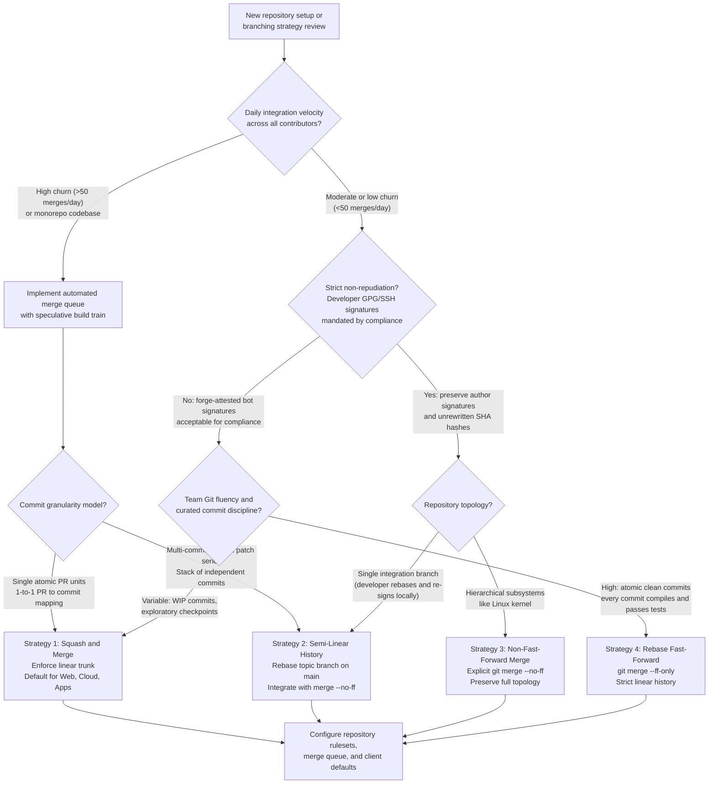
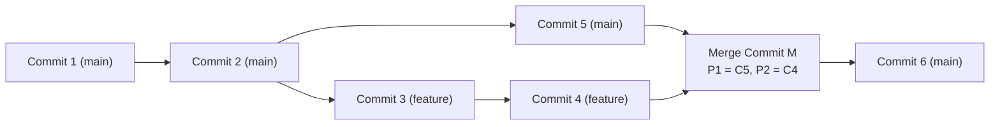
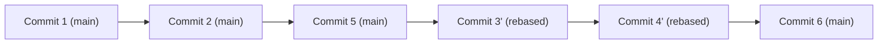
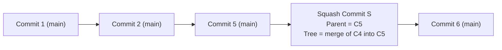
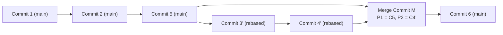
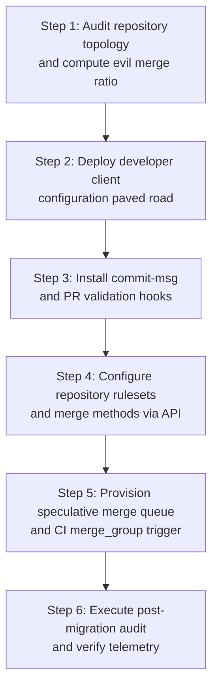
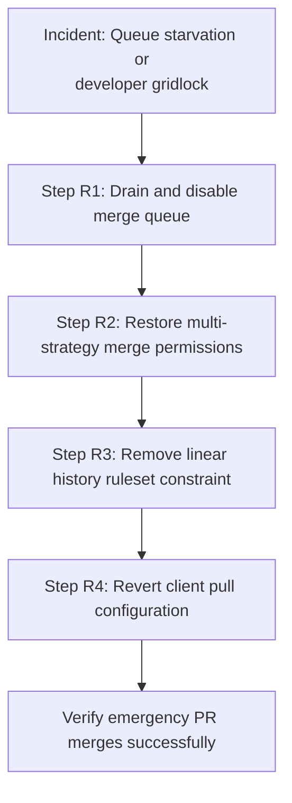
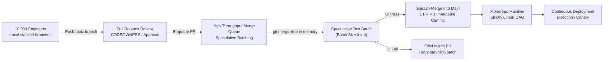

# Decision Record: Merge Commits versus Rebase and Branching Strategy

> [!summary] Scope
> Owns the trade-off evaluation and organizational decision framework between non-fast-forward merge commits, squash-merging, and rebase fast-forward workflows.
> Reaches Decide at Scale rungs by establishing the default strategy, specifying exact conditions that flip the decision, modeling the downsides regarding bisection reliability and auditability, and providing repository migration scripts.
> Connects upstream branching concepts with downstream engineering system merge queues.

Branching models, speculative build trains, and code review governance are owned by [[Git-Branching-Models-Merge-Queues-and-Code-Review]].
Three-way merge internals, rename detection, and diff engines are owned by [[Git-Three-Way-Merge-ORT-and-Diff-Algorithms]].
Local interactive rebase mechanics, the sequencer, and stacked branches are owned by [[Git-Rebase-Internals-and-Stacked-Branches]].
Server-side worktree-free history rewriting is owned by [[Git-Replay-and-Server-Side-History-Rewriting]].
Automated bisection and historical code archaeology are owned by [[Git-Archaeology-Log-Blame-and-Bisect]].
Cryptographic commit verification, SSH signatures, and policy hooks are owned by [[Git-Hooks-and-Cryptographic-Signing]].
Monorepo scaling, sparse enlistments, and virtual filesystems are owned by [[Git-At-Scale-VFS-Scalar-and-Monorepos]].
This decision record owns the architectural trade-off evaluation, organizational policy, failure modeling across bisection and compliance, and the fleet-wide migration playbook between merge commits, squash-merging, and rebase fast-forward workflows.

## Trigger and Symptoms

Activate this decision record and migration procedure when any of the following repository pathologies manifest in production operations:

- Automated regression hunting via `git bisect` stalls or returns false positives because bisection lands on broken, uncompilable intermediate commits introduced by rebased feature branches.
- Production incidents are traced to silent logic alterations introduced during manual conflict resolutions inside merge commits, which escaped pull request review because standard single-parent diffs omit merge commit payloads.
- High-concurrency merge queues (such as GitHub Merge Queue or Bors) experience throughput collapse and runaway continuous integration costs due to invalidation cascades under rebase fast-forward configurations.
- Enterprise security compliance audits (such as SOC2 Type II, FedRAMP, or PCI-DSS) flag repository governance violations because server-side squash or rebase operations strip developer cryptographic signatures or obscure commit provenance.
- Repository history displays foxtrot merges, where developers merged the integration branch into their local topic branches before final integration, inverting first-parent ancestry and corrupting automated release notes.
- Engineering onboarding friction surges as junior developers struggle with complex multi-parent branch meshes, diamond dependency conflicts on stacked branches, or dangling ref conflicts during pull operations.

## Decision Tree

The following decision logic governs the selection of integration strategies across repositories, balancing commit concurrency, testing latency, bisection requirements, and regulatory auditability.



## Prerequisites

Before executing the repository strategy migration runbook, verify administrative permissions, local client tooling, and remote API access.

### 1. Administrative Privileges and Scopes
- Organization Owner or Repository Administrator privileges on the hosting platform (GitHub, GitLab, or Bitbucket).
- Personal access token or machine token with classic scopes `repo` and `admin:org` (for organization rulesets); GitHub has no `ruleset` scope (as of 2026-11, GitHub OAuth scopes reference).
  A fine-grained token needs the repository "Administration" permission with write access, which GitHub lists for `POST`, `PUT`, and `DELETE /repos/{owner}/{repo}/rulesets/...` and for `PATCH /repos/{owner}/{repo}` (as of 2026-11, GitHub REST API, Permissions required for fine-grained personal access tokens).
- Administrative rights on local workstations or centralized configuration management (MDM) to configure global Git configuration defaults.

### 2. Tooling and Runtime Environment
- Git 2.38.0 or later installed on developer workstations (Git 2.44.0 or later for `git replay`, which its man page still marks EXPERIMENTAL as of Git 2.55.0).
- GitHub CLI (`gh`) version 2.50.0 or later installed.
- Modern command-line utilities `jq`, `curl`, and `awk` available in the automation execution environment.

**Verification:**

```bash
git version
gh version
gh api user -q '.login'
gh api repos/{owner}/{repo} -q '.permissions.admin'
```

The output must report Git version 2.38.0 or later, a valid GitHub CLI login identity, and `.permissions.admin` returning `true`.

## Commands and Numbers to Know

The operational parameters, configuration flags, and performance thresholds governing Git merge and rebase workflows are detailed below.

| Item | Platform | Value `(as of 2026-11)` | Why it matters |
| :--- | :--- | :--- | :--- |
| `merge.ff` default | Both | `true` | When true, Git fast-forwards if possible; set to `false` to force `--no-ff` or `only` to force `--ff-only`. |
| `pull.rebase` default | Both | `false` | Default creates a merge commit on pull; setting to `true` or `merges` prevents divergence merge bubbles. |
| `pull.ff` default | Both | unset (allows fast-forward) | Setting to `only` blocks implicit merge commits during developer pull operations. |
| `rebase.autoSquash` default | Both | `false` | Setting to `true` automatically arranges `fixup!` and `squash!` commits during interactive rebase. |
| `rebase.autoStash` default | Both | `false` | When true, automatically stashes and reapplies dirty working trees across rebase invocations. |
| `rebase.updateRefs` default | Both | `false` (added Git 2.38) | When true, automatically updates stacked branch tips during rebase of intermediate commits. |
| `merge.conflictStyle` default | Both | `merge` | Change to `zdiff3` (added Git 2.35) to show common ancestor context and reduce misresolved conflicts. |
| `squash_merge_commit_title` | Both | `PR_TITLE` or `COMMIT_OR_PR_TITLE` | Configures whether squashed commit titles derive from pull request title or original commit message. |
| `squash_merge_commit_message` | Both | `PR_BODY`, `COMMIT_MESSAGES`, or `BLANK` | Controls whether squashed commit body preserves individual commit logs or pull request markdown body. |
| `required_linear_history` ruleset rule | Both | Rule type, no parameters | GitHub repository ruleset setting blocking non-linear merge commits on matching branches. |
| Bisection step complexity | Both | $\lceil \log_2 N \rceil$ | Number of bisection iterations required across $N$ commits on a strictly linear history. |
| Speculative queue invalidation | Both | $1 - (1 - p)^k$ | Probability that a speculative batch of size $k$ is aborted given single PR failure probability $p$. |

## Trade-Off Evaluation Framework

Selecting an integration strategy requires evaluating four competing architectural approaches across six structural dimensions.

### 1. Strategy Comparison Matrix

| Architectural Dimension | Non-Fast-Forward Merge (`--no-ff`) | Rebase Fast-Forward (`--ff-only`) | Squash-Merge (`--squash`) | Semi-Linear History (Rebase + `--no-ff`) |
| :--- | :--- | :--- | :--- | :--- |
| Commit Graph Topology | Multi-parent 2D DAG with branch lifecycles | 1D strictly linear line | 1D strictly linear line | Linear mainline with 2-commit merge bubbles |
| Bisection Reliability | High with `--first-parent`; low without | Low if intermediate commits are broken | High when each squash commit was tested as merged (merge queue or strict up-to-date checks) | High with `--first-parent`; variable inside bubble |
| Cryptographic Signatures | Preserves original developer GPG/SSH signatures | Forge-side rebase drops them; a local `git rebase --gpg-sign` re-signs as the developer | Creates new commit signed by forge or merger | Inside-bubble commits keep developer signatures only if the developer rebased and re-signed locally |
| Merge Queue Efficiency | Same queue mechanics: the queue tests the group head | Same queue mechanics; per-commit CI (needed for bisectability) multiplies cost | Same queue mechanics; one tested commit per PR | Requires a rebase before the merge commit (native on GitLab) |
| Multi-Author Attribution | Full attribution preserved across all commits | Full attribution preserved across all commits | Co-authors dropped unless `Co-authored-by:` trailers are kept | Full attribution preserved across all commits |
| Revert Simplicity | Requires `-m 1` flag specifying mainline parent | `git revert <sha>` per commit; a multi-commit PR needs a range revert | Simple `git revert <sha>` | `git revert -m 1 <sha>` reverts the whole PR |

### 2. Strategy 1: Non-Fast-Forward Merge Commits (`git merge --no-ff`)

The non-fast-forward merge strategy creates a merge commit containing two or more parent pointers ($P_1 = \text{target}, P_2 = \text{source}$).
This strategy reflects the original distributed design of Git.



#### Advantages
- Preserves full historical context, showing exactly when feature work branched off and when it integrated.
- Retains original cryptographic signatures and author metadata without rewriting object identities.
- Avoids painful manual rebasing when feature branches are developed collaboratively across multiple engineers.
- Never creates ghost commits: individual commits reflect the state tested by the author during authoring.

#### Disadvantages
- Produces a complex visual graph often referred to as "train tracks" or "git knot", complicating manual inspection.
- Susceptible to "evil merges", where conflict resolutions or manual edits introduce changes that appear in neither parent.
- Standard `git bisect` navigates both parents, encountering broken or half-implemented intermediate feature commits.
- Reverting a merge commit requires selecting the parent index (`git revert -m 1 <commit>`), which prevents the feature branch from ever being merged again without first reverting the revert.

### 3. Strategy 2: Rebase Fast-Forward (`git merge --ff-only`)

The rebase fast-forward strategy replays all commits from the feature branch on top of the target branch tip, generating new commit objects with updated parent pointers, committer timestamps, and hashes.
Once rebased, the target branch ref pointer is simply moved forward.



#### Advantages
- Produces a strictly linear, 1D commit history where `git log --oneline` reads chronologically.
- Simplifies downstream tooling, changelog generators, and automated deployment pipelines.
- Standard `git bisect` operates with clean binary search complexity without requiring graph traversal flags.
- Reverts are straightforward single-commit reversals using standard `git revert <commit>`.

#### Disadvantages
- Creates "ghost commits": intermediate feature commits rebased onto a modern mainline tip were never tested by CI in that exact synthetic state, frequently failing builds during bisection.
- Drops developer cryptographic signatures when the forge performs the rebase, because rewritten commits are new objects; GitHub's "Rebase and merge" always updates committer information and creates new SHAs (GitHub, About pull request merges), and a local rebase keeps a developer signature only if re-signed (`git rebase --gpg-sign`).
- High developer friction when multiple engineers collaborate on the same feature branch, requiring coordinating force-pushes with `--force-with-lease`.
- Merge queue invalidation on GitHub is the same for every merge method (a failing entry is removed and the entries behind it are rebuilt); the extra cost appears only if every intermediate commit must also pass CI to stay bisectable.

### 4. Strategy 3: Squash-Merging (`git merge --squash`)

Squash-merging condenses all changes from a feature branch into a single synthetic changeset, applying it as a brand new commit directly on top of the target branch tip.
The original feature branch commits are omitted from the target branch ancestry.



#### Advantages
- Guarantees complete alignment between pull requests and mainline commits (1 pull request equals 1 commit on trunk).
- High bisection reliability: every commit on trunk was validated by CI, provided CI ran on the merged result (merge queue or strict up-to-date status checks) rather than only on the branch.
- Hides development noise, exploratory spikes, typo fixes, and broken intermediate tests from the permanent record.
- Cheapest CI per PR when bisectability is required: only one commit per PR has to pass CI, whereas rebase fast-forward needs every intermediate commit tested.

#### Disadvantages
- Destroys granular commit structure: if a pull request contains multiple logical units, they are irreversibly merged into a single monolith.
- Destroys multi-author attribution unless the merge infrastructure explicitly parses and generates `Co-authored-by:` Git trailers.
- Introduces the "diamond dependency rebase trap": if branch B is branched off branch A, and branch A is squash-merged, rebasing branch B onto main produces massive textual conflicts because Git cannot recognize that the squash commit already contains branch A's changes.
- Encourages oversized pull requests, as developers treat the pull request as the only unit of code organization.

### 5. Strategy 4: Semi-Linear History (Rebase then Non-Fast-Forward Merge)

Semi-linear history requires that a feature branch be rebased onto the tip of the target branch before integration, but integrates it using an explicit non-fast-forward merge commit (`git merge --no-ff`).



#### Advantages
- Combines the topological clarity of merge commits with the cleanliness of a linear mainline.
- First-parent traversal (`git log --first-parent`) yields a strictly linear sequence representing pull requests.
- Second-parent traversal preserves individual, fine-grained commits for deep archaeological investigation.
- Bisection can execute at high velocity on merge commits using `git bisect start --first-parent`, falling back to internal commit bisection only if necessary.

#### Disadvantages
- Requires rebase discipline: pull requests cannot be merged if the target branch has advanced, requiring rebase automation.
- Rewrites feature branch commits during rebase, invalidating original developer GPG signatures on internal commits unless the developer re-signs during a local rebase.
- Native forge support varies: supported out of the box in GitLab as "Merge commit with semi-linear history" (a merge commit is created, but only when a fast-forward merge is possible), but requires custom merge queue or GitHub Actions automation on GitHub.

## Downstream Impact: Bisection, Auditing, and Merge Queues

The choice of integration strategy directly dictates the operational characteristics of downstream engineering infrastructure.

### 1. The Bisection Reliability Model and Ghost Commits

Automated bisection via `git bisect run` relies on the assumption that any randomly selected commit in history represents a meaningful, buildable state.
In a rebase-fast-forward workflow with uncurated commits, this assumption fails catastrophically due to "ghost commits".

Consider a developer working on a feature branch for five days:
- Day 1: Commit A adds a new database interface function `query()`.
- Day 2: Commit B updates call sites in the application layer.
- Day 3: Commit C fixes compilation errors and writes unit tests.
- Day 5: The developer rebases commits A, B, and C onto mainline commit X (which altered database connection pooling) and pushes to trunk.

While commit C compiles cleanly against X, intermediate commit A was never compiled against X.
When `git bisect` checks out commit A to isolate an unrelated regression, the build fails immediately.
The bisection script must abort or execute `git bisect skip` (exit code 125 under `git bisect run`), costing extra steps; if the regression lies inside the skipped range, bisect can only report a set of candidate commits instead of one.

```text
Commit Graph State during Bisect Failure:

Mainline:    --- X ----------------------------------------->
                  \
Rebased:           A' (Broken build) ---> B' (Broken build) ---> C' (Clean build)
```

Under a squash-merge strategy, commits A', B', and C' are replaced by single commit S, which compiled and passed CI against X when CI ran on the merged result (merge queue or strict up-to-date checks).
Under a non-fast-forward merge strategy, running `git bisect start --first-parent` instructs the bisection engine to follow only parent 1 pointers (the mainline integration line), completely skipping intermediate commits A, B, and C.

### 2. Forensic Analysis of Evil Merges

An "evil merge" is formally defined in `gitglossary(7)` as a merge commit that introduces changes that do not appear in any parent.
Evil merges typically occur when a developer resolves a merge conflict manually and introduces functional code changes or accidental deletions during the conflict resolution phase.

Standard Git log and diff tools obscure evil merges:
- `git show <merge-commit>` uses the dense combined format of `git diff-tree --cc` by default (git-show(1)); it shows only hunks that differ from every parent, so an evil change that silently restores one parent's version of a hunk (dropping the other side's change) is invisible.
- `git log -p` lists merge commits but prints no diff for them, because `--diff-merges` defaults to `off` for `git log` (git-log(1)).

To expose an evil merge, use combined diff plumbing (`git diff-tree -c`, or dense `--cc`), and prefer `--remerge-diff` (Git 2.36), which re-runs the merge and diffs the mechanical result against the recorded one, so it also exposes dropped sides:

```bash
git diff-tree -p --cc <merge-commit-sha>
git show --remerge-diff <merge-commit-sha>
```

The dense combined diff format (`--cc`) compares the merge commit against all parents simultaneously:
- Column 1 displays changes between Parent 1 and the merge result.
- Column 2 displays changes between Parent 2 and the merge result.
- If a line displays `++`, the code was introduced in the merge commit itself and existed in neither parent; hand-written conflict resolutions also produce `++`, so it flags lines to review, not proof of an evil change.

```text
Example Evil Merge Output (git diff-tree -p --cc, illustrative and abridged):

diff --cc src/auth/token_validator.c
index a41bc21,e82f109..b892a01
--- a/src/auth/token_validator.c
+++ b/src/auth/token_validator.c
@@@ -42,7 -42,8 +42,9 @@@ int validate_session_token(const char *token)
      if (token == NULL)
          return -1;
  
 -    if (is_expired(token))
 +    if (is_blacklisted(token))
++    /* EVIL MERGE PAYLOAD: bypasses token expiration check */
++    return 0;
```

In the listing above, the human merger accidentally inserted a return statement during conflict resolution that completely bypassed security checks.
Because it existed in neither parent branch, reviewers who read only each branch's own diff never saw it.

### 3. Cryptographic Provenance and Auditability

In security-critical environments governed by regulatory frameworks (such as SOC2, ISO 27001, or PCI-DSS), every change must demonstrate non-repudiation: proof that code was authored by an authorized engineer and reviewed without tampering.

A signed Git commit object contains these headers, followed by the message:
1. `tree`: SHA hash pointing to the root directory tree object.
2. `parent`: One or more SHA hashes of predecessor commits.
3. `author`: Name, email, and timestamp of original code author.
4. `committer`: Name, email, and timestamp of person or system applying the commit.
5. `gpgsig`: Cryptographic signature (PGP, SSH, or X.509 such as Sigstore gitsign) whose payload is the commit object, so it covers the other headers and the message (gitformat-signature(5)).

```text
Commit Object Payload Layout:

+---------------------------------------------------------------+
| tree 8b1a9f3b584d0b2e8a1f2c4d5e6f7a8b9c0d1e2f                |
| parent 4c2e1a0b9f8e7d6c5b4a3f2e1d0c9b8a7f6e5d4c              |
| author Jane Doe <jane@example.com> 1762588800 +0000           |
| committer Jane Doe <jane@example.com> 1762588800 +0000        |
| gpgsig -----BEGIN SSH SIGNATURE-----                          |
|        U1NIU0lHAAAAAQAAADMAAAALc3NoLWVkMjU1MTkAAAAg...        |
|        -----END SSH SIGNATURE-----                            |
|                                                               |
| feat(auth): add hardware token validation                     |
+---------------------------------------------------------------+
```

Because the cryptographic signature seals the exact parent hash and committer timestamp:
- Any `git rebase` rewrites the `parent` and `committer` fields, so the rewritten commit carries no valid copy of the original signature; only re-signing (`git rebase --gpg-sign` or `commit.gpgSign=true`) by whoever runs the rebase restores one.
- Any server-side `git merge --squash` generates a brand new commit object.
  The signature on trunk is either missing or belongs to the forge (GitHub signs the squash commits it creates, per its protected-branches documentation; the public key is published at `https://github.com/web-flow.gpg`, and its current user id is `GitHub <noreply@github.com>`, with the earlier key labeled `GitHub (web-flow commit signing)` and expired 2024-01-16, as of 2026-11, checked by `gpg --show-keys`), breaking end-to-end author non-repudiation.
- The non-fast-forward merge commit (`git merge --no-ff`) is the only server-side strategy that leaves the developer-signed topic branch commits untouched while adding a separate signed merge commit from the merger or merge queue; a developer-side rebase with re-signing followed by `--ff-only` also keeps developer signatures, at the cost of the developer re-signing on every rebase.

### 4. Merge Queue Throughput and Speculative Invalidation

In trunk-based development with high commit velocity, direct merges to trunk cause race conditions where developer branches become out of date before CI completes.
A merge queue resolves this by constructing speculative build branches.

Let:
- $T_{\text{CI}}$ = duration of integration test suite in minutes.
- $N$ = number of pull requests submitted per hour.
- $k$ = speculative batch window size (number of PRs tested concurrently).
- $p$ = probability that an individual pull request fails CI.

The probability $P_{\text{invalidation}}$ that a speculative queue batch of depth $k$ is invalidated by a failure is modeled by:

$$P_{\text{invalidation}} = 1 - (1 - p)^k$$

On GitHub, the queue pushes temporary branches with the prefix `gh-readonly-queue/{base_branch}`, each containing the target branch plus every entry ahead of it, and runs the `merge_group` workflow event on them:
1. The queue constructs speculative branch $S_1 = \text{main} + \text{PR}_1$.
2. The queue concurrently constructs $S_2 = S_1 + \text{PR}_2$, and $S_3 = S_2 + \text{PR}_3$.
3. If $\text{PR}_1$ fails CI, the queue removes it and rebuilds and re-tests $S_2$ and $S_3$ without it.

This invalidation behavior is the same whichever merge method the queue uses (`merge_method` is a queue parameter: `MERGE`, `SQUASH`, or `REBASE`); the merge method changes CI cost only when policy requires every intermediate commit of a rebased series to pass CI.
A self-hosted queue can compute each speculative merge tree without a worktree using `git merge-tree --write-tree` (Git 2.38+); the hosted forges do not document which plumbing they run internally, so this note makes no claim about it.

## Step-by-Step Execution: Enterprise Migration Runbook

This playbook provides the end-to-end runbook for migrating a production repository from uncurated merge commits to an enforced Squash-Merge or Semi-Linear strategy with Merge Queue automation.



### Step 1: Audit Repository Topology and Evil Merge Rate

Audit the target repository to quantify existing merge commit density and hand-edited (possibly evil) merges; foxtrot merges are detected at push time, below.

Run the diagnostic audit script:

```bash
#!/usr/bin/env bash
set -euo pipefail

TARGET_BRANCH="main"
SAMPLE_DEPTH=500

echo "=== Auditing Repository Topology (Last ${SAMPLE_DEPTH} commits) ==="

# One line per commit: "<sha> <parent1> [<parent2> ...]"; merges have more than two fields.
# (rev-list --merges --max-count would count the first N merges, not merges among N commits.)
COMMITS=$(git rev-list --parents --max-count="${SAMPLE_DEPTH}" "${TARGET_BRANCH}")
TOTAL_COMMITS=$(printf '%s\n' "${COMMITS}" | wc -l | tr -d ' ')
MERGE_COMMITS=$(printf '%s\n' "${COMMITS}" | awk 'NF > 2' | wc -l | tr -d ' ')

echo "Total commits analyzed: ${TOTAL_COMMITS}"
echo "Merge commits: ${MERGE_COMMITS} ($(( MERGE_COMMITS * 100 / TOTAL_COMMITS ))%)"

EDITED_MERGE_COUNT=0

while read -r MERGE_SHA; do
    # Recorded result differs from the mechanical merge: a conflict resolution or an evil merge.
    # (diff-tree --cc misses merges that silently restore one parent's side.)
    REMERGE=$(git show --remerge-diff --format= "${MERGE_SHA}")
    if [ -n "${REMERGE}" ]; then
        EDITED_MERGE_COUNT=$(( EDITED_MERGE_COUNT + 1 ))
        echo "Review merge ${MERGE_SHA}: result differs from the automatic merge"
    fi
done < <(printf '%s\n' "${COMMITS}" | awk 'NF == 3 {print $1}')

echo "Hand-edited two-parent merges (review each for evil changes): ${EDITED_MERGE_COUNT}"
```

A foxtrot cannot be told apart from an ordinary merge in the final graph; detect it when the branch moves, by requiring that the old tip stays on the new tip's first-parent chain (for example in a pre-receive hook or CI job):

```bash
CHAIN=$(git rev-list --first-parent "${NEW_SHA}")
grep -qx "${OLD_SHA}" <<<"${CHAIN}" || echo "FOXTROT: ${OLD_SHA} left the first-parent chain"
```

**Verification:**

The script outputs concrete metrics.
If merge commits exceed 30% of total history or any hand-edited merge hides an unreviewed change, the repository requires immediate migration to enforced rulesets.

### Step 2: Deploy Developer Client Configuration Paved Road

Distribute standard Git client configurations across engineering workstations to prevent developers from accidentally introducing divergence merge bubbles during local updates.

Do not also set `pull.ff only`: with both keys in config, a diverged `git pull` aborts with "Not possible to fast-forward" instead of rebasing (tested on Git 2.55.0; an explicit `git pull --rebase` on the command line still rebases).

Execute local or MDM configuration provisioning:

```bash
# Ensure local pull operations rebase instead of creating divergence merges
git config --global pull.rebase merges

# Enable automatic fixup squashing during local interactive rebase
git config --global rebase.autoSquash true

# Enable automatic stashing during rebase operations
git config --global rebase.autoStash true

# Automatically update stacked branch references during rebase
git config --global rebase.updateRefs true

# Configure advanced 3-way conflict markers to show common base
git config --global merge.conflictStyle zdiff3

# Enable reuse of recorded conflict resolutions
git config --global rerere.enabled true
git config --global rerere.autoupdate true
```

**Verification:**

```bash
git config --global --get-regexp '^(pull|rebase|merge|rerere)\.'
```

Expected output on a global config file that had none of these keys before (verified on Git 2.55.0; Git prints the lowercased key names, in file order):

```text
pull.rebase merges
rebase.autosquash true
rebase.autostash true
rebase.updaterefs true
merge.conflictstyle zdiff3
rerere.enabled true
rerere.autoupdate true
```

### Step 3: Install Commit-Msg and PR Validation Hooks

Deploy a client-side and CI validation hook enforcing Conventional Commits and Git trailers (`Signed-off-by:` and `Co-authored-by:`), guaranteeing metadata retention during squash operations.

Write `.githooks/commit-msg`:

```bash
#!/usr/bin/env bash
set -euo pipefail

COMMIT_MSG_FILE="$1"
FIRST_LINE=$(head -n 1 "${COMMIT_MSG_FILE}")

# Enforce Conventional Commit format: <type>(<scope>): <description>
PATTERN="^(feat|fix|docs|style|refactor|perf|test|build|ci|chore|revert)(\([a-zA-Z0-9_-]+\))?: .{1,72}$"

if ! echo "${FIRST_LINE}" | grep -Eq "${PATTERN}"; then
    echo "ERROR: Invalid commit title format."
    echo "Must adhere to Conventional Commits: <type>(<scope>): <subject>"
    echo "Example: feat(auth): add hardware token validation"
    exit 1
fi

# Ensure commit subject does not end with a period
if echo "${FIRST_LINE}" | grep -Eq '\.$'; then
    echo "ERROR: Commit subject line must not end with a period."
    exit 1
fi

# Validate presence of signed-off trailer if required by policy
if ! grep -Eq "^Signed-off-by: " "${COMMIT_MSG_FILE}"; then
    echo "WARNING: Commit lacks a Signed-off-by trailer."
fi

exit 0
```

Make the hook executable and configure Git to use repository hooks:

```bash
chmod +x .githooks/commit-msg
git config core.hooksPath .githooks
```

**Verification:**

```bash
echo "bad commit message" > /tmp/test_msg
if .githooks/commit-msg /tmp/test_msg 2>/dev/null; then
    echo "FAIL: Hook accepted invalid commit message"
else
    echo "PASS: Hook correctly rejected non-compliant commit message"
fi
rm -f /tmp/test_msg
```

### Step 4: Configure Repository Rulesets and Merge Methods via API

Configure the remote hosting platform to disable merge commits, mandate squash-merging or rebase fast-forward, and enforce strict commit title and body derivation.

Execute via GitHub CLI:

```bash
REPO_OWNER="acme-corp"
REPO_NAME="core-engine"

echo "=== Updating Repository Merge Strategy Settings ==="

# Enforce Squash Merging only, disabling standard merge commits and rebase merges
gh api -X PATCH "repos/${REPO_OWNER}/${REPO_NAME}" \
  -F allow_squash_merge=true \
  -F allow_merge_commit=false \
  -F allow_rebase_merge=false \
  -F squash_merge_commit_title="PR_TITLE" \
  -F squash_merge_commit_message="PR_BODY"

echo "=== Creating Branch Protection Ruleset for Mainline ==="

# Define JSON ruleset payload enforcing linear history and pull request review
cat <<'EOF' > /tmp/ruleset_payload.json
{
  "name": "Enforce Linear History and Quality Gates",
  "target": "branch",
  "enforcement": "active",
  "conditions": {
    "ref_name": {
      "include": ["refs/heads/main"],
      "exclude": []
    }
  },
  "rules": [
    {
      "type": "non_fast_forward"
    },
    {
      "type": "required_linear_history"
    },
    {
      "type": "pull_request",
      "parameters": {
        "required_approving_review_count": 2,
        "dismiss_stale_reviews_on_push": true,
        "require_code_owner_review": true,
        "require_last_push_approval": true,
        "required_review_thread_resolution": true
      }
    },
    {
      "type": "required_status_checks",
      "parameters": {
        "strict_required_status_checks_policy": true,
        "required_status_checks": [
          {"context": "ci/build"},
          {"context": "ci/unit-tests"},
          {"context": "security/secret-scan"}
        ]
      }
    }
  ]
}
EOF

gh api -X POST "repos/${REPO_OWNER}/${REPO_NAME}/rulesets" \
  --input /tmp/ruleset_payload.json \
  -q '.id'

rm -f /tmp/ruleset_payload.json
```

**Verification:**

```bash
gh api "repos/${REPO_OWNER}/${REPO_NAME}" \
  -q '{allow_squash_merge, allow_merge_commit, allow_rebase_merge, squash_merge_commit_title, squash_merge_commit_message}'
```

Expected output:

```json
{
  "allow_squash_merge": true,
  "allow_merge_commit": false,
  "allow_rebase_merge": false,
  "squash_merge_commit_title": "PR_TITLE",
  "squash_merge_commit_message": "PR_BODY"
}
```

### Step 5: Provision Speculative Merge Queue and CI Trigger

Enable GitHub Merge Queue to serialize integrations, run speculative integration testing, and eliminate merge race conditions.
Merge queues are available in public repositories owned by an organization, and in private organization repositories on GitHub Enterprise Cloud (as of 2026-11, GitHub Docs, Merging a pull request with a merge queue).

Create the GitHub Actions workflow `.github/workflows/merge_queue.yml`:

```yaml
name: Merge Queue Integration Gate

on:
  merge_group:
    types: [checks_requested]
  pull_request:
    branches: [main]

jobs:
  validate:
    runs-on: ubuntu-latest
    steps:
      - name: Checkout Source
        uses: actions/checkout@v4
        with:
          fetch-depth: 0

      - name: Execute In-Memory Integration Verification
        run: |
          echo "Validating speculative merge state for ref: ${{ github.ref }}"
          # Prove current HEAD is a direct descendant or clean integration
          git rev-parse HEAD
          git log -n 1 --stat

      - name: Compile and Test
        run: |
          echo "Running build and test suites..."
          # Real compilation command executed here
          make -j"$(nproc)" test
```

Update repository ruleset to mandate merge queue integration:

The REST schema requires all seven `merge_queue` parameters (as of 2026-11, GitHub REST API, Repository rules); the UI labels "Build concurrency", "Minimum pull requests to merge", and "Maximum pull requests to merge" map to `max_entries_to_build`, `min_entries_to_merge`, and `max_entries_to_merge`.

```bash
# Create a second ruleset that requires the merge queue on main
cat <<'EOF' > /tmp/merge_queue_ruleset.json
{
  "name": "Enforce Merge Queue",
  "target": "branch",
  "enforcement": "active",
  "conditions": {
    "ref_name": { "include": ["refs/heads/main"], "exclude": [] }
  },
  "rules": [
    {
      "type": "merge_queue",
      "parameters": {
        "merge_method": "SQUASH",
        "grouping_strategy": "ALLGREEN",
        "max_entries_to_build": 5,
        "min_entries_to_merge": 1,
        "max_entries_to_merge": 5,
        "min_entries_to_merge_wait_minutes": 5,
        "check_response_timeout_minutes": 60
      }
    }
  ]
}
EOF

gh api -X POST "repos/${REPO_OWNER}/${REPO_NAME}/rulesets" \
  --input /tmp/merge_queue_ruleset.json \
  -q '.id'

rm -f /tmp/merge_queue_ruleset.json
```

**Verification:**

Push a test branch, open a pull request, approve it, and confirm the merge button reads "Merge when ready".
Inspect the Actions tab and confirm the workflow triggers on event `merge_group`.

### Step 6: Post-Migration Audit and Telemetry Validation

Execute an automated audit after initial merges to confirm that trunk history remains strictly linear, no merge commits were pushed, and commit headers adhere to policy.

Run the post-migration verification script:

```bash
#!/usr/bin/env bash
set -euo pipefail

TARGET_BRANCH="origin/main"
git fetch origin main

echo "=== Verifying Mainline Compliance ==="

# Check for non-linear history in recent commits
RECENT_MERGES=$(git rev-list --merges --count "${TARGET_BRANCH}~20..${TARGET_BRANCH}")

if [ "${RECENT_MERGES}" -gt 0 ]; then
    echo "CRITICAL: Non-linear merge commits detected in recent history!"
    git log --merges -n 5 --oneline "${TARGET_BRANCH}"
    exit 1
fi

echo "PASS: Zero merge commits detected. History is strictly linear."

# Verify commit messages adhere to Conventional Commits
NON_COMPLIANT=0
while read -r SHA; do
    MSG=$(git log -1 --format="%s" "${SHA}")
    if ! echo "${MSG}" | grep -Eq '^(feat|fix|docs|style|refactor|perf|test|build|ci|chore|revert)(\([a-zA-Z0-9_-]+\))?: '; then
        echo "WARNING: Non-compliant commit subject at ${SHA}: ${MSG}"
        NON_COMPLIANT=$(( NON_COMPLIANT + 1 ))
    fi
done < <(git rev-list --max-count=20 "${TARGET_BRANCH}")

echo "Audited 20 recent commits. Non-compliant count: ${NON_COMPLIANT}"
```

**Verification:**

The verification script confirms that zero merge commits were detected in the sampled range.
The output confirms that mainline history is strictly linear with zero non-compliant commit subjects.

## Rollback Procedure

If the migration causes merge queue starvation, developer lockouts, or blocks emergency incident hotfixes, execute this emergency rollback procedure.



### Step R1: Drain and Disable Merge Queue
Remove the merge queue constraint from the active ruleset to allow immediate direct merges:

```bash
REPO_OWNER="acme-corp"
REPO_NAME="core-engine"

# Fetch active ruleset IDs
RULESET_ID=$(gh api "repos/${REPO_OWNER}/${REPO_NAME}/rulesets" -q '.[] | select(.name=="Enforce Merge Queue") | .id')

if [ -n "${RULESET_ID}" ]; then
    echo "Disabling Merge Queue Ruleset ID: ${RULESET_ID}"
    gh api -X DELETE "repos/${REPO_OWNER}/${REPO_NAME}/rulesets/${RULESET_ID}"
fi
```

### Step R2: Restore Multi-Strategy Merge Permissions
Re-enable merge commits and rebase merges to allow developers to clear blocked PRs:

```bash
gh api -X PATCH "repos/${REPO_OWNER}/${REPO_NAME}" \
  -F allow_squash_merge=true \
  -F allow_merge_commit=true \
  -F allow_rebase_merge=true
```

### Step R3: Remove Linear History Requirement
Update the primary ruleset to remove the `required_linear_history` constraint:

```bash
MAIN_RULESET_ID=$(gh api "repos/${REPO_OWNER}/${REPO_NAME}/rulesets" -q '.[] | select(.name=="Enforce Linear History and Quality Gates") | .id')

if [ -n "${MAIN_RULESET_ID}" ]; then
    # Fetch existing ruleset, keep only the writable fields, drop the linear-history rule, and update
    gh api "repos/${REPO_OWNER}/${REPO_NAME}/rulesets/${MAIN_RULESET_ID}" \
      | jq '{name, target, enforcement, bypass_actors, conditions,
             rules: (.rules | map(select(.type != "required_linear_history")))}' \
      > /tmp/rollback_ruleset.json

    gh api -X PUT "repos/${REPO_OWNER}/${REPO_NAME}/rulesets/${MAIN_RULESET_ID}" \
      --input /tmp/rollback_ruleset.json
    rm -f /tmp/rollback_ruleset.json
fi
```

### Step R4: Reset Developer Client Settings
If developers experience local rebase failures, instruct them to reset pull defaults:

```bash
git config --global --unset pull.rebase
git config --global --unset pull.ff   # only if it was set; exits 5 when the key is absent
```

**Verification:**

Open a test pull request, confirm that the standard "Merge pull request (Create a merge commit)" option is visible, and complete an emergency merge.

## Failure Modes of the Migration Procedure

The table below catalogs operational failures that arise during and immediately after repository integration migrations, along with recovery runbooks.

| Failure | How it shows up | Recovery |
| :--- | :--- | :--- |
| Diamond dependency rebase conflict | Developer rebasing `feature-b` on `main` sees hundreds of conflicts after `feature-a` was squash-merged | Execute `git rebase --onto main <feature-a-tip> feature-b` to transplant only unique commits. |
| Merge queue speculative cascade | A single flake removes one PR and forces every queued group behind it to be rebuilt and re-tested | Reduce `max_entries_to_build` and `max_entries_to_merge` (UI: "Build concurrency", "Maximum pull requests to merge"); isolate flaky tests into non-blocking quarantine suites. |
| GPG signature compliance alert | Security scanning flags merge commits on trunk as unsigned or signed by unknown bot key | Configure forge web-flow key in compliance scanner trust store, or switch to Semi-Linear strategy. |
| Developer push rejection | `git push` of a merge commit is rejected by the linear-history rule (a ruleset or protected-branch rule); GitHub documents the `GH006: Protected branch update failed` form for protected branches, and the exact rejection text for rulesets is not documented, so read the `remote:` lines; `GH007` is the unrelated private-email block | Developer must run `git pull --rebase origin main` to linearize local commits before pushing. |
| Conventional commit regex mismatch | Developer cannot commit; `commit-msg` hook aborts with syntax error | Fix commit message format or bypass hook during emergency using `git commit --no-verify` with manager override. |
| Missing Co-Authors in squash commit | Squashed commit on main only lists PR author; contributors lose credit | Ensure squash merge message template is set to `PR_BODY` and developers populate `Co-authored-by:` in PR text. |

## Pitfalls

> [!warning] The Squash-Merge Diamond Dependency Trap
> When a developer branches `branch-2` off `branch-1`, and `branch-1` is squash-merged into `main`, Git does not know that commit S on `main` corresponds to commits on `branch-1`.
> Running `git checkout branch-2 && git rebase main` causes Git to attempt to replay `branch-1`'s commits on top of `main`, triggering massive merge conflicts.
> Developers must be trained to use `git rebase --onto main branch-1 branch-2` to slice out the already merged commits.

> [!warning] Foxtrot Merges Invert Release Tracking
> A foxtrot merge occurs when a developer runs `git merge origin/main` inside their local feature branch (or a plain `git pull` on a diverged local `main`), and `main` is then fast-forwarded to that merge commit.
> In a foxtrot merge, parent 1 of the merge commit becomes the temporary feature branch, while parent 2 becomes the true mainline.
> Any automated tooling relying on `git log --first-parent` follows the feature branch history instead of mainline releases, causing changelog generation to omit the mainline commits that arrived through parent 2.

> [!warning] Ghost Commits Break Automated Bisection
> Enforcing a rebase fast-forward strategy without automated per-commit testing creates intermediate ghost commits that fail to build.
> When a regression occurs, `git bisect run` lands on an intermediate commit that fails compilation due to an unrelated API change introduced upstream.
> If developers cannot curate every commit in a series to be buildable and testable, mandate squash-merging.

> [!warning] Silent Production Outages Through Evil Merges
> An evil merge introduces modifications that existed in neither parent branch.
> Because `git log -p` prints no diff for merges by default and web pull request reviews routinely hide merge commit conflict resolutions, bugs introduced during conflict resolution bypass review undetected; review them with `git show --remerge-diff`.
> Mandate that all conflict resolutions take place on the feature branch before integration, or enforce `zdiff3` conflict markers and linear history.

> [!warning] Speculative Starvation Under Rebase Merge Queues
> Merge queue throughput falls as test suites lengthen, because every failure forces the groups behind it to be rebuilt.
> If three PRs are queued and PR 1 fails, PR 2 and PR 3 are rebuilt without it and re-tested from scratch, whichever merge method the queue uses.
> A rebase fast-forward policy adds cost only when it also demands CI on every intermediate commit; for large teams with long test suites, squash-merging keeps that to one tested commit per PR.

## At Scale

At scale (from 1,000 to 50,000 engineers), the branching strategy cannot be left to developer discretion; it forms the core interface between version control storage and the deployment pipeline.



### 1. Scaling Archetypes

- **Small Teams (1-15 engineers):**
  Low commit concurrency (<10 merges/day).
  The team can successfully run Rebase Fast-Forward or Squash-Merge without a merge queue.
  Developers rebase locally before clicking merge.
- **Mid-Sized Organizations (15-200 engineers):**
  Moderate concurrency (10-100 merges/day).
  Merge race conditions become frequent ("PR cannot be merged because base has changed").
  Mandate Squash-Merge with a basic merge queue.
  Standardize commit messages via Conventional Commits.
- **Enterprise / Monorepo (200-50,000+ engineers):**
  Extreme concurrency (>500 merges/day, such as Google, Meta, or Microsoft).
  Individual developer rebase-then-merge workflows become impractical: 500 merges in an 8-hour working day move trunk about once a minute, faster than most CI runs.
  Trunk must be strictly linear, and all merges must be executed server-side via speculative merge queues or virtual monorepo daemons.
  Squash-merging is mandatory for pull request workflows, with stacked changes represented as sequences of squashed pull requests.

### 2. Organizational Decision Matrix

The following decision rules specify the exact technical conditions that flip the architectural choice between strategies:

```text
Decision Rule 1 (Default):
Default to SQUASH-MERGE for all web, microservice, cloud, and mobile application repositories.
Rationale: Maximizes bisection reliability, guarantees 1-to-1 PR tracking, hides exploratory developer noise, and delivers maximum merge queue throughput.

Decision Rule 2 (Kernel and System Toolchains):
Flip to NON-FAST-FORWARD MERGE (--no-ff) ONLY IF:
1. The project operates a distributed, hierarchical subsystem maintainer model (such as the Linux kernel or Git project).
2. AND individual commits in a topic series are curated, atomic, signed-off patches that compile independently.
3. AND cryptographic non-repudiation of developer author signatures must survive without forge re-attestation.

Decision Rule 3 (High-Maturity C / Rust Libraries):
Flip to SEMI-LINEAR HISTORY ONLY IF:
1. The engineering culture enforces strict commit curation (every single commit compiles and passes unit tests).
2. AND pull requests represent cohesive multi-commit epics that benefit from granular archaeology.
3. AND merge queue automation is deployed to handle the automated pre-merge rebase.

Decision Rule 4 (Strict Rebase Prohibition):
NEVER permit REBASE FAST-FORWARD on public or shared integration branches once pushed.
Local interactive rebasing is restricted strictly to private developer topic branches prior to merge queue submission.
```

## Practice Drill

Execute this drill to observe how merge commits obscure manual changes and how `git diff-tree --cc` and `git bisect --first-parent` rescue triage engineers.

### 1. Reproduce an Evil Merge Scenario

Create a temporary repository and simulate an evil merge:

```bash
#!/usr/bin/env bash
set -euo pipefail

DRILL_DIR="/tmp/git_evil_merge_drill"
rm -rf "${DRILL_DIR}"
mkdir -p "${DRILL_DIR}"
cd "${DRILL_DIR}"

git init -b main
git config user.name "Drill Engineer"
git config user.email "drill@example.com"

# Baseline commit
cat <<'EOF' > app.py
def calculate_fee(amount):
    return amount * 0.05
EOF
git add app.py
git commit -m "feat(billing): initial fee calculation"

# Create feature branch to update fee to 7%
git checkout -b feature-fee
cat <<'EOF' > app.py
def calculate_fee(amount):
    return amount * 0.07
EOF
git commit -am "feat(billing): update fee to 7%"

# Meanwhile, main updates fee to 6%
git checkout main
cat <<'EOF' > app.py
def calculate_fee(amount):
    return amount * 0.06
EOF
git commit -am "feat(billing): update fee to 6%"

# Merge feature-fee into main, resolving conflict with EVIL payload (0% fee)
git merge --no-ff feature-fee -m "Merge branch 'feature-fee' into main" || true

# Human merger introduces zero fee bug during conflict resolution
cat <<'EOF' > app.py
def calculate_fee(amount):
    # EVIL MERGE: fee accidentally dropped to 0
    return 0.0
EOF
git add app.py
git commit --no-edit
```

### 2. Inspect with Standard vs Plumbing Tools

Inspect the merge commit:

```bash
# git show already uses the dense combined (--cc) format for merges
git show --oneline

# git log -p prints the merge with no diff at all
git log -p -1

# Standard diff against parents shows partial diffs
git diff HEAD^1 HEAD
git diff HEAD^2 HEAD

# Plumbing: Dense combined diff exposes the exact evil payload
git diff-tree -p --cc HEAD

# Remerge diff: the recorded result against the automatic merge, conflict markers included
git show --remerge-diff HEAD
```

Observe that `git diff-tree -p --cc HEAD` displays `++` on the `return 0.0` line, proving the return value was introduced inside the merge commit and existed in neither parent (verified on Git 2.55.0; `git show` prints the same hunk, `git log -p` prints none).

### 3. Execute First-Parent Bisection

Tag the broken merge commit and verify that first-parent bisection isolates the merge commit without visiting the feature branch:

```bash
git tag v1.0-broken HEAD
git bisect start --first-parent
git bisect bad v1.0-broken
git bisect good HEAD~2
git bisect run sh -c '! grep -q "return 0.0" app.py'
```

Git tests only the first-parent commit `HEAD~1` (the 6% fee commit), then reports the merge commit as the first bad commit, never checking out the `feature-fee` commit (verified on Git 2.55.0).
Clean up the drill directory:

```bash
git bisect reset
cd /tmp
rm -rf "${DRILL_DIR}"
```

### 4. Run the Lab

The same repository construction, audit, inspection, bisection, foxtrot check, and squash-merge diamond trap run as a self-checking lab with fixed dates and an isolated Git configuration.
Run it with `make verify LAB=02-Version-Control/merge_vs_rebase_audit/` from `code/`; each `ok` line is a check that fails the lab when the mechanism is absent or wrong.
The output below is `expected/darwin-arm64.txt` (macOS arm64, Git 2.55.0, as of 2026-11); it prints no commit ids or paths, so it contains nothing platform specific.

```text
== Step 1 audit (parents count and remerge-diff) ==
ok   total-commits = 7
ok   merge-commits = 2
ok   hand-edited-merges = 1
ok   clean-merge-has-empty-remerge-diff = <empty>
== Inspect the evil merge ==
ok   show-uses-cc = 1
ok   diff-tree-cc-marks-payload = 1
ok   log-p-prints-no-merge-diff = 0
ok   diff-vs-parent1-is-partial = 1
== First-parent bisection ==
ok   first-parent-first-bad = Merge feature-fee
ok   first-parent-never-visits-feature-commit = 0
== Push-time foxtrot check ==
ok   no-ff-merge-keeps-old-tip = clean
ok   pull-merge-has-two-parents = 3
ok   pull-merge-drops-old-tip = FOXTROT
== Squash-merge diamond trap ==
ok   plain-rebase-after-squash = conflict
ok   rebase-onto-transplants-only-b = clean
ok   commits-b-adds-over-main = 1
failed checks: 0
```

## Interview Questions

### L5: Predict-the-Output on Foxtrot Merges

> [!question] L5
> A developer on branch `feature` runs `git fetch origin` and `git merge origin/main`.
> They then run `git push origin feature`.
> A teammate on `main` runs `git merge feature` and pushes a fast-forward merge.
> Predict the difference in output between `git log --oneline --graph` and `git log --oneline --first-parent` on `main`.
>
> > [!success]- Answer
> > When the developer merged `origin/main` into `feature`, Git created a merge commit where Parent 1 ($P_1$) was `feature` and Parent 2 ($P_2$) was `origin/main`.
> > Because `main` subsequently fast-forwarded to `feature`, that merge commit became the tip of `main`.
> > Running `git log --oneline --graph` will show the full DAG topology, displaying both the mainline commits and feature commits merging together.
> > However, running `git log --oneline --first-parent` instructs Git to follow only the first parent pointer of every commit.
> > Because $P_1$ points to the historical `feature` branch lineage rather than `main`, `git log --first-parent` will follow the feature branch backwards and completely omit all mainline commits that were merged into `feature`.
> > This is a classic "foxtrot merge" pathology that silently breaks automated changelog generators and release scripts.

### L5: Cryptographic Signature Invalidation

> [!question] L5
> Why does running `git rebase main` on a local feature branch invalidate cryptographic SSH or GPG commit signatures, whereas `git merge main` does not?
>
> > [!success]- Answer
> > A cryptographic commit signature (whether GPG, SSH, or Sigstore) signs the exact byte representation of the Git commit object header and body.
> > This signed payload explicitly includes:
> > 1. The root tree object SHA hash.
> > 2. The SHA hashes of all parent commits.
> > 3. The author name, email, and timestamp.
> > 4. The committer name, email, and timestamp.
> > 5. The commit message.
> >
> > When you execute `git rebase`, Git replays your changes onto a new base commit by generating brand new commit objects.
> > These new commit objects have different parent SHA hashes and updated committer timestamps.
> > Because the commit payload has been modified, the original cryptographic signature is mathematically invalid and Git drops it; the new commits are signed only if the rebase runs with `--gpg-sign` or `commit.gpgSign=true`.
> > In contrast, `git merge` leaves the existing commit objects on the feature branch completely untouched, creating only a single new merge commit object that can be signed by the person or system performing the merge.

### L6: Debug-This on Stacked Pull Requests

> [!question] L6
> A developer creates two stacked branches: `branch-a` (branched from `main`), and `branch-b` (branched from `branch-a`).
> The team squash-merges `branch-a` into `main` via the GitHub web UI.
> The developer then checks out `branch-b` and executes `git rebase main`.
> The terminal immediately halts with 35 merge conflicts across files that were already reviewed and approved in `branch-a`.
> Diagnose why Git is failing and provide the exact command to resolve it cleanly without manual conflict resolution.
>
> > [!success]- Answer
> > This is the classic "diamond dependency rebase trap" caused by squash-merging.
> > When `branch-a` was squash-merged, GitHub created a single new commit $S$ on `main` containing the cumulative tree of `branch-a`.
> > However, commit $S$ has a different commit hash and tree identity than the individual commits $A_1, A_2, \dots$ on `branch-a`.
> > When the developer runs `git rebase main` on `branch-b`, Git looks for the merge-base between `main` and `branch-b`.
> > Because `main` does not contain commits $A_1, A_2$, Git identifies the common ancestor as the point where `branch-a` originally split from `main`.
> > Git then attempts to replay all commits from `branch-a` AND `branch-b` onto $S$.
> > When it replays $A_1$, Git attempts to apply changes that already exist in $S$, resulting in false merge conflicts across all modified files.
> >
> > To fix this cleanly, the developer must instruct Git to transplant only the unique commits of `branch-b` using the `--onto` flag:
> > ```bash
> > git rebase --onto main branch-a branch-b
> > ```
> > This tells Git: take the commits on `branch-b` starting after `branch-a`, and replay only those commits directly onto `main`.

### L6: The Evil Merge Mechanism and Detection

> [!question] L6
> What is an "evil merge" according to `gitglossary(7)`?
> Why does `git show <commit>` often fail to show any diff for an evil merge, and what exact plumbing flags reveal its hidden payload?
>
> > [!success]- Answer
> > According to `gitglossary(7)`, an evil merge is defined as "a merge that introduces changes that do not appear in any parent."
> > It occurs when a developer modifies code during a merge commit that was not present in either the source branch or the target branch, beyond standard conflict resolution.
> >
> > The premise is half true: `git show <commit>` already uses the dense combined format of `git diff-tree --cc` for merges, while `git log -p` prints no diff for merges at all (`--diff-merges` defaults to `off`).
> > The dense format shows only hunks where the result differs from every parent, treating hunks that match one parent as uninteresting.
> > So an evil merge that adds new lines does show up, but one that silently restores one parent's version of a hunk, discarding the other side's change, produces no output.
> >
> > To reveal an evil merge's payload, use Git's combined diff plumbing commands:
> > ```bash
> > git diff-tree -p --cc <merge-commit-sha>
> > git show --remerge-diff <merge-commit-sha>
> > ```
> > The dense combined diff format (`--cc`) compares the merge commit against all parents simultaneously.
> > Any line prefixed with `++` represents code that was introduced exclusively in the merge commit itself and was present in neither parent.
> > `--remerge-diff` (Git 2.36) re-runs the merge in memory and diffs that mechanical result, conflict markers included, against the recorded merge, which exposes both added payloads and discarded sides.
> > Alternatively, running `git diff <merge-commit-sha>^1 <merge-commit-sha>` reveals the full diff introduced relative to mainline.

### L6: Server-Side Plumbing: git merge-tree versus git replay

> [!question] L6
> Compare `git merge-tree --write-tree` (introduced in Git 2.38) and `git replay` (introduced in Git 2.44) in the context of building a server-side automated merge queue.
> What architectural limitations did each solve?
>
> > [!success]- Answer
> > Prior to Git 2.38, the Git CLI had no supported way to perform a real (recursive or `ort`) merge without an index and working tree; the old `git merge-tree` mode only computed a trivial merge, so a server-side merge needed a temporary worktree or a separate merge library.
> > Worktree-based merges cost disk I/O and need serialization on bare server repositories.
> >
> > `git merge-tree --write-tree` solved the server-side merge problem:
> > - It takes two commit hashes and computes a 3-way merge entirely in memory using the modern `ort` merge engine.
> > - It writes the resulting tree object directly into the object database and outputs the top-level tree SHA (or conflict details) without requiring a working tree or index.
> > - This lets merge queues evaluate whether pull requests would merge cleanly without touching disk checkouts.
> >
> > However, `merge-tree` only computes a single merge commit tree; it cannot rebase a series of commits.
> > `git replay` (still marked EXPERIMENTAL in its man page as of Git 2.55.0) solved the server-side rebase problem:
> > - It can replay an entire revision range (a series of commits) onto a new base (`--onto`) or advance a branch (`--advance`) without touching the working tree or the index, and works in bare repositories.
> > - It originally only printed ref update instructions for `git update-ref --stdin`; as of Git 2.55.0 it updates the refs itself in one atomic transaction by default, and `--ref-action=print` restores the `update-ref --stdin` output.
> > - This enables high-performance server-side rebase fast-forward merge queues that can rebase and validate multi-commit patch stacks without disk checkout overhead.

### L7: Fleet Decision: Monorepo Integration Strategy

> [!question] L7
> A 1,200-engineer fintech organization with a single monolithic repository (450 pull requests merged daily, CI duration 22 minutes) is debating moving from Squash-Merge to Rebase Fast-Forward to preserve granular developer commit histories.
> As Principal Infrastructure Architect, evaluate the proposal across continuous integration compute costs, merge queue throughput, and bisection latency.
> What strategy do you mandate?
>
> > [!success]- Answer
> > I strongly mandate REJECTING the proposal and retaining SQUASH-MERGE (or deploying Semi-Linear History with merge queue automation).
> >
> > Technical Evaluation:
> > 1. **Continuous Integration Cost and Throughput:**
> > A merge queue tests each group head, so switching the queue's merge method alone does not change its CI load.
> > The cost appears when the stated goal (granular, bisectable history) is enforced: every intermediate commit must then pass CI against the latest trunk tip.
> > If PRs average 4 commits each, that is $450 \times 4 = 1,800$ commit builds daily instead of 450, roughly four times the CI compute at 22 minutes per run.
> > In speculative build trains, the invalidation probability $P = 1 - (1 - p)^k$ grows with the number of independently failing units $k$, so testing four commits per PR raises the chance that a group is rebuilt.
> > If per-commit CI is not enforced instead, the history gains unbuildable ghost commits and the proposal defeats its own purpose.
> >
> > 2. **Bisection Reliability:**
> > With 1,200 developers, commit discipline varies widely.
> > Feature branches inevitably contain intermediate WIP, broken, or unformatted commits.
> > Under rebase fast-forward, these uncurated commits become part of trunk history as ghost commits.
> > Automated `git bisect run` jobs will frequently fail on unbuildable intermediate revisions, halting incident triage.
> > Under squash-merge through the merge queue, every commit on trunk corresponds 1-to-1 with a pull request validated as merged, so bisection needs about $\lceil \log_2 N \rceil$ steps with no skips.
> >
> > 3. **Architectural Recommendation:**
> > Retain Squash-Merge as the default for all application code.
> > If specific systems teams require multi-commit series, deploy stacked pull requests (where each atomic commit is its own small, reviewed pull request that squashes into trunk) or enforce Semi-Linear History with server-side `git replay` batching.

### L7: Regulatory Compliance and Cryptographic Non-Repudiation

> [!question] L7
> An algorithmic trading firm subject to SEC Rule 17a-4 and SOC2 Type II auditability mandates strict developer cryptographic non-repudiation: auditors must be able to prove that the exact lines of code that executed in production were cryptographically signed by authorized human developers, without reliance on third-party forge bot keys.
> How do you design the branching model, integration strategy, and verification pipeline to satisfy both audit compliance and sub-10-minute merge queue integration?
>
> > [!success]- Answer
> > To satisfy strict non-repudiation without forge-attested bot signatures, the system cannot use server-side squash or server-side rebase, because rewriting commit objects strips developer signatures.
> >
> > Architectural Design:
> > 1. **Integration Strategy: Semi-Linear Signed Topology or Non-Fast-Forward Merge:**
> > - Developers rebase and cryptographically sign their topic branches locally using hardware security keys (YubiKey via SSH or GPG commit signing).
> > - The branch is pushed with signed commits.
> > - The merge queue validates that every commit on the feature branch carries a valid signature from an authorized developer in the company's identity provider (IdP) directory.
> > - The merge queue integrates the branch using `git merge --no-ff`.
> > - The merge queue daemon signs the merge commit using an enterprise HSM-backed release key.
> >
> > 2. **Audit Verification Pipeline:**
> > - Auditing uses `git log --show-signature`.
> > - For any production deployment SHA, auditors verify two distinct cryptographic layers:
> >   a. The merge commit signature proves organizational release authorization.
> >   b. The second-parent commit signatures prove individual human developer author provenance.
> >
> > 3. **Throughput Optimization:**
> > - To keep integration latency under 10 minutes, the merge queue uses `git merge-tree --write-tree` for in-memory conflict detection.
> > - When trunk advances, the queue notifies the developer's local daemon (or an automated client runner holding the developer's signed agent credentials) to rebase and re-sign the branch, preserving end-to-end cryptographic integrity.

### L8+: Patch Theory and Next-Generation Version Control

> [!question] L8+
> Analyze the structural limitations of Git's directed acyclic graph (DAG) model when handling patch commutativity and conflict resolution across stacked changes.
> How do next-generation patch-theory version control systems (such as Jujutsu and Pijul) eliminate the traditional merge-versus-rebase dichotomy?
>
> > [!success]- Answer
> > Git's foundational limitation is that it models history as a Directed Acyclic Graph (DAG) of complete snapshot trees, rather than a category of commuting changes (patches).
> >
> > In Git's snapshot model:
> > 1. A commit represents the total state of the tree at a point in time, with parent pointers defining ancestry.
> > 2. "Rebasing" does not commute patches mathematically; it synthesizes a 3-way merge between the old commit, its old parent, and the new base.
> > 3. Conflicts are transient textual states that block the creation of commit objects.
> > A conflict must be resolved immediately before a commit can be written.
> > 4. Because Git cannot record conflict states inside objects, squashing, rebasing, or cherry-picking loses the semantic intent of the original conflict resolutions.
> >
> > Next-generation version control systems eliminate this dichotomy by altering the underlying algebraic data structures:
> >
> > - **Jujutsu (`jj`): First-Class Conflicts and Automatic Re-basing:**
> > Jujutsu treats conflicts as first-class, recordable states in the commit object.
> > If commit A is rebased onto an incompatible base, Jujutsu records the conflict inside the tree and allows the developer to commit, push, and inspect it later.
> > Furthermore, Jujutsu separates the commit graph from working copy mutations and automatically propagates rebases downstream through stacked changes without user intervention.
> >
> > - **Pijul: Theory of Commutative Patches:**
> > Pijul implements a formal patch theory based on category theory and graph rewriting.
> > A repository is not a linear chain of trees, but a set of patches that commute: if patch A and patch B touch disjoint files, $A \circ B = B \circ A$.
> > Under patch theory, the concept of "rebasing" does not exist because applying patches in any valid topological order yields the identical repository state.
> > Conflicts are represented as parallel edges in an internal file graph that persist until explicitly resolved by an inverse patch.
> >
> > By shifting from Git's rigid snapshot DAG to commutative patch graphs or first-class conflict trees, next-generation systems eliminate the trade-off between merge commits and linear history: history can be viewed concurrently as a clean linear projection or a complete topological dependency graph without rewriting underlying object identities.

## Further Reading

- Git Community, git-merge Documentation, https://git-scm.com/docs/git-merge.
  The official reference manual for merge behaviors, fast-forward flags, and octopus strategies.
- Git Community, git-rebase Documentation, https://git-scm.com/docs/git-rebase.
  The official documentation for sequencer mechanics, interactive rebasing, and branch ref updates.
- Git Community, git-bisect Documentation, https://git-scm.com/docs/git-bisect.
  Reference for automated regression hunting, including the `--first-parent` flag introduced in Git 2.29.
- Git Community, git-diff-tree Documentation, https://git-scm.com/docs/git-diff-tree.
  Plumbing documentation defining combined diff (`-c`) and dense combined diff (`--cc`) output formats for inspecting evil merges.
- Git Community, git-merge-tree Documentation, https://git-scm.com/docs/git-merge-tree.
  Reference for in-memory 3-way merge tree calculation added in Git 2.38.
- Git Community, git-replay Documentation, https://git-scm.com/docs/git-replay.
  Technical documentation for server-side worktree-free history rewriting introduced in Git 2.44 and still marked experimental.
- Linux Kernel Maintainer Handbook, Rebasing and Merging, https://www.kernel.org/doc/html/latest/maintainer/rebasing-and-merging.html.
  The authoritative philosophy on merge commits, back-merges, and topic branch management in large open-source projects.
- GitHub Enterprise Cloud Documentation, Managing a Merge Queue, https://docs.github.com/en/repositories/configuring-branches-and-merges-in-your-repository/configuring-pull-request-merges/managing-a-merge-queue.
  Comprehensive guide to configuring speculative build queues and merge method enforcement on GitHub.
- GitLab Documentation, Merge Methods, https://docs.gitlab.com/ee/user/project/merge_requests/methods/.
  Official documentation detailing GitLab's semi-linear history and fast-forward merge implementations.
- Martin Fowler, Patterns for Managing Source Code Branches, https://martinfowler.com/articles/branching-patterns.html.
  Detailed industry analysis of mainline integration, feature branching, and release branch patterns.
- Rachel Potvin and Josh Levenberg, Why Google Stores Billions of Lines of Code in a Single Repository, Communications of the ACM, 2016, https://doi.org/10.1145/2854146.
  Seminal analysis of trunk-based development, monorepo economics, and automated presubmit testing at planetary scale.

## Related

- Prerequisites: [[Git-Branching-Models-Merge-Queues-and-Code-Review]]
- Next: [[Git-At-Scale-VFS-Scalar-and-Monorepos]]
- Lab: `code/02-Version-Control/merge_vs_rebase_audit/`
- See also:
  - [[Git-Three-Way-Merge-ORT-and-Diff-Algorithms]]
  - [[Git-Rebase-Internals-and-Stacked-Branches]]
  - [[Git-Replay-and-Server-Side-History-Rewriting]]
  - [[Git-Archaeology-Log-Blame-and-Bisect]]
  - [[Git-Hooks-and-Cryptographic-Signing]]
  - [[Decision-Record-Monorepo-vs-Polyrepo]]
  - [[Beyond-Git-Jujutsu-Sapling-and-Patch-Theory]]
