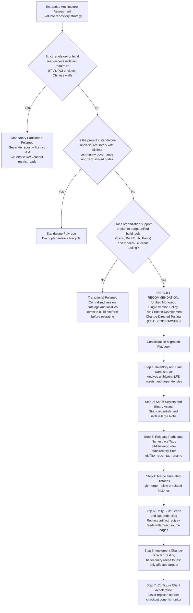

# Decision Record: Monorepo versus Polyrepo Architecture

> [!summary] Scope
> Owns the comprehensive architectural decision record comparing single unified monorepos against multi-repository polyrepo ecosystems for enterprise organizations.
> Reaches Decide at Scale rungs by evaluating atomic multi-project refactoring, cross-project diamond dependency prevention, codebase visibility, access control partitioning, and VCS and CI infrastructure overhead.
> Establishes the default recommendation, triggers for choosing polyrepos, and step-by-step repository consolidation migration paths.

The low-level virtual file system mechanics, Scalar daemon internals, and sparse-index chunk formats are owned by [[Git-At-Scale-VFS-Scalar-and-Monorepos]].
The next-generation change-based version control models and patch algebra are owned by [[Beyond-Git-Jujutsu-Sapling-and-Patch-Theory]].
Merge queue orchestration, branch protection policies, and review sharding are owned by [[Git-Branching-Models-Merge-Queues-and-Code-Review]].
History rewriting algorithms and secret scrubbing are owned by [[Remove-Secrets-and-Rewrite-Git-History]].
Submodule pointer tracking and LFS smudge filters are owned by [[Git-Submodules-Subtrees-LFS-and-Attributes]].
Wire protocol negotiations and blobless partial clones are owned by [[Git-Transfer-Protocol-and-Partial-Clone]].
Index stat caching and the file system monitor daemon are owned by [[Git-Index-Stat-Cache-and-Fsmonitor]].
Multi-pack indexes, commit-graphs, and reachability bitmaps are owned by [[Git-GC-Maintenance-MIDX-and-Commit-Graph]].
This playbook owns the definitive organizational architectural decision record, trade-off evaluation framework, and repository consolidation migration runbook.

## Trigger and Symptoms

Activate this decision record and operational playbook when an organization faces systemic architectural friction from repository fragmentation or when evaluating code consolidation for multi-team engineering fleets.

### Polyrepo Failure Symptoms
- **Diamond dependency gridlock:** Service A depends on Library B v1.2.0 and Library C v1.0.0, while Library C transitively depends on Library B v2.0.0.
  In languages with a flat link-time symbol namespace like C or C++, this causes link-time multiple definition errors or runtime One Definition Rule (ODR) violations.
  Go avoids the link error by construction: Minimal Version Selection builds with exactly one version per module path, and a new major version is a different module path (https://go.dev/ref/mod#minimal-version-selection).
  In languages with global module registries like Python, the interpreter loads only one version into `sys.modules`, silently causing attribute errors in downstream callers.
- **Cross-repository PR cascades:** Updating a shared serialization schema, protobuf definition, or base interface requires coordinating ten distinct pull requests across separate repositories.
  Engineers must manually sequence merges, publish intermediate semantic version tags to artifact registries, and wait for downstream builds, taking weeks to ship a single logical change.
- **Internal library drift and stale forks:** Teams copy-paste utility functions or fork internal packages into their own repositories rather than navigating cross-repo contribution hurdles.
  This leads to dozens of unmaintained variations of authentication, logging, and database connection logic across the fleet.
- **Incomplete security patching:** Remediating a zero-day vulnerability in a foundational dependency requires scanning hundreds of independent repositories.
  Security teams discover that many repositories lack active owners, have stale CI configurations, or fail to build from source, preventing timely CVE mitigation.
- **Opaque cross-team visibility:** Engineers cannot globally grep or search the corporate codebase, preventing discovery of existing components and leading to redundant reinvented wheels.

### Unoptimized Monorepo Failure Symptoms
- **Degraded VCS client performance:** Local commands like `git status`, `git checkout`, and `git diff` take 15 to 45 seconds because Git traverses hundreds of thousands of files on disk.
- **CI runner exhaustion and build queues:** Pull requests trigger massive, un-scoped test suites that attempt to build the entire repository, resulting in multi-hour CI wait times and high cloud compute bills.
- **Mainline merge contention:** Hundreds of engineers push commits to a single trunk simultaneously, generating frequent merge conflicts, speculative queue rejections, and branch serialization delays.
- **Developer workstation strain:** IDEs freeze while indexing millions of lines of code, and developer disk drives fill up from downloading multi-gigabyte packfiles and compilation artifacts.

## Decision Tree

The following flowchart defines the architectural decision process for choosing between a unified monorepo and a partitioned polyrepo architecture, followed by the repository consolidation execution path.



## Prerequisites

Execute this procedure on an isolated triage or migration workstation with fast local NVMe storage and sufficient memory to process Git fast-import streams.
Do not run migration rewrites directly on production workstations or shared developer servers.

### Toolchain Dependencies

Verify that the required migration utilities and version control clients are installed on Linux or macOS.

```bash
command -v git git-filter-repo python3 scalar bazel
```

- `git`: Version 2.45.0 or later (as of 2026-11, Both) with native support for `core.sparseIndex`, `core.fsmonitor`, `merge-ort`, and wire protocol v2.
- `git-filter-repo`: Release v2.38.0 or later (latest release v2.47.0 as of 2026-11, Both; there is no v2.40.0, per https://github.com/newren/git-filter-repo/releases), the Python-based fast-export stream rewriter officially recommended by the Git project.
- `scalar`: Distributed with Git 2.38+, used to configure background repository maintenance and sparse working trees.
- `bazel`: Version 7.0.0 or later (as of 2026-11, Both) or an equivalent build system supporting reverse dependency graph queries (`buck2`, `nx`, `pants`).
- `python3`: Version 3.10 or later for dependency analysis and migration scripting.

### Permissions and Infrastructure Checks
- **Monorepo write privileges:** Repository administrator access to the target monorepo to adjust branch protection rules and configure automated merge queues.
- **Source repository freeze:** Permission to mark all incoming polyrepos as read-only or archived in the forge (GitHub, GitLab, Bitbucket) during cutover to prevent split-brain commits.
- **Local storage capacity:** Ensure the migration workstation has free disk space equal to at least three times the combined uncompressed size of all incoming polyrepos.

**Verification:**

```bash
git --version
git-filter-repo --version
python3 --version
bazel --version
```

Expected output:
- `git` reports version 2.45.0 or higher.
- `git-filter-repo --version` prints an abbreviated commit hash such as `a40bce548d2c`, not a release number (observed on macOS, Homebrew install, 2026-11); read the release from your package manager (`brew info git-filter-repo` or `pip show git-filter-repo`) and confirm v2.38.0 or higher.
- `python3` reports Python 3.10.0 or higher.
- `bazel` reports release 7.0.0 or higher.

## Commands and Numbers to Know

| Item | Platform | Value `(as of 2026-11)` | Why it matters |
| :--- | :--- | :--- | :--- |
| Vanilla Git status degradation threshold | Both | No fixed threshold; cost grows with tracked file count and disk speed | Working tree `lstat()` calls become the dominant wall-clock bottleneck without `fsmonitor`. |
| Windows OS monorepo scale | Both | ~3.5 million files, ~300 GB repo, ~4,000 engineers (Harry, 2017) | Historic scale benchmark prompting Microsoft's creation of GVFS and [[Git-At-Scale-VFS-Scalar-and-Monorepos\|Scalar]]. |
| Google Piper monorepo scale | Both | ~2 billion lines, ~9 million source files (January 2015, Potvin and Levenberg, 2016) | Landmark demonstration of centralized trunk-based monorepo scaling across tens of thousands of engineers. |
| `git merge --allow-unrelated-histories` | Both | Disabled by default since Git 2.9.0 (2.9.0 release notes) | Mandatory safety flag required to merge independent repository histories into a single trunk. |
| `git-filter-repo` rewrite throughput | Linux / macOS | No throughput figure is published; the manual describes `git filter-branch` as orders of magnitude slower | Replaces `git filter-branch` by operating directly on in-memory fast-export and fast-import streams. |
| Sparse-index memory and latency reduction | Both | Index size tracks populated paths, not total files; no fixed percentage | Compresses unpopulated directories in the index into sparse directory entries marked with `SKIP_WORKTREE`; off by default and documented as experimental in git-sparse-checkout(1) (as of 2026-11). |
| `core.fsmonitor` status latency | macOS / Linux | No fixed latency; `git status` avoids a full working tree scan | Replaces recursive disk scanning with operating system kernel event feeds (FSEvents on macOS, inotify on Linux, per git-fsmonitor--daemon(1) as of Git 2.56.0). |
| Blobless clone bandwidth reduction | Both | Savings depend on the repository; blobs are fetched on demand | Clones with `--filter=blob:none` download all commits and trees while fetching file contents on-demand. |
| Bazel `rdeps` query complexity | Both | $O(V + E)$ DAG traversal | Enables calculation of affected test targets in CI. |
| Polyrepo diamond dependency conflict rate | Both | No published rate | Frequency of transitive version mismatches in large organizations using independent SemVer versioning. |

## Step-by-Step Execution

Follow these numbered steps to execute a clean, conflict-free consolidation of independent polyrepos into a unified enterprise monorepo while preserving complete commit ancestry, author attribution, and tag history.

### Step 1: Pre-Migration Inventory and Blast Radius Audit

Before modifying history, clone a fresh mirror of the source polyrepo to inspect commit depth, active tags, branch heads, and binary assets.
Never run migration scripts against an existing dirty developer checkout.

```bash
SRC_REPO_URL="https://github.com/example-org/service-auth.git"
WORK_DIR="/var/tmp/repo-migration"
mkdir -p "${WORK_DIR}"
cd "${WORK_DIR}"

git clone --mirror "${SRC_REPO_URL}" service-auth-mirror.git
cd service-auth-mirror.git

# Generate detailed repository metrics and inventory
git rev-list --all --count > ../commit_count.txt
git tag -l > ../tag_list.txt
# A mirror is bare and has no remote-tracking refs, so list local heads
git branch -l > ../branch_list.txt

# Inspect largest objects in history (a bare mirror writes to filter-repo/, not .git/filter-repo/)
git-filter-repo --analyze
head -n 20 filter-repo/analysis/README
head -n 10 filter-repo/analysis/directories-all-sizes.txt
```

**Verification:**
- `commit_count.txt` contains the exact total commit count across all refs.
- `filter-repo/analysis/` contains `README` (overall statistics) plus per-path, per-directory, and per-extension size reports and `renames.txt` (observed with git-filter-repo a40bce548d2c, macOS, 2026-11).
- Ensure that no unexpected active feature branches remain unmerged in the polyrepo.

### Step 2: Scrub Secrets and Isolate Large Binary Assets

Inspect the filter-repo analysis to detect committed secrets, credentials, or large binary objects (> 50 MB) that must not pollute the permanent monorepo history.
If secrets are found, purge them using the procedures owned by [[Remove-Secrets-and-Rewrite-Git-History]].
If large binaries exist, convert them to pointer files using [[Git-Submodules-Subtrees-LFS-and-Attributes]].

```bash
cd "${WORK_DIR}"
# Create a fresh working clone from the mirror for rewriting
git clone file://"${WORK_DIR}/service-auth-mirror.git" service-auth-clean
cd service-auth-clean

# Example: Strip credentials files and enforce size limits
git-filter-repo --invert-paths \
    --path-glob "*.pem" \
    --path-glob "*.key" \
    --path-glob "secrets/*" \
    --strip-blobs-bigger-than 50M \
    --force
```

**Verification:**

```bash
git log --all --full-history -- "secrets/*"
git rev-list --objects --all \
    | git cat-file --batch-check='%(objecttype) %(objectsize) %(rest)' \
    | awk '$1 == "blob" && $2 > 52428800'
```

Expected output:
- `git log` returns 0 commits for the scrubbed secret paths.
- The `cat-file` pipeline prints nothing, proving no reachable blob exceeds 50 MB (`git count-objects -v` reports only aggregate counts and sizes, not per-blob sizes).

### Step 3: Relocate Paths and Namespace Tags

In a monorepo, all files belonging to `service-auth` must live in a designated subdirectory, such as `services/auth/`.
Furthermore, Git tags like `v1.0.0` from different polyrepos will collide if imported directly into the monorepo.
Use `git-filter-repo` to simultaneously shift all historical paths into the destination folder and prefix all tags with the service namespace.

```bash
cd "${WORK_DIR}/service-auth-clean"

# Relocate entire tree to services/auth and prefix tags with auth-
TARGET_SUBDIR="services/auth"
TAG_PREFIX="auth-"

git-filter-repo \
    --to-subdirectory-filter "${TARGET_SUBDIR}" \
    --tag-rename ":${TAG_PREFIX}" \
    --force
```

`--to-subdirectory-filter` rewrites every historical commit so that files originally at the repository root appear as if they were always located under `services/auth/`.
`--tag-rename ":${TAG_PREFIX}"` prepends `auth-` to every tag name (for example, `v1.2.0` becomes `auth-v1.2.0`), completely preventing namespace collisions.
`git-filter-repo` automatically deletes the `origin` remote configuration after execution to prevent accidental pushes of rewritten history (git-filter-repo(1); observed on a fresh clone, macOS, 2026-11).

**Verification:**

```bash
ls -la
git log -1 --stat
git tag -l
```

Expected output:
- The top-level directory contains only the `services/` directory; all original root files (`README.md`, `src/`, `Cargo.toml`) now reside under `services/auth/`.
- `git log -1 --stat` shows file paths prefixed with `services/auth/`.
- `git tag -l` lists all tags prefixed with `auth-` (for example, `auth-v1.0.0`).

### Step 4: Merge Unrelated Histories into Monorepo Trunk

Navigate to your central enterprise monorepo working copy, add the filtered repository as a local temporary remote, fetch its refs and tags, and merge its trunk branch.

```bash
MONOREPO_DIR="/var/tmp/monorepo"
cd "${MONOREPO_DIR}"

# Ensure working directory is clean and updated to main trunk
git checkout main
git pull origin main

# Add temporary local remote
git remote add import-auth "${WORK_DIR}/service-auth-clean"
git fetch import-auth --tags

# Execute merge allowing unrelated commit graphs
git merge --allow-unrelated-histories \
    --no-ff \
    -m "feat(mono): consolidate service-auth into services/auth" \
    import-auth/main

# Clean up temporary remote
git remote remove import-auth
```

Because `services/auth/` does not collide with existing top-level files in the monorepo, the ORT merge engine cleanly joins the two graphs without textual merge conflicts.
The resulting merge commit has two parent commits: the previous monorepo `HEAD` and the latest commit from `service-auth-clean`.

**Verification:**

```bash
git status --short
git log --graph --oneline -n 10
git log --follow services/auth/README.md | head -n 15
```

Expected output:
- `git status` reports working tree clean.
- `git log --graph` displays the two converging history branches meeting at the merge commit.
- `git log --follow services/auth/README.md` shows the complete historical commit chain extending back to the initial commit of the original polyrepo.

### Step 5: Unify Build Graph and Dependencies

Once source trees are joined, eliminate artifact registry dependencies (such as internal npm packages, Maven artifacts, or Python wheels) and replace them with direct in-repo build targets.
Under a Single Version Policy, external third-party dependencies are pinned at single organizational versions in root workspace files.

```bash
cd "${MONOREPO_DIR}"

# Example: Generate Bazel BUILD file for the newly imported service
cat << 'EOF' > services/auth/BUILD.bazel
load("@rules_cc//cc:defs.bzl", "cc_binary", "cc_library")

cc_library(
    name = "auth_lib",
    srcs = glob(["src/*.cc"], exclude = ["src/main.cc"]),
    hdrs = glob(["include/*.h"]),
    visibility = ["//visibility:public"],
    deps = [
        "//common/logging:logging_lib",
        "//common/crypto:crypto_lib",
    ],
)

cc_binary(
    name = "auth_server",
    srcs = ["src/main.cc"],
    deps = [":auth_lib"],
)
EOF

# Update root MODULE.bazel or WORKSPACE to deduplicate third-party dependencies
bazel build //services/auth/...
```

**Verification:**

```bash
bazel query 'deps(//services/auth:auth_server)' | grep '//common/'
```

Expected output:
- The query confirms that `//services/auth:auth_server` depends directly on internal monorepo source targets `//common/logging:logging_lib` and `//common/crypto:crypto_lib` rather than external packaged binaries.

### Step 6: Deploy Change-Directed Testing (CDT) in CI

To prevent CI execution times from scaling linearly with repository size, implement Change-Directed Testing.
Use `git diff` to determine changed files against the target branch and use Bazel reverse dependency queries (`rdeps`) to build and test only affected targets.

Create `tools/ci/run_affected_tests.sh`:

```bash
#!/usr/bin/env bash
set -euo pipefail

BASE_REF="${1:-origin/main}"

# 1. Files changed in the commit range; deleted files are excluded because Bazel cannot load them
CHANGED_FILES=$(git diff --name-only --diff-filter=ACMR "${BASE_REF}...HEAD")

if [ -z "${CHANGED_FILES}" ]; then
    echo "No files modified. Skipping test execution."
    exit 0
fi

# 2. set() accepts bare source paths and resolves each to its file label; --keep_going skips paths
#    that belong to no package (for example a top-level README.md) instead of aborting the query
AFFECTED_TESTS=$(bazel query \
    --keep_going \
    --noshow_progress \
    "kind('.*_test', rdeps(//..., set(${CHANGED_FILES})))" 2>/dev/null || true)

if [ -n "${AFFECTED_TESTS}" ]; then
    echo "Executing affected tests:"
    echo "${AFFECTED_TESTS}"
    # shellcheck disable=SC2086
    bazel test --test_output=errors ${AFFECTED_TESTS}
else
    echo "No test targets affected by modified files."
fi
```

The `bazel query` expression language has no `owner()` function (it is not in the function list of Bazel 9.3.2, which rejects it with `unknown function 'owner'`), so the script relies on `set()` alone.
Observed with Bazel 9.3.2 on macOS (2026-11) in a scratch workspace with `//services/auth` and `//services/billing`, each a `cc_library` plus a `cc_test` over a shared `//common/logging:logging_lib`: `set(services/auth/src/token.cc)` resolves to `//services/auth:src/token.cc`, and the full expression returns only `//services/auth:auth_test`.
Editing `common/logging/log.cc` instead returns both service tests, and a change to a top-level `README.md` alone returns nothing.
The `kind('.*_test', ...)` pattern matched `cc_test` targets with and without a trailing ` rule`.

**Verification:**

```bash
chmod +x tools/ci/run_affected_tests.sh
# The script diffs commits (HEAD~1...HEAD), so a touch or an uncommitted edit is invisible to it
echo "// cdt probe" >> services/auth/src/token.cc
git commit -qam "test: cdt probe"
tools/ci/run_affected_tests.sh HEAD~1
git reset --hard HEAD~1
```

Expected output:
- Output lists only test targets within `//services/auth/...` or downstream services consuming `//services/auth/...`.
- Unrelated services (such as `//services/billing/...`) are completely omitted from the test run.

### Step 7: Configure Client Acceleration and Paved Roads

Large monorepos degrade developer performance if workstations maintain full checkouts without virtualized or sparse index structures.
Configure the monorepo with `scalar`, cone-mode sparse-checkouts, and the filesystem monitor daemon.

```bash
cd "${MONOREPO_DIR}"

# Register repository with Scalar for background maintenance
scalar register

# Configure cone mode (the default) with a sparse index for services/auth
# (`git sparse-checkout init` is deprecated; `set --sparse-index` also sets core.sparseIndex)
git sparse-checkout set --cone --sparse-index services/auth common

# Enable background filesystem monitor daemon
git config core.fsmonitor true
git fsmonitor--daemon start
```

Background maintenance automated by Scalar runs the `commit-graph`, `prefetch`, `loose-objects`, and `incremental-repack` (multi-pack-index) tasks per scalar(1), as detailed in [[Git-GC-Maintenance-MIDX-and-Commit-Graph]]; reflog pruning is not one of them.
`git sparse-checkout set --cone` configures Git to only populate directories necessary for the developer's domain, while the sparse index (`--sparse-index`, which sets `core.sparseIndex`; off by default and documented as experimental as of 2026-11) prevents Git from expanding unpopulated directories in memory during status checks.

**Verification:**

```bash
scalar list
git fsmonitor--daemon status
git status
```

Expected output:
- `scalar list` displays the monorepo path under active management.
- `git fsmonitor--daemon status` reports `fsmonitor-daemon is watching '<path>'` (observed with Git 2.55.0, macOS, 2026-11).
- `git status` reports only populated directories and does not scan the unpopulated ones; measure the latency on your own hardware with `time git status` rather than relying on a quoted figure.

## Verification

Validate the complete organizational and technical integrity of the consolidated monorepo by checking the following five invariants:

1. **Commit graph continuity:**
   Verify that `git log --follow` seamlessly traverses the consolidation merge commit into the historical polyrepo commits.
   Command: `git log --follow --oneline services/auth/src/main.cc | wc -l`
   Check: The commit count matches the historical commit count of that file in the original polyrepo.

2. **Tag uniqueness and integrity:**
   Verify that all imported tags exist with their prefix and point to valid historical commits.
   Command: `git tag -l "auth-*" | head -n 5`
   Check: Tags resolve cleanly to commits containing the relocated tree path.

3. **Absence of duplicate diamond libraries:**
   Verify that internal package registries no longer publish separate artifact versions for consolidated libraries.
   Command: `bazel query 'deps(//...)' | grep -E 'artifactory|nexus' || true`
   Check: Query returns empty for internal shared library coordinates.

4. **Sparse index compression:**
   Verify that Git uses sparse index trees rather than expanding all file entries into memory.
   Command: `git ls-files --sparse | grep '/$'` and inspect `.git/index` size (`git rev-parse --is-shallow-repository` reports shallow history, not the sparse index).
   Check: unpopulated directories appear as single sparse directory entries ending in `/` (observed with Git 2.55.0, macOS, 2026-11), and `.git/index` size is proportional to populated files rather than total monorepo files.

5. **Affected test calculation accuracy:**
   Verify that modifying a leaf service file does not trigger test execution for sibling services.
   Command: commit a one-line edit to `services/auth/src/main.cc`, run `tools/ci/run_affected_tests.sh HEAD~1`, and verify that no test outside `//services/auth/...` and its reverse dependencies executes.

## Rollback Procedure

If consolidation must be reverted for a specific service (for example, if a team is divested, spun out, or requires open-source release as an independent polyrepo), execute this inverse extraction procedure.

### Step 1: Clone a Clean Monorepo Mirror

```bash
EJECT_DIR="/var/tmp/repo-ejection"
mkdir -p "${EJECT_DIR}"
cd "${EJECT_DIR}"

git clone file://"${MONOREPO_DIR}" service-eject-work
cd service-eject-work
```

### Step 2: Extract Subdirectory to Root and Strip Tag Prefixes

Use `git-filter-repo --subdirectory-filter` to extract the service subdirectory back to the root level.
Use `--tag-rename` to strip the prefix that was added during consolidation.

```bash
cd "${EJECT_DIR}/service-eject-work"

# Extract services/auth to root and remove auth- prefix from tags
git-filter-repo \
    --subdirectory-filter services/auth \
    --tag-rename "auth-:" \
    --force
```

`--subdirectory-filter services/auth` discards all commits and tree objects unrelated to `services/auth/` and promotes the contents of that folder to the repository root.
`--tag-rename "auth-:"` strips the `auth-` prefix, restoring original tag names like `v1.0.0`.

**Verification:**

```bash
ls -la
git log -1 --stat
git tag -l
```

Expected output:
- The repository root contains `src/`, `include/`, and `BUILD.bazel` directly.
- `git log` shows only commits that modified files within the extracted service.
- Tags no longer carry the `auth-` prefix.

### Step 3: Re-establish Upstream Remote and CI Pipelines

```bash
NEW_POLYREPO_URL="git@github.com:example-org/standalone-auth.git"
git remote add origin "${NEW_POLYREPO_URL}"
git push --set-upstream origin main --tags
```

**Verification:**
- Clone `NEW_POLYREPO_URL` in a fresh directory and confirm clean build execution and test pass.

## Failure Modes of the Procedure

| Failure | How it shows up | Recovery |
| :--- | :--- | :--- |
| Root file collision on import | `git merge` fails with `CONFLICT (add/add): Merge conflict in .gitignore` or `README.md`. | Ensure `git-filter-repo --to-subdirectory-filter` was executed on the polyrepo before merging. If merging shared top-level config, resolve manually keeping monorepo conventions. |
| Tag namespace collision | `git fetch import-auth` fails or warns `! [rejected] v1.0.0 -> v1.0.0 (would clobber existing tag)`. | Abort merge. Re-run `git-filter-repo --tag-rename :<prefix>-` on the source repository so all incoming tags are unique. |
| Broken Git LFS pointers | Files appear as 130-byte text pointers; build fails with missing binary header errors. | Execute `git lfs fetch --all` on the polyrepo before rewriting. Ensure `.gitattributes` rules are relocated to `services/<name>/.gitattributes` or merged into root `.gitattributes`. |
| `git-filter-repo` non-fresh clone rejection | Error: `Aborting: Refusing to destructively overwrite repo history since this does not look like a fresh clone.` (observed, macOS, 2026-11). | `git-filter-repo` protects against accidental history rewriting. Pass `--force` or clone a fresh local copy with `git clone file:///path/to/repo fresh-clone`. |
| CI runner OOM or timeout | Monorepo CI attempts to execute `bazel test //...` across 500,000 targets, exhausting RAM and timing out after 4 hours. | Enforce Change-Directed Testing (CDT) script in CI. Ensure PR builds run `rdeps` queries instead of global wildcards. |
| Submodule pointer corruption | Git reports `fatal: transport 'file' not allowed` or working tree leaves empty directory stubs for nested gitlinks. | Resolve or absorb submodules prior to consolidation using `git submodule absorbgitdirs` or convert submodules to plain trees with `git subtree` or `git-filter-repo`. |
| Accidental history erasure | An engineer uses `rsync` or copy-pastes code into a branch and commits, destroying all git blame and historical commit authorship. | Reject the PR. Re-run Step 3 and Step 4 using `git-filter-repo --to-subdirectory-filter` and `git merge --allow-unrelated-histories` to preserve the complete Merkle commit graph. |

## Pitfalls

> [!warning] The Polyrepo Inside a Monorepo Anti-Pattern
> Simply moving multiple projects into a single Git repository without changing dependency mechanics produces the worst of both worlds.
> If teams continue to use independent `package.json`, `pom.xml`, or `Cargo.toml` files that reference published internal binary packages through Artifactory, they suffer the VCS scale overhead of a monorepo while retaining all the diamond dependency and cascading release pains of a polyrepo.
> A monorepo requires a Single Version Policy: dependencies between internal libraries must be direct source-level graph edges in the build tool, not version-stamped binary releases.

> [!warning] Git Merkle DAG Read-Access Physics
> Many engineering organizations attempt to enforce path-based read restrictions (such as preventing Team A from reading `services/finance/`) inside a standard Git repository.
> Vanilla Git does not support this.
> Because Git uses a content-addressable Merkle tree where every commit hash is cryptographically derived from the SHA hashes of its constituent trees and blobs, a client cannot verify history or run `git fsck` without receiving the complete tree graph.
> The git-fetch(1) SECURITY section states that the fetch and push protocols are not designed to prevent one side from stealing data not intended to be shared, and that namespaces on a server are not effective for read access control.
> If strict, legally mandated read isolation is required (such as ITAR defense code, PCI credit card enclaves, or multi-tenant banking segregation), you MUST use physically separate polyrepos or an enterprise virtual file system layer (like Google CitC or Meta EdenFS).
> Path-based access control in Git only works for write operations via `CODEOWNERS` and server-side pre-receive hooks.

> [!warning] The Full-Clone CI Storm
> In an enterprise monorepo with gigabytes of history, configuring CI runners to execute a standard `git clone` on every job creates catastrophic network bottlenecks on internal Git servers.
> CI runners must be configured to use blobless partial clones (`git clone --filter=blob:none`) combined with sparse checkouts.
> This allows the CI runner to fetch only the commits and trees necessary to calculate the diff, fetching only the blobs required for the specific affected targets being compiled.
> Pair this with server-side CDN bundle URIs as detailed in [[Git-Transfer-Protocol-and-Partial-Clone]].

> [!warning] Flaky Test Contagion in the Merge Queue
> In a polyrepo world, a flaky unit test in `service-billing` only impacts the billing team.
> In a monorepo served by an automated speculative merge queue (such as Bors or GitHub Merge Queue), a single flaky test in any service can fail an entire batch of speculative merges, ejecting healthy commits from other teams and stalling trunk progress for the entire enterprise.
> Monorepos require strict automated test quarantine systems: tests exhibiting non-deterministic failures must be automatically stripped of gating status and routed to background remediation queues.

> [!warning] Unbounded Build Visibility
> Without explicit visibility boundaries, engineers in a monorepo will import private internal implementation details of sibling services.
> Over time, this transforms a modular codebase into an entangled, unmaintainable monolith where changing an internal helper function in one team breaks compilation across fifty other teams.
> Enforce strict package visibility rules in your build system (for example, Bazel `visibility = ["//services/auth:__subpackages__"]`) and mandate clean, public API facades.

## At Scale

At scale (1,000 to 50,000 engineers), repository architecture ceases to be a developer preference and becomes an economic trade-off between build infrastructure costs and organizational coordination overhead.

### Trade-Off Matrix: Monorepo vs Polyrepo

The following table summarizes the foundational engineering trade-offs between unified monorepos and distributed polyrepos.

| Architectural Dimension | Unified Monorepo (Trunk-Based) | Partitioned Polyrepo Fleet |
| :--- | :--- | :--- |
| **Atomic Multi-Project Refactoring** | Trivial: a single commit updates API definitions and all consumers simultaneously. | Painful: requires coordinated, multi-stage PR cascades, deprecation phases, and SemVer bumps. |
| **Diamond Dependency Management** | Solved by design: Single Version Policy ensures exactly one version of any library exists at `HEAD`. | Severe failure mode: transitive version mismatches cause runtime symbol collisions and ODR violations. |
| **Code Sharing and Discoverability** | Universal: single search index, global grep, zero barriers to discovering existing shared components. | Fragmented: code is siloed across hundreds of repos; discovery requires complex indexing portals. |
| **Access Control (Read Permissions)** | All-or-nothing: Git Merkle DAG requires all developers to have read access to the entire tree. | Granular: native repository-level IAM access controls partition sensitive projects. |
| **VCS Client Complexity** | High: requires `scalar`, `fsmonitor`, cone-mode `sparse-checkout`, and partial clones. | Low: vanilla Git works out-of-the-box on standard workstations without specialized configuration. |
| **CI/CD Architecture** | Requires Change-Directed Testing (CDT) and remote build execution/caching (e.g. Bazel/Buck2). | Simple per-repo CI pipelines; full test suites run on every commit without complex graph analysis. |
| **Mainline Merge Throughput** | Requires automated speculative merge queues and build trains to prevent trunk serialization. | Independent: each repository maintains its own merge cadence without cross-team lock contention. |
| **Team Autonomy and Tooling Freedom** | Constrained: teams share a unified build system, standardized linters, and synchronized dependencies. | High: teams can independently choose programming languages, build tools, and release cycles. |
| **Infrastructure Engineering Investment** | High: requires dedicated developer tooling teams to maintain VCS and build infrastructure. | Low to moderate: standard SaaS tooling and forge defaults suffice until scale bottlenecks hit. |

### The Mathematics of Change-Directed Testing (CDT)

In a polyrepo ecosystem, CI execution time scales with the size of each independent service:
$$T_{\text{poly}} = O(|S_i|)$$
where $|S_i|$ is the test duration of service $i$.
However, the organizational overhead scales with the number of cross-repo dependency edges $E_{\text{cross}}$:
$$\text{Coordination Overhead} = O(E_{\text{cross}} \cdot \Delta t_{\text{release}})$$
where $\Delta t_{\text{release}}$ is the publishing and validation latency of intermediate packages.

In a monorepo, testing the entire codebase on every pull request is impossible:
$$T_{\text{full}} = \sum_{k=1}^{N} |S_k| \longrightarrow \infty$$
To maintain sub-15-minute CI feedback loops, monorepos rely on Change-Directed Testing.
The build system models the entire codebase as a Directed Acyclic Graph (DAG) $G = (V, E)$, where vertices $V$ represent build and test targets, and directed edges $E$ represent dependencies.

When a pull request modifies a set of files $F_{\text{mod}}$, the build system identifies the directly modified targets:
$$V_{\text{mod}} = \{ v \in V \mid \text{owner}(f) = v, f \in F_{\text{mod}} \}$$
The test runner then calculates the transitive reverse dependency closure (the downstream blast radius):
$$\text{rdeps}(V_{\text{mod}}) = \{ u \in V \mid \exists \text{ path from } u \text{ to } v \in V_{\text{mod}} \}$$
The set of tests to execute is strictly filtered:
$$T_{\text{exec}} = \{ u \in \text{rdeps}(V_{\text{mod}}) \mid \text{kind}(u) = \text{test} \}$$

Because the blast radius of a localized commit is usually a small fraction of the target graph, CDT cost tracks the size of the affected closure rather than the size of the repository:
$$T_{\text{monorepo\_ci}} \approx O(|\text{rdeps}(V_{\text{mod}})|) \ll T_{\text{full}}$$

### Decision Rules for Organizational Leadership

1. **The Default Rule:** Default to a unified monorepo with Trunk-Based Development, a Single Version Policy, and Change-Directed Testing.
   The developer velocity gains from atomic refactoring and the complete elimination of diamond dependency hell outweigh the VCS infrastructure overhead for organizations that meet the build platform precondition in rule 4.
2. **The Hard Polyrepo Exception (Regulatory/Compliance):** Choose polyrepos only when hard regulatory, legal, or cryptographic security boundaries mandate that specific groups of engineers cannot possess read access to code (for example, defense ITAR code, PCI payment enclaves, or competitive multi-tenant business divisions).
3. **The Open-Source Exception:** Choose standalone polyrepos for open-source libraries intended for external community adoption that possess zero internal dependencies and follow independent release cadences.
4. **The Build Platform Precondition:** Do not execute a monorepo consolidation migration until the organization has adopted or committed to a hermetic, graph-aware build system (Bazel, Buck2, Nx, or Pants).
   Consolidating code into a single Git repository while relying on disconnected build tools produces an unmaintainable "monolith of despair".

## Practice Drill

> [!tip] Practice Drill: Consolidating and Ejecting Two Repositories with Full History
> To build muscle memory for repository consolidation, execute this drill in a temporary directory on a Linux or macOS machine with `git` and `git-filter-repo`.
> Target completion time: under 15 minutes.
>
> 1. **Create two mock polyrepos:**
>    ```bash
>    DRILL_DIR=$(mktemp -d /tmp/git-drill-XXXXXX)
>    cd "${DRILL_DIR}"
>    
>    mkdir repo-auth repo-billing monorepo
>    
>    # Set up repo-auth
>    cd "${DRILL_DIR}/repo-auth"
>    git init -b main
>    echo "package auth" > auth.go
>    git add auth.go && git commit -m "feat(auth): initial auth logic"
>    echo "func Authenticate() {}" >> auth.go
>    git add auth.go && git commit -m "feat(auth): add Authenticate func"
>    git tag v1.0.0
>    
>    # Set up repo-billing
>    cd "${DRILL_DIR}/repo-billing"
>    git init -b main
>    echo "package billing" > billing.go
>    git add billing.go && git commit -m "feat(billing): initial billing logic"
>    git tag v1.0.0
>    
>    # Set up initial monorepo
>    cd "${DRILL_DIR}/monorepo"
>    git init -b main
>    echo "# Enterprise Monorepo" > README.md
>    git add README.md && git commit -m "chore: initial monorepo commit"
>    ```
>
> 2. **Rewrite histories into subdirectories and namespace tags:**
>    ```bash
>    # --force is required: a repo made with git init is not a fresh clone, so filter-repo aborts without it
>    cd "${DRILL_DIR}/repo-auth"
>    git-filter-repo --to-subdirectory-filter services/auth --tag-rename :auth- --force
>    
>    cd "${DRILL_DIR}/repo-billing"
>    git-filter-repo --to-subdirectory-filter services/billing --tag-rename :billing- --force
>    ```
>
> 3. **Merge both into monorepo:**
>    ```bash
>    cd "${DRILL_DIR}/monorepo"
>    
>    git remote add auth-src "${DRILL_DIR}/repo-auth"
>    git fetch auth-src --tags
>    git merge --allow-unrelated-histories --no-ff -m "merge auth" auth-src/main
>    git remote remove auth-src
>    
>    git remote add billing-src "${DRILL_DIR}/repo-billing"
>    git fetch billing-src --tags
>    git merge --allow-unrelated-histories --no-ff -m "merge billing" billing-src/main
>    git remote remove billing-src
>    ```
>
> 4. **Verify the consolidation:**
>    ```bash
>    ls -la services/auth services/billing
>    git tag -l
>    git log --follow --oneline services/auth/auth.go
>    ```
>    Confirm that `auth.go` shows its two historical commits from before the merge and that tags `auth-v1.0.0` and `billing-v1.0.0` coexist without collisions.
>
> 5. **Eject `services/billing` back to an independent polyrepo:**
>    ```bash
>    cd "${DRILL_DIR}"
>    git clone file://"${DRILL_DIR}/monorepo" ejected-billing
>    cd ejected-billing
>    git-filter-repo --subdirectory-filter services/billing --tag-rename billing-:
>    ls -la
>    git tag -l
>    ```
>    Confirm that `billing.go` is now at the repository root and that tag `v1.0.0` has had its prefix stripped cleanly.
>    Clean up with `rm -rf "${DRILL_DIR}"`.
>
> If `tag.gpgSign=true` is set in your Git configuration, the lightweight `git tag` commands fail with `no tag message?`.
> Run the drill with `GIT_CONFIG_GLOBAL=/dev/null` or pass `-c tag.gpgSign=false` to `git tag`.

The same consolidation and ejection is automated and asserted by the lab `code/02-Version-Control/monorepo_consolidation/`.
Run it with `make verify LAB=02-Version-Control/monorepo_consolidation/` from `code/`; it needs `git` and `git-filter-repo` on `PATH` and no other requirement.
It also asserts the refusal to merge unrelated histories (exit status 128) and the merge-then-`git mv` scenario from the L6 question below.
Output recorded on darwin-arm64 (Git 2.55.0, git-filter-repo a40bce548d2c, 2026-11), identical to `expected/darwin-arm64.txt`:

```text
ok: merge without --allow-unrelated-histories exits = 128
ok: tags after both imports = auth-v1.0.0,billing-v1.0.0
ok: auth.go history survives the merge = 2
ok: plain git log of billing file needs no --follow = 1
ok: merge commit has two parents = 3
ok: root files = README.md,services
ok: ejected root files = billing.go
ok: ejected tags = v1.0.0
ok: ejected commit count = 1
ok: git mv route: old path is gone = README.md,services
ok: git mv route: plain log = 1
ok: git mv route: --full-history log = 1
ok: git mv route: --follow log = 3
```

## Interview Questions

> [!question] L5 (Predict the output)
> An engineer navigates into an existing Git repository and attempts to merge an independent repository directly:
> ```bash
> git remote add other /tmp/other-repo
> git fetch other
> git merge other/main
> ```
> Assuming Git 2.9.0 or later, what is the exact behavior and terminal output, why did Git introduce this behavior, and what flag overrides it?
>
> > [!success]- Answer
> > Git refuses to execute the merge and exits with code 128, printing:
> > `fatal: refusing to merge unrelated histories`
> > Prior to Git 2.9.0, Git would attempt to create a merge commit between two completely distinct object graphs with no common ancestor commit.
> > The Git 2.9.0 release notes say this "led to a brand new history of an existing project created and then get pulled by an unsuspecting maintainer": not object corruption, but an unintended second root history silently joined to the project.
> > To override this protection when intentionally consolidating repositories, pass the `--allow-unrelated-histories` option to `git merge`.

> [!question] L5
> What is the fundamental algorithmic and architectural difference between `git-filter-repo --to-subdirectory-filter path/` and legacy `git filter-branch --subdirectory-filter path/`?
>
> > [!success]- Answer
> > Legacy `git filter-branch` operates by checking out every individual commit in history to disk (or a temporary index), executing a subshell per commit to inspect and mutate files, and committing the result.
> > This incurs massive disk I/O, process creation overhead, and scales as $O(N)$ filesystem operations, taking hours on repositories with tens of thousands of commits.
> > Furthermore, `git filter-branch --subdirectory-filter` extracts a directory to the root, rather than moving the root into a subdirectory.
> > In contrast, `git-filter-repo` operates directly on the Git fast-export and fast-import text streams in memory.
> > It parses the stream of commit and blob records in Python (filter-repo is a single Python script; the stream itself is produced and consumed by Git's C code), mutates the path strings in-memory without ever checking out files to disk, and streams the rewritten objects back into the Git object database.
> > This avoids the per-commit checkout and subprocess cost that makes `filter-branch` slow; the Git project publishes no commits-per-minute figure.

> [!question] L6 (Debug this)
> An infrastructure engineer consolidated `service-payment` into an enterprise monorepo by merging the unmodified polyrepo with `--allow-unrelated-histories` and then moving its files into `services/payment/` with `git mv` in a follow-up commit.
> When developers run `git log services/payment/api.go`, the history terminates abruptly at the move commit; all earlier commits authored in the polyrepo are missing.
> However, running `git log --follow services/payment/api.go` displays the full, uninterrupted commit history.
> Why does standard `git log` fail to display the earlier commits, what Git mechanism explains this difference, and did the migration corrupt repository history?
>
> > [!success]- Answer
> > The migration did not corrupt history; the underlying Merkle graph and commit objects are completely intact.
> > `git log <path>` without `--follow` performs path-limited traversal: it shows only commits that change that exact pathname, and in every commit before the move the pathname `services/payment/api.go` does not exist.
> > History Simplification therefore finds nothing to show beyond the move commit, and `--full-history` does not help, because it only stops merge pruning and never maps one pathname to another (observed with Git 2.55.0, macOS, 2026-11: plain and `--full-history` both list only the move commit).
> > `--follow` enables rename detection for a single path: at the move commit the diff engine pairs the deleted `api.go` with the added `services/payment/api.go` by content similarity and continues the walk under the old name.
> > To get `--follow` by default for single-path logs, configure `log.follow = true`.
> > The `git-filter-repo --to-subdirectory-filter` route in this playbook avoids the problem entirely: it rewrites every historical commit so the file was always at `services/payment/api.go`, so plain `git log` shows the full history (observed with the Practice Drill, macOS, 2026-11).

> [!question] L6
> Explain the diamond dependency problem across an enterprise polyrepo fleet.
> Contrast how a polyrepo and a monorepo resolve this conflict in a compiled language like C++ or Go.
>
> > [!success]- Answer
> > The diamond dependency problem occurs when an application target A depends on Library B and Library C, and both B and C depend on a common foundational Library D, but at mutually incompatible version constraints (for example, B requires D v1.0 and C requires D v2.0).
> > In a polyrepo ecosystem using published artifact packages (e.g. Artifactory, NuGet, npm):
> > - If the language enforces a flat symbol namespace at link time (C, C++), linking both D v1.0 and D v2.0 into the same binary produces duplicate symbol errors, or worse, silent runtime crashes from One Definition Rule (ODR) violations where two incompatible struct layouts share the same memory offset.
> > - Go does not hit the link error: Minimal Version Selection picks exactly one version per module path, and v2+ is a distinct module path that can coexist with v1, so the cost moves to API breakage when MVS selects a newer minor than B was tested against, or to duplicated v1 and v2 state in one binary.
> > - To fix this in a polyrepo, the team owning target A must lobby the owners of Library B to upgrade to D v2.0, which may require cascading breaking changes across multiple repositories and weeks of release coordination.
> > In a monorepo enforcing a Single Version Policy (Head-based development):
> > - There is only ever ONE version of Library D in the entire repository at any given commit.
> > - Libraries B, C, and target A all compile against the exact same source state of D at `HEAD`.
> > - A diamond on internal source cannot arise because the build graph contains exactly one node for Library D (external third-party dependencies still need the same single-version pin).
> > - When Library D needs an API breaking change, the author of the change executes an atomic refactoring commit that simultaneously updates the interface in D and updates all call sites across B, C, and all other consumers in the same commit.

> [!question] L6
> Why is path-based read access control fundamentally impossible in standard Git without an external virtualized file system?
>
> > [!success]- Answer
> > Git's data architecture is an immutable, content-addressable Merkle Directed Acyclic Graph (DAG).
> > A commit object points to a root tree object.
> > A tree object contains an array of directory entries, where each entry is a tuple of mode, filename, and the cryptographic hash (SHA-1 or SHA-256) of the corresponding sub-tree or blob.
> > The SHA hash of the root tree is cryptographically dependent on the SHA hashes of all nested sub-trees and files.
> > If a Git server attempts to redact a directory from a user during a clone or fetch:
> > 1. The client cannot compute or verify the root tree hash because the child hash is missing.
> > 2. The Git object transfer protocol (Wire Protocol v2) relies on commit and tree reachability walks.
> > If an object is omitted without being replaced by a synthetic tree, `git fsck` and `git checkout` will fail with missing object errors.
> > 3. Therefore, read access in Git is binary: if a user can clone a repository, they can read every object reachable in history.
> > Path-based read control requires a virtualized filesystem layer (such as Google CitC or Meta EdenFS) that intercepts POSIX read calls and authenticates them on-demand against a cloud RPC backend, or separate polyrepos with repository-level IAM boundaries.

> [!question] L7
> Design an automated Change-Directed Testing (CDT) pipeline for an enterprise monorepo handling 200 pull requests per hour across 100,000 build targets.
> How do you prevent merge skew and ensure test reproducibility?
>
> > [!success]- Answer
> > A production-grade CDT pipeline requires three coordinated subsystems:
> > 1. **Graph-Aware Query Engine:**
> >    In CI, execute `git diff --name-only origin/main...HEAD` to find changed files.
> >    Feed these files into Bazel's query engine using `rdeps(//..., set(<changed_targets>))` to compute the minimal set of affected test targets.
> >    Restrict the universe scope using package boundary heuristics to avoid parsing the full repository graph on localized edits.
> > 2. **Remote Build Execution and Caching (RBE):**
> >    Connect Bazel to a distributed remote cache and execution cluster.
> >    Compile and test actions are content-addressed by the cryptographic hashes of their input files, compiler flags, and toolchain binaries.
> >    Unmodified reverse dependencies hit the remote action cache instead of re-executing, downloading only test result outputs (`--remote_download_outputs=toplevel`).
> > 3. **Speculative Merge Queue (Eliminating Merge Skew):**
> >    Merge skew occurs when PR 1 and PR 2 both pass CI independently against `main`, but conflict semantically when merged together.
> >    To eliminate skew, engineers do not merge directly to `main`.
> >    Approved PRs enter an automated speculative merge queue (e.g. Bors or GitHub Merge Queue).
> >    The queue creates speculative merge heads (`main + PR1`, `main + PR1 + PR2`) and runs CDT against the combined speculative head.
> >    If a batch fails, the queue uses binary search to isolate the failing PR, ejects it, and merges the passing commits into `main` without manual developer re-testing.

> [!question] L7
> Author an architectural decision record: When should a technology enterprise deliberately reject the monorepo default and maintain a polyrepo architecture?
> Name five definitive triggers.
>
> > [!success]- Answer
> > An enterprise should reject the monorepo default and enforce a polyrepo architecture when any of the following five triggers apply:
> > 1. **Strict Legal or Regulatory Read Isolation:** The organization operates under legal frameworks (such as defense ITAR regulations, PCI-DSS cardholder data environments, healthcare HIPAA rules, or multi-tenant banking Chinese walls) where developers on Project A are legally prohibited from possessing read access to Project B.
> > 2. **Completely Independent Open-Source Governance:** The project is a standalone open-source library or framework intended for external community consumption with an independent release cadence, zero dependencies on internal infrastructure, and external maintainers.
> > 3. **Lack of Build Platform Investment Capability:** The organization lacks the engineering budget or headcount to maintain dedicated developer tooling teams, hermetic build systems (Bazel/Buck2), or merge queues.
> > Attempting a monorepo with vanilla Maven, Gradle, or npm without graph-aware tooling results in a broken, slow monolith.
> > 4. **Decoupled Organizational Lifecycles with Zero Code Sharing:** Completely distinct corporate subsidiaries or acquired entities that share zero code, runtime infrastructure, or developer workflows, and have no business requirement for cross-project refactoring.
> > 5. **External Vendor and Contractor Access:** The organization relies extensively on third-party offshore contractors who must only access a specific component, and the enterprise does not operate a virtualized file system with fine-grained access control.

> [!question] L8+
> A 10,000-engineer company is migrating 500 polyrepos into a unified monorepo.
> How do you design the source code management, virtual file system, build caching, and merge queue architecture so that local checkout times stay under 10 seconds and merge queue latency remains bounded under 1,000 commits per day?
>
> > [!success]- Answer
> > To achieve this scale, design four tightly coupled layers:
> > 1. **Source Control and Virtualization Layer:**
> >    Deploy Git with `scalar` enterprise policies.
> >    Enforce blobless clones (`--filter=blob:none`) backed by server-side CDN bundle URIs to offload clone bandwidth.
> >    Enable `core.sparseIndex = true` so that the index holds sparse directory entries for unpopulated directories instead of one entry per file.
> >    Run `git-fsmonitor--daemon` so `git status` is driven by OS file system events instead of a full tree scan, and set the latency budget from your own measurements.
> >    For massive working trees, deploy a virtual file system driver (such as Microsoft VFS for Git or Meta EdenFS; Scalar itself is not a virtual file system, per scalar(1)) that projects the repository tree into user space and pages in file blobs on demand upon file open.
> > 2. **Build and Action Cache Layer:**
> >    Mandate Bazel or Buck2 with hermetic toolchains.
> >    Deploy a distributed Remote Build Execution (RBE) grid with a globally replicated content-addressable action cache.
> >    Enable "Build without the Bytes" (`--remote_download_outputs=toplevel`), meaning intermediate compilation artifacts (`.o` files) remain on remote workers and are never downloaded to developer laptops.
> > 3. **High-Throughput Speculative Merge Queue:**
> >    At 1,000 commits per day, sequential merging creates an impossible bottleneck.
> >    Deploy a multi-lane speculative merge queue utilizing server-side worktree-free git replay primitives (`git replay`, added in Git 2.44.0 and still marked EXPERIMENTAL in git-replay(1) as of Git 2.56.0, and `git merge-tree --write-tree`).
> >    The queue batches incoming PRs into speculative trains (e.g. Batch 1: Commits 1-5; Batch 2: Commits 6-10 assuming Batch 1 passes).
> >    CI runs CDT against the speculative batch heads in parallel.
> >    When a batch fails, speculative branch prediction splits the batch to isolate the culprit in $O(\log N)$ time while allowing passing batches to fast-forward into trunk.
> > 4. **Governance and Blast Radius Containment:**
> >    Shard ownership via granular `CODEOWNERS` mapped to LDAP groups.
> >    Enforce package visibility restrictions in the build graph so that private service implementations cannot be imported across domain boundaries.
> >    Deploy automated flaky test detection to immediately quarantine non-deterministic tests, preventing merge queue stalls.

## Further Reading

- Rachel Potvin and Josh Levenberg, Why Google Stores Billions of Lines of Code in a Single Repository, Communications of the ACM, Vol. 59 No. 7, 2016, https://doi.org/10.1145/2854146.
  The seminal paper documenting Google Piper, CitC virtual file systems, trunk-based development, and the engineering rationale for unified monorepos.
- Durham Goode and Rain, Scaling Mercurial at Facebook, Meta Engineering Blog, 2014, https://engineering.fb.com/2014/01/07/core-infra/scaling-mercurial-at-facebook/.
  Details how Meta scaled Mercurial with Watchman file system monitoring, the remotefilelog extension, and native rewrites of hot loops for a repository many times larger than the Linux kernel.
- Brian Harry, The Largest Git Repo on the Planet, Microsoft DevOps Blog, 2017, https://devblogs.microsoft.com/bharry/the-largest-git-repo-on-the-planet/.
  Documents Microsoft's migration of the Windows codebase (3.5 million files, 300 GB, about 4,000 engineers) into Git and the creation of GVFS, the predecessor of Scalar.
- Elijah Newren, git-filter-repo User Manual, Git Project, 2024, https://htmlpreview.github.io/?https://github.com/newren/git-filter-repo/blob/docs/html/git-filter-repo.html.
  The authoritative manual for modern Git history rewriting, path filtering, and repository consolidation.
- Git Community, scalar(1) Reference Manual, Git 2.56.0, 2026, https://git-scm.com/docs/scalar.
  Reference documentation for configuring large-repository client maintenance and sparse enlistments.
- Git Community, git-sparse-checkout(1) and Cone Mode, Git 2.56.0, 2026, https://git-scm.com/docs/git-sparse-checkout.
  Technical specifications for cone-mode pattern matching and sparse index integration.
- Bazel Authors, Bazel Query: Reverse Dependencies (rdeps) and Target Expressions, Google Inc., 2026, https://bazel.build/query/language#rdeps.
  The query language specification for computing dependency closures and change-directed test suites.
- Tom Preston-Werner, Semantic Versioning 2.0.0, SemVer Specification, 2013, https://semver.org/spec/v2.0.0.html.
  The specification governing version ranges and the root cause of transitive diamond dependency conflicts in distributed package ecosystems.

## Related

- Prerequisites: [[Git-At-Scale-VFS-Scalar-and-Monorepos]]
- Next: [[Beyond-Git-Jujutsu-Sapling-and-Patch-Theory]]
- Lab: `code/02-Version-Control/monorepo_consolidation/`
- See also:
  - [[Git-Branching-Models-Merge-Queues-and-Code-Review]]
  - [[Decision-Record-Merge-vs-Rebase-and-Branching]]
  - [[Remove-Secrets-and-Rewrite-Git-History]]
  - [[Git-Submodules-Subtrees-LFS-and-Attributes]]
  - [[Git-Transfer-Protocol-and-Partial-Clone]]
  - [[Git-Index-Stat-Cache-and-Fsmonitor]]
  - [[Git-GC-Maintenance-MIDX-and-Commit-Graph]]
  - [[Git-Trace2-Telemetry-and-Diagnostics]]
