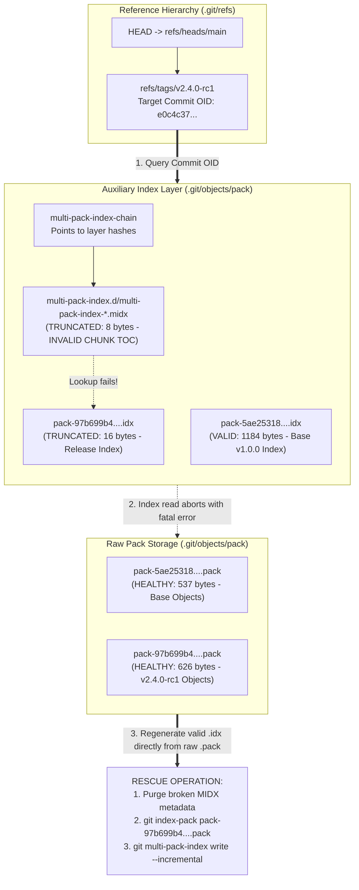

# Drill: Corrupted Packfile Index and Multi-Pack-Index Rescue

> [!summary] Scope
> Owns a hands-on troubleshooting drill where a repository suffers truncated packfile indexes and broken multi-pack-index chains right before an urgent production deployment.
> Reaches the Debug rung by providing a realistic reproduction script, symptoms of failed object read operations, layered hints, and a verified step-by-step resolution script that regenerates index files from raw pack data and rebuilds the MIDX.
> Delineates its boundary from simple reflog recovery.

## Related

- Prerequisites: [[Git-GC-Maintenance-MIDX-and-Commit-Graph]], [[Repair-a-Corrupted-Git-Repository]]
- Next: [[Drill-Git-Automated-Bisect-on-Non-Linear-History]]
- Lab: `code/02-Version-Control/drill_packfile_rescue/`

In enterprise continuous integration environments and low-latency trading infrastructure, automated deployment gates pull tagged releases directly from production Git mirrors to build release artifacts.
Modern Git repositories operating at scale configure multi-pack-indexes (MIDX) and incremental MIDX chains (`git multi-pack-index write --incremental` first documented in Git 2.47.0, whose release notes still call it work in progress; Git 2.50.0 lists it as a feature, as of 2026-11) alongside periodic background maintenance tasks to keep object search latencies bounded at $O(\log N)$ without triggering blocking all-into-one repacks.
During heavy write churn or scheduled maintenance, an ungraceful process termination - such as an out-of-memory container eviction, a disk volume quota exhaustion, or an abrupt host power failure - can interrupt Git while updating auxiliary index files.
When this happens, the raw `.pack` file containing the actual compressed Git objects remains fully intact on disk, but its corresponding `.idx` file and the incremental `multi-pack-index` layer are truncated or corrupted.
Minutes before a scheduled production exchange rollout, the deployment automation runner executes `git checkout v2.4.0-rc1` and immediately aborts with fatal errors: `fatal: bad object HEAD`, `fatal: unable to read tree`, and `error: index file ... is too small`.

Faced with a deployment halt, on-call engineers frequently misdiagnose this incident as branch corruption or accidental history deletion and attempt reflog recovery or destructive hard resets.
Reflog recovery is powerless in this scenario: the branch references in `.git/refs/heads/` and the reflog entries themselves still exist, but Git cannot look up the underlying commit and tree objects because the secondary binary indexing structures are broken.
This problem drill guides the engineer through isolating the failure to auxiliary lookup tables, protecting raw packfile payloads, regenerating pack indexes from raw pack data using Git low-level plumbing (`git index-pack`), reconstructing the incremental multi-pack-index chain, and validating repository consistency under deployment pressure.



## Reproduction

The reproduction environment provisions a high-performance trading engine repository containing two independent packfiles and an incremental multi-pack-index chain.
The base packfile (`pack-5ae25318c7dac56e315d9bf20730117e28f9ee7e.pack`) contains baseline event-loop routines and data structures tagged `v1.0.0`.
The second packfile (`pack-97b699b40b24f9e6e7d2c4fd8f2e5008c065f616.pack`) contains the urgent release candidate commit tagged `v2.4.0-rc1`, introducing zero-copy order matching primitives.
Loose objects are pruned from `.git/objects/` so that object retrieval depends entirely on packed storage.
The reproduction script simulates a crash during index synthesis by truncating the recent release pack index to 16 bytes and truncating the active incremental MIDX layer file to 8 bytes.

All reproduction and verification logic is contained in the lab runner at `code/02-Version-Control/drill_packfile_rescue/run.sh`.
The lab needs git 2.47 or newer (it exits with a message otherwise), a C compiler, and python3, and it declares no `# requires:` entry because all three exist on the recording platform.
Pack names and sizes depend on the git and zlib versions, and the recorded output is `expected/darwin-arm64.txt` from git 2.55.0 on macOS (as of 2026-11); no Linux recording exists, so another git or zlib build fails the diff until the lab is re-recorded.
Every `[check]` line in the output is an assertion that aborts the lab with exit status 1 when it fails.
To execute the lab verification harness:

```bash
cd code && python3 -m _harness.verify 02-Version-Control/drill_packfile_rescue/
```

## Observed Symptom

When the automated deployment agent attempts to inspect repository history or check out the release candidate tag, both `git log -1` and `git checkout` terminate with exit status 128:

```text
(darwin-arm64)
=== 1. OBSERVED SYMPTOM: FAILED OBJECT READS AND TRAVERSAL ABORT ===
[Command] git log -1
error: multi-pack-index file .git/objects/pack/multi-pack-index.d/multi-pack-index-ba4c919eaebf6835308df0126cdeffc557d97f09.midx is too small
warning: unable to find all multi-pack index files
error: index file .git/objects/pack/pack-97b699b40b24f9e6e7d2c4fd8f2e5008c065f616.idx is too small
error: multi-pack-index file .git/objects/pack/multi-pack-index.d/multi-pack-index-ba4c919eaebf6835308df0126cdeffc557d97f09.midx is too small
warning: unable to find all multi-pack index files
error: index file .git/objects/pack/pack-97b699b40b24f9e6e7d2c4fd8f2e5008c065f616.idx is too small
error: index file .git/objects/pack/pack-97b699b40b24f9e6e7d2c4fd8f2e5008c065f616.idx is too small
error: multi-pack-index file .git/objects/pack/multi-pack-index.d/multi-pack-index-ba4c919eaebf6835308df0126cdeffc557d97f09.midx is too small
warning: unable to find all multi-pack index files
error: index file .git/objects/pack/pack-97b699b40b24f9e6e7d2c4fd8f2e5008c065f616.idx is too small
error: index file .git/objects/pack/pack-97b699b40b24f9e6e7d2c4fd8f2e5008c065f616.idx is too small
error: multi-pack-index file .git/objects/pack/multi-pack-index.d/multi-pack-index-ba4c919eaebf6835308df0126cdeffc557d97f09.midx is too small
warning: unable to find all multi-pack index files
error: index file .git/objects/pack/pack-97b699b40b24f9e6e7d2c4fd8f2e5008c065f616.idx is too small
fatal: bad object HEAD
Exit status: 128
```

Attempting to check out the deployment tag `v2.4.0-rc1` similarly fails; the OID in the message is the commit `e0c4c37...` itself, because Git cannot even read the commit object to find its root tree:

```text
(darwin-arm64)
[Command] git checkout v2.4.0-rc1
error: multi-pack-index file .git/objects/pack/multi-pack-index.d/multi-pack-index-ba4c919eaebf6835308df0126cdeffc557d97f09.midx is too small
warning: unable to find all multi-pack index files
error: index file .git/objects/pack/pack-97b699b40b24f9e6e7d2c4fd8f2e5008c065f616.idx is too small
error: multi-pack-index file .git/objects/pack/multi-pack-index.d/multi-pack-index-ba4c919eaebf6835308df0126cdeffc557d97f09.midx is too small
warning: unable to find all multi-pack index files
error: index file .git/objects/pack/pack-97b699b40b24f9e6e7d2c4fd8f2e5008c065f616.idx is too small
error: index file .git/objects/pack/pack-97b699b40b24f9e6e7d2c4fd8f2e5008c065f616.idx is too small
error: multi-pack-index file .git/objects/pack/multi-pack-index.d/multi-pack-index-ba4c919eaebf6835308df0126cdeffc557d97f09.midx is too small
warning: unable to find all multi-pack index files
error: index file .git/objects/pack/pack-97b699b40b24f9e6e7d2c4fd8f2e5008c065f616.idx is too small
error: index file .git/objects/pack/pack-97b699b40b24f9e6e7d2c4fd8f2e5008c065f616.idx is too small
error: multi-pack-index file .git/objects/pack/multi-pack-index.d/multi-pack-index-ba4c919eaebf6835308df0126cdeffc557d97f09.midx is too small
warning: unable to find all multi-pack index files
error: index file .git/objects/pack/pack-97b699b40b24f9e6e7d2c4fd8f2e5008c065f616.idx is too small
fatal: unable to read tree (e0c4c37f59a1fb7bd32a7e3011ff5c456bf9be63)
Exit status: 128
```

Running a low-level object consistency audit via `git fsck` produces a cascade of missing blob, invalid pointer, and invalid reflog entry errors, culminating in exit status 78.
The fsck exit status is a bitmask (`builtin/fsck.c`): 78 is octal `0116`, that is `ERROR_PACK_REV_INDEX` (0100), `ERROR_REFS` (010), `ERROR_PACK` (04), and `ERROR_REACHABLE` (02):

```text
(darwin-arm64)
--- Low-Level Consistency Audit (git fsck) ---
error: multi-pack-index file .git/objects/pack/multi-pack-index.d/multi-pack-index-ba4c919eaebf6835308df0126cdeffc557d97f09.midx is too small
warning: unable to find all multi-pack index files
error: index file .git/objects/pack/pack-97b699b40b24f9e6e7d2c4fd8f2e5008c065f616.idx is too small
error: multi-pack-index file .git/objects/pack/multi-pack-index.d/multi-pack-index-ba4c919eaebf6835308df0126cdeffc557d97f09.midx is too small
warning: unable to find all multi-pack index files
error: index file .git/objects/pack/pack-97b699b40b24f9e6e7d2c4fd8f2e5008c065f616.idx is too small
error: index file .git/objects/pack/pack-97b699b40b24f9e6e7d2c4fd8f2e5008c065f616.idx is too small
error: multi-pack-index file .git/objects/pack/multi-pack-index.d/multi-pack-index-ba4c919eaebf6835308df0126cdeffc557d97f09.midx is too small
warning: unable to find all multi-pack index files
error: index file .git/objects/pack/pack-97b699b40b24f9e6e7d2c4fd8f2e5008c065f616.idx is too small
error: refs/heads/main: invalid sha1 pointer e0c4c37f59a1fb7bd32a7e3011ff5c456bf9be63
error: index file .git/objects/pack/pack-97b699b40b24f9e6e7d2c4fd8f2e5008c065f616.idx is too small
error: multi-pack-index file .git/objects/pack/multi-pack-index.d/multi-pack-index-ba4c919eaebf6835308df0126cdeffc557d97f09.midx is too small
warning: unable to find all multi-pack index files
error: index file .git/objects/pack/pack-97b699b40b24f9e6e7d2c4fd8f2e5008c065f616.idx is too small
error: index file .git/objects/pack/pack-97b699b40b24f9e6e7d2c4fd8f2e5008c065f616.idx is too small
error: multi-pack-index file .git/objects/pack/multi-pack-index.d/multi-pack-index-ba4c919eaebf6835308df0126cdeffc557d97f09.midx is too small
warning: unable to find all multi-pack index files
error: index file .git/objects/pack/pack-97b699b40b24f9e6e7d2c4fd8f2e5008c065f616.idx is too small
error: refs/tags/v2.4.0-rc1: invalid sha1 pointer e0c4c37f59a1fb7bd32a7e3011ff5c456bf9be63
error: index file .git/objects/pack/pack-97b699b40b24f9e6e7d2c4fd8f2e5008c065f616.idx is too small
error: multi-pack-index file .git/objects/pack/multi-pack-index.d/multi-pack-index-ba4c919eaebf6835308df0126cdeffc557d97f09.midx is too small
warning: unable to find all multi-pack index files
error: index file .git/objects/pack/pack-97b699b40b24f9e6e7d2c4fd8f2e5008c065f616.idx is too small
error: index file .git/objects/pack/pack-97b699b40b24f9e6e7d2c4fd8f2e5008c065f616.idx is too small
error: multi-pack-index file .git/objects/pack/multi-pack-index.d/multi-pack-index-ba4c919eaebf6835308df0126cdeffc557d97f09.midx is too small
warning: unable to find all multi-pack index files
error: index file .git/objects/pack/pack-97b699b40b24f9e6e7d2c4fd8f2e5008c065f616.idx is too small
error: HEAD: invalid sha1 pointer e0c4c37f59a1fb7bd32a7e3011ff5c456bf9be63
error: multi-pack-index file .git/objects/pack/multi-pack-index.d/multi-pack-index-ba4c919eaebf6835308df0126cdeffc557d97f09.midx is too small
warning: unable to find all multi-pack index files
error: index file .git/objects/pack/pack-97b699b40b24f9e6e7d2c4fd8f2e5008c065f616.idx is too small
error: packfile .git/objects/pack/pack-97b699b40b24f9e6e7d2c4fd8f2e5008c065f616.pack index not opened
error: HEAD: invalid reflog entry e0c4c37f59a1fb7bd32a7e3011ff5c456bf9be63
error: refs/heads/main: invalid reflog entry e0c4c37f59a1fb7bd32a7e3011ff5c456bf9be63
error: index file .git/objects/pack/pack-97b699b40b24f9e6e7d2c4fd8f2e5008c065f616.idx is too small
error: multi-pack-index file .git/objects/pack/multi-pack-index.d/multi-pack-index-ba4c919eaebf6835308df0126cdeffc557d97f09.midx is too small
warning: unable to find all multi-pack index files
error: index file .git/objects/pack/pack-97b699b40b24f9e6e7d2c4fd8f2e5008c065f616.idx is too small
error: index file .git/objects/pack/pack-97b699b40b24f9e6e7d2c4fd8f2e5008c065f616.idx is too small
error: multi-pack-index file .git/objects/pack/multi-pack-index.d/multi-pack-index-ba4c919eaebf6835308df0126cdeffc557d97f09.midx is too small
warning: unable to find all multi-pack index files
error: index file .git/objects/pack/pack-97b699b40b24f9e6e7d2c4fd8f2e5008c065f616.idx is too small
error: 41d0d0545af1c0114c732f23c4ab1788d8fb5350: invalid sha1 pointer in cache-tree of .git/index
error: index file .git/objects/pack/pack-97b699b40b24f9e6e7d2c4fd8f2e5008c065f616.idx is too small
error: unable to load rev-index for pack '.git/objects/pack/pack-97b699b40b24f9e6e7d2c4fd8f2e5008c065f616.pack'
error: index file .git/objects/pack/pack-97b699b40b24f9e6e7d2c4fd8f2e5008c065f616.idx is too small
error: index file .git/objects/pack/pack-97b699b40b24f9e6e7d2c4fd8f2e5008c065f616.idx is too small
missing blob e27e0530652c52594973b3bfed836403ef161857
missing blob 98800be700a8438ecab91bf3629c9d1c2adae1da
error: multi-pack-index file .git/objects/pack/multi-pack-index.d/multi-pack-index-ba4c919eaebf6835308df0126cdeffc557d97f09.midx is too small
warning: unable to find all multi-pack index files
Exit status: 78
```

An inspection of the filesystem reveals the physical root of the failure:

```text
(darwin-arm64)
=== 2. OBJECT STORE INSPECTION AND CORRUPTION ISOLATION ===
--- Object Database Pack Directory Manifest ---
  pack-5ae25318c7dac56e315d9bf20730117e28f9ee7e.idx                1184 bytes
  pack-5ae25318c7dac56e315d9bf20730117e28f9ee7e.pack                537 bytes
  pack-5ae25318c7dac56e315d9bf20730117e28f9ee7e.rev                  68 bytes
  pack-97b699b40b24f9e6e7d2c4fd8f2e5008c065f616.idx                  16 bytes
  pack-97b699b40b24f9e6e7d2c4fd8f2e5008c065f616.pack                626 bytes
  pack-97b699b40b24f9e6e7d2c4fd8f2e5008c065f616.rev                  68 bytes
  multi-pack-index.d/multi-pack-index-ba4c919eaebf6835308df0126cdeffc557d97f09.midx      8 bytes
  multi-pack-index.d/multi-pack-index-chain                          41 bytes
--- Reference Pointers in .git/refs ---
  main -> e0c4c37f59a1fb7bd32a7e3011ff5c456bf9be63
  v1.0.0 -> 4f119367ec994640ed389af31600bd3df35e1113
  v2.4.0-rc1 -> e0c4c37f59a1fb7bd32a7e3011ff5c456bf9be63
```

The file manifest confirms:
1. Both raw `.pack` files (`pack-5ae25318...pack` at 537 bytes and `pack-97b699b4...pack` at 626 bytes) have healthy non-zero sizes matching expected object payloads.
2. The index file `pack-97b699b4...idx` is severely truncated to only 16 bytes, whereas a valid v2 index for 4 objects requires 1184 bytes.
3. The incremental multi-pack-index layer file is truncated to 8 bytes, preventing Git from reading its Chunk Table of Contents.
4. The reference files under `.git/refs/` are completely healthy: `main` and `v2.4.0-rc1` point to valid 40-character hex commit IDs (`e0c4c37...`).

## Progressive Hint Ladder

> [!tip]- Hint 1: Differentiating Reference Metadata from Content Storage
> Examine the output of `git for-each-ref`.
> Notice that the symbolic reference `HEAD`, the branch reference `refs/heads/main`, and the release tag `refs/tags/v2.4.0-rc1` all point to valid object IDs (`e0c4c37...`).
> The failure is not caused by missing references, an aborted rebase, or an expired reflog.
> The breakdown occurs entirely within the content-addressable storage subsystem: Git cannot resolve the object ID `e0c4c37...` to raw bytes inside the pack directory.

> [!tip]- Hint 2: The Derived and Disposable Nature of Git Index Files
> Examine the relationship between `.pack` files, `.idx` files, and `multi-pack-index` files.
> A Git packfile (`.pack`) is a standalone, self-describing archive containing zlib-deflated objects and delta sequences, concluding with a 20-byte SHA-1 trailer calculated across the pack contents.
> In contrast, `.idx` files and `multi-pack-index` files contain zero original object content: they are strictly lookup indices storing first-level fanout tables, sorted object hashes, and file byte offsets.
> If the `.pack` payload is uncorrupted, can any index file be safely deleted and regenerated without data loss?

> [!tip]- Hint 3: Why Reflog Recovery and Git Reset Fail Here
> Consider what happens when an engineer runs `git reflog` or `git reset --hard` in this corrupted state.
> The reflog is an audit journal of reference transitions (`refs/heads/main@{0}`).
> When `git reflog` executes, it parses the reflog log entries and attempts to read the commit objects from the object database to format each entry.
> Because the pack index is unavailable, reading the commit fails, and in a scratch reproduction on Git 2.55.0 `git reflog` itself aborts with `fatal: bad object HEAD` and exit status 128; the `invalid reflog entry` lines in the Observed Symptom come from `git fsck`.
> Reflog recovery techniques cannot repair missing or unreadable object database lookup tables.

> [!tip]- Hint 4: Clearing Corrupted Multi-Pack-Index Layers First
> When Git accesses objects in a packed repository, it checks for the presence of a multi-pack-index (`.git/objects/pack/multi-pack-index` or `.git/objects/pack/multi-pack-index.d/`).
> If an incremental MIDX layer is corrupt or truncated, Git outputs warnings and attempts to fall back to individual `.idx` files.
> If both the MIDX and an individual `.idx` file are corrupt, Git fails completely.
> What happens if you remove `.git/objects/pack/multi-pack-index.d` and any monolithic `multi-pack-index` file before attempting individual packfile repairs?

> [!tip]- Hint 5: Reconstructing Pack Indexes with Git Plumbing
> Which low-level Git plumbing command is specifically designed to read an unindexed `.pack` file, parse every object header and delta offset, compute SHA-1 hashes, and write a brand-new `.idx` file?
> Check the manual page for `git-index-pack(1)`.
> What arguments does it accept, and where does it place the resulting index file?

> [!tip]- Hint 6: Verifying Pack Integrity and Rebuilding the Multi-Pack-Index
> After generating the missing index file, how can you definitively prove that the packfile has zero corrupted deltas or bitflips?
> Check the manual page for `git-verify-pack(1)`.
> Once all `.pack` archives possess valid `.idx` companion files, which command reconstructs the unified `multi-pack-index` structure?

## Model Solution

> [!success]- Solution: Root Cause Diagnosis and Step-by-Step Remediation
>
> ### Root Cause Analysis
>
> #### The Packfile Lookup Pipeline
> In a Git repository using packed storage, reading an object (e.g., during `git log`, `git checkout`, or `git cat-file -p <oid>`) proceeds through a layered lookup hierarchy implemented in `packfile.c`:
> 1. **Multi-Pack-Index Search:** Git first checks for an active multi-pack-index (`$GIT_DIR/objects/pack/multi-pack-index` or the chain directory `$GIT_DIR/objects/pack/multi-pack-index.d/multi-pack-index-chain`).
>    If present, Git executes a binary search over the sorted `OIDL` (OID Lookup) chunk using the 256-entry `OIDF` (OID Fanout) table.
>    If found, the `OOFF` (Object Offsets) chunk directly yields the packfile index and the 32-bit or 64-bit byte offset within that packfile.
> 2. **Individual Pack Index Fallback:** If the multi-pack-index is missing or cannot be opened, Git falls back to scanning every `.idx` file registered in the repository's pack list (`struct packed_git`).
>    For each `.idx`, Git consults its first-level fanout table (`fanout[256]`) to locate the candidate OID range, performs a binary search over sorted OIDs, and retrieves the pack byte offset.
> 3. **Raw Packfile Decompression:** Once the byte offset is determined, Git maps the surrounding window of the `.pack` file with `mmap(2)` (`use_pack()` in `packfile.c`, sized by `core.packedGitWindowSize`), reads the object header (a little-endian 7-bits-per-byte varint whose first byte carries the 3-bit type and the low 4 size bits, per `gitformat-pack(5)`), and passes the stream to `zlib` for decompression or delta chain reconstruction.
>
> #### The Double-Failure Failure Mode
> In this drill scenario, two failures compound to prevent object resolution:
> 1. **Broken Incremental MIDX Layer:** In `midx.c:load_multi_pack_index_one()`, Git requires the MIDX file size to be at least the 12-byte header (`MIDX_HEADER_SIZE`) plus one trailing hash ($12 + 20 = 32$ bytes for SHA-1).
>    The truncated file contains only 8 bytes (`MIDX\x01\x01\x00\x00`), triggering `error: multi-pack-index file ... is too small`; `load_midx_chain_fd_st()` then stops walking the chain with `warning: unable to find all multi-pack index files`.
> 2. **Truncated Individual Pack Index:** Git falls back to individual packfiles.
>    In `packfile.c:check_packed_git_idx()` (and again in `load_idx()`), Git rejects any index smaller than the 256-entry fanout table plus two trailing hashes ($256 \times 4 + 2 \times 20 = 1064$ bytes for SHA-1); a v2 index that passes that check must then be exactly $8 + 1024 + N \times 28 + 40$ bytes (plus any large offsets), or Git reports `wrong index v2 file size`.
>    The file `pack-97b699b4...idx` is only 16 bytes.
>    Git aborts with `error: index file ... is too small`, and `git fsck` later reports the pack as `error: packfile ... index not opened`.
>
> Because the release candidate commit `e0c4c37...` exists only inside `pack-97b699b4...pack` and loose objects were pruned, Git cannot resolve `HEAD`, `refs/heads/main`, or `refs/tags/v2.4.0-rc1`.
> All operations requiring commit or tree inspection fail with exit code 128.
>
> ---
>
> ### Step-by-Step Remediation Procedure
>
> #### Step 1: Purge Corrupted Multi-Pack-Index Metadata
> The multi-pack-index is an auxiliary search cache.
> If its chain or layer files are damaged, remove the directory `.git/objects/pack/multi-pack-index.d` and any monolithic `.git/objects/pack/multi-pack-index` file.
> Removing these files forces Git to consult individual pack indexes directly and stops the repeated `multi-pack-index ... is too small` errors.
> The purge is hygiene rather than a precondition for reads: in a scratch reproduction on Git 2.55.0, `git log` succeeded as soon as the `.idx` was regenerated, with only the MIDX warning left:
>
> ```bash
> rm -rf .git/objects/pack/multi-pack-index.d
> rm -f .git/objects/pack/multi-pack-index
> ```
>
> Output from lab execution:
> ```text
> (darwin-arm64)
> === 3. REMEDIATION STEP 1: PURGE CORRUPTED MIDX METADATA ===
> Removing broken multi-pack-index chain directory...
> MIDX metadata purged successfully.
>   [check] multi-pack-index.d is gone: ok
>   [check] monolithic multi-pack-index is absent: ok
> ```
>
> #### Step 2: Remove the Truncated Pack Index
> If the truncated `.idx` is left in place, `git index-pack` still prints `error: index file ... is too small` while it scans the existing pack list, then exits 0 and replaces the file with the regenerated index (observed in a scratch reproduction on Git 2.55.0).
> Removing or quarantining the damaged `.idx` first keeps the evidence and the output clean:
>
> ```bash
> rm -f .git/objects/pack/pack-97b699b40b24f9e6e7d2c4fd8f2e5008c065f616.idx
> ```
>
> #### Step 3: Regenerate the Pack Index from Raw Pack Data
> Execute `git index-pack` directly against the raw `.pack` file:
>
> ```bash
> git index-pack .git/objects/pack/pack-97b699b40b24f9e6e7d2c4fd8f2e5008c065f616.pack
> ```
>
> `git index-pack` streams the raw packfile, validates all zlib streams and object types, computes object hashes, resolves delta chains, constructs the first-level fanout table and CRC32 table, and writes a complete v2 `.idx` file named `pack-97b699b40b24f9e6e7d2c4fd8f2e5008c065f616.idx`.
> It prints the packfile SHA-1 checksum to stdout upon completion (`printf("%s\n", hash_to_hex(hash))` in `builtin/index-pack.c` when not reading `--stdin`):
>
> ```text
> (darwin-arm64)
> === 4. REMEDIATION STEP 2: REGENERATE PACKFILE INDEXES VIA GIT INDEX-PACK ===
> Removing truncated index: pack-97b699b40b24f9e6e7d2c4fd8f2e5008c065f616.idx...
> Executing git index-pack on raw packfile: pack-97b699b40b24f9e6e7d2c4fd8f2e5008c065f616.pack...
> Regenerated pack checksum: 97b699b40b24f9e6e7d2c4fd8f2e5008c065f616
> Verifying restored index file size:
>   pack-97b699b40b24f9e6e7d2c4fd8f2e5008c065f616.idx                1184 bytes
>   [check] index-pack printed the checksum that names the pack: ok
>   [check] index has the v2 magic and version: ok
>   [check] index lists all 4 objects: ok
>   [check] index size is 8 + 1024 + 28 * objects + 40: ok
>   [check] index trailer carries the pack checksum: ok
> ```
>
> The regenerated index file size is 1184 bytes, exactly matching the format specification:
> - 8 bytes: Header (`\xfftOc` magic and version `2`)
> - 1024 bytes: 256-entry fanout table ($256 \times 4$ bytes)
> - 80 bytes: 4 object IDs ($4 \times 20$ bytes)
> - 16 bytes: 4 CRC32 checksums ($4 \times 4$ bytes)
> - 16 bytes: 4 object offsets ($4 \times 4$ bytes)
> - 40 bytes: Two 20-byte SHA-1 trailers (pack checksum and index checksum)
> - Total: $8 + 1024 + 80 + 16 + 16 + 40 = 1184$ bytes.
>
> #### Step 4: Verify Packfile Integrity
> Run `git verify-pack -v` across all packfiles to prove that every object decompress and delta resolution succeeds without bitflips:
>
> ```bash
> git verify-pack -v .git/objects/pack/pack-*.pack
> ```
>
> Output verifies that all objects across both packfiles are healthy:
>
> ```text
> (darwin-arm64)
> === 5. REMEDIATION STEP 3: VERIFY PACKFILE INTEGRITY VIA GIT VERIFY-PACK ===
> 4f119367ec994640ed389af31600bd3df35e1113 commit 232 159 12
> 36055c08f9983740c5bda710ec899e4362c1ff1a tree   77 85 171
> b35e0fea85131a14a04a6fd5fa21308ca5d8c163 blob   124 117 256
> 98873c843587c88b4ac890ede5bc9abba0e37253 blob   192 144 373
> non delta: 4 objects
> .git/objects/pack/pack-5ae25318c7dac56e315d9bf20730117e28f9ee7e.pack: ok
> e0c4c37f59a1fb7bd32a7e3011ff5c456bf9be63 commit 291 201 12
> 41d0d0545af1c0114c732f23c4ab1788d8fb5350 tree   117 121 213
> e27e0530652c52594973b3bfed836403ef161857 blob   148 132 334
> 98800be700a8438ecab91bf3629c9d1c2adae1da blob   149 140 466
> non delta: 4 objects
> .git/objects/pack/pack-97b699b40b24f9e6e7d2c4fd8f2e5008c065f616.pack: ok
>   [check] verify-pack reports both packs ok: ok
> ```
>
> #### Step 5: Reconstruct the Multi-Pack-Index
> Rebuild the incremental multi-pack-index structure and verify its binary chunk layout:
>
> ```bash
> git multi-pack-index write --incremental
> git multi-pack-index verify
> ```
>
> Treat the `verify` exit status with care: `verify_midx_file()` in `midx.c` returns 0 when no MIDX can be loaded and only fails if the monolithic `multi-pack-index` file exists but does not parse, so the lab's earlier `git multi-pack-index verify` against the 8-byte chain layer also exited 0.
> The lab therefore proves the rebuild from the files themselves: the chain file must exist and list exactly one layer, the layer file must exist with a valid `MIDX` header, and the layer must name both packs, as the `[check]` lines below show.
> Output from the lab run:
>
> ```text
> (darwin-arm64)
> === 6. REMEDIATION STEP 4: RECONSTRUCT AND VERIFY MULTI-PACK-INDEX ===
> Rebuilding incremental multi-pack-index...
> Verifying rebuilt multi-pack-index...
>   [check] chain file exists: ok
>   [check] chain lists exactly one layer: ok
>   [check] layer file exists: ok
>   [check] layer has a valid MIDX header: ok
>   [check] layer names the base pack: ok
>   [check] layer names the rescued pack: ok
> ```
>
> #### Step 6: Post-Rescue Audit and Deployment Validation
> Execute a full repository consistency check (`git fsck --full`), inspect commit history, and execute the production release checkout:
>
> ```bash
> git fsck --full
> git log -2 --oneline
> git checkout -q v2.4.0-rc1
> ```
>
> Output confirms complete restoration and successful binary compilation:
>
> ```text
> (darwin-arm64)
> === 7. POST-RESCUE AUDIT AND DEPLOYMENT VALIDATION ===
> --- Repository Consistency Check (git fsck --full) ---
> git fsck exit status: 0
>   [check] fsck exits 0: ok
>   [check] fsck prints nothing: ok
>   [check] pack payloads are byte-identical to before the corruption: ok
> --- Commit Log Verification ---
> e0c4c37 fix(engine): zero-copy order matching for v2.4-rc1
> 4f11936 feat(engine): initial trading core v1.0
> --- Working Tree Checkout for Release Deployment ---
> HEAD detached at: e0c4c37 (tag: v2.4.0-rc1)
>   [check] HEAD is the tagged commit: ok
>   [check] working tree is clean: ok
> --- Production Build Gate Verification ---
> Build verification: PASS (engine.o and order_book.o compiled cleanly)
> ```

## Core Takeaway

The primary architectural lesson is the strict separation between primary immutable content storage (`.pack` files) and secondary derived lookup tables (`.idx`, `multi-pack-index`, `.rev`, and `commit-graph` files).

1. **Packfiles are Authoritative:** Raw `.pack` files encapsulate complete object metadata, content streams, and delta sequences.
   Every `.idx` file and `multi-pack-index` file is an ephemeral, fully regenerable search cache.
   As long as the raw `.pack` file has not suffered physical disk block corruption or truncation, zero commits, trees, or blobs are lost.
2. **Reflog Recovery Cannot Fix Object Storage Faults:** An engineer must distinguish between reference-level incidents and database-level incidents.
   If `HEAD` is detached or a branch pointer is lost, reflogs and commit-tree plumbing restore the graph, as detailed in [[Recover-Lost-Git-Work]] and [[Drill-Git-Detached-Rebase-and-Dangling-Tree-Recovery]].
   However, if `git log` fails with `fatal: bad object HEAD` or `error: index file ... is too small`, the failure resides in the object database lookup index, and running reflog commands will only trigger secondary read failures.
3. **Plumbing Tools Enable Hermetic Repair:** High-level porcelain commands (`git log`, `git checkout`, `git merge`) assume a healthy object database and fail completely when indices break.
   Distinguished engineers use low-level plumbing (`git index-pack`, `git verify-pack`, `git multi-pack-index verify`) to isolate and reconstruct indices without rebuilding repositories from remote clones.

For comprehensive operational remediation across loose object bitflips, damaged commit-graphs, and binary header repairs, consult [[Repair-a-Corrupted-Git-Repository]].
For packfile delta compression heuristics and binary pack format details, consult [[Git-Packfiles-and-Delta-Compression]].
For chunk-based commit-graph and multi-pack-index maintenance architectures, consult [[Git-GC-Maintenance-MIDX-and-Commit-Graph]].

## Technical Reference and Commands to Know

### Packfile Index v2 Binary Format Layout

The Git pack index format version 2 (`gitformat-pack(5)`) structures object offsets to allow $O(\log N)$ binary searching:

| Byte Offset / Region | Size (Bytes) | Field Name | Description and Invariants |
|---|---|---|---|
| `0x00` - `0x03` | 4 | Magic Header | `\xff\x74\x4f\x63` (`\xfftOc` in ASCII). Distinguishes v2 index from v1 index. |
| `0x04` - `0x07` | 4 | Version | Big-endian `0x00000002` (Version 2). |
| `0x08` - `0x0407` | 1024 | First-Level Fanout | 256 4-byte big-endian integers. Entry $i$ counts objects with first byte $\le i$. Entry 255 equals total object count $N$. |
| `0x0408` - ... | $N \times 20$ (or $32$) | Table of Object IDs | Sorted array of $N$ object IDs (SHA-1: 20 bytes; SHA-256: 32 bytes). Enables binary search within fanout bucket. |
| ... | $N \times 4$ | Table of CRC32s | Array of 4-byte CRC32 checksums for each packed object data chunk. Used by `verify-pack` to detect bitflips. |
| ... | $N \times 4$ | Table of Offsets | Array of 4-byte offsets into `.pack`. If high bit (bit 31) is set, lower 31 bits index into Large Offset table. |
| ... | $M \times 8$ | Large Offset Table | Optional array of 8-byte big-endian offsets for objects located at offset $\ge 2\text{ GiB}$ ($2^{31}$ bytes). |
| ... | 20 (or 32) | Packfile Checksum | SHA-1 or SHA-256 checksum copied from the trailing bytes of the corresponding `.pack` file. |
| ... | 20 (or 32) | Index Checksum | SHA-1 or SHA-256 checksum calculated across all preceding bytes of this `.idx` file. |

### Multi-Pack-Index (MIDX) Chunk Specifications

Multi-pack-index files use the chunk container of `gitformat-chunk(5)`; the MIDX chunks themselves are specified in `gitformat-pack(5)` and defined in `midx.h` (as of 2026-11, Git 2.55.0):

| Chunk ID | ASCII / Hex | Required? | Payload Contents and Lookup Function |
|---|---|---|---|
| `PNAM` | `0x504e414d` | Required | Packfile Names: sequence of null-terminated ASCII basenames for all indexed packfiles. |
| `OIDF` | `0x4f494446` | Required | OID Fanout: 256 4-byte big-endian cumulative object count table across all indexed packs. |
| `OIDL` | `0x4f49444c` | Required | OID Lookup: lexicographically sorted array of all unique object IDs across all indexed packs. |
| `OOFF` | `0x4f4f4646` | Required | Object Offsets: $N \times 8$ bytes. Each entry holds 4-byte pack-int-id and 4-byte pack offset (or LOFF row when the LOFF chunk exists and bit 31 is set). |
| `LOFF` | `0x4c4f4646` | Optional | Large Offsets: 8-byte offsets, present only when some offset exceeds $2^{32}-1$; then offsets above $2^{31}-1$ live here. |
| `BASE` | `0x42415345` | Unused | ID reserved as `MIDX_CHUNKID_BASE` in `midx.h`, but Git 2.55.0 neither writes nor reads it; layers record no base hash, and the header's base-count byte is "currently always zero". |
| `BTMP` | `0x42544d50` | Optional | Bitmapped Packfiles: per pack, the first bit position in pseudo-pack order and the number of bits selected from that pack. |
| `RIDX` | `0x52494458` | Optional | Bitmap pack order: MIDX positions sorted by pseudo-pack (bitmap) position. |

### Diagnostic and Repair Commands Quick Reference

All commands below apply to Linux and macOS `(as of 2026-11, Both)`:

| Command | Operational Purpose | Exit Code (Success / Failure) | Key Flags to Use |
|---|---|---|---|
| `git index-pack <pack>` | Regenerates `.idx` from raw `.pack` file. | `0` / non-zero | `--fix-thin` (resolves external delta bases during transfer). |
| `git index-pack -o <file> <pack>` | Writes generated index to explicit destination path. | `0` / non-zero | `-o <path>` |
| `git verify-pack -v <pack>` | Validates all objects and deltas inside a packfile (runs `git index-pack --verify`). | `0` / non-zero | `-v` (verbose object table), `-s` (stat-only: delta chain histogram, no content verification). |
| `git multi-pack-index write` | Generates monolithic multi-pack-index. | `0` / non-zero | `--no-progress` (clean script output). |
| `git multi-pack-index write --incremental` | Writes incremental MIDX layer without full rewrite. | `0` / non-zero | First documented in Git 2.47.0 (as of 2026-11). |
| `git multi-pack-index verify` | Verifies checksum, pack loading, OID order, and offsets of a loaded MIDX. | `0` / `1`; `0` also when no MIDX loads at all | `--no-progress` |
| `git fsck --full` | Performs full connectivity and database validity audit. | `0` / non-zero | `--no-progress`, `--lost-found` (writes dangling objects). |

## Interview Questions

### Question 1 (L5, Predict-the-output)
> [!question] Predict the output:
> An engineer notices that `git checkout` is failing on a critical repository.
> Inspection of `.git/objects/pack/` reveals a healthy 50 MB packfile `pack-abcdef1234567890abcdef1234567890abcdef12.pack`, but its companion `.idx` file was accidentally deleted.
> The engineer executes:
> ```bash
> git index-pack .git/objects/pack/pack-abcdef1234567890abcdef1234567890abcdef12.pack
> echo "Exit: $?"
> ls -l .git/objects/pack/*.idx
> ```
> What appears on standard output, what is the exit status, and what file is present in `.git/objects/pack/`?
>
> > [!success]- Answer
> > Standard output prints the 40-character hexadecimal SHA-1 checksum matching the trailing 20 bytes of the packfile:
> > `abcdef1234567890abcdef1234567890abcdef12`
> > The exit status is `0`.
> > In `.git/objects/pack/`, `git index-pack` automatically creates `pack-abcdef1234567890abcdef1234567890abcdef12.idx` matching the packfile name (the printed hash equals the name only because Git names packs by their trailer checksum).
> > Because `pack.writeReverseIndex` defaults to true (as of 2026-11, Both), it also writes a `.rev` file for the pack.
> > The regenerated `.idx` file contains a valid first-level fanout table, sorted OID table, CRC32 table, offset table, and trailers, fully restoring object lookup capabilities for that packfile.

### Question 2 (L5, Operational use)
> [!question] Explain the mechanical differences between `git verify-pack` and `git fsck`.
> When should an engineer execute `git verify-pack` instead of `git fsck` during repository triage?
>
> > [!success]- Answer
> > `git verify-pack` operates strictly on packed archive files (`.pack` and `.idx`) in isolation.
> > It validates the binary integrity of the packfile: it verifies the trailing pack checksum, reads the index, verifies each object's CRC32 checksum, decompresses each object payload to ensure zlib streams are valid, resolves all delta compression chains (`OBJ_OFS_DELTA` and `OBJ_REF_DELTA`), and confirms object offsets.
> > It does not inspect Git reference DAG connectivity, commit parents, reflogs, or loose objects.
> >
> > `git fsck` performs a whole-repository reachability and validity audit.
> > It reads all references in `.git/refs/`, walks the commit and tree graph starting from reference tips and reflogs, checks loose objects and packed objects, validates tree syntax, and detects dangling or unreachable objects.
> >
> > An engineer should run `git verify-pack` when isolating physical storage errors in specific pack archives or when `git fsck` fails with index-opening errors, because `git verify-pack` confirms whether raw pack storage is salvageable without being blocked by higher-level graph traversal failures.

### Question 3 (L6, Debug-this)
> [!question] Debug this scenario:
> A CI/CD deployment runner reports the following error during deployment of release tag `v3.1.0`:
> ```text
> error: index file .git/objects/pack/pack-7f8e9a....idx is too small
> fatal: bad object HEAD
> fatal: unable to read tree (1a2b3c4d...)
> ```
> A junior engineer suggests executing `git reflog expire --expire=now --all && git reset --hard origin/main` to restore the branch.
> Critique this proposed resolution, explain why it will fail, and provide the correct recovery steps.
>
> > [!success]- Answer
> > **Critique of Junior Engineer's Proposal:**
> > The proposed commands will exacerbate the incident and fail completely:
> > 1. Expiring reflogs (`git reflog expire`) deletes the local reference audit journal, destroying the safety net to recover unpushed commits or stash entries.
> > 2. The error message `error: index file ... is too small` explicitly points to a corrupted or truncated packfile index (`.idx`) in `.git/objects/pack/`.
> > 3. `git reset --hard` requires Git to read tree objects and blob objects from the object store to update the index and working tree.
> >    Because the pack index is corrupt, `git reset` aborts before touching the working tree; in a scratch reproduction on Git 2.55.0 it failed with `fatal: Could not parse object '<rev>'` and exit status 128, leaving the repository broken.
> >
> > **Correct Remediation:**
> > 1. Recognize that the raw `.pack` file is intact and that only the secondary index table is truncated.
> > 2. Purge any corrupted multi-pack-index metadata: `rm -rf .git/objects/pack/multi-pack-index*`.
> > 3. Remove the truncated index: `rm -f .git/objects/pack/pack-7f8e9a....idx`.
> > 4. Regenerate the pack index from the raw packfile: `git index-pack .git/objects/pack/pack-7f8e9a....pack`.
> > 5. Verify packfile integrity: `git verify-pack -v .git/objects/pack/pack-7f8e9a....pack`.
> > 6. Run `git fsck --full` to verify complete graph connectivity.
> > 7. Execute `git checkout v3.1.0`.

### Question 4 (L6, Mechanism internals)
> [!question] How does `git index-pack` reconstruct the first-level fanout table, the sorted OID array, and the CRC32 table from a raw `.pack` file without reading an existing `.idx` file?
>
> > [!success]- Answer
> > A Git packfile (`.pack`) contains complete information necessary to rebuild its index:
> > 1. `git index-pack` opens the `.pack` file and reads the 12-byte header: 4 bytes `PACK`, 4 bytes version (`2`), and 4 bytes big-endian object count $N$.
> > 2. It sequentially scans each object starting at byte offset 12.
> >    For each object, it records the starting byte offset, decodes the variable-length LEB128 header (determining object type: commit, tree, blob, tag, `OBJ_OFS_DELTA`, or `OBJ_REF_DELTA`, and uncompressed size), and inflates the zlib data stream.
> > 3. While reading the raw compressed byte slice for an object, it computes the CRC32 checksum over the exact compressed byte range in the `.pack` file.
> > 4. For non-delta objects, it hashes the canonical object header (`type size\0`) and uncompressed payload using SHA-1 or SHA-256 to compute the object's OID.
> >    For delta objects, it queues them in a delta resolution list until the base object is decoded, applies delta instructions to reconstruct the full payload, and computes the canonical OID.
> > 5. Once all $N$ objects are decoded, `git index-pack` sorts the $N$ object IDs in ascending lexicographical order.
> > 6. It iterates through the sorted OIDs to construct the 256-entry `fanout[256]` array, where `fanout[i]` records how many objects have a first byte $\le i$.
> > 7. It writes the v2 index format: 8-byte header, 1024-byte fanout table, sorted OIDs, CRC32 array, 4-byte offset table (with 8-byte large offset chunk if needed), the pack checksum, and the index checksum.

### Question 5 (L6, Object store semantics)
> [!question] In the Git multi-pack-index (MIDX) specification (`gitformat-pack(5)`), explain how the `OOFF` (Object Offsets) chunk maps an object ID to a specific byte location in a repository with 50 distinct packfiles.
> How does MIDX handle objects located at offsets exceeding 2 GiB?
>
> > [!success]- Answer
> > The `OOFF` chunk in a multi-pack-index contains an array of fixed-width 8-byte entries, exactly one entry per unique object tracked in the `OIDL` (OID Lookup) chunk.
> > Each 8-byte entry is structured as two 32-bit big-endian integers:
> > 1. **Packfile ID (uint32_t, 4 bytes):** A 0-based index pointing to the packfile entry in the `PNAM` (Packfile Names) chunk.
> >    The `PNAM` chunk stores null-terminated packfile basenames.
> >    For example, pack index `3` corresponds to the fourth packfile listed in `PNAM`.
> > 2. **Pack Offset (uint32_t, 4 bytes):**
> >    - If no offset exceeds $2^{32} - 1$, the `LOFF` chunk is absent and the full 32-bit value is the byte offset, as in IDX v1.
> >    - If the `LOFF` chunk exists, an entry with bit 31 clear holds the offset directly (up to $2^{31} - 1 \approx 2\text{ GiB}$), and an entry with bit 31 set holds, in its lower 31 bits, a 0-based row in `LOFF` (`nth_midxed_offset()` in `midx.c` checks `m->chunk_large_offsets` before testing the bit).
> >      Git reads the 8-byte (64-bit) value from `LOFF` at that index to obtain the full byte offset for packfiles exceeding 2 GiB.

### Question 6 (L7, System design)
> [!question] Design an automated self-healing disaster recovery mechanism for a multi-terabyte Git monorepo fleet where concurrent `git maintenance` background jobs and heavy developer pushes risk packfile index and MIDX corruption.
>
> > [!success]- Answer
> > An enterprise self-healing storage architecture combines transactional filesystem guarantees, isolated background maintenance lockfiles, and automated client-side fallback hooks:
> >
> > 1. **Failsafe Storage Configuration:**
> >    - Configure `core.fsync = objects,derived-metadata` (or `all`) and `core.fsyncMethod = fsync` on both Linux and macOS (as of 2026-11, Both).
> >      `pack-indexes` and `multi-pack-index` are not valid components: `.idx`, `.rev`, bitmaps, and the MIDX are all hardened by `pack-metadata` (`midx-write.c` finalizes with `FSYNC_COMPONENT_PACK_METADATA`), and `derived-metadata` is `pack-metadata,commit-graph`.
> >      Avoid `writeout-only`, which `git-config(1)` warns may not be durable after a crash and which is the macOS default; `batch` currently only changes loose-object writes.
> >      This ensures that write buffers for `.pack`, `.idx`, and `multi-pack-index` files are flushed before Git renames temporary files (`tmp_pack_*`) into place.
> >    - Enforce atomic file replacement using temporary files on the same filesystem mount so that index updates occur via atomic `rename(2)` syscalls.
> >
> > 2. **Isolated Background Maintenance Locking:**
> >    - Background maintenance tasks (`git maintenance run --task=incremental-repack`, the task that writes the MIDX; there is no `midx` task) run under Git's own lock file `$GIT_DIR/objects/maintenance.lock` (`builtin/gc.c`), and a second run skips with `lock file ... exists, skipping maintenance`.
> >    - If an OOM killer or preemption terminates a maintenance task mid-write, the orphaned temporary file (`multi-pack-index.d/tmp_midx_XXXXXX`, created in `midx-write.c`) never replaces a live layer, so active production readers are unaffected; the orphan is not cleaned up automatically: in a scratch repository on git 2.55.0 (macOS, as of 2026-11) a `tmp_midx_*` file with a 2020 mtime survived `git multi-pack-index write --incremental`, `git maintenance run --task=incremental-repack`, `git multi-pack-index expire`, and `git gc`, so a recovery job should delete stale `tmp_midx_*` files itself.
> >
> > 3. **Automated Read Triage and Repair Hook:**
> >    - Implement an automated health check within the CI agent wrapper:
> >      If a Git command exits with status 128 and stderr contains `error: index file ... is too small` or `error: multi-pack-index ... is too small`:
> >      a. The wrapper traps the error and acquires an exclusive repair lock.
> >      b. Purges `.git/objects/pack/multi-pack-index*`.
> >      c. Runs `git verify-pack` across all `.pack` files to identify missing or truncated `.idx` companions (not `-s`, which skips content verification).
> >      d. Invokes `git index-pack` on any packfile missing a valid index.
> >      e. Regenerates the MIDX via `git multi-pack-index write --incremental`.
> >      f. Automatically retries the failed deployment checkout, preventing pipeline failure and eliminating on-call escalations.

### Question 7 (L7, Incremental MIDX chains)
> [!question] Incremental multi-pack-indexes were first documented in Git 2.47.0 (as of 2026-11).
> Explain why monolithic multi-pack-indexes become a bottleneck in repositories exceeding 10 million objects, describe the binary chain structure under `.git/objects/pack/multi-pack-index.d/`, and explain whether the `BASE` chunk maintains chain integrity.
>
> > [!success]- Answer
> > **The Monolithic MIDX Bottleneck:**
> > In a traditional monolithic MIDX architecture, every repository maintenance cycle (`git multi-pack-index write`) requires scanning all packfiles in the repository, reading every object ID across all packs, performing a global deduplication and lexicographical sort of tens of millions of OIDs, and rewriting the entire multi-gigabyte `multi-pack-index` file.
> > As monorepos scale to tens of millions of objects, this rewrite incurs heavy disk I/O, cache invalidation, and CPU overhead, even when only a small incremental packfile (e.g., from an hourly fetch) was added.
> >
> > **Incremental MIDX Chain Structure:**
> > Git 2.47.0 documented `write --incremental` while its release notes still called the feature work in progress; Git 2.50.0 lists it as a feature, and by Git 2.55.0 a `compact` subcommand merges adjacent layers (as of 2026-11):
> > - Instead of a single file, MIDX layers are stored in `$GIT_DIR/objects/pack/multi-pack-index.d/`.
> > - A plain-text chain file, `multi-pack-index.d/multi-pack-index-chain`, records the hexadecimal hash of each layer in ascending order from base to tip, one hash per line.
> > - Each layer file is named `multi-pack-index.d/multi-pack-index-<hash>.midx`.
> > - When new packs arrive, `git multi-pack-index write --incremental` leaves older base layers untouched on disk and writes a new small layer containing only the newly added packfiles and objects.
> >
> > **The `BASE` Chunk (`MIDX_CHUNKID_BASE`, `0x42415345`):**
> > This is a trap in the question: `midx.h` reserves the `BASE` chunk ID, but in Git 2.55.0 neither `midx.c` nor `midx-write.c` writes or reads it, and `gitformat-pack(5)` says the header's "number of base multi-pack-index files" byte "is currently always zero".
> > A layer written by `write --incremental` in this drill carries only `PNAM`, `OIDF`, `OIDL`, and `OOFF` chunks with a base count of 0 (checked by dumping the chunk table in a scratch reproduction).
> > Chain order lives only in `multi-pack-index-chain`: `load_midx_chain_fd_st()` loads each listed layer in turn, and `add_midx_to_chain()` stacks it on the previous one by accumulating `num_packs_in_base` and `num_objects_in_base`.
> > If a layer is missing or truncated, the walk stops with `warning: unable to find all multi-pack index files`, and objects not covered by the layers loaded so far are found through the individual pack indexes, as the drill's Observed Symptom shows.

### Question 8 (L7+, Frontier reasoning)
> [!question] Compare the architectural trade-offs of Git's chunk-based derived index architecture (`gitformat-chunk(5)`, commit-graph, and MIDX) against the storage models used by other version control systems (such as Jujutsu's lock-free operation log) and by embedded databases.
> Analyze concurrency, crash resilience, and query latency.
>
> > [!success]- Answer
> > **1. Concurrency and Locking:**
> > - **Git Chunk-Based Architecture:** Git uses immutable flat binary files mapped into memory via `mmap(2)`.
> >   Because files (`.pack`, `.idx`, `commit-graph`, `multi-pack-index`) are immutable once written, readers execute completely lock-free without read transactions or shared mutexes.
> >   Writers build new structures in temporary files and swap them atomically using `rename(2)`.
> >   However, writers cannot perform fine-grained concurrent appends: every modification creates a new layer or full file rewrite.
> > - **Operation-Log Architecture (Jujutsu):** Jujutsu does not use SQLite or sled; its `Cargo.toml` depends on neither (as of 2026-11).
> >   Its concurrency design is a lock-free operation log: every command writes immutable, content-addressed operation and view objects, and concurrent operations are merged on the next read instead of being serialized by a lock, which its documentation says keeps a clone safe under `rsync`, NFS, or Dropbox.
> >   The trade-off is that divergent concurrent operations must be reconciled after the fact, and the reconciliation logic lives in the tool rather than in a database engine.
> > - **Embedded Database Architecture (general):** Systems built on SQLite or embedded key-value stores serialize writers through Write-Ahead Logging (WAL) and page-level transactions, which buys fine-grained concurrent updates at the cost of lock contention and cross-process coordination.
> >
> > **2. Crash Resilience and Recovery:**
> > - **Git Architecture:** Git achieves exceptional crash resilience because the source of truth (`.pack` and loose objects) is strictly decoupled from auxiliary search indices (`.idx`, `commit-graph`, `MIDX`).
> >   If an indexing crash occurs, the search indices can be completely deleted with `rm -rf` and regenerated from the underlying content without data loss.
> >   The blast radius of index corruption is strictly localized to search performance.
> > - **Embedded Database Architecture:** If the central database (e.g., SQLite WAL journal or sled tree) suffers structural corruption (e.g., b-tree page split corruption or torn pages during kernel panic), the entire repository metadata state can become unreadable.
> >   Recovery requires database repair tooling, salvage dumps, or re-cloning from remote servers.
> >
> > **3. Query Latency and Memory Footprint:**
> > - **Git Architecture:** Git's chunk formats are tailored to graph walks and binary searches: 256-entry fanout tables eliminate the first byte of search comparisons, commit-graph `CDAT` entries are fixed-width $H + 16$ bytes (root tree OID, two 4-byte parent positions, and 8 bytes of generation number and commit time, per `gitformat-commit-graph(5)`), and generation numbers (corrected commit dates in `GDA2`) let reachability walks prune with an $O(1)$ comparison per commit.
> >   Zero SQL parsing or B-tree traversal overhead exists.
> > - **Embedded Database Architecture:** Offers rich revset and commit relation queries via SQL or indexed revlogs, but incurs higher memory overhead and query execution overhead compared to raw memory-mapped array offsets.

## Further Reading

- Git Community, `git-index-pack(1)` Reference Manual, Git 2.55.0, 2026.
  The authoritative manual for building pack index files from raw pack streams and recovering unindexed archives.
- Git Community, `git-multi-pack-index(1)` Reference Manual, Git 2.55.0, 2026.
  Covers writing, verifying, expiring, and repacking multi-pack-index structures, including incremental chain operations.
- Git Community, `gitformat-pack(5)` - Git Pack and Index Formats, Git 2.55.0, 2026.
  The definitive binary specification for packfile format version 2, index format version 2, and reverse index files.
- Git Community, `gitformat-chunk(5)` - Chunk-Based File Formats, Git 2.55.0, 2026.
  Defines the common binary chunk architecture shared by the commit-graph and multi-pack-index formats.
- Taylor Blau, *Scaling Git's Garbage Collection*, The GitHub Blog, 2022.
  In-depth engineering analysis of geometric repacking, cruft packs, and multi-pack-index reachability bitmaps.
- Taylor Blau, *Scaling Monorepo Maintenance*, The GitHub Blog, 2023.
  Explores background maintenance scheduling, commit-graph generation numbers, and multi-pack-index performance in enterprise repositories.
- Scott Chacon and Ben Straub, *Pro Git*, 2nd Edition, Chapter 10.7 (Git Internals - Maintenance and Data Recovery), Apress, 2014.
  Covers object store recovery, raw object extraction, and packfile indexing fundamentals.
