# Drill: Detached Rebase Failure and Dangling Tree Recovery

> [!summary] Scope
> Owns an interactive hands-on drill simulating a catastrophic rebase abort across stacked branches that leaves work detached and reflogs expired.
> Reaches the Debug and Use rungs under timed pressure, presenting the engineer with a broken repository state, folded diagnostic hints, and a model recovery command script reconstructing the target commits and branches.
> Leaves packfile and index-level corruptions to the corrupted packfile drill.

## Related

- Prerequisites: [[Git-Rebase-Internals-and-Stacked-Branches]], [[Recover-Lost-Git-Work]]
- Next: [[Drill-Git-Corrupted-Packfile-and-MIDX-Rescue]]
- Lab: `code/02-Version-Control/drill_rebase_recovery/`

In low-latency quantitative trading systems and enterprise software fleets, developers manage stacked topic branches to separate low-level kernel drivers, matching engine cores, and pre-trade risk controls into isolated, reviewable PR layers.
Stacked development workflows rely heavily on interactive history rewriting using `git rebase --update-refs` (available since Git 2.38.0, as of 2026-11).
During an interactive rebase across stacked branches, Git's sequencer detaches `HEAD` and executes rebase instructions sequentially from `.git/rebase-merge/git-rebase-todo`.
If merge conflicts or manual edits interrupt this flow, the repository enters a detached `HEAD` state where newly synthesized commits are not yet anchored by named branch references.
A catastrophic operational mistake - such as an automated script running `git rebase --abort`, followed by an aggressive maintenance cleanup running `git reflog expire --expire=now --all` - deletes the sequencer state directory and truncates local reflogs.
When this occurs, newly rewritten commits keep their parent pointers but are abandoned with no ref pointing to them in the directed acyclic graph (DAG), while staged conflict resolutions persist only as unreachable blobs, and as a dangling tree only if something wrote a tree from the index (`git write-tree`, as this drill's lab does).
A real conflicted pick also leaves a dangling tree that `merge-ort` wrote with the conflict markers in it, not the resolution (section 7 of the lab, Git 2.55.0, as of 2026-11).
This drill places the engineer in an emergency post-incident scenario where multiple stacked branches appear lost, local reflogs are completely empty, and critical trading engine logic must be resurrected from the raw object store using low-level Git plumbing.

```mermaid
flowchart TD
    subgraph S1["Catastrophic Rebase Abort Incident"]
        C1["Initial Commit: c1<br/>Engine Primitives"] --> C2["Main Tip: c2<br/>Expand Ring Buffer"]
        C1 --> S_FEED["Pre-rebase feature/feed-handler: s1"]
        S_FEED --> S_BOOK["Pre-rebase feature/order-book: s2"]
        S_BOOK --> S_RISK["Pre-rebase feature/risk-limits: s3"]
        C2 -.->|git rebase -i --update-refs| R_FEED["Rebased Feed: r1<br/>(Detached in Object DB)"]
        R_FEED -.-> R_BOOK["Rebased Book: r2<br/>(Detached in Object DB)"]
        R_BOOK -.->|git add risk.c / git write-tree| DT["Dangling Tree: dt<br/>(No commit references this tree)"]
        ABORT["Catastrophic Abort + Reflog Expire<br/>git rebase --abort<br/>git reflog expire --expire=now --all"] --> WIPED[".git/rebase-merge deleted<br/>Reflogs emptied to 0 lines<br/>Branch pointers restored to stale s1, s2, s3"]
    end

    subgraph S2["Plumbing Recovery Pipeline"]
        FSCK["1. git fsck --lost-found --unreachable<br/>Locates dangling commit r2 and dangling tree dt"] --> CAT["2. git cat-file -p<br/>Inspects r2 parentage (r1) and dt file entries"]
        CAT --> COMMIT_TREE["3. git commit-tree dt -p r2<br/>Mints recovered commit for risk-limits"]
        COMMIT_TREE --> UPDATE_REF["4. git update-ref<br/>Atomically re-points feature branches:<br/>feed-handler -> r1<br/>order-book -> r2<br/>risk-limits -> recovered commit"]
        UPDATE_REF --> VERIFY["5. git log --graph + make build<br/>Validates complete linear stack on main"]
    end
```



## Reproduction

The reproduction environment is located in `code/02-Version-Control/drill_rebase_recovery/run.sh`.
The scenario models an ultra-low-latency market data and order execution system written in C.
The baseline repository starts with an initial commit on `main` establishing core order primitives (`types.h`, `engine.c`).
An upstream update lands on `main` that expands the ring buffer capacity to 64k slots and introduces hardware timestamping fields (`timestamp_ns`) to `Order`.
Concurrently, a three-tier stacked branch hierarchy was developed off the baseline:
1. `feature/feed-handler`: Implements ITCH market data packet parsing (`feed.c`).
2. `feature/order-book`: Implements an L2 order book matching engine (`book.c`), stacked on `feature/feed-handler`.
3. `feature/risk-limits`: Implements pre-trade position and notional risk checks (`risk.c`), stacked on `feature/order-book`.

The engineer began rebasing this stack onto updated `main` (`c2`).
The first two branches were rebased successfully as commits `r1` and `r2`.
At the third branch (`feature/risk-limits`), the engineer adapted `risk.c` to support the new `timestamp_ns` field, staged the changes, and the tree object was written to the repository database via `git write-tree`.
Immediately following this, an accidental abort script triggered `git rebase --abort` and an automated maintenance daemon purged all reflogs via `git reflog expire --expire=now --all`.
Sections 1 to 6 of the lab simulate this end state rather than driving the sequencer: they create `r1` and `r2` with `git commit` on a detached `HEAD`, write the tree with an explicit `git write-tree`, and re-point the three branches with `git update-ref`.
Because `risk.c` is a new file on that branch, a real pick of it onto `r2` would apply cleanly; picture an `edit` stop rather than a textual conflict.
Section 7 of the lab closes that gap: in a second repository it runs the real sequencer (`git rebase --update-refs main`) into a genuine `types.h` conflict, then `git rebase --abort`, then `git reflog expire --expire=now --all`, and prints what it observes.
Beyond the golden diff, the lab asserts on stderr that the dangling commit is `r2`, that its parent chain is `r1` then `main`, that the dangling tree is the written tree, and that the recovered stack sits on `main` with three commits.
The following output of section 7 is recorded directly from the lab execution on macOS (darwin-arm64, Git 2.55.0, as of 2026-11):

```text
=== 7. REAL SEQUENCER CROSS-CHECK: git rebase --update-refs, conflict stop, abort, reflog expire ===
--- Sequencer state while stopped on the conflict ---
rebase-merge directory: present
git-rebase-todo: present
done: present
head-name: present
onto: present
orig-head: present
stopped-sha: present
update-refs: present
head-name: refs/heads/book
update-refs queues feed: yes
onto is main: yes
HEAD is detached: yes
rebased feed commit sits on main: yes
conflicted paths: types.h 
--- After git rebase --abort ---
rebase-merge directory: absent
book restored to pre-rebase tip: yes
feed restored to pre-rebase tip: yes
ORIG_HEAD survives the abort: yes
HEAD reflog records the pick: 1 pick entries
HEAD reflog records the abort: 1 abort entry
--- After git reflog expire --expire=now --all ---
HEAD reflog entries: 0
HEAD log file bytes: 0
dangling commit count: 1
dangling commit is the rebased feed commit: yes
dangling trees holding conflict markers in types.h: 1
--- After git update-ref refs/heads/feed <dangling commit> ---
feed is based on main: yes
feed carries only its own commit: 1 commit
```

Every `present` line is the real sequencer state at the conflict stop, the abort removes the directory but keeps `ORIG_HEAD`, and after the reflog expiry the only dangling commit is the rebased `feed` commit, with one dangling tree that holds conflict markers rather than a resolution.
To run the reproduction, audit the object store, and execute the complete recovery procedure, run the lab entry point:

```bash
bash code/02-Version-Control/drill_rebase_recovery/run.sh
```

## Observed Symptom

When opening the terminal in the affected repository, the working directory is clean and checked out to `main`.
Querying `git status` reports nothing modified, and querying `git reflog` displays zero historical transitions.
Inspecting the branch references reveals that `feature/feed-handler`, `feature/order-book`, and `feature/risk-limits` were all reset back to their obsolete pre-rebase commits rooted off `c1`.
The rebased feed handler and order book commits, as well as the newly written risk validation logic, are entirely missing from the branch graph.

The following output is recorded directly from the lab execution on macOS (darwin-arm64):

```text
=== 1. OBSERVED SYMPTOM: ABORTED REBASE AND EXPIRED REFLOGS ===
Active branch: main at 46d9410
Working tree status: 0 modified files
Reflog entry count: 0
--- Current Branch References ---
feature/feed-handler -> a23a18d feat(feed): parse itch market data feed
feature/order-book -> a84393c feat(book): implement L2 order book matching engine
feature/risk-limits -> 8c7febb feat(risk): add pre-trade capital limit checks
main -> 46d9410 feat(core): expand ring buffer capacity to 64k and add hardware timestamps
--- Commit Graph Before Recovery ---
* 8c7febb (feature/risk-limits) feat(risk): add pre-trade capital limit checks
* a84393c (feature/order-book) feat(book): implement L2 order book matching engine
* a23a18d (feature/feed-handler) feat(feed): parse itch market data feed
| * 46d9410 (HEAD -> main) feat(core): expand ring buffer capacity to 64k and add hardware timestamps
|/  
* 4962e4a feat(core): initial engine and ring buffer primitives
```

Notice the critical operational breakdown demonstrated by this terminal state:
1. `HEAD` is parked on `main` at commit `46d9410`, but none of the rebased commits appear in the ancestry of `main` or any named branch.
2. The stacked branch tips still point to old commits (`a23a18d`, `a84393c`, `8c7febb`) which branch off `4962e4a` (`c1`) rather than `46d9410` (`c2`).
3. Standard rescue commands like `git reflog show HEAD` or `git checkout HEAD@{1}` fail completely because `git reflog expire --expire=now --all` emptied every reflog under `.git/logs/` (the files remain, at zero bytes; checked on Git 2.55.0, as of 2026-11).
4. The sequencer state directory `.git/rebase-merge/` was unlinked during the rebase abort, destroying `git-rebase-todo`, `head-name`, `onto`, and `orig-head`.
5. The engineer must prove whether the rebased commits and staged working trees still exist in `.git/objects/` or if they were permanently destroyed.

## Progressive Hint Ladder

> [!tip]- Hint 1: Auditing Unreachable Objects Beyond Reflogs with git fsck
> In Git, reference updates and reflogs are convenience pointers; they are not the source of truth for object existence.
> All committed snapshots, intermediate index trees, and staged files are written as immutable zlib-compressed objects inside `.git/objects/`.
> While `git log` and `git branch` only traverse reachable references, `git fsck` performs an exhaustive connectivity check across the entire object database.
> Execute `git fsck` with `--lost-found` and `--unreachable` to discover all objects not reachable from current ref tips:
> `git fsck --lost-found --unreachable 2>&1 | sort`.
> Notice the distinction between object classifications:
> - `unreachable`: Any object that cannot be reached by traversing backwards from active refs, the index, or reflogs.
>   With `--lost-found`, reflogs stop counting as roots (`builtin/fsck.c` sets `include_reflogs = 0`), so this audit finds the lost work even when reflogs survive.
> - `dangling`: A specific subset of unreachable objects that have no other unreachable object pointing to them (they sit at the outer tip of an unreachable subgraph).
> Inspect the output from the audit:
>
> ```text
> === 2. LOW-LEVEL REPOSITORY AUDIT VIA FSCK ===
> unreachable blob 83bab83b611ec54e5315cf356679d8b1f8859278
> unreachable commit 01193601c9f455756d484bc6960dadf2e4892051
> unreachable commit 6214664effe6d26debabb7892894eb6a43946cbd
> unreachable tree 5c517d130bf42a3686c30f0b278e8e1b578234fa
> unreachable tree a7632105b5c0aabb15e6fd6a82dec2e40d1d1b73
> unreachable tree dca60cfa4e70bac4abbff1f6e279e3b27defdf73
> ```
>
> Identify which commit hash represents the detached branch tip and which tree hash holds the uncommitted risk checks.

> [!tip]- Hint 2: Triaging Dangling Commits and Walking Parent Lineage
> To determine which unreachable commit corresponds to your rebased stack, query `git fsck` without `--unreachable`:
> `git fsck --lost-found`.
> Notice that `git fsck` reports only one dangling commit:
> `dangling commit 01193601c9f455756d484bc6960dadf2e4892051`.
> Why is commit `6214664...` reported as unreachable, but NOT dangling?
> Because commit `0119360...` contains a `parent` pointer pointing directly to `6214664...`.
> Inspect the contents of commit `0119360...` using `git cat-file -p 01193601c9f455756d484bc6960dadf2e4892051`.
> Read the `parent` header field in the commit object.
> Then inspect the parent commit using `git cat-file -p <parent-hash>`.
> Observe that the parent commit's parent is `46d9410...`, which is the exact tip of `main` (`c2`).
> This proves that `6214664...` is the rebased version of `feature/feed-handler` on top of `main`, and `0119360...` is the rebased version of `feature/order-book` on top of `feature/feed-handler`.
> Both commits are fully intact and ready to be anchored to branch references.

> [!tip]- Hint 3: Decoding Dangling Tree Objects and Identifying Stranded Work
> What happened to the third branch (`feature/risk-limits`)?
> In `git fsck`, look at `unreachable tree dca60cfa4e70bac4abbff1f6e279e3b27defdf73`.
> Notice that no commit in the repository references tree `dca60cf...`.
> This tree was generated when the engineer staged `risk.c` and then wrote the index out as a tree with `git write-tree` before the abort occurred.
> `git add` alone writes only blobs; without the explicit `git write-tree`, the adapted `risk.c` would survive only as a dangling blob, and the tree Git writes during a conflicted pick holds the conflict markers, not the resolution (checked on Git 2.55.0, as of 2026-11).
> Inspect the contents of the tree using Git plumbing:
> `git ls-tree -r dca60cfa4e70bac4abbff1f6e279e3b27defdf73`.
> Verify which files exist in this tree snapshot: `book.c`, `engine.c`, `feed.c`, `risk.c`, and `types.h`.
> Compare the tree snapshot against the tip of the recovered order book commit:
> `git diff 01193601c9f455756d484bc6960dadf2e4892051 dca60cfa4e70bac4abbff1f6e279e3b27defdf73`.
> Notice that the diff reveals the exact new implementation of `risk.c` with the `timestamp_ns` validation.
> The full source code of the risk limits feature is preserved inside tree `dca60cf...`.

> [!tip]- Hint 4: Synthesizing Commits with git commit-tree and Atomic Ref Updates
> A tree object contains a directory snapshot, but it cannot be checked out as a branch directly because a branch reference must point to a commit object containing author, committer, and parent metadata.
> To resurrect a dangling tree into a valid commit in the Git graph, use the plumbing command `git commit-tree`:
> `git commit-tree <tree-hash> -p <parent-commit-hash> -m "<message>"`.
> Pass the dangling tree hash (`dca60cf...`) and set the parent to the recovered order book commit (`0119360...`).
> `git commit-tree` emits the newly minted 40-character commit hash on stdout.
> Finally, update all three branch pointers without touching the working tree using `git update-ref`; each call is atomic for its own ref, and for an all-or-nothing update of all three, feed `start`, three `update` lines, and `commit` to `git update-ref --stdin`:
> `git update-ref refs/heads/feature/feed-handler <feed-commit-hash>`.
> `git update-ref refs/heads/feature/order-book <book-commit-hash>`.
> `git update-ref refs/heads/feature/risk-limits <synthesized-commit-hash>`.
> Check out `feature/risk-limits` and verify that `git log --graph --oneline --decorate --all` displays the entire linear stacked hierarchy resting cleanly on top of `main`.

## Model Solution

> [!success]- Solution
> Here is the complete post-incident triage and plumbing reconstruction procedure to recover all detached commits, synthesize the missing commit from the dangling tree, and restore the stacked branch hierarchy.
>
> ### Phase 1: Low-Level Repository Audit via `git fsck`
> When reflogs are emptied and branch references point to stale commits, porcelain commands cannot locate disconnected revisions.
> Run `git fsck` with `--lost-found` and `--unreachable` to enumerate all disconnected objects in `.git/objects/`:
>
> ```bash
> git fsck --lost-found --unreachable 2>&1 | sort
> ```
>
> The command scans all loose object directories and packfile indexes, reporting:
>
> ```text
> === 2. LOW-LEVEL REPOSITORY AUDIT VIA FSCK ===
> unreachable blob 83bab83b611ec54e5315cf356679d8b1f8859278
> unreachable commit 01193601c9f455756d484bc6960dadf2e4892051
> unreachable commit 6214664effe6d26debabb7892894eb6a43946cbd
> unreachable tree 5c517d130bf42a3686c30f0b278e8e1b578234fa
> unreachable tree a7632105b5c0aabb15e6fd6a82dec2e40d1d1b73
> unreachable tree dca60cfa4e70bac4abbff1f6e279e3b27defdf73
> ```
>
> ### Phase 2: Object Triage and Lineage Identification
> Running `git fsck --lost-found` isolates the dangling commit tip: `01193601c9f455756d484bc6960dadf2e4892051`.
> Inspect the commit object using `git cat-file -p`:
>
> ```bash
> git cat-file -p 01193601c9f455756d484bc6960dadf2e4892051
> ```
>
> The terminal output reveals:
>
> ```text
> tree 5c517d130bf42a3686c30f0b278e8e1b578234fa
> parent 6214664effe6d26debabb7892894eb6a43946cbd
> author Distinguished Engineer <engineer@example.com> 1794139380 +0000
> committer Distinguished Committer <committer@example.com> 1794139860 +0000
>
> feat(book): implement L2 order book matching engine
> ```
>
> Inspecting the parent commit `6214664effe6d26debabb7892894eb6a43946cbd` via `git cat-file -p`:
>
> ```text
> tree a7632105b5c0aabb15e6fd6a82dec2e40d1d1b73
> parent 46d9410bfc80b2525966ab4bb072949bfafcb597
> author Distinguished Engineer <engineer@example.com> 1794139320 +0000
> committer Distinguished Committer <committer@example.com> 1794139800 +0000
>
> feat(feed): parse itch market data feed
> ```
>
> This confirms:
> 1. `6214664...` is the rebased feed handler commit, parented directly on `46d9410...` (`main`).
> 2. `0119360...` is the rebased order book commit, parented directly on `6214664...`.
>
> ### Phase 3: Inspecting the Dangling Tree
> The third branch commit does not exist because the rebase was aborted during conflict resolution.
> However, `git fsck` identified dangling tree `dca60cfa4e70bac4abbff1f6e279e3b27defdf73`.
> Query the tree manifest using `git ls-tree -r`:
>
> ```bash
> git ls-tree -r dca60cfa4e70bac4abbff1f6e279e3b27defdf73
> ```
>
> The command returns all five files in the system:
>
> ```text
> 100644 blob b6b069b2b95b5080a7d4a74e0baef9e27ef8320a	book.c
> 100644 blob 32666a97cf0cb0f387e246f2d634ee13ca7a6ac2	engine.c
> 100644 blob d946e78c244b92d9a51b8cca0220ec89e28746d3	feed.c
> 100644 blob 83bab83b611ec54e5315cf356679d8b1f8859278	risk.c
> 100644 blob d99c381dd3bc6e07cc8fffe5c55d46bc0d441e9e	types.h
> ```
>
> Diffing `0119360...` against the tree confirms the resolved changes:
>
> ```text
> diff --git a/risk.c b/risk.c
> new file mode 100644
> index 0000000..83bab83
> --- /dev/null
> +++ b/risk.c
> @@ -0,0 +1,7 @@
> +#include "types.h"
> +int validate_risk_limits(const Order *order) {
> +    if (!order) return -1;
> +    if (order->qty > 10000) return -2;
> +    if (order->timestamp_ns == 0) return -3;
> +    return 0;
> +}
> ```
>
> ### Phase 4: Minting the Missing Commit via `git commit-tree`
> Using Git plumbing, synthesize a new commit object that wraps tree `dca60cf...` and sets its parent pointer to the order book commit (`0119360...`):
>
> ```bash
> export GIT_AUTHOR_DATE="2026-11-08T12:04:00Z"
> export GIT_COMMITTER_DATE="2026-11-08T12:12:00Z"
> RECOVERED_RISK_COMMIT=$(echo "feat(risk): add pre-trade capital limit checks" | git commit-tree dca60cfa4e70bac4abbff1f6e279e3b27defdf73 -p 01193601c9f455756d484bc6960dadf2e4892051)
> echo "Synthesized commit: ${RECOVERED_RISK_COMMIT}"
> ```
>
> This emits the new commit SHA-1 `4f00506d07e15bd40b631470e80d8ebc9fbfa5d2`.
> Inspecting `git cat-file -p 4f00506...`:
>
> ```text
> tree dca60cfa4e70bac4abbff1f6e279e3b27defdf73
> parent 01193601c9f455756d484bc6960dadf2e4892051
> author Distinguished Engineer <engineer@example.com> 1794139440 +0000
> committer Distinguished Committer <committer@example.com> 1794139920 +0000
>
> feat(risk): add pre-trade capital limit checks
> ```
>
> ### Phase 5: Atomic Reference Restoration via `git update-ref`
> Restore all branch heads to their correct positions in the rebased stack:
>
> ```bash
> git update-ref refs/heads/feature/feed-handler 6214664effe6d26debabb7892894eb6a43946cbd
> git update-ref refs/heads/feature/order-book 01193601c9f455756d484bc6960dadf2e4892051
> git update-ref refs/heads/feature/risk-limits 4f00506d07e15bd40b631470e80d8ebc9fbfa5d2
> ```
>
> ### Phase 6: Verification and Compilation Check
> Switch to `feature/risk-limits` and verify the commit graph:
>
> ```bash
> git checkout feature/risk-limits -q
> git log --graph --oneline --decorate --all
> ```
>
> The reconstructed graph confirms the complete linear stack:
>
> ```text
> * 4f00506 (HEAD -> feature/risk-limits) feat(risk): add pre-trade capital limit checks
> * 0119360 (feature/order-book) feat(book): implement L2 order book matching engine
> * 6214664 (feature/feed-handler) feat(feed): parse itch market data feed
> * 46d9410 (main) feat(core): expand ring buffer capacity to 64k and add hardware timestamps
> * 4962e4a feat(core): initial engine and ring buffer primitives
> ```
>
> Running the cumulative diff against `main`:
>
> ```text
>  book.c | 4 ++++
>  feed.c | 4 ++++
>  risk.c | 7 +++++++
>  3 files changed, 15 insertions(+)
> ```
>
> Compile all modules under the system C compiler with strict warnings enabled:
>
> ```bash
> "${CC:-cc}" -Wall -Werror -c engine.c feed.c book.c risk.c
> ```
>
> Compilation succeeds with zero warnings, proving that all recovered modules integrate cleanly with the upgraded header definitions.

## Core Takeaway

Modern version control systems separate the immutable content-addressable object store from the mutable reference pointer graph:
1. **The Object Store vs The Reference Graph:** In Git, commits, trees, and blobs are immutable objects keyed by cryptographic hashes stored in `.git/objects/`.
   Branch references (`refs/heads/*`) and `HEAD` are merely mutable pointers.
   Executing `git rebase --abort` or `git branch -D` updates reference pointers and unlinks working metadata, but it leaves all newly created objects intact on disk until garbage collection prunes them; `git gc`, including the `git gc --auto` that everyday commands trigger, prunes unreachable loose objects older than `gc.pruneExpire` (default `2.weeks.ago`, Git 2.56.0, as of 2026-11).
2. **Reflogs are Transient Caches:** Local reflogs (`.git/logs/`) provide a convenient historical log of reference transitions, but they are ephemeral and easily wiped by `git reflog expire` or non-standard toolchains.
   When reflogs are empty, `git fsck --lost-found --unreachable` is the definitive diagnostic tool to audit unreferenced objects across the object database.
3. **Dangling Trees vs Dangling Commits:** Staging an edit (`git add`) writes only blobs; a full directory tree object exists only once something writes one, such as `git write-tree`, `git commit`, or `merge-ort` recording a conflicted merge result.
   If a rebase aborts before a commit is finalized, the code exists not as a commit, but as a dangling tree when a tree was written, and otherwise as dangling blobs you must reassemble by hand.
   Distinguished engineers resurrect stranded trees into first-class commits using `git commit-tree` without having to re-resolve textual conflicts.
4. **Architectural Paved Road:** To safeguard multi-tier stacked branch workflows in production, configure `git config --global rebase.updateRefs true` (introduced in Git 2.38.0) to allow Git to automatically record and advance intermediate branch pointers.
   Furthermore, keep conservative repository maintenance settings (`gc.reflogExpire = 90.days`, `gc.reflogExpireUnreachable = 30.days`, both the defaults, and `gc.pruneExpire` no shorter than its `2.weeks.ago` default; Git 2.56.0, as of 2026-11) to prevent premature garbage collection of detached work.

For deeper exploration of Git object formats and hashing mechanics, see [[Git-Object-Model-and-Content-Addressing]].
For internal mechanics of reflogs, packed-refs, and reftables, see [[Git-Refs-Reflog-and-Reftable]].
For the internals of the rebase sequencer and stacked branch series, see [[Git-Rebase-Internals-and-Stacked-Branches]].
For broad operational procedures regarding data loss recovery, see [[Recover-Lost-Git-Work]].
For low-level index and stat cache mechanics, see [[Git-Index-Stat-Cache-and-Fsmonitor]].

## Interview Questions

### Question 1 (L5, Predict-the-output)
A software engineer initializes an empty Git repository, commits `fileA.txt`, stages a modification to `fileA.txt` using `git add`, stages a new file `fileB.txt` using `git add`, executes `git write-tree`, runs `git reset --hard HEAD`, and runs `git reflog expire --expire=now --all`.
Predict the exact output categories reported by `git fsck --lost-found`, and explain which Git objects are created and which ones are classified as dangling.

> [!success]- Answer
> `git fsck --lost-found` will output:
> ```text
> dangling tree <HASH_OF_TREE>
> ```
> Explanation of object generation and reachability:
> 1. Initial commit: When `fileA.txt` was committed, Git created a blob object for `fileA.txt`, a tree object referencing that blob, and a commit object pointing to that tree.
>    Because `HEAD` and `refs/heads/main` point to this commit, all three objects are reachable.
> 2. Staging files: When the engineer staged the modification to `fileA.txt` and the addition of `fileB.txt` via `git add`, Git created two new blob objects in `.git/objects/`.
> 3. `git write-tree`: This command wrote the current state of the staging index as a new tree object into `.git/objects/`.
>    This new tree references the two newly created blobs.
> 4. `git reset --hard HEAD`: This command reset the index and working directory to match the root commit.
>    No commit object was ever created to reference the newly written tree.
> 5. `git reflog expire`: All reflog entries were expunged.
> 6. Object classification:
>    - The newly written tree is unreachable from any ref, tag, index, or reflog.
>    - Because no other object references this tree, it is classified as a `dangling tree`.
>    - The two newly created blobs are also unreachable; however, because the dangling tree contains valid directory entries pointing to both blobs, those blobs are reachable from the tree.
>    - Therefore, the blobs are NOT dangling; they are unreachable but referenced by the dangling tree.
>    - Only the root tree is output as `dangling tree <HASH>`.

### Question 2 (L5, Operational use)
An engineer in your team was rebasing five stacked commits across three feature branches onto `origin/main`.
Encountering a conflict on commit four, the engineer mistakenly typed `git rebase --abort`.
Why did `git rebase --abort` reset the repository back to the pre-rebase state, what happened to the commits that were already successfully rebased in the first three steps, and where can they be found?

> [!success]- Answer
> When an interactive rebase begins, Git creates the `.git/rebase-merge/` directory.
> It writes the starting commit hash to `.git/rebase-merge/orig-head`, writes the target base to `.git/rebase-merge/onto`, and records the original branch name in `.git/rebase-merge/head-name`.
> As the sequencer picks each commit, it creates new commit objects in `.git/objects/` that advance `HEAD` in a detached state.
> When `git rebase --abort` is executed:
> 1. Git reads `orig-head` and resets `HEAD` and the original branch ref back to the exact commit SHA recorded prior to starting the rebase.
> 2. Git resets the index and working tree to match `orig-head`.
> 3. Git completely unlinks and deletes the `.git/rebase-merge/` directory.
> 
> The commits created during steps one through three are NOT deleted from the disk.
> Because Git object storage is append-only, those rewritten commit objects remain in `.git/objects/`.
> However, because the rebase was aborted before updating branch references, those commits have no branch pointer pointing to them.
> If reflogs are enabled, they can be immediately located using `git reflog show HEAD`, which will display the `rebase (pick)` transitions immediately before the `rebase (abort)` step.
> If reflogs were expired or disabled, they can be located by scanning dangling and unreachable commits via `git fsck --lost-found`.

### Question 3 (L6, Debug-this)
An on-call infrastructure engineer runs `git fsck --lost-found` on a production server after an unrecorded branch loss.
The engineer identifies a dangling commit hash `d7a1b2c`, creates a branch pointing to it (`git branch rescue d7a1b2c`), and pushes it.
A teammate reviews `git log rescue` and notices that while commit `d7a1b2c` has the correct commit message and code diff, its parent pointer references an abandoned experimental branch with 350 unwanted commits instead of `main`.
The teammate attempts to run `git rebase --onto main <old-parent> rescue`, but the command aborts due to 85 massive merge conflicts in unrelated legacy files.
How can the engineer transplant the exact tree snapshot of `d7a1b2c` onto `main` as a clean, single commit without resolving a single merge conflict?

> [!success]- Answer
> This question is a trap: re-parenting the tree of `d7a1b2c` onto `main` with `git commit-tree d7a1b2c^{tree} -p main` is conflict-free but wrong.
> A tree is a full snapshot, not a diff, so that snapshot also carries everything the 350 experimental commits changed and lacks everything `main` gained since the experimental branch forked; the new commit's diff against `main` would add the unwanted work and revert `main`.
> The `-C <commit>` option this answer once used does not exist: `git commit-tree` accepts only `-p`, `-m`, `-F`, and `-S`/`--no-gpg-sign` (`builtin/commit-tree.c`, Git 2.56.0, as of 2026-11).
> 
> The 85 conflicts are the real clue: `git rebase --onto main <old-parent> rescue` replays every commit in `<old-parent>..rescue`, so a wrong `<old-parent>` (such as the fork point of the experimental branch) replays all 350 unwanted commits.
> 1. Replay only the one wanted commit by naming its own parent as the upstream:
>    ```bash
>    git rebase --onto main d7a1b2c^ rescue
>    ```
>    (Equivalently: `git switch -C rescue main && git cherry-pick d7a1b2c`.)
> 2. Any conflict left is confined to the files `d7a1b2c` itself touches, which is the minimum any correct transplant must resolve.
> 3. Reserve the `git commit-tree <tree> -p main` transplant for the case where the tree really is the desired final state of the whole repository, and copy the message and author explicitly, because `commit-tree` has no option for it:
>    ```bash
>    NEW_COMMIT=$(git log -1 --format=%B d7a1b2c | \
>      GIT_AUTHOR_NAME="$(git log -1 --format=%an d7a1b2c)" \
>      GIT_AUTHOR_EMAIL="$(git log -1 --format=%ae d7a1b2c)" \
>      GIT_AUTHOR_DATE="$(git log -1 --format=%aI d7a1b2c)" \
>      git commit-tree "$(git rev-parse 'd7a1b2c^{tree}')" -p main)
>    git update-ref refs/heads/rescue "${NEW_COMMIT}"
>    ```
> 4. Check out the branch and confirm `git diff main rescue --stat` lists only the files the original commit changed before pushing.

### Question 4 (L6, Mechanism internals)
Detail the internal state directory `.git/rebase-merge/` used by Git's sequencer during an interactive rebase.
Explain the exact files Git creates in this directory, how `git rebase --continue` reads them, and why manual deletion of this directory causes repository desynchronization.

> [!success]- Answer
> Under Git's modern sequencer architecture, an interactive rebase or merge rebase operates inside `.git/rebase-merge/`.
> The primary state files include:
> - `git-rebase-todo`: The sequence of commands remaining to be processed (e.g., `pick`, `edit`, `squash`, `update-ref`, `exec`).
> - `done`: An append-only log of instructions that have already executed successfully.
> - `head-name`: The full reference path of the branch being rebased (e.g., `refs/heads/feature/order-book`).
> - `onto`: The 40-character commit hash of the target revision onto which commits are being replayed.
> - `orig-head`: The commit hash where `HEAD` was pointing before the rebase started.
> - `stopped-sha`: The commit hash currently being edited when paused by an `edit` command or conflict.
> - `author-script`: Shell environment variables preserving the original author's name, email, and date for the current commit.
> - `update-refs`: A list of dependent stacked branch refs scheduled to be updated at the end of the rebase when `--update-refs` is active.
> 
> Execution mechanism:
> When `git rebase --continue` is run, the sequencer commits any staged changes using `author-script`, appends the completed instruction to `done`, removes it from `git-rebase-todo`, and reads the next instruction line.
> If all instructions complete, Git updates the branch named in `head-name` to the current `HEAD`, applies all ref updates recorded in `update-refs`, resets `HEAD` back to `head-name`, and unlinks `.git/rebase-merge/`.
> 
> Failure mode of manual deletion (`rm -rf .git/rebase-merge`):
> If an engineer manually deletes `.git/rebase-merge/` while paused:
> 1. `HEAD` remains permanently detached at the intermediate rebased commit.
> 2. The original branch reference in `.git/refs/heads/` is never updated and remains stuck at its pre-rebase commit.
> 3. Git loses `rebase-merge/orig-head` and `head-name`, making clean `git rebase --abort` impossible; the pre-rebase tip still survives in `.git/ORIG_HEAD`, which `git rebase` sets at start, so `git switch -C <branch> ORIG_HEAD` recovers it by hand.
> 4. Any dependent branch refs queued in `update-refs` are abandoned, desynchronizing the stacked branch hierarchy.

### Question 5 (L6, Object store semantics)
Explain the formal topological difference in Git's object graph between an `unreachable` object and a `dangling` object.
If a developer creates a chain of three commits ($C_1 \leftarrow C_2 \leftarrow C_3$), where each commit introduces a modified file ($T_1 \leftarrow T_2 \leftarrow T_3$), deletes the branch pointing to $C_3$, and purges reflogs, which objects are reported by `git fsck --unreachable` versus default `git fsck`?

> [!success]- Answer
> In Git's graph model:
> - An object $O$ is reachable if there exists a directed path from any active reference (branches, remote-tracking refs, tags), the staging index, or active reflogs to $O$.
> - An object $U$ is unreachable if no such path exists from any active reference.
> - An unreachable object $D$ is dangling if no other unreachable object has a directed edge pointing to $D$.
>   In other words, a dangling object is an in-degree-zero node within the unreachable subgraph.
> 
> In the scenario described ($C_1 \leftarrow C_2 \leftarrow C_3$):
> 1. Commit $C_3$ points to parent commit $C_2$ and tree $T_3$.
> 2. Commit $C_2$ points to parent commit $C_1$ and tree $T_2$.
> 3. Commit $C_1$ has no parent and points to tree $T_1$.
> 4. When the branch ref pointing to $C_3$ is deleted and reflogs are purged, all six objects ($C_1, C_2, C_3, T_1, T_2, T_3$) and their associated blobs become unreachable.
> 
> Comparison of command outputs:
> - `git fsck --unreachable`:
>   Reports every unreachable object in the database:
>   `unreachable commit C1`, `unreachable commit C2`, `unreachable commit C3`, `unreachable tree T1`, `unreachable tree T2`, `unreachable tree T3`, and all constituent unreachable blobs.
> - Default `git fsck` (or `git fsck --dangling`):
>   Traverses the unreachable subgraph and filters out any object that is referenced by another unreachable object.
>   - $C_1$ is referenced by $C_2$ (not dangling).
>   - $C_2$ is referenced by $C_3$ (not dangling).
>   - $T_1, T_2, T_3$ are referenced by commits $C_1, C_2, C_3$ respectively (not dangling).
>   - $C_3$ has NO object pointing to it.
>   Therefore, default `git fsck` reports ONLY:
>   ```text
>   dangling commit C3
>   ```
>   This filtering is intentional: by reporting only $C_3$, Git gives the engineer the exact tip needed to recover the entire three-commit chain with a single reference update.

### Question 6 (L7, System design)
In large engineering organizations (5,000+ engineers) with continuous deployment pipelines and stacked pull request workflows, compare the operational risk, server load, and failure modes of client-side `git rebase --update-refs` against centralized server-side merge queues utilizing `git replay` (EXPERIMENTAL as of Git 2.56, as of 2026-11) and `git merge-tree`.

> [!success]- Answer
> | Architectural Dimension | Client-Side Rebase (`git rebase --update-refs`) | Server-Side Merge Queue (`git replay` / `git merge-tree`) |
> | :--- | :--- | :--- |
> | Execution Location | Local developer workstation / laptop | Centralized server / build cluster |
> | Working Tree Requirement | Requires full working tree checkout, index updates, and filesystem I/O | Completely worktree-free; operates purely in-memory on object database |
> | Throughput & Contention | Low throughput; serialized rebase loops fail under rapid upstream push rates | High throughput; server can speculatively rebase and test many PRs in parallel |
> | Failure Modes | Merge conflict or abort strands work on a detached HEAD; reflog wipes orphan commits | `git merge-tree --write-tree` reports a conflict with exit status 1; zero risk to local developer repositories |
> | Object Store Bloat | Generates redundant loose objects locally; force-pushes dirty object packs upstream | Merges in memory without a worktree, but still writes the resulting tree, including a conflicted one, to the object store; unused results become unreachable objects for `git gc` |
> | Developer Ergonomics | High friction: developer must pull, rebase stack, resolve conflicts, and force push | Paved road: developer submits stack to queue; server manages rebasing and landing |
>
> Architectural Decision Rule:
> Use client-side `git rebase --update-refs` exclusively for local topic branch grooming prior to pull request submission.
> For integration onto production trunk branches (`main`), forbid client-side force-push rebasing and mandate an automated server-side merge queue.
> The merge queue utilizes `git merge-tree --write-tree` and `git replay` to speculatively rebase PR stacks directly on the Git server, testing mergeability and CI validation without checking out working trees or putting developer repositories at risk of detached head data loss.

### Question 7 (L7, Reference backend architecture)
How does reference recovery and data resurrection change when a repository is migrated from the traditional `files` reference backend to the block-indexed `reftable` backend (introduced in Git 2.45; still opt-in in Git 2.56, where `files` remains the default and `reftable` becomes the default for new repositories only in Git 3.0 or a build with breaking changes enabled, as of 2026-11)?
Specifically, how does `reftable` handle reflogs, and how does this affect emergency auditing when recovering lost work?

> [!success]- Answer
> Under the traditional `files` reference backend:
> - Each reference is stored as an individual ASCII text file in `.git/refs/heads/<name>` or inside the monolithic `.git/packed-refs` file.
> - Reflogs are stored as individual append-only text files under `.git/logs/refs/heads/<name>` and `.git/logs/HEAD`.
> - If an automated script or malicious tool deletes or truncates `.git/logs/`, the text records are irrevocably unlinked from the filesystem.
> 
> Under the modern `reftable` backend:
> - References and reflogs are stored in binary block-indexed tables inside `.git/reftable/` composed of ref and log blocks, each table bounded by 64-bit `min_update_index` and `max_update_index` transaction counters.
> - Reflogs are first-class records within the reftable format rather than loose filesystem files; expiring or dropping a reflog entry writes a deletion record (`log_type = 0x0`).
> - Reftable auto-compacts geometrically after writes, merging tables only when their sizes require it, so a superseded table can persist for several writes; once compaction merges the tables (as `git pack-refs --all` forced in the scratch run), the expired records are gone.
> - Auditing advantages:
>   1. Atomic reference transactions: Updates across multiple stacked branches (`update-refs`) commit atomically in a single reftable transaction, whereas the `files` backend can expose in-between states while a multi-ref transaction is being committed.
>      A rebase abort either cleanly commits the rollback transaction or aborts without partial reference file corruption.
>   2. Direct binary inspection: there is no installed porcelain for dumping raw tables; `git show-ref` has no `--reftable` option, and the dumper is the test helper `test-tool dump-reftable`, built only in a Git source tree.
>      Expired records can still sit on disk: in a scratch `reftable` repository on Git 2.55.0 (macOS, as of 2026-11), three commits wrote an initial table holding the three `HEAD` log records, and `git reflog expire --expire=now --all` then wrote a second small table of deletion records beside it instead of rewriting the first.
>      `git reflog show HEAD` reported 0 entries, yet zlib-decompressing the first table's log block still yielded the three original messages.
>      A later `git pack-refs --all` merged the two tables into one whose log block no longer contained them.
>      So expiry hides the records at once but erases them only when compaction merges the tables; copy `.git/reftable/` before anything that might compact if the records matter.
>   3. Object reachability independence: In both backends, object store reachability remains unchanged.
>      `git fsck` relies on the reference backend only to determine root reachability seeds; once roots are identified, object traversal is identical across `files` and `reftable`.

### Question 8 (L7+, Frontier reasoning)
In an enterprise monorepo using partial clone with blobless and treeless configurations (`--filter=blob:none` or `--filter=tree:0`) and sparse checkout cone mode (`core.sparseCheckoutCone = true`), an engineer experiences an aborted rebase with wiped reflogs.
If the engineer runs `git fsck --lost-found --unreachable`, what critical failure mode occurs regarding remote promisor object fetching, and how must the engineer configure `git fsck` to prevent a denial-of-service clone storm on the corporate Git server?

> [!success]- Answer
> In a partial clone repository, the local object database contains promisor packfiles.
> Git records the remote server as a "promisor remote" in `.git/config` (`remote.origin.promisor = true` and `remote.origin.partialclonefilter = blob:none`).
> Missing blobs or trees are not treated as database corruptions; instead, Git on-demand fetches missing objects from the promisor remote whenever an internal command attempts to inspect them.
> 
> The premise is a trap: `git fsck` itself does not lazily fetch.
> `cmd_fsck` in `builtin/fsck.c` sets `repo->fetch_if_missing = 0` with the comment "fsck knows how to handle missing promisor objects", so an object missing behind a promisor pack is accepted as promised rather than fetched (Git 2.56.0, as of 2026-11).
> Locally created unreachable commits from an aborted rebase are also fully local: the rebase wrote their commits, trees, and changed blobs itself.
> 
> The real failure mode comes after the audit:
> Follow-up inspection commands do lazy fetch, so `git diff`, `git log -p`, `git show`, or `git cat-file -p` on a blob or tree that came from the promisor pack and is absent locally each trigger an on-demand fetch from the promisor remote.
> Each such command costs the server a separate fetch: in a scratch `--filter=blob:none` clone on Git 2.55.0 (macOS, as of 2026-11), four separate `git cat-file -p` runs on four missing blobs spawned four `git fetch origin --filter=blob:none --stdin` children, while `git fsck --lost-found` in the same clone spawned none and `GIT_NO_LAZY_FETCH=1` made `cat-file` fail with `Not a valid object name` instead of fetching.
> Scripted across hundreds of unreachable commits, that is one fetch round trip per command, so batch the inspection or disable lazy fetching; how much server CPU each fetch costs was not measured.
> 
> Safe recovery configuration:
> To audit and inspect local unreachable objects without triggering remote network downloads:
> 1. Pass the `--connectivity-only` flag to `git fsck` for speed:
>    ```bash
>    git fsck --connectivity-only --lost-found
>    ```
>    This checks only the connectivity of reachable objects and avoids reading blobs; `builtin/fsck.c` still marks unreachable objects so that `--dangling` and `--lost-found` stay accurate.
> 2. There is no `--no-promisor` option; `--no-dangling` only hides dangling output.
>    Disable lazy fetching for the whole session instead:
>    ```bash
>    export GIT_NO_LAZY_FETCH=1
>    git fsck --lost-found --unreachable
>    ```
>    Setting `GIT_NO_LAZY_FETCH=1` (equivalent to `git --no-lazy-fetch`) tells Git not to lazily fetch missing objects from the promisor remote on demand, so a missing object makes the command fail instead of fetching.
> 3. Once dangling commits and trees are identified, use `git cat-file -p <SHA>` with `GIT_NO_LAZY_FETCH=1` still set to inspect only the locally available commit headers and tree manifests, reconstructing the branch stack without downloading the entire repository's history.
