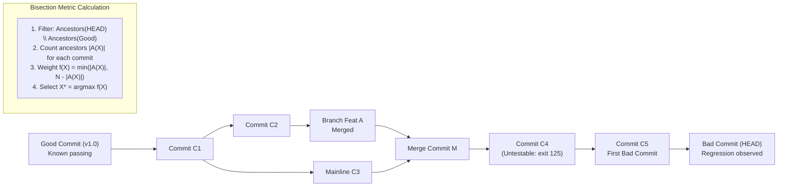

# Git Archaeology: Log, Blame, and Automated Bisect

> [!summary] Claim:
> Git archaeology reconstructs software evolution, attributes line authorship, and isolates defect origins by treating the commit graph as a partially ordered directed acyclic graph (DAG) rather than a linear sequence of files.
> `git log -S` and `-G` traverse the revision graph using preimage and postimage blob occurrence counting and diff-hunk scanning, while `-L` dynamically tracks line-range intervals across file renames.
> `git blame` attributes line origins by computing reverse parent diffs, detecting intra-file movements (`-M`) and cross-file copies (`-C`), with `--ignore-rev` bypassing bulk formatting noise via dedicated attribution markers.
> `git range-diff` matches patch series across rebases by solving the linear sum assignment problem via the Jonker-Volgenant algorithm on an $(N+M) \times (N+M)$ diff-of-diffs cost matrix padded with creation and deletion slots.
> `git bisect run` executes $O(\log N)$ binary search across DAG topologies using reachability set subtraction and ancestor weighting, handling merge commits via `--first-parent` and untestable revisions via exit code 125.

```mermaid
flowchart TD
    subgraph ARCHAEOLOGY["Git Archaeology Subsystems"]
        direction TB
        subgraph LOG["1. History Inspection (git log)"]
            REV["Graph Walk: rev-list<br/>Topological / Date Order"]
            PICKAXE["Pickaxe Engine<br/>-S: count(pre) != count(post)<br/>-G: regex in diff hunk"]
            LINELOG["Line-Range Engine (-L)<br/>Interval [s, e] tracking<br/>Parent diff shifting"]
            REV --> PICKAXE
            REV --> LINELOG
        end

        subgraph BLAME["2. Attribution Tracking (git blame)"]
            BLAME_CORE["Blame Engine: blame.c<br/>Reverse parent diff walk"]
            DETECT["Copy & Move Detection<br/>-M: intra-file (score 20)<br/>-C: inter-file (score 40)"]
            IGNORE["Ignore Revs Engine<br/>blame.ignoreRevsFile<br/>Markers: '?' ignored, '*' unblamable"]
            BLAME_CORE --> DETECT
            BLAME_CORE --> IGNORE
        end

        subgraph RANGEDIFF["3. Patch Equivalence (git range-diff)"]
            PAIR["N x M Patch Pairs"]
            COST["Cost Matrix: diff-of-diffs<br/>Dummy nodes for adds/deletes<br/>--creation-factor=60"]
            JV["Jonker-Volgenant LSAP<br/>O((N+M)^3) optimal matching"]
            PAIR --> COST --> JV
        end

        subgraph BISECT["4. Automated Bisection (git bisect)"]
            REACH["Reachability Filter<br/>Ancestors(BAD) \\ Ancestors(GOOD)"]
            WEIGHT["Weight: min(|A(X)|, N - |A(X)|)<br/>Optimal point: max weight"]
            RUNNER["bisect run loop<br/>Exit 0: good / old<br/>Exit 1..124, 126..127: bad / new<br/>Exit 125: skip untestable<br/>Exit <0 or >=128: abort"]
            SKIP_PRNG["Skip PRNG: r^1.5 bias<br/>Deterministic LCG"]
            REACH --> WEIGHT --> RUNNER
            RUNNER --> SKIP_PRNG
        end

        subgraph METADATA["5. Metadata & Fast Walk"]
            NOTES["git notes: refs/notes/commits<br/>Attached without rewriting commits<br/>Fanout tree structure"]
            LASTMOD["git last-modified (EXPERIMENTAL)<br/>Single-pass tree archaeology<br/>Generation-ordered walk, path bitmaps"]
        end
    end
```



## The Mechanism

[[Git-Revision-Selection-and-Graph-Walks]] establishes the graph foundation: commits form a directed acyclic graph where parents point backward in time.
Git archaeology tools interrogate this graph to answer three questions: what changed over time (`git log`), who changed each line and why (`git blame`), and which exact commit introduced a change or defect (`git bisect`).
All mechanisms operate over content-addressed trees and blobs without modifying existing commit hashes.

### 1. Historical Code Evolution and Graph Traversal Mechanics

`git log` drives revision walks through `revision.c` and `list-objects.c`.
Instead of reading file system logs, Git traverses the commit DAG starting from one or more tip revisions and filters commits based on reachability and path alterations.

#### Line-Range History (`-L`)

Line-range tracking (`-L <start>,<end>:<file>` or `-L :<funcname>:<file>`) is implemented in `line-log.c`.
Unlike simple file-level history, `-L` tracks a dynamic set of line ranges across commits:

1. At the starting revision, Git parses the line boundaries or searches for the function regex specified by `:<funcname>`.
2. As the commit walk traverses backward from child to parent, Git computes a diff between the child blob and parent blob.
3. If no hunk touches the tracked range, the commit is not shown, but hunks above the range still shift its position: the range is mapped line by line through the diff into the parent's coordinates.
4. If the diff modifies, inserts, or deletes lines within the range $[s_i, e_i]$, Git outputs the diff hunk and maps the tracked boundaries into the parent commit as $[s_{i-1}, e_{i-1}]$.
   For a single hunk that lies entirely inside the range:

$$\Delta = \text{lines\_added} - \text{lines\_deleted}$$

$$s_{i-1} = s_i, \quad e_{i-1} = e_i - \Delta$$

   A hunk wholly above the range shifts both ends by $-\Delta$ instead.
5. When a commit renames the target file, Git's rename detection identifies the preimage file and updates the file path tracked in the parent (`queue_diffs()` in `line-log.c` runs `diffcore_std()` when rename detection is on).
6. At a merge commit, Git diffs the range against each parent; if some parent leaves the range unchanged, that parent "takes all the blame" and Git follows only it, otherwise it propagates the mapped ranges to every parent (`process_ranges_merge_commit()` in `line-log.c`, Git 2.55.0).

#### Pickaxe Search: `-S` versus `-G`

The pickaxe mechanism searches history for changes affecting specific symbols or strings.
The distinction between `-S` and `-G` represents a fundamental algorithmic divergence in `diffcore-pickaxe.c`:

- `git log -S<string>` (occurrence counting):
  Git inspects the preimage blob (in the parent commit) and the postimage blob (in the current commit).
  It counts the total number of occurrences of `<string>` in both blobs:

$$\Delta N = |N_{\text{post}} - N_{\text{pre}}|$$

  A commit is emitted if and only if $\Delta N \ne 0$.
  If a commit moves `<string>` to another line, renames an argument on the same line, or reformats the line containing `<string>` while leaving the net count unchanged, `-S` discards the commit.
  Because `-S` only requires scanning the raw blob text to count substrings, Git avoids generating full diff hunks, making `-S` substantially faster on large histories.

- `git log -G<regex>` (diff hunk inspection):
  Git generates the full diff between parent and child.
  It scans the generated patch text for added lines (`+`) or removed lines (`-`) that match `<regex>`.
  If a line matching `<regex>` was modified, even if the total count of the match in the file remained identical, `-G` emits the commit.
  `-G` requires diff generation for every commit that touches the path, incurring significantly higher CPU overhead.

- `--pickaxe-all`:
  When `-S` or `-G` matches a change in a single file within a changeset, `--pickaxe-all` forces Git to output the entire commit diff across all modified files, rather than displaying only the matching file.

- `--pickaxe-regex`:
  Instructs `-S` to treat the search string as an extended POSIX regular expression while maintaining occurrence counting semantics.

### 2. Attribution Tracking and Blame Engine

`git blame` (`builtin/blame.c` and `blame.c`) determines the origin commit and author for every line in a file.
The algorithm works backward from a target commit (defaulting to the working tree or `HEAD`):

1. The file is represented as an array of line entries, each holding a pointer to its originating commit and source line number.
2. Git walks backward through the commit graph.
   For each commit $C$, it diffs the file in $C$ against the corresponding file in each of $C$'s parents $P_k$.
3. Any lines that are identical between $P_k$ and $C$ are "passed up" to $P_k$, transferring the responsibility to the ancestor.
4. Lines that were introduced or modified in $C$ (present in $C$ but absent in $P_k$) remain attributed to $C$.
5. The walk terminates when every line has been assigned to a commit, or when root commits are reached.

#### Move and Copy Detection (`-M` and `-C`)

Code refactoring frequently moves lines within a file or extracts them into new files.
Without detection flags, Git blames the refactoring commit rather than the original author.

- Intra-file Move Detection (`-M[<num>]`):
  Detects lines moved or copied within the same file.
  The parameter `<num>` defines the minimum threshold of alphanumeric characters required to consider a line group as moved (default 20, Both, as of 2026-11).
  Git re-diffs each still-unattributed block against the whole parent version of the same file and accepts a match only above that threshold.

- Inter-file Copy Detection (`-C[<num>]`):
  Detects lines copied from other files.
  The parameter `<num>` sets the character threshold (default 40, Both, as of 2026-11).
  The depth of copy detection depends on how many times `-C` is passed:
  - Single `-C`: Git inspects other files modified in the *same* commit.
  - Double `-C` (`-C -C`, which `--find-copies-harder` also selects in `builtin/blame.c`): in the commit that *created* the blamed file, Git additionally inspects every existing file of the parent, modified or not.
  - Triple `-C` (`-C -C -C`): Git inspects every existing file of the parent at *every* commit in the walk, not only the creating commit.
  Triple `-C` turns each step of the walk into a comparison against the whole parent tree, so its cost grows with files per tree times commits walked, requiring bounded usage.

#### Ignoring Formatting Churn (`blame.ignoreRevsFile`)

Repository-wide reformatting (such as adopting `clang-format`, `black`, `rustfmt`, or `prettier`) creates massive commits that alter every line in a repository, obscuring historical attribution.
Git provides ignore-revs machinery to skip these commits during the blame traversal:

- `--ignore-rev <commit-id>`:
  Bypasses the specified commit during attribution.
- `--ignore-revs-file <file>` and configuration `blame.ignoreRevsFile`:
  Reads a file in the `fsck.skipList` format: full, unabbreviated 40-character (SHA-1) or 64-character (SHA-256) object names, one per line.
  Comments starting with `#`, blank lines, and leading or trailing whitespace are ignored (Git 2.20 and later).
  An empty file name `""` clears the list built so far.
- When an ignored revision is processed, lines it changed or added are blamed on the previous commit that changed that line or nearby lines, as if the change never happened.
- Attribution Markers:
  - `blame.markIgnoredLines = true`:
    Marks lines that were altered by an ignored revision and successfully attributed to an ancestor with a leading `?` character.
  - `blame.markUnblamableLines = true`:
    Marks lines that were introduced by an ignored revision that could not be attributed to any ancestor (for example, completely new lines written during the reformat) with a leading `*` character.

### 3. Single-Pass Directory Archaeology: `git last-modified` (added in Git 2.52)

Web hosting interfaces (such as GitHub, GitLab, and Gerrit tree views) require displaying the commit hash, author date, and commit message that last modified each file in a directory.
Historically, client tools executed $K$ independent process calls or graph walks:

$$\text{for path in dir: } \texttt{git log -1 -- path}$$

In a directory with 100 files across a repository with 500,000 commits, this naive approach requires 100 separate commit graph walks, loading tree objects repeatedly and creating severe I/O bottlenecks.

Added in Git 2.52 as an EXPERIMENTAL porcelain interrogator (`builtin/last-modified.c`), `git last-modified` computes the last modifying commit for all files and subtrees in a single generation-ordered traversal (synopsis confirmed against `git last-modified -h`, Git 2.55.0):

```text
git last-modified [--recursive] [--show-trees] [--max-depth=<depth>] [-z] [<revision-range>] [[--] <pathspec>...]
```

1. The command accepts a target revision range (defaulting to `HEAD`) and an optional pathspec.
2. It walks commits from the tip through a priority queue ordered by generation number, then commit date, holding the requested paths in a hash map and, per commit, a bitmap of paths still unresolved (`builtin/last-modified.c`, Git 2.55.0).
3. For each commit, Git first consults the commit-graph changed-path Bloom filters when present (`maybe_changed_path()`), and only diffs the commit's tree against its parent trees when a pending path may have changed.
4. When a path's blob or tree OID (or mode, or name via a rename) changes between parent and child, Git records the current commit OID as the last modifier for that path and clears its bit; unresolved bits pass to the parents.
5. Traversal terminates early as soon as all requested paths have been resolved, avoiding an exhaustive walk of full history.
6. The output is printed as (paths with special characters are C-style quoted):

```text
<oid> TAB <path> LF
```

Passing `-z` terminates each line with a NUL byte (`\0`) instead of LF and disables the quoting.

### 4. Commit Patch Equivalence and Series Evolution: `git range-diff`

When a developer rebases a feature branch, squashes commits, or revises a patch series following code review, commit hashes change completely.
Standard `git diff` cannot compare the old branch `old_base..old_tip` with the new branch `new_base..new_tip` because their parentages differ.
`git range-diff` (`builtin/range-diff.c` and `range-diff.c`) compares two commit ranges by matching commits based on patch content.

#### The Cost Matrix and Jonker-Volgenant LSAP

`git range-diff` formulates the comparison as a Linear Sum Assignment Problem (LSAP) on a complete bipartite graph:

1. Let $P = \{p_1, p_2, \dots, p_N\}$ be the commits in the first range (`old`), and $Q = \{q_1, q_2, \dots, q_M\}$ be the commits in the second range (`new`).
2. For every commit, Git computes the patch text (including author, commit message, and diff); patches identical across the ranges are paired first by hashing and get cost 0 (`find_exact_matches()` in `range-diff.c`).
3. For every remaining pair $(p_i, q_j)$, Git computes a "diff-of-diffs" between patch $p_i$ and patch $q_j$ with 3 context lines (`diffsize()` sets `cfg.ctxlen = 3`).
4. The cost $C_{ij}$ is the number of lines plus hunk headers that this outer diff emits.
5. To represent commit creations and deletions, Git extends the cost matrix to $n = N + M$ rows and columns, with $M$ dummy nodes on the left and $N$ dummy nodes on the right.
   The cost of assigning a commit to a dummy node is the size of the commit's diff scaled by `--creation-factor=<percent>` (default 60, Both, as of 2026-11):

$$\text{Cost}(\text{dummy} \to q_j) = \frac{\text{creation\_factor}}{100} \times \text{size}(q_j)$$

   Since Git 2.52, `--max-memory=<size>` (default 4G) makes range-diff die rather than allocate an $n \times n$ integer matrix larger than the limit.
6. Git solves the minimum-cost assignment using the Jonker-Volgenant algorithm (`linear-assignment.c`), which runs in $O((N+M)^3)$ time.
7. Output Syntax:
   - `=`: Commit diff and commit message matched exactly between ranges (hashes differ due to rebasing).
   - `!`: Commit was modified; followed by a diff-of-diffs whose first column is the outer marker and second column the inner patch marker.
   - `<`: Commit was dropped from the new series.
   - `>`: Commit was newly added to the new series.
   - `--dual-color`: Retains inner diff syntax highlighting while applying outer `-`/`+` markers.
   - `--diff-merges=remerge` (`--remerge-diff`): Re-merges merge commits in memory to verify that merge conflict resolutions match across rebases.

### 5. Non-Destructive Metadata Attachment: `git notes`

In enterprise CI/CD and audit environments, systems must attach test results, code review approval IDs, performance benchmarks, and vulnerability scan reports to commits.
Directly editing a commit message invalidates the commit object's cryptographic hash, forcing a rewrite of all descendant commits and breaking detached branches.

`git notes` (`builtin/notes.c` and `notes.c`) stores arbitrary metadata without altering commit objects:

1. Notes are tracked under a dedicated reference namespace, default `refs/notes/commits`.
2. The reference points to a standard Git commit containing a tree object.
3. Tree Path Mapping:
   Git addresses notes inside the tree using the target commit's hex hash.
   When the notes tree is small, it is flat, mapping the 40-character (or 64-character) SHA directly to a blob:

```text
100644 blob <blob-oid>    <target-commit-sha>
```

4. Fanout Partitioning:
   When the notes tree grows, Git automatically splits it into fanout levels of two hex digits each, like loose object directories.
   There is no fixed count threshold: `determine_fanout()` in `notes.c` adds a level when all 16 entries of the next two 4-bit levels of its in-memory 16-way trie are populated (Git 2.55.0):

```text
040000 tree <tree-oid>    fa
    100644 blob <blob-oid>    ce97e17c9c5e783a26066bef79d024f5000558
```

5. The blob content contains the raw text of the note.
6. When running `git log`, Git checks `refs/notes/commits` (or custom namespaces specified via `--notes=<ref>`), looks up the current commit's SHA in the notes tree, and prints the attached note below the commit message.
7. Because notes are stored in independent Git objects, they can be pushed and fetched (`git push origin 'refs/notes/*'`) without altering core history.
   Notes themselves stay mutable: `git notes edit`, `append`, and `remove` create new commits on the notes ref.

### 6. Binary Search Fault Isolation: `git bisect`

`git bisect` implements binary search over the commit DAG to isolate the first commit that introduced a defect or changed program behavior.
The DAG bisection algorithm implemented in `bisect.c` was described by Christian Couder (Linux Kongress 2009).



#### DAG Bisection Mathematics

In a linear history of $N$ commits, binary search selects commit $\lfloor N/2 \rfloor$, halving the search space at each iteration in $O(\log N)$ steps.
In a non-linear DAG with branching and merges, a single commit does not divide the graph into two equal linear halves.

The bisection algorithm proceeds as follows:

1. Reachability Set Pruning:
   Let $B$ be the set of "bad" (or "new") commits, and $G$ be the set of "good" (or "old") commits.
   Git computes the candidate set $S$:

$$S = \{c \in \text{DAG} \mid c \in \text{Ancestors}(B) \land c \notin \text{Ancestors}(G)\}$$

   This is equivalent to the revision selection query `git rev-list B --not G`.

2. Ancestor Counting:
   Starting from the root boundary commits of $S$, Git associates to each commit $X \in S$ the number of ancestors it has within $S$, denoted $|A(X)|$.

3. Weight Function:
   If commit $X$ is tested and determined to be "good", all ancestors of $X$ are eliminated.
   If commit $X$ is determined to be "bad", all commits in $S$ that are *not* ancestors of $X$ are eliminated.
   Git maximizes the minimum information gained regardless of outcome:

$$f(X) = \min(|A(X)|, |S| - |A(X)|)$$

4. Best Bisection Point:
   Git chooses commit $X^* = \arg\max_{X \in S} f(X)$.
   As an optimization, if Git evaluates a commit where $|A(X)| = \lfloor |S|/2 \rfloor$, it short-circuits traversal immediately and selects $X^*$.
   The distance metric can be inspected directly using:

```bash
git rev-list --bisect-all BAD --not GOOD
```

#### Skip Algorithm with PRNG Bias

When a selected commit cannot be compiled or tested, the user or automated script marks it with `git bisect skip`.
If Git simply picked the next highest weight commit, it would frequently land on an adjacent commit in the same broken pull request or branch.

To avoid broken clusters, Git implements a pseudo-random skip selection in `bisect.c`:

1. All candidate commits are sorted by descending weight $f(X)$.
2. Skipped commits are filtered out.
3. A pseudo-random number $r = \text{prn} / 32768 \in [0, 1)$ is drawn from a linear congruential generator seeded with the candidate count (`get_prn()`: `count * 1103515245 + 12345`), so the same graph and verdicts always yield the same choice.
4. Git computes a biased index by multiplying $r$ by its square root (`skip_away()`: `index = (count * prn / PRN_MODULO) * sqrti(prn) / sqrti(PRN_MODULO)`, Git 2.55.0):

$$\text{index} = \lfloor r^{1.5} \times |U| \rfloor$$

   where $|U|$ is the number of remaining unskipped candidates.
   The exponent $1.5$ biases selection toward high-weight commits (near the center of the graph) while introducing sufficient entropy to escape contiguous broken commit sequences.

#### The `git bisect run` Exit Code Contract

`git bisect run <cmd> [<args>...]` automates the bisection loop by executing a test harness at each step.
The test executable must conform strictly to the exit code contract defined by `git-bisect(1)`:

| Exit Code | Classification | Bisection Action |
| :--- | :--- | :--- |
| `0` | Good / Old | Marks commit as `good`/`old`; prunes commit and all its ancestors. |
| `1` to `124` | Bad / New | Marks commit as `bad`/`new`; prunes all commits that are not ancestors of this commit. |
| `125` | Untestable | Marks commit as `skip`; applies biased PRNG to select alternative candidate. |
| `126` | Bad / New | POSIX shells use it for "found but not executable", but bisect counts it as bad; on the first step only, Git (2.36 and later) reruns the command on a good revision and aborts if that also returns 126. |
| `127` | Bad / New | POSIX shells use it for "command not found"; handled exactly like 126, including the first-step double check. |
| $< 0$ or $\ge 128$ | Signal / Out of range | `git bisect run` stops with `bisect run failed: exit code N ... is < 0 or >= 128`; an `exit(-1)` arrives as 255. |

> [!important]
> If a test script encounters a compilation failure or missing dependency, it must exit with code `125`.
> Exiting with code `1` causes Git to mark the commit as bad, falsely identifying a broken build as the introduction of a functional regression.

#### Merge Commits and `--first-parent`

In non-linear history with numerous topic branches, a regression introduced on a branch causes Git to bisect into that branch's individual commits.
If topic branches contain messy intermediate commits or temporary breakages, bisection can become prolonged or land on non-functional intermediate states.

Passing `--first-parent` to `git bisect start`:

```bash
git bisect start --first-parent HEAD v1.0
```

forces Git to follow only the first parent of merge commits.
The bisection treats each merged branch as an atomic transaction, identifying the specific pull request or merge commit that introduced the bug.
Once the merge commit is isolated, a second bisection can be targeted specifically inside the feature branch range if desired.

#### Distinction from Delta Debugging

Git bisection is frequently confused with Andreas Zeller's formal Delta Debugging algorithm (`ddmin`).
The boundary must be maintained:
- `git bisect` performs binary search over a discrete, pre-existing, partially ordered graph of repository states (the commit DAG).
  It isolates which existing state transition introduced a defect.
- Delta Debugging (`ddmin`) minimizes failure-inducing *inputs*, configuration files, or textual diff hunks by systematically partitioning and combining subsets of changes to find a 1-minimal test case.
  `git bisect` finds the commit; Delta Debugging minimizes the patch inside that commit.

## Commands and Numbers to Know

| Item | Value / Syntax | Platform and date | What it controls |
| :--- | :--- | :--- | :--- |
| Line log syntax | `git log -L <start>,<end>:<file>` | Both (as of 2026-11) | Traces line-range evolution across renames |
| Function log syntax | `git log -L :<funcname>:<file>` | Both (as of 2026-11) | Traces function evolution using language regex |
| Pickaxe occurrence search | `git log -S <string>` | Both (as of 2026-11) | Filters commits where occurrence count of string changes |
| Pickaxe regex diff search | `git log -G <regex>` | Both (as of 2026-11) | Filters commits whose patch text contains matching diff lines |
| Move detection threshold | `-M` (default `20` alphanumeric chars) | Both (as of 2026-11) | Threshold for detecting moved lines within a file |
| Copy detection threshold | `-C` (default `40` alphanumeric chars) | Both (as of 2026-11) | Threshold for detecting copied lines across files |
| Copy detection scope | `-C` (files changed in same commit), `-C -C` or `--find-copies-harder` (all files, in the file-creating commit), `-C -C -C` (all files, every commit) | Both (as of 2026-11) | Tree search depth for copy detection |
| Blame ignore revs config | `blame.ignoreRevsFile` | Both (as of 2026-11) | Path to file listing commits to skip during blame |
| Mark ignored blame lines | `blame.markIgnoredLines = true` | Both (as of 2026-11) | Prefixes lines attributed through ignored commits with `?` |
| Mark unblamable blame lines | `blame.markUnblamableLines = true` | Both (as of 2026-11) | Prefixes lines created by ignored commits with `*` |
| Range-diff creation factor | `--creation-factor=<percent>` (default `60`) | Both (as of 2026-11) | Cost weight for patch additions and deletions in LSAP |
| Range-diff memory cap | `--max-memory=<size>` (default `4G`, added in 2.52) | Both (as of 2026-11) | Maximum memory allocated for LSAP cost matrix |
| Default notes reference | `refs/notes/commits` | Both (as of 2026-11) | Object namespace where commit metadata is stored |
| Single-pass tree archaeology | `git last-modified` (added in 2.52) | Both (as of 2026-11) | EXPERIMENTAL batched commit walk for path modified times |
| Bisect good exit code | `0` | Both (as of 2026-11) | Signals commit is good / baseline intact |
| Bisect bad exit code | `1` to `124`, `126`, `127` | Both (as of 2026-11) | Signals commit is bad / regression present |
| Bisect skip exit code | `125` | Both (as of 2026-11) | Signals commit cannot be tested; triggers biased PRNG |
| Bisect abort exit code | $< 0$ or $\ge 128$ | Both (as of 2026-11) | Stops `git bisect run` |
| Bisect first-parent flag | `git bisect start --first-parent` | Both (as of 2026-11) | Restricts bisection to the first-parent chain of the mainline |
| Bisect active reference | `BISECT_HEAD` | Both (as of 2026-11) | With `--no-checkout` only: ref to the commit to test, updated instead of checking out |

## Multi-Language Comparison: C / Python / Rust

Git itself is written in C, Python provides high-level scripting wrappers and the Dulwich pure-Python implementation, and Rust provides the high-performance `gitoxide` (`gix`) toolchain.

| Concern | C (git v2.55.0 / libgit2) | Python (Dulwich / pygit2 / lab script) | Rust (gitoxide `gix`) |
| :--- | :--- | :--- | :--- |
| Revision walk | `struct rev_info` in `revision.c`; priority queue sorted by commit date or topo generation | `pygit2.Repository.walk()` wraps libgit2; Dulwich's `Repo` reads parents from the commit-graph file when the object store has one (`dulwich/repo.py`, Dulwich 1.2.21, as of 2026-11) and otherwise from the commit objects | `gix_revwalk::Graph` with commit-graph topological generation numbers |
| Line range log | `line-log.c`: maps interval arrays through `xdl_diff()` hunks | Python scripts diff successive blobs and translate line offsets via `difflib` | Custom hunk translation using `gix_diff::blob::diff` |
| Pickaxe search | `diffcore-pickaxe.c`: fast boyer-moore substring search or POSIX regex | Python string count comparison (`blob.count()`) or `re.search()` over patch hunks | `bstr` and regex searching over diff streams in `gix-diff` |
| Blame attribution | `blame.c`: linked list of `struct blame_entry`, passing blame upward across parent diffs | `pygit2.Repository.blame()` wraps libgit2; Dulwich implements basic ancestry blame | `gix-blame` crate (0.20.0 on crates.io, as of 2026-11): single-file commit annotation across parent diff chunks; the gitoxide crate-status page lists rename tracking and commits-to-ignore as not done, and lists no move or copy detection |
| Range-diff LSAP | `linear-assignment.c`: Jonker-Volgenant shortest augmenting path algorithm | `scipy.optimize.linear_sum_assignment` (modified Jonker-Volgenant) | `pathfinding::kuhn_munkres` (Hungarian, also $O(n^3)$) or a custom Jonker-Volgenant crate matching diff matrices |
| Notes tree lookup | `notes.c`: fanout tree traversal mapping commit OID to note blob | `Repository.lookup_note(annotated_id, ref='refs/notes/commits')` in pygit2 1.21.0; `dulwich.notes.NotesTree.get_note()` in Dulwich 1.2.21, which detects the fanout level itself (both checked by import, as of 2026-11) | `gix-note` crate (0.3.1 on crates.io, as of 2026-11), which the gitoxide crate-status page describes as CRUD for git notes, or a manual tree lookup of the hex OID |
| Bisect execution | `bisect.c`: topological reachability subtraction and PRNG skip bias | Lab harness invokes `git bisect run` via subprocess or implements poset binary search | Graph traversal computing ancestor counts via `gix_revwalk` |

## Worked Lab Example

The companion lab is located at `code/02-Version-Control/bisect_harness/`; it requires only `git` (v2.52+) and `python3`.

`run.sh` executes `bisect_harness.py`, which constructs a synthetic, fully deterministic Git repository using fixed identities, dates (`2026-10-01`), and `LC_ALL=C`.
The harness executes six archaeological operations:

1. Constructs a non-linear DAG with a mainline, a feature branch merged via `--no-ff`, a clean refactoring commit (`c4`), a regression commit introducing an arithmetic error (`c5`), a cosmetic comment update (`c6`), an automated formatting commit by a bot (`c7`), and a documentation commit (`c8`).
2. Automated Bisect: Runs `git bisect run` using a test harness that compiles the module (exiting `125` on syntax failure) and checks the calculation contract `compute(5) == 50` (exiting `1` on failure, `0` on success), cleanly isolating culprit `c5`.
3. Bisect Skip: Introduces an untestable commit with broken syntax between good and bad commits, demonstrating how exit code `125` detects the bounded uncertainty set when intermediate commits cannot be tested.
4. Pickaxe `-S` vs `-G`: Queries `FACTOR_SCALE = 10`.
   Demonstrates that `-S` matches only commit `c0` (count changed from 0 to 1), whereas `-G` matches both `c0` and `c6` (since `c6` added an inline comment modifying the diff hunk without altering the occurrence count).
5. Blame with Ignore-Revs and Copy Detection: Demonstrates how `--ignore-rev` with `blame.markIgnoredLines` strips out the bot commit `c7` and marks lines restored to author with `?`, and how `git blame -f -C -C` detects that the head of `compute_metrics` in `fast_calc.py` was copied from `calc.py` (single `-C` misses it, because `c9` does not modify `calc.py`).
6. Range-Diff and Notes: Amends a feature branch commit and runs `git range-diff` to display the diff-of-diffs with `!`, attaches an audit note to `c5` using `git notes add` without altering its SHA, and executes `git last-modified` to inspect tree modification times in a single pass.

```bash
cd code/02-Version-Control/bisect_harness
bash run.sh
```

### Verified output

Recorded on `darwin-arm64` on 2026-11-08 and verified by `make verify`; the file is `code/02-Version-Control/bisect_harness/expected/darwin-arm64.txt`.

```text
=== 1. Automated Bisect Run ===
Bisect steps: 2
  Bisecting: 1 revision left to test after this (roughly 1 step)
  Bisecting: 0 revisions left to test after this (roughly 0 steps)
First bad commit: 23e0320 c5: optimize calculation path
Culprit matches c5: True

=== 2. Bisect Skip Handling (Exit Code 125) ===
Bisect skip status: bounded uncertainty set detected
  The first 'bad' commit could be any of:
  We cannot bisect more!
Candidate set size: 2
  candidate: s1: broken syntax commit
  candidate: s2: regression commit
Candidates equal {s1, s2}: True

=== 3. Pickaxe Search (-S vs -G) ===
Pickaxe -S (occurrence count changes):
  f5fab2d c0: initial codebase
Pickaxe -G (diff hunk regex matches):
  1468492 c6: annotate factor scale
  f5fab2d c0: initial codebase

=== 4. Blame with Ignore-Revs and Copy Detection ===
Blame normal (calc.py L4-7, line 6 attributed to bot):
  ^f5fab2d (<author@example.com> 2026-10-01 10:00:00 +0000 4) def compute_metrics(base, multiplier, offset):
  ^f5fab2d (<author@example.com> 2026-10-01 10:00:00 +0000 5)     val = (base * multiplier) + offset
  332f36a1 (<bot@example.com>    2026-10-01 10:35:00 +0000 6)     if val > 1000: return val // 2
  ^f5fab2d (<author@example.com> 2026-10-01 10:00:00 +0000 7)     return val * 2
Blame with --ignore-rev (calc.py L4-7, line 6 restored with marker):
  ^f5fab2d (<author@example.com> 2026-10-01 10:00:00 +0000 4) def compute_metrics(base, multiplier, offset):
  ^f5fab2d (<author@example.com> 2026-10-01 10:00:00 +0000 5)     val = (base * multiplier) + offset
  ^?f5fab2 (<author@example.com> 2026-10-01 10:00:00 +0000 6)     if val > 1000: return val // 2
  ^f5fab2d (<author@example.com> 2026-10-01 10:00:00 +0000 7)     return val * 2
Blame with a single -C (fast_calc.py L2-6, copy from calc.py is missed):
  7ba4ff40 fast_calc.py (Toolchain Author 2026-10-01 10:50:00 +0000 2) def compute_metrics(base, multiplier, offset):
  7ba4ff40 fast_calc.py (Toolchain Author 2026-10-01 10:50:00 +0000 3)     val = (base * multiplier) + offset
  7ba4ff40 fast_calc.py (Toolchain Author 2026-10-01 10:50:00 +0000 4)     if val > 1000:
  7ba4ff40 fast_calc.py (Toolchain Author 2026-10-01 10:50:00 +0000 5)         return val // 2
  7ba4ff40 fast_calc.py (Toolchain Author 2026-10-01 10:50:00 +0000 6)     return val * 2
Blame with -C -C cross-file copy detection (fast_calc.py L2-6):
  ^f5fab2d calc.py      (Toolchain Author 2026-10-01 10:00:00 +0000 2) def compute_metrics(base, multiplier, offset):
  ^f5fab2d calc.py      (Toolchain Author 2026-10-01 10:00:00 +0000 3)     val = (base * multiplier) + offset
  7ba4ff40 fast_calc.py (Toolchain Author 2026-10-01 10:50:00 +0000 4)     if val > 1000:
  7ba4ff40 fast_calc.py (Toolchain Author 2026-10-01 10:50:00 +0000 5)         return val // 2
  7ba4ff40 fast_calc.py (Toolchain Author 2026-10-01 10:50:00 +0000 6)     return val * 2

=== 5. Range-Diff (Patch Series Evolution) ===
Range-diff output:
  1:  b252065 ! 1:  07ffdb8 c1: add extra module
      @@ Metadata
       Author: Toolchain Author <author@example.com>
       
        ## Commit message ##
      -    c1: add extra module
      +    c1-v2: add extra module with optimization
       
        ## extra.py (new) ##
       @@
       +# Extra module
       +def extra_fn():
      ++    # optimized implementation
       +    return 100

=== 6. Non-Destructive Git Notes ===
Commit with attached note:
  commit 23e0320265a5e57af04e0d3c0da7acba766125f5
  Author: Toolchain Author <author@example.com>
  Date:   Thu Oct 1 10:25:00 2026 +0000
  
      c5: optimize calculation path
  
  Notes:
      Audit: verified regression via automated bisect harness
Commit object bytes unchanged: True
Branch tip unchanged: True
Plain log without notes shows no note: True
Notes ref holds one note for the culprit: True

=== 7. Tree Archaeology with git last-modified ===
Last-modified directory listing:
  703371f README.md
  332f36a calc.py
  b252065 extra.py
  7ba4ff4 fast_calc.py
  9a7d252 util.py
```

### Reading the Result

- Part 1 confirms that `git bisect run` traversed the non-linear DAG (the range holds the merged `feat` commit) and correctly converged on `23e0320` (`c5: optimize calculation path`); the lab prints the two `Bisecting:` lines Git emitted (two test runs for a nine-commit range), so the weight metric itself is shown only by `git rev-list --bisect-all`.
- Part 2 demonstrates the skip handling contract: when an intermediate commit fails to compile, returning `125` causes Git to halt when all separating commits are untestable, printing `The first 'bad' commit could be any of:` followed by the candidate set and the lab resolves those hash lines and asserts that the set is exactly the skipped `s1` and the bad `s2` (`Candidate set size: 2`, `Candidates equal {s1, s2}: True`).
- Part 3 proves the pickaxe distinction: `-S "FACTOR_SCALE = 10"` found only `f5fab2d` (`c0`) where the symbol count changed.
  `-G "FACTOR_SCALE = 10"` additionally found `1468492` (`c6`), where an inline comment modified the hunk text without changing symbol frequency.
- Part 4 shows attribution hygiene: in normal blame, line 6 is blamed on `332f36a1` (`Bot Formatter`).
  Passing `--ignore-rev` restores attribution to the true author `^f5fab2d` and prepends the `?` marker (`^?f5fab2`), proving that `blame.markIgnoredLines` succeeded.
  Running `git blame -f -C -C` on `fast_calc.py` resolves lines 2 and 3 back to their origin in `calc.py` (`^f5fab2d calc.py`).
  Lines 4 and 5 stay on `c9` because the bot commit `c7` had already joined them into one line in `calc.py`, and line 6 (`return val * 2`, 10 alphanumeric characters) stays on `c9` because it is below the default 40-character `-C` threshold; rerunning with `-C5 -C5` moves line 6 to `calc.py` as well (checked by hand on Git 2.55.0, not part of the recorded output).
- Part 5 confirms `git range-diff`: commit `b252065` is matched against `07ffdb8` with marker `!`, followed by the exact outer diff of commit message and code hunks.
- Part 6 verifies `git notes`: the audit note is attached to `23e0320` under `refs/notes/commits` and displayed by `git log --notes`; the lab proves the commit is not rewritten by comparing the raw commit object (`git cat-file commit`) and the branch tip before and after, and that `git log --no-notes` shows no note.
- Part 7 shows `git last-modified`: each path in the directory is mapped to its exact modifying commit in a single pass (`332f36a calc.py`, `7ba4ff4 fast_calc.py`, `9a7d252 util.py`).

## Pitfalls

> [!warning] Pitfall: Exit code leakage in `git bisect run`
> In shell test scripts, commands that fail unexpectedly (such as `grep` finding no matches, an unhandled network error, or a missing binary) return exit code 1 or 127.
> If the script does not trap errors and map them to `125`, Git treats codes 1 and 127 as a test failure and falsely marks an innocent commit as "bad" (127 is caught only when it also occurs on the first step and on a good revision).
> Always wrap `git bisect run` scripts with explicit error classification: return `0` for passing tests, `1` strictly for reproducible functional regressions, and `125` for build, compilation, or environment errors.

> [!warning] Pitfall: Dirty working tree during automated bisection
> Compilation tools and test runners frequently generate untracked build artifacts (e.g. `.o`, `.pyc`, build cache directories).
> As `git bisect` switches revisions across history, untracked artifacts can prevent Git from checking out an older tree or cause subsequent builds to link stale binary objects.
> Configure the test harness to run `git clean -fdx` or build strictly inside an isolated temporary directory or out-of-tree build root.

> [!warning] Pitfall: Assuming `-S` detects line modifications
> Engineers frequently reach for `git log -S<symbol>` to find when a function's implementation changed.
> If a commit edits the arguments, logic, or formatting of a line containing `<symbol>` without changing the count of occurrences in the file, `-S` silently skips the commit.
> Use `-G<regex>` when searching for diff text modifications, and reserve `-S` for tracking addition or deletion of symbols.

> [!warning] Pitfall: Running `git blame -C -C -C` without path or line limits
> Passing triple `-C` forces Git, at every commit it walks, to search every file of the parent tree for copy sources, not just the files that commit changed.
> In a large monorepo with 100,000 files, this multiplies the candidate source set at each step by the tree size, so the cost grows with tree size.
> This note gives no measured monorepo figure.
> Always constrain blame with `-L <start>,<end>` or restrict copy detection to `-C` or `-C -C`.

> [!warning] Pitfall: Mutating history instead of attaching metadata via `git notes`
> CI systems that attempt to record build artifacts, code review approvals, or security compliance hashes by amending commits invalidate commit SHAs, requiring forced pushes and breaking developer branches.
> Use `git notes add` under a dedicated ref (`refs/notes/ci` or `refs/notes/review`), which attaches metadata to existing commits without rewriting the commit graph; the notes ref keeps its own history of every edit.

> [!warning] Pitfall: Non-linear bisection without `--first-parent` in trunk-based repos
> When a regression occurs on trunk following the merge of a 50-commit pull request, running a default `git bisect` navigates inside the branch's intermediate commits.
> If the feature branch contained temporary broken commits or rebasing errors that were fixed before the PR merged, bisection wastes time testing broken branch states.
> Run `git bisect start --first-parent` to identify the responsible merge commit first, then bisect within the PR range if necessary.

## At Scale

At large enterprise and monorepo scale (1,000 to 50,000 engineers, millions of commits, hundreds of gigabytes of history), archaeological operations face severe computational constraints:

- Distributed Blame Ignore Files:
  Enterprise organizations should establish a root `.git-blame-ignore-revs` file tracked directly in version control.
  Engineers configure Git per repository, or globally with the `:(optional)` path prefix:

```bash
git config blame.ignoreRevsFile .git-blame-ignore-revs
git config --global blame.ignoreRevsFile ':(optional).git-blame-ignore-revs'
```

  A plain global setting breaks blame in every repository that lacks the file: Git 2.55.0 dies with `fatal: could not open object name list: .git-blame-ignore-revs`, while the `:(optional)` form is skipped silently (both checked by hand on Git 2.55.0).

  Whenever large automated refactoring tools (e.g. language upgrades or linter migrations) run across the codebase, the commit SHA is appended to this file.
  This ensures that daily blame attribution across thousands of developers automatically bypasses formatting noise without manual flags.

- Automated CI Bisect Fleets:
  Rather than individual developers bisecting defects locally on developer laptops, large organizations run automated bisection worker fleets:
  - When an end-to-end regression is detected on the main branch, a bisection orchestrator provisions a cloud container.
  - The runner executes `git bisect start --no-checkout`, so each step only updates the `BISECT_HEAD` ref instead of checking out a working tree; the test must read the commit from `BISECT_HEAD`.
  - Test suites are executed using out-of-tree caching or pre-built container images indexed by commit OID.
  - Fast fault isolation keeps merge queues unblocked, because the culprit is found in O(log N) test runs.

- Single-Pass Tree Archaeology vs. Commit-Graph Bloom Filters:
  For repository browsers and code search engines, fetching the last modified timestamp for thousands of files requires optimized server-side execution.
  Repositories leverage `git last-modified` in conjunction with commit-graph changed-path Bloom filters (`commitGraph.changedPathsVersion = 2`, Both, as of 2026-11), which `git last-modified` consults before diffing trees.
  The Bloom filters let Git rule out, in constant time per path and with no false negatives, that a commit touches a path without reading tree objects from disk; this note gives no measured CPU saving.

- Merge Queue Range-Diff Verification:
  Modern speculative merge queues and build trains (see [[Git-Branching-Models-Merge-Queues-and-Code-Review]]) rebase developer pull requests onto rapidly advancing master tips before merging.
  To prove that a rebase introduced no unexpected code changes, merge queues automatically compute:

```bash
git range-diff origin/main..pr-branch origin/main..rebased-pr-branch
```

  If any commit displays an unexpected `!` or `<`/`>` marker outside of resolved conflict hunks, the merge queue rejects the branch automatically.

> [!tip] Practice Drill:
> Execute the hands-on non-linear automated bisection exercise in [[Drill-Git-Automated-Bisect-on-Non-Linear-History]].

## Interview Questions

> [!question] L5: Explain the technical difference between `git log -S<string>` and `git log -G<regex>`, and describe when you must use each.
>
> > [!success]- Answer
> > `git log -S<string>` operates on occurrence counting: it compares the preimage blob in the parent against the postimage blob in the child and emits the commit only if the total count of `<string>` changed ($\Delta N \ne 0$).
> > It does not trigger on commits that modify, move, or reformat lines containing `<string>` if the net frequency remains constant.
> > `git log -G<regex>` generates the full diff patch and scans the added and deleted lines for matches against `<regex>`.
> > It emits any commit whose diff hunks touch `<regex>`, even if the overall count in the file did not change.
> > Use `-S` when looking for the introduction, deletion, or copy of a symbol (which runs significantly faster because Git does not need to generate full diff hunks).
> > Use `-G` when investigating modifications or logic updates to lines that reference a specific pattern.

> [!question] L5: In `git bisect run`, what is the purpose of exit code 125, and what failure occurs if your test script returns exit code 1 instead?
>
> > [!success]- Answer
> > Exit code 125 signals to `git bisect` that the current commit is untestable (for example, due to a broken build, missing third-party dependency, or syntax error unrelated to the regression under test).
> > When receiving code 125, Git marks the revision as `skip` and invokes its biased pseudo-random number generator to select an alternative candidate commit.
> > If the test script mistakenly exits with code 1 upon a build failure, Git interprets code 1 as a confirmed presence of the regression (`bad`).
> > Git will then prune every commit that is not an ancestor of it and can erroneously declare the broken build commit as the culprit that introduced the functional defect.

> [!question] L6: Predict the output: Given commit `C1` introducing `void handle_event(int code) { ... }` in `events.c`, commit `C2` renaming the file to `dispatcher.c`, and commit `C3` modifying the function signature to `void handle_event(int code, void *data)`.
> What will `git log -S "handle_event" --oneline` output versus `git log -G "handle_event" --oneline`?
>
> > [!success]- Answer
> > `git log -S "handle_event" --oneline` will output only `C1`.
> > In `C2`, the file was renamed, but with rename detection on (`diff.renames` defaults to true) the pair `events.c -> dispatcher.c` keeps the occurrence count of `"handle_event"` unchanged; with `--no-renames` the delete and add would each change the count and `-S` would also show `C2`.
> > In `C3`, the signature was edited from `(int code)` to `(int code, void *data)`, but the string `"handle_event"` occurs exactly once before and after the commit, so $\Delta N = 0$.
> > `git log -G "handle_event" --oneline` will output both `C3` and `C1`.
> > In `C3`, the diff hunk contains deleted line `- void handle_event(int code)` and added line `+ void handle_event(int code, void *data)`, both of which match the regex `"handle_event"`.
> > Note that `C2` (pure rename without modification) produces no content hunks, so `-G` never shows it.

> [!question] L6: Walk through the three levels of `-C` in `git blame` and explain the algorithmic complexity trade-offs of using `-C -C -C`.
>
> > [!success]- Answer
> > A single `-C` detects lines moved or copied from other files modified within the *same* commit.
> > Double `-C` (`-C -C`, also selected by `--find-copies-harder`) additionally checks every existing file of the parent in the commit that *created* the file being blamed (finding code extracted into new modules).
> > Triple `-C` (`-C -C -C`) checks every existing file of the parent at *every* commit the blame walk visits.
> > Single `-C` inspects only the files a commit changed, and double `-C` pays the whole-tree search once, at the creating commit; triple `-C` pays it at every step.
> > In large repositories, the work grows with the number of commits walked and the number of files searched per commit, which is why the flag is unsafe without `-L`; this note gives no formal bound.

> [!question] L7: Debug this scenario: A developer ran `git bisect run ./test.sh`.
> The test script runs `pytest tests/test_calc.py`.
> After 10 iterations, Git stops and outputs: `bisect run cannot continue any more. The first 'bad' commit could be any of: [C4, C5]`.
> Why did Git fail to isolate a single commit, and how do you resolve it?
>
> > [!success]- Answer
> > Git encountered one or more commits marked as `skip` (exit code 125) that sit directly on the boundary between the last known good commit and the first confirmed bad commit.
> > If commit `C4` broke compilation or tests and returned 125, and commit `C5` fixed the build but introduced the regression, Git knows that `C3` was good and `C5` was bad.
> > Because `C4` could not be tested, Git cannot mathematically determine whether `C4` or `C5` introduced the bug, resulting in a bounded uncertainty set.
> > To resolve this:
> > 1. Inspect the untestable commit `C4` manually.
> > 2. Apply a temporary hot-fix or cherry-pick in the test script: have `test.sh` apply a patch to fix the compilation error in `C4` before running the test, run `pytest`, record the status, run `git reset --hard` to clean the tree, and exit with the test status.
> > 3. Alternatively, use `git bisect replay` with manual verdicts for the skipped commits.

> [!question] L7: How does `git range-diff` model the equivalence of two commit ranges, what algorithm does it use, and why does `--creation-factor` exist?
>
> > [!success]- Answer
> > `git range-diff` models the comparison between two commit ranges $P$ and $Q$ as a minimum-weight bipartite matching problem (Linear Sum Assignment Problem).
> > The cost between each pair $(p_i, q_j)$ is computed as the line count of the "diff-of-diffs" between their patch representations.
> > It adds dummy nodes to allow commits to be matched as creations or deletions.
> > The cost of matching a commit to a dummy node is the commit's diff size multiplied by `--creation-factor / 100` (default 60%).
> > It solves the assignment using the Jonker-Volgenant shortest augmenting path algorithm in $O((N+M)^3)$ time.
> > The creation factor exists because even completely unrelated commits can share trivial boilerplate lines or blank lines.
> > A creation factor below 100% requires a significant commonality between commits before matching them, preventing Git from falsely matching two unrelated patches that share a few trivial lines.

> [!question] L8+: You are the principal architect for a 20,000-engineer monorepo.
> Engineers complain that `git blame` is slow and frequently blames bot reformatting commits.
> Design the organizational and tooling infrastructure to eliminate both problems.
>
> > [!success]- Answer
> > 1. Attribution Hygiene:
> >    Establish a root `.git-blame-ignore-revs` file in the monorepo root.
> >    Configure internal developer setup scripts and devcontainers to enforce `git config --global blame.ignoreRevsFile ':(optional).git-blame-ignore-revs'`, so blame keeps working in repositories without the file.
> >    Integrate CI validation: any automated formatting or mass refactoring PR must append its commit SHA to `.git-blame-ignore-revs` as part of the PR validation pipeline.
> >    Enable `blame.markIgnoredLines = true` so IDE extensions display visual indicators (`?`) when lines are attributed through ignored commits.
> > 2. Execution Performance:
> >    Generate commit-graph files with changed-path Bloom filters enabled (`commitGraph.changedPathsVersion = 2`) during nightly server maintenance.
> >    In IDE plugins and internal web code portals, mandate the use of `git blame -L <range>` with a maximum 500-line viewport window rather than blaming whole 50,000-line files.
> >    Restrict copy detection in IDE integrations and web portals to `-C` and block `-C -C -C` through client wrapper profiles (blame runs client-side, so server-side push hooks cannot police it).
> >    For web repository browsers, deploy `git last-modified` to populate folder views in a single pass instead of spawning per-file log processes.

> [!question] L8+: In a trunk-based development workflow with speculative merge queues, explain why and how `git bisect --first-parent` protects regression detection, and describe how to automate regression isolation across build trains.
>
> > [!success]- Answer
> > In high-frequency trunk-based repositories, developers merge pull requests containing multiple intermediate commits.
> > If intermediate commits contain compile failures or non-functional checkpoint states, a standard bisect tests those intermediate commits, wasting CI compute and triggering false positives.
> > `--first-parent` restricts the candidate set to the first-parent chain of trunk, which in a merge-commit workflow is the sequence of PR merge commits.
> > Each merge commit represents an atomic, CI-verified integration of an entire PR (an assumption that holds only if the merge queue tests every merge result).
> > Bisection across trunk with `--first-parent` isolates the faulty pull request in $\lceil \log_2 M \rceil$ steps (where $M$ is the number of merged PRs).
> > Automated build train architecture:
> > 1. Continuous deployment monitors production health telemetry; upon an alert, the orchestrator triggers an automated bisection job with `--first-parent`.
> > 2. The job uses `--no-checkout` (the test reads `BISECT_HEAD`) with a pre-built binary artifact cache indexed by mainline commit hash.
> > 3. Once the culprit merge commit is identified, the system automatically opens a revert PR on trunk and notifies the authoring team with the isolated PR link and bisect trace log.

## Further Reading

- `git-log(1)` (Git 2.55.0): Normative reference for revision traversal, line-range history (`-L`), and pickaxe options (`-S`, `-G`).
- `git-blame(1)` (Git 2.55.0): Documentation of attribution mechanics, intra-file move (`-M`), inter-file copy (`-C`), and `blame.ignoreRevsFile`.
- `git-bisect(1)` (Git 2.55.0): Specifications for binary search fault isolation, alternate terms, exit codes, and `--first-parent`.
- `git-range-diff(1)` (Git 2.55.0): Documentation of the dual-diff algorithm, dual coloring, and `--creation-factor` cost matrices.
- `git-notes(1)` (Git 2.55.0): Normative layout and operational rules for non-destructive metadata attachment under `refs/notes/`.
- `git-last-modified(1)` (Git 2.55.0): Specifications for the experimental single-pass batched directory tree archaeology command.
- Christian Couder, "Fighting regressions with git bisect" (Linux Kongress 2009): Foundational technical paper detailing DAG bisection algorithms, reachability set pruning, and biased PRNG skip selection.
- Roy Jonker and Ton Volgenant, "A shortest augmenting path algorithm for dense and sparse linear assignment problems" (Computing, 1987): The foundational LSAP algorithm powering Git's `range-diff` patch matching.
- Andreas Zeller, "Yesterday, my program worked. Today, it does not. Why?" (ESEC/FSE 1999): The seminal paper introducing Delta Debugging (`ddmin`), defining the theoretical boundary with Git DAG bisection.
- Scott Chacon and Ben Straub, *Pro Git*, Chapter 7 (Apress, 2014): Walkthrough of debugging with Git log, blame, and bisect.

## Related

- Prerequisites: [[Git-Revision-Selection-and-Graph-Walks]]
- Next: [[Git-Submodules-Subtrees-LFS-and-Attributes]]
- See also: [[Git-Three-Way-Merge-ORT-and-Diff-Algorithms]], [[Git-Rebase-Internals-and-Stacked-Branches]], [[Git-Trace2-Telemetry-and-Diagnostics]], [[Git-Branching-Models-Merge-Queues-and-Code-Review]], [[Recover-Lost-Git-Work]], [[Repair-a-Corrupted-Git-Repository]]
- Lab: `code/02-Version-Control/bisect_harness/`
