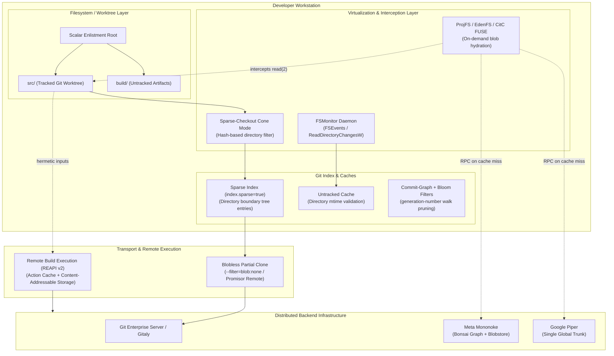
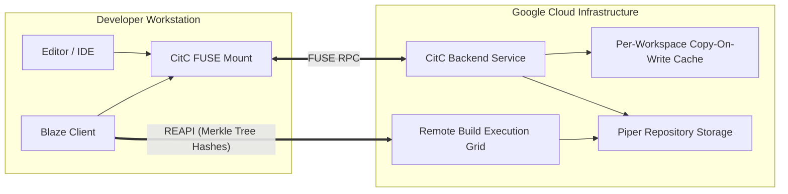

# Git at Scale: VFS for Git, Scalar, and Enterprise Monorepos

> [!summary] Claim:
> Standard Git degrades linearly as repositories scale beyond millions of files, because status operations require an O(N) stat traversal across the working tree, the index requires an O(N) flat serialization, and history traversal requires an O(C) graph walk.
> File system virtualization systems like VFS for Git and ProjFS intercept read and write system calls at the OS kernel or FUSE boundary to hydrate placeholder inodes lazily on demand.
> Microsoft Scalar eliminates the operational overhead of custom kernel drivers by orchestrating native Git primitives: blobless partial clone, sparse-checkout in cone mode, the FSMonitor daemon, and scheduled background maintenance, with the sparse index as a one-flag opt-in that Scalar itself does not set (as of 2026-11, Git 2.55.0 `scalar.c`).
> At hyperscale (thousands of engineers and billions of lines of code), Google Piper with CitC and Meta Sapling with EdenFS and Mononoke replace local repository storage entirely with virtual distributed file systems coupled directly to remote build execution grids.



## The Mechanism

Traditional Git was designed around the invariant that a developer clones the entire object history and checks out the complete working tree onto local block storage.
This invariant holds efficiently for repositories containing tens of thousands of files and tens of gigabytes of history.
When an organization transitions to an enterprise monorepo spanning millions of files, terabytes of historical objects, and thousands of daily commits, the physical assumptions underlying Git plumbing break down.
[[Git-Object-Model-and-Content-Addressing]] owns loose objects and basic content addressing, and [[Git-Transfer-Protocol-and-Partial-Clone]] owns wire protocol negotiations.
This note explains the filesystem, indexing, and architectural mechanisms required to scale source control to billions of lines of code.

### 1. The Algorithmic Scaling Wall in Standard Git

The execution cost of everyday Git commands is governed by three distinct dimensions: the number of files in the current commit tree ($N$), the total historical commits ($C$), and the volume of stored object content ($B$).
In an unoptimized repository, standard Git commands scale as follows:

```text
Operation                 Standard Git Complexity        Dominant Cost
------------------------------------------------------------------------------------------
git status                O(N) stat(2) + O(N) index      one lstat(2) per tracked file
git checkout <branch>     O(N) working-tree writes       every changed file rewritten
git add -A                O(N) stat(2) + O(N) sha1/sha256 whole tree stat-ed and hashed
git log -- <path>         O(C) commit graph traversal    one tree comparison per commit
git clone                 O(B) network + pack write      every object of the full history
```

The only primary timing figure used here is Brian Harry (2017): on the roughly 3.5M-file Windows repository, before GVFS, "many of the commands would take 30 minutes up to hours and a few would never complete".

#### The Working Tree and Stat Cache Bottleneck

To detect unstaged modifications, `git status` executes an `lstat(2)` or `stat(2)` system call for every tracked entry recorded in `.git/index`.
[[Git-Index-Stat-Cache-and-Fsmonitor]] details the stat cache: Git compares cached device IDs, inode numbers, file modification times (`mtime`), and file sizes against the filesystem.
When $N$ exceeds 3,500,000 files (such as the Microsoft Windows OS repository, about 3.5M files and 300 GB per Harry 2017), issuing 3.5 million sequential `lstat(2)` calls exhausts operating system page caches, causes lock contention across kernel directory inodes, and forces heavy physical disk seeks.
This note gives no per-invocation figure for the stat crawl; measure it on your own repository with `git status` and `GIT_TRACE2_PERF=1`.

#### The Index Serialization Bottleneck

The `.git/index` binary format versions 2 and 3 store a flat array of `struct cache_entry` records.
Each record contains 40 bytes of stat metadata, a 20-byte or 32-byte object hash, 2 bytes of flags, and a variable-length relative path string padded to an 8-byte boundary.
For a repository with 4,000,000 tracked files with an average relative path length of 64 bytes, each version 2 entry is 62 fixed bytes plus the path, padded to 128 bytes, so the raw index file is about 512 MB (roughly 490 MiB) on disk (computed from `gitformat-index(5)`, not measured).
Because Git writes the index by creating a lockfile (`.git/index.lock`), streaming the entire updated state, and renaming the file atomically via `rename(2)`, every minor operation (`git add`, `git checkout`, `git commit`) incurs an $O(N)$ read, parse, and write overhead of several hundred megabytes.

### 2. Filesystem Virtualization: GVFS, VFS for Git, and ProjFS

To break the $O(N)$ dependency on client hardware, Microsoft launched the Git Virtual File System (GVFS, later renamed VFS for Git) in 2017 for the Windows OS codebase.
The foundational insight was filesystem virtualization: present the developer and local build tools with an illusion of a fully populated 300 GB working directory containing 3.5 million files, while storing virtually zero blob bytes locally.

```mermaid
sequenceDiagram
    autonumber
    actor Dev as Developer / Compiler
    participant Kernel as OS Kernel (ProjFS / FUSE Driver)
    participant Daemon as Virtualization Daemon (VFS / EdenFS)
    participant LocalCache as Local Cache
    participant Remote as Upstream Server (Promisor / Mononoke)

    Dev->>Kernel: open("src/engine/core.c", O_RDONLY)
    Note over Kernel: Intercepts I/O; detects unhydrated placeholder
    Kernel->>Daemon: PRJ_GET_FILE_DATA_CB / read() RPC
    Daemon->>LocalCache: Query blob hash in local CAS
    alt Blob present in local cache
        LocalCache-->>Daemon: Return decompressed payload
    else Blob absent
        Daemon->>Remote: HTTP POST /rpc Batch Blob Fetch
        Remote-->>Daemon: Compressed blob stream
        Daemon->>LocalCache: Store in local content cache
    end
    Daemon->>Kernel: Write payload to placeholder handle
    Note over Kernel: Converts placeholder to hydrated inode
    Kernel-->>Dev: File descriptor ready; read(2) completes
```

#### Kernel Interception via ProjFS

On Windows, virtualization is implemented through the Windows Projected File System (ProjFS), an optional Windows component enabled with `Enable-WindowsOptionalFeature -Online -FeatureName Client-ProjFS` (Microsoft Learn, "Enabling Windows Projected File System"), whose API has Windows 10 version 1809 as its minimum supported client (`PrjStartVirtualizing` reference page).
ProjFS lets a user-mode provider project hierarchical data into the file system, and the provider registers callbacks for file and directory operations (VFS for Git is the example Microsoft Learn names):

1. Directory Enumeration (`PRJ_GET_DIRECTORY_ENUMERATION_CB`): When an application calls `FindFirstFile` or `GetFileInformationByHandleEx`, the driver invokes the user-space provider daemon.
   The daemon queries Git tree objects to provide virtual directory listings without creating physical files on the storage volume.
2. File Data Materialization (`PRJ_GET_FILE_DATA_CB`): Files appear in directory listings as placeholders tagged with the NTFS reparse point attribute `IO_REPARSE_TAG_PROJFS`.
   Placeholders occupy zero physical disk clusters.
   When an application reads the file, ProjFS blocks the calling thread and issues the callback to the user-mode provider, which downloads the blob payload over HTTP and writes the bytes back through ProjFS, which converts the placeholder into a hydrated placeholder.
3. Modification Tracking: When a file is modified, ProjFS converts it to a full local file that is no longer projected.
   VFS for Git keeps its own local database of placeholder state: `GVFSDatabase.cs` creates a `PlaceholderTable` and a `SparseTable` and issues the SQLite pragma `journal_mode=WAL` (VFS for Git source, as of 2026-11; the table schemas were not read).

#### The Demise of Custom Kernel Filesystem Drivers

While ProjFS and VFS for Git demonstrated that enterprise repositories could run on Git, the kernel-driver architecture incurred severe maintenance and operational costs:

- Platform dependence: VFS for Git relied on OS-level filesystem virtualization.
  The Story of Scalar says that "Apple deprecated the kernel features that provided the filesystem virtualization that was required for that flow".
- Cross-platform need: the same article says the team needed cross-platform support, specifically for macOS development, which Windows-only ProjFS cannot provide.
- Scope of this claim: The Story of Scalar does not state blue-screen incidents or antivirus-triggered hydration storms as reasons, so this note does not assert them.
  The VFSForGit README (as of 2026-11) says "for new deployments, we strongly recommend you consider Scalar instead of VFS for Git".

### 3. Native Git Orchestration: Microsoft Scalar

To solve the scale problem permanently without kernel drivers, Microsoft engineers (including Derrick Stolee and Victoria Dye, authors of The Story of Scalar) shifted from filesystem virtualization to native Git optimizations.
This effort produced Scalar, initially a separate .NET tool (The Story of Scalar: "The overhead of dealing with Scalar as a .NET tool was colliding with our maintenance costs"), later ported to C and shipped as part of core Git in Git 2.38.0 as the top-level `scalar.c` (Git 2.38.0 release notes: "The scalar addition from Microsoft is now part of the core Git installation").
Scalar does not replace Git; it is an opinionated manager that configures and orchestrates Git's internal algorithms.

```text
+-----------------------------------------------------------------------+
|                         Scalar Enlistment                             |
|                                                                       |
|  enlistment/                                                          |
|  |-- src/                      <- The Git worktree and .git repository|
|  |   |-- .git/                                                        |
|  |   `-- tracked_files...                                             |
|  `-- build/                    <- Out-of-source build artifacts       |
|      `-- target/                                                      |
+-----------------------------------------------------------------------+
```

#### The Enlistment Model

Scalar introduces the concept of an enlistment.
Running `scalar clone <url> <enlistment>` establishes an enlistment root containing a `src/` directory.
The Git repository and worktree reside entirely within `src/`.
Build systems, compilers, and IDEs are configured to emit generated binaries, intermediate objects, and indices into sibling directories (such as `build/`) outside `src/`.
This prevents millions of transient build artifacts from entering Git's untracked file traversal, protecting the untracked cache from constant invalidation.

#### Blobless Partial Clone

Scalar configures repositories using partial clone (`--filter=blob:none`), setting:

```ini
[remote "origin"]
    promisor = true
    partialclonefilter = blob:none
```

Under a blobless clone, the initial transfer fetches 100% of the commit history and 100% of the tree objects, but 0% of the historical file contents (blobs).
Tree objects carry no file contents but provide complete structural history.
Because all tree objects exist locally, commands that need only commits and trees, such as `git log -- <path>`, `git merge-base`, `git branch`, and revision walks, execute at full speed without network round trips; `git log --stat` and `git log -p` read blob contents and therefore fetch missing blobs.
Missing blobs are promisor objects: Git downloads them on demand via batch HTTP POST requests only when a command (`git checkout`, `git diff`) materializes or inspects their contents.

#### Sparse-Checkout in Cone Mode

Scalar restricts the populated working tree to a small functional subset using sparse-checkout cone mode (`core.sparseCheckoutCone = true`).
Unlike traditional sparse-checkout, which evaluates arbitrary, unbounded regular expressions from `.gitignore` syntax across every path ($O(N \cdot P)$ string operations), cone mode restricts patterns to directory prefixes:

```text
/*
!/*/
/packages/
/packages/engine/
```

In cone mode, Git parses patterns into an internal prefix hash table.
Determining whether a directory or file belongs in the working tree is an $O(1)$ hash-table lookup per path component.
On initial clone, Scalar configures an empty cone: only files in the root directory are populated.
The developer explicitly expands the cone using `git sparse-checkout set <directory>`.

#### The Sparse Index

Even with sparse-checkout hiding files from disk, earlier Git versions still maintained a complete index entry for every file in the repository HEAD.
The sparse index (`index.sparse = true`), authored by Derrick Stolee, transforms `.git/index`.
`index.sparse` defaults to `false`, has no effect unless `core.sparseCheckout` and `core.sparseCheckoutCone` are both enabled (`git-config(1)`), and is not in Scalar's recommended config (`set_recommended_config()` in Git 2.55.0 `scalar.c`, and a live `scalar clone` on macOS, as of 2026-11); enable it with `git sparse-checkout set --sparse-index` or `git sparse-checkout init --cone --sparse-index`.
Directories outside the sparse-checkout cone are collapsed into a single index entry representing the directory tree itself:

```text
Normal Flat Index (.git/index):
  Makefile
  README.md
  packages/docs/api.md
  packages/docs/architecture.md
  packages/engine/engine.c
  packages/engine/engine.h
  packages/ui/view.c
  packages/ui/view.h
  tools/benchmarks/bench.c

Sparse Index with Cone at packages/engine/ (.git/index):
  Makefile
  README.md
  packages/docs/          <- Stored as S_IFDIR with directory tree hash
  packages/engine/engine.c
  packages/engine/engine.h
  packages/ui/            <- Stored as S_IFDIR with directory tree hash
  tools/                  <- Stored as S_IFDIR with directory tree hash
```

In the sparse index, directory boundary entries are stored with file mode `040000` (`S_IFDIR`), a trailing slash, and the object ID of the corresponding Git tree object (confirmed with `git ls-files --sparse -s` on Git 2.55.0, macOS, as of 2026-11).
If a repository contains 4,000,000 files sharded across 100 top-level directories, and a developer works inside one package containing 2,000 files, the sparse index collapses the remaining 3,998,000 file entries into 99 tree entries.
The index shrinks from roughly 490 MiB to well under 1 MiB (about 2,100 entries, computed), so sparse-aware commands such as `git status`, `git add`, and `git commit` read and write only the in-cone entries plus the collapsed tree entries (no latency is claimed here; measure on your repository).

#### Built-in FSMonitor and Untracked Cache

Scalar eliminates directory scanning by coupling the untracked cache (`core.untrackedCache = true`, set to `false` on Windows because Scalar's functional tests found it unreliable there) with Git's built-in filesystem monitor (`core.fsmonitor = true`, set only when `have_fsmonitor_support()` passes), per Git 2.55.0 `scalar.c`.
The FSMonitor daemon (`git fsmonitor--daemon`) runs as a persistent background process.
It registers with OS kernel event notification facilities: `FSEvents` on macOS, `ReadDirectoryChangesW` on Windows, and `inotify` on Linux (`git-fsmonitor--daemon(1)` LINUX CAVEATS, Git 2.55.0, as of 2026-11).
The daemon maintains a sliding token sequence of modified paths.
When `git status` runs, it issues an IPC query over a local Unix domain socket (or Windows named pipe) passing its last observed token.
The daemon responds with the exact list of paths modified since that token.
Git skips `lstat(2)` on all other paths, querying only dirty files.

#### Scheduled Background Maintenance

Foreground Git operations should never block on garbage collection.
Scalar sets `gc.auto = 0` and runs `git maintenance start`, which sets `maintenance.auto = false` and `maintenance.strategy = incremental` and registers the schedule with the system service manager (`launchctl` on macOS, `systemd-timer` on Linux when available and otherwise `crontab`, `schtasks` on Windows), per Git 2.55.0 `scalar.c`, `builtin/gc.c`, and `git-maintenance(1)`:

```text
Schedule     Task Name            Command Executed Under the Hood
------------------------------------------------------------------------------------------
Hourly       prefetch             git fetch origin --prefetch --prune --no-tags ...
Hourly       commit-graph         git commit-graph write --split --reachable
Daily        loose-objects        git prune-packed && git pack-objects (batch loose)
Daily        incremental-repack   git multi-pack-index expire && repack --batch-size=<n>
```

`--prefetch` rewrites the configured refspec into `refs/prefetch/`, so `origin` refs land in `refs/prefetch/remotes/origin/*` (observed on Git 2.55.0, macOS, as of 2026-11).
The commit-graph task writes changed-path Bloom filters because Scalar sets `commitGraph.changedPaths = true`; the incremental-repack batch size is the second-largest pack size plus one, capped at 2 GiB (`get_auto_pack_size()` in `builtin/gc.c`).
Scalar sets `log.excludeDecoration = refs/prefetch/*` so that developer terminal output remains clean.
Because commits and trees are downloaded hourly in the background, a later `git fetch` or `git pull` can, in the ideal case, just update remote-tracking branches without any object transfer (`git-maintenance(1)`).

### 4. Hyperscale Monorepo Architectures: Google and Meta

When a codebase expands to hundreds of millions of lines of code with tens of thousands of daily commits, even native Git with Scalar encounters scaling limits.
At this tier, industry leaders replace standard client-side Git with distributed, virtualized source control systems.

#### Google Piper and CitC (Clients in the Cloud)

Google maintained about 2 billion lines of code (January 2015 figures: 1 billion files, 9 million source files) in a single centralized monorepo managed by Piper (Potvin & Levenberg 2016).
Piper is Google's custom-built version control system for that repository (Potvin & Levenberg 2016).
This note does not describe Piper's internal storage or replication layers: the paper text could not be fetched (ACM returned 403 on two URLs and the Google Research page carries only the abstract, 2026-11).



CitC (Clients in the Cloud) provides the developer workspace interface:

- Cloud-Backed Workspaces: Workspaces are stored in a cloud-based backend and mounted locally via a Linux-only FUSE file system.
- Read Virtualization: Navigating or reading files pulls directly from Piper's immutable storage layer.
  Zero bytes are downloaded to local storage during workspace creation.
- Copy-On-Write Mutation: When a developer edits a file, CitC writes the modification to a private per-workspace copy-on-write (COW) layer.
  An average workspace has fewer than 10 files against a billion-file repository (Potvin & Levenberg 2016).
- Build Execution: Google's build system (Blaze) is the internal counterpart of the open remote execution model in section 6.
  This note does not describe the internal execution cluster or its storage, which the sources checked do not cover.

#### Meta Sapling, EdenFS, and Mononoke

Meta operates its primary software products within a massive monorepo ecosystem comprising Sapling, EdenFS, and Mononoke:

1. Sapling (`sl`): A Git- and Mercurial-compatible CLI client optimized for stacked-diff workflows and rapid branch navigation via `sl smartlog`.
   It automatically uploads developer drafts to Commit Cloud to eliminate local data loss.
2. EdenFS: A high-performance user-space virtual filesystem written in C++ (using the Folly library and Apache Thrift).
   EdenFS mounts repositories via FUSE on Linux, NFSv3 on macOS, and ProjFS on Windows (`eden/fs/docs/Overview.md`, as of 2026-11).
   It intercepts POSIX filesystem calls (`open`, `read`, `readdir`) and serves reads from caches rather than its own object store: "Eden has no on-disk object store of its own", and blobs and trees are cached by the backing store, which for Sapling repositories is the hgcache shared with the Sapling CLI (`eden/fs/docs/Caching.md`, as of 2026-11); inode data lives in an on-disk overlay (`eden/fs/docs/InodeStorage.md`).
3. Mononoke: A distributed source control server written in Rust (`eden/mononoke/README.md`).
   Mononoke decouples read workloads from write transactions.
   It stores history using *Bonsai* changesets (`mononoke_types/src/bonsai_changeset.rs`), an agnostic content-addressed directed acyclic graph (DAG) model that serves both Sapling clients and Git clients simultaneously.
   The open-source build includes MySQL, SQLite, file, and S3 storage backends (`eden/mononoke/README.md`).
   A push is validated and converted to Bonsai, stored in the blobstore, recorded in the metadata database, passed through hooks, and then the bookmark moves; derived data is not computed on that write path but asynchronously after the commit is accepted (`docs/1.3-architecture-overview.md`, `docs/2.3-derived-data.md`).

### 5. Large-Scale Semantic Indexing and Search

In a repository spanning millions of files, local grep, IDE indexing, and language server protocol (LSP) daemons fail.
Spawning an LSP instance that parses abstract syntax trees (ASTs) for millions of source files exhausts workstation RAM and triggers mass blob hydration.
Monorepos solve code intelligence through asynchronous global indexing pipelines:

```text
+-------------------+      +-------------------+      +-------------------+
|  Git / Mononoke   | ---> |  CI Indexing Run  | ---> |  Global Semantic  |
|  Merge Commit     |      |  (SCIP / Kythe)   |      |  Search Engine    |
+-------------------+      +-------------------+      +-------------------+
                                                        |        |
                                     Trigram Text Search|        |Symbol Graph
                                                        v        v
                                                    +--------+ +--------+
                                                    | Zoekt  | | Source-|
                                                    | Index  | | graph  |
                                                    +--------+ +--------+
```

- Zoekt (Fast Trigram Search): Open-sourced by Google (`google/zoekt`) and maintained by Sourcegraph since a 2017 fork, Zoekt builds an inverted trigram index (3-byte substring tuples) across the repository.
  It evaluates regular expressions and literal substrings against the index rather than reading individual files from disk; the README gives no latency or scale figures.
- SCIP and Kythe (Compiler-Accurate Semantic Graphs): Sourcegraph SCIP (Source Code Intelligence Protocol) and Google Kythe execute compiler frontends (Clang, rustc, javac) within hermetic CI pipelines upon every merged commit.
  The compiler emits structured protobuf graphs capturing symbol definitions, references, hover documentation, and inheritance relationships.
  Developers jump to definitions and find references instantly inside web interfaces and IDEs without local compilation.

### 6. Remote Build Execution (RBE) and Content-Addressable Storage

A monorepo cannot function if developers compile projects locally.
Build systems such as Bazel and Buck2 decouple build orchestration from action execution through the standardized Remote Execution API (REAPI v2):

- Hermetic Action Model: Every compilation step is defined as an Action protobuf.
  The Action references a `Command` (command-line arguments, environment variables, output paths) by `command_digest`, the input Merkle tree by `input_root_digest`, and platform constraints (`remote_execution.proto`).
- Content-Addressable Storage (CAS): All inputs and outputs are addressed by their cryptographic hash (typically SHA-256, one of the `DigestFunction` values).
  The build client calls `FindMissingBlobs` and uploads only the blobs the remote CAS lacks.
  If an input file already exists in the CAS from a previous run, transfer is skipped.
- Action Cache (AC): Before scheduling execution, the client (or the execution service on `Execute`) looks up the Action digest with `GetActionResult`.
  If an identical action was executed previously by CI or another engineer, the AC returns the cached result and output digests immediately.
- Build Without the Bytes: The build client downloads intermediate `.o` or `.a` files only if strictly necessary.
  The final binary is linked remotely and either deployed directly to test clusters or streamed as a single executable artifact.

## Commands and Numbers to Know

The configuration rows are read from `set_recommended_config()` in Git 2.55.0 `scalar.c` and from a live `scalar clone` on macOS; the last two rows are computed estimates, not measurements.

| Parameter / Configuration Key | Reference Value | Platform and Date | Operational Role and Mechanism |
| :--- | :--- | :--- | :--- |
| `scalar clone --src` | Default behavior | Both (as of 2026-11) | Places worktree in `<enlistment>/src` to isolate untracked build artifacts |
| `core.sparseCheckoutCone` | `true` | Both (as of 2026-11) | Enforces hash-based prefix matching instead of $O(N \cdot P)$ glob regexes |
| `index.sparse` | `true` (opt-in; not set by Scalar, default `false`) | Both (as of 2026-11) | Collapses unpopulated subtrees into directory entries; shrinks the index to the in-cone entries plus one entry per collapsed directory |
| `core.fsmonitor` | `true` (daemon; set only when supported) | Both (as of 2026-11) | Queries OS filesystem event stream; eliminates $O(N)$ `lstat(2)` crawl |
| `core.untrackedCache` | `true` (macOS/Linux), `false` (Windows) | Both (as of 2026-11) | Uses directory `mtime` to skip scanning clean directories for untracked files |
| `index.version` | `4` | Both (as of 2026-11) | Prefix compresses path names in `.git/index`; reduces index size by 30%-50% on large repositories (`git-update-index(1)`) |
| `index.skipHash` | `true` | Both (as of 2026-11) | Skips computing the index's trailing checksum and writes zero bytes instead |
| `index.threads` | `true` | Both (as of 2026-11) | Auto-sizes the thread pool for loading the index; independent of `core.preloadIndex`, which parallelizes the `lstat(2)` comparison |
| `gc.auto` | `0` | Both (as of 2026-11) | Disables foreground automatic garbage collection; prevents terminal stalls |
| `maintenance.strategy` | `incremental` | Both (as of 2026-11) | Runs hourly prefetch and commit-graph, and daily MIDX repacks in background |
| `commitGraph.changedPaths` | `true` | Both (as of 2026-11) | Generates Bloom filters in commit-graph; accelerates `git log -- <path>`; Scalar also pins `commitGraph.generationVersion = 1` |
| `status.aheadBehind` | `false` | Both (as of 2026-11) | Disables ahead/behind branch calculations during status to eliminate graph walks |
| `fetch.showForcedUpdates` | `false` | Both (as of 2026-11) | Skips the local forced-update commit walk during fetch, a CPU cost rather than a network one |
| `fetch.unpackLimit` | `1` | Both (as of 2026-11) | Keeps downloaded packs intact instead of unpacking them into loose objects |
| `pack.useBitmaps` | `false` | Both (as of 2026-11) | Disables reachability bitmaps on client side to avoid expensive repack churn |
| `pack.usePathWalk` | `true` | Both (as of 2026-11) | Uses path-walk delta heuristic to accelerate packfile object compression |
| Flat Index Footprint (4M files) | ~490 MiB (v2, 64-byte paths, computed); v4 is 30-50% smaller per `git-update-index(1)` | Both (as of 2026-11) | Memory and disk size of `.git/index` without sparse index enabled |
| Sparse Index Footprint (Cone) | ~0.5 - 2.0 MiB (computed estimate) | Both (as of 2026-11) | Memory and disk size of `.git/index` with sparse index enabled |

## Multi-Language Comparison: C / C++ / Rust

Scaling version control systems involves different implementation trade-offs across low-level languages:

| Architectural Concern | C (Git Core & Scalar) | C++ (Meta EdenFS & ProjFS Provider) | Rust (Meta Mononoke & Sapling) |
| :--- | :--- | :--- | :--- |
| Virtualization Strategy | In-tree native Git optimizations (`scalar.c`, `sparse-index.c`); no kernel or FUSE interception | User-space FUSE on Linux, NFSv3 on macOS; ProjFS on Windows | Zero client driver; server-side Bonsai graph over a pluggable blobstore |
| Concurrency Model | POSIX threads (`pthreads`), fork/exec subprocesses, Unix domain sockets (`simple-ipc`) | Folly asynchronous fibers, thread pools, Apache Thrift non-blocking RPC | Tokio async event loop, actor-based request pipelines, zero-copy buffer slicing |
| Inode & Stat Management | In-memory `struct index_state` serialized to `.git/index` version 4 with prefix compression | In-memory inode table with an on-disk overlay for inode data | Decoupled graph engine (*Bonsai*); immutable tree objects mapped in memory |
| Cache & Storage Tier | Local `.git/objects/pack/` packfiles, multi-pack-index (MIDX), commit-graph | No object store of its own: blobs and trees are cached by the backing store (hgcache for Sapling repositories) | Blobstore (S3 in the open-source build) plus a metadata database (MySQL or SQLite in the open-source build) |
| Error Handling & Safety | C return codes, `die()` process aborts, manual file descriptor cleanup | C++ exceptions, `folly::Expected`, RAII handle wrappers, FUSE POSIX error codes | Exhaustive `Result<T, E>`, structured tracing spans, panic isolation per connection |

## Worked Lab Example

The reproducible lab is located at `code/02-Version-Control/scalar_enlistment/`.
It establishes an enterprise monorepo containing multiple package subtrees (`packages/engine`, `packages/ui`, `packages/docs`, `tools/benchmarks`), executes `scalar clone`, audits the resulting configuration, expands the sparse cone, validates the sparse index structure, and exercises background maintenance.

```bash
cd code/02-Version-Control/scalar_enlistment
bash run.sh
```

### Verified Golden Output

Recorded on darwin-arm64 (Git 2.55.0, as of 2026-11), byte-identical to `expected/darwin-arm64.txt`, and verified via `code/_harness/verify.py`:

```text
=== 1. Enlistment Layout ===
Enlistment root entries: ['src']
Worktree populated root files: ['Makefile', 'README.md']
Subtrees materialized on disk initially: []
Blobs absent after clone (blobless): 7 [MATCH]

=== 2. Config Audit ===
  core.fsmonitor = true [MATCH]
  core.untrackedCache = true [MATCH]
  index.version = 4 [MATCH]
  index.skipHash = true [MATCH]
  maintenance.strategy = incremental [MATCH]
  gc.auto = 0 [MATCH]
  status.aheadBehind = false [MATCH]
  fetch.unpackLimit = 1 [MATCH]
  fetch.showForcedUpdates = false [MATCH]
  pack.useBitmaps = false [MATCH]
  pack.usePathWalk = true [MATCH]
  remote.origin.promisor = true [MATCH]
  remote.origin.partialclonefilter = blob:none [MATCH]
  core.sparseCheckoutCone (worktree) = true [MATCH]

=== 3. Sparse-Checkout Cone Expansion ===
Populated files after cone expansion:
  packages/engine/engine.c
  packages/engine/engine.h

=== 4. Sparse Index Representation ===
index.sparse after scalar clone: unset [MATCH]
Entries before enabling the sparse index: 9
Sparse index entries:
  Makefile
  README.md
  packages/docs/
  packages/engine/engine.c
  packages/engine/engine.h
  packages/ui/
  tools/
Directory boundary entries with mode 040000: 3 of 3 [MATCH]

=== 5. Background Maintenance Task ===
Commit-graph before the task: False
Commit-graph written: True [MATCH]
Changed-path Bloom chunks present (BDAT, BIDX): True [MATCH]

=== 6. Enlistment Lifecycle ===
Registered in scalar.repo: True [MATCH]
Unregister executed cleanly: True
Registered after unregister: False [MATCH]
```

### Reading the Result

1. Enlistment Isolation: Section 1 demonstrates that `scalar clone` creates an enlistment containing exclusively `src/`.
   In the working tree, only the root files (`Makefile`, `README.md`) are populated on disk.
   The subtrees `packages/` and `tools/` do not exist on the local filesystem.
2. Configuration Audit: Section 2 confirms that Scalar establishes all opinionated configuration keys automatically.
   `remote.origin.partialclonefilter = blob:none` establishes the promisor connection, while `core.sparseCheckoutCone = true` is isolated inside `.git/config.worktree` via `extensions.worktreeConfig = true`.
   The lab sets `uploadpack.allowFilter = true` on its `file://` upstream (without it the server ignores the filter and every blob arrives) and asserts that `git rev-list --objects --all --missing=print` reports absent blobs: 7, every blob outside the root files.
3. Cone Expansion: Section 3 shows that running `git sparse-checkout set packages/engine` materializes only `engine.c` and `engine.h`.
   The companion packages `packages/ui` and `packages/docs` remain unmaterialized, preserving disk space and filesystem performance.
4. Sparse Index Verification: Section 4 first asserts that `index.sparse` is unset after `scalar clone` (Scalar does not set it) and counts the 9 entries of the flat index, then enables the sparse index itself with `git sparse-checkout init --cone --sparse-index` and prints `git ls-files --sparse`.
   It also asserts that all three directory boundary entries have mode `040000` in `git ls-files --sparse -s`.
   Instead of indexing every file inside `packages/docs`, `packages/ui`, and `tools`, Git records them as directory boundary entries (`packages/docs/`, `packages/ui/`, `tools/`).
   The index scales with the size of the checked-out cone rather than the global repository HEAD.
5. Maintenance & Lifecycle: Sections 5 and 6 confirm that `scalar run commit-graph` writes a commit-graph where none existed after clone, and the lab reads the chunk table of the resulting file to assert the changed-path Bloom filter chunks (`BDAT` and `BIDX`) are present.
   `scalar unregister` then removes the enlistment from global configuration; the registration check compares real paths, so macOS `/private` prefixes do not matter.
6. Isolation and exit status: `scalar clone` runs `git maintenance start`, so the lab sets `HOME` to a temporary directory and `GIT_TEST_MAINT_SCHEDULER` (a test hook in `builtin/gc.c`) to mock every scheduler with `true`; no LaunchAgent plists or systemd units are written to the host.
   Every `[MATCH]` line is a real assertion: any `[FAIL]` makes the script exit non-zero, so the harness fails the lab even before the golden diff.
   The golden output is recorded on darwin-arm64 only, and the lab needs `scalar` on `PATH`, which the harness cannot declare.

## Pitfalls

> [!warning] Pitfall: Non-cone mode sparse checkout in enterprise repositories
> Configuring sparse-checkout using arbitrary `.gitignore` glob patterns (`core.sparseCheckoutCone = false`) forces Git to evaluate recursive regular expressions against every tracked path.
> In a repository with millions of files, pattern matching consumes minutes of CPU time and prevents Git from activating the sparse index.
> Always use cone mode (`git sparse-checkout init --cone`).

> [!warning] Pitfall: Accidental global blob hydration via unanchored grep or log
> Executing `git grep <pattern> <revision>` (for example `git grep <pattern> HEAD`) or `git log -S<string>` / `git log -p` without pathspecs in a blobless partial clone forces Git to query the promisor remote for every missing blob in the searched trees or history.
> Plain `git grep <pattern>` searches only the populated working tree and fetched nothing in a sparse blobless enlistment, while `git grep <pattern> HEAD` fetched the out-of-cone blobs (observed on Git 2.55.0, macOS, as of 2026-11).
> This triggers a "download storm" that downloads hundreds of thousands of files sequentially, exhausting local disk and saturating developer network bandwidth.
> Restrict searches using pathspecs (for example `git grep <pattern> HEAD -- packages/engine/`) or use centralized semantic search tools like Zoekt.

> [!warning] Pitfall: Placing build artifacts inside the Git worktree (`src/`)
> Emitting compiler output, intermediate object files (`.o`, `.class`), or package manager caches (`node_modules`) inside `src/` creates millions of untracked files.
> This invalidates the untracked cache on every build, forces the FSMonitor daemon to track transient file creation/deletion events, and causes `git status` latency to degrade.
> Strictly follow the Scalar enlistment convention: direct build output to an out-of-source directory adjacent to `src/`.

> [!warning] Pitfall: Enabling pack reachability bitmaps on client workstations
> Pack bitmaps (`pack.useBitmaps = true`) are highly effective on Git servers to accelerate object reachability calculations when generating clone and fetch packs.
> On client workstations, generating bitmaps during background maintenance consumes immense CPU and RAM with zero benefit, as developer machines do not serve fetch requests.
> Ensure `pack.useBitmaps = false` (which stops `pack-objects` from using bitmaps) is enforced across all client enlistments, and leave `repack.writeBitmaps` off, since that key, not `pack.useBitmaps`, controls bitmap generation.

> [!warning] Pitfall: Running foreground garbage collection (`git gc`)
> Running `git gc` or `git gc --aggressive` in a monorepo collapses incremental multi-pack-indexes, forces a full historical repack, and recomputes delta chains across millions of objects.
> The cost grows with repository size and blocks the foreground, so this note gives no duration; measure it before ever running it on a large enlistment.
> Keep `gc.auto = 0` and rely exclusively on scheduled incremental maintenance via `git maintenance`.

> [!warning] Pitfall: Untracked cache failures on network-mounted or virtualized filesystems
> The untracked cache relies on directory `mtime` updates when files within a directory are created, renamed, or deleted.
> Certain networked filesystems (NFS, SMB) and older Windows FAT/NTFS configurations do not reliably update directory modification timestamps on file mutations.
> On systems with unreliable directory timestamps, the untracked cache serves stale negative results, causing newly created files to be omitted from `git status`.
> Validate filesystem timestamp semantics before forcing `core.untrackedCache = true`.

## At Scale

Monorepo scaling introduces distinct architectural tipping points as an engineering organization grows from a single team to tens of thousands of developers.
The tiers below are the author's rule of thumb (as of 2026-11), not measured thresholds; each remedy names a mechanism documented above:

```text
Codebase Scale                 Primary Bottleneck         Prescribed Architectural Remedy
------------------------------------------------------------------------------------------
< 100k files, < 5 GB            None; plain Git suffices  Standard Git with commitGraph.generationVersion=2
100k - 1M files, 5 - 50 GB      Clone time & stat crawl   Blobless partial clone + FSMonitor daemon
1M - 5M files, 50 - 500 GB      Index size & status churn Scalar enlistment + opt-in sparse index
> 5M files, > 500 GB            Local disk & build I/O    Virtual FUSE/ProjFS (EdenFS/CitC) + REAPI Grid
```

### The Economic Crossover Point: Monorepo vs. Polyrepo

Adopting an enterprise monorepo is not a pure software configuration; it is an organizational and financial trade-off:

1. The Monorepo Tax: Operating a multi-million-file monorepo requires a dedicated Developer Infrastructure team to maintain remote build execution grids, custom merge queues, semantic search clusters, and client version control tooling.
2. The Polyrepo Tax: In a polyrepo architecture, the organization eliminates version control scaling issues by sharding code across thousands of small repositories.
   However, the engineering fleet incurs a continuous "coordination tax": managing diamond dependencies, cross-repository pull request synchronization, semantic versioning drift, and multi-repository integration testing.
3. Decision Rule: For a small organization the coordination tax of polyrepos is usually lower than the infrastructure overhead of supporting a monorepo.
   As headcount grows and components become tightly coupled across boundaries, a monorepo backed by Scalar or virtualized storage can become the cheaper option by removing dependency version negotiation and enabling atomic company-wide refactoring.
   The crossover is organization-specific; this note gives no headcount threshold, and the linked decision record owns the framework.

[[Decision-Record-Monorepo-vs-Polyrepo]] provides the formal decision framework for evaluating these organizational trade-offs.

### Build System Remote Execution Integration

At enterprise scale, version control cannot be decoupled from the build system:

- Hermetic Build Sandboxing: Compilers must run inside standardized container environments where every dependency is explicitly declared.
- Merkle Tree Input Upload: When a developer executes a test or build, Bazel or Buck2 constructs a Merkle tree of the local input files.
  Because the developer operates in a sparse checkout, only the files in the active cone are hashed.
- Shared Action Cache Hit Rates: In a large organization, continuous integration and peer workstations constantly populate the remote Action Cache.
  Actions that CI or another engineer already ran are answered from the cache, so a client can skip compiling them locally; the hit rate depends on how hermetic the actions are and is not stated as a number here.

## Practice Drill

> [!tip] Practice Drill:
> Execute the following reproduction script to simulate an enterprise monorepo containing 10,000 files across multiple package directories.
> Compare the index size and `git status` execution characteristics between a standard clone and a Scalar-managed enlistment equipped with a sparse index and FSMonitor.

```bash
#!/usr/bin/env bash
set -euo pipefail

WORKDIR="$(mktemp -d)"
trap 'rm -rf "${WORKDIR}"' EXIT
cd "${WORKDIR}"

# Scalar registers the enlistment in the global config, so it needs a writable file (not /dev/null).
export GIT_CONFIG_GLOBAL="${WORKDIR}/gitconfig"
export GIT_CONFIG_SYSTEM=/dev/null
export LC_ALL=C
: > "${GIT_CONFIG_GLOBAL}"

# 1. Create upstream bare repository; allowFilter makes the file:// upstream honor --filter=blob:none
git init --bare -b main upstream.git -q
git -C upstream.git config uploadpack.allowFilter true

# 2. Populate 10,000 files sharded across 10 packages
git clone upstream.git seed -q
cd seed
git config user.name "Drill Engineer"
git config user.email "drill@example.com"

echo "Generating 10,000 files across 10 packages..."
python3 -c '
import os
for p in range(10):
    pkg_dir = f"packages/pkg_{p:02d}"
    os.makedirs(pkg_dir, exist_ok=True)
    for f in range(1000):
        with open(f"{pkg_dir}/file_{f:04d}.c", "w") as fp:
            fp.write(f"int fn_{p}_{f}(void) {{ return {p} * 1000 + {f}; }}\n")
with open("README.md", "w") as fp:
    fp.write("# Scalability Drill Monorepo\n")
'
git add .
git commit -m "feat: initial 10k file monorepo" -q
git push origin main -q
cd ..

# 3. Standard Clone: Full working tree and flat index
git clone upstream.git standard_clone -q
cd standard_clone
FLAT_ENTRIES=$(git ls-files | wc -l | tr -d ' ')
FLAT_SIZE=$(wc -c < .git/index | tr -d ' ')
echo "Standard Clone Index: ${FLAT_ENTRIES} entries, ${FLAT_SIZE} bytes"
cd ..

# 4. Scalar Enlistment: Sparse checkout cone and sparse index
# --no-maintenance keeps `git maintenance start` from installing launchd/systemd/cron jobs on this host
scalar clone --no-maintenance file://"${WORKDIR}/upstream.git" scalar_enlistment
cd scalar_enlistment/src
git sparse-checkout set packages/pkg_00
git sparse-checkout init --cone --sparse-index
git -c core.fsmonitor=false status >/dev/null

SPARSE_ENTRIES=$(git ls-files --sparse | wc -l | tr -d ' ')
SPARSE_SIZE=$(wc -c < .git/index | tr -d ' ')
echo "Scalar Sparse Index:  ${SPARSE_ENTRIES} entries, ${SPARSE_SIZE} bytes"

# Verify ratio
python3 -c "
flat = int('${FLAT_SIZE}')
sparse = int('${SPARSE_SIZE}')
ratio = flat / sparse
print(f'Sparse Index Memory Reduction: {ratio:.1f}x smaller')
"

# Clean up FSMonitor daemon before exit
git fsmonitor--daemon stop >/dev/null 2>&1 || true
cd "${WORKDIR}"
scalar unregister "${WORKDIR}/scalar_enlistment" >/dev/null 2>&1 || true
```

## Interview Questions

> [!question] L5: What is the fundamental operational difference between a treeless partial clone (`--filter=tree:0`) and a blobless partial clone (`--filter=blob:none`) in an enterprise monorepo?
>
> > [!success]- Answer
> > A blobless partial clone (`--filter=blob:none`) downloads 100% of the commit history and 100% of the tree objects across all revisions, omitting only blob objects (file contents).
> > Because all tree objects are present locally, Git can perform history walks, path-limited `git log -- <path>`, tree-level diffs such as `--name-only`, and merge-base calculations without network round trips; it queries the promisor remote only when file contents must be materialized or inspected (`--stat`, `-p`, checkout of new files).
> > In contrast, a treeless partial clone (`--filter=tree:0`) downloads commits but omits trees and blobs.
> > While a treeless clone minimizes initial clone size and transfer time, every subsequent `git log -p`, `git diff`, or `git checkout` must issue network requests to download the missing tree objects for each commit traversed.
> > In an enterprise monorepo with high commit frequency, treeless clones saturate developer networks and server backends with millions of individual tree requests.
> > Therefore, blobless clones represent the production standard for interactive developer workstations, while treeless clones are reserved for ephemeral, single-commit CI build runners.

> [!question] L5 (Predict the output): You clone a repository using `scalar clone <url> <enlistment>`.
> Predict the stdout of `git sparse-checkout list` immediately after clone, and explain which files are materialized on disk.
>
> > [!success]- Answer
> > The stdout of `git sparse-checkout list` is empty (an empty string; confirmed on Git 2.55.0, macOS, as of 2026-11).
> > In cone mode, an empty sparse-checkout definition represents the root directory pattern.
> > The files materialized on disk are exclusively the files located in the top-level root directory of the repository (for example `README.md`, `Makefile`, root configuration files).
> > All subdirectories and package subtrees are omitted from disk until the developer explicitly expands the cone using `git sparse-checkout set <directory>`.

> [!question] L6: Why did Microsoft move from VFS for Git to Scalar, and what native Git primitives replace filesystem filter drivers?
>
> > [!success]- Answer
> > Microsoft did not deprecate ProjFS, which still ships as an optional Windows component and backs EdenFS on Windows; it steered new deployments from VFS for Git to Scalar (the VFSForGit README "strongly recommend[s]" Scalar for new deployments, as of 2026-11).
> > The Story of Scalar gives two reasons: Apple deprecated the kernel features that provided the filesystem virtualization VFS for Git required on macOS, and the team needed cross-platform support, specifically for macOS development.
> > ProjFS is Windows-only, so covering macOS and Linux would have meant separate virtualization layers per platform, each with its own maintenance cost.
> > The article does not cite blue screens or antivirus hydration storms, so this answer does not either.
> > Scalar replaces filesystem filter drivers by orchestrating native Git primitives that achieve comparable performance in user space:
> > 1. Partial clone (`--filter=blob:none`) replaces virtual file downloading by fetching blobs on demand via Git's promisor remote protocol.
> > 2. Sparse-checkout in cone mode replaces virtual directory trees by restricting working-tree filesystem writes to explicitly selected directories using $O(1)$ prefix matching.
> > 3. Sparse index (`index.sparse`, an opt-in that Scalar does not set as of Git 2.55.0) replaces flat index serialization by collapsing unpopulated subtrees into directory tree entries.
> > 4. Built-in FSMonitor (`git fsmonitor--daemon`) replaces filesystem change interception by querying OS event streams (`FSEvents`, `ReadDirectoryChangesW`) to eliminate $O(N)$ directory scans.

> [!question] L6 (Debug-this): A developer working in a blobless Scalar enlistment executes `git grep "DB_PASSWORD" HEAD` and reports that their workstation completely froze for 20 minutes while network bandwidth was saturated.
> Diagnose the root cause and provide the remediation command.
>
> > [!success]- Answer
> > Root cause: In a blobless partial clone (`--filter=blob:none`), blob objects are promisor objects that reside on the remote server until accessed.
> > Running `git grep` against a revision (`HEAD`) without pathspec limitations forces Git to search the entire tree of that commit, including directories outside the sparse cone; plain `git grep` without a revision searches only the populated working tree and does not fetch (observed on Git 2.55.0, macOS, as of 2026-11).
> > When Git inspects a file whose blob is absent locally, the promisor remote protocol triggers an on-demand batch fetch over HTTP.
> > Because `git grep` traversed the entire repository, it forced Git to download millions of missing blobs sequentially.
> > This triggered a massive blob hydration storm that saturated the developer's network connection, filled local disk space, and starved the system of I/O bandwidth.
> > Remediation:
> > 1. Terminate the running `git grep` process.
> > 2. Constrain future grep operations strictly to the populated working tree or specific subdirectories using pathspecs:
> >    `git grep "DB_PASSWORD" -- packages/engine/`
> > 3. Alternatively, instruct developers to search the global codebase using centralized trigram indexing tools (such as Zoekt or Sourcegraph), which evaluate regular expressions across compiler-indexed clusters without downloading source files locally.

> [!question] L7: Walk through the internal data structure changes in `.git/index` when `index.sparse=true` is enabled, and explain why early Git commands had to be rewritten to support sparse index entries.
>
> > [!success]- Answer
> > In a traditional Git index (versions 2 and 3), `.git/index` consists of a 12-byte header followed by a flat, sorted array of `struct cache_entry` records.
> > Every single file in the tracked tree must have a distinct cache entry, regardless of whether it is checked out on disk.
> > When `index.sparse=true` is enabled, Git modifies the index representation:
> > Any directory that lies completely outside the sparse-checkout cone is represented by a single `cache_entry` whose file mode (`ce_mode`) is set to `040000` (`S_IFDIR`), whose path string terminates with a trailing slash (for example `packages/docs/`), and whose object ID is the SHA-1 or SHA-256 hash of the corresponding tree object.
> > Why earlier Git commands broke:
> > For decades, internal Git algorithms assumed that every entry in `the_index.ce[]` had `ce_mode` equal to a regular file (`S_IFREG`) or a symlink (`S_IFLNK`), and that the index never contained directory entries (`S_IFDIR`).
> > Iterating through the index to perform diffs, merges, or path lookups assumed leaf-node granularity.
> > If an older Git command encountered an `S_IFDIR` entry, it either threw an assertion failure or triggered a full index expansion (`ensure_full_index()`), which dynamically converted the sparse directory entry back into millions of individual file entries, destroying the performance advantage.
> > Core contributors had to incrementally rewrite every major Git builtin (`status`, `add`, `commit`, `checkout`, `diff`, `merge`, `reset`) to make them "sparse-aware," allowing them to manipulate directory boundary entries directly without expanding the full index.

> [!question] L7: How does Google CitC leverage FUSE to eliminate local checkouts for tens of thousands of engineers, and how does it integrate with Blaze remote execution?
>
> > [!success]- Answer
> > Google CitC (Clients in the Cloud) decouples source control from local workstation hardware:
> > 1. Centralized Storage: The primary repository (Piper) is one central repository with a single trunk (Potvin & Levenberg 2016).
> >    Its storage and replication internals are not described here because the paper text could not be fetched.
> > 2. User-Space FUSE Layer: Developers mount their workspace via a Linux-only FUSE file system.
> >    Directory structures and files are virtual projections.
> >    When an editor or tool reads a file, the FUSE daemon issues an RPC to CitC backend servers, which stream the requested snapshot directly from Piper storage.
> > 3. Copy-on-Write Workspaces: Workspaces do not copy source files locally.
> >    When a developer modifies a file, CitC writes the diff into a cloud-backed copy-on-write (COW) layer assigned to that workspace.
> >    The workspace consumes storage proportional only to edited files (an average workspace has fewer than 10 files, Potvin & Levenberg 2016), so almost nothing is stored locally.
> > 4. Blaze / RBE Integration: Developers never compile CitC mounts locally.
> >    Google's build system (Blaze) dispatches build actions to remote execution rather than compiling on the workstation; the open REAPI model in section 6 is the public analogue.
> >    The internal execution cluster, storage, and network details are not covered by the sources checked and are not claimed here.

> [!question] L8+: You are the VP of Engineering Infrastructure at a company with 15,000 developers whose monolithic Git repository (6 million files, 400 GB) causes 45-minute CI checkouts and 3-minute developer `git status` latency.
> Design the complete migration roadmap and technical architecture.
>
> > [!success]- Answer
> > Phase 1: Client Paved Road Deployment (Months 1-3)
> > 1. Deploy Microsoft Scalar across all developer workstations via corporate package management.
> > 2. Migrate developer checkouts to blobless partial clone enlistments (`scalar clone <url>`, which unconditionally sets `remote.origin.partialCloneFilter=blob:none` in `scalar.c`; `scalar clone` has no `--filter` option, per `scalar(1)` Git 2.55.0), reducing initial clone times from 45 minutes to under 90 seconds (illustrative target, not measured).
> > 3. Enforce sparse-checkout cone mode and sparse index (`git sparse-checkout set --sparse-index`, since Scalar does not set `index.sparse=true`), reducing `.git/index` size from the order of 500 MiB toward the in-cone size (computed estimate, see the footprint rows above).
> > 4. Standardize out-of-source builds into `<enlistment>/build/` outside `src/`, and enable `core.fsmonitor` using the native daemon.
> >    Target: bring `git status` from the reported 3 minutes to well under a second (a goal to verify with measurements, not a claimed result).
> >
> > Phase 2: Server-Side and CI Infrastructure Optimization (Months 4-6)
> > 1. Configure server-side reachability bitmaps and geometric repacking (`git repack --geometric=2`) with multi-pack-indexes (MIDX).
> > 2. Shard CI workloads: eliminate full checkouts in CI.
> >    Deploy treeless partial clones (`--filter=tree:0`) or shallow clones (`--depth=1`) on CI runners, coupled with pre-warmed reference mirrors on local runner networks.
> > 3. Implement server-side merge queues using worktree-free git replay primitives (`git replay`, EXPERIMENTAL as of Git 2.55.0, and `git merge-tree`) to process speculative PR integration without spinning up physical worker checkouts.
> >
> > Phase 3: Remote Build Execution and Semantic Code Intelligence (Months 7-12)
> > 1. Transition the corporate build system (Bazel or Buck2) to Remote Build Execution (REAPI v2) backed by a Content-Addressable Storage (CAS) cluster and Action Cache.
> > 2. Enforce "Build without the Bytes," ensuring local workstations download only final binaries rather than intermediate object files.
> > 3. Deploy centralized Zoekt trigram search and SCIP compiler-based semantic indexing in CI.
> >    Disable local IDE global indexing, routing jump-to-definition and reference lookups through centralized index servers.
> >
> > Long-term Evaluation:
> > Monitor monorepo growth.
> > If growth outpaces the top tier of the table above (tracked files well beyond 5 million, or commit concurrency that Git server-side tooling cannot absorb), plan the multi-year migration to a virtualized filesystem architecture (such as Meta's Sapling/EdenFS/Mononoke stack).

> [!question] L8+: Contrast the distributed graph model of Meta's Mononoke (*Bonsai*) with traditional Git DAG storage, and explain how Mononoke decouples the write path from asynchronous derived data.
>
> > [!success]- Answer
> > Traditional Git DAG Architecture:
> > In Git, repository state is an immutable directed acyclic graph composed of commits, trees, and blobs addressed by cryptographic hash.
> > Merging a commit or updating a reference is tightly coupled to graph reachability: Git must update ref pointers (`refs/heads/*`), maintain the reflog, and execute packfile indexing synchronously.
> > Graph walks (`git rev-list`, reachability bitmap generation) require traversing trees and commit chains directly from storage.
> > When thousands of concurrent pushes hit a single repository, Git's file-based locking (`refs/heads/<branch>.lock`) and packfile contention create severe serialization bottlenecks.
> >
> > Mononoke and the *Bonsai* Data Model:
> > Meta's Mononoke serves Git and Mercurial/Sapling clients from one backend, built on the following (Mononoke docs, as of 2026-11):
> > 1. Format-Agnostic Graph (*Bonsai*): the docs call Bonsai "the canonical, VCS-agnostic representation of repository data", a content-addressed Merkle DAG hashed with Blake2b.
> >    It stores a flat list of path-based changes per changeset rather than nested trees; manifests and other views are derived data computed separately.
> >    Bidirectional mapping tables connect each `ChangesetId` to a Git commit SHA-1 and to a Mercurial changeset hash.
> > 2. Write Path: a push is validated and converted to Bonsai, the changeset and file contents go to the blobstore, the VCS mapping and commit graph index are recorded in the metadata database, hooks run, and then the bookmark moves.
> >    The architecture overview states that "derived data is not computed on the write path", which keeps the critical section minimal and push latency low.
> > 3. Asynchronous Derived Data: derived data types such as changeset info, unodes, fsnodes, skeleton manifests, and Git commit and delta manifests "can be computed asynchronously after a commit has been accepted".
> >    The commit graph index is the exception: it is written synchronously in the metadata database.
> >    The docs checked do not mention reachability bitmaps, changed-path Bloom filters, or read replicas, so this answer makes no claim about them.

## Further Reading

- Derrick Stolee and Victoria Dye, "The Story of Scalar" (GitHub Blog, 2022): the architectural history detailing the transition from VFS for Git to upstream Git orchestration.
- Derrick Stolee, "Make your monorepo feel small with Git's sparse index" (GitHub Blog, 2021): the deep dive into sparse index directory entry mechanics and performance measurements.
- Rachel Potvin and Josh Levenberg, "Why Google Stores Billions of Lines of Code in a Single Repository" (CACM, 2016): the seminal paper establishing the mechanics of Google Piper, CitC, and trunk-based monorepo workflows.
- `scalar(1)` and `git-sparse-checkout(1)` (Git 2.55.0): normative reference manuals for enlistment management, cone mode syntax, and background maintenance.
- Meta Sapling and Mononoke Architecture Documentation (2022): primary documentation for the Bonsai data model, EdenFS FUSE virtualization, and Commit Cloud.
- Bazel Remote Execution API v2 (`bazelbuild/remote-apis`): the open gRPC protocol specification defining Action Caches, Content-Addressable Storage, and Merkle tree build execution.
- Brian Harry, "The largest Git repo on the planet" (Microsoft DevOps Blog, 2017): the primary account of moving the 3.5M-file, 300 GB Windows repository to Git on GVFS (the previously cited Noursalehi URL returns 404).

## Related

- Prerequisites: [[Git-Transfer-Protocol-and-Partial-Clone]], [[Git-Index-Stat-Cache-and-Fsmonitor]]
- Next: [[Decision-Record-Monorepo-vs-Polyrepo]]
- See also: [[13-Agentic-AI/Agentic-Harness/components/treehouse|treehouse]]
- Lab: `code/02-Version-Control/scalar_enlistment/`
