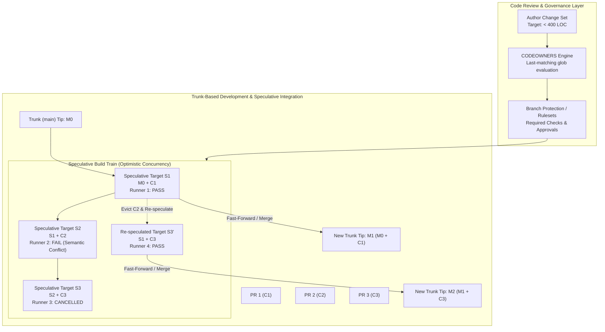

# Git Branching Models, Merge Queues, and Code Review

> [!summary] Claim:
> Branching models define the lifecycle and graph divergence of concurrent changes, where Trunk-Based Development caps topic branch lifetime to hours to eliminate integration drift, while GitFlow accumulates synchronization debt across long-lived branches.
> When integration velocity exceeds serial continuous integration pipeline limits ($\lambda > 1 / T_{\text{CI}}$), testing pull requests in parallel against stale target heads allows semantic merge conflicts to break the trunk.
> Speculative merge queues enforce the Not Rocket Science Rule by pipelining validation across an optimistic commit graph, testing candidates against speculative future trunk states ($S_k = S_{k-1} \oplus C_k$) and evicting failures via graph bisection and tree re-speculation.
> Code review governance balances repository security and throughput via CODEOWNERS pattern matching, bounded by cognitive inspection limits where defect detection rates drop sharply beyond 200 to 400 lines of code.



## The Mechanism

Version control collaboration models balance integration velocity against trunk stability.
Every merge operation represents an integration hypothesis: the assertion that two independent paths of development can be combined into a valid state.
[[Git-Three-Way-Merge-ORT-and-Diff-Algorithms]] handles the algorithmic three-way content merge, but syntactic merge success does not guarantee semantic correctness.
The branching model, merge automation, and review architecture establish the procedural and computational harness that prevents broken code from reaching production.

### 1. Topology and Evolution of Branching Models

A branching model defines the rules governing branch creation, naming, lifetime, and merge topology.

```text
GitFlow Topology:
master   ======================[Release v1.0]======================[Hotfix v1.0.1]=====
               \                  ^                         ^          /
develop  =======*=====*===========|====*=====*==============|=========*================
                 \   /            |     \   /               |        /
feature           *-*             |      *-*                |       /
                                  |                         |      /
release                           +---[release-1.0]---------+     /
                                                                 /
hotfix                                                          +---[hotfix-1.0.1]

Trunk-Based Development Topology:
main     ===*=======*=======*=======*=======*=======*=======*=======*=======*==========
             \     /         \     /         \     /         \     /
feature       *---*           *---*           *---*           *---*   (lifetime < 24h)
```

#### GitFlow: Mechanics and Failure Modes
Published by Vincent Driessen in 2010, GitFlow introduced a rigid branching taxonomy designed for software with explicit release cycles:
- **Two Infinite Branches:** `master` represents production-ready releases; `develop` serves as the integration trunk for the next release.
- **Three Supporting Branch Types:**
  - `feature/*`: Branches off `develop` and merges strictly back into `develop`.
  - `release/*`: Branches off `develop` when features for a release are frozen; accepts only bug fixes, documentation, and release metadata; merges into both `master` and `develop`.
  - `hotfix/*`: Branches off `master` to address critical production defects; merges into both `master` and `develop`.

GitFlow introduces systemic failure modes in high-velocity engineering organizations:
1. **The Dual-Merge Hazard:** Because bug fixes on `release/*` and `hotfix/*` must be merged into both `master` and `develop`, history diverges.
If an engineer rebases or squash-merges a hotfix into `master`, the commit object ID changes.
Merging that branch back into `develop` can produce spurious merge conflicts when either side has since edited the same lines, because the common merge base does not contain the cherry-picked or squashed patch; identical changes on both sides still merge cleanly.
2. **Divergence Debt:** Features developed in isolation on long-lived `feature/*` branches miss ongoing architecture refactorings on `develop`.
The cost of integration grows non-linearly with the age of the branch:
$$\text{Integration Effort} \propto \int_{0}^{T} \Delta_{\text{trunk}}(t) \, dt$$
where $\Delta_{\text{trunk}}(t)$ represents the rate of change on the target branch.
3. **Environment Coupling:** Teams frequently map physical deployment environments to Git branches (for example, `develop` to Dev, `staging` to Staging, `master` to Production).
Promoting code between environments requires merging Git branches, coupling code integration to deployment schedules and preventing out-of-order bug remediation without cherry-pick contamination.

On March 5, 2020, Driessen added a "Note of reflection" to the post: git-flow may still fit software that is explicitly versioned or must support multiple versions in the wild.
For continuously delivered software such as web apps, he suggests adopting a much simpler workflow (like GitHub flow) instead (https://nvie.com/posts/a-successful-git-branching-model/); he does not use the word "anti-pattern".

#### Trunk-Based Development (TBD)
Trunk-Based Development mandates that all developers merge small, frequent updates into a single core branch, typically named `main` or `trunk`.
Key operating principles:
- **Branch Lifetime:** Developers either commit directly to trunk (in small teams practicing pair programming) or work on short-lived feature branches: DORA says such branches "typically last no more than a few hours", and trunkbaseddevelopment.com says a branch "should only last a couple of days", with review wait time counting toward that limit ($T_{\text{branch}} \le 2\text{ days}$).
- **Continuous Integration:** Every commit merged to trunk triggers an automated build and test pipeline.
Trunk is maintained in an always-releasable state.
- **Decoupling Deployment from Release:** Long-running features that cannot be completed within a few hours to a couple of days are not kept on long-lived branches.
Instead, they are merged into trunk incrementally using:
  - **Feature Flags (Feature Toggles):** Conditional logic paths evaluated at runtime based on configuration, tenant metadata, or rollout percentages.
  - **Branch by Abstraction:** Introducing an abstract interface layer in front of a subsystem, routing calls to the legacy implementation, developing the new implementation in trunk alongside it, and flipping the binding once complete before removing the legacy code.

Empirical research in the DORA State of DevOps studies (the 2016 and 2017 reports, summarized in Forsgren, Humble, and Kim, 2018) found Trunk-Based Development, defined as three or fewer active branches and merging to trunk at least daily, predictive of higher software delivery performance (https://dora.dev/capabilities/trunk-based-development/).
In the 2018 Accelerate State of DevOps report, elite performers had a lead time from commit to production of under one hour and a change failure rate of 0 to 15 percent (secondary summary: https://www.cloudbees.com/blog/2018-accelerate-state-devops-report-identifies-elite-performers).

#### Release Trains
This section describes a common practice and cites no study; the two-week cadence is an example.
For large-scale client software (such as mobile applications or browser engines like Chromium) where external gatekeepers (such as app stores) prevent continuous deployment, teams combine Trunk-Based Development with scheduled Release Trains:
- Work proceeds continuously on `main`.
- At regular fixed calendar intervals (for example, every two weeks), a release engineer cuts a release branch (such as `release/124`).
- No new features are merged to the release branch.
- **Trunk-First Backporting:** All stabilization fixes must land on `main` first, undergo automated testing and code review, and be cherry-picked back to the release branch using `git cherry-pick -x <commit>`.
The `-x` flag appends `(cherry picked from commit ...)` to the commit message, establishing an audit trail that prevents regressions in future release trains.

---

### 2. The Serial Integration Bottleneck and Semantic Conflicts

The primary technical obstacle to scaling Trunk-Based Development is the divergence between syntactic mergeability and semantic correctness.

#### Syntactic vs. Semantic Conflicts
A syntactic merge conflict occurs when Git's three-way merge algorithm (`merge-ort`) finds that both sides changed overlapping or adjacent line ranges of the same file.
Git refuses to resolve the merge automatically and exits with a non-zero status.

A semantic merge conflict occurs when Git resolves all hunk diffs cleanly (exit code 0), but the combined code violates structural, type, or behavioral invariants.
Consider two independent pull requests branching from the same base commit:

```text
Base Commit (main):
    func ProcessUser(id string) error { ... }

PR 1 (Branch A): Changes signature to accept a context
    func ProcessUser(ctx context.Context, id string) error { ... }

PR 2 (Branch B): Adds a new callsite in another file
    err := ProcessUser("usr_123")
```

If PR 1 and PR 2 are tested independently against `main`, both pass CI:
- PR 1 passes because all existing callsites within its branch were updated.
- PR 2 passes because `ProcessUser` still accepts a single argument on `main`.

If both pull requests merge into `main`, compilation fails: `ProcessUser` expects two arguments, but receives one.
This defect breaks `main`, blocking all subsequent merges across the engineering team.

#### The Queuing Mathematics of Integration
Graydon Hoare, who built the `bors` merge bot for Rust, named the foundational defense against semantic breakage in a 2014 post as the Not Rocket Science Rule of Software Engineering (original at https://graydon2.dreamwidth.org/1597.html, offline as of 2026-11; wording confirmed via https://typesanitizer.com/blog/not-rocket-science.html):
> "Automatically maintain a repository of code that always passes all the tests."

To guarantee that trunk never breaks, a continuous integration system must test each pull request against the exact commit that will serve as its parent on `main`.

In a naive serial merge queue, pull requests are tested one at a time:
1. Rebase PR onto `main`.
2. Execute full CI test suite.
3. If green, fast-forward `main`.
4. Proceed to the next PR.

Let:
- $\lambda$ be the arrival rate of pull requests submitted for merge (PRs per hour).
- $T_{\text{CI}}$ be the duration of the CI pipeline (hours).
- $\mu = \frac{1}{T_{\text{CI}}}$ be the maximum service rate of the serial queue (PRs per hour).

The integration queue is modeled as an $M/M/1$ queuing system, which assumes exponentially distributed CI durations.
Real CI durations are closer to constant; the $M/D/1$ model then gives half the $L_q$ shown below, but the stability condition $\rho < 1$ is the same.
Traffic intensity is defined as:
$$\rho = \frac{\lambda}{\mu} = \lambda \cdot T_{\text{CI}}$$

When $\rho < 1$, the average queue length $L_q$ and average wait time $W_q$ are stable:
$$L_q = \frac{\rho^2}{1 - \rho}, \quad W_q = \frac{\rho}{\mu (1 - \rho)} = \frac{\lambda \cdot T_{\text{CI}}^2}{1 - \lambda \cdot T_{\text{CI}}}$$

When $\lambda \ge \mu$ ($\rho \ge 1$), the queue enters unstable divergence:
$$\lim_{t \to \infty} L_q(t) = \infty$$

If a CI test suite requires 30 minutes ($T_{\text{CI}} = 0.5\text{ h}$), the maximum theoretical throughput of a serial merge queue is:
$$\mu = \frac{1}{0.5} = 2\text{ PRs/hour} = 48\text{ PRs/day}$$

An organization with 300 engineers producing 120 PRs per day ($\lambda = 15\text{ PRs/hour}$ during an 8-hour workday) experiences total queue gridlock under a serial integration model.

---

### 3. Speculative Merge Queues (Build Trains)

To scale throughput beyond the serial limit without sacrificing trunk stability, modern developer infrastructure employs speculative merge queues (also known as merge trains or build trains).

#### Optimistic Concurrency Control (OCC)
A speculative merge queue pipelines integration by speculating that preceding pull requests in the queue will pass their tests.
Instead of waiting for PR 1 to finish CI before testing PR 2, the queue constructs speculative merge targets in parallel.

Let $M_0$ be the current tip of `main`.
Let $[C_1, C_2, C_3, \dots, C_k]$ be an ordered sequence of approved pull requests entering the queue.
The queue engine constructs $k$ speculative integration states using tree-level merging:
$$S_1 = M_0 \oplus C_1$$
$$S_2 = S_1 \oplus C_2 = (M_0 \oplus C_1) \oplus C_2$$
$$S_3 = S_2 \oplus C_3 = ((M_0 \oplus C_1) \oplus C_2) \oplus C_3$$
$$S_k = S_{k-1} \oplus C_k = M_0 \oplus \sum_{i=1}^{k} C_i$$

```mermaid
sequenceDiagram
    participant Q as Merge Queue Engine
    participant R1 as CI Runner 1 (S1)
    participant R2 as CI Runner 2 (S2)
    participant R3 as CI Runner 3 (S3)
    participant M as Trunk (main)

    Note over Q: Queue order: PR1, PR2, PR3
    Q->>R1: Test S1 (M0 + PR1)
    Q->>R2: Test S2 (S1 + PR2)
    Q->>R3: Test S3 (S2 + PR3)
    R1-->>Q: S1 PASS
    Q->>M: Advance main to S1 (M1)
    R2-->>Q: S2 FAIL (PR2 broken)
    Note over Q: Evict PR2; Poison S3
    Q->>R3: Cancel S3
    Q->>R3: Re-speculate S3' (M1 + PR3)
    R3-->>Q: S3' PASS
    Q->>M: Advance main to S3' (M2)
```

The system dispatches CI suites for $S_1, S_2, \dots, S_k$ simultaneously across isolated runners.
- **Best-Case Latency:** If all $k$ candidates pass their tests, all $k$ PRs merge into `main` after $T_{\text{CI}}$ time.
The effective integration throughput increases from $\frac{1}{T_{\text{CI}}}$ to $\frac{k}{T_{\text{CI}}}$.
- **Eviction and Re-speculation Mechanics:**
Suppose candidate $C_m$ fails its test suite or encounters a merge conflict during tree construction:
1. $C_m$ is identified as an invalid state and evicted from the queue.
2. Every speculative state $S_j$ where $j \ge m$ is poisoned because its tree incorporates the defective commits of $C_m$.
3. The queue engine issues immediate cancellation signals to runners evaluating $S_j$ ($j \ge m$).
4. The remaining valid downstream candidates $[C_{m+1}, \dots, C_k]$ are re-speculated over the last known good state $S_{m-1}$:
$$S'_{m+1} = S_{m-1} \oplus C_{m+1}$$
$$S'_j = S'_{j-1} \oplus C_j \quad (\text{for } j > m+1)$$
5. New CI jobs are dispatched for the re-speculated states.

#### Batching and Bisection Optimization
When CI compute capacity cannot support unconstrained speculative fan-out, merge queues group pull requests into batches of size $B$.
A batch $G = [C_1, C_2, \dots, C_B]$ is merged into a single integration commit $M_G = M_0 \oplus \sum_{i=1}^{B} C_i$ and tested once.
- If $M_G$ passes, all $B$ pull requests land atomically on `main`.
- If $M_G$ fails, the queue engine bisects the batch into two sub-batches of size $\lfloor B/2 \rfloor$ and $\lceil B/2 \rceil$, running them speculatively to isolate the failing PR in $O(\log_2 B)$ steps.
- Bisection is the generic model; GitHub's merge queue documentation describes only removing a failing pull request and rebuilding the remaining group, not how it isolates the culprit (as of 2026-11, Both).

Let $p$ be the independent probability that an individual pull request contains a test failure or semantic conflict.
The probability that a batch of size $B$ passes on the first attempt is:
$$P(\text{batch pass}) = (1 - p)^B$$

If $p = 0.05$ (5% failure rate) and $B = 4$:
$$P(\text{pass}) = (1 - 0.05)^4 \approx 0.8145 \quad (81.5\%)$$
If $B = 10$:
$$P(\text{pass}) = (1 - 0.05)^{10} \approx 0.5987 \quad (59.9\%)$$

If $p = 0.20$ (20% failure rate) and $B = 10$, the probability of batch success drops to $(0.80)^{10} \approx 10.7\%$.
In high-failure environments, large batch sizes trigger near-constant bisection cascades, consuming more compute minutes than individual speculative pipelining.
The optimal batch size balances the cost of CI compute against the bisection penalty; borrowing Dorfman's two-stage group-testing result (test the batch, then retest every member of a failed batch), CI runs per PR are minimized near:
$$B^* \approx 1 + \frac{1}{\sqrt{p}}$$
This is a heuristic for small $p$, not a vendor-documented rule; with bisection instead of full retest the optimum shifts somewhat larger.

---

### 4. Worktree-Free Server-Side Integration Plumbing

Traditional CI bots execute merges by spawning shell processes that clone repositories, checkout branches, and run `git merge`.
This approach introduces severe operational bottlenecks:
- Worktree disk allocations consume multiple gigabytes per runner.
- Filesystem index stat-cache writes (`.git/index`) bottleneck local disk I/O.
- Concurrent merge operations on the same physical host lock working directories.

High-throughput merge queues bypass working directories and index files entirely by driving Git plumbing commands directly against the bare object database.

#### Tree-Level Three-Way Merging: `git merge-tree --write-tree`
Added in Git 2.38 (Git 2.38.0 release notes; the `merge-ort` engine it uses dates from Git 2.33), `git merge-tree --write-tree` performs a complete three-way content merge between two commit trees entirely in memory and writes the resulting tree object directly to `.git/objects/`:

```bash
git merge-tree --write-tree <base-branch> <feature-branch>
```

- **Clean Merge Execution:**
If the merge succeeds without conflict, `git merge-tree` writes the new tree object, outputs its hexadecimal object ID (OID; 40 characters in a SHA-1 repository, 64 in SHA-256) to standard output, and exits with code 0.
The two blocks below are output from `merge_tree.sh` in the lab, recorded with Git 2.55.0 on macOS (`darwin-arm64`), for a repository whose only file `f` is edited on the first line by both `topic-x` and `topic-y`, while `topic-z` adds a new file `g`:
```text
$ git merge-tree --write-tree topic-x topic-z
c49aa72d734edaff5346a04349fb90f0acc0c345
$ echo $?
0
```
- **Conflicted Merge Execution:**
If conflicts occur, `git merge-tree` outputs the OID of the toplevel tree (files in it carry embedded conflict markers), then the conflicted file info as `<mode> <object> <stage> <filename>` lines, a blank line, then informational messages, and exits with code 1:
```text
$ git merge-tree --write-tree topic-x topic-y
ccb1bef019475471392e7cab545be0981e7b7fcd
100644 e5c5c5583f49a34e86ce622b59363df99e09d4c6 1	f
100644 549be43febac89498ef2aa8085cb24457428c46e 2	f
100644 b86fcff541e83f6b7a354be66a17601bf46fbf91 3	f

Auto-merging f
CONFLICT (content): Merge conflict in f
$ echo $?
1
```

#### Persistent High-Performance Processing: `git merge-tree --stdin`
To eliminate process startup overhead in busy queues, Git provides a persistent coprocess interface via `--stdin` (available since Git 2.39, per the Git 2.39.0 release notes):
```bash
git merge-tree --stdin
```
Input lines are fed via standard input:
```text
[<base-commit> -- ]<branch1> <branch2>
```
`--stdin` implies `-z`, so every field is terminated by ASCII NUL (`\0`), and each merge's record ends with one extra NUL.
Crucially, the output protocol differs from the CLI exit codes:
- Each record starts with an integer merge status followed by NUL: `1` indicates a clean merge; `0` indicates a conflicted merge.
- This is followed by the tree OID and NUL, then (for conflicts) the NUL-terminated conflicted file info entries and the `-z` form of the informational messages.
- The process exits 0 whether the merges were clean or conflicted, and with a status other than 0 or 1 only if it cannot complete the requested merges (git-merge-tree(1)).

The lab feeds both merges to one `--stdin` process and prints the raw stream with each NUL shown as `\0` (Git 2.55.0, macOS `darwin-arm64`, from `expected/darwin-arm64.txt`):

```text
--- git merge-tree --stdin (NUL shown as \0) ---
1\0c49aa72d734edaff5346a04349fb90f0acc0c345\0\00\0ccb1bef019475471392e7cab545be0981e7b7fcd\0100644 e5c5c5583f49a34e86ce622b59363df99e09d4c6 1	f\0100644 549be43febac89498ef2aa8085cb24457428c46e 2	f\0100644 b86fcff541e83f6b7a354be66a17601bf46fbf91 3	f\0\01\0f\0Auto-merging\0Auto-merging f\n\01\0f\0CONFLICT (contents)\0CONFLICT (content): Merge conflict in f\n\0\0
exit: 0
```

Reading the stream: the clean record is `1\0<tree-oid>\0\0`.
The conflicted record is `0\0<tree-oid>\0`, then one `<mode> <oid> <stage>\t<path>\0` entry per stage, then `\0`, then one `<count>\0<paths>\0<type>\0<message>\0` group per informational message, then a final `\0`.
The process exits 0 although the second merge conflicted.

#### Commit Construction and Atomic Reference Advancement
Once the merged tree OID is obtained, the merge queue engine constructs the merge commit object using `git commit-tree`:
```bash
COMMIT_OID=$(git commit-tree $TREE_OID \
    -p $PARENT_MAIN \
    -p $PARENT_FEATURE \
    -m "Merge pull request #42 from feature-branch")
```

To land the commit on `main`, the queue executes an atomic compare-and-swap (CAS) update via `git update-ref`:
```bash
git update-ref refs/heads/main $COMMIT_OID $EXPECTED_OLD_OID
```
If another process or emergency hotfix modified `refs/heads/main` in the interim, `$EXPECTED_OLD_OID` fails to match the current ref target.
`git update-ref` aborts the transaction with a non-zero exit code (exit 128 with `cannot lock ref 'refs/heads/main': is at <oid> but expected <oid>` in Git 2.55.0, verified locally), guaranteeing that the merge queue never overwrites concurrent ref updates.
[[Git-Replay-and-Server-Side-History-Rewriting]] details how server-side history mutations operate without index locks.

---

### 5. Code Review Architecture and Cognitive Limits

Code review is the human gatekeeper preceding merge queue admission.
Its organizational goal is twofold: defect prevention and knowledge distribution.

#### CODEOWNERS Mechanics and Precedence
Repository hosts (GitHub, GitLab) enforce path-based review authority via `CODEOWNERS` files located in `.github/CODEOWNERS`, `CODEOWNERS`, or `docs/CODEOWNERS`; GitHub searches those locations in that order and uses the first file it finds.

GitHub CODEOWNERS syntax and precedence rules:
- **Last Match Wins:** The file is evaluated sequentially from top to bottom.
If multiple patterns match a path, the last matching pattern takes complete precedence:
```text
# Rule 1: Global default
* @infra-core

# Rule 2: Subdirectory override
/services/billing/ @billing-team

# Rule 3: File extension override
/services/billing/*.sql @db-admins
```
In this configuration, a change to `/services/billing/schema.sql` matches Rule 1, Rule 2, and Rule 3.
Only `@db-admins` is required for review; `@billing-team` is superseded.
- **Pattern Matching Differences from `.gitignore`:**
  - Negative patterns (`!pattern`) are unsupported.
  - Bracket character classes (`[0-9]`) are unsupported.
  - Escaping `#` as `\#` is unsupported (treated as a comment).
  - Directory matching follows `.gitignore` rules: `apps/` matches files in any `apps` directory at any depth, `/docs/` matches only the root `docs` directory, and `docs` without a slash matches both a directory and a file named `docs`.

GitLab CODEOWNERS divergence:
GitLab extends CODEOWNERS with **Sections**.
Sections allow independent, parallel ownership evaluation across distinct domains:
```text
[Infrastructure]
* @platform-team

[Database][2]
model/db/ @db-lead-1 @db-lead-2 @db-lead-3

[Security]
/auth/ @sec-team
```
Under GitLab rules, changes touching `/auth/` and `model/db/` trigger approval gates in both `[Database]` and `[Security]`.
The `[2]` notation sets the section's required approval count: two approvals from that section's owners before the merge request can proceed.
Within one section the last matching entry wins; across sections, the last matching entry of each section applies (https://docs.gitlab.com/user/project/codeowners/reference/).
#### Cognitive Economics of Code Inspection
Human attention is an exhaustible, error-prone resource.
Extensive empirical software engineering research quantifies the relationship between change size, review latency, and defect escape rates.

The sources give thresholds, not a defect-density curve: SmartBear and the Cisco study report that yield falls sharply once a review exceeds about 400 lines or 500 lines per hour, and no cited paper publishes per-LOC values to plot.

1. **The Cisco / SmartBear Benchmark (Cohen, 2006):**
   - SmartBear's study of a Cisco Systems programming team recommends reviewing no more than 200 to 400 lines of code (LOC) at a time; a 200 to 400 LOC review over 60 to 90 minutes "should yield 70-90% defect discovery" (https://smartbear.com/learn/code-review/best-practices-for-peer-code-review/).
   - The page reports a "significant drop in defect density at rates faster than 500 LOC per hour", so effective inspection stays below 500 LOC per hour.
   - It advises: "Do not review for more than 60 minutes at a time."
2. **Google Critique Analysis (Sadowski et al., ICSE 2018):**
   - Analyzing about 9 million reviewed changes in Google's internal Critique review platform revealed an engineered culture of micro-changes (all figures below confirmed in the author PDF, https://sback.it/publications/icse2018seip.pdf).
   - **Median change size:** 24 lines of code.
   - **File distribution:** Over 35 percent of changes touched a single file; 90 percent touched fewer than 10 files.
   - **Single-line edits:** Over 10 percent of all reviews modified exactly one line of code.
   - **Latency:** Median time to initial feedback is under an hour for small changes and about 5 hours for very large ones; the overall median latency for the entire review process is under 4 hours.
3. **Rigby & Bird Cross-Project Investigation (ESEC/FSE 2013):**
   - Measuring peer review across Apache, Linux, AMD, Chrome, and Android confirmed convergence toward small, rapid inspection:
     - Apache: Median 25 LOC.
     - Linux: Median 32 LOC.
     - AMD: Median 44 LOC.
     - Android: Median 44 LOC.
     - Chromium: Median 78 LOC across ~5 files.
   - Contrasted sharply with legacy formal inspections (such as Lucent, with a median of 263 non-comment lines changed per inspected change; all figures confirmed in the author preprint), contemporary peer review operates as an asynchronous, continuous micro-feedback loop.

#### Stacked Changes (Stacked Pull Requests)
To reconcile the engineering requirement for large feature development with the cognitive constraint of 200 to 400 line review limits, high-performing teams use stacked changes (stacked PRs).

```text
Stacked Change Graph:
main ---> [C1: Schema] ---> [C2: Data Access] ---> [C3: API Layer] ---> [C4: UI Component]
             (PR #101)          (PR #102)             (PR #103)             (PR #104)
```

Mechanics of stacked workflows:
1. Each logical step of an architectural feature is authored as an isolated, fully functional commit on an atomic branch.
2. Branch `feat/data-access` is branched directly from `feat/schema`, not `main`.
3. In pull request review, PR #102 displays only the diff against PR #101 (`git diff feat/schema..feat/data-access`).
4. **The Upstream Rebasing Problem:** If code review on PR #101 requires amending commit $C_1$ to $C_1'$, the commit OID changes.
All downstream branches must be rebased onto the new base commit:
```bash
git rebase --onto feat/schema-v2 feat/schema-v1 feat/data-access
```
[[Git-Rebase-Internals-and-Stacked-Branches]] details the sequencer state machine that automates stacked branch rebasing.
Tools like `git-branchless`, Graphite, and `spr` automate this cascading rebase process using local Git reflogs and change IDs.

---

## Commands and Numbers to Know

Reference numbers, defaults, and configuration properties governing branching models, merge queues, and code review (as of 2026-11, Both Linux and macOS):

| Parameter / Metric | Scope / Target | Default Value | Measured / Standard Threshold | Description |
| :--- | :--- | :--- | :--- | :--- |
| `max_entries_to_build` | GitHub Merge Queue | Not stated in the docs; the REST API requires an explicit value | `1 - 100` (UI; REST schema allows `0 - 100`) | Maximum `merge_group` webhooks dispatched, that is, groups built concurrently in CI |
| `min_entries_to_merge` | GitHub Merge Queue | Not stated in the docs; the REST API requires an explicit value | `1 - 100` (UI; REST schema allows `0 - 100`) | Minimum pull requests merged together; the queue waits up to `min_entries_to_merge_wait_minutes` (`0 - 360`) to fill it |
| `max_entries_to_merge` | GitHub Merge Queue | Not stated in the docs; the REST API requires an explicit value | `1 - 100` (UI; REST schema allows `0 - 100`) | Maximum pull requests merged into the base branch at the same time |
| `check_response_timeout_minutes` | GitHub Merge Queue | Not stated in the docs; the REST API requires an explicit value | `1 - 360` | How long the queue waits for a CI response before assuming checks failed |
| `grouping_strategy` | GitHub Merge Queue | Not stated in the docs; the REST API requires an explicit value | `ALLGREEN` / `HEADGREEN` | `ALLGREEN` = "Only merge non-failing pull requests"; `HEADGREEN` lets a failed PR merge if its group's last PR passed |
| `merge_method` | GitHub Merge Queue | Not stated in the docs; the REST API requires an explicit value | `MERGE`, `SQUASH`, `REBASE` | Git strategy used to incorporate queued commits into base branch |
| `merge-tree` exit code (CLI) | Git Plumbing | `0` (clean) | `0` or `1` | CLI exit code: 0 indicates clean merge; 1 indicates merge conflict |
| `merge-tree` status byte (`--stdin`) | Git Plumbing | `1` (clean) | `1` or `0` | Streaming NUL protocol: '1' indicates clean; '0' indicates conflict |
| Optimal Review Size (LOC) | Code Review | N/A | `<= 200 - 400 LOC` | SmartBear: review no more than 200 to 400 LOC at a time |
| Optimal Inspection Rate | Code Review | N/A | `< 500 LOC/h` | SmartBear: defect density drops significantly at faster rates |
| Review Session Duration | Code Review | N/A | `<= 60 min` | SmartBear: do not review for more than 60 minutes at a time |
| Google Median Review Size | Industry Benchmark | N/A | `24 LOC` | Median lines modified per change in Google Critique (2018 study) |
| Google Review Latency | Industry Benchmark | N/A | `< 4 hours` | Overall median latency of the entire review process at Google (2018 study) |
| Branch Lifespan Target | Trunk-Based Dev | N/A | `hours; <= 2 days` | DORA: a few hours; trunkbaseddevelopment.com: a couple of days at most |

---

## Multi-Language Comparison: C / Python / Rust

Merge queue orchestration, path ownership matching, and three-way tree algorithms are implemented across different language ecosystems:

| Capability / Concern | C (Core Git Plumbing) | Python (CI / Developer Tooling) | Rust (Modern Toolchains & Bots) |
| :--- | :--- | :--- | :--- |
| Worktree-Free Tree Merge | `merge_incore_recursive()` / `merge_incore_nonrecursive()` in `merge-ort.c`, called by `builtin/merge-tree.c` | Subprocess calling `git merge-tree --write-tree` | `gix_merge::tree()` in the `gix-merge` crate (`gitoxide`) |
| Streaming Queue Loop | `builtin/merge-tree.c` `--stdin` loop, one merge per input line | `asyncio.create_subprocess_exec` over stdin | Asynchronous tokio workers piping into `git merge-tree --stdin` |
| CODEOWNERS Evaluation | Not implemented in Git (a hosting feature); the nearest analogue is `.gitignore` matching in `dir.c` via `wildmatch.c` | `pathlib` globbing or `codeowners` PyPI parser | Glob matching via `ignore` / `globset` crates |
| Atomic Ref Advancement | `refs.c` transaction API (`ref_transaction_commit`) | `git update-ref` with old OID validation | `gix_ref::transaction` with atomic CAS guarantees |
| Stacked Branch Management | Git sequencer state machine in `sequencer.c` | Python scripts parsing `git rev-parse` and reflogs | Directed acyclic graph engines in `git-branchless` |

---

## Worked Example: Speculative Merge Queue Simulation and CODEOWNERS Evaluation

Lab: `code/02-Version-Control/merge_queue/` (no special requirements), checked by `make verify LAB=02-Version-Control/merge_queue/`.
`run.sh` pins the Git config, runs `queue_sim.py`, then `drill.sh` (the Practice Drill below), then `merge_tree.sh` (the `merge-tree` outputs in the plumbing section).
The simulator builds a bare repository, evaluates CODEOWNERS precedence, builds a speculative train with `git merge-tree --write-tree`, and runs a small CI stand-in over each speculative tree.
The CI stand-in is an arity check between `core.Calculate` and its callers, so every verdict is computed from the tree, not printed.
Only the Git plumbing and the arity check are real; there is no compiler.
The script also asserts the CODEOWNERS result, the verdict sequence, the compare-and-swap refusal, the final tree contents, and the `merge-tree` conflict exit code, so a wrong mechanism fails the lab.

```python
#!/usr/bin/env python3
"""Speculative merge queue simulator and CODEOWNERS evaluator.

Runs worktree-free plumbing against a local bare repository.
The CI runner is a tiny arity check over the speculative tree, so each verdict is computed, not printed.
"""
import fnmatch
import os
import re
import subprocess
import tempfile

ENV = dict(os.environ)
ENV.update({
    "GIT_CONFIG_GLOBAL": "/dev/null",
    "GIT_CONFIG_SYSTEM": "/dev/null",
    "GIT_AUTHOR_NAME": "Queue Engine",
    "GIT_AUTHOR_EMAIL": "queue@example.com",
    "GIT_COMMITTER_NAME": "Queue Engine",
    "GIT_COMMITTER_EMAIL": "queue@example.com",
    "GIT_AUTHOR_DATE": "2026-11-08T12:00:00Z",
    "GIT_COMMITTER_DATE": "2026-11-08T12:00:00Z",
})


class CodeOwnersEngine:
    def __init__(self, rules_text: str):
        # Rules stored as an ordered list of (pattern, owners).
        self.rules = []
        for line in rules_text.strip().splitlines():
            line = line.strip()
            if not line or line.startswith("#"):
                continue
            parts = line.split()
            self.rules.append((parts[0], parts[1:]))

    def evaluate(self, file_path: str) -> list:
        """GitHub precedence: the last matching rule wins.

        Only the two pattern shapes this lab uses are implemented: a glob containing `*`, and an exact file name.
        Directory patterns, anchoring, and `**` are out of scope.
        """
        matched_owners = []
        clean_path = file_path.lstrip("/")
        for pattern, owners in self.rules:
            norm_pattern = pattern.lstrip("/")
            if "*" in norm_pattern:
                hit = fnmatch.fnmatch(clean_path, norm_pattern)
            else:
                hit = clean_path == norm_pattern
            if hit:
                matched_owners = owners
        return matched_owners


class Repo:
    def __init__(self, git_dir: str):
        self.git_dir = git_dir

    def run(self, *args, stdin=None, check=True):
        cmd = ["git", f"--git-dir={self.git_dir}", *args]
        res = subprocess.run(cmd, input=stdin, stdout=subprocess.PIPE, stderr=subprocess.PIPE,
                             text=True, env=ENV, check=False)
        if check and res.returncode != 0:
            raise RuntimeError(f"git failed ({res.returncode}): {' '.join(cmd)}\n{res.stderr}")
        return res

    def blob(self, content: str) -> str:
        return self.run("hash-object", "-w", "--stdin", stdin=content).stdout.strip()

    def tree(self, files: dict) -> str:
        lines = [f"100644 blob {self.blob(c)}\t{p}" for p, c in sorted(files.items())]
        return self.run("mktree", stdin="\n".join(lines) + "\n").stdout.strip()

    def commit(self, tree: str, parents: list, message: str) -> str:
        args = ["commit-tree", tree, "-m", message]
        for p in parents:
            args += ["-p", p]
        return self.run(*args).stdout.strip()

    def read(self, tree: str, path: str) -> str:
        return self.run("cat-file", "-p", f"{tree}:{path}").stdout

    def speculate(self, base: str, candidate: str, label: str):
        """Merge candidate onto base without a worktree; return (commit, tree, merge-tree exit code)."""
        res = self.run("merge-tree", "--write-tree", base, candidate, check=False)
        tree = res.stdout.splitlines()[0]
        if res.returncode != 0:
            return None, tree, res.returncode
        return self.commit(tree, [base, candidate], f"Speculative: {label}"), tree, 0


def ci(repo: Repo, tree: str) -> str:
    """Tiny arity check standing in for a compiler: every core.Calculate call must match its definition."""
    core = repo.read(tree, "core.go")
    api = repo.read(tree, "api.go")
    sig = re.search(r"func Calculate\(([^)]*)\)", core).group(1)
    want = sum(len(group.split(",")) for group in re.findall(r"([\w, ]+?)\s+int", sig))
    for lineno, line in enumerate(api.splitlines(), start=1):
        for call in re.findall(r"core\.Calculate\(([^)]*)\)", line):
            have = len([a for a in call.split(",") if a.strip()])
            if have != want:
                return f"FAIL: api.go:{lineno}: not enough arguments in call to core.Calculate (have {have}, want {want})"
    return "PASS"


def short(oid: str) -> str:
    return oid[:8]


def main():
    print("=== Speculative Merge Queue & CODEOWNERS Harness ===")
    with tempfile.TemporaryDirectory(prefix="merge_queue_lab_") as temp_dir:
        repo_dir = os.path.join(temp_dir, "server.git")
        subprocess.run(["git", "init", "--bare", "-q", repo_dir], check=True, env=ENV)
        repo = Repo(repo_dir)

        # 1. Base commit M0 on main
        core_v0 = "package core\n\nfunc Calculate(a, b int) int { return a + b }\n"
        api_v0 = 'package api\nimport "core"\n\nfunc Exec() int { return core.Calculate(1, 2) }\n'
        readme_v0 = "# Core Banking Engine\nProduction Service\n"
        base_files = {"core.go": core_v0, "api.go": api_v0, "README.md": readme_v0}
        tree_m0 = repo.tree(base_files)
        commit_m0 = repo.commit(tree_m0, [], "M0: Initial service base")
        repo.run("update-ref", "refs/heads/main", commit_m0)
        print(f"Base commit on main (M0): {short(commit_m0)} (Tree: {short(tree_m0)})")
        assert ci(repo, tree_m0) == "PASS"

        # 2. CODEOWNERS evaluation
        codeowners_spec = """
        # Global fallback
        * @core-platform

        # Go packages
        *.go @backend-devs

        # Core engine requires strict risk approval (last match takes precedence)
        core.go @risk-eng @quant-reviewers
        """
        engine = CodeOwnersEngine(codeowners_spec)
        expected_owners = {
            "README.md": ["@core-platform"],
            "api.go": ["@backend-devs"],
            "core.go": ["@risk-eng", "@quant-reviewers"],
        }
        print("\n--- Evaluating CODEOWNERS Precedence ---")
        for path, want in expected_owners.items():
            owners = engine.evaluate(path)
            assert owners == want, (path, owners, want)
            print(f"Path: {path:<12} -> Assigned Owners: {' '.join(owners)}")

        # 3. Three pull requests, all branched from M0
        readme_v1 = "# Core Banking Engine\nProduction Service v1.1\n"
        core_v2 = "package core\n\nfunc Calculate(a, b, c int) int { return a + b + c }\n"
        api_v3 = api_v0 + "func ExecBatch() int { return core.Calculate(3, 4) }\n"
        commit_pr1 = repo.commit(repo.tree({**base_files, "README.md": readme_v1}), [commit_m0], "PR1: Update documentation")
        commit_pr2 = repo.commit(repo.tree({**base_files, "core.go": core_v2}), [commit_m0], "PR2: Expand Calculate signature")
        commit_pr3 = repo.commit(repo.tree({**base_files, "api.go": api_v3}), [commit_m0], "PR3: Add ExecBatch caller")
        print("\nPull Requests Submitted:")
        print(f"  PR 1 (Doc update):      Commit {short(commit_pr1)}")
        print(f"  PR 2 (Signature break): Commit {short(commit_pr2)}")
        print(f"  PR 3 (New caller):      Commit {short(commit_pr3)}")

        # 4. Build the speculative train: S1 = M0+PR1, S2 = S1+PR2, S3 = S2+PR3
        print("\n--- Constructing Speculative Merge Queue ---")
        train = []
        tip = commit_m0
        for name, pr in (("S1", commit_pr1), ("S2", commit_pr2), ("S3", commit_pr3)):
            spec, tree, code = repo.speculate(tip, pr, f"{name} ({short(tip)} + {short(pr)})")
            assert code == 0, f"{name} was expected to merge textually clean, got exit {code}"
            train.append((name, spec, tree))
            print(f"Speculative Target {name} created: Commit {short(spec)} (Tree {short(tree)})")
            tip = spec
        (_, commit_s1, _), (_, commit_s2, tree_s2), (_, commit_s3, tree_s3) = train

        # 5. CI over each speculative tree; a failure cancels everything stacked on it
        print("\n--- Executing Parallel CI Runners ---")
        verdicts = []
        failed_upstream = False
        for runner, (name, _spec, tree) in enumerate(train, start=1):
            if failed_upstream:
                verdict = "CANCELLED (Upstream dependency failed)"
            else:
                verdict = ci(repo, tree)
                failed_upstream = not verdict.startswith("PASS")
            verdicts.append(verdict)
            print(f"Runner {runner} ({name}): {verdict}")
        assert [v.split(":")[0].split(" ")[0] for v in verdicts] == ["PASS", "FAIL", "CANCELLED"]

        # 6. Evict PR 2, advance trunk to S1, re-speculate PR 3 onto S1
        print("\n--- Eviction & Re-speculation Routine ---")
        print(f"Evicting PR 2 (Commit {short(commit_pr2)}) from merge queue.")
        repo.run("update-ref", "refs/heads/main", commit_s1, commit_m0)
        print(f"Trunk successfully advanced to S1: {short(commit_s1)}")

        commit_s3r, tree_s3r, code = repo.speculate(commit_s1, commit_pr3, f"S3' ({short(commit_s1)} + {short(commit_pr3)})")
        assert code == 0
        print(f"Re-speculated Target S3' created: Commit {short(commit_s3r)} (Tree {short(tree_s3r)})")
        verdict = ci(repo, tree_s3r)
        assert verdict == "PASS", verdict
        print(f"Runner 4 (S3'): {verdict}")

        # 7. Compare-and-swap: a stale expected old value must be refused
        stale = repo.run("update-ref", "refs/heads/main", commit_s3, commit_m0, check=False)
        assert stale.returncode != 0
        assert repo.run("rev-parse", "refs/heads/main").stdout.strip() == commit_s1
        print(f"Stale update-ref (expected old = M0, actual = S1) rejected: exit {stale.returncode}, main unchanged")

        repo.run("update-ref", "refs/heads/main", commit_s3r, commit_s1)
        print(f"Trunk successfully advanced to S3': {short(commit_s3r)}")
        assert repo.read("refs/heads/main", "README.md") == readme_v1
        assert repo.read("refs/heads/main", "api.go") == api_v3
        assert repo.read("refs/heads/main", "core.go") == core_v0

        # 8. A real textual conflict: merge-tree exits 1 and still writes a tree
        readme_conflict = "# Core Banking Engine\nProduction Service v2.0\n"
        commit_pr4 = repo.commit(repo.tree({**base_files, "README.md": readme_conflict}), [commit_m0], "PR4: Conflicting documentation")
        res = repo.run("merge-tree", "--write-tree", "--name-only", commit_s1, commit_pr4, check=False)
        assert res.returncode == 1 and "CONFLICT (content)" in res.stdout
        print(f"\nConflict probe (S1 + PR4 both edit README.md): merge-tree exit {res.returncode}, CONFLICT (content) reported")

        # 9. Final history
        log_output = repo.run("log", "--oneline", "refs/heads/main").stdout.strip()
        print("\nFinal Verified Main Branch History:")
        for entry in log_output.splitlines():
            print(f"  {entry}")


if __name__ == "__main__":
    main()
```

### Execution Output

Platform: macOS (`darwin-arm64`), Git 2.55.0, Python 3.15.2, copied from `expected/darwin-arm64.txt` (first part of the lab output).
Identity and dates are pinned, so the object IDs are identical across runs and platforms.
`git log` on `main` also lists PR 1 and PR 3 because they are the second parents of the S1 and S3' merge commits.
The stale `update-ref` line shows Git refusing to move `main` when the expected old value is wrong (exit 128).
The conflict probe shows `git merge-tree --write-tree` exiting 1 on a real textual conflict.

```text
=== Speculative Merge Queue & CODEOWNERS Harness ===
Base commit on main (M0): 3fb96da2 (Tree: 1448ece0)

--- Evaluating CODEOWNERS Precedence ---
Path: README.md    -> Assigned Owners: @core-platform
Path: api.go       -> Assigned Owners: @backend-devs
Path: core.go      -> Assigned Owners: @risk-eng @quant-reviewers

Pull Requests Submitted:
  PR 1 (Doc update):      Commit 07a03a22
  PR 2 (Signature break): Commit 16c16aaf
  PR 3 (New caller):      Commit 3b1898b9

--- Constructing Speculative Merge Queue ---
Speculative Target S1 created: Commit 80f39c08 (Tree 0f650409)
Speculative Target S2 created: Commit dd9eaf04 (Tree 0bd67827)
Speculative Target S3 created: Commit e6c6eb8a (Tree 4464da8a)

--- Executing Parallel CI Runners ---
Runner 1 (S1): PASS
Runner 2 (S2): FAIL: api.go:4: not enough arguments in call to core.Calculate (have 2, want 3)
Runner 3 (S3): CANCELLED (Upstream dependency failed)

--- Eviction & Re-speculation Routine ---
Evicting PR 2 (Commit 16c16aaf) from merge queue.
Trunk successfully advanced to S1: 80f39c08
Re-speculated Target S3' created: Commit 3713b5e5 (Tree 82e1dc6a)
Runner 4 (S3'): PASS
Stale update-ref (expected old = M0, actual = S1) rejected: exit 128, main unchanged
Trunk successfully advanced to S3': 3713b5e5

Conflict probe (S1 + PR4 both edit README.md): merge-tree exit 1, CONFLICT (content) reported

Final Verified Main Branch History:
  3713b5e Speculative: S3' (80f39c08 + 3b1898b9)
  80f39c0 Speculative: S1 (3fb96da2 + 07a03a22)
  3b1898b PR3: Add ExecBatch caller
  3fb96da M0: Initial service base
  07a03a2 PR1: Update documentation
```

---

## Pitfalls

> [!warning] Pitfall: Testing against stale trunk tips without merge queue serialization
> Developers whose PR branches pass CI in isolation frequently merge broken states into `main`.
> If PR A and PR B are approved concurrently, both were validated against base commit $M_0$.
> If PR A modifies a dependency or contract that PR B relies upon, merging both creates a semantic conflict.
> Without a speculative merge queue enforcing serialization, the number of untested pairwise interactions among $n$ concurrently approved pull requests grows as $n(n-1)/2$, so breakage risk grows roughly quadratically (a model, not a measured rate).

> [!warning] Pitfall: CODEOWNERS rule shadowing and the last-match trap
> Placing broad wildcard rules below specific subsystem definitions completely overrides earlier rules in GitHub.
> For example:
> ```text
> /src/crypto/ @security-team
> *            @general-maintainers
> ```
> In GitHub, `@general-maintainers` becomes the sole required owner for `/src/crypto/` because the global wildcard appears last.
> Specific patterns must always be placed at the bottom of the file to ensure correct precedence.

> [!warning] Pitfall: Rebase-merging hotfixes into master in GitFlow
> In a GitFlow setup, using `git rebase` or squash-merging to land a hotfix branch on `master` generates new commit OIDs.
> When that hotfix branch is subsequently merged into `develop`, Git does not treat the changes as already integrated because the commit hashes differ, and it re-merges the patch content.
> Where `develop` has since edited the same lines, this triggers redundant merge conflicts across active development branches.
> Driessen's model merges with `git merge --no-ff`, which always creates a merge commit and keeps the original commits, so the same commit objects reach both tracks.

> [!warning] Pitfall: High test flakiness causing merge queue death spirals
> In speculative merge queues with batching or pipelining, a non-deterministic (flaky) test failure triggers catastrophic throughput collapse.
> A single flaky failure on speculative target $S_m$ causes the queue engine to evict $C_m$, cancel all downstream runners $S_{m+1} \dots S_k$, and re-speculate the entire pipeline.
> The probability that a train of depth $k$ hits at least one failure is $1 - (1 - p)^k$: at $p = 0.15$ that is 0.80 for $k = 10$ and 0.96 for $k = 20$, so nearly every cycle cancels downstream work and most CI capacity is spent on runs that are later discarded.

> [!warning] Pitfall: Stale approval invalidation loops
> "Dismiss stale pull request approvals when new commits are pushed" (`dismiss_stale_reviews_on_push`) dismisses approvals whenever a push changes the pull request's diff, including an **Update branch** or rebase that brings in base changes affecting the diff.
> A one-character typo fix therefore discards every code owner approval, which causes re-review gridlock on slow-reviewing teams.
> "Require approval of the most recent reviewable push" (`require_last_push_approval`) is not a relief valve: it is a stricter control requiring someone other than the last pusher to approve.
> Mitigate with small pull requests, fast re-review service levels, and by enabling stale dismissal only on branches whose risk justifies the cost (GitHub Docs, About protected branches, as of 2026-11).

> [!warning] Pitfall: Giant batch bisection cascades
> Setting `max_entries_to_merge` to high values (for example, 20 PRs) in an effort to maximize throughput backfires when failure rates are non-zero.
> Bisecting a 20-PR batch requires multiple recursive build passes.
> While bisection proceeds, all downstream pull requests are blocked, creating artificial queue latency.
> As a rule of thumb derived from $(1 - p)^B$ rather than from vendor guidance, cap batch sizes to $B \le 5$ unless individual PR failure rates are below about 1 percent (at $p = 0.01$, a 20-PR batch still passes $0.99^{20} \approx 82$ percent of the time).

---

## At Scale

The organizational mechanics of code integration and review undergo distinct phase shifts as engineering fleets grow from small teams to tens of thousands of contributors.

```mermaid
flowchart LR
    subgraph STAGE1["1 - 20 Engineers"]
        A1["Direct Trunk Push / PRs"]
        A2["Manual Code Review"]
        A3["Serial CI Runs"]
    end
    subgraph STAGE2["50 - 500 Engineers"]
        B1["Trunk-Based Development"]
        B2["Basic Merge Queue (B=1, k=3-5)"]
        B3["CODEOWNERS Enforcement"]
        B4["Stacked PR Tooling"]
    end
    subgraph STAGE3["1,000 - 50,000 Engineers"]
        C1["Speculative Merge Train (k=20+)"]
        C2["Predictive CI Test Selection"]
        C3["Sharded CODEOWNERS Architecture"]
        C4["Impact Analysis & Affected Targets"]
    end
    STAGE1 --> STAGE2 --> STAGE3
```



### Single Contributor to Small Team (1 - 20 Engineers)
- **Workflow:** Direct commits to `main` or lightweight topic branches reviewed by a peer.
- **Integration:** Fast serial CI runs ($T_{\text{CI}} < 5\text{ min}$).
Merge queues are unnecessary because the arrival rate $\lambda$ is well below $1 / T_{\text{CI}}$.
- **Governance:** Mutual trust; CODEOWNERS files add friction without tangible safety gains.
Branch protection is limited to preventing accidental force-pushes (`git push --force`).

### Mid-Sized Engineering Fleet (50 - 500 Engineers)
- **Workflow:** Strict Trunk-Based Development.
Topic branch lifetime stays short: DORA says "a few hours" and trunkbaseddevelopment.com says "a couple of days" at most.
Large features are deployed behind runtime feature flags or implemented via branch by abstraction.
- **Integration:** Introduction of a speculative merge queue with low concurrency ($k = 3 \text{ to } 5$) and batch size $B = 1$ (a starting point chosen for this note, not a published figure).
GitHub Merge Queue or GitLab Merge Trains are activated to eliminate semantic breakage on `main`.
- **Review Structure:** Path-based `CODEOWNERS` enabled to route reviews to appropriate subsystem teams.
Pull request size distribution is tracked as an engineering health metric; teams target median review sizes under 300 LOC.
Engineers adopt stacked PR tooling (`git-branchless`, Graphite) to break large migrations into sequential atomic reviews.

### Enterprise Fleet (1,000 - 50,000+ Engineers)
At enterprise scale, a single monolithic repository receives thousands of pull requests daily.
Integration and review systems require distributed systems engineering:
1. **Dynamic Merge Queue Scaling and Predictive Test Selection:**
   - Monolithic test suites requiring hours to run cannot be executed in their entirety on every speculative queue node.
   - Using build dependency graphs (such as Bazel, Buck2, or Pants), the merge queue executes only impacted targets:
   $$\text{Tests to Run} = \text{TransitiveClosure}(\Delta_{\text{files}}) \cap \text{TestSuites}$$
   - Machine learning models perform predictive test selection, running a small subset of tests historically correlated with failures in modified modules during speculative phases, deferring full suites to post-merge validation (the subset size is a per-organization tuning choice, not a published constant).
2. **CODEOWNERS Sharding and Governance Delegation:**
   - A single monolithic `CODEOWNERS` file with thousands of lines becomes an unmaintainable bottleneck.
   - Enterprise organizations shard ownership into hierarchical `OWNERS` files located within respective subdirectories (the Chromium and Android model).
   - Approval thresholds are stratified: non-critical application directories require 1 approval from any peer, while critical security surfaces (`/auth/`, `/crypto/`, `/pci/`) require mandatory approvals from designated security groups.
   - Approval fallback policies prevent organizational deadlock: if an assigned owner fails to review within a fixed window (4 hours is an example value, not a published standard), routing rules escalate to secondary pools or engineering managers.
3. **Stacked Change Automation and Server-Side Rebasing:**
   - Stacked branches are maintained by server-side daemons.
   - When an intermediate commit in a stack of 10 PRs is amended during review, the server automatically executes `git replay` (added in Git 2.44 and still marked experimental; linking to [[Git-Replay-and-Server-Side-History-Rewriting]]) to re-anchor downstream branches without requiring manual developer rebase operations.
4. **Emergency Integration Bypass (The Break-Glass Runbook):**
   - High-severity incidents (SEV-1 / P0 outages) cannot wait behind a 30-PR speculative merge queue.
   - Enterprise rulesets define explicit bypass lists: designated incident commanders or automated remediation bots possess "Break-Glass" permissions to push emergency fixes directly to `main`, instantly canceling all active merge train runners and re-anchoring the queue onto the hotfix commit.

---

## Practice Drill

> [!tip] Practice Drill:
> Construct a reproduction repository demonstrating how two concurrent branches pass local testing independently but introduce a semantic conflict when integrated, and verify that `git merge-tree` reports the merge as clean (exit 0).
> PR-B adds its caller in a new file, so the merge is textually clean; the script is `code/02-Version-Control/merge_queue/drill.sh`, run by `run.sh` after the simulator, and ends with `SEMANTIC CONFLICT: clean merge, broken main`.

```bash
#!/usr/bin/env bash
set -euo pipefail

# 1. Environment isolation
export GIT_CONFIG_GLOBAL=/dev/null
export GIT_CONFIG_SYSTEM=/dev/null
export LC_ALL=C
export GIT_AUTHOR_NAME="Drill Engineer"
export GIT_AUTHOR_EMAIL="drill@example.com"
export GIT_COMMITTER_NAME="Drill Engineer"
export GIT_COMMITTER_EMAIL="drill@example.com"
export GIT_AUTHOR_DATE="2026-11-08T12:00:00Z"
export GIT_COMMITTER_DATE="2026-11-08T12:00:00Z"

WORK_DIR=$(mktemp -d)
trap 'rm -rf "$WORK_DIR"' EXIT
cd "$WORK_DIR"
git init -q -b main

# 2. Base commit on main: calc module and its test
# (named calc.py, not math.py, so it cannot collide with the standard library)
cat << 'PY' > calc.py
def add(a, b):
    return a + b
PY

cat << 'PY' > test_calc.py
import calc

assert calc.add(2, 3) == 5
print("test_calc: PASS")
PY

git add calc.py test_calc.py
git commit -q -m "M0: Base calc service"

# 3. Branch A: rename add to add_numbers and update every caller it can see
git checkout -q -b feature-rename
cat << 'PY' > calc.py
def add_numbers(a, b):
    return a + b
PY
sed -i.bak 's/calc\.add(/calc.add_numbers(/' test_calc.py && rm test_calc.py.bak
git commit -q -am "PR-A: Rename add to add_numbers"
python3 test_calc.py

# 4. Branch B (from main): add a new caller in a new file
git checkout -q main
git checkout -q -b feature-new-call
cat << 'PY' > test_report.py
import calc

assert calc.add(10, 20) == 30
print("test_report: PASS")
PY
git add test_report.py
git commit -q -m "PR-B: Add report caller"
python3 test_calc.py
python3 test_report.py

# 5. Land PR-A, then compute PR-B's merge without a worktree
git checkout -q main
git merge -q --no-ff feature-rename -m "Merge PR-A"
echo "--- git merge-tree --write-tree main feature-new-call ---"
if git merge-tree --write-tree main feature-new-call; then
    echo "merge-tree exit 0: textually clean"
fi

# 6. Land PR-B and run the full suite on the integrated trunk
git merge -q --no-ff feature-new-call -m "Merge PR-B"
echo "--- Running test suite on integrated main ---"
python3 test_calc.py
if python3 test_report.py > report.out 2>&1; then
    echo "test_report: PASS"
else
    echo "test_report: FAIL ($(tail -n 1 report.out | cut -d: -f1))"
    echo "SEMANTIC CONFLICT: clean merge, broken main"
fi
```

Platform: macOS (`darwin-arm64`), Git 2.55.0, Python 3.15.2, copied from `expected/darwin-arm64.txt` (middle part of the lab output).
The failing test is reduced to its exception class so the output does not depend on the Python version's traceback wording.

```text
test_calc: PASS
test_calc: PASS
test_report: PASS
--- git merge-tree --write-tree main feature-new-call ---
a4fa7664f428db1686b562123d1c9ca37d0e0894
merge-tree exit 0: textually clean
--- Running test suite on integrated main ---
test_calc: PASS
test_report: FAIL (AttributeError)
SEMANTIC CONFLICT: clean merge, broken main
```

---

## Interview Questions

> [!question] L5: What is the fundamental difference between GitFlow and Trunk-Based Development, and why does DORA identify Trunk-Based Development as a core driver of software delivery performance?
>
> > [!success]- Answer
> > GitFlow relies on two long-lived core branches (`master` and `develop`) alongside isolated feature, release, and hotfix branches.
> > Trunk-Based Development mandates that all developers integrate their work frequently (at least daily, with branch lifetimes of hours and at most a couple of days) into a single core branch (`main`).
> > In GitFlow, long-lived feature branches accumulate integration divergence: the longer a branch exists in isolation, the higher the probability of complex merge conflicts and architectural drift.
> > DORA research demonstrates that Trunk-Based Development strongly correlates with elite delivery performance because it forces small batch sizes, continuous integration, and rapid automated verification.
> > Small batches reduce change risk, shorten code review turnaround, minimize work-in-progress (WIP), and decouple deployment from release via feature flags rather than branch isolation.

> [!question] L5: What did empirical studies across Google, Microsoft, and open-source ecosystems reveal regarding code review size, defect detection density, and review latency?
>
> > [!success]- Answer
> > Empirical studies (such as Sadowski et al. on Google Critique, Rigby & Bird on modern review practices, and the Cisco/SmartBear benchmark) discovered that:
> > 1. SmartBear's Cisco data recommends reviewing no more than 200 to 400 lines of code (LOC) at a time, at under 500 LOC per hour, for no more than 60 minutes at a time; such reviews should find 70 to 90 percent of defects.
> > 2. High-performing organizations actively enforce micro-changes: Google's median change size is 24 lines of code, with over 35 percent of changes touching only a single file and over 10 percent modifying a single line.
> > 3. Review latency grows with change size: at Google, median time to initial feedback is under an hour for small changes and about 5 hours for very large ones, and the overall median for the entire review process is under 4 hours, versus 17.5 hours median time to approval for AMD and 15.7 hours for Chrome reported by Rigby and Bird.

> [!question] L6: Why does testing pull requests in parallel against `origin/main` fail to guarantee that `main` remains unbroken, and how does this demonstrate a semantic merge conflict?
>
> > [!success]- Answer
> > Standard CI systems test a pull request against the target branch tip at the moment the test is triggered.
> > If PR 1 and PR 2 are created against commit $M_0$, both run their test suites against $M_0$.
> > However, Git's three-way merge algorithm (`merge-ort`) only compares text line ranges; it knows nothing about types, call graphs, or behavior.
> > A semantic merge conflict occurs when two changes are textually disjoint (exit code 0 during merge), but functionally incompatible.
> > For example, PR 1 renames or modifies the signature of a function in `core.go` and updates all callsites in its branch.
> > PR 2 adds a new callsite to the old function signature in `api.go`.
> > Both PR 1 and PR 2 pass CI when tested against $M_0$.
> > But when both merge into `main`, the integrated tree fails compilation or runtime validation.
> > Graydon Hoare's "Not Rocket Science Rule" requires testing every commit against the exact integrated parent state it will have on `main`.

> [!question] L6: How does GitHub resolve conflicting rules in `.github/CODEOWNERS`, and how does this behavior differ from GitLab CODEOWNERS sections?
>
> > [!success]- Answer
> > GitHub evaluates the `CODEOWNERS` file sequentially from top to bottom, enforcing a strict "last match wins" precedence rule.
> > If a file matches multiple patterns, only the owners specified in the last matching pattern are assigned for review; earlier matching patterns are completely superseded.
> > Furthermore, GitHub does not support pattern negation (`!`), character classes (`[]`), or escaped comments.
> > In contrast, GitLab introduces **Sections** (for example, `[Database]`, `[Security]`).
> > Each section in GitLab is evaluated independently.
> > A single file path matching rules in multiple sections requires approvals from each matched section concurrently.
> > GitLab sections also support approval quotas (such as `[Database][2]`, requiring approvals from two distinct members of the database team).

> [!question] L7 (Predict the Output): Compare the exit codes and output structures of `git merge-tree --write-tree <branch1> <branch2>` executed on the CLI versus `git merge-tree --stdin` in streaming mode for both clean and conflicted merges.
>
> > [!success]- Answer
> > **CLI Mode (`git merge-tree --write-tree branch1 branch2`):**
> > - Clean Merge: Exits with code `0`.
> > Standard output contains a single line with the 40-character hexadecimal OID of the new toplevel tree:
> >   `<tree-oid>\n`
> > - Conflicted Merge: Exits with code `1`.
> > Standard output contains the OID of the toplevel tree (whose files carry conflict markers), then `<mode> <object> <stage> <filename>` lines for each conflicted stage, a blank line, and informational messages:
> >   `<tree-oid>\n<conflicted-file-info lines>\n\n<messages>\n`
> >
> > **Streaming Mode (`git merge-tree --stdin`):**
> > `--stdin` implies `-z`; the process exits 0 for both clean and conflicted merges once all input is processed.
> > Every field is NUL-terminated and each merge record ends with an extra NUL.
> > Crucially, the status indication is reversed compared to CLI exit codes:
> > - Clean Merge: Output starts with character `'1'`, followed by NUL, the tree OID, NUL, and the record terminator:
> >   `1\0<tree-oid>\0\0`
> > - Conflicted Merge: Output starts with character `'0'`, followed by NUL, tree OID, NUL-terminated conflicted file info entries, the `-z` form of the messages, and the record terminator:
> >   `0\0<tree-oid>\0<mode> <oid> <stage>\t<path>\0...\0<messages>\0`

> [!question] L7 (Debug This): A high-velocity monorepo merge queue with speculative batching enabled enters an integration lock where CI runners are pinned at 100 percent utilization, but zero PRs are landing on `main`; diagnose the failure mode and provide remediation.
>
> > [!success]- Answer
> > **Diagnosis:** The merge queue is experiencing a "flakiness cascade" / bisection storm.
> > When batch size $B$ is large (such as $B=10$ or $20$) or the speculative pipeline depth $k$ is high, the probability of a batch passing cleanly without failure is $P(\text{pass}) = (1-p)^B$, where $p$ is the test failure rate.
> > If non-deterministic (flaky) tests or broken PRs cause $p$ to rise (for example, to 10-15%), most batches fail (for $B = 10$, $P(\text{pass}) = 0.90^{10} \approx 35\%$ to $0.85^{10} \approx 20\%$).
> > Every failure poisons all downstream speculative runners, forcing the queue engine to cancel active runs, bisect the failed batch recursively, and re-speculate downstream nodes.
> > Because bisection consumes multiple sequential CI runs while new PRs continue to enter the queue, the system spends 100% of its compute capacity running tests that are subsequently aborted.
> > **Remediation:**
> > 1. Immediately reduce batch size $B$ to 1 (single-PR speculative pipelining) and cap speculative concurrency $k$ to 3 to prevent wide cancellation cascades.
> > 2. Quarantine flaky tests from the required merge queue gate into non-blocking monitoring pipelines.
> > 3. Implement aggressive pre-merge validation on PR branches before queue admission to catch deterministic compilation or lint failures before they enter the speculative queue.
> > 4. Enforce impact-based test selection (using tools like Bazel) so that speculative runners execute only tests affected by modified files rather than the entire monolithic suite.

> [!question] L8+: Formulate the queuing model of a speculative merge queue with concurrency $k$ and batch size $B$, and derive the expected throughput as a function of CI duration $T_{\text{CI}}$ and per-PR failure probability $p$.
>
> > [!success]- Answer
> > Let:
> > - $T_{\text{CI}}$ be the duration of a CI pipeline run.
> > - $B$ be the batch size (number of PRs grouped per integration node).
> > - $k$ be the speculative depth (number of concurrent speculative batches evaluated).
> > - $p$ be the independent probability that a PR contains a defect or triggers a test failure.
> >
> > For an individual batch of size $B$, the probability that the entire batch passes cleanly without triggering bisection or eviction is:
> > $$P_{\text{clean}} = (1 - p)^B$$
> >
> > In a purely serial non-speculative batching queue ($k=1$), if the batch passes, $B$ pull requests merge in $T_{\text{CI}}$ time.
> > If the batch fails, binary bisection requires approximately $2 \log_2 B$ additional pipeline runs to isolate and evict the defective PR, during which only $B-1$ pull requests land.
> > The expected time to process a batch of size $B$ is:
> > $$E[T_{\text{batch}}] = P_{\text{clean}} T_{\text{CI}} + (1 - P_{\text{clean}}) (1 + 2 \log_2 B) T_{\text{CI}}$$
> > Expected throughput $\Theta_{\text{serial}}$ is:
> > $$\Theta_{\text{serial}} = \frac{B - (1 - P_{\text{clean}})}{E[T_{\text{batch}}]}$$
> >
> > In a speculative build train with depth $k$, all $k$ batches are evaluated concurrently across $k$ runner pools.
> > If all $k$ batches pass (probability $P_{\text{all}} = P_{\text{clean}}^k = (1-p)^{B \cdot k}$), all $B \cdot k$ pull requests merge in $T_{\text{CI}}$ time, yielding an optimal throughput ceiling of:
> > $$\Theta_{\text{max}} = \frac{B \cdot k}{T_{\text{CI}}}$$
> >
> > When batch $m \in \{1 \dots k\}$ fails, all downstream batches $j > m$ are cancelled and must be re-speculated.
> > The number of batches that land per cycle is the number of clean batches before the first failure, capped at $k$; since batch $j$ lands only if batches $1 \dots j$ are all clean:
> > $$E[\text{Successful Batches}] = \sum_{j=1}^{k} P_{\text{clean}}^{j} = \frac{P_{\text{clean}} (1 - P_{\text{clean}}^k)}{1 - P_{\text{clean}}}$$
> > The expression $\frac{1 - P_{\text{clean}}^k}{1 - P_{\text{clean}}}$ counts batches resolved per cycle, including the one failed batch, so it overstates landed throughput.
> > Multiplying by batch size $B$ and dividing by $T_{\text{CI}}$ yields the effective throughput under speculative pipelining (ignoring bisection time and the $B - 1$ good PRs recovered from a failed batch):
> > $$\Theta_{\text{speculative}} = \frac{B \cdot (1 - p)^B \cdot (1 - (1 - p)^{B \cdot k})}{(1 - (1 - p)^B) \cdot T_{\text{CI}}}$$
> > When $p \to 0$, this converges to $\frac{B \cdot k}{T_{\text{CI}}}$.
> > When $p$ increases, large values of $B$ cause rapid throughput collapse because $P_{\text{clean}} = (1-p)^B$ shrinks exponentially in $B$, which is why the optimal batch size $B^*$ decreases as failure probability $p$ increases.

> [!question] L8+: Design a worktree-free, server-side merge queue architecture for a 10,000-engineer monorepo processing 2,000 PRs per day with a 30-minute full CI suite, detailing storage, concurrency control, and emergency incident mitigation.
>
> > [!success]- Answer
> > **1. Ingestion and Pre-Queue Admission Filtering:**
> > At 2,000 PRs/day, peak arrival rate during working hours reaches $\lambda \approx 250\text{ PRs/hour}$.
> > A full 30-minute CI run cannot be the initial gate.
> > Incoming PRs pass a mandatory pre-queue tier: fast linting, compilation, and unit tests using impacted target analysis (Bazel query `rdeps(//..., set(modified_files))`) executing in $< 3\text{ minutes}$.
> > PRs must be rebased within 100 commits of `main` to enter the queue.
> >
> > **2. Worktree-Free Merge Engine & Storage Architecture:**
> > The merge queue orchestrator runs as a distributed daemon interacting directly with bare Git object stores hosted on high-IOPS NVMe volumes, using the `reftable` ref backend so that ref updates stay cheap at millions of refs (a replicated custom store, as large hosts build, is the alternative).
> > The daemon drives `git merge-tree --stdin` coprocesses over stdin and stdout pipes, computing merged tree OIDs in memory without disk checkouts or index file locks.
> > The queue constructs a speculative commit DAG with depth $k=15$ and batch size $B=2$ to $4$.
> > Once a speculative commit is validated, the orchestrator advances `refs/heads/main` using atomic compare-and-swap via `git update-ref refs/heads/main $NEW_OID $EXPECTED_OLD_OID`.
> >
> > **3. Predictive and Impact-Based CI Execution:**
> > Speculative integration targets do not run the full 30-minute suite.
> > They execute affected test targets identified by the monorepo graph, combined with predictive test selection (running tests with historical correlation to modified components), capping speculative pipeline duration at 8 to 10 minutes.
> > The full 30-minute monolithic validation suite executes asynchronously as a post-merge verification gate.
> >
> > **4. Governance and CODEOWNERS Sharding:**
> > Eliminate monolithic root CODEOWNERS.
> > Implement directory-level hierarchical `OWNERS` files with designated primary and secondary approval pools.
> > Reviews enforce approval thresholds: standard directories require 1 peer review; critical security/infrastructure paths require 2 domain owners.
> > Escalation timers re-route unanswered reviews after 4 hours to prevent queue starvation.
> >
> > **5. Emergency Incident Mitigation (Break-Glass Protocol):**
> > For critical production incidents (P0/SEV-1), designated incident commanders activate an automated Break-Glass bypass.
> > The emergency hotfix bypasses the speculative queue entirely and is pushed directly to `main` (a push runs `post-receive`; a local `git update-ref` does not, but it does fire the `reference-transaction` hook, which every ref update triggers).
> > The merge orchestrator intercepts the ref update via the `reference-transaction` hook (or `post-receive` for pushes), immediately terminates all active speculative runners, evicts poisoned trees, re-bases pending queue candidates onto the hotfix commit, and restarts speculative pipelining automatically.

---

## Further Reading

- Vincent Driessen, *A successful Git branching model* (2010): The seminal essay defining GitFlow, and its March 2020 reflection note recommending a simpler workflow for continuously delivered software.
- Paul Hammant, *Trunk Based Development* (trunkbaseddevelopment.com): Comprehensive reference on branch-by-abstraction, short-lived feature branches, and feature toggles.
- Nicole Forsgren, Jez Humble, and Gene Kim, *Accelerate: The Science of Lean Software and DevOps* (2018): Statistical evidence establishing Trunk-Based Development as an elite predictor of continuous delivery performance.
- Graydon Hoare, *The Not Rocket Science Rule Of Software Engineering* (2014): The foundational essay introducing automated pre-merge gating, bors, and merge queue theory.
- Caitlin Sadowski et al., *Modern Code Review: A Case Study at Google* (ICSE-SEIP 2018): Empirical analysis of 9 million reviews examining review sizes, file spreads, and turnaround latency in Critique.
- Peter C. Rigby and Christian Bird, *Convergent Contemporary Software Peer Review Practices* (ESEC/FSE 2013): Empirical demonstration of cross-organizational convergence toward small, rapid peer reviews.
- Jason Cohen, *Best Practices for Code Review* (SmartBear Software / Cisco Systems study, 2006): Practical thresholds from a Cisco team study: 200 to 400 LOC per review, under 500 LOC per hour, at most 60 minutes per session.
- Git Reference Manual, *git-merge-tree* (Git 2.55.0): Normative technical documentation for worktree-free tree merging and the `--stdin` streaming protocol.
- GitHub Documentation, *Managing a merge queue* (2026): Administrative configuration reference for merge queue grouping strategies, concurrency limits, and status check timeouts.
- GitLab Documentation, *Merge trains* (2026): Operational manual for cumulative ref evaluation and parallel pipeline validation on merge results.

---

## Related

- Prerequisites: [[Git-Rebase-Internals-and-Stacked-Branches]], [[Git-Replay-and-Server-Side-History-Rewriting]]
- Next: [[Decision-Record-Merge-vs-Rebase-and-Branching]]
- Lab: `code/02-Version-Control/merge_queue/`
- See also: [[09-Engineering-Leadership/03-Code-Review/checklist|checklist]], [[17-Cloud-AI-Engineering/Volume_05_Kubernetes_and_Platform_Engineering/Chapter_07_GitOps_Delivery_Argo_CD_and_Flux|Chapter_07_GitOps_Delivery_Argo_CD_and_Flux]]
