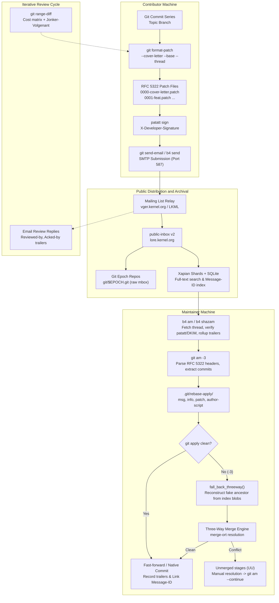
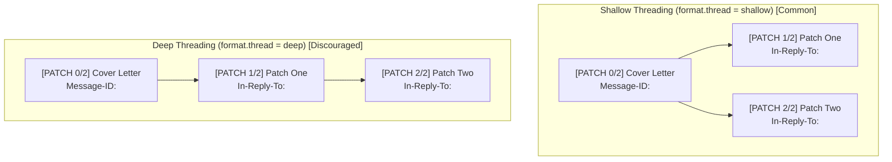
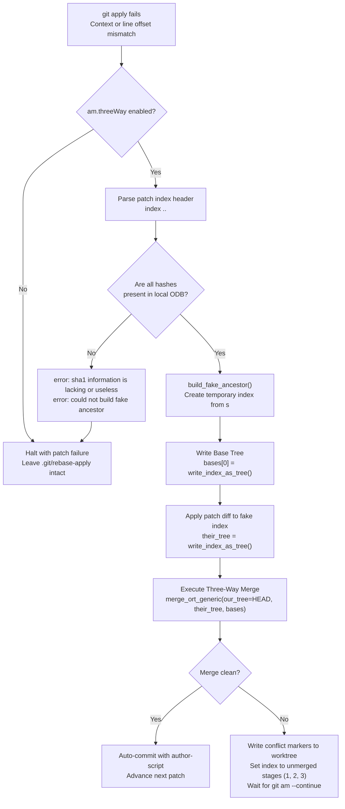
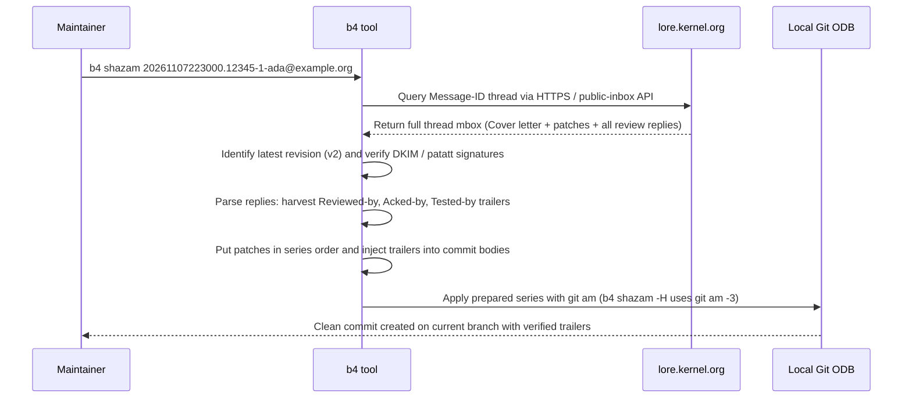
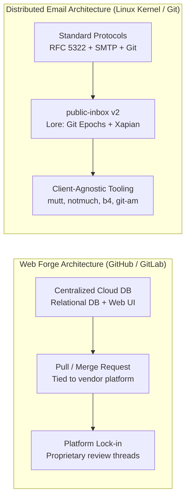

# Git Email and Patch Workflows

> [!summary] Claim:
> Git email workflows treat version control history as portable RFC 5322 messages, generating serialized commit streams via `git format-patch` and transmitting them over SMTP via `git send-email`.
> Ingestion via `git am` processes UNIX mbox files through `git mailinfo` into `.git/rebase-apply/`, applying patches directly or falling back to a three-way merge (`-3`) by synthesizing a fake ancestor tree from recorded blob hashes.
> Iterative review relies on `git range-diff` to solve a minimum-cost bipartite matching between patch versions via the Jonker-Volgenant linear assignment algorithm, while `b4` and `public-inbox` scale distributed maintainership through immutable Message-ID threads, trailer rollups, and cryptographic patch attestation.



## The Mechanism

Patch-over-email workflows date to the genesis of Git in April 2005.
Linus Torvalds designed Git specifically to coordinate the distributed, asynchronous development of the Linux kernel without requiring shared write access to a central repository.
Every commit is convertible into an RFC 5322 electronic mail message and reconstructed faithfully across disconnected systems.

### 1. The RFC 5322 Mbox Structure and Patch Anatomy

A patch series is stored on disk in UNIX mbox format, a flat sequence of concatenated RFC 5322 messages delimited by initial `From ` envelope lines.
`git format-patch` transforms commit objects walked from the revision graph into this representation.

```text
From 4f8b9a1e0c2d3f4a5b6c7d8e9f0a1b2c3d4e5f6a Mon Sep 17 00:00:00 2001
Message-ID: <20261107223000.12345-2-ada@example.org>
In-Reply-To: <20261107223000.12345-1-ada@example.org>
References: <20261107223000.12345-1-ada@example.org>
From: Ada Example <ada@example.org>
Date: Fri, 07 Nov 2026 14:30:00 -0800
Subject: [PATCH v2 1/3] sched/fair: Optimize task placement for hybrid architectures
MIME-Version: 1.0
Content-Type: text/plain; charset=UTF-8
Content-Transfer-Encoding: 8bit

Refactor the energy-aware scheduler wake-up path to avoid scanning
efficiency cores when compute capacity demands high-performance domains.

Signed-off-by: Ada Example <ada@example.org>
Reviewed-by: Bob Reviewer <bob@example.org>
---
Changes in v2:
 - Fixed null pointer dereference on asymmetric CPU topologies.
 - Added benchmark numbers on Alder Lake and Strix Point silicon.

 kernel/sched/fair.c | 14 ++++++++++----
 1 file changed, 10 insertions(+), 4 deletions(-)

diff --git a/kernel/sched/fair.c b/kernel/sched/fair.c
index a1b2c3d..e4f5a6b 100644
--- a/kernel/sched/fair.c
+++ b/kernel/sched/fair.c
@@ -1024,10 +1024,16 @@ select_task_rq_fair(struct task_struct *p, int prev_cpu, int wake_flags)
...
-- 
2.55.0
```

The identities and object IDs in this listing are illustrative; the header order (`Message-ID:`, threading headers, then `From:`, `Date:`, `Subject:`) matches real `git format-patch` output from Git 2.55.0 (macOS, as of 2026-11), and the `MIME-Version:` group appears only when the message contains non-ASCII text.
The message divides into four distinct functional segments:

1. **RFC 5322 Email Headers:**
   The `From:` header establishes the commit author, and `Date:` establishes the commit author timestamp.
   `Subject:` holds the patch title prefixed by `[PATCH]` or custom tags like `[PATCH v2 1/3]`.
   `Message-ID:` assigns a globally unique string identifying the message.
   When threading is enabled (`--thread`), `In-Reply-To:` and `References:` point to the root cover letter or preceding patch.

2. **Commit Log and Trailers:**
   The text immediately following the headers up to the `---` separator forms the immutable Git commit message.
   Structured trailers reside at the end of this block, including `Signed-off-by:` (Developer Certificate of Origin compliance), `Reviewed-by:`, `Acked-by:`, `Reported-by:`, and `Fixes:`.

3. **The `---` Post-Separator Block:**
   The three dashes on a single line mark the end of the commit message.
   Everything between `---` and the start of the unified diff is stripped by `git mailinfo` and omitted from the final commit.
   This area carries the series diffstat (`git diff --stat`), developer commentary, test logs, version changelogs (`v1 -> v2`), and base tree metadata.

4. **The Unified Diff and Signature:**
   The code modifications follow standard unified diff format.
   The `index <pre-image-hash>..<post-image-hash> <mode>` line provides the object IDs of the blobs before and after the change.
   The file terminates with an RFC 3676 email signature delimiter `-- ` (dash, dash, space) followed by the Git version that generated the patch.

#### The Base Tree Information Block

When passed `--base=<commit>` or when `format.useAutoBase` is set, `git format-patch` appends base tree metadata immediately preceding the email signature:

```text
base-commit: 7b2c9a1e0c2d3f4a5b6c7d8e9f0a1b2c3d4e5f6b
prerequisite-patch-id: d4f5a6b1c2d3e4f5a6b7c8d9e0f1a2b3c4d5e6f7
prerequisite-patch-id: e5a6b7c8d9e0f1a2b3c4d5e6f7a8b9c0d1e2f3a4
```

`base-commit` specifies the exact 40-character hexadecimal commit ID from upstream that the branch was forked from.
`prerequisite-patch-id` lines identify dependent patches that are not yet upstream but are prerequisites for this series.
Each prerequisite patch ID is computed using the stable patch-id algorithm (`git patch-id --stable`), which hashes diff hunks while stripping line numbers, whitespace noise, and commit metadata.
This enables automated testing systems (such as KernelCI) and maintainers to automatically reconstruct the exact base tree before patch application.

#### The Scissors Convention

When patches are forwarded or updated in email discussion threads, preamble text often precedes the commit metadata.
`git mailinfo --scissors` (or `git am --scissors` / `-c`) parses the scissors line:

```text
Subject: Re: [PATCH v2 1/3] sched/fair: Optimize task placement

Here is the updated patch with your suggested lockless check applied:

>8------------------------
From: Ada Example <ada@example.org>
Subject: [PATCH v3 1/3] sched/fair: Optimize task placement for hybrid architectures

Refactor the energy-aware scheduler wake-up path.

Signed-off-by: Ada Example <ada@example.org>
---
```

In `mailinfo.c`, `is_scissors_line()` detects the scissors delimiter (`>8`, `8<`, `>%`, or `%<` combined with dashes); the mark must be at least 8 bytes long, the perforation must cover more than a third of the visible line, and dashes plus scissors must make up more than half of the perforation (`mailinfo.c`, git.git v2.55.0).
Upon encountering the scissors line, `git mailinfo` discards all preceding commentary, resets its internal message buffer, and re-parses `From:`, `Subject:`, and commit body from the text below the cut.

### 2. Transport and Submission over SMTP: `git send-email`

`git send-email` is a specialized Perl script (`git-send-email.perl`) that manages direct SMTP submission according to RFC 5321 and RFC 6409.
It avoids the formatting corruption caused by standard graphical mail user agents (MUAs).

#### Addressing Architecture: Envelopes vs. Headers

In email protocols, the SMTP envelope and the RFC 5322 message headers operate independently:
- **Envelope Sender (`MAIL FROM`):** The address negotiated in the SMTP session.
  Bounces and delivery status notifications return here.
- **Envelope Recipients (`RCPT TO`):** The addresses the SMTP relay delivers to.
- **Message Headers (`From:`, `To:`, `Cc:`):** The human-readable fields rendered in mail clients.

When an author submits patches through a company mail relay that enforces domain alignment, the envelope sender must match the authenticated account (`sendemail.envelopeSender`).
If the commit author differs from the sender, `git send-email` preserves authorship by injecting an in-body `From:` line at the very top of the commit message:

```text
From: committer@corporate-relay.com
To: linux-kernel@vger.kernel.org
Subject: [PATCH] net/core: fix socket buffer leak

From: Original Author <author@partner.org>

Socket buffers were not decremented upon transmit errors.
...
```

When `git mailinfo` ingests this message, it detects the in-body `From:` line, overrides the `From:` header author (it never sees the SMTP envelope), and attributes the commit to `Original Author`.
`git-format-patch(1)` documents the same transformation for `--from` and notes that `git send-email` already performs it.

#### Recipient Discovery and Trailer Auto-CC

High-volume projects automate recipient discovery based on path modification.
The Linux kernel maintains `scripts/get_maintainer.pl`, which parses the `MAINTAINERS` database and git history.
`git send-email` hooks into this via `--cc-cmd`:

```bash
git send-email --to="linux-kernel@vger.kernel.org" \
    --cc-cmd="./scripts/get_maintainer.pl --nogit-fallback" \
    patches/*.patch
```

`git send-email` also parses commit trailers to populate recipient lists automatically.
The configuration variable `sendemail.suppressCc` (or `--suppress-cc=<category>`) fine-tunes which addresses are added (`git-send-email(1)`, Git 2.55.0):
- `author`: Do not auto-cc the patch author.
- `self`: Do not auto-cc the sender.
- `cc`: Do not auto-cc addresses in `Cc:` lines of the patch header, except self.
- `bodycc`: Do not auto-cc addresses in `Cc:` lines of the patch body (commit message), except self.
- `sob`: Do not auto-cc addresses found in `Signed-off-by:` trailers, except self.
- `misc-by`: Do not auto-cc `Acked-by:`, `Reviewed-by:`, `Tested-by:`, and other `-by` lines, except `Signed-off-by:`.
- `cccmd`: Do not execute the `--cc-cmd`.
- `body`: Equivalent to `sob` + `bodycc` + `misc-by`.
- `all`: Suppresses all automatic CC injection.

#### Threading Mechanics: Shallow vs. Deep

Two tools can add `In-Reply-To:` and `References:` headers, so only one of them should: `format.thread` (default off, `--thread` alone means `shallow`) controls `git format-patch`, while `sendemail.thread` (default on) and `sendemail.chainReplyTo` (default off, which is the shallow shape) control `git send-email` (`git-format-patch(1)` and `git-send-email(1)`, Git 2.55.0):



- **Shallow Threading:** The cover letter (Patch 0/N) serves as the parent root with `Message-ID: <M0>`.
  Every subsequent patch in the series sets `In-Reply-To: <M0>` and `References: <M0>`.
  All patches render at the same indentation level directly beneath the cover letter.
- **Deep Threading:** Patch 1 replies to Patch 0, Patch 2 replies to Patch 1, and Patch N replies to Patch N-1.
  On a 20-patch series, replies cascade diagonally across terminal clients and review interfaces.
  `git send-email` defaults to the shallow shape (`--no-chain-reply-to`), as the lab shows in its send-email section.
  Git's own `SubmittingPatches` (git.git v2.55.0) accepts replies to the cover letter, to the first patch, or to the preceding patch, and the kernel's submitting-patches guide does not discuss deep threading, so shallow is a convention that eases reading, not a rule of either project.

### 3. Mailbox Ingestion and Application State: `git am`

`git am` (rewritten from shell into C in Git 2.6.0 per its release notes, located in `builtin/am.c`) consumes mbox files, extracts commits, and applies them to the current branch.

#### State Machine in `.git/rebase-apply/`

When `git am` initiates, it creates the directory `.git/rebase-apply/` (historically shared with `git rebase --apply`).
It splits the incoming mbox (the `git mailsplit` logic) into individual messages named `0001`, `0002`, up to the patch count (`state->prec = 4` digits).

After a plain `git am` fails on its first patch, Git 2.55.0 on macOS leaves exactly these entries (lab section 5): `0001`, `abort-safety`, `apply-opt`, `applying`, `author-script`, `final-commit`, `info`, `keep`, `last`, `messageid`, `msg`, `next`, `patch`, `quiet`, `quoted-cr`, `scissors`, `sign`, `threeway`, `utf8`.
`threeway`, `quiet`, `sign`, `utf8`, and `messageid` hold `t` or `f`; `keep`, `scissors`, `quoted-cr`, and `apply-opt` record the matching option text (`write_state_bool()` and `write_state_text()` in `builtin/am.c`).
The files with a documented role (`builtin/am.c`, git.git v2.55.0):

| File | Purpose |
| :--- | :--- |
| `next` | Decimal index of the patch currently being processed, written with `%d` (for example `1`, not zero-padded). |
| `last` | Decimal index of the final patch in the series (for example `4`). |
| `applying` | Empty file marking the directory as owned by `git am`; `git rebase --apply` writes `rebasing` instead. |
| `msg` | Extracted raw commit message body produced by `git mailinfo`. |
| `patch` | Extracted unified diff payload passed to the apply engine. |
| `info` | Authorship metadata extracted from RFC 5322 headers. |
| `author-script` | Shell-compatible variable assignments: `GIT_AUTHOR_NAME`, `GIT_AUTHOR_EMAIL`, and `GIT_AUTHOR_DATE`. |
| `final-commit` | The commit message (`state->msg`) that will be used for the commit being applied. |
| `abort-safety` | The `HEAD` object ID recorded after the last step; `git am --abort` refuses to rewind to `ORIG_HEAD` if `HEAD` has moved since. |
| `threeway` | Always written, containing `t` or `f` for whether `--3way` fallback is enabled. |
| `patch-merge-index` | Temporary index constructed during three-way fallback merge operations. |

For each patch in sequence:
1. `git mailinfo` parses the message file, recodes character sets to UTF-8 (`i18n.commitEncoding`), extracts the author ident and commit title, and writes `msg` and `patch`.
2. `git am` reads `author-script` and applies the patch to the index and working directory via the apply library (`apply.c`).
3. If clean, it commits the changes in-process through `commit_tree_extended()` in `do_commit()` (not the `git commit-tree` command) and updates `HEAD`.
4. If the patch fails to apply cleanly, execution halts, leaving the conflict state on disk for developer intervention.

### 4. The Three-Way Merge Fallback Engine (`git am -3`)

A patch produced by `git format-patch` records unified diff context.
If the target repository has advanced since the patch was created, line numbers change and surrounding context shifts.
`git apply` tolerates a pure line offset, but it applies no fuzz by default (only `-C<n>` relaxes context), so it fails when any context line no longer matches; a hunk whose pre-image starts at line 1 must also match at the beginning of the file (`match_beginning` in `apply.c`, git.git v2.55.0).
GNU `patch` differs: it applies fuzzy matches by default.

When `-3` (or `--3way`, or config `am.threeWay = true`) is specified, `git am` does not abort upon patch application failure.
Instead, `fall_back_threeway()` in `builtin/am.c` activates:



#### Step-by-Step Execution of `fall_back_threeway()`

1. **Header Parsing:**
   The function inspects the diff header for the target file:
   ```text
   index a1b2c3d..e4f5a6b 100644
   ```
   `a1b2c3d` is the abbreviation of the blob object ID in the author's tree before the patch was applied.
   `e4f5a6b` is the blob object ID after the patch was applied.

2. **Blob Verification:**
   Git checks whether `a1b2c3d` exists in the local object database.
   If the local repository is a shallow clone or does not share history with the author's base, `build_fake_ancestor()` (which drives the `apply.c` function of the same name) fails immediately with:
   `error: sha1 information is lacking or useless (<filename>).`
   `error: could not build fake ancestor`
   Both strings are in git.git v2.55.0 (`apply.c` and `builtin/am.c`).

3. **Fake Ancestor Synthesis:**
   If the blobs are present, Git creates a temporary index file (`.git/rebase-apply/patch-merge-index`).
   It reads the pre-image blob `a1b2c3d` directly from the object database and writes it into this temporary index at stage 0.
   Git then writes this index out as a tree object, the merge base (`bases[0]` in `fall_back_threeway()`).

4. **Their-Tree Construction:**
   Git applies the patch directly to the temporary index containing the pre-image blobs.
   Because the patch was generated directly from these exact blobs, this application succeeds with zero fuzz and zero offset.
   Git writes this updated temporary index out as a tree object: `their_tree`.

5. **Three-Way Merge Execution:**
   In Git 2.55.0 the fallback calls `merge_ort_generic()` (`builtin/am.c`).
   Git 2.34 made `ort` the default strategy for `git merge` (2.34.0 release notes), which is a different code path.
   It performs a three-way merge between:
   - Base tree: `bases[0]`, labelled "constructed fake ancestor" (the author's pre-image state).
   - Our tree: `HEAD` (the current branch tip in the maintainer's repository).
   - Their tree: `their_tree` (the author's post-image state).

If changes in `HEAD` and changes in `their_tree` modify non-overlapping regions of the file, `merge-ort` resolves them automatically.
If changes conflict, standard Git conflict markers (`<<<<<<< HEAD`, `=======`, `>>>>>>>`) are inserted into the working tree, and the file is marked unmerged in the index with stages 1 (base), 2 (ours/HEAD), and 3 (theirs/patch).
The maintainer resolves the conflict manually, stages the file with `git add`, and runs `git am --continue` to finalize the commit without re-entering the author metadata.

### 5. Patch Series Iteration and Diff-of-Diffs: `git range-diff`

When a contributor revises a patch series following review feedback, the maintainer needs to know what changed between iteration N and iteration N+1.
A simple diff between branch tips conflates commit-level edits with rebases against upstream.
`git range-diff` (introduced in Git 2.19 as "a reimplementation of `git tbdiff`" per the 2.19.0 release notes) solves this by computing a diff of diffs.

#### The Cost Matrix and Jonker-Volgenant Matching

Given two commit ranges $A = A_1, A_2, \dots, A_n$ (old version) and $B = B_1, B_2, \dots, B_m$ (new version):
In `range-diff.c`, `get_correspondences()` builds a cost matrix of dimension $(n+m) \times (n+m)$:

```text
Cost Matrix Layout:
             B_1         B_2     ...     B_m        Dummy_1    Dummy_2   ...  Dummy_n
A_1      [ Cost(A1,B1) Cost(A1,B2) ... Cost(A1,Bm)   Del(A1)    Del(A1)   ...  Del(A1)  ]
A_2      [ Cost(A2,B1) Cost(A2,B2) ... Cost(A2,Bm)   Del(A2)    Del(A2)   ...  Del(A2)  ]
...      [     ...         ...     ...     ...         ...        ...     ...    ...    ]
A_n      [ Cost(An,B1) Cost(An,B2) ... Cost(An,Bm)   Del(An)    Del(An)   ...  Del(An)  ]
Dummy_1  [  Ins(B1)     Ins(B2)    ...   Ins(Bm)        0          0      ...     0     ]
...      [    ...         ...      ...     ...         ...        ...     ...    ...    ]
Dummy_m  [  Ins(B1)     Ins(B2)    ...   Ins(Bm)        0          0      ...     0     ]
```

In `get_correspondences()` (git.git v2.55.0) a commit's deletion or creation cost fills its entire dummy row or column, not a diagonal.
Pairs already matched exactly by `find_exact_matches()` (identical diff text) get cost 0, and every other cell in an exactly matched commit's row or column gets `COST_MAX`.

1. **Pairwise Diff Cost:**
   For every pair $(A_i, B_j)$, Git computes the diff of their commit patches with 3 lines of context (`diffsize()`).
   The cost assigned to cell $(i, j)$ is the number of lines in this outer diff.
   If two commits have identical diffs, their outer diff is empty and the cost is 0.

2. **Creation and Deletion Factors:**
   To account for commits introduced or dropped between versions, the matrix includes dummy insertion and deletion rows and columns.
   The cost for inserting or deleting a patch is governed by `--creation-factor=<percent>` (default 60%).
   The deletion cost is calculated as:
   $$\text{DelCost} = \text{diffsize}(A_i) \times \frac{\text{creation\_factor}}{100}$$
   If the outer diff between $A_i$ and $B_j$ exceeds this threshold, the algorithm prefers marking $A_i$ as deleted and $B_j$ as newly created rather than pairing them as heavily modified.

3. **Optimal Assignment:**
   Git solves the linear sum assignment problem using the Jonker-Volgenant shortest augmenting path algorithm implemented in `linear-assignment.c`.
   The file header cites Jonker and Volgenant (1987), whose shortest augmenting path algorithm runs in $O(N^3)$ worst-case time.
   To prevent memory exhaustion during massive range comparisons, `get_correspondences()` dies if the `int` cost matrix would need `--max-memory` bytes or more; the option arrived in Git 2.52, has no config key, is not described in `git-range-diff(1)`, and defaults to 4 GiB on 64-bit and 2 GiB on 32-bit builds (`RANGE_DIFF_MAX_MEMORY_DEFAULT` in `range-diff.h`).

#### Dual-Diff Visualization

`git range-diff` displays matched commits using a four-symbol outer diff margin:

```text
1:  e139c17 ! 1:  693ef24 feat: modify scheduler latency
    @@ file.c: void update_load(struct rq *rq)
      line 3
      line 4
     -line 5
    -+line 5 modified v1
    ++line 5 modified v2
      line 6
      line 7
```

- Column 1 is the outer diff marker: whether the line changed between the old and new iteration of the patch.
- Column 2 is the inner diff marker: the line's own `+`, `-`, or context role inside the patch.
- ` -`: A line deleted in both old and new versions (common context).
- ` +`: A line added in both old and new versions (common context).
- `-+`: A line added in the old iteration that was removed in the new iteration.
- `++`: A line added in the new iteration that did not exist in the old iteration.
- `=`: The two patches are textually identical, including metadata and commit message (`output_pair_header()` compares the full patch text with `strcmp`).
- `!`: Commits match but their diffs or commit messages differ.
- `<`: Commit was dropped from the new iteration.
- `>`: Commit was newly added in the new iteration.

### 6. Decentralized Archival, Public-Inbox, and `b4`

Mailing lists historically suffered from fragmented archives, broken threading across month boundaries in Pipermail, and lack of offline programmatic querying.
Modern patch ecosystems rely on `public-inbox` and `b4`.

#### Public-Inbox v2 Architecture

Created by Eric Wong, `public-inbox` powers `lore.kernel.org`.
It uses Git itself as the permanent, immutable backing store for email.

- **Git Epoch Shards:**
  Incoming emails are committed as raw RFC 5322 blobs into a bare Git repository.
  To keep any single repository from growing without bound, history is partitioned into epochs (`git/0.git`, `git/1.git`), currently "roughly one gigabyte segments" per `public-inbox-v2-format(5)`.
  The format states that "the git packs of older epochs are stable", so mirrors can clone them without expensive pack generation.
  Mirrors replicate the entire mailing list archive via `grokmirror` or standard `git clone`.
- **The Alternates Mechanism:**
  An empty umbrella repository (`all.git`) points to every epoch repository using Git's object alternates file (`objects/info/alternates`); the epoch repositories themselves do not use alternates.
  This allows blob lookups across all epochs through a single object database without duplicating data.
- **Xapian Indexing and SQLite Metadata:**
  Full-text search, thread reconciliation, and header indexes are maintained in sharded Xapian databases (`xap$SCHEMA_VERSION/$SHARD`) and SQLite databases (top-level `msgmap.sqlite3` and `xap$SCHEMA_VERSION/over.sqlite3`).
  The Xapian shards hold the search index and the SQLite files hold the Message-ID and overview metadata.

#### The `b4` Toolchain

Created by Konstantin Ryabitsev, `b4` automates maintainer and contributor workflows over `public-inbox`.



- `b4 am <Message-ID>`:
  Fetches the complete thread from `lore.kernel.org`.
  It identifies the latest reroll iteration, runs attestation checks (DKIM in the documented example output), scrapes follow-up review emails for trailers (`Reviewed-by:`, `Acked-by:`), refuses trailers whose sender does not match the trailer address unless `-S` is given, rolls those trailers into the respective patch messages, and writes an mbox file ready for `git am`.
- `b4 shazam <Message-ID>`:
  Does the same retrieval and applies the series directly to the current branch; `-H` and `-M` instead treat it like a pull request, and the b4 docs state that `b4 shazam -H` uses `git am -3`.
- `b4 prep`:
  Manages contributor patch series on local branches, tracking series versions, managing cover letters, and computing range-diffs automatically between revisions.
- `b4 send`:
  Formats and submits series over SMTP without manual mbox generation; since b4 v0.14 its pre-flight checks warn when `b4 prep --check` or `b4 prep --auto-to-cc` has not been run (as of 2026-11, Both).
  The `b4 send` page names the pre-flight checks `needs-checking` (run `b4 prep --check`) and `needs-auto-to-cc` (run `b4 prep --auto-to-cc`) and does not name `scripts/checkpatch.pl` or `scripts/get_maintainer.pl`; the kernel's submitting-patches guide names those two scripts for manual use.

#### Cryptographic Patch Attestation: `patatt`

Traditional inline PGP signatures (`-----BEGIN PGP SIGNED MESSAGE-----`) alter whitespace and line structures, causing `git am` and patch utilities to fail.
DKIM (DomainKeys Identified Mail) signs messages at the mail server boundary, but mailing list software (e.g., Mailman, Majordomo) alters message headers, appends list footers, and breaks DKIM verification.

`patatt` (patch attestation, v0.8.0 released 2026-07-22 per PyPI) adapts the DKIM signature standard into the `X-Developer-Signature` header:
- It canonicalizes the patch body and selected RFC 5322 headers (the docs list a Canonicalization chapter; this note does not state which headers are signed by default).
- It generates an Ed25519, OpenSSH, or OpenPGP cryptographic signature over these canonicalized bytes.
- Because the signature is embedded inside an RFC 5322 header, mailing list relays transport it unmodified.
- Contributor public keys can live inside the target repository ("in-repository keyring management via git refs" per the patatt README), enabling git-native key auditing without external keyservers; the patatt docs cover the layout in their Maintainer Guide chapters "In-Git Public Key Management" and "Keyring Structure".

### 7. Canonical Identity Resolution: `.mailmap`

Open source projects accumulate contributions over decades.
Developers change employers, use multiple personal email addresses, or have name misspellings across distinct git configurations.
Git provides `.mailmap` (implemented in `mailmap.c` with a sorted `string_list` keyed by email) to normalize author identities during `git shortlog`, `git log --use-mailmap`, `git blame`, and `git check-mailmap`.

`.mailmap` parses four distinct syntax patterns:

1. Map commit email to canonical name and canonical email:
   ```text
   Canonical Name <canonical@email.com> <commit@email.com>
   ```
2. Map specific commit name and email to canonical name and canonical email:
   ```text
   Canonical Name <canonical@email.com> Commit Name <commit@email.com>
   ```
3. Map commit email to canonical name, keeping original email:
   ```text
   Canonical Name <commit@email.com>
   ```
4. Map commit email to canonical email, keeping original name:
   ```text
   <canonical@email.com> <commit@email.com>
   ```

`git check-mailmap --stdin` allows scripts to translate arbitrary `Name <email>` strings into their canonical equivalents using repository mailmap rules.
All four forms were confirmed with `git check-mailmap --stdin` on Git 2.55.0 (macOS, as of 2026-11); form 2 maps only the exact name and email pair, so `Other <commit@email.com>` passes through unchanged.

## Commands and Numbers to Know

| Item | Value | Platform and date | What it controls |
| :--- | :--- | :--- | :--- |
| `format.thread` | unset (no threading) | Both (as of 2026-11) | `format-patch` threading; `--thread` alone means `shallow` (reply to cover letter), `deep` chains replies |
| `format.useAutoBase` | `false` | Both (as of 2026-11) | `true` enables `--base=auto`; `whenAble` adds base info only when a suitable base exists |
| `sendemail.confirm` | `auto` | Both (as of 2026-11) | Confirmation prompt before transmission (`always`, `never`, `cc`, `compose`, `auto` = `cc` + `compose`); defaults to `compose` if a suppress option is given |
| `sendemail.suppressCc` | unset | Both (as of 2026-11) | Suppresses automatic CC addresses (`author`, `self`, `cc`, `bodycc`, `sob`, `misc-by`, `cccmd`, `body`, `all`) |
| `sendemail.transferEncoding` | `auto` | Both (as of 2026-11) | Transfer encoding for patches (`7bit`, `8bit`, `quoted-printable`, `base64`); `auto` uses `8bit` when possible |
| `sendemail.smtpEncryption` | unset (plain SMTP, port 25) | Both (as of 2026-11) | `tls` = STARTTLS (default port 25), `ssl` = implicit TLS (default port 465) |
| Standard SMTP submission port | `587` | Both (as of 2026-11) | RFC 6409 submission port; `git-send-email(1)` calls it the common alternative port for `tls`, so set `--smtp-server-port` |
| Implicit TLS port | `465` | Both (as of 2026-11) | Default port for `sendemail.smtpEncryption = ssl` |
| `am.threeWay` | `false` | Both (as of 2026-11) | Enables three-way merge fallback (`-3`) automatically upon application failure |
| `am.messageId` | `false` | Both (as of 2026-11) | Appends `Message-ID: <...>` trailer to commit log during `git am` |
| `mailinfo.scissors` | `false` | Both (as of 2026-11) | Strips text preceding a scissors line (`>8--`) by default in `git mailinfo` and therefore `git am`; there is no `am.scissors` key |
| `git range-diff --creation-factor` | `60` | Both (as of 2026-11) | Percentage cost for creation/deletion vs pairing (`RANGE_DIFF_CREATION_FACTOR_DEFAULT`); no config key |
| `git range-diff --max-memory` | 4 GiB (64-bit), 2 GiB (32-bit) | Both (as of 2026-11) | Cost matrix allocation limit, added in Git 2.52; no config key |
| Linear assignment complexity | $O(N^3)$ | Both (as of 2026-11) | Worst-case time complexity of Jonker-Volgenant algorithm in `linear-assignment.c` |
| `diff.interHunkContext` | `0` | Both (as of 2026-11) | Context line threshold for merging adjacent diff hunks |
| Signature delimiter | `-- \n` (dash, dash, space, newline) | Both (as of 2026-11) | RFC 3676 standard email signature separator preceding Git version |
| Public-inbox epoch size | roughly 1 GB | Both (as of 2026-11) | Approximate epoch segment size in `public-inbox-v2-format(5)`, which notes it may become configurable |

## Multi-Language Comparison: C / Python / Rust

Patch parsing, mail parsing, and identity translation are implemented across the core toolchain languages:

| Concern | C (Git v2.55.0) | Python (`b4` / `patatt` / stdlib) | Rust (Gitoxide `gix-mailmap` / `gix-diff`) |
| :--- | :--- | :--- | :--- |
| RFC 5322 Parsing | Hand-written line-oriented header and body parser in `mailinfo.c` | `email.parser.BytesParser` and `mailbox.mbox` in Python stdlib | No mailinfo equivalent: `gix-mailmap` parses only `.mailmap` files (gix-mailmap 0.36.1, as of 2026-11) |
| Three-Way Fallback | `fall_back_threeway()` in `builtin/am.c` calling `merge_ort_generic()` | `b4 shazam` hands the series to `git am` | No `git am` counterpart appears in this note's sources; `gix-merge` provides blob, tree, and commit merges (gix-merge 0.23.0, docs.rs, as of 2026-11) |
| Patch Diff Matching | Cost matrix + Jonker-Volgenant in `linear-assignment.c` | `b4 prep --compare-to` runs `git range-diff` (b4 docs, as of 2026-11) | No gitoxide range-diff appears in this note's sources |
| Cryptographic Attestation | Shelling out to `gpg` or `ssh-keygen` via `gpg-interface.c` (Git's own commit signing, not patatt) | `patatt` signs with ed25519, OpenPGP, or OpenSSH keys (patatt docs, as of 2026-11) | No Rust patch-attestation tool appears in this note's sources |
| Mailmap Resolution | Sorted `string_list` lookups in `mailmap.c` | No mailmap parser appears in this note's sources; `git check-mailmap --stdin` (lab section 7) is the scriptable entry point | `gix_mailmap::Snapshot`, documented as storing entries "for optimal, case-insensitive lookup by email and optionally name" |

## Worked Example: End-to-End Patch Generation, Range-Diff, and Three-Way Merge Resolution

The lab `code/02-Version-Control/git_email_patch_workflow/` runs this whole walkthrough in throwaway repositories with fixed identities and dates, and `make verify` diffs its output against `expected/<platform>.txt`.
Every output block below is copied byte for byte from `expected/darwin-arm64.txt` (Git 2.55.0, macOS arm64, recorded 2026-11).
The lab substitutes `<oid>`, `<timestamp>`, and `<date>` for values that vary per run.
Each `CHECK ok` line is a derived fact that turns into `CHECK FAIL` when its mechanism is absent; the lab was mutation-tested with 42 deliberate breakages, each of which the lab detects.

```bash
cd code && python3 -m _harness.verify 02-Version-Control/git_email_patch_workflow/
```

### 1. Generating a Patch Series with Base Metadata

The lab commits two patches to `service.c` on `topic-v1`, then formats them twice, once with `--thread=shallow` and once with `--thread=deep`:

```bash
git format-patch -q --cover-letter --base=main --thread=shallow -2 -o patches-v1/
git format-patch -q --cover-letter --base=main --thread=deep -2 -o patches-deep/
```

Output (darwin-arm64, Git 2.55.0): the generated cover letter, then the threading checks.

```text
From <oid> Mon Sep 17 00:00:00 2001
Message-ID: <cover.<timestamp>.git.engineer@example.com>
From: Distinguished Engineer <engineer@example.com>
Date: <date>
Subject: [PATCH 0/2] *** SUBJECT HERE ***

*** BLURB HERE ***

Distinguished Engineer (2):
  feat(service): enhance initialization logging
  feat(service): implement graceful shutdown

 service.c | 7 ++++++-
 1 file changed, 6 insertions(+), 1 deletion(-)


base-commit: <oid>
-- 
2.55.0

CHECK ok: base-commit names main
CHECK ok: shallow: patch 1 replies to the cover letter
CHECK ok: shallow: patch 2 replies to the cover letter
CHECK ok: deep: patch 2 replies to patch 1, not the cover letter
CHECK ok: no threading by default: no In-Reply-To without --thread
CHECK ok: patch file ends with the RFC 3676 delimiter then the Git version
```

The cover letter keeps the `*** SUBJECT HERE ***` placeholders on purpose: `git send-email` refuses to send a message whose subject is still the template.
Its `base-commit:` line sits above the signature delimiter, and the shallow checks prove that patches 1 and 2 both carry `In-Reply-To:` pointing at the cover letter's `Message-ID:`.

### 2. Submission Threading Without Sending Mail: `send-email --dry-run`

`git send-email --dry-run` generates every `Message-ID:` and `In-Reply-To:` header without opening an SMTP connection.
The lab feeds it an unthreaded series so the headers are generated by `send-email` itself:

```text
default: patch 1 replies to message 1, patch 2 replies to message 1
--chain-reply-to: patch 1 replies to message 1, patch 2 replies to message 2
Cc lines by default: 3
Cc lines with --suppress-cc=self: 0
CHECK ok: default send-email: both patches reply to the cover letter (message 1)
CHECK ok: --chain-reply-to: patch 2 replies to patch 1 (message 2)
CHECK ok: default send-email adds the sender as Cc
CHECK ok: --suppress-cc=self removes the automatic Cc to the sender
```

By default patch 2 replies to message 1 (the cover letter, the shallow shape), while `--chain-reply-to` makes it reply to message 2.
With the sender as author, the default run adds three `Cc:` lines (one per message), and `--suppress-cc=self` removes them.

### 3. Revising the Series and Computing `range-diff`

After review the engineer rebuilds the series on `topic-v2` from `main` with a changed logging string:

```bash
git range-diff --no-color topic-v1...topic-v2
```

```text
1:  <oid> ! 1:  <oid> feat(service): enhance initialization logging
    @@ service.c
      
      void init_subsystem(void) {
     -    printf("Subsystem v1 initialized\n");
    -+    printf("Subsystem v1 initialized with logging\n");
    ++    printf("Subsystem v2 initialized with structured logging\n");
      }
      
      int main(void) {
2:  <oid> ! 2:  <oid> feat(service): implement graceful shutdown
    @@ Commit message
     
      ## service.c ##
     @@ service.c: void init_subsystem(void) {
    -     printf("Subsystem v1 initialized with logging\n");
    +     printf("Subsystem v2 initialized with structured logging\n");
      }
      
     +void shutdown_subsystem(void) {
CHECK ok: service series: patch 1 is '!' (changed)
CHECK ok: service series: patch 2 is '!' (its context includes patch 1's line)
```

Patch 1 is `!`: the v1 added line (`-+`) was replaced by the v2 added line (`++`).
Patch 2 is also `!` even though its own change is identical, because its hunk context includes the `printf` line that patch 1 changed, so the patch text differs and `=` (textually identical patches) does not apply.
Section 5 of the lab shows the `=` case, and `--creation-factor=1` turning a heavily changed pair into a deletion plus a creation.

### 4. Simulating Upstream Divergence and Three-Way Fallback

Upstream adds a header comment at the top of `service.c`, so the v2 patch's `@@ -1,7 +1,7 @@` hunk no longer matches at the start of the file:

```bash
git format-patch -q -v2 -2 topic-v2 -o patches-v2/
git am patches-v2/v2-0001-feat-service-enhance-initialization-logging.patch   # fails
git am --abort
git am -3 patches-v2/v2-0001-feat-service-enhance-initialization-logging.patch
```

The lab captures stdout and stderr of each command separately, so the order is deterministic:

```text
@@ -1,7 +1,7 @@
git am exit: 128
-- stdout
Applying: feat(service): enhance initialization logging
Patch failed at 0001 feat(service): enhance initialization logging
-- stderr
error: patch failed: service.c:1
error: service.c: patch does not apply
hint: Use 'git am --show-current-patch=diff' to see the failed patch
hint: When you have resolved this problem, run "git am --continue".
hint: If you prefer to skip this patch, run "git am --skip" instead.
hint: To restore the original branch and stop patching, run "git am --abort".
hint: Disable this message with "git config set advice.mergeConflict false"
git am -3 exit: 0
-- stdout
Applying: feat(service): enhance initialization logging
Using index info to reconstruct a base tree...
M	service.c
Falling back to patching base and 3-way merge...
Auto-merging service.c
-- stderr
CHECK ok: plain git am fails on the shifted hunk
CHECK ok: git am -3 reconstructs a base tree
CHECK ok: git am -3 falls back to a 3-way merge
CHECK ok: git am -3 kept the upstream header and applied the v2 change
CHECK ok: git am -3 left no am state behind
```

Plain `git am` fails even though only one line was inserted above the hunk: the hunk starts at line 1, and `apply.c` requires a hunk starting at line 1 to match at the beginning of the file.
`git am -3` inspected the blob hash recorded in the patch, retrieved the original blob from the local object store, constructed the fake ancestor, applied the patch to it, and ran `merge_ort_generic()` against `HEAD`.
The changes merged cleanly without human intervention.

### 5. A Shifted Context Line, a Real Conflict, and the State Directory

The second repository (`buffer.c`, 20 lines) is the reference solution for the practice drill below.
It shows `=` for an unchanged patch, the `.git/rebase-apply/` contents after a failed `git am`, a clean `git am -3`, the conflict path with unmerged stages 1, 2, and 3, and the case where the base blobs are missing:

```text
1:  <oid> ! 1:  <oid> feat: allocate buffer pool
    @@ buffer.c: buffer_line_1
      buffer_line_3
      buffer_line_4
     -buffer_line_5
    -+buffer_line_5_alloc
    ++buffer_line_5_dma_alloc
      buffer_line_6
      buffer_line_7
      buffer_line_8
2:  <oid> = 2:  <oid> feat: free buffer pool
CHECK ok: buffer series: patch 1 is '!'
CHECK ok: buffer series: patch 2 is '=' (identical patch text)
range-diff --creation-factor=1 markers:
  1 < -
  - > 1
  2 = 2
CHECK ok: low creation factor turns the changed pair into delete plus create
git am exit: 128
error: patch failed: buffer.c:2
error: buffer.c: patch does not apply
state directory entries:
  0001
  abort-safety
  apply-opt
  applying
  author-script
  final-commit
  info
  keep
  last
  messageid
  msg
  next
  patch
  quiet
  quoted-cr
  scissors
  sign
  threeway
  utf8
next=1 last=1 threeway=f
applying size: 0
final-commit: feat: allocate buffer pool
CHECK ok: abort-safety holds the HEAD object ID
CHECK ok: next is the plain decimal 1
CHECK ok: final-commit is the commit message, not an object ID
CHECK ok: threeway is f without -3
CHECK ok: git am --abort removes the state directory
git am -3 log:
  feat: allocate buffer pool
  fix: lock hardware buffer
  init: add buffer subsystem
CHECK ok: git am -3 merged both the upstream context edit and the patch
git am -3 on a conflicting patch, exit: 128
  CONFLICT (content): Merge conflict in buffer.c
  Patch failed at 0001 feat: free buffer pool
  error: Failed to merge in the changes.
unmerged stages for buffer.c: 1 2 3 
conflict region:
  <<<<<<< HEAD
  buffer_line_15_other
  =======
  buffer_line_15_free
  >>>>>>> <patch label>
CHECK ok: git am -3 stops with three unmerged stages
CHECK ok: the work tree holds conflict markers
after resolve and --continue: feat: free buffer pool
CHECK ok: the resolved commit holds the resolution and no markers
CHECK ok: git am --continue kept the patch's author date
CHECK ok: git am --continue left no am state behind
git am -3 without the base blobs, exit: 128
error: sha1 information is lacking or useless (buffer.c).
error: could not build fake ancestor
CHECK ok: missing base blobs report a fake ancestor failure
```

`git am --continue` kept the patch's author date even though the committer date was "now", which the check on `%at` proves.

### 6. `mailinfo`, In-Body `From:`, `.mailmap`, and `patch-id`

```text
mailinfo without --scissors:
  Author: Reviewer
  Email: reviewer@example.org
  Subject: fix the widget
mailinfo --scissors:
  Author: Author Name
  Email: author@example.org
  Subject: fix the widget
message kept with --scissors:
  | Real commit message line.
  | 
  | Signed-off-by: Author Name <author@example.org>
CHECK ok: without --scissors the reviewer is the author
CHECK ok: --scissors discards the text above the cut and re-reads the author
CHECK ok: mailinfo.scissors=true makes plain mailinfo behave the same
CHECK ok: text after the --- separator is not in the message
CHECK ok: the trailer above --- is in the message
format-patch --from, top of the message:
  From: Relay Sender <relay@corporate.example.org>
  Date: Sun, 1 Nov 2026 10:00:00 +0000
  From: Original Author <author@partner.example.org>
mailinfo on that message:
  Author: Original Author
  Email: author@partner.example.org
CHECK ok: outer From is the sender
CHECK ok: first body line is the in-body From of the author
CHECK ok: mailinfo credits the in-body author

=== 7. .mailmap: the four forms ===
  Anyone <one@old.example.org> -> Form One <one@canonical.example.org>
  Old Two <two@old.example.org> -> Form Two <two@canonical.example.org>
  Other <two@old.example.org> -> Other <two@old.example.org>
  Anyone <three@old.example.org> -> Form Three <three@old.example.org>
  Keep Name <four@old.example.org> -> Keep Name <four@canonical.example.org>
CHECK ok: form 1 rewrites name and email for the commit email
CHECK ok: form 2 matches only the exact name and email pair
CHECK ok: form 3 rewrites the name, keeping the email
CHECK ok: form 4 rewrites the email, keeping the name

=== 8. patch-id --stable survives a move to a different base ===
original hunk:    @@ -12,7 +12,7 @@
cherry-picked:    @@ -13,7 +13,7 @@
patch-id length:  41 bytes including newline
CHECK ok: the hunk header line numbers moved
CHECK ok: the commit IDs differ
CHECK ok: the stable patch-id is unchanged
CHECK ok: a different patch has a different patch-id
```

The `patch-id` check moves a commit onto a base that shifts its hunk by one line: the hunk header changes (`-12,7` to `-13,7`), the commit ID changes, and `git patch-id --stable` still reports the same ID.

## Pitfalls

> [!warning] Pitfall: Email Client Formatting Corruption (format=flowed and HTML)
> Standard desktop and web mail clients (Outlook, Apple Mail, Gmail web interface) corrupt patches by converting tabs to spaces, wrapping lines longer than 72 characters, or converting plain text into multipart/alternative HTML.
> An altered space or line wrap invalidates the unified diff context, causing `git apply` to fail immediately.
> Contributors must use `git send-email` or `b4 send`, which interface directly with SMTP sockets using raw 8bit or quoted-printable transfer encodings without MUA munging.

> [!warning] Pitfall: Missing Base Blobs in Partial or Shallow Clones
> `git am -3` relies completely on the availability of the pre-image blob hashes recorded in the patch `index` header line.
> If maintainers run `git am -3` inside a shallow clone (`--depth=1`) or a repository missing historical objects, `build_fake_ancestor()` fails with `error: sha1 information is lacking or useless`.
> When maintaining repositories over email, maintainers must ensure the repository has sufficient history to resolve referenced base blobs, or fetch the commit identified in `base-commit:`.

> [!warning] Pitfall: Runaway Cascading Indentation via `format.thread = deep`
> Configuring `format.thread = deep` causes every patch in a series to set `In-Reply-To:` pointing to the immediately preceding patch.
> In a 30-patch series, email clients indent each patch inside its predecessor, pushing text off the right margin.
> Shallow threading, where all patches reply directly to Patch 0 (the cover letter), keeps a long series readable; `git send-email` produces it by default (`--no-chain-reply-to`), so the safe setting is `format.thread = shallow` or leaving threading to `git send-email` alone, never both.
> Neither Git's `SubmittingPatches` nor the kernel guide forbids deep threading, so this is a readability convention, not a project rule.

> [!warning] Pitfall: Forgetting the `---` Delimiter for Version Changelogs
> Reviewers expect version-to-version changelogs (`v1 -> v2 changes`), but these notes must not appear in the permanent git history.
> If a developer puts changelog notes above the `---` separator line, those notes become part of the permanent commit message.
> Changelogs and commentary must always be placed below the `---` line and above the diffstat, ensuring `git mailinfo` strips them during application.

> [!warning] Pitfall: Broken In-Body Author Attribution
> When submitting patches through third-party relays, corporate mail servers rewrite the outer `From:` header to match the sending user.
> If the patch author differs from the sender, the outer `From:` header overwrites original authorship unless an in-body `From: Author Name <author@example.com>` line exists as the first line of the message body.
> `git format-patch --from` ensures this in-body header is generated automatically whenever the author does not match the committer.

> [!warning] Pitfall: Unverified Review Trailers
> In email workflows, review trailers (`Reviewed-by:`, `Acked-by:`) are harvested from plain text email replies.
> Attackers can forge review emails from public maintainer addresses to bypass scrutiny.
> Organizations relying on email workflows must enforce cryptographic signature verification using `b4` and `patatt` to validate that trailers originate from trusted cryptographic keys rather than forged email headers.

## At Scale

Email workflows scale along completely different architectural trade-offs compared to web-based code hosting forges (such as GitHub, GitLab, and Gerrit):



### Scale Comparison: Web Forges vs. Patch Email Workflows

| Architectural Dimension | Web Forges (GitHub / GitLab) | Distributed Email Workflows (Linux / Lore) |
| :--- | :--- | :--- |
| **Scaling Bottleneck** | Database writes, notification queues, and DOM rendering on massive diffs | Local mail indexing (Xapian) and network bandwidth over plain text |
| **Review Tooling** | Proprietary browser interface; requires constant online connectivity | Local terminal MUAs (Neomutt, Aerc), text editors, and offline review |
| **Offline Capability** | Zero; browsing and commenting require live HTTP connections | Complete; entire mailboxes synchronize via IMAP/lei for full offline review |
| **Archival Permanence** | Vendor-dependent; issues/PRs vanish if hosting platform shuts down | Permanent; archives are native Git repositories cloned across global mirrors |
| **Review Granularity** | Comment threads tied to line numbers; easily invalidated by rebases | Plain text quote-and-reply; inline comments remain legible regardless of rebase |
| **Automation Surface** | Webhooks, Forge APIs, centralized CI runners | `b4`, `scripts/get_maintainer.pl`, `git-mailinfo`, distributed mail filters |
| **Contributor Friction** | Low; web fork-and-edit UI accessible to novice developers | High; requires SMTP configuration, mail client hygiene, and strict formatting |

### Decision Rules for Engineering Organizations

1. **Adopt Web Forges When:**
   - The engineering fleet comprises 1 to 5,000 developers working in a corporate monorepo or standard microservices.
   - Contributors require automated web UI onboarding without configuring local MTAs.
   - Real-time synchronous discussions, centralized branch protection rules, and graphical merge queues are required.
   - Sibling note [[Git-Branching-Models-Merge-Queues-and-Code-Review]] owns forge merge queue architectures.

2. **Adopt or Retain Email and Patch Workflows When:**
   - The project is an open source ecosystem with thousands of independent, unaffiliated contributors and organizations (for example the Linux kernel, Git, PostgreSQL, QEMU).
   - Long-term archival independence is mandatory: reviews must remain accessible and parseable 30 years into the future without relying on commercial SaaS databases.
   - Code changes require deep, sentence-by-sentence architectural critique that web pull request UIs render poorly.
   - Subsystem maintainers operate hierarchically, pulling from downstream trees and merging batches of patches offline.

## Practice Drill

> [!tip] Practice Drill:
> Build a two-commit patch series by hand, format it with base tree metadata, generate an iterative range-diff, and recover from a context mismatch using three-way fallback:
>
> 1. Initialize a clean repository, commit a 20-line `buffer.c` on `main` (`buffer_line_1` to `buffer_line_20`), and commit two successive patches on `feature`: rename line 5, then rename line 15.
> 2. Format the patches using `git format-patch --cover-letter --base=main -2 -o patches/` and verify that `0000-cover-letter.patch` contains a `base-commit:` line naming `main`.
> 3. Rebuild the series on `feature-v2` from `main` with patch 1 renaming line 5 differently, and run `git range-diff feature...feature-v2`: expect `!` with dual-diff lines for patch 1 and `=` for patch 2.
> 4. Advance `main` with a commit that edits line 3, a context line of patch 1's hunk.
> 5. Run `git am patches/0001-feat-allocate-buffer-pool.patch`, observe the context failure and the `.git/rebase-apply/` directory, run `git am --abort`, then run `git am -3` on the same file and verify that both changes are in the file.
> 6. Edit line 15 on a branch from the commit before your `git am -3`, apply patch 2 with `git am -3`, and resolve the conflict with `git add` and `git am --continue`.
>
> Section 5 of the lab is the reference solution; compare your output to it.
> Shifting only the `@@` line numbers is not enough to force a failure: `git apply` searches for the context at an offset and applies the patch.

## Interview Questions

> [!question] L5: Predict the output when applying a `git format-patch` message containing review notes below the `---` separator via `git am`.
>
> > [!success]- Answer
> > The commit will contain only the text above the `---` line (the subject and commit description), attributed to the author and timestamp from the RFC 5322 headers.
> > The review notes below the `---` line, the diffstat, and the trailing email signature (`-- `) are completely discarded by `git mailinfo`.
> > `git mailinfo` explicitly treats `---` as the boundary separating permanent commit log content from transient patch submission commentary.

> [!question] L5: What is the purpose of the scissors line (`>8--`) in email workflows, and how does `git mailinfo` handle it?
>
> > [!success]- Answer
> > The scissors line allows developers to include conversational discussion or reply commentary at the top of an email while embedding an updated patch beneath it.
> > When `git mailinfo --scissors` (or `git am -c`) runs, `is_scissors_line()` detects the cut mark (`>8`, `8<`).
> > It discards all email text above the scissors line, resets its internal state buffers, and re-reads the commit metadata (`From:`, `Subject:`, body) exclusively from the content following the scissors line.

> [!question] L6: Debug this: identify the root cause and recovery procedure when `git am -3` fails with `error: could not build fake ancestor` due to missing blob hashes.
>
> > [!success]- Answer
> > The root cause is that the local object database does not contain the pre-image blob object IDs recorded in the patch's `index <old-blob>..<new-blob>` header line.
> > When a patch fails to apply cleanly, `git am -3` calls `fall_back_threeway()`, which attempts to construct a temporary base index using the pre-image blobs.
> > If those blobs cannot be inflated from the local ODB (common in shallow clones or disconnected forks), ancestor reconstruction fails.
> > To resolve:
> > 1. Inspect the patch's `base-commit:` trailer or examine the pre-image blob hashes in the patch header.
> > 2. Fetch the upstream branch or tag that contains those base commits into the local repository (`git fetch <remote> <base-commit>`).
> > 3. Re-run `git am -3 patch.eml`.
> > With the necessary blobs present in the object store, `build_fake_ancestor()` synthesizes the base tree and `merge-ort` completes the three-way merge.

> [!question] L6: Walk through the internal mechanics of `git am -3` when resolving a patch application context mismatch.
>
> > [!success]- Answer
> > 1. `git apply` fails because surrounding file context has shifted.
> > 2. If `--3way` is active, `builtin/am.c` calls `fall_back_threeway()`.
> > 3. It parses the patch header line `index <old-blob>..<new-blob> <mode>`.
> > 4. It initializes a temporary index (`patch-merge-index`) and populates it with the `<old-blob>` contents read from the object database.
> > 5. It writes this temporary index out as a tree object, the merge base (`bases[0]`).
> > 6. It applies the patch diff directly to `patch-merge-index` (which succeeds perfectly because the index matches the author's exact pre-image) and writes out `their_tree`.
> > 7. It executes Git's three-way merge machinery (`merge_ort_generic()` in Git 2.55.0) using `bases[0]` as the merge base, `HEAD` as our tree, and `their_tree` as their tree.
> > 8. If clean, it updates the index and working tree, commits with author metadata, and proceeds to the next patch.

> [!question] L6: Why is shallow threading the usual choice over `format.thread = deep` on high-volume mailing lists?
>
> > [!success]- Answer
> > Under `format.thread = shallow`, the cover letter serves as the root `Message-ID:`, and all subsequent patches set `In-Reply-To:` pointing to the cover letter.
> > This renders all patches at a uniform indentation level directly beneath the cover letter in email thread trees.
> > Under `format.thread = deep`, each patch replies to the patch preceding it ($P_1 \to C_0, P_2 \to P_1, P_3 \to P_2$).
> > On a large series (20 to 50 patches), deep threading causes a diagonal cascade of indentation in threaded mail readers and web archives.
> > It is a readability convention: Git's `SubmittingPatches` allows replies to the cover letter, the first patch, or the preceding patch.

> [!question] L7: How does `git range-diff` match commits between two iterations of a rebased patch series, and what role does `--creation-factor` play?
>
> > [!success]- Answer
> > `git range-diff` constructs a cost matrix of size $(N+M) \times (N+M)$ between the commits of old range $A$ and new range $B$.
> > The cost between commit $A_i$ and $B_j$ is the line count of the outer diff between their respective commit diffs (`diffsize()`).
> > Identical patches have cost 0.
> > To handle added or dropped patches, the matrix is padded with insertion and deletion rows and columns.
> > The deletion/insertion cost is computed as `diffsize(commit) * (creation_factor / 100)`.
> > Git solves the minimum-weight bipartite matching problem using the Jonker-Volgenant algorithm in `linear-assignment.c` ($O(N^3)$ complexity).
> > If `--creation-factor` (default 60%) is set high, Git aggressively pairs heavily modified commits together; if set low, Git prefers reporting that the old commit was deleted and the new commit was inserted from scratch.

> [!question] L7: Why do traditional PGP inline signatures and DKIM fail to provide authentic patch provenance on mailing lists, and how does `patatt` solve this?
>
> > [!success]- Answer
> > PGP inline (cleartext) signatures wrap the message in armor text and dash-escape every line that starts with `-` by prefixing `- ` (RFC 4880 section 7.1), so `--- a/file` becomes `- --- a/file`, which breaks unified diff parsing in `git am`.
> > PGP/MIME creates multipart messages that many mail relays reject or alter.
> > DKIM signs messages at the domain mail-server level rather than attributing the individual developer, and mailing list servers break DKIM signatures by modifying headers (adding `[List-Name]`, `List-Id:`) and appending list unsubscribe footers.
> > `patatt` solves this by introducing the `X-Developer-Signature` header.
> > It signs a canonicalized subset of headers and the patch body using an ed25519, OpenSSH, or OpenPGP key.
> > Mailing list software preserves custom headers, allowing maintainer tooling (`b4`) to verify the developer's cryptographic signature regardless of list modifications or intermediate MTA relays.

> [!question] L8+: Evaluate the architectural trade-offs between a centralized web forge and a distributed `public-inbox` / `b4` architecture for an open source project receiving 2,000 patches per day.
>
> > [!success]- Answer
> > A centralized web forge (GitHub/GitLab) routes all reviews through relational databases and proprietary web UIs.
> > At 2,000 patches/day, review queues experience notification fatigue, massive diffs cause DOM rendering bottlenecks, and maintainers cannot review or comment while offline.
> > Furthermore, review comments and history are locked inside the SaaS vendor's database.
> > Conversely, a `public-inbox v2` architecture commits incoming raw RFC 5322 messages into Git epoch repositories (roughly 1 GB each), indexed via Xapian search shards.
> > Maintainers use local, highly optimized text clients (Mutt, Notmuch) to review code offline, and `b4` automates thread retrieval, DKIM/patatt cryptographic verification, and review trailer rollups.
> > Archival is permanently preserved in native Git format, globally mirrored via `grokmirror`.
> > The trade-off is contributor onboarding friction: contributors must configure SMTP and learn mail formatting rules rather than clicking a web UI button.
> > The optimal architecture bridges this: a `public-inbox` core for subsystem maintainers paired with an automated patch-submission gateway (or forge bridge like `b4 prep` / GitGitGadget) to accept casual web contributions without sacrificing maintainer scalability.

## Further Reading

- `git-format-patch(1)` (Git 2.55.0): Normative manual for patch generation, cover letters, and threading flags.
- `git-send-email(1)` (Git 2.55.0): Documentation for SMTP authentication, recipient commands, and trailer suppression.
- `git-am(1)` (Git 2.55.0): Mechanics of mailbox ingestion, `.git/rebase-apply/` control files, and scissors parsing.
- `git-range-diff(1)` (Git 2.55.0): Mathematical specifications for dual-diff matching and creation-factor scaling.
- `range-diff.c` and `linear-assignment.c` (git.git v2.55.0): Source implementation of the cost matrix and Jonker-Volgenant algorithm.
- `builtin/am.c` and `mailinfo.c` (git.git v2.55.0): Internal C state machine for mbox splitting and three-way merge fallback.
- Konstantin Ryabitsev, "B4 Documentation" (Linux Foundation, 2024): End-user and maintainer guide for `b4 am`, `shazam`, and `prep`.
- Konstantin Ryabitsev, "Patatt Specification" (Linux Foundation, 2024): Cryptographic patch attestation using `X-Developer-Signature`.
- Eric Wong, `public-inbox-v2-format(5)` (2024): Architecture of Git epoch repositories and Xapian indexing on `lore.kernel.org`.
- RFC 5322 (Internet Message Format, 2008): Normative internet standard defining email message structure and headers.

## Related

- Prerequisites: [[Git-Rebase-Internals-and-Stacked-Branches]], [[Git-Three-Way-Merge-ORT-and-Diff-Algorithms]]
- Next: [[Git-Trace2-Telemetry-and-Diagnostics]]
- See also: [[Git-Object-Model-and-Content-Addressing]], [[Git-Branching-Models-Merge-Queues-and-Code-Review]], [[Git-Hooks-and-Cryptographic-Signing]]
- Lab: `code/02-Version-Control/git_email_patch_workflow/`
