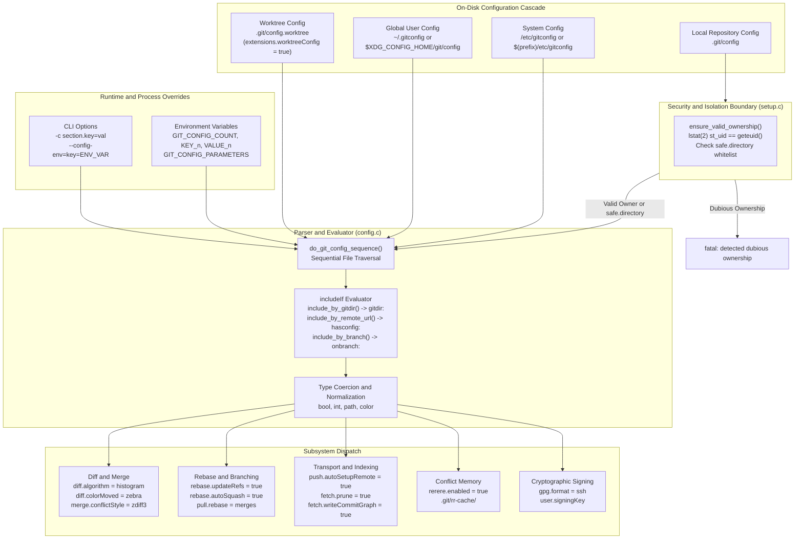

# Git Expert Configuration and Ergonomics

> [!summary] Claim:
> Git configuration is a multi-tiered key-value cascade evaluated sequentially from system, global, local, to worktree scopes, overridden at runtime by environment variables and explicit command-line flags.
> Parsing in `config.c` enforces ASCII case-insensitivity on section and variable names, strictly differentiates scalar replacements from multi-valued lists, and dynamically evaluates conditional inclusions driven by filesystem path ancestry, remote URLs, or active branch references.
> Security boundaries in `setup.c` verify repository ownership prior to parsing local configurations, preventing arbitrary code execution from untrusted working trees on multi-user systems.
> A production-hardened configuration eliminates cognitive friction and historical data loss by binding diffs to histogram heuristics, merges to zealous three-way conflict presentation (`zdiff3`), rebases to automated stacked-branch updates (`rebase.updateRefs`), and commit integrity to cryptographic SSH signatures.



## The Mechanism

Git configuration is not a monolithic database or a set of shell aliases.
It is an event-driven, cascaded key-value evaluation subsystem implemented in C (`config.c` and `setup.c`).
Every porcelain and plumbing command discovers its operational parameters by reading configuration files in a rigid order, dynamically evaluating conditions, and binding variables to in-memory runtime structs.

### 1. Configuration Scopes and Precedence Cascade

Configuration values are resolved through a multi-tier hierarchy.
Later layers in the cascade override scalar values set by earlier layers.
For multi-valued configuration keys, later entries append to the accumulated list unless an explicit reset is provided.

```text
+-------------------------------------------------------------------------+
| Scope: Command-Line Flags (-c key=value, --config-env=key=ENV_VAR)       | (Highest Precedence)
+-------------------------------------------------------------------------+
                                   |
+-------------------------------------------------------------------------+
| Scope: Runtime Environment (GIT_CONFIG_COUNT, GIT_CONFIG_KEY_<n>, ...)   |
+-------------------------------------------------------------------------+
                                   |
+-------------------------------------------------------------------------+
| Scope: Worktree (.git/config.worktree, requires worktreeConfig extension)|
+-------------------------------------------------------------------------+
                                   |
+-------------------------------------------------------------------------+
| Scope: Local Repository (.git/config)                                   |
+-------------------------------------------------------------------------+
                                   |
+-------------------------------------------------------------------------+
| Scope: Global User (~/.gitconfig or $XDG_CONFIG_HOME/git/config)        |
+-------------------------------------------------------------------------+
                                   |
+-------------------------------------------------------------------------+
| Scope: System (/etc/gitconfig or $(prefix)/etc/gitconfig)                | (Lowest Precedence)
+-------------------------------------------------------------------------+
```

1. **System Scope:** Stored at `/etc/gitconfig` or `$(prefix)/etc/gitconfig`.
It applies across all users on the operating system.
It can be overridden or disabled by setting `GIT_CONFIG_SYSTEM` or passing `GIT_CONFIG_NOSYSTEM=1` in the environment.

2. **Global Scope:** Stored at `$HOME/.gitconfig` or `$XDG_CONFIG_HOME/git/config` (defaulting to `~/.config/git/config` if `XDG_CONFIG_HOME` is unset).
Git checks both locations, preferring `$XDG_CONFIG_HOME/git/config` if it exists and `~/.gitconfig` does not.
If both exist, Git reads `~/.gitconfig` after `$XDG_CONFIG_HOME/git/config`, allowing `~/.gitconfig` to override it.
This scope can be overridden by pointing `GIT_CONFIG_GLOBAL` to a specific file.

3. **Local Scope:** Stored at `.git/config` inside the repository directory.
It holds repository-specific remote endpoints, branch tracking maps, and local settings.
This scope cannot be read if repository ownership fails validation.

4. **Worktree Scope:** Stored at `.git/config.worktree` or `.git/worktrees/<id>/config.worktree`.
By default, linked git worktrees share the primary `.git/config`.
When `extensions.worktreeConfig` is set to `true` in `.git/config`, Git reads the repository `.git/config` for shared settings and subsequently evaluates `.git/config.worktree` for settings unique to that worktree (such as `core.worktree`, `core.bare`, and `core.sparseCheckout`, per git-worktree(1) at v2.47.0).

5. **Runtime Environment Scope:** Injected via explicit environment variables without modifying on-disk files.
The `GIT_CONFIG_COUNT` variable defines the number of dynamic configuration pairs.
For each index `i` from `0` to `GIT_CONFIG_COUNT - 1`, Git reads `GIT_CONFIG_KEY_<i>` and `GIT_CONFIG_VALUE_<i>`.
Git aborts with a fatal error if any indexed key or value variable is missing.

6. **Command-Line Scope:** Passed directly to the process via `-c <name>=<value>` or `--config-env=<name>=<envvar>`.
These values take precedence over all configuration files and over the `GIT_CONFIG_COUNT` pairs; Git also exports them to child processes through `GIT_CONFIG_PARAMETERS`, so they are not confined to one process (verified with Git 2.55.0: `GIT_CONFIG_COUNT=1 GIT_CONFIG_KEY_0=a.b GIT_CONFIG_VALUE_0=env git -c a.b=cli config --get a.b` prints `cli`).
The `--config-env` flag (introduced in Git 2.31.0, together with `GIT_CONFIG_COUNT`, per RelNotes/2.31.0) fetches the value dynamically from the named environment variable, preventing credentials from appearing in process listings (`ps`) or shell history.

### 2. Lexer, Parser, and Data Structures in `config.c`

Git configuration files follow an INI-derived grammar with strict lexical rules implemented in `config.c`.
The parser reads the stream byte by byte without constructing an abstract syntax tree in memory.

#### Parsing Rules and Case Sensitivity

- **Section Names:** Sections are declared as `[section]` or `[section "subsection"]`.
Section names contain only ASCII alphanumeric characters, `-`, and `.` (git-config(1) at v2.47.0).
Section names are matched case-insensitively.
`[Core]`, `[CORE]`, and `[core]` map to the identical section.

- **Subsection Names:** Subsections can be declared as dot-separated identifiers (`[section.subsection]`) or quoted strings (`[section "subsection"]`).
Dot-separated subsections are deprecated and converted to lowercase by Git.
Quoted subsections are strictly case-sensitive and can contain arbitrary characters, including spaces, slashes, and escaped quotes (`\"`).
For example, `[remote "Origin"]` and `[remote "origin"]` define two distinct remotes.

- **Variable Names:** Variable names must begin with an alphabetic character and contain only alphanumeric characters and hyphens.
Variable names are matched case-insensitively.
`pull.rebase` and `PULL.REBASE` refer to the same configuration key.

- **Values and Line Continuations:** Values are strings trailing the equals sign (`=`).
A trailing backslash (`\`) escapes a newline, allowing multi-line string definitions.
Whitespace preceding and following the value is stripped unless enclosed in double quotes.

#### Type Coercion Internals

Git provides typed accessor functions in `config.c`:

- **Boolean (`git_config_bool`):** Coerces `"true"`, `"yes"`, `"on"`, and any non-zero integer (including negative ones; Git 2.55.0 reports `-5` as `true`) to `1`.
Coerces `"false"`, `"no"`, `"off"`, `""`, and `"0"` to `0`.
A variable declared without an explicit value (e.g., `[core] filemode`) evaluates to `true`.
Any other value produces a fatal parsing error.

- **Integer (`git_config_int`, `git_config_int64`):** Parses signed integer literals.
Recognizes the case-insensitive unit suffixes `k` (1024), `m` (1048576), and `g` (1073741824); `ki`, `mi`, and `gi` are rejected (Git 2.55.0: `bad numeric config value '1ki' ... invalid unit`).
For example, `pack.windowMemory = 500m` evaluates to `524288000` bytes.

- **Pathname (`git_config_pathname`):** Expands leading tildes (`~`) to `$HOME` and leading `~user` to the target user home directory via `getpwnam(3)`.
It also expands `%(prefix)/` tokens to the Git installation prefix path.

- **Color (`git_config_color`):** Parses ANSI color strings into terminal escape sequences.
Supports basic colors (red, green, blue), 256-color palette indexes, 24-bit hex RGB values (`#RRGGBB`), and attributes (bold, dim, ul, blink, reverse, italic).

#### Scalar Overwrites vs Multi-Valued Lists

When the parser encounters duplicate keys within a single file or across cascaded scopes, handling depends on the consuming API:

- **Scalar Variables:** The parser executes in sequence, and each subsequent assignment overwrites the previous value in the consumer struct.
For example, `pull.rebase = true` in local config overrides `pull.rebase = false` in global config.
To clear an earlier string variable completely, assign an empty string (`key = `).

- **Multi-Valued Variables:** Consumed via callback collectors (such as `remote.<name>.fetch`, `push.pushOption`, or `safe.directory`).
Each occurrence appends an entry to an in-memory `string_list` structure.
Only keys that document it treat an empty value as a reset of the inherited list (for example `safe.directory` and `http.extraHeader` in git-config(1) at v2.47.0); other multi-valued keys, such as `remote.<name>.fetch`, have no reset syntax.

### 3. Conditional Inclusions (`includeIf`)

The `include.path` directive provides unconditional file inclusion.
The `includeIf.<condition>.path` directive introduces context-dependent evaluation.
During configuration loading, `include_condition_is_true()` in `config.c` evaluates whether the enclosing environment satisfies the condition before parsing the referenced path.

```text
[includeIf "gitdir:~/work/"]
    path = ~/.gitconfig-work

[includeIf "gitdir/i:~/personal/"]
    path = ~/.gitconfig-personal

[includeIf "hasconfig:remote.*.url:git@github.com:enterprise/*"]
    path = ~/.gitconfig-enterprise

[includeIf "onbranch:release/*"]
    path = ~/.gitconfig-release
```

#### Evaluation Conditions

1. **`gitdir:<pattern>` and `gitdir/i:<pattern>`:** Evaluated by `include_by_gitdir()` in `config.c` (v2.47.0, line 244).
Matches the absolute filesystem path of the repository's `.git` directory against `<pattern>`.
If `<pattern>` begins with `~/`, it expands to `$HOME`.
If `<pattern>` ends with `/`, Git automatically appends `**` to match all nested child directories.
The `gitdir:` variant performs case-sensitive matching.
The `gitdir/i:` variant performs case-insensitive matching, essential on case-preserving but case-insensitive filesystems such as Apple APFS and Windows NTFS.

2. **`hasconfig:remote.*.url:<pattern>`:** Introduced in Git 2.36.0 and evaluated by `include_by_remote_url()`.
Matches any configured remote URL in the active repository against `<pattern>`.
This enables corporate identity configurations (e.g., custom commit signing keys and corporate emails) to trigger automatically whenever a repository clones from a corporate forge, regardless of where the repository sits in the local directory tree.

3. **`onbranch:<pattern>`:** Introduced in Git 2.23.0 (RelNotes/2.23.0) and evaluated by `include_by_branch()`.
Inspects the current symbolic reference at `.git/HEAD`.
If `HEAD` points to a branch whose refname matches `<pattern>` (e.g., `main` or `release/*`), the include file is parsed.
If the repository is in a detached `HEAD` state, or if an interactive rebase is in progress, `onbranch` evaluates to false.
Configurations required during rebase or detached inspection must not rely on `onbranch`.

### 4. Security Isolation: `safe.directory` (CVE-2022-24765)

In multi-user Unix systems and container environments, a user traversing directories could have Git commands execute inside a repository owned by a different user.
A malicious actor could place a `.git/config` file in a shared directory (e.g., `/tmp` or a shared volume) defining malicious `core.fsmonitor` executables, custom diff drivers, or hook binaries.
When another user ran a benign Git command in that path, Git executed the arbitrary binaries under the victim's privileges.

#### The Ownership Check Algorithm

To resolve CVE-2022-24765, Git 2.35.2 introduced repository ownership verification implemented in `setup.c` (`ensure_valid_ownership()`):

```c
/* Simplified from ensure_valid_ownership() in setup.c at v2.47.0 */
static int ensure_valid_ownership(const char *gitfile, const char *worktree,
                                  const char *gitdir, struct strbuf *report)
{
    struct safe_directory_data data = { 0 };

    /* 1. Ownership first: lstat(2) each path and compare st_uid with
     *    geteuid(); as root, SUDO_UID is honored (Git 2.37.0+). */
    if ((!gitfile || is_path_owned_by_current_user(gitfile, report)) &&
        (!worktree || is_path_owned_by_current_user(worktree, report)) &&
        (!gitdir || is_path_owned_by_current_user(gitdir, report)))
        return 1;

    /* 2. Only on failure: consult safe.directory from protected config. */
    data.path = real_pathdup(worktree ? worktree : gitdir, 0);
    if (!data.path)
        return 0;
    git_protected_config(safe_directory_cb, &data);
    free(data.path);
    return data.is_safe;
}
```

1. **System Call Verification:** Git calls `lstat(2)` on `.git`, the working tree root, and any pointer `.git` file.
2. **UID Comparison:** Git compares `st.st_uid` against the process effective user ID returned by `geteuid(2)`.
3. **Sudo Elevation Handling:** Since Git 2.37.0 (RelNotes/2.37.0, `cb/path-owner-check-with-sudo-plus`), if running as root (`euid == 0`) under `sudo`, `is_path_owned_by_current_user()` in `git-compat-util.h` reads the `SUDO_UID` environment variable.
If the directory is owned by `SUDO_UID`, the check passes.
4. **Failure and Abort:** If the UID does not match and the directory path is not explicitly listed in a protected-scope `safe.directory` list, Git refuses to read `.git/config` and aborts:
`fatal: detected dubious ownership in repository at '/path/to/repo'`.
5. **Whitelist Scope:** `safe.directory` is only respected in protected configuration, which git-config(1) defines as the system, global, and command (`-c`) scopes.
Git explicitly ignores `safe.directory` entries located inside the dubious local `.git/config` file itself (verified with Git 2.55.0 and `GIT_TEST_ASSUME_DIFFERENT_OWNER=1`: a local `safe.directory = *` still fails, `-c safe.directory=<path>` passes).

### 5. Production Subsystem Configurations

A distinguished engineer's `.gitconfig` configures core subsystems to eliminate historical failure modes.

#### Diff and Merge Engines

- **Myers vs Histogram Algorithm:** Myers (default) finds the shortest edit script.
On files with repeated structural patterns (such as closing brackets, braces, and empty lines), Myers produces noisy, disjoint diff hunks that scramble logical blocks.
Setting `diff.algorithm = histogram` switches to a variant of Patience diff.
Histogram identifies low-frequency, unique lines as anchors and recursively calculates differences around them, producing clean, human-readable patches that reflect true semantic modifications.

- **Moved Code Detection (`diff.colorMoved`):** When refactoring code, moving a block of lines across functions or files appears in standard diffs as a deletion followed by an addition.
Setting `diff.colorMoved = zebra` (or `blocks`) causes Git to track deleted lines that match added lines elsewhere in the changeset, painting relocated code in distinct alternating colors.
Adding `diff.colorMovedWS = allow-indentation-change` allows Git to recognize moved blocks even when indentation depth changed.

- **Zealous Diff3 (`merge.conflictStyle = zdiff3`):** Standard two-way conflict markers (`<<<<<<<` and `>>>>>>>`) display only the conflicting branch endpoints, obscuring the original code state.
The legacy `diff3` style adds the common ancestor base (`|||||||`), but leaves common leading and trailing lines inside the conflict hunk.
Introduced in Git 2.35.0, `zdiff3` zealously pulls identical matching lines at the top and bottom of a conflict block outside the conflict boundaries.
This drastically shrinks the conflict footprint and displays the exact common ancestor context needed to resolve the merge correctly.

#### Rebase, Stacked Branches, and History Hygiene

- **Stacked Branch Synchronization (`rebase.updateRefs`):** In modern feature development, developers construct stacked branches where Branch C branches off Branch B, which branches off Branch A.
Historically, rebasing Branch A against `main` modified Branch A's commit hashes, leaving Branch B and Branch C attached to orphaned, obsolete commits.
Synchronizing the stack required manual rebases of every dependent branch.
Introduced in Git 2.38.0, setting `rebase.updateRefs = true` enables `--update-refs` by default for every `git rebase`, interactive or not, which identifies the local branch tips within the rebased range; branches checked out in another worktree are skipped (git-rebase(1) at v2.47.0).
The sequencer injects `update-ref refs/heads/<branch>` instructions into the interactive rebase todo list.
When the rebase finishes, `do_update_refs()` in `sequencer.c` updates each recorded branch with its own compare-and-swap `refs_update_ref()` call, so the updates are individually checked but not one atomic transaction.

- **Autosquash and Autostash:** Setting `rebase.autoSquash = true` automatically recognizes commits created with `git commit --fixup=<hash>` or `--squash=<hash>`, moving them directly below the target commit in the interactive todo list and assigning the `fixup` or `squash` command.
Setting `rebase.autoStash = true` and `merge.autoStash = true` causes Git to create a temporary stash commit prior to initiating the operation and pop it automatically once the rebase or merge finishes, eliminating manual `git stash` steps on dirty working trees.

- **Pull Fast-Forward Governance:** Setting `pull.rebase = true` or `pull.rebase = merges` ensures `git pull` does not inject unwanted merge commits into linear local branches.
For organizations enforcing absolute linear history, setting `pull.ff = only` instructs Git to abort the pull immediately if the upstream branch has diverged, preventing accidental merges or rebases unless explicitly invoked.

#### Transport Safety and Background Optimization

- **Remote Branch Setup (`push.autoSetupRemote`):** Introduced in Git 2.37.0, setting `push.autoSetupRemote = true` instructs `git push` on a newly created local branch to automatically establish tracking with the upstream remote without requiring `--set-upstream` or `-u`.

- **Tag Pushing (`push.followTags`):** Running a bare `git push --tags` sends every local tag in `.git/refs/tags/` to the remote server, frequently leaking experimental or private tags.
Setting `push.followTags = true` causes `git push` to push annotated tags reachable from the pushed refs that the remote lacks, and never lightweight tags (the lab pushes two annotated tags and two lightweight ones and only the annotated ones arrive).

- **Remote Reference Pruning:** Setting `fetch.prune = true` and `fetch.pruneTags = true` ensures that when remote branches or tags are deleted upstream, stale tracking references under `refs/remotes/origin/` and local mirrored tags are pruned on the next fetch.

- **Multi-Remote Synchronization (`fetch.all`):** Introduced in Git 2.44.0, setting `fetch.all = true` causes a bare `git fetch` invocation to fetch updates across all configured remotes rather than only the default `origin`.

- **On-Fetch Commit-Graph Generation (`fetch.writeCommitGraph`):** Introduced in Git 2.24.0, setting `fetch.writeCommitGraph = true` instructs Git to incrementally update the binary commit-graph file (`.git/objects/info/commit-graph` or `.git/objects/info/commit-graphs/`) immediately after downloading new packfiles.
This ensures graph walks, ancestry reachability queries, and `git log --graph` operations run at peak binary speed without waiting for scheduled maintenance tasks.

#### Reuse Recorded Resolution (`git rerere`)

Long-lived feature branches and complex topic merges frequently encounter the identical merge conflicts across multiple rebase cycles.
The `rerere` subsystem (Reuse Recorded Resolution) records conflict states and resolutions in `.git/rr-cache/`.

```text
+-------------------+      Conflict      +-----------------------------+
| Conflicted Merge  | -----------------> | Create .git/rr-cache/<hash>/|
| or Rebase Event   |                    | Write 'preimage' file       |
+-------------------+                    +-----------------------------+
                                                        |
                                                 Developer Fixes
                                                 and Runs git add
                                                        |
                                                        v
+-------------------+     Identical      +-----------------------------+
| Future Conflict   | <----------------- | Write 'postimage' file      |
| Auto-Resolved!    |    Conflict Seen   | (Clean resolution stored)   |
+-------------------+                    +-----------------------------+
```

1. **Preimage Generation:** When a conflict occurs and `rerere.enabled = true`, Git normalizes each conflict by stripping the marker labels, dropping the common-ancestor section of `diff3` or `zdiff3`, and sorting the two sides, then computes the conflict ID as the SHA-1 of the hunks joined by NUL bytes (Documentation/technical/rerere.txt at v2.47.0); it does not normalize whitespace.
It creates a directory at `.git/rr-cache/<hash>/` and writes the conflicted content to `preimage`.
2. **Postimage Recording:** `git add` alone does not record anything; on the next `git rerere` invocation (which `git commit` and `git rebase --continue` run automatically), rerere sees that the path no longer has conflict markers and writes the resolved content to `postimage` (the drill shows `Recorded resolution` printed by `git commit`).
3. **Automatic Resolution Replay:** During a subsequent rebase or merge where the exact same conflict hunk occurs, Git detects the matching preimage hash and applies the recorded `postimage` directly to the working tree.
4. **Index Staging (`rerere.autoUpdate`):** Setting `rerere.autoUpdate = true` instructs Git to automatically stage the resolved file (`git add`) if the recorded resolution applied cleanly without secondary conflicts.
5. **Cache Retention:** Stored resolutions are maintained locally.
Git prunes unresolved preimages after 15 days (`gc.rerereUnresolved`) and resolved postimages after 60 days (`gc.rerereResolved`).

#### Filesystem Monitoring and Reference Storage

- **Built-In Simple-IPC Fsmonitor:** Large repositories with hundreds of thousands of files suffer severe latency during `git status` because Git must issue `lstat(2)` system calls across every tracked file to detect changes.
Setting `core.fsmonitor = true` activates Git's built-in background daemon (`git fsmonitor--daemon`, introduced in Git 2.36.0 for Windows and macOS only).
The daemon uses macOS FSEvents and Windows ReadDirectoryChangesW; Linux support (inotify) arrived only in Git 2.55.0 (RelNotes/2.55.0), so at v2.47.0 `core.fsmonitor = true` has no built-in daemon on Linux (git-config(1) `core.fsmonitor` at v2.47.0).
Clients talk to it over simple-IPC: a Unix domain socket on macOS (`fsmonitor.socketDir`) and a named pipe on Windows (`compat/simple-ipc/ipc-win32.c`).
Commands query the daemon for the list of modified paths since the last index token, transforming status operations from $O(N)$ filesystem walks to $O(M)$ modified path updates.

- **Reftable Backend Migration:** The legacy reference backend stores refs as individual loose files in `.git/refs/` and packed lines in `.git/packed-refs`.
On repositories with millions of refs, loose ref creation exhausts inodes, ref updates suffer from directory locking contention, and updating `packed-refs` requires rewriting the entire file.
The `reftable` backend (introduced in Git 2.45.0) stores references in binary, block-indexed, log-structured files with fast $O(\log N)$ lookup, prefix compression, and atomic multi-ref transactions.
A repository is migrated to this backend using `git refs migrate --ref-format=reftable` (Git 2.46.0+).

#### Cryptographic Provenance via SSH Signing

Git 2.34.0 added native support for signing commits and tags using OpenSSH keys instead of requiring complex GnuPG daemon infrastructure.

1. **Format Declaration:** `gpg.format = ssh` instructs Git to invoke `ssh-keygen -Y sign` rather than GPG.
2. **Key Assignment:** `user.signingKey` holds the path to the private key, the path to the public key when `ssh-agent` holds the private half (e.g., `~/.ssh/id_ed25519.pub`), or a literal public key prefixed with `key::` (git-config(1) `user.signingKey` at v2.47.0).
3. **Agent Integration:** When signing, Git passes the public key to `ssh-keygen`, which delegates signature generation to the running `ssh-agent`, supporting hardware tokens (such as FIDO2 / YubiKey `sk-ssh-ed25519@openssh.com` keys) without exposing private keys.
4. **Signature Verification (`gpg.ssh.allowedSignersFile`):** To verify SSH signatures, Git requires an `allowed_signers` file containing authorized email and public key mappings formatted identically to `ssh-keygen` allowed signers specifications:
`alice@example.com namespaces="git" ssh-ed25519 AAAAC3NzaC1lZDI1NTE5AAAAI...`.
Setting `gpg.ssh.allowedSignersFile = ~/.config/git/allowed_signers` allows `git log --show-signature` to cryptographically validate commit authenticity.
5. **OpenSSH Dependency:** The Git 2.34.0 release notes say the feature "cannot be used with ssh-keygen from OpenSSH 8.7, whose support for it is broken" and advise OpenSSH 8.8; they describe a warning, not a version check that Git enforces.

### 6. Configuration Boundary: `.gitconfig` vs Shell Aliases vs Environment Variables

An expert maintains a strict architectural separation between Git aliases, shell functions, and environment variables:

| Concern | Implementation Layer | Rationale and Boundaries |
| :--- | :--- | :--- |
| Core toolchain flags and defaults | `.gitconfig` settings | Dictates Git command behavior across all shells, scripts, IDEs, and automation harnesses. |
| Subcommand shortcuts (`co`, `st`, `br`) | `.gitconfig` `[alias]` | Standardizes Git-specific abbreviations across tools that invoke `git` directly. |
| Shorthand plumbing chains | `.gitconfig` `!sh -c '...'` | Encapsulates multi-command Git operations within Git's process namespace. |
| Complex terminal UI and interactive workflows | Shell scripts / `.zshrc` functions | Workflows requiring interactive prompts, terminal multiplexing, or cross-tool pipes belong in the shell. |
| Ephemeral overrides and automation | Environment variables (`GIT_*`) | CI pipelines and automated wrappers inject one-off tokens, paths, and bypasses via process environment. |

#### Pitfalls of Shell Escapes in Git Aliases

Git allows aliases prefixed with an exclamation mark (`!`) to execute arbitrary shell commands:
`alias.prune-all = !git fetch --prune && git branch -vv | awk '/: gone]/{print $1}' | xargs git branch -D`

- **Positional Parameter Handling:** When arguments are passed to a Git alias (e.g., `git myalias arg1 arg2`), Git appends them to the shell string as `"$@"`, so an alias that also references `$1` sees the argument twice unless it wraps its body in `!sh -c '...' -` or `!f() { ...; }; f`.
Inside such a wrapper, an unquoted `$1` is subject to field splitting and pathname expansion (globbing), not to command parsing.
- **Process Spawning Overhead:** Every `!` alias spawns an extra `/bin/sh` shell process.
Performance-critical loops in scripts should invoke Git plumbing commands directly rather than through shell-escaped porcelain aliases.

## Commands and Numbers to Know

| Item | Value | Platform and date | What it controls |
| :--- | :--- | :--- | :--- |
| `merge.conflictStyle` | `zdiff3` (default `merge`) | Both (as of 2026-11) | Zealously trims common lines from conflict hunks; displays common base (Git 2.35+) |
| `diff.algorithm` | `histogram` (default `myers`) | Both (as of 2026-11) | Low-frequency anchor diff algorithm minimizing noisy hunk churn |
| `diff.colorMoved` | `zebra` (default `no`) | Both (as of 2026-11) | Highlights relocated code blocks in alternating colors (Git 2.15+) |
| `diff.colorMovedWS` | `allow-indentation-change` (default `no`) | Both (as of 2026-11) | Ignores whitespace indentation shifts in moved blocks (Git 2.19+) |
| `diff.mnemonicPrefix` | `true` (default `false`) | Both (as of 2026-11) | Replaces `a/` and `b/` with `i/` (index), `w/` (work tree), `c/` (commit) |
| `rebase.autoSquash` | `true` (default `false`) | Both (as of 2026-11) | Auto-pairs `fixup!` and `squash!` commits during interactive rebase |
| `rebase.autoStash` | `true` (default `false`) | Both (as of 2026-11) | Automatically stashes dirty worktree before rebase and pops upon completion |
| `rebase.updateRefs` | `true` (default `false`) | Both (as of 2026-11) | Updates stacked branch references when rebased (Git 2.38+) |
| `rebase.missingCommitsCheck` | `warn` or `error` (default `ignore`) | Both (as of 2026-11) | Detects accidental commit deletions in interactive rebase todo lists |
| `pull.rebase` | `merges` or `true` (default `false`) | Both (as of 2026-11) | Rebase local branch onto upstream instead of creating merge commit |
| `pull.ff` | `only` (default unset) | Both (as of 2026-11) | Refuses non-fast-forward pulls unless explicit merge is requested |
| `push.autoSetupRemote` | `true` (default `false`) | Both (as of 2026-11) | Automatically implies `--set-upstream` on initial branch push (Git 2.37+) |
| `push.followTags` | `true` (default `false`) | Both (as of 2026-11) | Pushes annotated tags reachable from pushed commit tips |
| `fetch.prune` | `true` (default `false`) | Both (as of 2026-11) | Prunes remote-tracking references deleted on remote |
| `fetch.pruneTags` | `true` (default `false`) | Both (as of 2026-11) | Prunes local tags deleted on remote during fetch (Git 2.17+) |
| `fetch.all` | `true` (default `false`) | Both (as of 2026-11) | Implicitly fetches all configured remotes on `git fetch` (Git 2.44+) |
| `fetch.writeCommitGraph` | `true` (default `false`) | Both (as of 2026-11) | Generates split commit-graph chain on fetch (Git 2.24+) |
| `rerere.enabled` | `true` (default `false`) | Both (as of 2026-11) | Records and replays merge conflict resolutions in `.git/rr-cache/` |
| `rerere.autoUpdate` | `true` (default `false`) | Both (as of 2026-11) | Automatically stages files resolved cleanly by rerere |
| `gc.rerereResolved` | `60` days (default `60`) | Both (as of 2026-11) | Retention window for resolved conflict postimages in rr-cache |
| `gc.rerereUnresolved` | `15` days (default `15`) | Both (as of 2026-11) | Retention window for unresolved conflict preimages in rr-cache |
| `core.fsmonitor` | `true` (default `false`) | macOS and Windows from Git 2.36; Linux from Git 2.55 (as of 2026-11) | Built-in file system watcher daemon via simple-IPC |
| `core.untrackedCache` | `true` (default `keep`) | Both (as of 2026-11) | Caches directory stat data to accelerate `git status` |
| `gpg.format` | `ssh` (default `openpgp`) | Both (as of 2026-11) | Cryptographic signing backend format (Git 2.34+) |
| `init.defaultBranch` | `main` (default `master`) | Both (as of 2026-11) | Initial default branch name for `git init` (Git 2.28+) |
| `branch.sort` | `-committerdate` (default lexical) | Both (as of 2026-11) | Sorts branch lists by newest commit date (Git 2.19+) |
| `tag.sort` | `version:refname` (default lexical) | Both (as of 2026-11) | Sorts tag lists by semantic version order (Git 2.1+) |
| `help.autoCorrect` | `prompt` (default `0`) | Both (as of 2026-11) | Interactively confirms mistyped subcommands (Git 2.34+) |
| `safe.directory` | path list or `*` (default unset) | Both (as of 2026-11) | Whitelists directories bypassing ownership checks (Git 2.35.2+; `*` accepted from 2.35.3) |
| `extensions.refStorage` | `reftable` (default `files`) | Both (as of 2026-11) | Binary block-indexed reference backend (Git 2.45+) |
| `extensions.worktreeConfig` | `true` (default `false`) | Both (as of 2026-11) | Enables per-worktree `config.worktree` parsing (Git 2.20+) |
| `GIT_CONFIG_COUNT` | integer (default unset) | Both (as of 2026-11) | Number of runtime environment config pairs (Git 2.31+) |
| `--config-env` | `key=ENV_VAR` (default unset) | Both (as of 2026-11) | Injects config value from environment variable (Git 2.31+) |

## Multi-Language Comparison: C / Python / Rust

Git configuration parsing and cascading are implemented across different language runtimes within the version control ecosystem.

| Concern | C (`git.git` v2.47 / `libgit2` main) | Python (`Dulwich` main / `pygit2`) | Rust (`gitoxide` `gix-config`) |
| :--- | :--- | :--- | :--- |
| Parser Architecture | Event-driven lexical scanner in `config.c`; invokes streaming callback per key-value | `Dulwich`: `ConfigFile` in `dulwich/config.py`, values held as `bytes`; `pygit2`: bindings to the `libgit2` shared library, which parses in C | `parse::Events` is the event-based syntactic parser (`Events::from_bytes()` returns a self-contained representation); `File` is the high-level reader and writer on top |
| `includeIf` Evaluation | Full native evaluation of `gitdir:`, `gitdir/i:`, `hasconfig:`, and `onbranch:` | `Dulwich`: built-in `hasconfig:` only; `gitdir:` and `onbranch:` work only if the caller supplies `condition_matchers`; `pygit2`: `libgit2` `config_file.c` implements `gitdir:`, `gitdir/i:`, and `onbranch:` but not `hasconfig:` | `include_condition_match` resolves `gitdir`, `gitdir/i`, `onbranch`, and `hasconfig` (only the `remote.*.url` key), fed by a `conditional::Context` holding the `.git` path and branch |
| Type Coercion | `git_config_bool()`, `git_config_int()`, `git_config_pathname()` | `Dulwich`: `get_boolean()` accepts only `true` or `false` (case-insensitive) and raises `ValueError` otherwise, so the `yes`, `on`, and non-zero integer spellings Git accepts are rejected | Value types `Boolean`, `Integer`, `Path`, and `Color` |
| Case Sensitivity | ASCII case-insensitive section and key names; case-sensitive quoted subsections | `Dulwich`: `CaseInsensitiveOrderedMultiDict` lowercases section and variable names and keeps subsection case | Documented deviation: legacy `[section.subsection]` headers keep their case and compare case-insensitively, where Git lowercases them and compares case-sensitively |
| CLI and Environment Override | `-c` flags stored in memory buffer and parsed in `do_git_config_sequence()` | `Dulwich`: no `-c` support; `env_config()` parses `GIT_CONFIG_COUNT` pairs from a mapping the caller passes, and the caller must prepend the result to `StackedConfig.backends` | `Source` enum in ascending precedence: `GitInstallation`, `System`, `Git`, `User`, `Local`, `Worktree`, `Env`, `Cli`, `Api`, `EnvOverride` |
| Ownership Validation | `ensure_valid_ownership()` in `setup.c` checks `st_uid == geteuid()` | `Dulwich`: no `safe.directory` or ownership check in `config.py`; `pygit2`: `libgit2` validates ownership by default (`GIT_OPT_SET_OWNER_VALIDATION`) | `gix-sec` `is_path_owned_by_current_user` compares the `symlink_metadata` uid with `geteuid()` and also accepts `SUDO_UID` on Unix |
| Memory Overhead | Reads files through `fgetc`-style callbacks (no mmap) and copies each value with `xstrdup` into a hashmap of `struct config_set_element` holding a `string_list` (`config.h`, `config.c` at v2.47.0) | `Dulwich`: `bytes` values stored in a `CaseInsensitiveOrderedMultiDict` per section | Parsed `Events` are self-contained, not views into the input buffer (`gix_config::parse` docs) |

The `Dulwich`, `libgit2`, and `gitoxide` entries reflect each project's `main` branch as of 2026-11.

## Worked Lab Example

The lab is `code/02-Version-Control/git_expert_config/`; it needs `git` 2.46 or newer (for `git refs migrate`) and `ssh-keygen`.

`run.sh` builds every repository in a scratch directory with `HOME`, `GIT_CONFIG_GLOBAL`, and `GIT_CONFIG_SYSTEM` pointed inside it, every inherited `GIT_*` variable unset, fixed identities and dates, and `LC_ALL=C`, so no real configuration leaks in.
Each check prints `ok <label>: <observed value>` and aborts with a non-zero exit on a mismatch, so a Git upgrade that changes a behavior fails `make verify` instead of misleading a reader.
The twelve sections map to the note:

1. Scope cascade: system, global, local, worktree, `GIT_CONFIG_COUNT`, and `-c`, read back with `--show-scope`; `--config-env`; `GIT_CONFIG_NOSYSTEM`; `~/.gitconfig` read after `$XDG_CONFIG_HOME/git/config`.
2. Parser rules: case folding, bool and int coercion (`-5` is true, `1ki` is rejected), line continuation, scalar overwrite versus accumulating multi-valued keys.
3. `includeIf`: `gitdir:`, `gitdir/i:`, `hasconfig:remote.*.url:`, and `onbranch:`, including a detached `HEAD`, a cherry-pick, and a stopped interactive rebase.
4. `safe.directory`, with `GIT_TEST_ASSUME_DIFFERENT_OWNER=1` standing in for a foreign owner: a local entry is ignored, `-c`, global, and system entries are honored, and an empty value resets the list.
5. Alias argument handling: appended `"$@"`, glob expansion of an unquoted `$1`, and no re-parsing of `;`.
6. `rebase.updateRefs` as a config key, with the default, `--no-update-refs`, a branch checked out in another worktree, and an interactive rebase as controls.
7. `rerere`: preimage at conflict time, postimage only at commit time, replay, `autoUpdate`, label-independent conflict id, `forget`, and a disabled control.
8. `merge.conflictStyle`: `merge`, `diff3`, and `zdiff3` hunks on the same conflict.
9. `diff.algorithm` and `diff.colorMoved` with `colorMovedWS`.
10. `push.autoSetupRemote`, `push.followTags`, `fetch.prune`, `fetch.pruneTags`, `fetch.all`, `rebase.autoSquash`, and `rebase.autoStash`, each against its default.
11. SSH signing with a throwaway Ed25519 key and an `allowed_signers` file, including a namespace mismatch and the signature lost by a rebase.
12. `git refs migrate --ref-format=reftable` and `git init --ref-format=reftable`.

```bash
cd code/02-Version-Control/git_expert_config
bash run.sh
```

### Verified output

Recorded by `make record` on darwin-arm64 on 2026-11-07 with Git 2.55.0 and re-checked by `make verify`; the file is `code/02-Version-Control/git_expert_config/expected/darwin-arm64.txt`.

```text

== 1. scope cascade, lowest to highest precedence ==
ok system only: system system
ok +global: global global
ok +local: local local
ok +worktree: worktree worktree
ok worktree file holds it: lab.level=worktree
ok +GIT_CONFIG_COUNT: command env
ok +-c beats env: command cli
ok -c reaches child git processes: cli
ok --config-env: from-env
ok GIT_CONFIG_COUNT missing value: exit 128
ok system and global both read: system global
ok GIT_CONFIG_NOSYSTEM drops system: global
ok scalar override: last scope wins: global
ok home file read after xdg: home
ok xdg value still visible: xdg

== 2. parser: case rules, typed values, multi-valued keys ==
ok section and key case-insensitive: Mixed
ok subsection case-sensitive (miss): 1
ok dotted subsection lowercased: dotted
ok bool yes: true
ok bool -5 (non-zero int): true
ok bool 0: false
ok bool empty value: false
ok bool valueless key: true
ok int 500m: 524288000
ok int 1g: 1073741824
ok int 1ki rejected: exit 128
ok path ~ expands to HOME: HOME/x
ok backslash continuation: onetwo
ok quotes keep whitespace: [  padded  ]
ok scalar: last assignment wins: second
ok get-all keeps every value: 2
ok multi-valued fetch accumulates across scopes: 3
ok global value comes first: +refs/tags/*:refs/tags/*

== 3. includeIf conditions ==
ok gitdir: matches ~/work/: yes
ok gitdir: is case-sensitive: no
ok gitdir/i: ignores case: yes
ok hasconfig remote.*.url hit: yes
ok hasconfig remote.*.url miss: no
ok outside ~/work: gitdir: misses: no
ok onbranch on main: no
ok onbranch on release/1: yes
ok onbranch with detached HEAD: no
ok onbranch after cherry-pick (HEAD attached): yes
ok HEAD is detached while the rebase is stopped: detached
ok onbranch while an interactive rebase is stopped: no
ok onbranch again once the rebase is aborted: yes

== 4. ownership check and safe.directory (GIT_TEST_ASSUME_DIFFERENT_OWNER simulates a foreign owner) ==
ok foreign owner is refused: fatal: detected dubious ownership in repository at 'REPO'
ok local safe.directory=* is ignored: refused
ok -c safe.directory=<path>: allowed
ok -c safe.directory=<other path>: refused
ok global safe.directory=<path>: allowed
ok empty -c value resets the list: refused
ok system safe.directory=* disables the check: allowed
ok own repository needs no entry: allowed

== 5. alias argument handling ==
ok argument appended to a bare ! alias: a a b
ok unquoted $1 is glob-expanded: got: f1 f2
ok quoted "$1" is literal: got: *
ok ; is not re-parsed: got: x; echo INJECTED

== 6. rebase.updateRefs (config key, no --update-refs flag) ==
ok updateRefs=true, plain rebase: moved
ok default (unset), plain rebase: stale
ok updateRefs=true but --no-update-refs: stale
ok branch checked out in another worktree is skipped: stale
ok updateRefs=true, interactive rebase: moved

== 7. rerere: record, replay, forget ==
ok conflict records a preimage: 1 1 0
ok git add alone records no postimage: 0
ok git commit records the postimage: 1
ok replay: file resolved, no markers: resolved 0
ok replay without autoUpdate leaves the path unmerged: 1
ok replay with autoUpdate stages the path: resolved 0
ok different branch label, same conflict id: 1 resolved
ok rerere forget deletes the postimage: 0
ok after forget the conflict is raw again: 1
ok rerere disabled: nothing cached: 0
ok rerere disabled: replay conflicts again: 1

== 8. merge.conflictStyle: merge, diff3, zdiff3 ==
ok style merge: <<<<<<< HEAD B C D ======= X C Y >>>>>>> theirs 
ok style diff3: <<<<<<< HEAD A B C D E ||||||| 5 6 ======= A X C Y E >>>>>>> theirs 
ok style zdiff3: <<<<<<< HEAD B C D ||||||| 5 6 ======= X C Y >>>>>>> theirs 

== 9. diff.algorithm and diff.colorMoved ==
ok both algorithms add the same number of lines: 10 10
ok diff text differs by algorithm: differ
ok diff.algorithm=histogram equals --histogram: same
ok histogram output differs from the default: differ
ok colorMoved=no marks nothing as moved: 0
ok colorMoved=zebra marks 8 lines as moved: 8
ok indented move, colorMovedWS=no: 0
ok indented move, allow-indentation-change: 8

== 10. push, fetch, and rebase defaults ==
ok push.default=simple refuses an unconfigured branch: exit 128
ok push.autoSetupRemote sets the upstream: origin/feature
ok no tags pushed without followTags: 0
ok followTags pushes annotated tags, never lightweight ones: v-annotated v-annotated-2
ok stale tracking ref survives a plain fetch: yes
ok fetch.prune removes it: no
ok local tag survives without pruneTags: yes
ok fetch.pruneTags removes it: no
ok bare fetch ignores the second remote: no
ok fetch.all fetches every remote: yes
ok autoSquash unset: todo keeps commit order: pick c1,pick c2,pick c3,pick fixup! c1,
ok autoSquash=true: fixup moves under its target: pick c1,fixup fixup! c1,pick c2,pick c3,
ok rebase on a dirty tree without autoStash: exit 1
ok rebase.autoStash keeps the edit: dirty

== 11. SSH signing: gpg.format=ssh ==
ok commit carries a gpgsig header: 1
ok no allowedSignersFile: signature cannot be verified: N
ok allowedSignersFile: good signature: G
ok signer principal: lab@example.com
ok principal comes from allowed_signers, not the commit email: someone@example.com
ok wrong namespace in allowed_signers is not a good signature: B
ok commit.gpgSign=false: unsigned: N
ok signed commit verifies before the rebase: G
ok rebased commit loses the signature (gpgSign unset): N
ok commit.gpgSign=true re-signs during the rebase: G

== 12. reftable: init and migration ==
ok files backend: refs/heads/main is a file: files yes
ok after migrate: ref format: reftable
ok extensions.refStorage: reftable
ok tables.list exists: yes
ok .git/HEAD is a placeholder: ref: refs/heads/.invalid
ok .git/refs/heads is a stub file: this repository uses the reftable format
ok refs still resolve through git: main
ok new ref is not a loose file: no yes
ok git init --ref-format=reftable: reftable
ok reftable HEAD placeholder survives init: ref: refs/heads/.invalid

== done ==
all checks passed
```

Only the darwin-arm64 recording exists.
The fsmonitor daemon is deliberately absent from the lab because it is platform-specific, so its claims rest on the release notes cited in the sources.

### Annotated Production Configuration and Walkthrough

This subsection provides an annotated, production-grade `.gitconfig` designed for distinguished engineering workflows, followed by copy-pasteable verification commands.

### Annotated Production Configuration (`~/.gitconfig`)

```ini
# Production-Hardened Git Configuration
# Target: Git 2.46+ on macOS and Linux (the walkthrough uses `git config get`, added in 2.46.0)

[user]
    name = Distinguished Engineer
    email = engineer@example.com
    signingkey = ~/.ssh/id_ed25519.pub

[core]
    # Eliminate CRLF translation corruption; use native LF line endings
    autocrlf = input
    # Fast filesystem tracking via built-in simple-IPC daemon
    fsmonitor = true
    untrackedCache = true
    # Sensible editor and pagination
    editor = vim
    pager = less -FRX
    # Prevent whitespace errors on commit
    whitespace = trailing-space,space-before-tab

[init]
    # Modern repository initial branch naming
    defaultBranch = main

[diff]
    # Low-frequency anchor diff algorithm for readable changesets
    algorithm = histogram
    # Visual tracking of moved code blocks
    colorMoved = zebra
    colorMovedWS = allow-indentation-change
    # Intuitive diff prefixes: i/ (index), w/ (work tree), c/ (commit)
    mnemonicPrefix = true
    # Detect copies as well as renames
    renames = copies
    # Show submodule commit summaries in diffs
    submodule = log

[merge]
    # Zealous 3-way conflict presentation displaying ancestor base
    conflictStyle = zdiff3
    # Use modern ORT merge engine (default since Git 2.34)
    # Stash uncommitted changes prior to merge and restore after
    autoStash = true

[rebase]
    # Automatically rewrite stacked child branch pointers
    updateRefs = true
    # Auto-pair fixup! and squash! commits during interactive rebase
    autoSquash = true
    # Stash uncommitted changes prior to rebase and restore after
    autoStash = true
    # Prevent accidental dropping of commits in interactive todo list
    missingCommitsCheck = warn

[pull]
    # Prevent accidental merge commits when updating local branches
    rebase = merges
    # Strict alternative: ff = only

[push]
    # Push the current branch to update a branch with the same name
    default = current
    # Automatically setup upstream tracking on initial push
    autoSetupRemote = true
    # Push annotated tags reachable from pushed commits
    followTags = true

[fetch]
    # Clean up deleted remote-tracking references
    prune = true
    pruneTags = true
    # Fetch all configured remotes on bare 'git fetch'
    all = true
    # Incrementally write commit-graph after fetch
    writeCommitGraph = true

[rerere]
    # Enable conflict resolution recording and replay
    enabled = true
    # Automatically stage cleanly resolved files
    autoUpdate = true

[branch]
    # Sort branch listings by most recent commit date
    sort = -committerdate

[tag]
    # Sort tags by semantic versioning order
    sort = version:refname

[column]
    # Columnar formatting for branch and tag listings
    ui = auto

[help]
    # Interactively prompt on mistyped subcommands
    autoCorrect = prompt

[gpg]
    # Use native OpenSSH for cryptographic commit and tag signing
    format = ssh

[gpg "ssh"]
    # Keyring of trusted public keys for commit verification
    allowedSignersFile = ~/.config/git/allowed_signers

[commit]
    # Enforce cryptographic signing on all commits
    gpgSign = true

[tag]
    # Enforce cryptographic signing on all tags
    gpgSign = true

# Conditional Include: Work Repositories
[includeIf "gitdir:~/work/"]
    path = ~/.gitconfig-work

# Conditional Include: Corporate Remote URLs
[includeIf "hasconfig:remote.*.url:git@github.com:enterprise/*"]
    path = ~/.gitconfig-enterprise
```

### Verification and Inspection Walkthrough

Execute the following commands to inspect and verify configuration resolution locally:

```bash
# 1. Audit active configuration scopes and originating files
git config --list --show-origin --show-scope

# 2. Verify diff algorithm and conflict style resolution
git config get diff.algorithm
# Expected output: histogram
git config get merge.conflictStyle
# Expected output: zdiff3

# 3. Verify stacked rebase branch updating configuration
git config get rebase.updateRefs
# Expected output: true

# 4. Verify SSH signing configuration
git config get gpg.format
# Expected output: ssh
git config get user.signingkey
# Expected output: ~/.ssh/id_ed25519.pub

# 5. Query conditional include evaluation inside a specific directory
git -C ~/work/test-repo config get --show-origin user.email
```

## Pitfalls

> [!warning] Pitfall: Wildcard `safe.directory = *` on shared machines
> Setting `git config --global --add safe.directory *` disables the CVE-2022-24765 security boundary entirely.
> On shared workstations, CI build agents, or multi-tenant servers, any local user can create a malicious `.git/config` inside a world-writable directory (e.g., `/tmp/scratch`).
> When an administrative user or service account executes a Git command within that path, Git executes arbitrary commands defined under `core.fsmonitor` or custom diff drivers with elevated privileges.
> Always whitelist specific absolute paths (`safe.directory = /opt/ci/workspace`) rather than applying a blanket wildcard.

> [!warning] Pitfall: `pull.rebase = true` flattening intentional merge commits
> When developers work on long-running integration branches containing legitimate architectural merge commits, setting `pull.rebase = true` silently re-rebases and linearizes the branch, discarding all merge commits; a rebase also rewrites each local commit, so its original signature stops verifying unless `commit.gpgSign = true` re-signs it (the lab shows `N` after a plain rebase and `G` with `commit.gpgSign=true`).
> Use `pull.rebase = merges` instead.
> The `merges` mode instructs the rebase engine to preserve the local merge topology using `git rebase --rebase-merges`, re-creating merge commit nodes while advancing the branch tip.

> [!warning] Pitfall: `onbranch` condition failure during detached HEAD and rebases
> Conditional configurations relying on `[includeIf "onbranch:main"]` (such as specific signing keys or email addresses) evaluate to false whenever the repository enters a detached `HEAD` state or while an interactive rebase is actively running.
> Commits generated during interactive rebase steps or bisect runs will silently fall back to the default committer identity or fail commit-signing checks.
> Use path-based `gitdir:` or remote-based `hasconfig:remote.*.url:` conditional includes for identity and signing settings rather than `onbranch:`.

> [!warning] Pitfall: Case-sensitivity traps in `gitdir:` on macOS and Windows
> Filesystems on macOS (APFS default) and Windows (NTFS) are case-preserving but case-insensitive.
> Declaring `[includeIf "gitdir:~/Work/"]` will fail to match a repository checked out at `~/work/project` if the directory pattern does not match the exact filesystem casing.
> Always use `[includeIf "gitdir/i:~/work/"]` on macOS and Windows to enforce case-insensitive path evaluation.

> [!warning] Pitfall: Rerere poisoning and bogus resolution replay
> If a developer incorrectly resolves a merge conflict and commits it (or runs `git rerere`), rerere records the flawed resolution into `.git/rr-cache/<hash>/postimage`; `git add` alone records nothing (the lab proves both).
> In all subsequent rebase steps or branch merges that hit this conflict, Git silently reapplies the flawed resolution.
> When a bad resolution is detected, re-create the conflict and run `git rerere forget <path>` to delete the recorded postimage from `.git/rr-cache/` before re-resolving it correctly; the lab shows the conflict returning raw after `forget`.

> [!warning] Pitfall: SSH signing failures on OpenSSH 8.7
> Configuring `gpg.format = ssh` on systems running OpenSSH 8.7 is unsupported because the Git 2.34.0 release notes state that OpenSSH 8.7's `ssh-keygen` support for it is broken.
> Verify the installed OpenSSH version using `ssh -V`.
> Systems must run OpenSSH 8.8 or newer to support Git SSH commit signing reliably.

> [!warning] Pitfall: Word splitting and globbing in Git aliases with unquoted arguments
> Declaring a Git alias that executes an inline shell script with unquoted positional variables lets the argument be split and glob-expanded:
> `[alias] show1 = !sh -c 'echo got: $1' -`
> Invoking `git show1 '*'` prints the file names of the current directory (Git 2.55.0: `got: f1 f2`), so an alias such as `!sh -c 'git reset --hard $1' -` can receive arguments the user never typed.
> A payload such as `git show1 'x; echo INJECTED'` is not executed: parameter expansion does not re-parse `;`, and Git 2.55.0 prints `got: x; echo INJECTED`.
> Always quote positional parameters (`"$1"`) or pass them as distinct arguments to the shell interpreter.

> [!warning] Pitfall: `core.fsmonitor` background daemon hangs on network storage
> Running Git's built-in `fsmonitor` daemon over NFS, SMB, or SSHFS mounts can cause Git commands to hang or consume 100% CPU because network filesystems do not deliver inotify or FSEvents notifications reliably.
> By default, Git refuses to run `fsmonitor` on network-mounted directories unless `fsmonitor.allowRemote = true` is explicitly configured.
> Keep `core.fsmonitor` disabled on network drives.

## At Scale

At enterprise scale (1,000 to 50,000+ engineers), client configuration stops being an individual preference and becomes an infrastructure and security governance boundary.

### 1. Centralized Configuration Management vs Local Autonomy

Organizations distribute baseline configurations using a layered strategy:

- **The Paved Road (`/etc/gitconfig`):** Enterprise workstation management tools (Nix, Puppet, MDM) manage the system-level `/etc/gitconfig`.
This file defines baseline security settings: `safe.directory` boundaries, corporate `gpg.ssh.allowedSignersFile`, `fetch.prune = true`, `init.defaultBranch = main`, and `merge.conflictStyle = zdiff3`.
- **User Layer (`~/.gitconfig`):** Developers retain complete control over personal ergonomical settings: `core.editor`, custom aliases, diff color palettes, and pagination defaults.
- **Enterprise Inclusion (`include.path`):** The global configuration includes an enterprise managed snippet (`include.path = ~/.config/git/enterprise.config`) that is refreshed automatically by internal developer tooling.

### 2. Large Repository Scaling Controls

On multi-gigabyte repositories, unoptimized client configurations cause severe server load and slow local operations:

- **Commit-Graph Acceleration:** Since Git 2.24.0 commit graphs are enabled by default and written by `git gc` (GitHub Blog, Highlights from Git 2.24), so without `fetch.writeCommitGraph` the graph covers only history up to the last gc or maintenance run and newer commits fall back to parsing commit objects.
Enforcing `fetch.writeCommitGraph = true` ensures developer machines incrementally maintain commit-graph chains after every fetch that downloads a pack, offloading computation from Git commands.
- **Network Storm Mitigation:** Without `fetch.prune = true` and `push.followTags = true`, developers accumulate tens of thousands of dead tracking references and leak ephemeral tags to central servers.
During CI clone storms, servers waste CPU negotiating dead references over the wire protocol.
- **Fsmonitor at Scale:** In repositories with hundreds of thousands of files, `core.fsmonitor = true` replaces the per-file `lstat(2)` walk of `git status` with a query to the daemon, and `core.untrackedCache = true` caches directory stat data.
The gain depends on file count, disk, and churn, so measure it on the real enlistment with `GIT_TRACE2_PERF=1 git status` before and after instead of trusting a quoted figure.

### 3. Reftable Migration Strategy

For repositories tracking millions of branch and tag references (such as large monorepos or heavily branched release repositories):

- Audit existing tooling for direct `.git/refs/` filesystem access.
Scripts reading `.git/refs/heads/` directly rather than through `git for-each-ref` or `git rev-parse` will break when references migrate to binary reftables.
- Standardize developer toolchains on Git 2.46.0 or newer.
- Execute repository migration using `git refs migrate --ref-format=reftable`.
- Verify the reftable format: refs live in `.git/reftable/tables.list` and `.git/reftable/*.ref`, `extensions.refStorage` reads `reftable`, and `.git/refs/` survives only as a compatibility stub (a `heads` file reading `this repository uses the reftable format`, with `.git/HEAD` set to `ref: refs/heads/.invalid`), verified after `git refs migrate` on Git 2.55.0.

## Practice Drill

> [!tip] Practice Drill:
> Build a fully isolated configuration sandbox, configure advanced ergonomics, and verify stacked-branch updates and rerere conflict caching hands-on.
> 
> Execute the drill using the copy-pasteable script below:

```bash
#!/usr/bin/env bash
set -euo pipefail

# 1. Create isolated temporary workspace and sandbox environment
SANDBOX_DIR=$(mktemp -d)
trap 'rm -rf "$SANDBOX_DIR"' EXIT
cd "$SANDBOX_DIR"

export HOME="$SANDBOX_DIR/home"
export GIT_CONFIG_GLOBAL="$HOME/.gitconfig"
export GIT_CONFIG_SYSTEM=/dev/null
mkdir -p "$HOME"

# 2. Write an annotated sandbox .gitconfig
cat << 'EOF' > "$GIT_CONFIG_GLOBAL"
[user]
    name = Drill Engineer
    email = drill@example.com
[diff]
    algorithm = histogram
[merge]
    conflictStyle = zdiff3
[rebase]
    updateRefs = true
    autoSquash = true
[rerere]
    enabled = true
    autoUpdate = true
[init]
    defaultBranch = main
EOF

# 3. Initialize repository and create base commit
git init -q repo
cd repo
echo "row A: baseline" > service.txt
git add service.txt
git commit -q -m "initial commit"

# 4. Demonstrate stacked branch rebasing with rebase.updateRefs
git checkout -q -b feature-base
echo "row B: feature base edit" >> service.txt
git commit -q -am "feature base commit"

git checkout -q -b feature-child
echo "row C: feature child edit" >> service.txt
git commit -q -am "feature child commit"

# Create a hotfix on main that diverges history
git checkout -q main
echo "hotfix line" > hotfix.txt
git add hotfix.txt
git commit -q -m "hotfix commit"

# Rebase feature-child onto main; rebase.updateRefs = true (no flag) also moves feature-base
git checkout -q feature-child
git rebase -q main

echo "Stacked branch verification:"
echo "feature-base commit parent is now main:"
git rev-parse feature-base^
git rev-parse main
test "$(git rev-parse feature-base^)" = "$(git rev-parse main)"
echo "PASS: rebase.updateRefs moved feature-base while rebasing feature-child"

# 5. Demonstrate rerere conflict recording and replay
git checkout -q -b topic-a main
echo "conflict from topic-a" > conflict.txt
git add conflict.txt
git commit -q -m "conflict A"

git checkout -q -b topic-b main
echo "conflict from topic-b" > conflict.txt
git add conflict.txt
git commit -q -m "conflict B"

# Trigger initial conflict
set +e
git merge topic-a > /dev/null 2>&1
set -e
test -d .git/rr-cache
echo "Recorded conflict preimage in .git/rr-cache:"
ls .git/rr-cache

# Resolve conflict manually
echo "resolved content" > conflict.txt
git add conflict.txt
git commit -q -m "resolved merge"
echo "Recorded postimage in .git/rr-cache:"
find .git/rr-cache -name postimage

# Reproduce the identical conflict from the pre-merge tip of topic-b
git checkout -q -b topic-replay topic-b^1
set +e
git merge topic-a > /dev/null 2>&1
set -e

# Verify rerere applied resolution
test "$(cat conflict.txt)" = "resolved content"
echo "PASS: rerere successfully recorded, remembered, and auto-applied resolution!"
```

## Interview Questions

> [!question] L5: Explain the resolution precedence between System, Global, Local, Worktree, Environment, and CLI `-c` configuration scopes.
>
> > [!success]- Answer
> > Git evaluates configuration sources sequentially in ascending order of precedence: System (`/etc/gitconfig`), Global (`$XDG_CONFIG_HOME/git/config` then `~/.gitconfig`), Local (`.git/config`), and Worktree (`.git/config.worktree`, when `extensions.worktreeConfig` is enabled).
> > Overriding all on-disk files are runtime environment variables (`GIT_CONFIG_COUNT`, `GIT_CONFIG_KEY_<n>`, `GIT_CONFIG_VALUE_<n>`).
> > The absolute highest precedence belongs to command-line parameters passed directly to the Git process via `-c <key>=<value>` and `--config-env=<key>=<envvar>`.
> > For scalar variables, any later evaluated layer overwrites earlier definitions.
> > For multi-valued keys (such as `remote.<name>.fetch` or `safe.directory`), assignments across scopes accumulate into an ordered list unless an explicit empty string assignment clears the list.

> [!question] L5: Predict what `git config get` and `git config --get-all` return given a specific configuration sequence.
>
> ```ini
> # ~/.gitconfig (Global)
> [user]
>     name = Global User
> [remote "origin"]
>     fetch = +refs/heads/*:refs/remotes/origin/*
> 
> # .git/config (Local)
> [user]
>     name = Local User
> [remote "origin"]
>     fetch = +refs/pull/*/head:refs/remotes/origin/pr/*
> ```
> What does `git config get user.name` return?
> What does `git config --get-all remote.origin.fetch` return?
>
> > [!success]- Answer
> > `git config get user.name` outputs `Local User`.
> > Because `user.name` is a scalar configuration key, the local repository configuration overrides the global user setting during traversal in `do_git_config_sequence()`.
> > `git config --get-all remote.origin.fetch` outputs two lines in order:
> > `+refs/heads/*:refs/remotes/origin/*`
> > `+refs/pull/*/head:refs/remotes/origin/pr/*`
> > `remote.<name>.fetch` is a multi-valued refspec key.
> > Git does not overwrite earlier occurrences; it accumulates them across configuration scopes into an internal `string_list`, resulting in both refspecs remaining active.

> [!question] L6: Walk through the exact mechanism of `rerere`. How does Git construct the preimage hash, when is the postimage written, and how does `rerere.autoUpdate` interact with the index?
>
> > [!success]- Answer
> > When a three-way merge or rebase encounters textual conflicts and `rerere.enabled` is `true`, Git invokes `setup_rerere()` in `rerere.c`.
> > Git parses the conflicting file, isolates the conflict hunks bounded by `<<<<<<<`, `=======`, and `>>>>>>>`, strips the marker labels and any `diff3` base section, sorts the two sides, and hashes the hunks joined by NUL bytes with SHA-1 (Documentation/technical/rerere.txt).
> > It creates a directory at `.git/rr-cache/<hash>/` and writes the conflicted hunk into `.git/rr-cache/<hash>/preimage`.
> > When the developer resolves the conflict, the next `git rerere` run (invoked automatically by `git commit` or `git rebase --continue`) detects that the working tree path no longer has conflict markers, compares the resolved lines against the preimage, and writes the clean resolution into `.git/rr-cache/<hash>/postimage`.
> > On future rebase or merge operations encountering the identical conflict preimage, Git looks up `.git/rr-cache/<hash>/postimage` and copies the resolution into the working tree.
> > If `rerere.autoUpdate` is set to `true`, Git automatically calls `git add` on the resolved path, moving it directly to index stage 0 without requiring manual staging.

> [!question] L6: Why was `merge.conflictStyle = zdiff3` introduced to replace `diff3`, and what algorithmic step does `zdiff3` perform on conflict boundaries?
>
> > [!success]- Answer
> > Traditional `merge` conflict presentation displays only the two divergent branch tips (`ours` and `theirs`), concealing what the code originally looked like before either branch modified it.
> > The older `diff3` style introduced the common ancestor base section (`|||||||`), but its diffing heuristic frequently generated unnecessarily large conflict blocks containing lines at the beginning and end of the hunk that were actually identical across both branches.
> > Introduced in Git 2.35.0, `zdiff3` (Zealous diff3) performs an extra post-processing pass on the conflict hunk.
> > It scans inward from the top and bottom of the conflict block, identifying identical leading and trailing lines shared between both branches or matching the base safely, and zealously moves them outside the conflict markers.
> > This shrinks the visual conflict hunk to only the genuinely divergent tokens while retaining the ancestor base in the middle, dramatically reducing human resolution error.

> [!question] L6: A developer configures `[includeIf "onbranch:main"]` to set corporate signing keys and email, but their interactive rebases and cherry-picks produce unsigned commits with their personal fallback identity; diagnose the root cause and provide the fix.
>
> > [!success]- Answer
> > The root cause is that `onbranch:<pattern>` conditional includes in `config.c` (`include_by_branch()`) inspect the symbolic reference currently pointed to by `.git/HEAD`.
> > During an interactive rebase (`git rebase -i`), a bisect, or a detached inspection (`git checkout <hash>`), `.git/HEAD` is detached and does not point to `refs/heads/main`; `git cherry-pick` keeps `HEAD` attached, so cherry-picks on `main` still match (verified with Git 2.55.0).
> > Because `HEAD` is not attached to `main`, the `onbranch:main` condition evaluates to false.
> > Git bypasses the corporate include file, falling back to global user credentials, creating unsigned commits with personal identity; cherry-picks onto any branch other than `main` miss the include for the same reason.
> > The fix is to decouple identity configuration from active branch names.
> > Switch to directory-based conditional inclusion (`[includeIf "gitdir:~/work/"]`) or remote URL conditional inclusion (`[includeIf "hasconfig:remote.*.url:git@github.com:corporate/*"]`), which remain valid regardless of whether `HEAD` is attached or detached.

> [!question] L7: How does `rebase.updateRefs` operate internally during a sequencer execution, what instruction stream is inserted into the todo list, and what happens if an intermediate branch cannot be updated?
>
> > [!success]- Answer
> > When `rebase.updateRefs = true` is set (Git 2.38.0+), `git rebase` inspects the commit range being rewritten and identifies any local branch references whose tips point to commits within that range.
> > During todo list generation in `sequencer.c`, Git inserts an `update-ref <refname>` instruction immediately following the commit corresponding to that branch tip; branches checked out in another worktree are skipped.
> > As the sequencer processes each commit, when it encounters `update-ref <refname>`, it records the current `HEAD` object ID in the rebase state file `rebase-merge/update-refs`, so the record survives a stop for conflicts.
> > Upon completion of the entire rebase sequence, `do_update_refs()` updates each recorded branch with its own `refs_update_ref()` call that checks the old value, and reports any branch it failed to update; the updates are not one atomic transaction.
> > If an intermediate commit in the rebase fails with a conflict, the user resolves it and runs `git rebase --continue`; the sequencer preserves the remaining `update-ref` instructions.
> > If the rebase is aborted (`git rebase --abort`), none of the branch references are modified, because the updates run only after the last todo item.

> [!question] L7: Walk through the internal security check `ensure_valid_ownership()` introduced for CVE-2022-24765, explaining why Git added `safe.directory`, how it handles `sudo` execution, and why `safe.directory = *` is dangerous in shared build environments.
>
> > [!success]- Answer
> > To mitigate CVE-2022-24765, `setup.c` implements `ensure_valid_ownership()` before reading local repository configurations.
> > Git issues an `lstat(2)` system call on `.git` and the worktree root to extract the owner user ID (`st.st_uid`) and compares it against the effective user ID of the calling process via `geteuid(2)`.
> > If the process runs under `sudo` (`geteuid() == 0`), Git 2.37.0 and later inspect the `SUDO_UID` environment variable; if the repository owner matches `SUDO_UID`, the execution is permitted.
> > If ownership validation fails, Git checks whether the directory path matches an explicit entry in `safe.directory` loaded strictly from protected configuration (system, global, or `-c` command scope).
> > If no match is found, Git aborts execution.
> > Setting `safe.directory = *` completely disables this check.
> > In shared environments (such as shared build servers or multi-user workstations), a non-privileged user can create a malicious `.git/config` in a shared location defining arbitrary commands inside `core.fsmonitor` or diff drivers; when an administrator or service account enters that directory, Git executes the malicious commands under the elevated user's privileges.

> [!question] L8+: Design a configuration distribution and enforcement architecture for a 15,000-engineer organization that balances centralized governance with individual developer flexibility and monorepo performance.
>
> > [!success]- Answer
> > A distinguished architecture structures configuration into three decoupled tiers:
> >
> > 1. System Paved Road (`/etc/gitconfig`):
> > Managed via infrastructure-as-code such as Nix, MDM, or configuration daemons.
> > Enforces immutable corporate governance: `gpg.format = ssh`, `gpg.ssh.allowedSignersFile = /etc/git/allowed_signers`, `commit.gpgSign = true`, `tag.gpgSign = true`, `init.defaultBranch = main`, `safe.directory` whitelists for approved workspace mounts, and `transfer.fsckObjects = true`.
> >
> > 2. Conditional Corporate Inclusion:
> > The system config injects `[includeIf "hasconfig:remote.*.url:git@corp-forge.internal:*"]` pointing to a centrally synced corporate policy file.
> > This ensures corporate email and signing identities apply automatically across all company checkouts regardless of local directory paths.
> >
> > 3. Local Ergonomics Preservation:
> > Developers freely configure `~/.gitconfig` for non-governed operational preferences: `core.editor`, `diff.algorithm = histogram`, `diff.colorMoved = zebra`, `rebase.autoSquash = true`, `rebase.updateRefs = true`, and personal shell aliases.
> >
> > 4. Performance at Scale:
> > The workstation daemon automatically provisions `core.fsmonitor = true` (backed by the native IPC daemon) and `core.untrackedCache = true` on large monorepo enlistments.
> > It simultaneously configures `fetch.writeCommitGraph = true` and `fetch.prune = true` to offload server negotiation load.
> >
> > 5. Server-Side Enforcement:
> > All cryptographic and identity requirements are strictly validated at server-side push hooks verifying commit signatures and author domain authenticity.
> > This ensures client-side configuration drift can never bypass corporate compliance.

> [!question] L8+: Compare the traditional `files` reference backend with the `reftable` backend configured via `extensions.refStorage = reftable`. What architectural limitations in `.git/refs/` and `.git/packed-refs` does `reftable` resolve, and how does the atomic transaction log replace individual reflog files?
>
> > [!success]- Answer
> > The traditional `files` reference backend stores active references as individual text files under `.git/refs/` (loose refs) and periodically compacts them into a flat file (`.git/packed-refs`).
> > This design has severe architectural scaling bottlenecks: loose refs exhaust filesystem inodes, branch creations require filesystem directory locks susceptible to contention and case-insensitivity collisions, reading a ref requires multiple `lstat(2)` calls, and updating any packed reference requires acquiring a global `.git/packed-refs.lock` and rewriting the entire multi-megabyte file.
> > Furthermore, reflogs are stored as individual files under `.git/logs/`, where concurrent writes cannot be grouped into an atomic multi-reference transaction.
> > The `reftable` backend (Git 2.45+) resolves this by storing references in binary, block-indexed tables structured like a log-structured merge tree: a stack of immutable tables listed in `tables.list`.
> > References and reflog entries are stored in blocks (Git writes 4096-byte blocks by default, `DEFAULT_BLOCK_SIZE` in `reftable/constants.h`) with prefix compression and an indexed binary search tree, enabling $O(\log N)$ point lookups and fast prefix scans.
> > Reference transactions are fully atomic: updates write a new table and atomically update `.git/reftable/tables.list`.
> > Compaction merges smaller reftable files in the background using geometric compaction.
> > Reflogs are stored within the reftable blocks directly, providing atomic reference updates and reflog recordings in a single transaction without loose filesystem overhead.

## Further Reading

- Git Community, `git-config(1)` (Git 2.47.0): Normative manual page documenting configuration scopes, syntax, type parsers, and variable specifications.
- Git Community, `git-rerere(1)` (Git 2.47.0): Reference documentation for the reuse of recorded conflict resolutions and rr-cache mechanics.
- Git Community, `config.c` and `setup.c` (git.git source tree at v2.47.0): Primary source code for `do_git_config_sequence()`, `include_condition_is_true()`, and `ensure_valid_ownership()`.
- Git Community, `BreakingChanges.adoc` (git.git documentation): Detailed historical and upcoming roadmaps for configuration defaults, including reftable and SHA-256 transitions.
- Scott Chacon and Ben Straub, *Pro Git*, 2nd Edition, Chapter 8: Customizing Git, configuration options, and hook integration.
- OpenSSH Project, `ssh-keygen(1)`: Specification of SSH signing formats and the `allowed_signers` format utilized by Git.
- Taylor Blau, "Highlights from Git 2.34 through Git 2.47" (The GitHub Blog): Architectural deep dives into SSH signing, zdiff3 conflict presentation, rebase update-refs, and reftable reference storage.

## Related

- Prerequisites: [[Git-Refs-Reflog-and-Reftable]], [[Git-Three-Way-Merge-ORT-and-Diff-Algorithms]]
- Next: [[Git-Branching-Models-Merge-Queues-and-Code-Review]]
- See also: [[19-Shell-and-Unix-Engineering/21-Interactive-Environment-and-Dotfiles/Dotfiles-Managers|Dotfiles Managers]], [[Git-Index-Stat-Cache-and-Fsmonitor]], [[Git-Rebase-Internals-and-Stacked-Branches]], [[Git-Hooks-and-Cryptographic-Signing]], [[Git-GC-Maintenance-MIDX-and-Commit-Graph]]
- Lab: `code/02-Version-Control/git_expert_config/`
