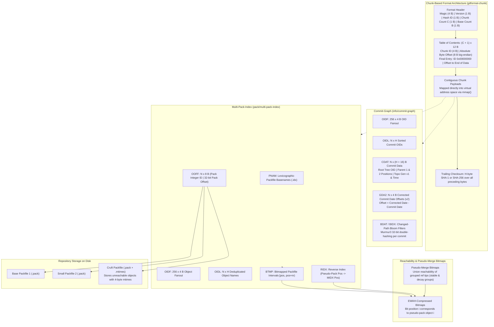
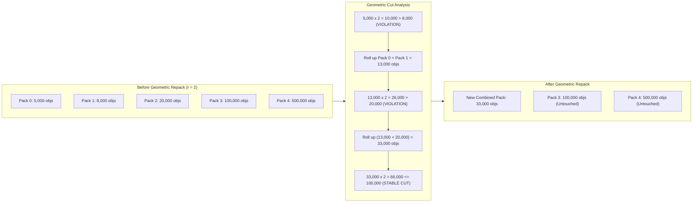
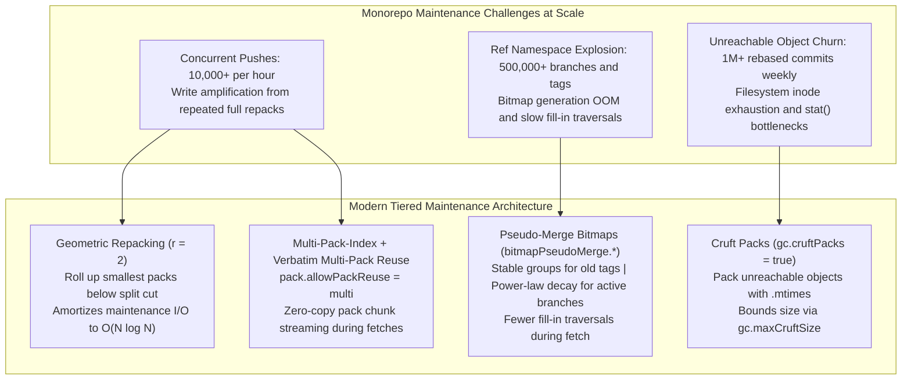

# Git GC, Maintenance, Multi-Pack-Index, and Commit-Graph

> [!summary] Claim:
> Long-term Git repository performance relies on two chunk-based binary formats, the commit-graph and the multi-pack-index (MIDX), to decouple graph walks and object queries from raw packfile decompression.
> The commit-graph accelerates DAG traversals and commit-date priority queues by storing topological parent positions, changed-path Bloom filters, and monotonic corrected commit dates in fixed-width chunk arrays.
> The multi-pack-index aggregates object offsets across unbounded packfiles into a single fanout binary search, while its pseudo-pack ordering and companion bitmaps eliminate the need for expensive all-into-one repacks.
> Cruft packs with epoch-second modification timestamps solve the loose-object explosion during grace-period expiration, and background geometric repacking bounds cumulative maintenance I/O to O(N log N).



## The Mechanism

[[Git-Object-Model-and-Content-Addressing]] defines loose objects, and [[Git-Packfiles-and-Delta-Compression]] details individual `.pack` and `.idx` structures.
In an unmaintained repository, thousands of loose files and fragmented packfiles degrade performance: path lookups require scanning multiple directories, commit graph walks inflate and parse zlib payloads repeatedly, and reachability traversals walk millions of historic tree deltas.
Git solves these bottlenecks by layering chunk-based acceleration structures over the raw object database.
Every format and configuration fact below is verified against Git 2.55.0 unless another version is named.

### 1. The Chunk-Based File Format (`gitformat-chunk`)

Both the commit-graph and the multi-pack-index build upon the chunk-format architecture introduced to provide forward-compatible, extensible binary tables.
Traditional index files like `.idx` v2 use rigid, hard-coded section layouts that require format version increments to introduce new tables.
The chunk-format specification in `gitformat-chunk` decouples file layout from parser logic, enabling Git to read and write arbitrary optional sections without breaking older clients.

A chunk-based file consists of four structural regions:

1. **Format Header:** Contains a 4-byte identification signature, format version byte, hash algorithm identifier, chunk count $C$, and format-specific metadata.
2. **Table of Contents (TOC):** Exactly $C + 1$ contiguous rows of 12 bytes each, stored in network byte order (big-endian).
   Each row records a 4-byte ASCII chunk identifier and an 8-byte unsigned offset from the start of the file.
   The final TOC entry has a 4-byte chunk ID of all zeros (`0x00000000`), whose 8-byte offset marks the end of the chunk data region.
   The length of chunk $i$ is calculated as $\text{OFFSET}[i+1] - \text{OFFSET}[i]$.
3. **Chunk Payloads:** Binary tables placed contiguously in the order listed by the TOC.
   Unknown chunk IDs are skipped by parsers, providing forward compatibility for new metadata chunks.
4. **Trailer:** A trailing checksum of length $H$ (20 bytes for SHA-1, 32 bytes for SHA-256) computed over all preceding bytes in the file.

In the Git C codebase (`chunk-format.h`), reading is memory-mapped via `read_table_of_contents()`.
Chunks are accessed using `pair_chunk()`, which assigns an internal pointer directly into the mapped region, or `read_chunk()`, which invokes a callback with chunk pointer and size.

### 2. The Commit-Graph Architecture (`gitformat-commit-graph`)

Parsing commits during revision walks like `git log`, `git rev-list`, or `git merge-base` requires traversing history DAGs.
Without a commit-graph, Git must locate each commit object across loose files or pack indexes, inflate its zlib payload, parse ASCII headers for `tree`, `parent`, author dates, and committer dates, and follow parents recursively.
The commit-graph format (`.git/objects/info/commit-graph`) eliminates this overhead by serializing commit DAG relationships and commit metadata into fixed-width binary tables.

The commit-graph starts with an 8-byte header:
- Signature: 4 bytes `CGPH` (`0x43475048`).
- Version: 1 byte, currently version 1.
- Hash Version: 1 byte (`1` for SHA-1, `2` for SHA-256).
- Number of Chunks ($C$): 1 byte.
- Number of Base Graphs ($B$): 1 byte (`0` for monolithic graphs, $>0$ for split graphs).

The header is followed by $(C + 1) \times 12$ bytes of TOC, followed by the chunk payloads:

| Chunk ID | Name | Size | Purpose |
| :--- | :--- | :--- | :--- |
| `OIDF` | OID Fanout | $256 \times 4\text{ B} = 1024\text{ B}$ | Stores cumulative counts where entry $i$ records commits with first byte $\le i$. |
| `OIDL` | OID Lookup | $N \times H\text{ B}$ | Lexicographically sorted array of all $N$ commit object IDs in the graph. |
| `CDAT` | Commit Data | $N \times (H + 16)\text{ B}$ | Root tree OID, parent positional references, generation number v1, and committer time. |
| `GDA2` | Generation Data | $N \times 4\text{ B}$ | Corrected commit date offsets for generation number v2. Optional. |
| `GDO2` | Generation Data Overflow | Variable ($M \times 8\text{ B}$) | 64-bit corrected commit date offsets that overflow 31 bits. Optional. |
| `EDGE` | Extra Edge List | Variable ($K \times 4\text{ B}$) | 4-byte parent references for octopus merges (commits with $>2$ parents). Optional. |
| `BIDX` | Bloom Filter Index | $N \times 4\text{ B}$ | Cumulative byte offsets for changed-path Bloom filters. Optional. |
| `BDAT` | Bloom Filter Data | Variable | Murmur3 Bloom filter bit-arrays for modified paths between commit and first parent. Optional. |
| `BASE` | Base Graphs List | $B \times H\text{ B}$ | Checksums of antecedent commit-graph files in a split graph chain. Optional. |

#### Commit Data (`CDAT`) Layout and Positional References

The `CDAT` chunk packs each commit into $H + 16$ bytes:
- Bytes $0 \dots H-1$: Root tree object ID ($H$ bytes).
- Bytes $H \dots H+3$: First parent positional index (32-bit unsigned int).
- Bytes $H+4 \dots H+7$: Second parent positional index (32-bit unsigned int).
- Bytes $H+8 \dots H+11$: Generation number v1 (higher 30 bits) and commit time high bits (lowest 2 bits).
- Bytes $H+12 \dots H+15$: Commit time low bits (32 bits, seconds since UNIX epoch).

Parent references do not store object IDs.
They store 0-based array indices directly into the `OIDL` chunk.
Resolving a parent requires indexing into the memory-mapped `CDAT` array at offset $p \times (H + 16)$, completely avoiding hash table queries and binary searches.
If a commit has no parent (root commit), the parent field stores `0x70000000`.
If a commit has only one parent, the second parent field stores `0x70000000`.
If a commit has more than two parents (an octopus merge), the second parent field sets its most significant bit (`0x80000000`), and the remaining 31 bits index into the `EDGE` chunk.
The `EDGE` chunk lists sequential 4-byte parent positions; the entry with its most significant bit set is the last parent, and its lower 31 bits still hold that parent's position (`GRAPH_EXTRA_EDGES_NEEDED` and `GRAPH_EDGE_LAST_MASK` in `commit-graph.c`).

```text
+-----------------------+-------------------+-------------------+-------------------+-------------------+
| Root Tree OID (H B)   | Parent 1 (4 B)    | Parent 2 (4 B)    | Gen v1 & Time (4B)| Commit Time (4 B) |
+-----------------------+-------------------+-------------------+-------------------+-------------------+
 0                       H                   H+4                 H+8                 H+12                H+16
```

#### Generation Numbers: Topological Level (v1) vs Corrected Commit Date (v2)

Generation numbers accelerate reachability testing.
If commit $A$ has generation number $g(A)$ and commit $B$ has $g(B)$, and $g(A) < g(B)$, then $A$ cannot be a descendant of $B$.
During DAG walks, Git prunes branches from the priority queue when their generation number falls below the target commit generation number.

Generation number v1 measures topological level:
- Root commits: $L(C) = 1$.
- Non-root commits: $L(C) = 1 + \max_{P \in \text{parents}(C)} L(P)$.

Topological levels suffer from clock skew vulnerability and branch merge path dilation.
When a developer works on a long-lived feature branch with 2,000 commits and merges it into `main`, the merge commit receives a topological level $>2001$.
However, the wall-clock committer date on `main` may be newer than the feature branch.
When `git log -n 10` runs, Git uses a priority queue sorted by commit date.
Topological levels cannot determine if all commits newer than date $T$ have been discovered, forcing the walk to traverse the deep branch.

Generation number v2 defines Corrected Commit Dates, introduced in Git 2.31 (RelNotes 2.31.0) and stored in `GDA2` since Git 2.36:
- Monotonicity definition: For every commit $C$ and parent $P$, $R(C) > R(P)$ and $R(C) \ge \text{cdate}(C)$.
- Formula: $R(C) = \max(\text{cdate}(C), \max_{P \in \text{parents}(C)} R(P) + 1)$.

The `GDA2` chunk stores the offset $\Delta(C) = R(C) - \text{cdate}(C)$.
In well-ordered repositories, committer dates increase monotonically along branches, so $\Delta(C) = 0$ for most commits.
$\Delta(C)$ is stored as a 4-byte integer.
If $\Delta(C) < 2^{31}$, bit 31 is zero and the integer is the offset.
If $\Delta(C) \ge 2^{31}$, bit 31 is set to 1, and the remaining 31 bits index into the `GDO2` chunk, which stores 8-byte 64-bit offsets.
Git configuration `commitGraph.generationVersion` defaults to `2` (as of 2026-11, Both).
Git 2.31 through 2.35 wrote these offsets in chunks named `GDAT` and `GDOV`, which could hold erroneous data; Git 2.36 (`ds/commit-graph-gen-v2-fixes`, RelNotes 2.36.0) switched to `GDA2` and `GDO2` so newer binaries silently ignore the old chunks (gitformat-commit-graph, Historical Notes).

#### Changed-Path Bloom Filters (`BIDX` and `BDAT`)

Path-filtered history walks (`git log -- path/to/file.c`) traditionally inspect every commit by diffing its tree against its parents' trees.
Tree diffing is I/O intensive because it inflates tree objects across history.
When enabled via `--changed-paths` or `commitGraph.changedPaths=true`, Git writes Bloom filters into `BIDX` and `BDAT`.

- **Hash algorithm:** Both filter versions use 32-bit MurmurHash3 with double hashing (Kirsch-Mitzenmacher technique); version 2 (Git 2.46, RelNotes 2.46.0) fixes how version 1 hashed path bytes $\ge$ `0x80` when `char` is signed (`murmur3_seeded_v1()` vs `murmur3_seeded_v2()` in `bloom.c`).
  Two hash seeds, `0x293ae76f` and `0x7e646e2c` (`bloom.c`; the format page prints the second as `0x7e646e2`), compute $k$ bit positions as $h_i(x) = (h_1(x) + i \cdot h_2(x)) \pmod m$.
- **Header:** `BDAT` begins with three 32-bit unsigned integers: version (`1` by default, `2` when `commitGraph.changedPathsVersion=2`; the lab writes `1`), number of hash passes $k$ (default 7), and minimum bits per entry $b$ (default 10) (`DEFAULT_BLOOM_FILTER_SETTINGS` in `bloom.h`).
- **Short-circuiting:** Commits modifying 0 paths store a 1-byte filter of all zeros.
  Commits modifying $>512$ paths store a 1-byte filter of all ones (explicit positive fallback).
- **Query mechanism:** When walking history for `path/to/file.c`, Git queries the commit's Bloom filter.
  A negative result guarantees the commit did not touch the path, completely skipping tree loading and diff execution.

#### Split Commit-Graphs

Rewriting a monolithic commit-graph in large repositories takes non-trivial time.
Git supports split commit-graphs (`git commit-graph write --split`).
Split graphs live in `.git/objects/info/commit-graphs/`:
- `commit-graph-chain`: A plain text file listing the checksums of active graph files from base to tip.
- `graph-<hash>.graph`: Individual commit-graph layers.
Each layer contains a `BASE` chunk recording the checksums of antecedent layers.
When writing a new layer, Git creates a tip file containing only newly introduced commits.
Layers merge according to geometric scaling rules:
If `--size-multiple=<X>` is specified (default $X = 2$), Git merges the new tip of $N$ commits into the previous tip of $M$ commits if $X \cdot N > M$.
This maintains an $O(\log N)$ bound on the total number of layer files.

### 3. The Multi-Pack-Index (`gitformat-pack`)

A Git repository accumulating pushes develops multiple `.pack` and `.idx` files.
Each `.idx` file requires file descriptors and memory-mapped buffers.
Object lookups must search each index file sequentially until the object is found.
Worse, reachability bitmaps (`.bitmap`) historically required all reachable objects to reside in a single packfile.
The Multi-Pack-Index (`.git/objects/pack/multi-pack-index`) consolidates index data across all packfiles into a single unified index.

The MIDX header spans 12 bytes:
- Signature: 4 bytes `MIDX` (`0x4d494458`).
- Version: 1 byte, version 1 or 2; `git multi-pack-index write` emits version 1 unless `midx.version` overrides it, and `compact` requires version 2 (`midx-write.c`; gitformat-pack claims a default of 2, but the lab's Git 2.55.0 output shows `version=1`) (as of 2026-11, Both).
- Object ID Version: 1 byte (`1` for SHA-1, `2` for SHA-256).
- Number of Chunks ($C$): 1 byte.
- Number of Base MIDX Files ($B$): 1 byte, always written as 0, including for incremental layers, whose chain lives in a separate file (`write_midx_header()` in `midx-write.c`).
- Number of Packfiles: 4 bytes big-endian unsigned integer.

The TOC contains $(C + 1) \times 12$ bytes, followed by the chunk payloads:

| Chunk ID | Name | Size | Purpose |
| :--- | :--- | :--- | :--- |
| `PNAM` | Packfile Names | Variable | Sequence of NUL-terminated relative `.idx` basenames, padded with 0 to 3 NUL bytes to 4-byte alignment. |
| `OIDF` | OID Fanout | $256 \times 4\text{ B} = 1024\text{ B}$ | Cumulative counts of objects with first byte $\le i$. `OIDF[255]` is total objects $N$. |
| `OIDL` | OID Lookup | $N \times H\text{ B}$ | Lexicographically sorted unique object IDs spanning all indexed packfiles. |
| `OOFF` | Object Offsets | $N \times 8\text{ B}$ | 4-byte pack integer ID followed by 4-byte packfile offset. |
| `LOFF` | Large Offsets | Variable ($M \times 8\text{ B}$) | 8-byte offsets for objects residing past the 2 GiB boundary in large packfiles. |
| `RIDX` | Reverse Index | $N \times 4\text{ B}$ | Maps pseudo-pack bit positions to MIDX array positions. |
| `BTMP` | Bitmapped Packfiles | $P \times 8\text{ B}$ | Table mapping each pack to its `[bitmap_pos, bitmap_pos + bitmap_nr)` pseudo-pack interval. |

#### Object Resolution through `OOFF`

When Git looks up an object ID $O$, `bsearch_hash()` uses the fanout table `OIDF` to bound the binary search range in `OIDL`.
Once index $i$ is found, Git reads row $i$ in `OOFF` (offset $\text{OFFSET}_{\text{OOFF}} + 8i$):
- Bytes $0 \dots 3$: `pack_int_id`, selecting pack name $\text{PNAM}[\text{pack\_int\_id}]$.
- Bytes $4 \dots 7$: Offset within that pack.
When no offset exceeds $2^{31}-1$, `LOFF` is absent and the value is the plain byte offset in the `.pack` file.
Once `LOFF` exists, a set bit 31 means the lower 31 bits index into `LOFF` to retrieve the 64-bit offset (`write_midx_object_offsets()` in `midx-write.c`).
Duplicate copies of an object across multiple packs are deduplicated: the MIDX records exactly one copy, favoring the preferred pack, otherwise the pack with the highest mtime; without `--preferred-pack`, the pack with the lowest mtime is preferred (git-multi-pack-index).

#### Pseudo-Pack Ordering and Multi-Pack Bitmaps

Reachability bitmaps encode reachability as compressed bit-vectors using the EWAH (Enhanced Word-Aligned Hybrid) algorithm.
For single packfiles, bit position $i$ maps to object $i$ in packfile offset order.
Packfile offset order provides spatial and temporal clustering: files in the same tree or commit revisions sit close together, producing long runs of identical bits that compress efficiently.
If bits were assigned in `OIDL` lexicographic order, SHA-1 randomness would destroy bit-run locality, inflating bitmap sizes by an order of magnitude.

To preserve compression across multiple packfiles without repacking them, Git defines a synthetic **pseudo-pack order**:
1. All objects indexed by the MIDX are partitioned into their source packfiles.
2. The `BTMP` chunk assigns each pack $p$ a contiguous bit range defined by `bitmap_pos` (starting bit position) and `bitmap_nr` (number of selected objects).
3. Within each pack's allocated interval, objects are ordered strictly by their offset within that pack.
4. The `RIDX` chunk records an $N$-element array of 32-bit unsigned integers, where entry $j$ stores the MIDX `OIDL` position of the object at pseudo-pack position $j$.

With `BTMP` and `RIDX`, multi-pack reachability bitmaps (`multi-pack-index-<hash>.bitmap`) keep the pack-order locality that single-pack bitmaps rely on: gitformat-pack states that bits laid out in `OIDL` (hash) order "would have no locality, and thus compress poorly", while the pseudo-pack order has "far better locality (and thus compresses more efficiently)" (gitformat-pack, "Multi-pack-index reverse indexes", Git 2.55.0).
That is the format's stated rationale; this note quotes no measured compression ratio.
Furthermore, setting `pack.allowPackReuse=multi` allows `git pack-objects` to reuse raw compressed object byte chunks verbatim from all packs in the MIDX during clone and fetch operations.

#### Incremental Multi-Pack-Index Chains (Git 2.47+)

Similar to split commit-graphs, writing a monolithic MIDX in huge repositories incurs rewrite costs proportional to total repository objects.
Incremental multi-pack-index chains (`git multi-pack-index write --incremental`) landed as work in progress in Git 2.47 and were listed as a feature in Git 2.50 (RelNotes 2.47.0, 2.50.0).
Incremental MIDXs reside in `.git/objects/pack/multi-pack-index.d/` (`midx.c`):
- `multi-pack-index-chain`: Text file listing hex checksums of MIDX layers from base to tip.
- `multi-pack-index-<hash>.midx`: Individual MIDX layers containing only objects and packs not present in an earlier layer.
Compaction, added in Git 2.55 (RelNotes 2.55.0), is executed using `git multi-pack-index compact <from> <to>`, which writes one new layer holding the objects and packs of the layer range `<from>` to `<to>` without rebuilding the layers below it; it writes a version 2 MIDX that Git before 2.54 cannot read (git-multi-pack-index).

### 4. Reachability Bitmaps and Pseudo-Merge Bitmaps

Reachability bitmaps allow Git to evaluate revision walk reachability in microseconds without loading commit or tree objects.
When answering a fetch request, Git must find the set difference $\text{WANTS} \setminus \text{HAVES}$.
With bitmaps, this reduces to performing bitwise logical operations: $\text{Bitmap}(\text{WANTS}) \text{ AND NOT } \text{Bitmap}(\text{HAVES})$.

#### The Ref Tip Explosion Problem

In large repositories hosting tens of thousands of developer branches, tags, and pull request refs, generating a bitmap for every ref tip is impossible.
Bitmaps consume memory and disk; computing them causes repacks to time out.
Git selects bitmapped commits from windows of history, and `pack.preferBitmapTips` (such as `refs/heads/`) only gives matching ref tips preference within a window; it does not guarantee every matching tip a bitmap (git-config).
However, when a client fetches an older tag or a feature branch that lacks a dedicated bitmap, Git must perform a slow "fill-in traversal", walking trees object-by-object until hitting an object that has bitmap coverage.

#### Pseudo-Merge Bitmaps (`bitmapPseudoMerge.*`)

Git 2.46 introduced pseudo-merge bitmaps (RelNotes 2.46.0; documented in `gitpacking`) to solve the ref tip coverage gap.
A pseudo-merge is an artificial commit created in memory that treats a collection of ref tips as its parents.
The reachability bitmap computed for the pseudo-merge represents the exact union of all objects reachable from those refs.

During a traversal, if a query's WANTS or HAVES include commits belonging to a pseudo-merge group, Git replaces individual tree traversals with a single EWAH bitwise OR of the pseudo-merge bitmap.

Pseudo-merges partition candidate references into two categories:

1. **Stable Pseudo-Merges:**
   Refs older than `bitmapPseudoMerge.<name>.stableThreshold` (default `1.month.ago`) are grouped into fixed-size batches of `bitmapPseudoMerge.<name>.stableSize` (default 512 commits).
   Because old tags and historic release branches never move, stable pseudo-merges are computed once and remain permanently valid.

2. **Unstable Pseudo-Merges:**
   Recent ref tips between `bitmapPseudoMerge.<name>.threshold` (default `1.week.ago`) and the stable threshold change frequently.
   Git groups unstable commits using a power-law decay function:
   $$f(n) = C \cdot n^{-k/100}$$
   where $k$ is configured by `bitmapPseudoMerge.<name>.decay` (default 1).
   The `gitpacking` page states this formula two ways: the overview gives $n^{-k/100}$, while the `decay` entry gives $f(n) = C \cdot n^{-k}$ and says $k = 1$ makes the $n$-th group $1/n$ the size of the first.
   Older unstable commits are bundled into larger pseudo-merges, while newer commits form smaller groups.
   This reflects the heuristic that older branches are less likely to receive new force-pushes or rebases.
   The number of pseudo-merge commits per group is bounded by `bitmapPseudoMerge.<name>.maxMerges` (default 64).

### 5. Cruft Packs and Object Expiration

Git's garbage collection must clean up unreachable objects created by rebases, amends, discarded stashes, and branch deletions.
However, Git cannot delete unreachable objects immediately.
A concurrent push, rebase, or commit operation may have created loose objects that are temporarily unreachable from any ref tip while the ref transaction is in flight.
To protect against race-condition data loss, Git enforces a grace period: `gc.pruneExpire` defaults to `2.weeks.ago`.

#### The Loose Object Explosion

Traditionally, `git repack -A -d` handled unreachable objects by exploding them out of packs into loose files under `.git/objects/??/`.
The filesystem `mtime` (modification time) on the loose object file tracked the object's age.
A subsequent `git gc` scanned all loose directories, checked each file's `mtime` via `stat()`, and deleted files older than two weeks.

In large, active monorepos, this mechanism causes catastrophic degradation:
- A single repack can unpack hundreds of thousands of loose objects.
- Directory entries and inode tables exhaust filesystem limits.
- Repeated `stat()` system calls across 256 loose directories cause severe I/O stalls during background maintenance.

#### Cruft Pack Architecture (`pack-*.mtimes`)

Git 2.37 introduced Cruft Packs, and Git 2.41 made them the default (`gc.cruftPacks=true`) (RelNotes 2.37.0, 2.41.0).
A cruft pack stores all unreachable objects together in a standard packed archive (`.pack` and `.idx`), preventing loose object explosion.
Because `.pack` entry headers do not carry timestamps, the cruft pack is accompanied by an `.mtimes` file (`gitformat-pack`).

The `.mtimes` file format:
- Signature: 4 bytes `MTME` (`0x4d544d45`, `MTIMES_SIGNATURE` in `pack-mtimes.h`).
- Version: 4 bytes big-endian unsigned integer (currently version 1).
- Hash ID: 4 bytes big-endian unsigned integer (`1` for SHA-1, `2` for SHA-256).
- Table of timestamps: Exactly $N \times 4$ bytes of big-endian 32-bit unsigned UNIX epoch seconds, where entry $i$ records the modification time of the $i$-th object in the accompanying `.idx` file.
- Checksum trailer: 20-byte or 32-byte hash matching the checksum trailer of the companion `.pack` file, followed by the SHA checksum of the `.mtimes` contents.

```text
+-------------------+-------------------+-------------------+-------------------------------+-----------------------+
| Magic 'MTME' (4B) | Version 1 (4 B)   | Hash ID 1/2 (4 B) | N x 4 B Epoch Timestamps      | Checksum Trailers     |
+-------------------+-------------------+-------------------+-------------------------------+-----------------------+
```

During maintenance (`git gc` or `git repack --cruft --cruft-expiration=2.weeks.ago`):
1. Git reads the `.mtimes` file alongside the cruft pack index.
2. Objects whose timestamp is older than the expiration threshold are permanently dropped.
3. Unreachable objects whose timestamp is newer than the threshold are packed into a fresh, smaller cruft pack with updated `.mtimes`.
4. `gc.maxCruftSize` allows splitting large cruft packs so huge repositories do not rewrite a single massive cruft file during incremental cycles.

### 6. Background Maintenance and Geometric Repacking

Garbage collection via monolithic `git gc` is a batch process that blocks user commands or locks the object database.
Git provides `git maintenance` as a modular porcelain framework to run non-disruptive, scheduled background optimizations.

#### Scheduler Integration and Strategy Architecture

Running `git maintenance start` registers the current repository in the user's global Git config (`maintenance.repo`) and configures system background schedulers:
- macOS: `launchd` via user launch agents in `~/Library/LaunchAgents/org.git-scm.git*`.
- Linux: `systemd` timers via user units in `~/.config/systemd/user/git-maintenance@*`.
- Windows: Windows Task Scheduler via `schtasks`.

Under the `incremental` strategy, the schedule executes tasks at three discrete frequencies:
- **Hourly:** Updates auxiliary data structures and prefetches remote objects without updating local branch tips.
  - `commit-graph`: Incrementally writes new commit-graph layers and verifies checksums.
  - `prefetch`: Fetches new objects from all registered remotes with refs rewritten under `refs/prefetch/` and tags not updated, warming the object store without moving remote-tracking branches.
- **Daily:** Consolidates loose objects and reorganizes pack structures.
  - `loose-objects`: Sweeps loose objects into a small batch packfile (up to `maintenance.loose-objects.batchSize`, default 50,000) and runs `git prune-packed`.
  - `incremental-repack`: Calls `git multi-pack-index expire`, then `git multi-pack-index repack --batch-size=<size>`, rolling up small packs referenced by the MIDX.
- **Weekly:**
  - `pack-refs`: Packs loose references into a single `packed-refs` file or `reftable` backend via `git pack-refs`.

The framework supports four distinct strategies (`maintenance.strategy`):
- `none`: Runs no tasks; this is the default for scheduled maintenance when no strategy is set.
- `gc`: Invokes traditional monolithic `git gc`.
- `incremental`: Set by `git maintenance register` (and therefore `start`) when no strategy is configured; performs small incremental updates that delete no data.
- `geometric`: Added in Git 2.52 and the default for manual maintenance since Git 2.54 (RelNotes 2.52.0, 2.54.0; as of 2026-11, Both); recommended for large repositories; performs geometric packfile rollups, and when it would do an all-into-one repack it writes a cruft pack for unreachable objects.

#### Geometric Repacking (`git repack --geometric=<factor>`)

A major scalability failure in Git is the $O(N^2)$ repacking explosion: if a repository has 10 GB of history and receives 50 MB of new commits daily, running `git repack -a -d` rewrites the entire 10 GB every day.
Geometric repacking (`git repack --geometric=<factor>`; the factor is a required argument, and the maintenance task uses `maintenance.geometric-repack.splitFactor`, default 2) eliminates this write amplification.

The geometric algorithm arranges packfiles into a geometric progression where each successive packfile contains at least $r$ times the number of objects of the next smaller pack:
$$N_{i+1} \ge r \cdot N_i$$



When `git repack --geometric=2` executes:
1. Git inventories all non-kept, non-cruft packfiles, counting the objects in each pack.
2. Packs are sorted in ascending order of object count: $P_0, P_1, \dots, P_{m-1}$.
3. Git scans from the largest pack downward and stops at the first adjacent pair that breaks $N_{i+1} \ge r \cdot N_i$; the larger pack of that pair and every smaller one go below the split.
   It then moves the split upward while the next larger pack holds fewer than $r$ times the objects being rolled up (`compute_pack_geometry_split()` in `repack-geometry.c`).
4. Only the packs below the split cut are rolled up into a single new packfile.
   All larger packs above the split remain completely untouched on disk.
5. If the split reaches the largest pack, every pack is rolled up; under `maintenance.strategy=geometric`, such an all-into-one repack also writes a cruft pack for unreachable objects (git-config `maintenance.strategy`).

By rolling up only small packs frequently and touching large packs with exponentially decreasing frequency, geometric repacking reduces total object write amplification over repository lifetime from $O(N^2)$ to $O(N \log N)$.

## Commands and Numbers to Know

| Item | Value / Syntax | Platform and Date | What It Controls |
| :--- | :--- | :--- | :--- |
| `gc.auto` | `6700` | Both (as of 2026-11) | Loose objects threshold triggering automatic `git gc --auto`. Set to `0` to disable. |
| `gc.autoPackLimit` | `50` | Both (as of 2026-11) | Maximum unkept packfiles before `git gc --auto` consolidates packs. Set to `0` to disable. |
| `gc.autoDetach` | `true` | Both (as of 2026-11) | Causes `git gc --auto` to fork and run in the background. |
| `gc.cruftPacks` | `true` | Both (as of 2026-11) | Enables writing unreachable objects to `.pack` with `.mtimes` instead of loose files. |
| `gc.pruneExpire` | `2.weeks.ago` | Both (as of 2026-11) | Grace period threshold for expiring unreachable objects. |
| `gc.writeCommitGraph` | `true` | Both (as of 2026-11) | Automatically writes or updates the commit-graph during `git gc`. |
| `commitGraph.generationVersion` | `2` | Both (as of 2026-11) | Specifies generation number version: `1` (topological level) or `2` (corrected commit dates). |
| `commitGraph.changedPaths` | unset | Both (as of 2026-11) | Enables automatic computation of changed-path Bloom filters during commit-graph write; when unset, existing filters are kept. |
| `commitGraph.changedPathsVersion` | `-1` (use the repository's existing version, else `1`) | Both (as of 2026-11) | Bloom filter version: `1` (Murmur3 with the signed-char bug) or `2` (Murmur3 over unsigned bytes, Git 2.46+). |
| `core.commitGraph` | `true` | Both (as of 2026-11) | Directs Git to read commit-graph files when traversing commit DAGs. |
| `core.multiPackIndex` | `true` | Both (as of 2026-11) | Directs Git to use multi-pack-index for object lookup across packs. |
| `midx.version` | unset: `write` emits `1`, `compact` emits `2` | Both (as of 2026-11) | Multi-pack-index file version generated by Git (`midx-write.c`; the lab writes version 1). |
| `pack.allowPackReuse` | `true` (`single`) | Both (as of 2026-11) | Verbatim pack reuse during fetch: `single` (one pack) or `multi` (all packs in MIDX). |
| `pack.writeBitmapHashCache` | `true` | Both (as of 2026-11) | Writes namehash section into reachability bitmaps (4 bytes per object). |
| `pack.writeBitmapLookupTable` | `false` | Both (as of 2026-11) | Writes binary lookup table in `.bitmap` for deferred lazy bitmap loading. |
| `maintenance.strategy` | `geometric` (manual), `none` (scheduled); `register` sets `incremental` | Both (as of 2026-11) | High-level maintenance strategy: `none`, `gc`, `incremental`, or `geometric`. |
| `maintenance.commit-graph.auto` | `100` | Both (as of 2026-11) | Unindexed commits threshold triggering automatic commit-graph update. |
| `maintenance.loose-objects.auto` | `100` | Both (as of 2026-11) | Loose objects threshold triggering automatic loose object packaging. |
| `maintenance.loose-objects.batchSize` | `50000` | Both (as of 2026-11) | Maximum loose objects packed in a single maintenance batch. |
| `maintenance.geometric-repack.splitFactor` | `2` | Both (as of 2026-11) | Geometric scaling ratio $r$ for split-cut pack rollup calculation. |
| `bitmapPseudoMerge.<name>.stableSize` | `512` | Both (as of 2026-11) | Number of commits bundled into each stable pseudo-merge bitmap. |
| `bitmapPseudoMerge.<name>.stableThreshold` | `1.month.ago` | Both (as of 2026-11) | Minimum age of commit tips eligible for stable pseudo-merge grouping. |
| `bitmapPseudoMerge.<name>.decay` | `1` | Both (as of 2026-11) | Power-law decay rate $k$ for sizing consecutive unstable pseudo-merge groups. |
| Commit-Graph Magic | `CGPH` (`0x43475048`) | Both (as of 2026-11) | 4-byte header signature for commit-graph binary files. |
| MIDX Magic | `MIDX` (`0x4d494458`) | Both (as of 2026-11) | 4-byte header signature for multi-pack-index files. |
| Cruft Mtimes Magic | `MTME` (`0x4d544d45`) | Both (as of 2026-11) | 4-byte header signature for companion `.mtimes` binary files. |
| Root Parent Sentinel | `0x70000000` | Both (as of 2026-11) | Positional parent constant in `CDAT` indicating no parent exists. |

## Multi-Language Comparison: C / Python / Rust

Git core is written in C.
High-level toolchains and hosting services interact with chunk-based formats through C bindings, pure Python, or pure Rust implementations.

| Concern | C (git.git v2.55.0) | Python (this lab; Dulwich) | Rust (gitoxide `gix-pack` 0.77, `gix-commitgraph`) |
| :--- | :--- | :--- | :--- |
| Chunk TOC Parsing | `read_table_of_contents()` in `chunk-format.c`: scans $(C+1) \times 12$ bytes, checks alignment, non-decreasing offsets, and bounds before the trailer, then pairs pointers | Unpacks `>4sQ` records with `struct.unpack()`, slices the file buffer read into memory | `File::new()` in `gix-commitgraph` 0.42.0 reads the TOC through the `gix-chunk` crate, then checks the signature, version, per-chunk sizes, trailer length, fanout monotonicity, and that `OIDF`, `OIDL`, and `CDAT` agree on the commit count |
| Commit-Graph Lookup | `bsearch_graph()` and `lookup_commit_in_graph()` in `commit-graph.c`: fanout bounds, binary search on `OIDL`, $O(1)$ `CDAT` index | Lab slices `OIDL` and `CDAT` by index without searching; Dulwich 1.2.21 has `dulwich/commit_graph.py` with chunk constants for `GDA2`, `BIDX`, and `BDAT` | `gix_commitgraph::Graph::lookup()` and `commit_by_id()` return a commit view over the mapped file |
| Generation Numbers | `commit_graph_generation()` in `commit-graph.c`: returns the generation cached in a commit slab, which `fill_commit_graph_info()` decodes from `GDA2`/`GDO2` when present, else from `gen_v1` | Decodes 30-bit `gen_v1` and adds the `GDA2` offset (no `GDO2` overflow handling) to the 34-bit timestamp | `Commit::generation()` in `gix-commitgraph` 0.42.0 returns the 30-bit topological level from `CDAT` (`>> 2`); the source never reads `GDA2` |
| Bloom Filter Query | `bloom_filter_contains()` in `bloom.c`: computes 32-bit MurmurHash3 double-hash bit positions | Lab parses `BDAT` header and `BIDX` offsets only | No Bloom filter API in the published `gix-commitgraph` docs (as of 2026-11) |
| MIDX Object Search | `bsearch_midx()` in `midx.c` (via `bsearch_hash()`): fanout bounds, binary search on `OIDL`, returns MIDX position | Lab slices `OIDL` and decodes pack ID and offset from `OOFF` for sample positions | `gix_pack::multi_index::File::lookup()` searches deduplicated names across packs |
| Pseudo-Pack Bitmaps | `midx_to_pack_pos()`, `pack_pos_to_midx()`, and `midx_pair_to_pack_pos()` in `pack-revindex.c`: map between MIDX and pseudo-pack positions via `RIDX` | Lab reads `BTMP` intervals and checks that `RIDX` is a permutation | No `RIDX` or `BTMP` chunk module in published `gix-pack` docs (as of 2026-11) |
| Cruft Mtimes Parsing | `load_pack_mtimes()` in `pack-mtimes.c`: maps `.mtimes`, checks `MTME` signature, version, hash id, and size | Not exercised by the lab | No `.mtimes` module in published `gix-pack` docs (as of 2026-11) |

## Worked Lab Example

The reproducible lab is located at `code/02-Version-Control/midx_inspect/`.
It needs only `git` and `python3`.
Golden output is recorded for `darwin-arm64` only, because the pack bytes depend on the zlib build and the Git version: a scratch run on Linux aarch64 (Alpine edge, Git 2.56.0) passed every assertion in `midx_inspect.py` but printed different pack names, pack offsets, and interval sizes, so no Linux golden is claimed (as of 2026-11).

`run.sh` initializes a deterministic repository: fixed author and committer identities, fixed commit timestamps (`2026-10-25T12:00:00Z` through `12:04:00Z`), `GIT_CONFIG_GLOBAL=/dev/null`, `GIT_CONFIG_SYSTEM=/dev/null`, and `LC_ALL=C`.
It sets `git config gc.auto 0` to prevent background auto-gc heuristics from firing asynchronously.
It constructs a non-linear history across five discrete commits and packs each revision independently into its own packfile via `git pack-objects`:
1. Commit 1 (`c1`): Initial core engine file `engine.c` on branch `main`.
2. Commit 2 (`c2`): Updates `engine.c` and introduces `config.c`.
3. Commit 3 (`c3`): Diverges onto branch `feature` modifying `feature.c`.
4. Commit 4 (`c4`): Switches to `main` and introduces `telemetry.c`.
5. Commit 5 (`c5`): Merges `feature` into `main`, creating a two-parent merge commit.

After pruning loose objects, `run.sh` executes:
```bash
git multi-pack-index write --no-progress --bitmap --preferred-pack="${PREF_PACK}"
git commit-graph write --no-progress --reachable --changed-paths
```
`PREF_PACK` is the lexicographically first `.idx` basename, so the preferred pack does not depend on file mtimes.
Then `midx_inspect.py` parses the binary structures directly from `.git/objects/pack/multi-pack-index` and `.git/objects/info/commit-graph`.
It decodes chunk TOC layouts, object offsets, and pseudo-pack intervals, inspects generation numbers and Bloom filter headers, and requires `git multi-pack-index verify` and `git commit-graph verify` to exit 0.
It also cross-checks the decode against Git itself, so a wrong decode or an absent mechanism fails an assertion instead of printing plausible numbers:
- Chunk lengths come from the next TOC entry, never from an assumed chunk order, and both trailers are recomputed for the hash named in the header.
- Every `OOFF` pack id and offset must match `git show-index` for that pack, and the MIDX must index exactly the set that `git cat-file --batch-all-objects` lists.
- `BTMP` intervals must be contiguous from 0, each sized to its pack's object count, and the preferred pack must start at bit 0; `RIDX` must be a permutation whose entries inside each interval belong to that pack in pack-offset order.
- Parents, trees, and committer dates in `CDAT` must equal `git log`; `gen_v1` must equal 1 plus the maximum parent level, and `gen_v2` must equal the corrected commit date recomputed from the DAG.
- Every path that `git diff` reports as changed against the first parent must hit the commit's Bloom filter (a hand-written murmur3 double-hash query), and a path that never changed must miss.

```bash
cd code/02-Version-Control/midx_inspect
bash run.sh
```

### Verified Output

Recorded on `darwin-arm64` on 2026-11-07 and validated by `python3 -m _harness.verify 02-Version-Control/midx_inspect/`; the golden output file is `code/02-Version-Control/midx_inspect/expected/darwin-arm64.txt`:

```text
MIDX Header: signature=MIDX version=1 oid_version=1 chunks=6 base_midx=0 packs=5
MIDX Chunk Table of Contents:
  Chunk PNAM       : byte_offset=   96
  Chunk OIDF       : byte_offset=  348
  Chunk OIDL       : byte_offset= 1372
  Chunk OOFF       : byte_offset= 1672
  Chunk RIDX       : byte_offset= 1792
  Chunk BTMP       : byte_offset= 1852
  Chunk TERMINATOR : byte_offset= 1892
Indexed Packfiles (5):
  pack [0]: pack-71ac46282ad4583b07e28327ae441a0ca816c65e.idx
  pack [1]: pack-abb6a4a3ac22de1b81ef635c1fe889ead4dd9f2e.idx
  pack [2]: pack-b47baa2a4feca07a84346d9d9c5554911b17148b.idx
  pack [3]: pack-e3936a946fdd05cc5cc5e122afc1772f70a1a37d.idx
  pack [4]: pack-f0f7023922588e022bf539cdb296c70f1100c666.idx
Total Objects Indexed: 15
MIDX Object Lookup Samples:
  pos  0: oid=027d838b2a23348979cef5b53fe8e7f4d9109a11 pack_id=3 pack_offset=12
  pos  7: oid=823891adf2272df1f5563a512609bc07fc409f3d pack_id=0 pack_offset=292
  pos 14: oid=f7c8cac692ec3a30fbc986d654b4e4954f02b242 pack_id=2 pack_offset=212
Bitmapped Packfile Pseudo-Pack Intervals (BTMP):
  pack [0]: bitmap_pos= 0 bitmap_nr= 3 range=[ 0,  3)
  pack [1]: bitmap_pos= 3 bitmap_nr= 3 range=[ 3,  6)
  pack [2]: bitmap_pos= 6 bitmap_nr= 2 range=[ 6,  8)
  pack [3]: bitmap_pos= 8 bitmap_nr= 3 range=[ 8, 11)
  pack [4]: bitmap_pos=11 bitmap_nr= 4 range=[11, 15)
Reverse Index (RIDX): 15 pseudo-pack mappings validated

Commit-Graph Header: signature=CGPH version=1 hash_version=1 chunks=6 base_graphs=0
Commit-Graph Chunk Table of Contents:
  Chunk OIDF       : byte_offset=   92
  Chunk OIDL       : byte_offset= 1116
  Chunk CDAT       : byte_offset= 1216
  Chunk GDA2       : byte_offset= 1396
  Chunk BIDX       : byte_offset= 1416
  Chunk BDAT       : byte_offset= 1436
  Chunk TERMINATOR : byte_offset= 1459
Total Commits Indexed: 5
Commit Data and Generation Numbers (CDAT & GDA2):
  commit [0] 027d838b2a23348979cef5b53fe8e7f4d9109a11: tree=38cbfaf6 parents=(none, none) gen_v1=1 gen_v2=1792929600
  commit [1] 4ff4b68fc16b9969d70f086622b0e3656d2d1c0d: tree=81201985 parents=(pos=3, none) gen_v1=3 gen_v2=1792929780
  commit [2] 8aede95e08e438eb53d394aa60696088698392d4: tree=f7c8cac6 parents=(pos=1, pos=4) gen_v1=4 gen_v2=1792929840
  commit [3] 9c5ef92ba8914b3e5b846706cd0ea03f14359d0e: tree=786755ec parents=(pos=0, none) gen_v1=2 gen_v2=1792929660
  commit [4] ec6ce82a9d0627e551938ad2473abd7647e4c0f1: tree=b55f2be7 parents=(pos=3, none) gen_v1=3 gen_v2=1792929720

Bloom Filters (BDAT): version=1 hash_passes=7 bits_per_entry=10
Bloom Filter Index Offsets: [2, 4, 6, 9, 11]

Verification Status:
  multi-pack-index trailer SHA-1: VALID
  commit-graph trailer SHA-1: VALID
  git multi-pack-index verify: PASS (0 errors)
  git commit-graph verify: PASS (0 errors)
```

### Reading the Result

- **Chunk Alignment:** In the MIDX, the TOC begins at byte 12 immediately after the 12-byte header.
  With 6 chunks plus the terminator, the TOC spans $7 \times 12 = 84$ bytes, placing the first chunk (`PNAM`) at offset $12 + 84 = 96$.
  The five NUL-terminated packfile `.idx` filenames span $5 \times 50 = 250$ bytes plus 2 NUL padding bytes to a 4-byte multiple (252 bytes), aligning the fanout table `OIDF` at offset 348.
  `OIDF` spans 1,024 bytes ($256 \times 4$), positioning `OIDL` at offset 1,372.
  `OIDL` holds 15 20-byte SHA-1 names ($15 \times 20 = 300$ bytes), positioning `OOFF` at offset 1,672.
  `OOFF` holds 15 8-byte entries ($15 \times 8 = 120$ bytes), positioning `RIDX` at offset 1,792.
  `RIDX` holds 15 4-byte entries ($15 \times 4 = 60$ bytes), positioning `BTMP` at offset 1,852.
  `BTMP` holds 5 8-byte entries ($5 \times 8 = 40$ bytes), ending at the terminator offset 1,892.
  The 20-byte SHA-1 checksum trailer occupies bytes 1,892 through 1,911, so the file is 1,912 bytes (checked with `wc -c` on a scratch run).
- **Pseudo-Pack Interval Allocation:** The `BTMP` table verifies that the five packs partition the pseudo-pack bitmap positions $[0, 15)$ without gaps or overlap:
  Pack 0 covers $[0, 3)$, Pack 1 covers $[3, 6)$, Pack 2 covers $[6, 8)$, Pack 3 covers $[8, 11)$, and Pack 4 covers $[11, 15)$.
  Pack 0 (the `c3` pack) occupies bitmap positions starting at 0 because `run.sh` names it with `--preferred-pack`, and the preferred pack sorts first in pseudo-pack order.
  Pack 4 holds four objects because it is the `c2` pack: its commit, root tree, and the new `engine.c` and `config.c` blobs.
  The merge `c5` is pack 2, which holds only its commit and root tree (`f7c8cac6`, the `pos 14` sample), since the merge introduced no new blobs.
- **Commit-Graph DAG Positional Encoding:** In the Commit-Graph, Commit 0 (`027d838b`, `c1`) has `parents=(none, none)` and `gen_v1=1`.
  Commit 3 (`9c5ef92b`, `c2`) points to parent `pos=0` and has `gen_v1=2`.
  Commit 1 (`4ff4b68f`, `c4`) and Commit 4 (`ec6ce82a`, `c3`) both point to parent `pos=3` and have `gen_v1=3`.
  Commit 2 (`8aede95e`, `c5` merge) has `parents=(pos=1, pos=4)` and `gen_v1=4`, verifying that merge commits reference multiple parent array positions directly.
- **Monotonic Corrected Commit Dates (`GDA2`):** Committer timestamps advance by 60 seconds per revision (`1792929600`, `1792929660`, `1792929720`, `1792929780`, `1792929840`).
  Because commits were created with strictly increasing dates, every commit's corrected date equals its committer date ($\Delta(C) = 0$), so `gen_v2` strictly exceeds parent `gen_v2` values across all edges.

## Pitfalls

> [!warning] Pitfall: Background GC lock contention and stale `gc.pid`
> When `git gc --auto` triggers in background mode (`gc.autoDetach=true`), it writes its process ID into `.git/gc.pid`.
> If a system reboots or the process terminates abnormally, the lockfile remains on disk.
> Subsequent `git gc --auto` invocations read the PID and hostname inside `gc.pid`; if the file is under 12 hours old and that PID was re-assigned to an unrelated running process on the same host (or the hostname differs), Git assumes garbage collection is active and quietly exits with return code 0 (`lock_repo_for_gc()` in `builtin/gc.c`).
> After 12 hours the stale lock is ignored, so the stall is bounded.
> If maintenance appears stalled and packs multiply uncontrollably, inspect `.git/gc.pid` and verify process ownership with `ps -p $(cat .git/gc.pid)`.

> [!warning] Pitfall: Topological generation number skew on deep branch merges
> Relying on generation number v1 (topological levels) can cause severe `git log` and `git rev-list` stalls.
> If a long-lived branch with 10,000 commits is merged into `main`, the merge commit receives topological generation 10,001.
> Because topological level does not correlate with committer date, date-ordered priority queues cannot prune branches whose generation exceeds the cutoff.
> Verify that `commitGraph.generationVersion` is set to `2` so that corrected commit dates in `GDA2` enforce monotonic time ordering.

> [!warning] Pitfall: Generation Data chunk ID collision (`GDAT` vs `GDA2`)
> Git 2.31 through 2.35 wrote corrected commit dates using chunk IDs `GDAT` and `GDOV`.
> Those chunks could hold erroneous data (gitformat-commit-graph, Historical Notes).
> The fix (merge `6dbf4b8172`, `ds/commit-graph-gen-v2-fixes`, RelNotes 2.36.0) states that earlier Git versions parsed the chunks incorrectly and might also have written them incorrectly, and a split commit-graph chain across an alternate boundary could yield errors such as "commit-graph generation for commit <oid> is 1623273624 < 1623273710".
> The upstream authors did not pin down one root cause, so the fix declares the old chunks untrustworthy instead of repairing them.
> Git 2.36 and later silently ignore `GDAT` and read only `GDA2`/`GDO2`.
> If older scripts or custom tools inspect `GDAT`, they read invalid offsets.
> Always check for `GDA2` when parsing chunk tables directly.

> [!warning] Pitfall: Loose object explosion during traditional `git repack -A -d`
> Running `git repack -A -d` without cruft pack support causes all unreachable objects in old packs to be written as individual loose files.
> In busy repositories with frequent rebases, this can suddenly generate 500,000 loose files in `.git/objects/??/`, exhausting filesystem inodes and crippling `stat()` performance.
> Ensure `gc.cruftPacks=true` is set, and use `git repack --cruft -d` so unreachable objects remain packed alongside `.mtimes` tables.

> [!warning] Pitfall: Multi-pack bitmap generation failure without a preferred pack
> Writing reachability bitmaps across multiple packs via `git multi-pack-index write --bitmap` requires breaking object duplication ties deterministically.
> If duplicate copies exist and no preferred pack is given via `--preferred-pack=<pack>`, Git treats the packfile with the lowest mtime as preferred, so the choice shifts whenever pack mtimes change (`pack.preferBitmapTips` selects bitmapped commits, not the preferred pack).
> The preferred pack must contain at least one object, or the write fails (git-multi-pack-index).
> Explicitly provide `--preferred-pack` pointing to the largest base pack when generating initial multi-pack bitmaps.

> [!warning] Pitfall: Bitwise truncation of large offsets in `OOFF`
> When decoding `OOFF` entries in a multi-pack-index that has a `LOFF` chunk, the offset is stored in the lower 31 bits of the second 4-byte word.
> If bit 31 is set, reading the 4-byte value directly as an integer yields negative numbers or massive offsets beyond file bounds.
> A correct decoder must test bit 31 (`offset & 0x80000000`), clear it (`offset & 0x7FFFFFFF`), and use the resulting value as an array index into the 8-byte `LOFF` table.

> [!warning] Pitfall: Signed char bug in Bloom filter version 1 on UTF-8 paths
> Commit-graph changed-path Bloom filters written under version 1 evaluated characters as signed `char`.
> On platforms where `char` is signed, pathnames containing bytes $\ge \text{0x80}$ (such as UTF-8 accented characters or international filenames) sign-extended during Murmur3 hashing, so the same path hashes differently across platforms (gitformat-commit-graph; RelNotes 2.46.0).
> Set `commitGraph.changedPathsVersion=2` (Git 2.46+) so filters hash path bytes as unsigned on every platform; version 1 remains the default for new filters.

## At Scale

At single-developer scale, default `git gc --auto` is sufficient.
When scaling to engineering fleets of 1,000 to 50,000 developers operating against centralized monorepos, repository maintenance policy shifts from a background luxury to a critical infrastructure SLA.



### Operational Decision Rules for Large Fleets

1. **Client Fleets (1,000 - 50,000 Developer Laptops):**
   - Deploy `git maintenance start` on all developer machines via MDM or workspace setup scripts.
   - Configure `maintenance.strategy = incremental` to schedule hourly commit-graph updates and prefetching.
   - Disable foreground maintenance (`maintenance.auto = false`) so developers never experience interactive CLI stalls during `git commit` or `git checkout`.
   - Enable `core.commitGraph = true` and `core.multiPackIndex = true` globally.

2. **Server-Side Monorepos (Gerrit, GitHub Enterprise, GitLab, Internal Forges):**
   - **Never run monolithic `git repack -a -d` on the hot path.**
     Full repacks rewrite tens of gigabytes of history and saturate NVMe I/O.
     Use `git repack --geometric=2` during hourly and daily maintenance cycles.
   - **Enable Multi-Pack Bitmaps and Multi-Pack Reuse:**
     Set `pack.allowPackReuse = multi`.
     When clients run `git fetch`, Git reuses byte ranges directly from multiple packfiles referenced by the MIDX without repacking them into temporary buffers or burning CPU.
   - **Configure Pseudo-Merge Bitmaps for Tag and Branch Namespaces:**
     Set `bitmapPseudoMerge.tags.pattern = refs/tags/`.
     Set `bitmapPseudoMerge.tags.stableThreshold = 1.month.ago` and `stableSize = 512`.
     Set `bitmapPseudoMerge.heads.pattern = refs/heads/` with `decay = 1`.
     This guarantees high bitmap coverage across developer branches while bounding total bitmap size on disk.
   - **Mandate Cruft Packs with Size Caps:**
     Enable `gc.cruftPacks = true`.
     Set `gc.maxCruftSize = 2G` to prevent cruft packs from growing into unmanageable single files.
     Combine small cruft packs off-peak using `--combine-cruft-below-size=500M`.
   - **Isolate Delta Islands Across Tenant Boundaries:**
     When multiple forks or team namespaces share a single object store via alternates, configure delta islands (`pack.island`) so that `git pack-objects` refuses to delta an object against a base that is absent from any of the object's islands.
     The packs get slightly larger, but a fetch of one island never has to recompute a delta on the fly because the base lives in another fork (git-pack-objects, "DELTA ISLANDS", Git 2.55.0).

[[Git-At-Scale-VFS-Scalar-and-Monorepos]] covers client-side virtualized monorepos, and [[Git-Transfer-Protocol-and-Partial-Clone]] details wire-level fetch acceleration.

## Practice Drill

> [!tip] Practice Drill:
> Execute a multi-pack corruption rescue exercise.
> Build a five-commit repository across multiple packs using the lab setup script, write the multi-pack-index and commit-graph, and run `git multi-pack-index verify` and `git commit-graph verify`.
> Next, introduce surgical corruption: open `.git/objects/pack/multi-pack-index` in a hex editor or Python script, flip one byte inside the `OIDL` chunk, and predict whether `git multi-pack-index verify` reports an OID ordering error or a checksum mismatch first.
> Then, recalculate and patch the trailing 20-byte SHA-1 trailer so the file passes trailer validation, and run `git multi-pack-index verify` again to observe the low-level chunk validation checks in `midx.c`.
> Finally, delete the corrupted MIDX and verify that Git falls back gracefully to searching individual `.idx` files.
> For an extended scenario involving packfile repair and recovery, see [[Drill-Git-Corrupted-Packfile-and-MIDX-Rescue]].

```bash
export GIT_CONFIG_GLOBAL=/dev/null
DIR=$(mktemp -d) && cd "$DIR"
git init -b main -q
git config gc.auto 0

export GIT_AUTHOR_NAME="Drill Engineer" GIT_AUTHOR_EMAIL="drill@example.com"
export GIT_COMMITTER_NAME="Drill Engineer" GIT_COMMITTER_EMAIL="drill@example.com"

# Create two packs
for i in 1 2; do
    export GIT_AUTHOR_DATE="2026-10-25T12:0${i}:00Z" GIT_COMMITTER_DATE="2026-10-25T12:0${i}:00Z"
    echo "payload $i" > "file${i}.txt"
    git add "file${i}.txt"
    git commit -m "commit $i" -q
    if [ "$i" -eq 1 ]; then range="HEAD"; else range="HEAD ^HEAD~1"; fi
    # shellcheck disable=SC2086 # range is two words on purpose
    git rev-list --objects $range |
        git -c pack.threads=1 pack-objects .git/objects/pack/pack -q >/dev/null
    git prune-packed
done

git multi-pack-index write --bitmap
git multi-pack-index verify

# Inspect chunk table of contents directly via Python
python3 -c "
import struct
data = open('.git/objects/pack/multi-pack-index', 'rb').read()
magic, ver, oid_ver, chunks, base, packs = struct.unpack('>4sBBBB I', data[:12])
print(f'Magic: {magic} Ver: {ver} Chunks: {chunks} Packs: {packs}')
for i in range(chunks + 1):
    cid, off = struct.unpack('>4sQ', data[12 + i*12 : 24 + i*12])
    print(f'  {cid}: offset {off}')
"

cd / && rm -rf "$DIR"
```

## Interview Questions

> [!question] L5: How does `git gc --auto` decide when to run, and how does its behavior differ from a manual `git gc`?
>
> > [!success]- Answer
> > `git gc --auto` is an opportunistic housekeeping check invoked by porcelain commands that create repository data, such as `git commit`, `git merge`, or `git fetch`.
> > It evaluates two primary heuristics:
> > 1. Loose objects: It estimates loose object count by examining directory `.git/objects/17`.
> > It multiplies the entry count of `.git/objects/17` by 256 and compares it with `gc.auto` rounded up to a multiple of 256 (6,700 becomes 6,912, so 28 or more entries trigger packing) (`too_many_loose_objects()` in `builtin/gc.c`, `odb/source-loose.c`).
> > 2. Packfile count: It counts non-kept packfiles; if the count exceeds `gc.autoPackLimit` (default 50), it triggers consolidation.
> > If neither limit is exceeded, `git gc --auto` immediately exits with status 0 without performing work.
> > When triggered, `git gc --auto` detaches into the background by default (`gc.autoDetach=true`), whereas a manual `git gc` runs synchronously in the foreground, forces repack and ref pruning regardless of object thresholds, and optionally accepts `--aggressive` to exhaustively recompute delta compression windows.

> [!question] L5: Predict the output.
> A repository has five commits created sequentially with strictly monotonic commit dates.
> Inspecting the `CDAT` and `GDA2` chunks of the commit-graph, what are the expected generation number v1 and v2 values for the tip commit?
>
> > [!success]- Answer
> > For a linear five-commit history $C_1 \to C_2 \to C_3 \to C_4 \to C_5$:
> > 1. Generation number v1 measures topological level: root commit $C_1$ has level 1, and each child increments the maximum parent level by 1.
> >    Therefore, tip commit $C_5$ has `gen_v1 = 5`.
> > 2. Generation number v2 measures corrected commit date: $R(C) = \max(\text{cdate}(C), R(P) + 1)$.
> >    Because commit dates are strictly increasing, $\text{cdate}(C_i) > \text{cdate}(C_{i-1}) = R(C_{i-1})$, so $R(C_i) = \text{cdate}(C_i)$ for all commits.
> >    The offset stored in `GDA2` is $\Delta(C) = R(C) - \text{cdate}(C) = 0$.
> >    Therefore, the tip commit $C_5$ has `gen_v2` exactly equal to its committer UNIX timestamp (for example `1792929840`), and its offset in `GDA2` is 0.

> [!question] L6: Why did Git introduce generation number v2 (corrected commit dates) in `GDA2` to replace topological levels (v1), and how does the format handle integer overflow?
>
> > [!success]- Answer
> > Topological levels (v1) measure longest distance from a root commit ($1 + \max(L(P))$).
> > In repositories with long-lived feature branches, topological levels diverge drastically from wall-clock commit times.
> > When merging a 5,000-commit branch, the merge commit receives level 5,001.
> > During `git log` or `rev-list` queries sorted by committer date, topological levels cannot prove whether older-looking branches still contain commits with newer timestamps, defeating generation-based pruning and forcing Git to walk the entire deep branch.
> > Corrected commit dates (v2) enforce that $R(C) > R(P)$ and $R(C) \ge \text{cdate}(C)$.
> > If all commits currently in the priority queue have $R(C) < T$, Git can mathematically prove that no undiscovered ancestor has a commit date $\ge T$, terminating the walk immediately.
> > To store this efficiently, `GDA2` records the offset $\Delta(C) = R(C) - \text{cdate}(C)$ as a 32-bit unsigned integer.
> > If $\Delta(C) < 2^{31}$, bit 31 is zero.
> > If $\Delta(C)$ exceeds 31 bits, bit 31 is set to 1, and the remaining 31 bits store an offset into the optional `GDO2` (Generation Data Overflow) chunk, which stores the full 64-bit offset.

> [!question] L6: How do the Multi-Pack-Index (MIDX) pseudo-pack ordering chunks (`RIDX` and `BTMP`) enable reachability bitmaps across multiple packfiles without an all-into-one repack?
>
> > [!success]- Answer
> > Reachability bitmaps use EWAH compression, which achieves high compression ratios only when bit positions exhibit spatial clustering (long sequences of 1s and 0s).
> > Single-pack bitmaps achieve this by ordering bit positions by object offset within the packfile, clustering revisions of the same directory and file together.
> > If a multi-pack index ordered bitmap bits by object name (lexicographically by OID), cryptographic hash randomness would destroy all run-length compression, producing massive bitmaps.
> > To solve this, the MIDX establishes a synthetic "pseudo-pack order":
> > 1. The `BTMP` chunk records each packfile's interval in the global bitmap space via `bitmap_pos` (starting bit) and `bitmap_nr` (object count).
> > 2. Within each pack's interval, objects are ordered strictly by their byte offset inside that source pack.
> > 3. The `RIDX` chunk stores an array mapping each pseudo-pack position back to its corresponding position in the MIDX `OIDL` table.
> > This gives the bitmap engine the identical spatial locality of a single monolithic packfile while allowing physical objects to remain dispersed across dozens of independent packfiles.

> [!question] L6: Debug-this scenario.
> A server runs out of disk space and inodes during a scheduled `git repack -A -d`.
> Inspecting `.git/objects/` reveals 800,000 loose files created within minutes.
> What caused this, and what is the remediation?
>
> > [!success]- Answer
> > **Root Cause:** The `-A` flag in `git repack -A -d` instructs Git to unpack unreachable objects from old packfiles into loose object files under `.git/objects/??/` so their filesystem `mtime` can track the `gc.pruneExpire` grace period (default 2 weeks).
> > In a repository with heavy rebase and force-push activity, hundreds of thousands of unreachable objects exist.
> > Unpacking them as individual loose files causes catastrophic directory entry and inode exhaustion, triggering disk failure and filesystem thrashing.
> > **Remediation:**
> > 1. Enable cruft packs globally or in repository config: `git config gc.cruftPacks true`.
> > 2. Repack unreachable objects into a single cruft pack with an accompanying `.mtimes` file instead of loose files:
> >    `git repack --cruft -d --cruft-expiration=2.weeks.ago`
> > 3. To prune loose objects that were already unpacked and clear inodes, run:
> >    `git prune --expire=2.weeks.ago`
> > 4. For ongoing automation, ensure `git maintenance` is configured with `maintenance.strategy = geometric`, which handles cruft pack expiration automatically without unpacking loose objects.

> [!question] L7: How does geometric repacking (`git repack --geometric=<factor>`) bound repository write amplification, and how does Git determine the split cut?
>
> > [!success]- Answer
> > In traditional repacking (`git repack -a -d`), every maintenance run rewrites all $N$ objects in the repository, producing $O(N^2)$ cumulative I/O over time.
> > Geometric repacking organizes packfiles into a geometric progression where each packfile is at least $r$ times larger than the next smaller pack ($N_{i+1} \ge r \cdot N_i$, default $r = 2$).
> > To determine the split cut:
> > 1. Git sorts all non-kept, non-cruft packfiles by object count in ascending order: $P_0, P_1, \dots, P_{m-1}$ (`repack-geometry.c`).
> > 2. It walks down from $P_{m-1}$ and stops at the first $i$ where $|P_i| < r \cdot |P_{i-1}|$; packs $P_0 \dots P_i$ go below the split.
> > 3. With $S$ the object total below the split, it then absorbs each next larger pack $P_j$ while $|P_j| < r \cdot S$, adding it to $S$.
> > 4. Only packs below the final split are combined into a new rolled-up packfile; all larger packs remain untouched on disk (`compute_pack_geometry_split()`).
> > Because larger packs are repacked with exponentially decreasing frequency ($1/r^i$), each object is rewritten at most $O(\log_r N)$ times over the repository lifetime, bounding cumulative I/O to $O(N \log N)$.

> [!question] L7: Walk through the chunk-based format architecture (`gitformat-chunk`) shared by MIDX and commit-graph, explaining TOC validation, binary search bounds, and trailing checksum verification.
>
> > [!success]- Answer
> > The chunk format provides a zero-copy, memory-mapped table of contents:
> > 1. **Header Validation:** The reader inspects the first 8 to 12 bytes, checking the 4-byte magic signature (`MIDX` or `CGPH`), verifying the version (`1` for commit-graph, `1` or `2` for MIDX), matching the hash algorithm byte against repository settings (20 bytes for SHA-1, 32 bytes for SHA-256), and reading chunk count $C$.
> > 2. **TOC Validation:** The reader parses $(C + 1)$ 12-byte entries.
> >    Each entry contains a 4-byte ID and an 8-byte big-endian offset.
> >    The reader verifies that offsets are aligned, non-decreasing ($\text{OFFSET}[i] \le \text{OFFSET}[i+1]$), and end before the trailer, and that the terminating chunk ID `0x00000000` appears only as the $(C+1)$-th entry, which establishes the end of the chunk data region (`read_table_of_contents()` in `chunk-format.c`).
> > 3. **Binary Search Bounds:** To look up object $O$, the reader takes the first byte $b = O[0]$ and inspects `OIDF`.
> >    Lower bound index is $0$ if $b = 0$, else $\text{OIDF}[b-1]$.
> >    Upper bound index is $\text{OIDF}[b]$.
> >    The reader binary searches `OIDL` between these bounds with stride $H$, executing $\approx \log_2(N/256)$ comparisons.
> > 4. **Trailing Checksum Verification:** The final $H$ bytes of the file store the cryptographic hash of all preceding bytes.
> >    During verification (`git multi-pack-index verify` or `git commit-graph verify`), the reader hashes the file from byte 0 to $\text{OFFSET}_{\text{terminator}}$ and confirms that the result matches the trailer byte-for-byte.

> [!question] L8+: Monorepo maintenance design.
> You are architecting storage for an enterprise monorepo with 50,000 active engineers and 100,000 pushes daily.
> Nightly full repacks fail to complete within the 4-hour maintenance window, and fetch CPU spikes on the hosting fleet.
> Design the complete maintenance and reachability architecture.
>
> > [!success]- Answer
> > **1. Storage and Repacking Architecture:**
> > - Eliminate all-into-one repacks (`git repack -a -d`) from the hot path.
> > - Deploy geometric repacking with factor 2 (`git repack --geometric=2`) triggered incrementally when small packs accumulate.
> > - Set `maintenance.strategy = geometric`.
> > - Enforce cruft packs with `gc.cruftPacks = true`, capping individual cruft packs at `gc.maxCruftSize = 2G` with `gc.pruneExpire = 2.weeks.ago`.
> > - Schedule rare all-into-one consolidation off-peak on weekends via batch scripts.
> >
> > **2. Reachability and Fetch Acceleration:**
> > - Generate multi-pack indexes with bitmaps: `git multi-pack-index write --bitmap`.
> > - Enable multi-pack verbatim reuse: `pack.allowPackReuse = multi`.
> >   This allows fetch servers to stream raw byte slices directly from existing packs referenced by the MIDX without unpacking objects or recompressing deltas.
> >   gitformat-pack ("Bitmapped Packfiles") says verbatim reuse saves memory and CPU time because reused objects "do not need to be added to the packing list"; this note quotes no measured percentage.
> > - Adopt incremental MIDX chains (`git multi-pack-index write --incremental`) to avoid rewriting the base MIDX on push.
> >
> > **3. Namespace and Bitmap Scaling:**
> > - Implement pseudo-merge bitmaps (`bitmapPseudoMerge.*`) to solve the ref-tip explosion across 500,000 developer branches:
> >   - Group stable tags: `bitmapPseudoMerge.tags.pattern = refs/tags/`, `stableThreshold = 1.month.ago`, `stableSize = 512`.
> >   - Group volatile heads: `bitmapPseudoMerge.heads.pattern = refs/heads/`, `threshold = 1.week.ago`, `decay = 1`, `maxMerges = 64`.
> > - Configure Delta Islands (`pack.island`) if fork namespaces share the object store, preventing deltas from crossing tenant boundaries and avoiding runtime delta reconstruction.
> >
> > **4. Graph Acceleration:**
> > - Enable split commit-graphs with `commitGraph.generationVersion = 2` (corrected commit dates in `GDA2`) and `commitGraph.changedPaths = true` (version 2 Bloom filters in `BDAT`).
> > - Run hourly incremental commit-graph writes and daily loose object batching via `git maintenance`.

> [!question] L8+: How do pseudo-merge bitmaps solve the bitmap explosion problem for large forge deployments, and what are the trade-offs of the power-law decay parameter?
>
> > [!success]- Answer
> > In large forges, maintaining a reachability bitmap for every ref tip causes bitmap files to balloon into gigabytes and repacks to run out of memory.
> > Generating bitmaps for only default branches (`main`) forces fetches of non-bitmapped branches or older tags to fall back to expensive fill-in traversals.
> > Pseudo-merge bitmaps synthesize virtual merge commits that bundle hundreds of ref tips together, writing a single bitmap for the union of their reachable objects.
> > During query negotiation, if a request's WANTS or HAVES overlap with the pseudo-merge, Git inflates and ORs that single bitmap in one pass.
> > **Trade-offs of the Power-Law Decay Parameter ($k$ in $f(n) = C \cdot n^{-k/100}$):**
> > - **Decay $k = 0$ (Equal sizing):** All pseudo-merge groups are identical in size.
> >   Because newer branches are updated frequently, groups containing recent commits are frequently invalidated or rendered partially mismatched by force-pushes, requiring fallback fill-in traversals.
> > - **High Decay ($k \ge 1$, default 1):** Groups shrink rapidly for newer commits.
> >   Older commits (less likely to be mutated) are clustered into large groups, yielding massive bitmap reuse for historic tags.
> >   Newer commits form small, precise groups, reducing the probability that an active push invalidates the group's utility.
> >   However, high decay increases the total number of pseudo-merge bitmaps, consuming more disk space in the `.bitmap` index.
> > Balancing $k$ ensures high cache hit rates during fetch negotiation while keeping bitmap file size well within RAM cache budgets.

## Further Reading

- `gitformat-chunk` (Git 2.55.0): Normative specification of the chunk-based file format architecture and API.
- `gitformat-commit-graph` (Git 2.55.0): Binary specification of the commit-graph header, `CDAT`, `GDA2`, `BIDX`, and `BDAT` chunks.
- `gitformat-pack` (Git 2.55.0): Normative specification of multi-pack-index chunk layouts, `.mtimes` cruft tables, and reverse indexes.
- `git-gc` and `git-maintenance` (Git 2.55.0): Documentation of garbage collection heuristics, background tasks, and execution strategies.
- `git-repack` and `gitpacking` (Git 2.55.0): Mechanics of geometric repacking, split cut calculations, and pseudo-merge bitmap tuning.
- Taylor Blau, "Scaling Git's garbage collection" (The GitHub Blog, 2022): Architectural background on why cruft packs were created to eliminate loose object explosions at GitHub.
- Taylor Blau, "Scaling monorepo maintenance" (The GitHub Blog, 2023): Operational deployment of geometric repacking, incremental MIDX, and multi-pack reuse.
- Derrick Stolee, "Supercharging the Git Commit Graph" (The GitHub Blog, 2020): Algorithmic design of changed-path Bloom filters and DAG traversal optimizations.
- Abhishek Kumar, "Corrected Commit Date: A monotonic generation number" (2020): Mathematical formulation of generation number v2 and why topological levels fail on merge graphs.

## Related

- Prerequisites: [[Git-Packfiles-and-Delta-Compression]], [[Git-Revision-Selection-and-Graph-Walks]]
- Next: [[Git-Transfer-Protocol-and-Partial-Clone]]
- See also: [[Git-Object-Model-and-Content-Addressing]], [[Git-Refs-Reflog-and-Reftable]], [[Git-Index-Stat-Cache-and-Fsmonitor]], [[Git-At-Scale-VFS-Scalar-and-Monorepos]], [[Drill-Git-Corrupted-Packfile-and-MIDX-Rescue]], [[Repair-a-Corrupted-Git-Repository]], [[Git-Expert-Config]]
- Lab: `code/02-Version-Control/midx_inspect/`
