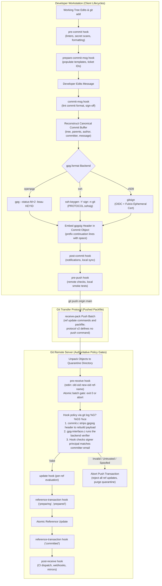

# Git Hooks and Cryptographic Signing

> [!summary] Claim:
> Git intercepts development lifecycles through deterministic hook triggers executed via `hook.c` and `git-hook(1)`, supporting configuration-bound commands and opt-in parallel execution (`hook.jobs`) for events Git does not force to run serially.
> Cryptographic trust does not rely on mutable `author` or `committer` strings; it binds an immutable commit buffer (tree OID, parent OIDs, author, committer, and commit message) to an asymmetric key via a detached ASCII-armored header (`gpgsig`).
> Signing formats span OpenPGP (`gpg`), native OpenSSH signatures (`ssh-keygen -Y` with namespace `git` and `allowed_signers`), and keyless ephemeral X.509 certificates (Sigstore `gitsign`) anchored to OIDC identities in the Rekor transparency log.
> Client-side hooks (`pre-commit`, `commit-msg`) serve as personal hygiene filters that developers can bypass via `--no-verify`, whereas server-side transactional hooks (`pre-receive`, `reference-transaction`) act as authoritative cryptographic gates by validating detached signatures across pushed revision graphs.



## The Mechanism

Git separates revision content generation from revision security enforcement.
[[Git-Object-Model-and-Content-Addressing]] establishes that commit objects are content-addressed Merkle tree nodes.
However, content addressing guarantees only data integrity, not author provenance.
A Git commit object records plain ASCII text for its `author` and `committer` fields.
Any user can set `GIT_AUTHOR_NAME="Linus Torvalds"` and `GIT_AUTHOR_EMAIL="torvalds@linux-foundation.org"`, and Git will construct a valid commit object with those identical bytes.
Cryptographic signing and lifecycle interception hooks provide identity verification and execution control across repository operations.

### 1. Hook Discovery and Execution Architecture

Every Git command that manipulates state triggers hook interception routines implemented in `hook.c` at pinned version Git 2.55.0.
Historically, hooks existed solely as executable POSIX shell scripts located within `$GIT_DIR/hooks/<event-name>`.
When Git initializes a new repository via `git init`, it populates `$GIT_DIR/hooks/` with template scripts ending in `.sample` (copied from the template directory, `<sharedir>/git-core/templates/hooks`, for example `/usr/share/git-core/templates/hooks`; the prefix depends on how Git was built).
Git ignores any hook file that lacks the executable bit: `find_hook()` in `hook.c` tests `access(path, X_OK)` and, when the file exists but is not executable, prints the `advice.ignoredHook` hint (git.git v2.55.0 `hook.c`).

Git deliberately does not track `.git/hooks/` inside the revision tree.
If Git executed hooks checked into the repository automatically upon cloning, downloading an untrusted repository would immediately execute arbitrary code with developer privileges.
Historical vulnerabilities show why that boundary matters: CVE-2014-9390 (case-insensitive path collisions on Windows and OS X), CVE-2019-1387 (too-lax submodule name validation in recursive clones), and CVE-2024-32002 (crafted submodules that make Git write a hook into a `.git/` directory, which then runs while the clone is still in progress) all let a malicious remote execute code on clone (NVD).
To configure tracked hooks safely, developers set `core.hooksPath` (supported since Git 2.9, per the 2.9 release notes) to a versioned directory such as `.githooks`.

Before executing a hook, Git changes the process working directory (githooks(5)):
- In a non-bare repository, Git sets current working directory to the root of the working tree.
- In a bare repository, Git sets current working directory to `$GIT_DIR`.
- For push-triggered server hooks (`pre-receive`, `update`, `post-receive`, `post-update`, `push-to-checkout`), Git always sets the working directory to `$GIT_DIR`.

Git exports internal environment variables to hook child processes: `GIT_DIR`, `GIT_WORK_TREE`, and `GIT_INDEX_FILE`.
If a hook script must execute Git operations against a secondary repository, it must clear these variables using `unset $(git rev-parse --local-env-vars)` to prevent contamination.

### 2. Client-Side Lifecycle Pipeline

Client-side hooks fire during local branch modifications, staging, and commit assembly:

```text
[Working Tree / Index]
       |
       v
+--------------+   --no-verify   +--------------------+
|  pre-commit  | --------------> |  commit aborted?   | (Exit non-zero halts commit)
+--------------+                 +--------------------+
       |
       v
+--------------------+
| prepare-commit-msg | (Takes file, source: message|template|merge|squash|commit)
+--------------------+
       |
       v
  [User Editor]
       |
       v
+--------------+   --no-verify   +--------------------+
|  commit-msg  | --------------> |  commit aborted?   | (Validates format, trailers)
+--------------+                 +--------------------+
       |
       v
  [Commit Object Written]
       |
       v
+--------------+
| post-commit  | (Notification only; cannot abort commit)
+--------------+
```

- `pre-commit`: Invoked by `git commit` before reading the proposed commit message.
  It takes zero command-line arguments.
  It inspects the staged changes via `git diff-index --cached HEAD`.
  Exiting with non-zero status terminates commit assembly before any object is written.
  It can be bypassed with the command-line flag `--no-verify` (or `-n`).
- `prepare-commit-msg`: Invoked immediately after Git generates the default commit log message and before the text editor opens.
  It takes one to three arguments: `$1` path to the commit message file, `$2` commit source (`message`, `template`, `merge`, `squash`, or `commit`), and `$3` a commit object name, passed only when the source is `commit` (`-c`, `-C`, or `--amend`) (githooks(5)).
  It cannot be bypassed with `--no-verify`.
- `commit-msg`: Invoked after the user saves and exits the commit message editor.
  It takes one argument: the filesystem path to the temporary commit message file.
  It enforces commit message schemas (such as Conventional Commits or issue tracker trailers).
  Exiting with non-zero status aborts the commit.
  It can be bypassed with `--no-verify`.
- `post-commit`: Invoked after the commit object is written to `.git/objects/` and the ref is updated.
  It takes zero arguments and cannot affect the outcome of the commit command.
- `pre-push`: Invoked by `git push` before transmitting objects.
  It takes two arguments: `$1` remote name, `$2` remote URL.
  It receives a list of ref updates on standard input formatted as:
  `<local-ref> SP <local-oid> SP <remote-ref> SP <remote-oid> LF`
  Exiting non-zero aborts the push without sending objects.

### 3. Server-Side Transactional Policy Gates

Server-side hooks execute within the remote repository during `git-receive-pack`:

1. `pre-receive`: Invoked once per push batch before any references are modified.
   It takes no command-line arguments.
   It reads a stream of ref updates on standard input:
   `<old-oid> SP <new-oid> SP <ref-name> LF`
   If `old-oid` is the all-zeroes object name (`0000000000000000000000000000000000000000` in a SHA-1 repository, 64 zeroes in a SHA-256 repository), the push creates a new ref.
   If `new-oid` is all zeros, the push deletes the ref.
   Crucially, `pre-receive` is an atomic all-or-nothing policy gate: exiting with non-zero status immediately rejects every ref update in the push batch.
2. `update`: Invoked once for each individual ref in the push batch.
   It takes three positional arguments: `$1` ref name, `$2` old object ID, and `$3` new object ID.
   Exiting non-zero rejects only that specific ref while allowing others to proceed (unless `--atomic` push is requested by the client).
3. `reference-transaction`: Introduced in Git 2.28, this hook intercepts atomic reference backend operations across both loose files and reftable storage engines ([[Git-Refs-Reflog-and-Reftable]]).
   It receives the state argument (`preparing`, `prepared`, `committed`, or `aborted`) and a list of ref updates on standard input.
   A non-zero exit in the `preparing` or `prepared` state aborts the transaction; in every other state the exit status is ignored (githooks(5), Git 2.55.0).
   In `git-receive-pack`, the `update` hook runs for a ref before that ref is queued into a reference transaction, so `update` fires before `reference-transaction` reaches `prepared` (`builtin/receive-pack.c` v2.55.0).
   GitLab's Gitaly Cluster builds strong consistency on this hook: each Gitaly node reports its proposed reference update to Praefect, which waits for the votes and, under the default strategy, requires every node to agree before the update commits (Gitaly HA design document, `doc/design_ha.md`; GitLab Praefect documentation; as of 2026-11).
4. `post-receive`: Invoked after all references are committed to disk.
   It receives the same standard input format as `pre-receive`.
   It handles downstream notifications, event pub/sub queues, and webhook triggers.
   It cannot abort the completed push.

### 4. Config-Defined and Parallel Hooks (`git-hook`)

Traditional hook scripts suffer from three operational limitations: a repository can define only one script per event, hooks cannot run concurrently, and sharing scripts across repositories requires fragile symlinks.
Git 2.55.0 provides the built-in command `git hook` (backed by `builtin/hook.c` and `hook.c`).
Hooks can be declared directly within configuration files (`system`, `global`, or `local`):

```ini
[hook "linter-cpp"]
    event = pre-push
    command = /usr/local/bin/clang-format --dry-run --Werror
    parallel = true

[hook "linter-python"]
    event = pre-push
    command = /usr/local/bin/ruff check .
    parallel = true

[hook "pre-push"]
    jobs = -1
```

The last section sets `hook.pre-push.jobs`, an event-level key; a friendly name must never equal a known event name in `hook.<friendly-name>.event`, which Git treats as a fatal error (git-hook(1), Git 2.55.0).
The example uses `pre-push` because `pre-commit` always runs serially, whatever `hook.jobs` says.
In `hook.c`, `run_hooks_opt()` collects all configured hook entries for the targeted event and always hands them to `run_processes_parallel()`, with a job count of 1 unless parallelism is allowed (git.git v2.55.0 `hook.c`).
Hooks run concurrently only when the effective job count is greater than 1 and every configured hook for the event sets `hook.<friendly-name>.parallel = true`; passing `git hook run -j <n>` with `n > 1` overrides the per-hook setting (git-hook(1)).
Concurrency is controlled globally by `hook.jobs` (default 1) or per event by `hook.<event>.jobs` (where `-1` uses the number of available CPU cores).
If any hook for an event omits `parallel = true`, Git falls back to sequential execution.
Git always runs these events serially, regardless of `-j` or `hook.jobs`: `applypatch-msg`, `prepare-commit-msg`, and `commit-msg` (they rewrite a message file in place), and `pre-commit`, `post-commit`, `post-checkout`, and `push-to-checkout` (they touch the working tree, index, or repository state) (git-hook(1), Git 2.55.0).
Traditional hook scripts inside `.git/hooks/` execute last in the sequence.

### 5. Cryptographic Signature Anatomy

Git supports three signature formats configured via `gpg.format`: `openpgp`, `ssh`, and `x509`.
`gpg.format` selects the backend for signing only: verification chooses the backend from the signature's own armor header (`get_format_by_sig()` in `gpg-interface.c` v2.55.0), which is why the lab's server-side repository needs only `gpg.ssh.allowedSignersFile` and no `gpg.format`.
The signature mechanism is defined in `gitformat-signature(5)`.

#### Commit Signature Embedding
When a developer runs `git commit -S`, Git constructs the commit object in memory.
It determines the unsigned canonical payload, passes that payload to the external signing backend, and embeds the resulting detached signature into the commit object header under the key `gpgsig` (`gpgsig-sha256` in a SHA-256 repository; `gpg_sig_headers[]` in `commit.c` v2.55.0).
Object headers follow strict continuation rules: the first line begins with `gpgsig `, and every subsequent line of the ASCII-armored signature block begins with exactly one ASCII space ` ` (`0x20`).
This is the lab's root commit `7fe43e4b629ef7b458bc2f471ecf16036bf14915`, as printed by `git cat-file commit` (508 bytes):

```text
tree ed46dd19f6204c92947780231982716d4016b9bb
author Alice Engineer <alice@example.com> 1794139200 +0000
committer Alice Engineer <alice@example.com> 1794139200 +0000
gpgsig -----BEGIN SSH SIGNATURE-----
 U1NIU0lHAAAAAQAAADMAAAALc3NoLWVkMjU1MTkAAAAgGCUKoNdZzL9vj0sqK392H7LiRV
 ABsg6i67uTEyKwsh8AAAADZ2l0AAAAAAAAAAZzaGE1MTIAAABTAAAAC3NzaC1lZDI1NTE5
 AAAAQHkFp00iV4yvhtQw6jW7ad2nIGxlXu1AhHi/yB9yCFHji8QQ2FFxcPh4HGij+Pr1Js
 GTtQF550LU6vXcfR3acAw=
 -----END SSH SIGNATURE-----

feat: core runtime initial commit
```

#### The Canonical Signed Payload
To verify a signed commit, Git reconstructs the canonical payload that was signed in `parse_buffer_signed_by_header()`, called from `parse_signed_commit()` in `commit.c`; `gpg-interface.c` then hands payload and signature to the backend (git.git v2.55.0).
It iterates through the commit buffer line by line.
When it encounters `gpgsig `, it extracts the signature block, stripping the leading space from each continuation line until it hits an unindented header or the empty line separating headers from the commit message body.
The canonical payload consists of the exact commit buffer bytes minus the `gpgsig` header line and its continuation lines (202 bytes for the lab commit):

```text
tree ed46dd19f6204c92947780231982716d4016b9bb
author Alice Engineer <alice@example.com> 1794139200 +0000
committer Alice Engineer <alice@example.com> 1794139200 +0000

feat: core runtime initial commit
```

Because the signature covers the tree OID, parent OIDs, author, committer, and commit message, any modification to any of these bytes invalidates the signature.
If a developer amends, rebases, or cherry-picks a commit, the timestamp, parent OID, or tree OID changes, breaking the cryptographic signature ([[Git-Rebase-Internals-and-Stacked-Branches]]).

#### Tag Signatures
Unlike commits, annotated tags created via `git tag -s` append the detached signature directly to the end of the tag object body without header prefixing (gitformat-signature(5); the signature below is illustrative and truncated):

```text
object 7fe43e4b629ef7b458bc2f471ecf16036bf14915
type commit
tag v1.0.0
tagger Alice Engineer <alice@example.com> 1794139200 +0000

Release version 1.0.0
-----BEGIN SSH SIGNATURE-----
U1NIU0lHAAAAAQAAADMAAAALc3NoLWVkMjU1MTkAAAAgGCUKoNdZzL...
-----END SSH SIGNATURE-----
```

### 6. Signature Backends: OpenPGP, OpenSSH, and Sigstore Gitsign

```text
+-------------------+----------------------------+-----------------------------+-----------------------------+
| Feature           | OpenPGP (gpg)              | OpenSSH (ssh)               | Keyless (Sigstore gitsign)  |
+-------------------+----------------------------+-----------------------------+-----------------------------+
| gpg.format        | openpgp                    | ssh                         | x509                        |
| Backend Binary    | gpg                        | ssh-keygen                  | gitsign                     |
| Armor Header      | -----BEGIN PGP SIGNATURE-- | -----BEGIN SSH SIGNATURE--- | -----BEGIN SIGNED MESSAGE-- |
| Trust Store       | Web of Trust, GPG Keyring  | allowed_signers file, KRL   | Rekor Transparency Log, TUF |
| Key Lifetime      | Multi-year / Static        | Multi-year / Rotated        | ~10 Minutes (Ephemeral)     |
| Identity Binding  | Self-signed User ID packet | Principal string in file    | OIDC SAN in X.509 Cert      |
+-------------------+----------------------------+-----------------------------+-----------------------------+
```

#### OpenPGP (`gpg`)
Git invokes `gpg --status-fd=2 -bsau <key-id>` to sign and `gpg --status-fd=1 --verify <sig-file> -` to verify (`gpg-interface.c` v2.55.0).
OpenPGP relies on long-lived private keys managed by `gpg-agent`.
Distribution requires key servers or corporate keyserver infrastructure.
In enterprise deployments, GPG suffers from key loss, lack of automated revocation propagation, and complex subkey management.

#### OpenSSH Signatures (`ssh`)
Introduced in Git 2.34 (which warns against OpenSSH 8.7's broken `ssh-keygen` and asks for 8.8 or later, per the 2.34 release notes), SSH signing leverages the developer's existing OpenSSH key (for example `ed25519` or `rsa`).
Git executes `ssh-keygen -Y sign -n git -f <key-file> <buffer-file>`, adding `-U` when `user.signingKey` is a literal public key held in `ssh-agent` (`gpg-interface.c` v2.55.0).
OpenSSH wraps the signature in the binary blob specified by `PROTOCOL.sshsig`, then base64-armors it between `-----BEGIN SSH SIGNATURE-----` and `-----END SSH SIGNATURE-----`:
- Magic bytes: 6-byte ASCII string `SSHSIG`.
- Version: uint32 (`1`).
- Public key: RFC 4251 binary string encoding the signer's public key.
- Namespace: RFC 4251 string.
  Git always passes `-n git`.
  Per `PROTOCOL.sshsig`, the namespace gives the signature "an unambiguous interpretation domain" and prevents cross-protocol attacks, such as a signature made for file signing being accepted as a Git signature; it is the `SSHSIG` magic preamble in the signed data that keeps these signatures from being confused with SSH user or host authentication signatures.
- Reserved field: RFC 4251 string (empty).
- Hash algorithm: RFC 4251 string, `sha256` or `sha512` for any key type; `ssh-keygen` defaults to `sha512` (`-O hashalg=`, ssh-keygen(1)).
- Signature blob: RFC 4251 string containing key format and signature bytes.

Verification first runs `ssh-keygen -Y find-principals` to map the key to a principal, then `ssh-keygen -Y verify -n git -f <allowed-signers-file> -I <principal> -s <sig-file>` with `-Overify-time=<commit time>`; if no principal matches, Git falls back to `ssh-keygen -Y check-novalidate -n git`, which checks only the cryptography and yields `%G?` = `U` (`gpg-interface.c` v2.55.0).
The trust store is a standard flat file configured by `gpg.ssh.allowedSignersFile`:
```text
alice@example.com namespaces="git" ssh-ed25519 AAAAC3NzaC1lZDI1NTE5AAAAIBglCqDXWcy/b49LKit/dh+y4kVQAbIOouu7kxMisLIf
bob@example.com namespaces="git" ssh-ed25519 AAAAC3NzaC1lZDI1NTE5AAAAICe...
```
Revocation is enforced via a Key Revocation List (KRL) or flat list of revoked public keys via `gpg.ssh.revocationFile`.

#### Keyless OIDC Signing via Sigstore Gitsign
Sigstore Gitsign eliminates long-lived private keys entirely:
1. When signing, Gitsign initiates an OpenID Connect (OIDC) flow against a corporate identity provider (Okta, Google, GitHub Actions Workload Identity).
2. Gitsign generates an ephemeral ECDSA keypair in memory (the gitsign README's sample signature uses `ecdsa-with-SHA256`).
   By default the private key is not written to disk; the optional credential cache modes keep keys and certificates for their lifetime in the OS keyring or an in-memory cache daemon (gitsign README, as of 2026-11).
3. Gitsign transmits a Certificate Signing Request (CSR) with the OIDC identity token to Fulcio (a free, automated public or private Certificate Authority).
4. Fulcio validates the token and issues a short-lived X.509 certificate (about 10 minutes on the public instance, per the gitsign README, as of 2026-11) containing the user's email address or workload URI in the Subject Alternative Name (SAN) extension.
5. Gitsign signs the commit payload with the ephemeral private key.
6. Gitsign records the commit and the signing certificate in Rekor, an append-only Merkle tree transparency log; in the default `online` mode the entry is a HashedRekord holding a SHA-256 hash of the commit SHA plus the certificate (gitsign README, as of 2026-11).
   Rekor returns a Signed Entry Timestamp (SET).
7. The CMS/PKCS7 signature and certificate are embedded in the commit's `gpgsig` header under a `-----BEGIN SIGNED MESSAGE-----` armor.
8. Verifiers validate that the certificate chains to the trusted Fulcio root CA (distributed via TUF), that the Rekor Merkle proof proves signature inclusion, and that the signing timestamp occurred within the certificate's validity window.
   Plain X.509 verification would reject the expired certificate, which is also why GitHub does not show Gitsign commits as verified (gitsign README FAQ, as of 2026-11).

## Commands and Numbers to Know

| Item | Value | Platform and date | What it controls |
| :--- | :--- | :--- | :--- |
| `gpg.format` | `openpgp`, `ssh`, `x509` (default `openpgp`) | Both (as of 2026-11) | Cryptographic signature format used by `--gpg-sign` |
| `gpg.ssh.program` | `ssh-keygen` | Both (as of 2026-11) | Executable binary used for SSH signature generation and verification |
| `gpg.ssh.allowedSignersFile` | Filesystem path | Both (as of 2026-11) | Flat-file trust store mapping principal identities to authorized SSH public keys |
| `gpg.ssh.revocationFile` | Filesystem path | Both (as of 2026-11) | OpenSSH Key Revocation List (KRL) or revoked public keys list |
| `gpg.ssh.defaultKeyCommand` | Shell command string | Both (as of 2026-11) | Dynamic fallback command (e.g. `ssh-add -L`) when `user.signingKey` is unset; Git uses the first output line, which must be a `key::`-prefixed or `ssh-`-prefixed public key |
| `commit.gpgSign` | `false` (default) | Both (as of 2026-11) | Automatically signs all commits without requiring the `-S` flag |
| `tag.gpgSign` | `false` (default) | Both (as of 2026-11) | Automatically signs all annotated tags without requiring `-s` |
| `core.hooksPath` | Unset (defaults to `$GIT_DIR/hooks`) | Both (as of 2026-11) | Overrides directory path from which Git discovers and executes hook scripts |
| `hook.jobs` | `1` (default; `-1` for all CPU cores) | Both (as of 2026-11) | Concurrency limit for parallel hook execution; ignored for the always-serial events (`pre-commit`, `commit-msg`, and others) |
| `hook.<event>.jobs` | Positive integer or `-1` | Both (as of 2026-11) | Per-event concurrency override for parallel hooks (e.g. `hook.post-receive.jobs`) |
| `SSHSIG` magic header | `0x535348534947` (`SSHSIG`) | Both (as of 2026-11) | 6-byte magic identifier at start of OpenSSH binary signature armor |
| `SSHSIG` namespace | `git` | Both (as of 2026-11) | Namespace isolation string in `PROTOCOL.sshsig` preventing replay attacks |
| Fulcio certificate lifetime | About 10 minutes on the public instance | Both (as of 2026-11) | Validity window (`notBefore` to `notAfter`) of Sigstore ephemeral X.509 signing certificates |
| `%G?` format: `G` | Good signature | Both (as of 2026-11) | Valid signature from trusted key in `git log --format="%G?"` |
| `%G?` format: `B` | Bad signature | Both (as of 2026-11) | Cryptographic signature verification failed (payload tampered) |
| `%G?` format: `U` | Good signature, unknown validity | Both (as of 2026-11) | Valid cryptographic signature, but key lacks trust (not in `allowed_signers`) |
| `%G?` format: `X`, `Y`, `R` | Expired signature, expired key, revoked key | Both (as of 2026-11) | Good signature whose signature or key has expired, or whose key is revoked |
| `%G?` format: `N` | No signature | Both (as of 2026-11) | Commit object lacks `gpgsig` header entirely |
| `%G?` format: `E` | Evaluation error | Both (as of 2026-11) | Signature cannot be verified (missing public key or backend binary failure) |

## Multi-Language Comparison: C / Python / Rust

Git core is written in C.
Tools operating in version control ecosystems interact with hooks and cryptographic signatures through language-native implementations:

| Concern | C (Git v2.55.0 / libgit2) | Python | Rust (gitoxide `gix` / `ssh-key`) |
| :--- | :--- | :--- | :--- |
| Hook Dispatch | `run_hooks_opt()` in `hook.c` invoking `run_processes_parallel()` | `subprocess` invoking `git hook run <event>` (as the lab does) | `gix-command` launches commands "very similarly to `Command`, but with `git` specific capabilities and adjustments" (crate docs) |
| Signature Parsing | `parse_signed_commit()` in `commit.c` extracting `gpgsig` header | Split the object at the first blank line and strip the leading space from continuation lines (the lab's `parse_commit_object`) | `gix-object::CommitRef::extra_headers()` iterates header fields not otherwise modeled, in the order encountered (crate docs) |
| Canonical Payload | Rebuilt in memory by skipping `gpgsig` header and continuation lines | Raw object bytes minus the `gpgsig` block (the lab asserts this equality) | The same byte-level removal on the raw object |
| SSH Verification | Fork/exec `ssh-keygen -Y verify` in `gpg-interface.c` | `subprocess` calling `ssh-keygen -Y verify` (the lab) | `ssh-key::SshSig`, a "general-purpose signature format based on SSH keys and wire formats", described as akin to `ssh-keygen -Y sign` and `-Y verify` (crate docs) |
| Trust Store | Git does not parse `allowed_signers`; it passes the file to `ssh-keygen -Y find-principals` and `-Y verify` | Parse the lines yourself, or delegate to `ssh-keygen -Y find-principals` | `ssh-key::authorized_keys` parses `AuthorizedKeysFile` data, a different line layout from `allowed_signers`, where the principals field comes first (ssh-keygen(1)) |
| Ephemeral OIDC | Delegated to `gitsign` child process via `gpg.x509.program` | `sigstore-python` supports keyless signing and verification and checks the certificate's SAN identity and OIDC issuer | `sigstore-rs` is experimental and "will not be considered stable until the 1.0 release"; it has a Fulcio client, a Rekor client, and keyless verification against Fulcio certificates |

The C column was checked against git.git v2.55.0 source.
The Python and Rust cells restate the crate and package documentation (docs.rs for `gix-command`, `gix-object`, and `ssh-key`; the sigstore-python and sigstore-rs READMEs) and the lab, and claim nothing about their internals.

## Worked Lab Example

The reproducible lab is located in `code/02-Version-Control/signed_commit_verify/`.
It runs entirely offline without external network access, leveraging native `git`, `ssh-keygen`, and Python 3; it needs a Git with config-defined hooks (recorded with Git 2.55.0 and OpenSSH 10.6p2 on darwin-arm64, the only recorded platform).

The lab builds a sandboxed environment:
1. It registers a config-defined hook `check-whitespace` using `git config hook.check-whitespace.*`, queries it with `git hook list pre-commit`, and runs it with `git hook run pre-commit`; the hook body writes a marker file, so the lab proves the hook really ran, and a second config-defined hook that exits 1 must make `git hook run` exit non-zero.
   The lab sets no `parallel` option, because `pre-commit` always runs serially.
2. It provisions deterministic Ed25519 SSH keys for an authorized engineer (Alice) and an untrusted actor (Eve), writing an `allowed_signers` trust store with Alice only and a second one with both.
3. It signs a commit with Alice's key, extracts the raw commit object from `git cat-file commit HEAD`, decodes the `SSHSIG` binary armor into magic, version, namespace, and hash algorithm fields, and asserts that the canonical payload equals the raw object with the `gpgsig` block removed.
4. It executes four low-level cases against `ssh-keygen -Y`, and every printed result is parsed from the tool's own output:
   - Valid signature with authorized signer (Alice): the `Good "git" signature for ...` line supplies the principal and fingerprint, and the fingerprint must equal `ssh-keygen -lf` of Alice's public key.
   - Tampered payload: verification must fail with `incorrect signature`.
   - Untrusted signer: a commit really signed by Eve, whose key is absent from `allowed_signers`; `-Y verify -I eve@example.com` fails and `-Y find-principals` finds nobody, while the same command resolves Alice's signature to `alice@example.com`.
   - Identity spoofing with a trusted key: Eve's key is in the second trust store, and her commit names Alice as committer.
     `ssh-keygen -Y verify -I alice@example.com` fails, `-I eve@example.com` succeeds, and `git log` reports `%G?` = `G`, `%GS` = `eve@example.com`, `%ce` = `alice@example.com`.
5. It configures a server-side `pre-receive` hook in a bare repository and pushes five branches: valid (accepted), unsigned (rejected, `%G?` = `N`), Eve with an untrusted key (rejected, `U`), Eve with a now-trusted key but Alice as committer (rejected on `%GS` != `%ce`), and Eve with a trusted key and an honest committer (accepted).
   The hook reads all-zero object names with a pattern test, so it also works in SHA-256 repositories.

The lab prints no fixed result strings: it records 32 named invariants as it runs, the reasons shown are parsed from `ssh-keygen` output and the hook's stderr, and it prints `Result: FAIL` and exits 1 if any invariant breaks.
The count in the final line is the number of recorded invariants.
I mutation-checked the lab: 16 deliberate breakages (a hook that exits 1, a hook that never runs, a missing event, an unsigned commit, a no-op tamper, a swapped trust-store key, a wrong namespace, an extra trusted key, a dropped hook test, a missing server trust store, and others) each make the harness fail.

```bash
cd code/02-Version-Control/signed_commit_verify
bash run.sh
```

### Verified output

Recorded on darwin-arm64 (Git 2.55.0, OpenSSH 10.6p2, the only recorded platform) and verified via `code/_harness/verify.py`:

```text
=== Git Hooks and Cryptographic Signing Verification ===

[1] Config-Defined Hook Architecture (git hook)
  Registered hook: check-whitespace (event: pre-commit)
  git hook list pre-commit: check-whitespace
  git hook run pre-commit: exit 0
  hook body ran: yes
  second hook that exits 1: git hook run pre-commit: exit 1

[2] Raw Commit Object & SSHSIG Armor Decoding
  Commit OID: 7fe43e4b629ef7b458bc2f471ecf16036bf14915
  Commit header fields: tree, author, committer, gpgsig
  SSHSIG binary structure:
    magic: SSHSIG
    version: 1
    namespace: git
    hash_algorithm: sha512
    key_type: ssh-ed25519
  Canonical payload size: 202 bytes

[3] Low-Level Cryptographic Verification Engine (ssh-keygen -Y)
  Case 3.1: Valid Alice signature against allowed_signers: PASS
    matched principal: alice@example.com
    key fingerprint: SHA256:M/1gnJn/fd1fZLzCt7ES7qm4kIP8Zr4IesR2R8uWO5Y
  Case 3.2: Tampered payload verification: FAIL
    ssh-keygen: Signature verification failed: incorrect signature
  Case 3.3: Untrusted Eve signature verified as eve@example.com: FAIL
    find-principals for Alice's signature: alice@example.com
    find-principals for Eve's signature: (none) (exit 255)
  Case 3.4: Trusted Eve key, committer claims alice, verified as alice@example.com: FAIL
    verified as eve@example.com: PASS
    git log %G? %GS %ce: G eve@example.com alice@example.com
    signer == committer: no

[4] Server-Side Hook Policy Enforcement (pre-receive)
  Push 1 (Alice valid signed commit): ACCEPTED (exit 0)
  Push 2 (Unsigned commit): REJECTED (status 'N' is not valid (G))
  Push 3 (Eve commit, key not in server allowed_signers): REJECTED (status 'U' is not valid (G))
  Push 4 (Eve key now trusted, committer claims Alice): REJECTED (signer 'eve@example.com' != committer 'alice@example.com')
  Push 5 (Eve key trusted, honest committer): ACCEPTED (exit 0)

Result: PASS (32 checks)
```

### Reading the result

- In Phase 1, `git hook list pre-commit` returns `check-whitespace` and `git hook run` executes its body, demonstrating that Git 2.55 reads hooks from configuration files rather than requiring loose files in `.git/hooks/`.
  The second hook, which exits 1, makes `git hook run pre-commit` exit 1, so a config-defined hook can veto the event.
- In Phase 2, `git cat-file commit HEAD` yields commit OID `7fe43e4b629ef7b458bc2f471ecf16036bf14915`.
  The decoded SSHSIG header reveals namespace `git` and hash algorithm `sha512`.
  The canonical payload size is 202 bytes, and the lab asserts that this payload equals the raw object with the `gpgsig` block excised.
- In Phase 3, Case 3.1 verifies Alice's signature against `allowed_signers` and reports the principal and the key fingerprint, which equals `ssh-keygen -lf` of her public key.
  Case 3.2 shows that changing the commit message invalidates the signature: `ssh-keygen` reports `incorrect signature`.
  Case 3.3 uses a commit that Eve's key really signed: her key matches no entry, so `find-principals` returns nothing (exit 255) while Alice's signature resolves to `alice@example.com`.
  Case 3.4 is the harder spoof: Eve's key is trusted for `eve@example.com`, so Git reports `G` for a commit whose committer is Alice, and only the comparison of `%GS` (`eve@example.com`) with `%ce` (`alice@example.com`) exposes it.
  `ssh-keygen -I alice@example.com` also fails, but Git derives the principal from `-Y find-principals` rather than from the committer field, so a hook must make the comparison itself.
- In Phase 4, the bare repository's `pre-receive` hook accepts Alice's push, aborts the unsigned push (`%G?` = `N`) and Eve's push while her key is untrusted (`U`), aborts the spoofed push on the `%GS` versus `%ce` mismatch once Eve's key is trusted, and accepts Eve's push when she is honestly the committer.
  The lab also asserts that the rejected pushes left the bare repository's refs unchanged.

## Pitfalls

> [!warning] Pitfall: Treating client-side hooks as security boundaries
> Client-side hooks (`pre-commit`, `commit-msg`) execute locally on developer laptops under developer control.
> Any engineer can bypass client hooks by passing `--no-verify` or `-n` to `git commit`.
> Client hooks are developer ergonomics and formatting hygiene tools; all authoritative security policies, signature verification, and secret scans must reside on server-side gates (`pre-receive` or CI merge queues).

> [!warning] Pitfall: Validating cryptographic signatures without checking committer identity
> A common flaw in server-side signature verification is checking only whether `git verify-commit` succeeds (`%G? == G`).
> If Eve possesses a valid, trusted corporate key, Eve can create a commit declaring `author` and `committer` as `CEO <ceo@company.com>` and sign it with Eve's key.
> The signature is mathematically valid and trusted, but the identity is spoofed.
> Server hooks must verify that the signer principal (`%GS`) strictly matches the committer email (`%ce`).

> [!warning] Pitfall: Expecting signatures to survive rebasing and cherry-picking
> A digital signature commits to the exact binary bytes of the commit object: tree OID, parent OIDs, author timestamp, and committer timestamp.
> Running `git rebase`, `git cherry-pick`, or `git commit --amend` creates a new commit object with a different parent OID or timestamp, which breaks the original signature.
> Rebased commits are unsigned unless re-signed, most directly with `git rebase --gpg-sign` (`-S`) or `commit.gpgSign = true` (git-rebase(1)); `git rebase --exec 'git commit --amend --no-edit -S'` also works but rewrites each commit a second time.

> [!warning] Pitfall: Omitting the OpenSSH signing namespace
> `ssh-keygen -Y sign` has no default namespace: without `-n` it refuses with `Too few arguments for sign: missing namespace` (OpenSSH 10.6p2, run locally), and `PROTOCOL.sshsig` forbids an empty namespace.
> The trap is a hand-rolled signer or verifier that uses another namespace such as `file`: Git always verifies with `-n git`, so `git verify-commit` rejects signatures created under foreign namespaces, and an `allowed_signers` entry with `namespaces="file"` will not accept Git signatures.
> Namespace isolation prevents a signature made for one purpose (for example signing a file) from being accepted as a commit signature; the separate `SSHSIG` preamble is what keeps these signatures from being confused with SSH authentication signatures (`PROTOCOL.sshsig`).

> [!warning] Pitfall: Parsing commit headers without handling space-continuation lines
> In Git commit objects, multi-line headers such as `gpgsig` and `mergetag` prefix every continuation line with a single space (`0x20`).
> Naive scripts that parse headers by splitting on lines or colons break on continuation lines, corrupting the ASCII armor and causing signature verification failures.

> [!warning] Pitfall: Race conditions in parallel hooks accessing mutable index state
> Enabling `hook.jobs = -1` executes independent hooks concurrently, but only for events Git allows to run in parallel.
> Git already forces `pre-commit`, `prepare-commit-msg`, `commit-msg`, `applypatch-msg`, `post-commit`, `post-checkout`, and `push-to-checkout` to run serially because they share the index, working tree, or a message file (git-hook(1), Git 2.55.0), so formatting hooks there cannot race each other.
> The risk remains for events such as `pre-push` or `post-receive`: two concurrent hooks that both write the index or working tree (for example, an auto-formatter and a script that stages files) collide on `.git/index.lock` or interleave writes.
> Set `parallel = true` only on hooks that are safe to run concurrently with every other hook for the event, in practice read-only checks; `git hook run -j <n>` with `n > 1` overrides that per-hook setting.

## At Scale

At personal scale, a developer signs commits with a local GPG or SSH key and runs a lightweight pre-commit script.
Between 1,000 and 50,000 engineers, local key management and hook orchestration collapse without deliberate architectural guardrails:

```text
1 Developer                        1,000 to 50,000 Engineers
--------------------------------   -------------------------------------------------
Local .git/hooks/ scripts          Centralized config hooks via core.hooksPath
Personal GPG keypairs              Short-lived keyless OIDC certificates (Sigstore)
Manual key distribution            Automated allowed_signers distribution via SSO/LDAP
Client-side linting checks         Authoritative server-side pre-receive gates & merge queues
Local git commit -S                CI/CD build train signing with workload identity
```

### Scale Bottlenecks

1. **Pre-Commit Latency Explosion:**
   When teams pack dozens of heavy linters, unit tests, and security scanners into local `pre-commit` hooks, commit latency is the sum of every check, because Git runs the `pre-commit` hooks one after another.
   Parallel hooks do not help here, because Git always runs `pre-commit` hooks serially (githooks(5), Git 2.55.0).
   Developers immediately circumvent checks using `git commit --no-verify`.
   Organizational rule: Limit local client hooks to sub-second AST linters and fast regex secret scans.
   Offload deep static analysis, integration tests, and full-repository compliance to server-side merge queues ([[Git-Branching-Models-Merge-Queues-and-Code-Review]]).

2. **The GPG Keyring Scaling Collapse:**
   Managing GPG keys across 10,000 engineers requires distributing public keys, managing key expiry, handling lost private keys, and maintaining local revocation certificates.
   When an engineer departs, revoking their GPG key across every developer laptop is nearly impossible without central key servers.
   Solution: Migrate from GPG to OpenSSH signatures backed by corporate SSO directories, or deploy Sigstore Gitsign.

3. **Server-Side Verification Storms:**
   Running `ssh-keygen -Y verify` or `gpg --verify` sequentially across large push batches inside `pre-receive` hooks introduces significant CPU overhead on Git server nodes during peak hours.
   A push containing 500 rebased commits spawns at least 1,000 `ssh-keygen` processes with SSH signing, because Git runs `-Y find-principals` and then `-Y verify` for each commit (`gpg-interface.c` v2.55.0), plus whatever `git log` processes the hook itself starts per commit.
   High-scale remotes cache verified commit OIDs in an external store such as Redis (Git's commit-graph file records no signature state), verifying only newly introduced commits in the push range (`$old_oid..$new_oid`).

### Organizational Decision Framework

| Criterion | OpenPGP (`gpg`) | OpenSSH (`ssh`) | Keyless Sigstore (`gitsign`) |
| :--- | :--- | :--- | :--- |
| **Fleet Fit** (author's judgment, no size threshold implied) | Small teams that already run a keyring | Organizations that can maintain a central `allowed_signers` file | Organizations with a corporate OIDC identity provider and no appetite for key management |
| **Key Lifecycle** | Manual key generation and backup | Existing SSH key generated on laptop | Zero key management; ephemeral in-memory |
| **Identity Source** | Self-asserted email in GPG key | Corporate LDAP / GitHub public keys | Corporate OIDC (Okta, Google, Azure AD) |
| **Revocation Model** | Revocation certificates on keyservers | Central `allowed_signers` file / KRL | Short-lived certificates (~10 min validity) |
| **Audit Trail** | None (distributed local keyrings) | Versioned `allowed_signers` in repo | Tamper-proof Rekor transparency log |
| **CI/CD Integration** | Long-lived GPG secret in CI runner | SSH private key secret in CI runner | OIDC Workload Identity Federation |

## Practice Drill

> [!tip] Practice Drill:
> Create a signed commit using an OpenSSH key, verify it using `git verify-commit`, and then write a tampered copy of the commit object to observe how Git detects cryptographic tampering.
> Editing the loose object file in place does not test the signature: the file is read-only, and once made writable Git rejects it as a corrupt loose object (its hash no longer matches) before any signature check runs.
> 
> Execute the following sequence in a temporary directory:

```bash
export GIT_CONFIG_GLOBAL=/dev/null
export GIT_CONFIG_SYSTEM=/dev/null
DIR=$(mktemp -d) && cd "$DIR"

# 1. Generate an isolated Ed25519 keypair
ssh-keygen -t ed25519 -N "" -C "drill@example.com" -f ./id_ed25519 >/dev/null
echo "drill@example.com namespaces=\"git\" $(cat ./id_ed25519.pub)" > ./allowed_signers

# 2. Initialize repository and configure SSH signing
git init -b main -q
git config user.name "Drill Engineer"
git config user.email "drill@example.com"
git config user.signingKey "$(pwd)/id_ed25519"
git config gpg.format ssh
git config gpg.ssh.allowedSignersFile "$(pwd)/allowed_signers"

# 3. Create a cryptographically signed commit
echo "production payload" > data.txt
git add data.txt
git commit -S -m "feat: trusted commit" -q

# 4. Verify signature status
echo "Initial Verification:"
git log -1 --format="Status: %G? | Signer: %GS | Committer: %ce"
git verify-commit -v HEAD

# 5. Write a tampered copy of the commit as a new object (gpgsig header kept intact)
BAD=$(git cat-file commit HEAD | sed 's/trusted/tampered/' | git hash-object -t commit -w --stdin)

# 6. Verify the tampered object: expect "Status: B" and "incorrect signature"
echo "Post-Tampering Verification:"
git log -1 --format="Status: %G? | Signer: %GS" "$BAD"
git verify-commit "$BAD" || echo "Cryptographic verification caught tampering!"

cd / && rm -rf "$DIR"
```

## Interview Questions

> [!question] L5: Explain the execution order of Git commit hooks during commit creation and state which hooks can be bypassed.
>
> > [!success]- Answer
> > When a user executes `git commit`, Git triggers hooks in the following sequence:
> > 1. `pre-commit`: Runs first with no arguments.
> >    It inspects the staged snapshot in the index.
> >    Exiting with non-zero aborts commit creation before an editor opens.
> >    Bypassed via `--no-verify`.
> > 2. `prepare-commit-msg`: Runs immediately after Git prepares the default log message, receiving the message file path, source type, and optional commit SHA.
> >    It populates templates or issue tracker IDs.
> >    It cannot be bypassed via `--no-verify`.
> > 3. `commit-msg`: Runs after the user edits and saves the message, receiving the path to the message file.
> >    It validates message formatting and trailers.
> >    Exiting with non-zero aborts the commit.
> >    Bypassed via `--no-verify`.
> > 4. `post-commit`: Runs after the commit object is written to the object store and the ref is updated.
> >    It receives no arguments and cannot abort the commit.
> > Only `pre-commit` and `commit-msg` can be bypassed using `--no-verify`.

> [!question] L5: Predict the output: A repository requires signed commits.
> An engineer configures `gpg.format = ssh` and signs a commit, but forgets to add their public key to `gpg.ssh.allowedSignersFile`.
> What does `git log -1 --format="%G? %GS"` output?
>
> > [!success]- Answer
> > The command outputs (confirmed with Git 2.55.0 and an empty `allowedSignersFile`):
> > `U `
> > Format specifier `%G?` evaluates to `U` (untrusted / unknown validity).
> > The signature is mathematically valid, but the signing key cannot be mapped to any trusted principal in `gpg.ssh.allowedSignersFile`.
> > Format specifier `%GS` evaluates to an empty string because no principal matched in the allowed signers trust store.

> [!question] L6: Walk through the canonical payload reconstruction algorithm Git uses for verifying commit signatures (`parse_buffer_signed_by_header()` in `commit.c`, whose output `gpg-interface.c` hands to the backend).
>
> > [!success]- Answer
> > Git reconstructs the exact byte sequence that was signed by performing the following steps:
> > 1. Read the uncompressed commit object from `.git/objects/`.
> > 2. Parse the header line by line until reaching the empty line delimiter (`\n\n`) that separates headers from the commit message.
> > 3. When encountering the header `gpgsig `, parse the line as the beginning of the detached signature block.
> > 4. For every subsequent line, check if the first character is an ASCII space (`0x20`).
> >    If it is, strip the leading space and append the line to the detached signature buffer.
> > 5. Once an unindented line or the empty line delimiter is encountered, stop signature extraction.
> > 6. Reconstruct the signed canonical payload by concatenating all commit headers other than `gpgsig` (including `tree`, `parent`, `author`, `committer`), followed by the empty line, and the full commit message body.
> >    A signature header for the other hash algorithm (`gpgsig-sha256` in a SHA-1 repository) is also left out of the payload, which is how a commit can carry signatures for both object formats (`commit.c` v2.55.0).
> > 7. Feed this canonical byte payload to the verification program (`ssh-keygen -Y verify` or `gpg --verify`) along with the detached signature.

> [!question] L6: Debug this: Developers report that after running `git rebase`, their previously signed commits fail server-side signature verification hooks upon push.
> What is the root cause and how is it resolved?
>
> > [!success]- Answer
> > Root cause: A Git commit signature cryptographically seals the entire commit object header and body.
> > Rebasing commits creates new commit objects because their parent commit OIDs and committer timestamps are updated.
> > Because the parent OID and timestamp bytes differ from the original commit, the original signature is invalidated.
> > The sequencer writes brand-new commit objects and does not carry the old `gpgsig` header over; it signs the new commits only when asked to.
> > Resolution: Developers must instruct Git to re-sign each newly assembled commit, most directly with `git rebase --gpg-sign <upstream>` (`-S`, git-rebase(1)).
> > Alternatively, set `git config commit.gpgSign true` so any newly generated commit is signed automatically.
> > `git rebase --exec 'git commit --amend --no-edit -S' <upstream>` also works, at the cost of rewriting every commit twice.

> [!question] L7: Explain how Sigstore Gitsign achieves non-repudiation and identity verification without storing private keys on developer workstations.
>
> > [!success]- Answer
> > Gitsign eliminates static private keys through a three-stage temporal architecture:
> > 1. Authentication and Ephemeral Key Generation: The developer authenticates via an OpenID Connect (OIDC) identity provider.
> >    Gitsign generates a temporary keypair in memory and submits a CSR to Fulcio.
> > 2. Identity-Bound Short-Lived Certificates: Fulcio issues an X.509 certificate valid for only 10 minutes, binding the ephemeral public key to the authenticated user's email or workload URI inside the Subject Alternative Name (SAN).
> > 3. Transparency Logging (Rekor): Gitsign signs the commit payload with the ephemeral private key and submits the signature, certificate, and artifact hash to Rekor (an append-only Merkle tree ledger).
> >    Rekor returns an inclusion proof and Signed Entry Timestamp (SET).
> > 4. Verification: A verifier does not check a static local keyring.
> >    It validates that the certificate chains to Fulcio, verifies the signature against the ephemeral certificate, and verifies via Rekor's Merkle tree that the signature was timestamped during the certificate's 10-minute validity window.
> > Non-repudiation is guaranteed because an attacker cannot forge Rekor's append-only ledger entries retroactively.

> [!question] L7: A platform team notices that pre-push and pre-receive hooks take minutes to complete on large monorepo pushes.
> Design a high-performance server-side verification architecture.
>
> > [!success]- Answer
> > High-performance server-side verification requires the following architectural components:
> > 1. Graph Pruning: In `pre-receive`, never evaluate the entire repository history.
> >    Bound the rev-list traversal strictly to newly introduced commits using `git rev-list "$old_oid..$new_oid"` (or `git rev-list "$new_oid" --not --branches --tags` for new branches).
> > 2. Verification Caching: Store verified commit OIDs in a distributed key-value cache (such as Redis) keyed by commit hash and trust-store version.
> >    If a commit hash is already marked verified and immutable, skip external subprocess execution.
> > 3. Parallel Process Execution: Use worker pools inside a custom `pre-receive` binary to verify independent commit signatures concurrently across CPU cores.
> >    `hook.jobs = -1` (or `hook.pre-receive.jobs`) only runs separate configured hooks side by side when all of them set `parallel = true`; it does not split one hook's commit list.
> > 4. In-Process Verification: Eliminate `fork()` and `exec()` overhead of invoking `ssh-keygen` or `gpg` per commit by linking a native cryptographic verification engine (such as Rust `gix` with `ssh-key` or `ed25519-dalek`) into the server-side gate.

> [!question] L8+: What is the signer-committer impersonation vulnerability in Git signing, and how must enterprise repository governance defend against it?
>
> > [!success]- Answer
> > The vulnerability occurs when a repository gate verifies that a commit signature is cryptographically valid without verifying that the signer's identity matches the committer's identity.
> > An attacker with a legitimate corporate signing key can craft a commit setting `author` and `committer` to an executive or senior engineer, and sign the commit with their own private key.
> > If the server hook checks only `git verify-commit` (`%G? == G`), the check passes because the signature is mathematically valid and trusted.
> > Defense in depth requires:
> > 1. Hook Enforcement: The `pre-receive` hook must inspect both `%GS` (signer principal name) and `%ce` (committer email), rejecting any push where `signer != committer`.
> > 2. Merge Queue Attestation: Enforce that all code entering trunk passes through an automated merge queue ([[Git-Branching-Models-Merge-Queues-and-Code-Review]]).
> >    The merge queue bot validates author signatures on PR branches, rebases or merges the code, and re-signs the final merge commit using an isolated hardware security module (HSM) or workload identity.
> > 3. CODEOWNERS and Branch Protection: Enforce branch protection rules that disallow direct pushes, requiring peer review and cryptographically verified approval attestations.

> [!question] L8+: Formulate a migration strategy for transitioning an organization of 20,000 engineers from fragmented PGP keys to keyless OIDC signing.
>
> > [!success]- Answer
> > A distinguished-level migration strategy consists of four phases:
> > 1. Phase 1 (Infrastructure Deployment): Deploy an internal Sigstore stack (Fulcio CA and Rekor transparency log) integrated with corporate OIDC identity providers.
> >    Distribute root TUF trust metadata to all corporate developer workstations and CI runners via MDM.
> > 2. Phase 2 (Paved Road Tooling): Ship Gitsign bundled within the corporate CLI developer toolchain.
> >    Configure global Git defaults (`git config --global gpg.format x509`, `git config --global gpg.x509.program gitsign`, and `git config --global commit.gpgSign true`).
> > 3. Phase 3 (Soft Enforcement & Observability): Instrument server-side `pre-receive` hooks using [[Git-Trace2-Telemetry-and-Diagnostics]] to log signature types (`openpgp`, `ssh`, `x509`, or unsigned) without blocking pushes.
> >    Publish a migration dashboard tracking percentage adoption per department.
> > 4. Phase 4 (Hard Gate Enforcement): Update `pre-receive` hooks and merge queue validators to require valid Gitsign signatures on all pushes.
> >    Configure fallback handling for automated service accounts using GitHub Actions Workload Identity Federation tokens.
> >    Deprecate PGP and static SSH keys permanently.

## Further Reading

- `githooks(5)` (Git 2.55.0): The normative reference manual for Git hooks, parameters, and environment variables.
- `git-hook(1)` (Git 2.55.0): The official interface for config-defined hooks and parallel execution (`hook.jobs`).
- `gitformat-signature(5)` (Git 2.55.0): Specification of detached signature embedding across commit objects, annotated tags, and mergetags.
- OpenSSH `PROTOCOL.sshsig` (2026): Normative specification of the SSH binary signature format, armor headers, and namespace isolation.
- Sigstore Documentation (2026): Architecture of keyless signing using Fulcio ephemeral certificates and Rekor append-only Merkle transparency logs.
- `gpg-interface.c` and `hook.c` in `git.git` v2.55.0: Core C implementation of signature extraction, canonical payload reconstruction, and parallel process dispatch.
- Scott Chacon and Ben Straub, *Pro Git*, Chapter 8: Comprehensive walkthrough of customizing Git workflows with client and server hooks.

## Related

- Prerequisites: [[Git-Refs-Reflog-and-Reftable]]
- Next: [[Git-Email-and-Patch-Workflows]]
- See also: [[19-Shell-and-Unix-Engineering/11-Networking-and-SSH/SSH-Protocol-and-Keys|SSH Protocol and Keys]]
- Lab: `code/02-Version-Control/signed_commit_verify/`
