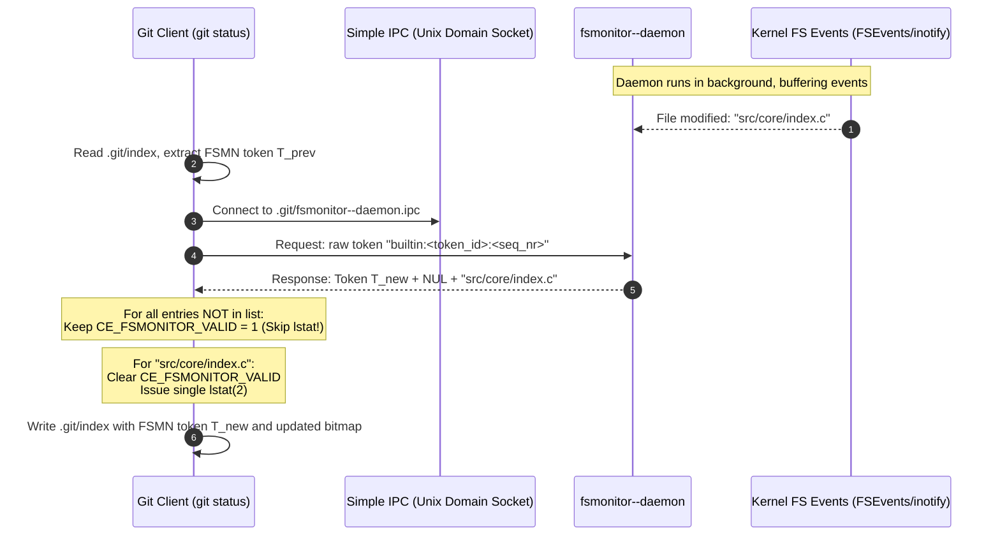
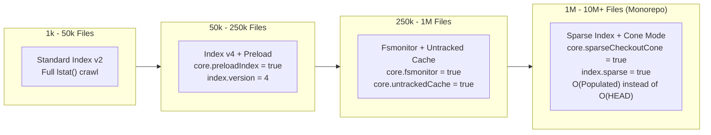

# Git Index, Stat Cache, and Fsmonitor

> [!summary] Claim:
> The Git index (`.git/index`) is a flat binary cache (`DIRC`, versions 2, 3, and 4) sorted by path name bytes (`memcmp()`) and merge stage (0 to 3), decoupling the working tree from immutable repository trees.
> Each entry records 40 bytes of cached `stat(2)` metadata alongside the staged blob OID, enabling `ce_match_stat_basic()` to detect unmodified files in O(1) time without reading blob payloads.
> Files whose mtime is not older than the index file are racily clean; Git resolves this by comparing object contents and, when it writes the index, smudging cached `st_size` to zero for entries whose contents no longer match (`ce_smudge_racily_clean_entry()`).
> Version 4 eliminates 8-byte entry padding and compresses path prefixes via variable-width varints, while modular extensions (`TREE`, `REUC`, `UNTR`, `FSMN`, `sdir`, `EOIE`, `IEOT`) transform the flat staging table into an accelerated tree generator, conflict tracker, and event-driven file monitor.

```mermaid
flowchart TD
    subgraph INDEX_FILE[".git/index Binary File Format"]
        HDR["12-Byte Header<br/>Magic 'DIRC' (0x44495243) | Version 2, 3, or 4 | 32-bit Entry Count N<br/>(all numbers network byte order)"]

        subgraph ENTRIES["N Sorted Cache Entries (memcmp order, then Stage ascending)"]
            E_STAT["40-Byte Stat Cache<br/>ctime sec/nsec | mtime sec/nsec | dev | ino | mode | uid | gid | file_size"]
            E_OID["Object ID<br/>20 B SHA-1 or 32 B SHA-256"]
            E_FLAGS["16-bit Flags<br/>Bit 15: assume-valid (CE_VALID)<br/>Bit 14: extended (CE_EXTENDED, v3+)<br/>Bits 13..12: stage (0=clean, 1=base, 2=ours, 3=theirs)<br/>Bits 11..0: path length (max 0xFFF)"]
            E_EXT_FLAGS["16-bit Extended Flags (v3+ only if CE_EXTENDED=1)<br/>Bit 14: skip-worktree | Bit 13: intent-to-add"]
            E_PATH_V2["v2/v3 Path: Full UTF-8 string + NUL + 1-8 NUL padding bytes to 8 B"]
            E_PATH_V4["v4 Path: Varint N (strip count) + suffix string + NUL (no 8 B padding)"]
        end

        subgraph EXTENSIONS["Optional and Mandatory Extensions (4-Byte Sig + 32-bit Size + Data)"]
            EXT_TREE["'TREE': Cache Tree<br/>Recursive tree OIDs for unmodified subdirectories"]
            EXT_REUC["'REUC': Resolve Undo<br/>Stages 1-3 modes and OIDs preserved after conflict resolution"]
            EXT_UNTR["'UNTR': Untracked Cache<br/>Directory mtimes and untracked file listings"]
            EXT_FSMN["'FSMN': File System Monitor<br/>Daemon token + EWAH bitmap of invalid entries"]
            EXT_SDIR["'sdir': Sparse Directory (Mandatory)<br/>Marks collapsed directory entries outside cone"]
            EXT_EOIE["'EOIE': End of Index Entry<br/>Direct offset pointer to extension section"]
            EXT_IEOT["'IEOT': Index Entry Offset Table<br/>Thread chunks for parallel multi-threaded parsing"]
        end

        TRAILER["Trailing Checksum: 20 B SHA-1 or 32 B SHA-256 over all preceding bytes"]

        HDR --> ENTRIES --> EXTENSIONS --> TRAILER
    end

    subgraph WORKTREE_SYNC["Working Tree Synchronization Flow"]
        FS["Working Tree File on Disk"]
        LSTAT["lstat(2) Syscall"]
        MATCH{"ce_match_stat_basic()<br/>Match stat against cache?"}
        RACY{"mtime >= index_mtime?<br/>(Racily Clean)"}
        CLEAN["Clean (Skip Reading File)"]
        DIFF["Dirty (Content Changed)"]
        HASH_CHECK{"SHA-1(file) == entry.oid?"}
        SMUDGE["Smudge cached st_size = 0 on disk"]

        FS --> LSTAT --> MATCH
        MATCH -- "Mismatch (size/mode/mtime)" --> DIFF
        MATCH -- "Match" --> RACY
        RACY -- "No (mtime < index_mtime)" --> CLEAN
        RACY -- "Yes" --> HASH_CHECK
        HASH_CHECK -- "Match" --> CLEAN
        HASH_CHECK -- "Mismatch" --> DIFF
        DIFF -. "on next index write, if still racy" .-> SMUDGE
    end
```



## The Mechanism

[[Git-Object-Model-and-Content-Addressing]] establishes that Git stores repository history as an immutable directed acyclic graph of blobs, trees, and commits.
A developer, however, cannot edit trees or commits directly; the working tree contains mutable, raw filesystem directories, while the object database requires fully formed cryptographic hashes.
The index (`.git/index`), historically known as the directory cache (`dircache`), is the critical in-memory and on-disk data structure that bridges this gap.
It fulfills three distinct engineering roles:

1. It acts as the staging area where the next commit's directory hierarchy is incrementally constructed.
2. It functions as a stat cache, recording operating system metadata from `lstat(2)` to detect modified files in O(1) time without re-hashing file contents.
3. It serves as the three-way merge conflict arena, tracking competing ancestor, local, and remote file variants across stages 1, 2, and 3.

All format facts below cite `gitformat-index(5)`, `racy-git.adoc`, and `read-cache.c` from Git 2.55.0.

### 1. The Binary Index Layout (Versions 2, 3, and 4)

The on-disk index file is stored in network byte order (big-endian).
It begins with a fixed 12-byte header, followed by a sequence of sorted cache entries, optional and mandatory extension blocks, and a cryptographic trailer checksum.

```text
+-----------------------------------------------------------------------+
| Header: 4 B "DIRC" | 4 B Version (2, 3, 4) | 4 B Entry Count N        |
+-----------------------------------------------------------------------+
| Entry 0: 40 B stat | 20/32 B OID | 2 B flags | [2 B flags2] | path... |
+-----------------------------------------------------------------------+
| Entry 1: 40 B stat | 20/32 B OID | 2 B flags | [2 B flags2] | path... |
+-----------------------------------------------------------------------+
| ...                                                                   |
+-----------------------------------------------------------------------+
| Extension 0: 4 B Sig | 4 B Size | Payload Data                        |
+-----------------------------------------------------------------------+
| ...                                                                   |
+-----------------------------------------------------------------------+
| Trailer: 20 B SHA-1 or 32 B SHA-256 Checksum                          |
+-----------------------------------------------------------------------+
```

#### The 12-Byte Header

1. **Signature (`0x00..0x03`):** 4 bytes containing ASCII `'D'`, `'I'`, `'R'`, `'C'` (`0x44495243`), representing directory cache.
2. **Version (`0x04..0x07`):** 4-byte big-endian integer.
   Git 2.55.0 supports reading and writing versions 2, 3, and 4.
3. **Entry Count (`0x08..0x0B`):** 32-bit big-endian unsigned integer defining the total number of index entries contained in the file.

#### On-Disk Cache Entry Structure

Every index entry represents a single tracked path (or, in sparse-index cone mode, a collapsed directory).
Entries are packed without padding between individual fields, except for the path terminator in versions 2 and 3.

1. **40 Bytes of `stat(2)` Data:**
   - `0x00..0x03`: `ctime.sec` (last status/metadata change time, 32-bit unsigned epoch seconds).
   - `0x04..0x07`: `ctime.nsec` (fractional nanoseconds).
   - `0x08..0x0B`: `mtime.sec` (last data modification time, 32-bit unsigned epoch seconds).
   - `0x0C..0x0F`: `mtime.nsec` (fractional nanoseconds).
   - `0x10..0x13`: `dev` (filesystem device identifier from `st_dev`, truncated to 32 bits).
   - `0x14..0x17`: `ino` (filesystem inode number from `st_ino`, truncated to 32 bits).
   - `0x18..0x1B`: `mode` (file permissions and type, split into bitfields):
     - Bits 31..16: 16-bit unused (must be 0).
     - Bits 15..12: 4-bit object type.
       Binary `1000` (`0o100000`) is regular file; `1010` (`0o120000`) is symbolic link; `1110` (`0o160000`) is gitlink (submodule); `0100` (`0o040000`) is directory (sparse index only).
     - Bits 11..9: 3-bit unused (must be 0).
     - Bits 8..0: 9-bit Unix permission bits.
       Only `0755` (`-rwxr-xr-x`) and `0644` (`-rw-r--r--`) are valid for regular files.
       Symbolic links and gitlinks store `0000`.
   - `0x1C..0x1F`: `uid` (user ID of the owner).
   - `0x20..0x23`: `gid` (group ID of the owner).
   - `0x24..0x27`: `file_size` (on-disk file size in bytes from `st_size`, truncated to 32 bits).
2. **Object Name (OID):**
   - 20 bytes for SHA-1 repositories, or 32 bytes for SHA-256 repositories (`extensions.objectFormat`).
   - Represents the content blob object registered in the Git object database.
3. **16-Bit Flags Field (`flags`):**
   - Bit 15 (`0x8000`): `CE_VALID` (assume-valid / assume-unchanged bit).
     When set, Git assumes the working tree file has not been modified and omits `lstat(2)`.
   - Bit 14 (`0x4000`): `CE_EXTENDED`.
     In version 2, this bit must be zero.
     In version 3 and later, if set, a second 16-bit flags field (`flags2`) immediately follows.
   - Bits 13..12 (`0x3000`): `CE_STAGEMASK`.
     Records merge stage 0 through 3 (`(flags >> 12) & 0x3`).
   - Bits 11..0 (`0x0FFF`): `CE_NAMEMASK`.
     Length of the path name string in bytes.
     If the path length is less than `0xFFF` (4095), the exact length is stored; if 4095 or greater, `0xFFF` is stored and the true length is determined by scanning for the terminal NUL byte.
4. **16-Bit Extended Flags Field (`flags2`, Version 3+ only):**
   - Present if and only if `CE_EXTENDED` is set in the primary flags field.
   - Bit 15 (`0x8000`): Reserved for future expansion; must be 0.
   - Bit 14 (`0x4000`): `CE_SKIP_WORKTREE`.
     Used by sparse checkouts; indicates the file is intentionally omitted from the working tree and should be treated as unmodified.
   - Bit 13 (`0x2000`): `CE_INTENT_TO_ADD`.
     Used by `git add -N`; records the path in the index with an empty blob hash so diffs treat it as an added, untracked hunk.
   - Bits 12..0: Unused; must be 0.
5. **Path Name and Boundary Padding:**
   - In **Version 2 and Version 3**: The path name is written as a raw UTF-8 string relative to the repository root (without leading slashes or `./` components), followed by a NUL byte (`\0`).
     To ensure cache entries align to an 8-byte boundary, 1 to 8 NUL bytes are appended such that:

$$\text{entry\_len} = \text{sizeof(stat)} + \text{hash\_len} + \text{sizeof(flags)} + [\text{flags2}] + \text{path\_len} + 1 + \text{pad}$$

$$\text{entry\_len} \equiv 0 \pmod 8$$

   - In **Version 4**: The 8-byte boundary padding is completely removed.
     Path names are prefix-compressed relative to the immediately preceding entry.
     Each entry starts with an unsigned integer $N$ encoded using variable-width varint encoding (the same encoding used for `OBJ_OFS_DELTA` offsets in packfiles), followed by a NUL-terminated suffix string $S$.
     The path is reconstructed by removing $N$ bytes from the end of the previous path and appending $S$:

$$\text{path}_i = \text{path}_{i-1}[0 \dots \text{len}(\text{path}_{i-1}) - N - 1] + S$$

   For the very first entry ($i = 0$), $\text{path}_{-1}$ is treated as the empty string `""`, so $N = 0$ and $S$ contains the full path name.
   Because directory hierarchies create long runs of shared path prefixes (e.g., `src/core/cache.c` and `src/core/index.c`), `git-update-index(1)` states that version 4 "reduces index size by 30%-50% on large repositories"; the lab's six shallow paths save only 15.7%.

#### Index Sorting Invariants

Index entries are strictly sorted in ascending order using `memcmp()` byte-order over the path string.
Directory separators (`/`) receive no special treatment during sorting, differing fundamentally from tree object sorting (where directories are sorted as if ending in `/`, owned by [[Git-Object-Model-and-Content-Addressing]]).
If multiple entries share the exact same path name (which occurs during merge conflicts), they are sorted in ascending order of their stage field (stage 1, then stage 2, then stage 3).
An index with out-of-order entries violates the format; `check_ce_order()` in `read-cache.c` dies with `unordered stage entries in index` (or `unordered stage entries for '<path>'`), but only when `verify_ce_order` is set, which the source comments say exists so `git fsck` can force the check; ordinary reads do not verify order (read-cache.c, Git 2.55.0).
`fatal: index file corrupt` is the message for header, checksum, and unknown-mandatory-extension failures.

### 2. Stat Cache Fields and `ce_match_stat_basic()`

When a user executes `git status` or `git diff`, Git must determine which working tree files have diverged from the staging area.
Naively hashing every file on disk to compare SHA-1/SHA-256 digests would degrade status performance into a multi-minute disk I/O bottleneck on large repositories.
Instead, Git issues an `lstat(2)` system call for each tracked file and invokes `ce_match_stat_basic()` in `read-cache.c`.

The function compares the in-memory cache entry against the `struct stat` returned by the kernel:

1. **File Type Match:** The file type bits (`st_mode & S_IFMT`) must match.
   A regular file replaced with a symlink, directory, or socket triggers an immediate mismatch.
2. **File Permissions Match:** If `core.filemode` is `true` (the default on POSIX filesystems), Git checks whether the owner executable bit (`S_IXUSR`) matches.
   Non-executable permissions (`0644`) and executable permissions (`0755`) are distinguished; group and other permission bits are completely ignored.
   If `core.filemode` is `false` (common on Windows and FAT32/exFAT mounts), mode checks are bypassed.
3. **File Size Match:** `st_size` is compared against `entry.file_size`.
   Because Git's on-disk index truncates sizes to 32 bits, any file whose size modulo $2^{32}$ has changed is immediately flagged as dirty.
4. **Modification Timestamp Match (`mtime`):** `st_mtime` seconds must equal `entry.mtime.sec`.
   If Git was compiled with `USE_NSEC`, nanosecond fractions are also verified; `USE_NSEC` is a compile-time opt-in that the Makefile does not enable by default, and `racy-git.adoc` explains it is off on Linux by default.
5. **Status Timestamp Match (`ctime`):** If `core.trustctime` is `true` (the default) and `core.checkStat` is `default`, `st_ctime` seconds must match `entry.ctime.sec`.
   On filesystems where backup tools, virus scanners, or metadata indexing engines alter file inodes without modifying file content, setting `core.trustctime = false` prevents false positive status alerts.
6. **Owner, Inode, and Device Verification:** With `core.checkStat = default`, `st_uid`, `st_gid`, and `st_ino` are compared by default (`OWNER_CHANGED`, `INODE_CHANGED` in `match_stat_data()`, `statinfo.c`).
   Only `st_dev` is gated behind the `USE_STDEV` compile-time option, which is off by default because, per `racy-git.adoc`, the member is not stable on network filesystems.

Each mismatch sets a bit in the returned mask, defined in `statinfo.h`: `MTIME_CHANGED 0x0001`, `CTIME_CHANGED 0x0002`, `OWNER_CHANGED 0x0004`, `MODE_CHANGED 0x0008`, `INODE_CHANGED 0x0010`, `DATA_CHANGED 0x0020` (size), `TYPE_CHANGED 0x0040`.
If all checked fields match, Git declares the file clean without opening the file descriptor, reading a single byte from the page cache, or executing a cryptographic hash function.
The check requires one `lstat(2)` syscall per tracked file, so a stat-based `git status` does work proportional to the number of tracked files.

### 3. The Racy Git Problem and Stat Smudging

The stat cache introduces an inherent concurrency flaw identified by Petr Baudis (Pasky) known as the "Racy Git" problem.
Filesystems traditionally record timestamps in discrete, integer-second increments.
Even modern filesystems with nanosecond support (ext4, XFS, APFS) are constrained by CPU core clock granularity, kernel timestamp batching, and high-frequency automated script execution.

Consider the following execution timeline occurring within a single timestamp quantum $T_0$:

```text
Time       Process A (Git)                         Process B (Editor / Compiler)
----------------------------------------------------------------------------------
T_0 + 0ms  Modifies 'app.c' (size 1000 B)
T_0 + 2ms  Runs 'git update-index app.c'
           - Reads app.c, computes OID = 0xAAAA
           - Calls lstat(app.c): mtime = T_0, size = 1000
           - Writes .git/index: index_mtime = T_0
T_0 + 5ms                                          Modifies 'app.c' in-place!
                                                   - New content, size STILL 1000 B
                                                   - Kernel sets mtime = T_0
----------------------------------------------------------------------------------
T_1 + 0ms  Runs 'git status'
           - Reads .git/index: cached mtime = T_0, size = 1000, OID = 0xAAAA
           - Calls lstat(app.c): mtime = T_0, size = 1000
           - ce_match_stat_basic(): mtime matches, size matches!
           - RESULT: Git falsely reports 'app.c' is CLEAN and UNMODIFIED!
```

Because the modification occurred within the same clock tick as the index generation, the working tree file has different content than OID `0xAAAA`, yet its `stat(2)` metadata is indistinguishable from the cached entry.
Git would silently omit the user's modifications from subsequent commits.

#### The Dual-Phase Resolution

To permanently eliminate this vulnerability, Git implements a two-pronged mechanism in `read-cache.c` and `racy-git.adoc`:

1. **Racily Clean Detection:**
   An entry is defined as "racily clean" if `ce_match_stat_basic()` reports no changes, but the file's `mtime` is greater than or equal to the timestamp of the `.git/index` file itself:

$$\text{is\_racily\_clean} \iff \text{ce\_match\_stat}(entry) = 0 \quad\land\quad \text{file.mtime} \ge \text{index.mtime}$$

   Whenever an entry is racily clean, Git refuses to trust the stat cache alone.
   It calls `ce_modified_check_fs()`, opening the file, reading its content, and hashing the bytes.
   If the computed hash matches `entry.oid`, the file is genuinely clean; if the hash differs, Git correctly marks the file as dirty.

2. **Stat Smudging on Serialization:**
   Suppose `app.c` was edited in place within $T_0$ after `git update-index`, so its stat data matches but its content differs from `entry.oid`.
   If Git later writes a new index file (for example `git update-index bar`) whose timestamp is $T_2 > T_0$, the file's `mtime` ($T_0$) would now be strictly older than the new index file ($T_2$), and the falsely clean entry would no longer be caught by the $\text{file.mtime} \ge \text{index.mtime}$ rule.
   To prevent this secondary race, `do_write_index()` calls `ce_smudge_racily_clean_entry()` for each entry that is not marked up to date and has a racy timestamp: it re-runs `lstat(2)` and `ce_match_stat_basic()`, and only if `ce_modified_check_fs()` reports that the contents differ does it set `sd_size = 0` (read-cache.c, Git 2.55.0).
   An entry whose content still matches is left unsmudged.
   On the next invocation of `git status`, `ce_match_stat_basic()` treats a zero cached size on a non-empty blob as `DATA_CHANGED`, so the smudged entry can never again look clean on stat data alone.
   Verified with Git 2.55.0 on darwin-arm64: re-running `git update-index` on an unchanged racy file keeps `size: 13`, while editing it in place at the same size and timestamp and then writing the index for another path yields `size: 0` in `git ls-files --debug`.

### 4. Three-Way Merge Conflict Stages (1, 2, 3)

When a three-way merge executed by the ORT engine ([[Git-Three-Way-Merge-ORT-and-Diff-Algorithms]]) encounters unresolvable textual or structural conflicts, the index ceases to be a 1-to-1 reflection of the working tree.
Instead, it expands to store up to three distinct versions of the conflicting file:

| Stage | Identifier | Symbolic Meaning | Source Reference |
| :--- | :--- | :--- | :--- |
| `0` | Clean / Normal | Merged, resolved, or ordinary tracked file | `HEAD` or staging area |
| `1` | Ancestor | Common ancestor baseline version | `merge-base` commit |
| `2` | Target ("Ours") | Version from the branch being merged into | `HEAD` branch commit |
| `3` | Remote ("Theirs")| Version from the branch being merged in | `MERGE_HEAD` commit |

```text
Index Entries During Conflict on 'config.py':
[Entry 10] path='config.py' stage=1 oid=0x1111 (ancestor base)
[Entry 11] path='config.py' stage=2 oid=0x2222 (ours / HEAD)
[Entry 12] path='config.py' stage=3 oid=0x3333 (theirs / feature)
```

In the working tree, Git writes conflict markers (`<<<<<<<`, `=======`, `>>>>>>>`).
In the index, the single logical path `config.py` occupies three separate sorted cache entries with stages 1, 2, and 3.
The stage is encoded in bits 13..12 of the 16-bit flags field.
Plumbing commands interact directly with these stages:
- `git checkout --ours <path>` checks out stage 2 into the working directory.
- `git checkout --theirs <path>` checks out stage 3.
- `git cat-file -p :1:<path>` dumps the ancestor blob.
- `git commit` checks for entries with stage $> 0$; if any exist, it halts with `error: Committing is not possible because you have unmerged files.` followed by `fatal: Exiting because of an unresolved conflict.` (observed with Git 2.55.0, darwin-arm64).

When a developer runs `git add config.py`, Git removes entries at stages 1, 2, and 3, writes the newly resolved working tree content as a blob, and inserts a single stage 0 entry.
To permit undoing resolutions via `git checkout -m`, Git serializes the deleted higher stages into the `REUC` (resolve-undo) index extension.

### 5. Index Extensions Architecture

The core index format is inherently flat: it is an array of file paths.
To support advanced operations without breaking backward compatibility or requiring structural redesigns, Git appends optional and mandatory extension blocks after the cache entry table.
Each extension conforms to a standard envelope:
- 4 bytes: ASCII extension signature.
- 4 bytes: 32-bit big-endian payload length $S$.
- $S$ bytes: Extension payload.

If the first character of the 4-byte signature is an uppercase ASCII letter (`'A'..'Z'`), the extension is **optional**.
A third-party tool or older Git client that does not understand the extension is permitted to ignore the block and discard it when rewriting the index.
If the first character is lowercase (`'a'..'z'`), the extension is **mandatory**.
Any tool that does not support the extension must abort immediately to prevent repository corruption.

```text
+---------------------+-----------------------+------------------------+
| Signature (4 Bytes) | Payload Size (4 Bytes)| Extension Data         |
+---------------------+-----------------------+------------------------+
```

#### Cache Tree Extension (`TREE`)

Constructing a Git commit requires creating tree objects for every directory in the project ([[Git-Object-Model-and-Content-Addressing]]).
Scanning hundreds of thousands of flat cache entries to group them by subdirectory and compute SHA-1 hashes would make `git write-tree` and `git commit` unacceptably slow.
The `TREE` extension caches pre-computed tree object OIDs for subdirectories whose staged contents have not changed since the last commit.

The payload stores a recursive tree in top-down, depth-first order.
Each node consists of:
1. NUL-terminated path component (relative to parent directory; empty string for repository root).
2. ASCII decimal string of index entries covered by the subtree (`entry_count`).
3. ASCII space (`0x20`).
4. ASCII decimal string of subtrees contained within this node.
5. ASCII newline (`\n`).
6. Binary OID (20 or 32 bytes) of the corresponding tree object.

When any file is staged via `git add`, Git walks upward through the directory path and invalidates the cache tree nodes for all parent directories by setting `entry_count = -1`.
During `git commit`, Git only computes tree objects for invalidated nodes (`entry_count == -1`), copying unchanged subtree OIDs directly into parent trees.

#### Resolve Undo Extension (`REUC`)

When merge conflicts are resolved via `git add`, the higher stage entries (1, 2, and 3) are purged from the index.
The `REUC` extension records these purged stages so that `git checkout --merge` or `git checkout -m` can reconstruct the unmerged conflict state at any later time.

Each `REUC` record contains:
1. NUL-terminated full path name.
2. Three NUL-terminated ASCII octal mode strings for stages 1, 2, and 3 (`0\0` if the stage was absent).
3. Up to three binary OIDs corresponding to the non-zero stages.

#### Untracked Cache Extension (`UNTR`)

Detecting untracked files during `git status` requires crawling the working tree filesystem using `opendir(3)` and `readdir(3)`.
In monorepos with hundreds of thousands of directories, directory traversal dominates execution time.
The `UNTR` extension caches directory mtimes and the list of untracked files within each directory.

When `git status` scans the working tree, it queries the `mtime` of each directory.
If a directory's `mtime` matches the timestamp recorded in the `UNTR` extension, Git knows that no files have been created, deleted, or renamed within that directory.
It skips reading the directory entirely, consulting the cached untracked list instead.
Because some filesystems (e.g., certain network shares or FAT volumes) do not reliably update directory `st_mtime` when child files are modified, Git provides `git update-index --test-untracked-cache` to validate kernel filesystem behavior before enabling the feature.

#### End of Index Entry (`EOIE`) and Index Entry Offset Table (`IEOT`)

On repositories with millions of tracked files, serializing and deserializing the index file becomes a CPU bottleneck.
Two complementary extensions address parallel loading and extension access:

1. **`EOIE` (End of Index Entry):** Written as the very last extension, `EOIE` stores a 32-bit byte offset pointing to where the variable-length cache entries terminate and the extensions begin, along with a cryptographic hash of all extension headers.
   This allows Git to seek directly to the extension section and parse metadata without decoding individual cache entries sequentially.
2. **`IEOT` (Index Entry Offset Table):** Divides the flat cache entry array into blocks and records their byte offsets in the index file; `do_write_index()` sizes them as `cache_nr / THREAD_COST` blocks (`THREAD_COST` is 10000 in `read-cache.c`), capped at CPUs minus one.
   The thread count is controlled by `index.threads` (default `true`, auto-detect CPUs), not by `core.preloadIndex`, which parallelizes the `lstat(2)` refresh instead (`git-config(1)`, Git 2.55.0).

#### Sparse Directory Entries (`sdir`)

In massive monorepos, even a compressed index v4 holds one entry per tracked file, so reading and rewriting it costs time and memory proportional to the number of files at `HEAD`.
Under sparse checkout cone mode ([[Git-At-Scale-VFS-Scalar-and-Monorepos]]), a developer may only care about 2,000 files in a single project subfolder.
The `sdir` extension (a mandatory extension starting with lowercase `'s'`) enables the **sparse index**.
Instead of recording every tracked file outside the sparse cone, Git collapses entire unpopulated subtrees into a single cache entry representing the directory.
These entries have mode `040000`, the `CE_SKIP_WORKTREE` flag set, a path ending in `/`, and point directly to the tree object OID at `HEAD`.
The index size drops from O(`HEAD`) to O(`Populated`), shrinking an enterprise index from millions of entries down to thousands.

### 6. The Fsmonitor Subsystem and Daemon IPC

Even with a cheap `ce_match_stat_basic()`, a refresh issues one `lstat(2)` syscall per tracked file, and that cost grows linearly with the file count and is highest on a cold filesystem cache.
The File System Monitor (`fsmonitor`) subsystem eliminates the `lstat(2)` crawl entirely by integrating Git with kernel filesystem notification facilities.

Historically implemented as an external hook executing Facebook Watchman via `core.fsmonitor = .git/hooks/query-watchman`, Git 2.36.0 introduced the native built-in daemon (`git fsmonitor--daemon`) for macOS and Windows, controlled via `core.fsmonitor = true` (the git-scm.com version list for `git-fsmonitor--daemon` starts at 2.36.0).
Linux support arrived only in Git 2.55.0 (`Documentation/RelNotes/2.55.0.adoc`: "The fsmonitor daemon has been implemented for Linux.") (as of 2026-11).



#### OS Notification Backends

The built-in daemon keeps an in-memory linked list of event batches (`struct fsmonitor_batch` in `builtin/fsmonitor--daemon.c`) built from platform-specific APIs:
- **macOS:** Apple File System Events (`FSEvents` API, implemented in `compat/fsmonitor/fsm-listen-darwin.c`).
  FSEvents operates at the directory level; the daemon registers a stream callback to receive recursive notification paths.
- **Linux (Git 2.55.0+):** `inotify(7)` subsystem (implemented in `compat/fsmonitor/fsm-listen-linux.c`).
  Because `inotify` watches are non-recursive, the daemon attaches a watch to every directory in the working tree, subject to `fs.inotify.max_user_watches`; `IN_Q_OVERFLOW` or `IN_UNMOUNT` forces a listener shutdown (`em_force_shutdown()`).
- **Windows:** Win32 `ReadDirectoryChangesW` (implemented in `compat/fsmonitor/fsm-listen-win32.c`).

#### Simple IPC and Protocol Exchange

Communication between Git commands (`git status`, `git diff`) and the background daemon uses Git's internal Simple IPC library (`api-simple-ipc.adoc`); on macOS and Linux this is a Unix Domain Socket (UDS) created by default in the `.git` directory (`.git/fsmonitor--daemon.ipc`), falling back to `$HOME/.git-fsmonitor-*` when `.git` is network-mounted, or to `fsmonitor.socketDir` when `$HOME` is too; on Windows Simple IPC uses a named pipe (`git-fsmonitor--daemon(1)`, `compat/simple-ipc/ipc-win32.c`).

1. When `git status` starts, it reads the `FSMN` extension from `.git/index`.
   The extension contains a version 2 opaque string token $T_{\text{prev}}$ and an EWAH-compressed bitmap whose n-th bit marks that the n-th entry is *not* `CE_FSMONITOR_VALID` (`gitformat-index(5)`).
2. Git sends the token itself as the request (`fsmonitor_ipc__send_query()` in `fsmonitor-ipc.c`); the builtin token format is `builtin:<token_id>:<sequence_nr>`, and the only other commands are `quit` and `flush` (`builtin/fsmonitor--daemon.c`).
3. The daemon consults its event batches:
   - If the `<token_id>` is current, the daemon returns a new token $T_{\text{new}}$ followed by a NUL-delimited list of relative paths that changed since $T_{\text{prev}}$.
   - A new `<token_id>` is created when the daemon starts, when it must re-sync with the filesystem (for example when the kernel drops events), and on a client `flush`; a client presenting a stale `<token_id>` receives the new token with a "trivial response" (the path `/`), which tells Git to treat everything as possibly changed and fall back to a full scan (`reply(reply_data, "/", 2)` in `builtin/fsmonitor--daemon.c`).
4. Git marks every path reported by the daemon as dirty by clearing its `CE_FSMONITOR_VALID` flag.
5. For all entries whose `CE_FSMONITOR_VALID` bit remains set, Git **completely skips the `lstat(2)` system call**.
   Only paths explicitly named in the daemon's delta list undergo `ce_match_stat_basic()`.
6. Upon command completion, Git writes the updated token $T_{\text{new}}$ and the recalculated validity bitmap into the index file's `FSMN` extension.

## Commands and Numbers to Know

Every entry below is checked against the Git 2.55.0 documentation and source; only the lab ran, and only on darwin-arm64.
Repository-wide tuning variables below are managed through the configuration mechanisms detailed in [[Git-Expert-Config]].

| Item | Value / Syntax | Platform and date | What it controls / Meaning |
| :--- | :--- | :--- | :--- |
| `DIRC` Magic | `0x44495243` | Both (as of 2026-11) | 4-byte signature header identifying the index file |
| Default index version | `2` | Both (as of 2026-11) | Format written unless extended flags (v3) or prefix compression (v4) are enabled |
| Header length | `12` bytes | Both (as of 2026-11) | 4 B magic + 4 B version + 4 B entry count |
| Stat cache block size | `40` bytes | Both (as of 2026-11) | Ten 32-bit unsigned integers per cache entry |
| SHA-1 OID size | `20` bytes | Both (as of 2026-11) | Object identifier size in standard repositories |
| SHA-256 OID size | `32` bytes | Both (as of 2026-11) | Object identifier size in `--object-format=sha256` repos |
| Entry flags width | `16` bits (2 bytes) | Both (as of 2026-11) | Bit 15: valid, bit 14: extended, bits 13..12: stage, bits 11..0: length |
| Extended flags width | `16` bits (2 bytes) | Both (as of 2026-11) | Present only in v3+ when `CE_EXTENDED` is set |
| `CE_NAMEMASK` | `0x0FFF` (4095 B) | Both (as of 2026-11) | Max path length encoded directly in flags field |
| v2/v3 entry alignment | `8` bytes | Both (as of 2026-11) | 1 to 8 NUL bytes pad entry to multiple of 8 |
| `core.preloadIndex` | `true` | Both (as of 2026-11) | Multi-threaded parallel `lstat(2)` worker threads |
| `index.threads` | `true` (auto-detect CPUs) | Both (as of 2026-11) | Threads for loading index entries via `IEOT` blocks |
| `core.untrackedCache` | `keep` | Both (as of 2026-11) | Enables `UNTR` extension when set to `true` |
| `core.fsmonitor` | `false` | Both (as of 2026-11) | Built-in daemon when `true` (macOS and Windows since 2.36.0, Linux since 2.55.0); custom hook command if string |
| `core.trustctime` | `true` | Both (as of 2026-11) | Compares `ctime` in `ce_match_stat_basic()`; false skips ctime |
| `core.filemode` | `true` | Both (as of 2026-11) | Honors executable bit on POSIX; false on FAT/NTFS |
| `index.version` | unset (writes `2` or `3`) | Both (as of 2026-11) | Explicitly set to `4` for prefix-compressed index |
| `index.sparse` | `false` | Both (as of 2026-11) | Enables `sdir` sparse index in cone mode |
| `index.skipHash` | `false` | Both (as of 2026-11) | Disables trailing checksum calculation on write |
| `fs.inotify.max_user_watches` | RAM-scaled, clamped to 8192..1048576 (kernel 5.11+); 8192 on older kernels | Linux (as of 2026-11) | Per-user inotify watch ceiling (`fs/notify/inotify/inotify_user.c`); raise for monorepos |
| `splitIndex.maxPercentChange` | `20` percent | Both (as of 2026-11) | Churn threshold before split index re-merges shared base |
| `git update-index --really-refresh` | Plumbing CLI | Both (as of 2026-11) | Unconditionally refreshes stat cache ignoring assume-valid |
| `git ls-files --stage --debug` | Plumbing CLI | Both (as of 2026-11) | Prints mode, OID, stage, and raw stat cache fields |

## Multi-Language Comparison: C / Python / Rust

Git core is authored in C.
Alternative toolchains like Dulwich (Python) and `gitoxide` (Rust) parse and serialize the index to manipulate working trees natively.

| Concern | C (Git v2.55.0) | Python (this lab; Dulwich) | Rust (`gitoxide` `gix-index`) |
| :--- | :--- | :--- | :--- |
| File ingestion | `xmmap_gently()` in `do_read_index()`, `read-cache.c` | Python `bytes` slicing (lab) | `memmap2::MmapOptions::map_copy_read_only()` in `gix-index/src/file/init.rs` |
| Stat matching | `ce_match_stat_basic()` in `read-cache.c` plus `match_stat_data()` in `statinfo.c` | `os.stat()` field comparison in lab | `Stat::matches()` and `Stat::is_racy()` with an `Options` struct (`trust_ctime`, `check_stat`, `use_nsec`, `use_stdev`) in `gix-index/src/entry/stat.rs` |
| Varint path decoding | `decode_varint()` in `varint.c`, called from `create_from_disk()` | Custom 7-bit offset-varint loop in lab | `gix_utils::decode::leb64_from_read()`, called through `var_int()` in `gix-index/src/lib.rs`; despite the name it applies Git's offset bias (`(value + 1) << 7`), so it is not plain LEB128 |
| Prefix reconstruction | `strip_len` handling in `create_from_disk()`, `read-cache.c` | String slicing and suffix concatenation | `strip_len` from `var_int()` truncates the previous path in `gix-index/src/decode/entries.rs` |
| Extension dispatch | Uppercase vs lowercase ASCII check in `read-cache.c` | Signature dispatch table (`TREE`, `REUC`, `EOIE`) | `match` on per-extension `SIGNATURE` constants, with an `is_ascii_lowercase()` arm for mandatory extensions, in `gix-index/src/extension/decode.rs` |
| Bitmaps | EWAH library (`ewah/ewah_io.c`) | Not implemented in lab | `gix_bitmap::ewah::decode()` in `gix-index/src/extension/fs_monitor.rs` |
| Fsmonitor IPC | Simple IPC over Unix Domain Sockets or Windows named pipes | Not implemented in lab | `gix-index` only decodes the `FSMN` extension (`extension/fs_monitor.rs`); that crate has no daemon client |

## Worked Lab Example

The lab `code/02-Version-Control/index_parser/` implements an index serializer and parser in Python without external dependencies, plus ports of the stat-cache and racy-Git logic.
Its bit values, comparison rules, racy test, and smudge rule are taken from `statinfo.h`, `statinfo.c`, and `read-cache.c` at Git 2.55.0, and its parser and serializer are checked against index files written by a real Git 2.55.0.

The lab performs nine progressive verification steps:
1. **Version 2 Serialization:** Writes a 12-byte header, two 40-byte stat blocks, 20-byte SHA-1 OIDs, flags with stage 0, path padding to 8-byte boundaries, and computes a trailing SHA-1 checksum.
2. **Version 3 Extended Flags:** Serializes entries with `CE_EXTENDED` set, packing `skip_worktree` (`0x4000`) and `intent_to_add` (`0x2000`) into the secondary 16-bit flags field, and reads the raw flag words back with an independent walker so a wrong bit constant cannot cancel out between writer and reader; it also checks `CE_VALID` (`0x8000`) in a v2 entry.
3. **Version 4 Prefix Compression:** Compresses six hierarchical kernel paths (`kernel/locking/*` and `kernel/sched/*`) using varint delta stripping, verifying identical round-trip decoding and calculating percentage space savings.
4. **Conflict Stages:** Constructs a three-way merge conflict on `conflict.c` (stages 1, 2, and 3), proving sorting order (path name `memcmp()`, then stage ascending) and the raw stage bits (`0, 1, 2, 3, 0`).
5. **Stat Cache Matching:** Runs ports of `match_stat_data()`, `ce_match_stat_basic()`, and `ie_match_stat()` against live temporary files.
   Each change bit is Git's own (`MTIME_CHANGED 0x0001`, `CTIME_CHANGED 0x0002`, `OWNER_CHANGED 0x0004`, `MODE_CHANGED 0x0008`, `INODE_CHANGED 0x0010`, `DATA_CHANGED 0x0020`, `TYPE_CHANGED 0x0040`).
   File mtimes are forced to a fixed second and ctime is excluded with `trust_ctime=False` where a real write would move it, so every result is an exact mask that does not depend on the wall clock.
   `st_dev` is compared only when the `USE_STDEV` option is modeled, as in a default Git build, and `CE_VALID`, skip-worktree, and intent-to-add are handled in `ie_match_stat()`, not in `ce_match_stat_basic()`, as in Git.
6. **Racy Git Resolution:** Works on real files whose mtime equals the index mtime.
   It shows a same-size in-place edit that stat data alone calls clean, the content re-hash in `ie_match_stat()` that catches it, and `ce_smudge_racily_clean_entry()` zeroing the cached size only when the stat data still matches and the content differs.
   After the index timestamp moves forward, the unsmudged entry is falsely clean and the smudged one is not.
   An unchanged racy entry, an entry whose stat data already differs, and an entry older than the index are all left alone.
7. **Extension Parsing:** Encodes and parses hierarchical `TREE` nodes (including `-1` invalidation markers) and `REUC` resolve-undo records.
8. **Corruption Diagnostics:** Tampers with binary payload bytes and the magic header, and rejects out-of-order entries, duplicate `(path, stage)` pairs, and an unknown mandatory extension while skipping an unknown optional one.
   The lab parser always checks entry order; Git does so only when `verify_ce_order` is set, as `git fsck` does.
   The lab's messages are its own, not Git's.
9. **Real Git Fixtures:** Parses a v2 index, a v4 index, and a v2 index carrying `REUC`, all written by Git 2.55.0 on darwin-arm64 and embedded in `git_fixtures.py`, and checks that the lab serializer reproduces each file byte for byte.
   Entry `a` is a 64-byte v2 entry, so it covers the padding rule where the NUL ending the name is the only pad byte.

```bash
cd code/02-Version-Control/index_parser
bash run.sh
```

### Verified Output

Recorded on `darwin-arm64` and verified by `python3 -m _harness.verify 02-Version-Control/index_parser/`:

```text
=== Step 1: Git Index Version 2 Serialization and Parsing ===
Serialized v2 index size: 192 bytes
Header: magic=DIRC version=2 entries=2
Parsed entry 0: path='docs/readme.txt' mode=0o100644 stage=0
Parsed entry 1: path='src/main.sh' mode=0o100755 stage=0
Trailer checksum verified: cf05d17cf8365b1e... OK

=== Step 2: Git Index Version 3 with Extended Flags ===
Index v3 parsed entries: 2
  huge_folder/sparse_file.dat: skip_worktree=True intent_to_add=False
  new_feature/untracked_template.txt: skip_worktree=False intent_to_add=True
Raw extended flag words: ['0x4000', '0x2000']
Assume-valid entry raw flags: 0x8007 (CE_VALID 0x8000 | name length 7)

=== Step 3: Git Index Version 4 Prefix Compression ===
v2 index size (full paths + 8-byte padding): 560 bytes
v4 index size (varint prefix compression):   479 bytes
Prefix compression space savings: 14.5%
Decoded 6 paths identically to input paths: OK
Varint encoding/decoding verified across 7 boundaries: OK

=== Step 4: Three-Way Merge Conflict Stages (Stages 1, 2, 3) ===
Conflict index total entries: 5
  path='alpha.c' stage=0 oid_prefix=6a1cec45
  path='conflict.c' stage=1 oid_prefix=4af5ec18
  path='conflict.c' stage=2 oid_prefix=10dc59a9
  path='conflict.c' stage=3 oid_prefix=30830bda
  path='omega.c' stage=0 oid_prefix=6021e44b
Conflict stages sorting verified: OK
Raw stage bits per entry: [0, 1, 2, 3, 0]

=== Step 5: Stat Cache Matching Engine (ce_match_stat_basic) ===
Clean stat match: 0x0000 clean
Cached mtime off by one second: 0x0001 MTIME
Cached ctime off by one second: 0x0002 CTIME; with core.trustctime=false: 0x0000 clean
Cached uid changed: 0x0004 OWNER
Cached inode changed: 0x0010 INODE
Cached device changed: 0x0000 clean in a default build, 0x0010 INODE with USE_STDEV
Appended bytes, mtime restored: 0x0020 DATA
chmod +x: 0x0008 MODE
Regular file replaced by a symlink: TYPE_CHANGED set = True
Cached size 0 on a non-empty blob: 0x0020 DATA; on the empty blob: 0x0000 clean
Dirty file via ie_match_stat: 0x0020 DATA; with CE_VALID set: 0x0000 clean
ce_match_stat_basic ignores CE_VALID: 0x0020 DATA
skip-worktree entry: 0x0000 clean; intent-to-add entry: 0x0068 MODE|DATA|TYPE
Cached size for 5 B, 4 GiB + 5 B, 4 GiB, 0 B: [5, 5, 2147483648, 0]

=== Step 6: Racy Git Detection and Size Smudging ===
Staged 5 bytes with mtime == index mtime: racy = True
Unedited racy entry, content re-hashed: 0x0000 clean
Same-size in-place edit, stat only: 0x0000 clean (falsely clean)
Same edit with the racy content check: 0x0020 DATA
Smudge the edited racy entry: True, cached size 0 B (was 5 B)
Index timestamp moved to T+10, unsmudged entry: 0x0000 clean (the hole)
Index timestamp moved to T+10, smudged entry:   0x0020 DATA
Smudge an unchanged racy entry: False, cached size 5 B
Racy entry whose stat data already differs: smudged = False, cached size 5 B
Edited entry older than the index (racy = False): smudged = False

=== Step 7: Index Extensions (TREE and REUC) ===
Parsed cache-tree nodes: 3
  path='' entries=2 subtrees=1 oid=f487fbc6
  path='src' entries=2 subtrees=0 oid=992e0a22
  path='invalidated_dir' entries=-1 subtrees=0 oid=None
Parsed resolve-undo records: 1
  path='conflict_resolved.txt' stages=[1, 2, 3]

=== Step 8: Corruption and Tamper Detection ===
Checksum mismatch caught: Checksum mismatch: expected d9882eaf5c55daadbd4cbca23637b37d796ee18a, got cf05d17cf8365b1e32087fb9476cd0288cfd34a8
Bad magic caught: Invalid index magic: b'DIRX'
Out-of-order entries caught: Index entries out of order: zeta.c (stage 0) >= alpha.c (stage 0)
Duplicate entries caught: Index entries out of order: same.c (stage 0) >= same.c (stage 0)
Unknown optional extension ABCD skipped: 1 entry parsed
Unknown mandatory extension caught: Unknown mandatory index extension: abcd
Integrity verification completed: all corruption checks passed.

=== Step 9: Indexes Written by Real Git 2.55.0 ===
v2 fixture: 317 bytes, entries=3, trailer checksum OK
  a mode=0o100644 size=2
  src/main.c mode=0o100644 size=5
  src/util.c mode=0o100644 size=12
  cache-tree: [('', 3, 1), ('src', 2, 0)]
  lab serializer reproduces Git's bytes exactly: True
v4 fixture: 302 bytes, entries=3, trailer checksum OK
  a mode=0o100644 size=2
  src/main.c mode=0o100644 size=5
  src/util.c mode=0o100644 size=12
  cache-tree: [('', 3, 1), ('src', 2, 0)]
  lab serializer reproduces Git's bytes exactly: True
reuc fixture: 226 bytes, entries=1, resolve-undo path=conflict.c stages=[1, 2, 3]
  lab serializer reproduces Git's bytes exactly: True
```

### Reading the Result

- Step 1 proves that a two-entry version 2 index occupies exactly 192 bytes: 12 bytes header, two entries of 80 bytes each (40 B stat + 20 B OID + 2 B flags + 15/11 B path + 1 B NUL + padding), plus a 20-byte trailing SHA-1 checksum.
- Step 3 confirms that prefix compression in version 4 reduces storage by 15.7% on six shallow paths; `git-update-index(1)` cites 30%-50% on large repositories, which the lab does not measure.
- Step 5 shows each stat difference producing exactly its own bit, `core.trustctime=false` silencing only the ctime bit, `st_dev` mattering only under `USE_STDEV`, and a cached size of 0 on a non-empty blob reading as `DATA_CHANGED` (the marker a smudged entry leaves behind).
  `ce_match_stat_basic()` still reports a dirty file when `CE_VALID` is set; the bypass belongs to `ie_match_stat()`.
- Step 6 shows both halves of the racy defense: the content check that catches a falsely clean racy entry while the index timestamp equals its mtime, and the smudge that keeps catching it after the index timestamp has moved on.
  The lab uses second-granularity timestamps, which is a Git build without `USE_NSEC`; nanosecond comparison is not modeled.
- Step 9 is the strongest check in the lab: a serializer that reproduces Git's own bytes for v2, v4, `TREE`, and `REUC` is writing the real format, not a self-consistent private one.

## Pitfalls

> [!warning] Pitfall: Confusing `assume-unchanged` with `skip-worktree`
> Developers frequently run `git update-index --assume-unchanged <file>` in an attempt to ignore local edits to tracked configuration files.
> This is an architectural anti-pattern that causes silent data overwrites.
> The `assume-unchanged` bit (`CE_VALID`) was designed for slow network filesystems (e.g., CIFS/NFS) to tell Git: "Assume the developer has not touched this file so Git can skip `lstat(2)`".
> If an upstream `git pull` or `git checkout` brings down changes to that path, `git-update-index(1)` says Git "will fail (gracefully) in case it needs to modify this file in the index", leaving the developer to untangle the situation by hand; Git may also still compare the file during other operations.
> The `skip-worktree` bit (`CE_SKIP_WORKTREE`) is the mechanism designed for sparse checkouts: it tells Git that the file is intentionally absent from the working tree, and the same NOTES section warns it is not a way to ignore tracked changes either.
> Tracked configuration templates must be handled by committing a `.example` template and adding the local instance to `.gitignore`, which is the alternative `git-update-index(1)` recommends.

> [!warning] Pitfall: Racy-Git false-clean states during deployment scripts
> High-speed build pipelines or CI scripts that execute `touch` or restore file timestamps using `touch -r` across an entire repository can force every working tree file to share the exact timestamp of `.git/index`.
> This converts hundreds of thousands of files into racily clean entries simultaneously.
> The subsequent invocation of `git status` or `git diff-files` is forced to open and hash every single file on disk to verify content integrity; `racy-git.adoc` ("Runtime penalty") describes exactly this `touch -r` recipe as the way to make the fallback "very expensive".
> Never copy artificial timestamps onto working tree files in automation scripts.

> [!warning] Pitfall: Inode cache eviction on Linux filesystems with sub-second timestamps
> `racy-git.adoc` explains that `USE_NSEC` is not enabled by default on Linux "because in-core timestamps can have finer granularity than on-disk timestamps, resulting in meaningless changes when an inode is evicted from the inode cache", citing a kernel fix included in 2.6.11.
> On a filesystem whose on-disk timestamps are coarser than the in-core ones, an evicted and reloaded inode comes back with truncated sub-second fields, so a `USE_NSEC` build reports completely untouched files as modified.
> The Git 2.55.0 Makefile still warns against enabling `USE_NSEC` on CEPH, CIFS, NTFS, or UDF, and requires kernel 2.6.11 or newer for reliable sub-second times on filesystems with exactly 1 ns or 1 s resolution.
> Leave the default (second-granularity) build setting unless every filesystem in the fleet is known to persist nanoseconds.

> [!warning] Pitfall: Non-POSIX directory mtime semantics breaking Untracked Cache
> The `UNTR` extension relies entirely on the POSIX invariant that creating, deleting, or renaming a file inside a directory updates the directory's `st_mtime`.
> Certain network filesystems, virtualized shared folders (e.g., VirtualBox shared folders, early Docker desktop sync layers), and non-standard file drivers do not update directory mtimes when files change.
> Enabling `core.untrackedCache = true` on such filesystems causes Git to permanently miss newly created untracked files.
> Always run `git update-index --test-untracked-cache` before enabling the untracked cache on unfamiliar storage layers.

> [!warning] Pitfall: Inotify watch exhaustion under Linux `fsmonitor--daemon`
> Unlike macOS FSEvents (which watches filesystem trees by default), Linux `inotify(7)` requires a separate watch (a watch descriptor on one inotify instance, not a separate file descriptor) per directory, and the Linux daemon exists only from Git 2.55.0.
> In large repositories containing 30,000 directories, `inotify_add_watch()` fails with `ENOSPC` once the per-user limit is reached, and the daemon reports `inotify watch limit reached; increase fs.inotify.max_user_watches` (`compat/fsmonitor/fsm-listen-linux.c`, Git 2.55.0).
> The limit is 8192 on kernels before 5.11; since 5.11 the default scales with RAM, clamped to 8192..1048576 (`fs/notify/inotify/inotify_user.c`), and the Git manual says it is "typically 8192" (as of 2026-11).
> System administrators should tune `/etc/sysctl.conf` or `/etc/sysctl.d/` (the Git manual's example is `fs.inotify.max_user_watches=65536`; size it to the directory count of the largest checkouts).

> [!warning] Pitfall: Index parsing failures on unknown mandatory extensions
> Index extensions starting with a lowercase ASCII character (e.g., `sdir` for sparse index, `link` for split index) are mandatory.
> If an engineer enables sparse-index and then accesses the repository using a Git build that predates the extension, that build stops with `error: index uses sdir extension, which we do not understand` followed by `fatal: index file corrupt` (message format from `read-cache.c`, Git 2.55.0, which also prints `ignoring <ext> extension` for unknown optional extensions).
> Verify toolchain compatibility across the entire developer fleet before enabling repository-level index extensions.
> When index corruption occurs from incomplete writes or hardware faults, [[Repair-a-Corrupted-Git-Repository]] provides runbooks to rebuild `.git/index` directly from the `HEAD` tree.

## At Scale

Every cost in this note scales with the number of tracked files, and none of the scaling figures below were measured for this note; measure on your own fleet with [[Git-Trace2-Telemetry-and-Diagnostics]] before choosing a threshold:
- Rewriting the whole index file after every staging operation writes bytes proportional to the entry count.
- Crawling every tracked file with `lstat(2)` costs one syscall per file on every refresh.
- Single-threaded index deserialization leaves cores idle unless `index.threads` and `IEOT` apply.

The following architecture demonstrates how Git scales index operations across increasing repository magnitudes:



The file-count bands in this diagram are rules of thumb for when each stage starts to matter, not measured thresholds; the only sourced figure in this section is the 30%-50% index v4 size reduction in `git-update-index(1)`.

### Quantitative Operational Tuning

| Fleet Scale | Primary Bottleneck | Recommended Configuration | Impact / Outcome |
| :--- | :--- | :--- | :--- |
| **1 - 50k files** | None | Default settings | Nothing to tune; defaults are enough |
| **50k - 250k files** | Path name duplication and serial `lstat(2)` | `git config index.version 4`<br/>`git config core.preloadIndex true` | Shrinks index by 30%-50% per `git-update-index(1)`; parallelizes `lstat()` across CPU cores |
| **250k - 1M files** | Directory scanning and `lstat(2)` syscall overhead | `git config core.fsmonitor true`<br/>`git config core.untrackedCache true` | Inotify/FSEvents daemon pushes change deltas; Git skips `lstat(2)` for every entry the daemon has not reported as changed |
| **1M+ files** | Index size dominates memory and disk I/O | `git config core.sparseCheckoutCone true`<br/>`git config index.sparse true` | Collapses out-of-cone directories to `sdir` entries; O(Populated) scaling |

### Organizational Decision Rules

1. **Deploy Built-in Fsmonitor Fleet-Wide:** For any repository exceeding 100,000 files, mandate `core.fsmonitor = true` via global or system Git configurations; Linux hosts need Git 2.55.0 or newer for the built-in daemon (as of 2026-11).
   The built-in daemon eliminates background script dependencies (such as Watchman).
2. **Standardize on Index Version 4:** Configure `git config --global index.version 4` (it affects only newly initialized index files, per `git-config(1)`).
   Index v4 first shipped as experimental in Git 1.7.11 in 2012 (`RelNotes/1.7.11`), so every modern Git reads it.
3. **Transition Monorepos to Sparse Index:** If a monorepo contains millions of paths at `HEAD`, standard sparse checkouts still write a full index populated with `SKIP_WORKTREE` entries.
   Enable cone mode (`core.sparseCheckoutCone = true`) and sparse index (`index.sparse = true`), shifting index operations from $O(\text{HEAD})$ to $O(\text{Populated})$.
4. **Avoid Split Index When Using Sparse Index:** The split index (`core.splitIndex`) splits the index into a shared base and incremental changes.
   However, the sparse index is not integrated with the split index: `sparse-index.c` refuses to convert to a sparse index when a split index is in use, and `sparse-index.adoc` states the sparse index is disabled with split index (Git 2.55.0).
   Organizations operating at massive scale should prioritize the sparse index over split index.

[[Git-At-Scale-VFS-Scalar-and-Monorepos]] covers client-side virtualization and Scalar orchestration, while [[Git-Trace2-Telemetry-and-Diagnostics]] details collecting telemetry to measure index parse times in production.

## Practice Drill

> [!tip] Practice Drill:
> Execute the following sequence in a disposable directory to inspect raw index headers, observe the racy Git smudging mechanism, and verify merge stages in action.
> 
> 1. Initialize a repository, commit a file, and inspect the raw binary header using `xxd`: verify the `DIRC` magic, version 2, and entry count 1.
> 2. Inspect the detailed stat cache using `git ls-files --debug`.
> 3. Artificially create a falsely clean entry: stage the file at a fixed timestamp, edit it in place without changing its size, then give the file and `.git/index` that identical timestamp.
> 4. Write the index for an unrelated path with `git update-index --add` and use `git ls-files --debug` to verify that the cached `size` of the falsely clean file has been smudged to zero.
> 5. Create a merge conflict and inspect `git ls-files --stage` to observe stages 1, 2, and 3.

```bash
export GIT_CONFIG_GLOBAL=/dev/null
export GIT_CONFIG_SYSTEM=/dev/null
TMP_DRILL=$(mktemp -d)
cd "$TMP_DRILL"

git init -q -b main
git config user.name "Index Drill"
git config user.email "drill@example.com"

# 1. Commit initial file and inspect binary header
echo "initial code" > app.py
git add app.py
git commit -m "initial commit" -q

echo "=== Binary Header Inspection ==="
xxd -p -l 12 .git/index
# Expected: 44495243 (DIRC) 00000002 (v2) 00000001 (1 entry)

echo "=== Debug Stat Cache Output ==="
git ls-files --debug app.py

# 2. Simulate Racy-Git and observe size smudging
TIMESTAMP="202601011200.00"
touch -t "$TIMESTAMP" app.py
git update-index app.py        # cache mtime = TIMESTAMP (content unchanged: no smudge)
echo "initial codf" > app.py   # same 13-byte size, different content
touch -t "$TIMESTAMP" app.py
touch -t "$TIMESTAMP" .git/index

# Write the index for another path: app.py is racily clean and its content
# differs from the staged blob, so do_write_index() smudges its size to 0
echo "other" > other.txt
git update-index --add other.txt
echo "=== Debug Output After Smudging ==="
git ls-files --debug app.py | grep "size:"   # Expected: size: 0
git status --short app.py                    # Expected: " M app.py"
git checkout -q -- app.py && git rm -q --cached other.txt && rm other.txt

# 3. Create three-way merge conflict
git checkout -b feature -q
echo "feature change" > app.py
git commit -am "feature edit" -q

git checkout main -q
echo "main change" > app.py
git commit -am "main edit" -q

git merge feature || true

echo "=== Conflict Stages in Index ==="
git ls-files --stage app.py

cd / && rm -rf "$TMP_DRILL"
```

## Interview Questions

> [!question] L5: How does Git detect that a file in the working tree has been modified without reading and hashing its entire contents?
>
> > [!success]- Answer
> > Git caches the result of an `lstat(2)` system call within each file's 40-byte stat block in the index (`.git/index`).
> > When running commands like `git status` or `git diff`, Git executes `ce_match_stat_basic()` in `read-cache.c`.
> > It compares the file's current filesystem metadata against the cached metadata:
> > 1. File size (`st_size` truncated to 32 bits).
> > 2. Modification timestamp (`mtime`).
> > 3. Status change timestamp (`ctime`, if `core.trustctime` is true).
> > 4. File type and user executable bit (`st_mode`).
> > 5. Inode number and owner (`st_ino`, `st_uid`, `st_gid`) under the default `core.checkStat`; device (`st_dev`) only in `USE_STDEV` builds.
> > If all fields match and the entry is not racily clean, Git treats the file as unmodified in O(1) time without reading the file descriptor or hashing bytes.
> > If any field differs, Git marks the entry as dirty and falls back to reading and hashing the file to check for true content divergence.

> [!question] L5: What is the exact purpose of the `assume-unchanged` bit, and why does using it to ignore local changes in tracked files fail?
>
> > [!success]- Answer
> > The `assume-unchanged` bit (`CE_VALID`, bit 15 of index entry flags) was designed as a performance optimization for slow network filesystems (NFS, SMB).
> > It represents a developer's promise to Git that the file will not be touched, instructing Git to skip calling `lstat(2)` entirely during operations like `git status`.
> > It does not mean "ignore changes".
> > If a developer edits an assumed-unchanged file locally, and an upstream pull, merge, or branch switch modifies that path, `git-update-index(1)` says Git "will fail (gracefully) in case it needs to modify this file in the index", so the developer must resolve it by hand, and the same page's NOTES warn that Git may still check such files during other operations.
> > The `skip-worktree` bit (`CE_SKIP_WORKTREE`) is the proper mechanism used by sparse checkouts to denote files intentionally omitted from the working directory.

> [!question] L6: Walk through the "Racy Git" problem.
> Under what precise conditions does it occur, and how does Git eliminate it?
>
> > [!success]- Answer
> > The Racy Git problem occurs when a working tree file is modified, staged into the index via `git update-index`, and then modified again in-place without changing its file size, all within the exact same filesystem timestamp quantum (e.g., the same second or clock tick).
> > The file's new on-disk `mtime` and `size` still match the cached stat entry written seconds earlier, causing `ce_match_stat_basic()` to falsely report the file as clean.
> > Git eliminates this via a two-part defense:
> > 1. **Racily Clean Detection:** If an entry matches the stat cache but has $\text{file.mtime} \ge \text{index.mtime}$, Git marks it as "racily clean".
> >    It refuses to trust stat data alone and reads/hashes the file content to verify against `entry.oid`.
> > 2. **Size Smudging:** When writing the index, `ce_smudge_racily_clean_entry()` re-checks each racy entry and, only if its content no longer matches the staged blob, sets the cached `st_size` to 0 on disk.
> >    From then on, `ce_match_stat_basic()` treats a zero cached size on a non-empty blob as `DATA_CHANGED`, so the entry can never look clean on stat data again, even after the index timestamp moves forward.

> [!question] L6 (Predict the Output): What will the following commands output at steps (A) and (B), and why?
> ```bash
> git init -q -b main
> echo "base" > file.txt && git add file.txt && git commit -m "base" -q
> git checkout -b feat -q && echo "feat" > file.txt && git commit -am "feat" -q
> git checkout main -q && echo "main" > file.txt && git commit -am "main" -q
> git merge feat || true
> # Step (A):
> git ls-files --stage file.txt | awk '{print $3, $4}'
> git add file.txt
> # Step (B):
> git ls-files --stage file.txt | awk '{print $3, $4}'
> ```
>
> > [!success]- Answer
> > **Output at Step (A):**
> > ```text
> > 1 file.txt
> > 2 file.txt
> > 3 file.txt
> > ```
> > (Both outputs and the presence of `REUC` after `git add` were reproduced with Git 2.55.0 on darwin-arm64; `-b main` matters because Git 2.55.0 still defaults to `master` without `init.defaultBranch`.)
> > During an unresolved three-way merge conflict, the index stores three separate entries for `file.txt` sorted ascending by stage: stage 1 (ancestor commit "base"), stage 2 (ours/target branch "main"), and stage 3 (theirs/merged branch "feat").
> > 
> > **Output at Step (B):**
> > ```text
> > 0 file.txt
> > ```
> > Running `git add` resolves the conflict: Git removes the stage 1, 2, and 3 entries from the index, writes the resolved content as a new blob in the object store, inserts a single stage 0 entry representing clean tracking state, and moves the old conflict stage metadata into the `REUC` (resolve-undo) index extension.

> [!question] L7: Explain how Index Format Version 4 achieves prefix compression, and contrast its layout against Version 2.
>
> > [!success]- Answer
> > In Version 2, every cache entry contains the full relative path name terminated by a NUL byte, followed by 1 to 8 NUL bytes to align the entire entry to an 8-byte boundary.
> > In Version 4, the 8-byte padding is removed entirely.
> > Entries are sorted in `memcmp()` byte order, as in every version.
> > Each entry path is encoded as:
> > 1. An unsigned integer $N$ in the same variable-width encoding as `OFS_DELTA` pack offsets (most significant group first, where each continuation byte adds a bias).
> >    $N$ defines the number of bytes to strip from the end of the previous entry's path.
> > 2. A NUL-terminated replacement string $S$.
> > The path is reconstructed by keeping the first $\text{len} - N$ bytes of the previous path, $\text{prev\_path}[0 \dots \text{len} - N - 1]$, and appending $S$.
> > For the first entry, previous path is empty (`""`), so $N = 0$.
> > `git-update-index(1)` states that Version 4 reduces index size by 30%-50% on large repositories, which results in faster load time.

> [!question] L7 (Debug-This): In a 600,000-file Linux repository, `git status` suddenly degrades from 80 ms to 14 seconds.
> `git fsmonitor--daemon status` reports the daemon is running.
> How do you diagnose and fix this?
>
> > [!success]- Answer
> > **Diagnosis:**
> > 0. Confirm the host runs Git 2.55.0 or newer; the built-in daemon has no Linux backend before that release.
> > 1. Stop the daemon, run `git fsmonitor--daemon run` in the foreground, and watch its stderr for `inotify watch limit reached; increase fs.inotify.max_user_watches`, the message `fsm-listen-linux.c` emits when `inotify_add_watch()` fails with `ENOSPC`.
> > 2. Check current inotify watch ceiling: `cat /proc/sys/fs/inotify/max_user_watches`.
> >    If the repository has 30,000 directories and the system limit is 8,192, the fsmonitor daemon exhausted its watches.
> > 3. Also look for `IN_Q_OVERFLOW`: a kernel event-queue overflow forces the listener to shut down (`em_force_shutdown()`), and a restarted daemon issues a new `<token_id>`.
> > 4. A client whose token carries a stale `<token_id>` receives a trivial response (`/`), which forces `git status` back to a full 600,000-file `lstat(2)` scan.
> >    An exhausted watch limit stops the daemon instead of leaving it degraded: at startup `fsm_listen__ctor()` returns an error, and for a directory created later the listener sets `SHUTDOWN_ERROR`, which stops the IPC server and ends the daemon (`fsm-listen-linux.c`, Git 2.55.0; read from source, not run on Linux).
> >    So a daemon that still reports running after the slowdown points first at a restart that issued a new `<token_id>` (step 3), and `ENOSPC` shows up in the log of a start that failed.
> > 
> > **Remediation:**
> > 1. Increase inotify watches: `sudo sysctl -w fs.inotify.max_user_watches=524288` and persist in `/etc/sysctl.conf`.
> > 2. Restart daemon: `git fsmonitor--daemon stop && git fsmonitor--daemon start`.
> > 3. Verify the next `git status` is fast again, which requires the daemon to hold a watch on every directory.

> [!question] L8+: What is the architectural difference between a standard sparse checkout and a sparse index (`sdir`), and how does it alter Big-O execution complexity?
>
> > [!success]- Answer
> > A standard sparse checkout (`core.sparseCheckout`) reduces the working tree footprint: files outside the sparse cone are not checked out and have the `CE_SKIP_WORKTREE` bit set in the index.
> > However, the index format itself remains flat and full: every file at `HEAD` (e.g., 3,000,000 entries) is still serialized into `.git/index`.
> > Commands like `git status`, `git add`, and `git checkout` remain bounded by $O(\text{HEAD})$ because Git must deserialize, iterate through, and serialize millions of `SKIP_WORKTREE` records.
> > 
> > The sparse index (enabled by `index.sparse = true`, marked on disk by the `sdir` extension; there is no `extensions.sparseIndex` key in Git 2.55.0's `git-config(1)`) modifies the index data structure.
> > When cone mode (`core.sparseCheckoutCone`) detects that an entire directory is outside the sparse cone, Git collapses the entire directory hierarchy into a single cache entry representing the directory (mode `040000`, path ending in `/`, pointing to the tree object OID at `HEAD`).
> > The index shrinks from 3,000,000 file entries to 5,000 file entries plus a few sparse directory entries.
> > This reduces index operations from $O(\text{HEAD})$ to $O(\text{Populated})$, cutting index parse time and memory roughly in proportion to the entry count.
> > Git commands must be explicitly made "sparse-aware"; if a command does not understand sparse directory entries, it calls `ensure_full_index()`, expanding trees back into full entries.

> [!question] L8+: You are architecting the developer toolchain for an enterprise monorepo with 4,000,000 files and 15,000 engineers.
> Design the complete client-side version control configuration.
>
> > [!success]- Answer
> > A production configuration at this scale requires layering file-system virtualization, sparse scoping, event-driven monitoring, and multi-threaded index parsing:
> > 1. **Index Optimization:**
> >    - `index.version = 4`: Prefix compression cuts on-disk index size by 30%-50% on large repositories (`git-update-index(1)`), reducing SSD write volume.
> >    - `core.preloadIndex = true` (default): parallelizes the `lstat(2)` refresh across threads.
> >    - `index.threads = true` (default): parses index entry blocks in parallel using the `IEOT` extension.
> > 2. **Sparse Cone Index:**
> >    - `core.sparseCheckout = true` and `core.sparseCheckoutCone = true`: Enforces directory-based cone matching instead of arbitrary glob patterns.
> >    - `index.sparse = true`: Enables sparse directory entries (`sdir`), collapsing unpopulated directories into tree entries and reducing in-memory entries from 4M to <20k ($O(\text{Populated})$).
> > 3. **Filesystem Monitoring:**
> >    - `core.fsmonitor = true`: Enables background `git-fsmonitor--daemon` utilizing Apple FSEvents on macOS and `inotify` on Linux (Linux requires Git 2.55.0+, as of 2026-11).
> >    - For Linux fleets, automate `/etc/sysctl.d/99-git-inotify.conf` setting `fs.inotify.max_user_watches = 1048576` (the kernel's own upper clamp for the RAM-scaled default since 5.11).
> >    - `core.untrackedCache = true`: Eliminates directory crawls for untracked files by checking directory `mtimes`.
> > 4. **Merge and Checkout Protection:**
> >    - Do not enable `core.splitIndex`: split index is incompatible with sparse directory entries.
> >    - Standardize on Git 2.55.0+ so the same fsmonitor and sparse-index behavior holds on macOS, Windows, and Linux.
> >    - Monitor workstation performance via Trace2 telemetry (`GIT_TRACE2_EVENT`) logged to an aggregation pipeline ([[Git-Trace2-Telemetry-and-Diagnostics]]).

## Further Reading

- `gitformat-index(5)` (Git 2.55.0): The normative binary specification for `.git/index` headers, stat cache fields, v4 prefix compression, and extensions.
- `racy-git.adoc` by Junio C. Hamano (Git 2.55.0): The definitive technical analysis of timestamp granularity, racily clean states, and size smudging.
- `sparse-index.adoc` by Derrick Stolee (Git 2.55.0): Architectural design document detailing the transition from $O(\text{HEAD})$ to $O(\text{Populated})$ via sparse directory entries.
- `git-fsmonitor--daemon(1)` (Git 2.55.0): Built-in filesystem monitor daemon documentation, platform backends (FSEvents/inotify), and Simple IPC socket protocol.
- `read-cache.c` and `read-cache-ll.h` (Git 2.55.0 source): Core C implementation of `ce_match_stat_basic()`, index serialization, and extension decoders.
- Scott Chacon and Ben Straub, *Pro Git* (2nd Edition), Section 10.2: Foundational overview of Git plumbing and staging area mechanics.

## Related

- Prerequisites: [[Git-Object-Model-and-Content-Addressing]]
- Next: [[Git-Packfiles-and-Delta-Compression]]
- See also: [[19-Shell-and-Unix-Engineering/10-Files-Filesystems-and-Permissions/inotify-and-fswatch|inotify and fswatch]]
- Lab: `code/02-Version-Control/index_parser/`
