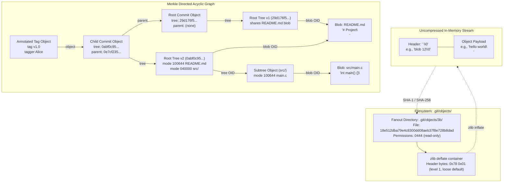
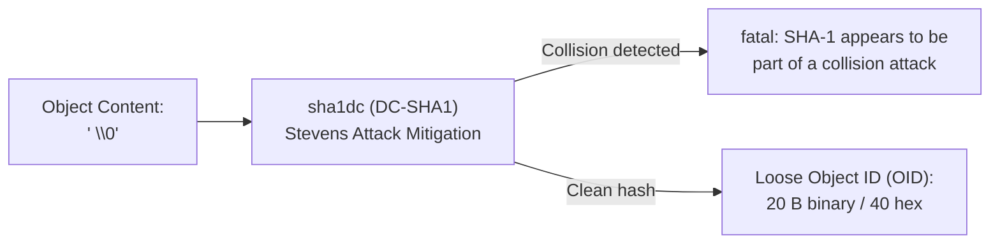
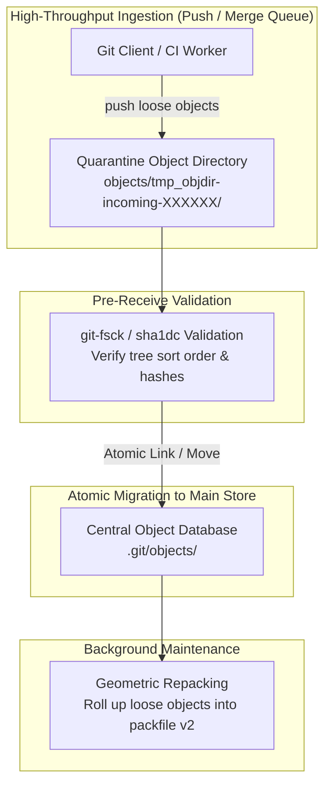

# Git Object Model and Content Addressing

> [!summary] Claim:
> Git stores repository state as an immutable, content-addressed directed acyclic graph (Merkle DAG) constructed from four fundamental object types: blobs, trees, commits, and annotated tags.
> Every loose object is serialized with a canonical header `"<type> <size>\0"`, hashed with SHA-1 or SHA-256 to produce its immutable Object ID (OID), compressed with zlib deflate, and stored under `.git/objects/??/` using a 256-way directory fan-out.
> Tree objects record directory entries as binary sequences sorted by `base_name_compare`, which compares directories as if an implicit trailing slash were appended to prevent sort-order ambiguities against files with common prefixes.
> Mutations never modify existing objects in place; instead, they construct new nodes and rewrite path pointers up to a new root commit, while collision detection (`sha1dc`) rejects input that carries the signature of a known SHA-1 collision attack.



## The Mechanism

The Git object model was created on 2005-04-07 by Linus Torvalds in commit `e83c5163316f89bfbde7d9ab23ca2e25604af290` to replace BitKeeper with an unconstrained, high-performance distributed version control engine.
Unlike earlier tools such as SCCS, RCS, and CVS, which modeled history as per-file delta chains, Git models history as a cryptographic Merkle Directed Acyclic Graph (DAG) of complete repository snapshots.
Every structural guarantee in Git - fast branching, verifiable history, instantaneous rollback, and corruption detection - derives from content addressing.
All format implementations and function signatures below reflect the Git reference source tree at version 2.56.0 unless otherwise cited.

### 1. The Loose Object Container

A newly created Git object is written to disk as a "loose object".
A loose object is an individual file stored under `$GIT_DIR/objects/` (typically `.git/objects/`).
The format is governed by `gitformat-loose(5)`; header formatting and parsing live in `object-file.c`, and as of v2.56.0 the loose write path (`create_tmpfile()`, `close_loose_object()`, `write_loose_object()`) lives in `odb/source-loose.c`.

#### The Canonical Header Prefix

Before compression or hashing, every Git object is formatted with an ASCII header prefix:

```text
<type> <size>\0<payload>
```

- `<type>` is an ASCII string matching one of the four valid object types: `blob`, `tree`, `commit`, or `tag`.
- ` ` is a single ASCII space delimiter (`0x20`).
- `<size>` is the length of the uncompressed `<payload>` in bytes, represented as a base-10 ASCII string with no leading zeros (except for a size of zero).
- `\0` is a single ASCII null byte (`0x00`) terminating the header.
- `<payload>` is the raw binary content of the object.

In the Git reference source, this header is formatted by `format_object_header()` in `object-file.c`:

```c
int format_object_header(char *str, size_t size, enum object_type type,
                         size_t objsize)
{
    const char *name = type_name(type);

    if (!name)
        BUG("could not get a type name for 'enum object_type' value %d", type);

    return xsnprintf(str, size, "%s %"PRIuMAX, name, (uintmax_t)objsize) + 1;
}
```

The maximum header size in Git is defined by `MAX_HEADER_LEN` (32 bytes) in `object-file.h`.
Because the header is prepended prior to hashing, the cryptographic identity of an object commits both to its payload and to its declared object type and length.
A blob containing the ASCII text `"hello world\n"` (12 bytes) has the uncompressed byte sequence:

```text
b"blob 12\0hello world\n"
```

Computing SHA-1 over this 20-byte sequence yields the canonical hash `3b18e512dba79e4c8300dd08aeb37f8e728b8dad`.
Hashing an empty blob (`b"blob 0\0"`) yields `e69de29bb2d1d6434b8b29ae775ad8c2e48c5391`.
Hashing an empty tree (`b"tree 0\0"`) yields `4b825dc642cb6eb9a060e54bf8d69288fbee4904`.

#### Filesystem Layout and Fan-out Sharding

The hexadecimal string of the cryptographic hash forms the Object ID (OID).
In a SHA-1 repository, the OID is 40 hexadecimal characters (20 bytes binary).
In a SHA-256 repository, the OID is 64 hexadecimal characters (32 bytes binary).
Loose objects are stored using a two-character directory fan-out:

```text
.git/objects/xx/yyyyyyyyyyyyyyyyyyyyyyyyyyyyyyyyyyyyyy
```

- The first 2 hexadecimal characters select a subdirectory under `.git/objects/`.
- The remaining 38 characters (or 62 characters in SHA-256) form the file basename within that subdirectory.

This sharding scheme bounds the number of child entries in any single directory.
On classic Unix filesystems (such as ext2, ext3, and older UFS), directories were indexed via linear lists of directory entries.
Placing 500,000 files in a single flat directory made every `open(2)` and `stat(2)` lookup a linear $O(N)$ scan of that directory; fan-out divides N by 256.
Link-count limits such as `EXT3_LINK_MAX = 32000` cap subdirectories and hard links per inode, not regular files in a directory (Linux v4.2 `fs/ext3/namei.c`), so they are not what fan-out guards against.
The two-character prefix creates exactly 256 subdirectories (`00` through `ff`), distributing directory entries evenly across the filesystem tree.

#### Compression and Atomic Persistence

A loose object on disk contains the zlib deflate stream of `"<type> <size>\0<payload>"`.
Git uses standard zlib framing (`0x78` header byte), but loose objects default to compression level 1 (best speed, so the stream starts `0x78 0x01`): `core.looseCompression` falls back to `core.compression` and then to 1 (git-config docs; `environment.c` sets `Z_BEST_SPEED`; first bytes checked locally on git 2.55.0, as of 2026-11).
When writing a loose object in `write_loose_object()` within `odb/source-loose.c` (v2.56.0), Git publishes atomically via this system call sequence:

1. `mkstemp`-style open: `create_tmpfile()` calls `git_mkstemp_mode(".../xx/tmp_obj_XXXXXX", 0444)`, so the file is created read-only from the start; there is no separate `fchmod(2)`.
2. `mkdir(2)`: only if that open fails with `ENOENT`, Git creates the fan-out directory with `mkdir(dir, 0777)` (masked by umask), applies `adjust_shared_perm()` for `core.sharedRepository`, and retries the open.
The source comment says the temp file sits in the destination directory to avoid cross-directory renames, which misbehave on FAT, NFS, and Coda.
3. `write(2)`: Git streams the zlib-compressed header and payload into the temporary descriptor.
4. Read-only mode: loose objects are immutable, so the `0444` mode from step 1 stands (`-r--r--r--` observed locally on git 2.55.0).
5. `fsync(2)`: `close_loose_object()` fsyncs only when `core.fsync` includes `loose-object` (including batch mode) or the deprecated `core.fsyncObjectFiles` is true; the default component set excludes loose objects.
6. `close(2)`: Git closes the temporary descriptor.
7. `link(2)` then `unlink(2)`: `finalize_object_file_flags()` in `object-file.c` hard-links the temp file to `xx/yy...` and removes the temp name; it uses `rename(2)` only when `core.createObject=rename` or on platforms built with `OBJECT_CREATION_USES_RENAMES` (Windows, MinGW, Cygwin in `config.mak.uname`).
If the destination already exists, `link(2)` fails with `EEXIST`, Git keeps the existing file, and by default runs `check_collision()` on the two files; existing objects are never overwritten.

Readers open loose objects via `open(2)`, stream the bytes into `inflateInit()`, parse the header through the first null byte, verify the size, and stream the payload into memory.

### 2. The Four Object Types and Exact Binary Layouts

Git defines exactly four object types in `enum object_type` inside `object.h` (v2.56.0):

```c
enum object_type {
    OBJ_BAD = -1,
    OBJ_NONE = 0,
    OBJ_COMMIT = 1,
    OBJ_TREE = 2,
    OBJ_BLOB = 3,
    OBJ_TAG = 4,
    /* 5 for future expansion */
    OBJ_OFS_DELTA = 6,
    OBJ_REF_DELTA = 7,
    OBJ_ANY,
    OBJ_MAX
};
```

Types 1 through 4 represent fundamental loose objects.
Types 6 and 7 exist exclusively within packfiles, as documented in [[Git-Packfiles-and-Delta-Compression]].

#### Blob (`OBJ_BLOB`, type 3)

A blob (binary large object) stores uninterpreted file data.
A blob does not record file names, directory paths, file modification timestamps, or executable permission bits.
If two files in different directories have identical byte contents, they point to the exact same blob OID in the object store, achieving automatic data deduplication.

#### Tree (`OBJ_TREE`, type 2)

A tree object represents a directory snapshot.
It maps human-readable path components to their corresponding blob or subtree OIDs, associating Unix file modes with each entry.
Unlike human-readable configuration files or commit manifests, a tree object is stored as a compact binary sequence of entries without newlines:

```text
<mode> <name>\0<binary-oid>
```

- `<mode>` is the file mode in octal, formatted as an ASCII string without leading zeros (e.g., `40000`, `100644`, `100755`, `120000`, `160000`).
- ` ` is an ASCII space delimiter (`0x20`).
- `<name>` is the filename or directory name as an uninterpreted byte string (Git does not enforce an encoding; UTF-8 is only a convention) containing no null bytes or slash characters.
- `\0` is a null byte terminator (`0x00`).
- `<binary-oid>` is the raw cryptographic hash: exactly 20 binary bytes in SHA-1, or 32 binary bytes in SHA-256.

Valid Git tree modes:

| Octal string in tree | Symbolic mode | Target object type | Meaning |
| :--- | :--- | :--- | :--- |
| `40000` | `040000` | `OBJ_TREE` | Subdirectory / Subtree |
| `100644` | `0100644` | `OBJ_BLOB` | Non-executable regular file |
| `100755` | `0100755` | `OBJ_BLOB` | Executable regular file |
| `120000` | `0120000` | `OBJ_BLOB` | Symbolic link (blob contains symlink target path) |
| `160000` | `0160000` | `OBJ_COMMIT` | Gitlink (submodule pointer to commit OID) |

Notice that the raw binary tree entry uses `40000` (5 characters, no leading zero) for directory entries, whereas the porcelain command `git cat-file -p` displays `040000` (6 characters with a leading zero) to align with standard POSIX mode notation (`builtin/mktree.c` writes `"%o"`, `builtin/ls-tree.c` prints `"%06o"`, v2.56.0).

#### The Canonical Tree Sorting Rule: `base_name_compare`

A critical invariant of Git's object model is that entries within a tree object must appear in strict canonical sort order.
If tree entries are not sorted canonically, tree hashing becomes non-deterministic and binary search during path traversal fails.
Git does not sort tree entries using naive `strcmp()`.
Instead, Git sorts tree entries using `base_name_compare()` in `tree.c`:

```c
int base_name_compare(const char *name1, size_t len1, int mode1,
                      const char *name2, size_t len2, int mode2)
{
    unsigned char c1, c2;
    size_t len = len1 < len2 ? len1 : len2;
    int cmp;

    cmp = memcmp(name1, name2, len);
    if (cmp)
        return cmp;
    c1 = name1[len];
    c2 = name2[len];
    if (!c1 && S_ISDIR(mode1))
        c1 = '/';
    if (!c2 && S_ISDIR(mode2))
        c2 = '/';
    return (c1 < c2) ? -1 : (c1 > c2) ? 1 : 0;
}
```

This function enforces a profound rule: **directories are sorted as if their path name ended with an implicit trailing slash (`/`).**
In standard ASCII, the characters compare as follows:
- Dash `-`: ASCII 45 (`0x2D`)
- Period `.`: ASCII 46 (`0x2E`)
- Slash `/`: ASCII 47 (`0x2F`)
- Letter `a`: ASCII 97 (`0x61`)

Consider four repository entries: `bin` (directory), `bin-tool` (file), `bin.c` (file), and `bina` (file).
Under naive lexicographical sorting, `"bin"` terminates with a null byte (`0x00`), which sorts before all printable ASCII characters.
Naive sort order would place `"bin"` first: `['bin', 'bin-tool', 'bin.c', 'bina']`.
Under Git's canonical sorting rule, `"bin"` is evaluated as `"bin/"`.
Comparing `"bin/"` against `"bin-tool"` evaluates `/` (47) against `-` (45), so `"bin-tool"` sorts before `"bin"`.
Comparing `"bin/"` against `"bin.c"` evaluates `/` (47) against `.` (46), so `"bin.c"` sorts before `"bin"`.
Comparing `"bin/"` against `"bina"` evaluates `/` (47) against `a` (97), so `"bin"` sorts before `"bina"`.
The canonical Git sort order is:

```text
['bin-tool', 'bin.c', 'bin', 'bina']
```

Any tool or custom script that serializes a Git tree using standard string comparison produces a tree with a different OID that `git fsck` rejects with `error in tree <oid>: treeNotSorted: not properly sorted` (reproduced locally on git 2.55.0; `FSCK_MSG_TREE_NOT_SORTED` is an ERROR in `fsck.h`).

#### Commit (`OBJ_COMMIT`, type 1)

A commit object binds a root directory snapshot (tree) to parent commits and author metadata.
The uncompressed commit payload is a plain ASCII/UTF-8 formatted text block:

```text
tree 29d176f5dfd29c658a04490d886ddb46fff869b6
parent 0e7cf235722c4ac815d7d45bdef5dd210ca93b89
author Alice Engineer <alice@example.com> 1731000000 +0000
committer Alice Engineer <alice@example.com> 1731000000 +0000
gpgsig -----BEGIN PGP SIGNATURE-----
 ...
 -----END PGP SIGNATURE-----

Commit title line

Optional detailed commit description body.
```

- `tree <oid>\n`: The hexadecimal OID of the root directory tree representing the complete repository snapshot at this commit.
- `parent <oid>\n`: The hexadecimal OID of a predecessor commit.
A root commit has 0 parent lines.
A standard commit has 1 parent line.
A two-way merge commit has 2 parent lines.
An octopus merge has 3 or more parent lines.
- `author <name> <<email>> <epoch-seconds> <tz-offset>\n`: Identifies the human who created the code change.
- `committer <name> <<email>> <epoch-seconds> <tz-offset>\n`: Identifies the human or automated agent who applied the commit to the repository.
- Optional header fields: `gpgsig` (PGP signature block), `gpgsig-sha256` (signature in transition repositories), or `mergetag` (inlined annotated tag during merge).
- `\n`: A single blank newline separating the headers from the commit message.
- The commit log message.

Because the parent commit OID is inlined directly in the commit payload, altering any historical commit changes its OID, which cascades down the graph and alters all subsequent child commit OIDs.
This structure forms a cryptographically authenticated blockchain.

#### Annotated Tag (`OBJ_TAG`, type 4)

Git distinguishes between two kinds of tags:
1. Lightweight tags: refs named `refs/tags/<name>` that store an OID directly (a loose ref file, a `packed-refs` line, or a reftable record), as owned by [[Git-Refs-Reflog-and-Reftable]].
2. Annotated tags: permanent, immutable objects stored in `.git/objects/` with their own cryptographic identity, author metadata, and optional cryptographic signature.

The uncompressed annotated tag payload follows a strict text header format:

```text
object 18f308bdba32d74e16e8ee30b23b4fabc5d0aa89
type commit
tag v2.0
tagger Release Lead <lead@example.com> 1731007200 +0000

Production Release 2.0
```

- `object <oid>\n`: The hexadecimal OID of the targeted object.
While an annotated tag usually targets a commit, it can legally point to a blob, tree, or another tag object.
- `type <type>\n`: The type of the target object (`commit`, `tree`, `blob`, or `tag`).
- `tag <tagname>\n`: The human-readable name of the tag (e.g., `v2.0`).
- `tagger <name> <<email>> <epoch-seconds> <tz-offset>\n`: The identity and timestamp of the tag author.
- `\n`: A single blank newline separator.
- The tag message body, optionally followed by an ASCII-armored PGP or SSH signature.

### 3. Cryptographic Addressing and Collision Mitigation

Git uses cryptographic hashing to establish content addressing: the hash of the serialized object is the primary key used for storage and retrieval.



#### The SHAttered Vulnerability and `sha1dc`

In February 2017, researchers from CWI Amsterdam and Google published the SHAttered attack (Marc Stevens et al.), demonstrating the first real-world cryptographic collision for the full 80-round SHA-1 hash function.
SHAttered is an identical-prefix collision; the first practical chosen-prefix SHA-1 collision came later, with "SHA-1 is a Shambles" (Leurent and Peyrin, January 2020).
The researchers produced two distinct PDF documents with different visual pages that yielded identical SHA-1 digests: `38762cf7f55934b34d179ae6a4c80cadccbb7f0a` (recomputed locally from `shattered-1.pdf` and `shattered-2.pdf`).

Because Git relies on hashes for object deduplication, injecting colliding objects into a repository could allow an attacker to replace legitimate source code with a malicious backdoor while retaining the exact same tree and commit OIDs.
To eliminate this vulnerability without breaking backward compatibility across hundreds of millions of existing Git repositories, Git 2.13.0 (2017-05-09) integrated the collision-detecting SHA-1 by Marc Stevens (CWI) and Dan Shumow (Microsoft) and made it the default (2.13.0 release notes): `sha1dc` (Collision-Detecting SHA-1).

The `sha1dc` engine monitors the internal disturbance vectors and message expansion rounds of the SHA-1 compression function.
If it observes the differential conditions characteristic of a known cryptanalytic collision attack such as SHAttered, `SHA1DCFinal()` flags the collision and returns nonzero.
Git integrates this via `sha1dc_git.c`:

```c
void git_SHA1DCFinal(unsigned char hash[20], SHA1_CTX *ctx)
{
    if (!SHA1DCFinal(hash, ctx))
        return;
    die("SHA-1 appears to be part of a collision attack: %s",
        hash_to_hex_algop(hash, &hash_algos[GIT_HASH_SHA1]));
}
```

Whenever a developer attempts to ingest a colliding object via `git hash-object`, `git add`, or `git push`, Git halts execution with a fatal error.
Since Git 2.13.0, sha1collisiondetection is the default SHA-1 backend: the Makefile selects it (`-DSHA1_DC`) whenever no other backend (`OPENSSL_SHA1`, `BLK_SHA1`, `APPLE_COMMON_CRYPTO_SHA1`) is chosen, so there is no `DC_SHA1` switch to turn on; a packager who picks another backend loses detection (Makefile "Default SHA-1 backend", v2.56.0).
The detailed postmortem and security implications are analyzed in [[Case-Study-SHAttered-SHA1-Collision-and-Git-Hardening]].

#### The SHA-256 Object Format Transition

While `sha1dc` prevents active collision attacks, SHA-1 is cryptographically obsolescent.
Git's long-term cryptographic transition is documented in `Documentation/technical/hash-function-transition.adoc`.
Experimental support for SHA-256 repositories was completed in Git 2.29.0 (2020-10-19; release notes: "no interoperability between SHA-1 and SHA-256 repositories yet") via:

```bash
git init --object-format=sha256
```

In a SHA-256 repository:
- Object OIDs are 32 bytes binary (64 hexadecimal characters).
- Loose object fan-out paths use 2 hex characters for the directory and 62 hex characters for the filename.
- Tree object entries store 32-byte binary hashes instead of 20-byte binary hashes, increasing entry size by 12 bytes.
- The uncompressed header format remains identical: `"<type> <size>\0"`.
- Commit and tag headers reference 64-character parent and tree OIDs.

In Git 2.45.0 (2024-04-29), work started on repositories that support both SHA-1 and SHA-256 (release notes), surfaced as `extensions.compatObjectFormat`, which keeps a translation map between the two hashes (`objects/loose-object-idx` for loose objects, `loose.c`).
As of Git 2.56.0 (as of 2026-11), the git-config documentation still calls that extension incomplete, existing only for development and testing, and not designed to be enabled by end users, so there is no usable network interoperability between SHA-1 and SHA-256 repositories.
SHA-1 remains the default object format for `git init` (`GIT_HASH_DEFAULT` in `hash.h`); only builds `WITH_BREAKING_CHANGES` default to SHA-256, the switch planned for Git 3.0 in `Documentation/BreakingChanges.adoc`.

## Commands and Numbers to Know

| Item | Value | Platform and date | What it controls |
| :--- | :--- | :--- | :--- |
| `MAX_HEADER_LEN` | `32` bytes | Both (as of 2026-11) | Header buffer size defined in `object-file.h` and used by callers of `format_object_header()` |
| Empty blob SHA-1 | `e69de29bb2d1d6434b8b29ae775ad8c2e48c5391` | Both (as of 2026-11) | Canonical SHA-1 hash of `b"blob 0\0"` |
| Empty tree SHA-1 | `4b825dc642cb6eb9a060e54bf8d69288fbee4904` | Both (as of 2026-11) | Canonical SHA-1 hash of `b"tree 0\0"` |
| Empty blob SHA-256 | `473a0f4c3be8a93681a267e3b1e9a7dcda1185436fe141f7749120a303721813` | Both (as of 2026-11) | Canonical SHA-256 hash of `b"blob 0\0"` |
| Empty tree SHA-256 | `6ef19b41225c5369f1c104d45d8d85efa9b057b53b14b4b9b939dd74decc5321` | Both (as of 2026-11) | Canonical SHA-256 hash of `b"tree 0\0"` |
| Canonical `"hello world\n"` SHA-1 | `3b18e512dba79e4c8300dd08aeb37f8e728b8dad` | Both (as of 2026-11) | Canonical SHA-1 hash of `b"blob 12\0hello world\n"` |
| Fanout subdirectories | `256` (`00` to `ff`) | Both (as of 2026-11) | 2-hex character sharding under `.git/objects/` |
| Loose file permissions | `0444` (`-r--r--r--`) | Linux / macOS (as of 2026-11) | POSIX read-only mode applied to immutable loose object files |
| `core.looseCompression` | `1` (best speed) unless `core.compression` is set; range `-1` to `9` | Both (as of 2026-11) | zlib deflate level for loose objects; `core.compression` defaults to `-1` (zlib default, level 6) and mainly governs packs |
| `core.fsyncObjectFiles` | `false`; deprecated in favor of `core.fsync` | Both (as of 2026-11) | Legacy boolean to force `fsync(2)` on loose object writes |
| `core.fsync` | platform default, on most platforms `committed,-loose-object`; accepts components (`loose-object`, `pack`, `index`, `reference`, ...) and aggregates `objects`, `derived-metadata`, `committed`, `added`, `all`, plus `none` | Both (as of 2026-11) | Granular fsync policy; the default does not fsync loose objects |
| Tree regular file mode | `100644` (ASCII octal) | Both (as of 2026-11) | Non-executable regular file entry in binary tree |
| Tree executable file mode | `100755` (ASCII octal) | Both (as of 2026-11) | Executable regular file entry in binary tree |
| Tree symlink mode | `120000` (ASCII octal) | Both (as of 2026-11) | Symbolic link entry in binary tree |
| Tree directory mode | `40000` (ASCII octal) | Both (as of 2026-11) | Subtree entry in binary tree (no leading zero) |
| Tree submodule mode | `160000` (ASCII octal) | Both (as of 2026-11) | Gitlink / submodule entry pointing to commit OID |
| Default SHA-1 backend | sha1collisiondetection (`-DSHA1_DC`) when no other `*_SHA1` option is set | Both (as of 2026-11) | Enables `sha1dc` collision-detecting SHA-1 engine; packagers can override it |
| `git hash-object -w <file>` | Writes loose object | Both (as of 2026-11) | Computes hash, formats header, deflates, and writes to `.git/objects/` |
| `git cat-file -p <oid>` | Pretty-prints object | Both (as of 2026-11) | Inflates and decodes object contents based on type |
| `git cat-file -t <oid>` | Prints object type | Both (as of 2026-11) | Parses header string and prints type name |
| `git cat-file -s <oid>` | Prints object byte size | Both (as of 2026-11) | Parses header string and prints decimal size |
| `git mktree` | Builds tree from text | Both (as of 2026-11) | Reads `ls-tree` formatted text from stdin, normalizes entry order itself, and writes binary tree object |
| `git commit-tree <tree>` | Builds commit from tree | Both (as of 2026-11) | Takes tree OID and `-p` parent OIDs to write commit object |

## Multi-Language Comparison: C / Python / Rust

The table below contrasts how low-level loose object manipulation, hashing, and tree sorting are implemented across systems languages.

| Concern | C (git.git v2.56.0) | Python (this lab; Dulwich) | Rust (gitoxide `gix-object`) |
| :--- | :--- | :--- | :--- |
| Header formatting | `format_object_header()` in `object-file.c` using `xsnprintf()` into a `MAX_HEADER_LEN` (32-byte) buffer | String concatenation `f"{type} {len}\0".encode("ascii")` | `gix_object::encode::loose_header()` into a `SmallVec<[u8; 28]>` |
| Ingestion & Hashing | `odb_write_object()` / `odb_write_object_ext()` in `odb.c`: streams payload to `the_hash_algo` context | `hashlib.sha1()` / `hashlib.sha256()` over memory buffer | `gix_hash::Kind` abstraction (`sha1` or `sha256`) |
| Deflation | `git_deflate()` (level from `core.looseCompression`, default 1) streaming to a temp file from `git_mkstemp_mode()` | `zlib.compress(payload, level=1)` (`LOOSE_COMPRESSION_LEVEL`, Git's loose default) written to a temp file opened with `os.open(..., 0o444)` | zlib `deflate::Write<NamedTempFile>` wrapper in `gix-odb` |
| Tree sorting | `base_name_compare()` in `tree.c` with implicit trailing slash logic | Lab's `base_name_compare()` using `b"/"` suffix comparison | `Ord` impls for `gix_object::tree::Entry` and `EntryRef` |
| Atomic publishing | `git_mkstemp_mode(0444)`, optional `fsync()`, `link(2)` plus `unlink(2)` (or `rename(2)` where configured); never overwrites an existing object | `os.open(..., O_EXCL, 0o444)`, then `os.link()` plus `os.unlink()` in `publish_noclobber()` (never overwrites; the lab asserts this against a decoy file) | `tempfile::NamedTempFile::persist()` after setting mode `0o444` |
| Inflation & Verification | `parse_loose_header()` followed by streaming `git_inflate()` | `zlib.decompress()` followed by slice parsing and hash verification | `gix_object::decode::loose_header()` and `ObjectRef::from_loose()`; hash verification is a separate step |

## Worked Lab Example

The reproducible lab is located at `code/02-Version-Control/object_store/`.
It implements a complete, self-contained Git object store engine in Python without external dependencies, validating binary object serialization, Merkle DAG construction, directory tree sorting, corruption detection, and the SHA-1 to SHA-256 migration.

To execute the lab:

```bash
cd code/02-Version-Control/object_store
bash run.sh
```

### Verified output

Recorded directly on darwin-arm64 via `python3 -m _harness.verify --record 02-Version-Control/object_store/`; golden output stored in `code/02-Version-Control/object_store/expected/darwin-arm64.txt`.
The lab needs `git` on `PATH`: its Step 6 runs real git (2.55.0 here, macOS, as of 2026-11) as the oracle for the stores the lab wrote.
In an earlier one-off check, every commit, tree, and tag OID below was also reproduced with `git commit-tree`, `git mktree`, and `git mktag`; Step 6 repeats only the blob and canonical-tree reproduction plus `git fsck --strict` over all objects.

```text
=== Step 1: Loose Object Header Serialization and Hashing ===
Empty blob SHA-1: e69de29bb2d1d6434b8b29ae775ad8c2e48c5391
Empty tree SHA-1: 4b825dc642cb6eb9a060e54bf8d69288fbee4904
'hello world\n' blob SHA-1: 3b18e512dba79e4c8300dd08aeb37f8e728b8dad (size 12 B)
Loose object file permissions: 0o444 (read-only 0444)
Read back object type: blob, payload: 'hello world'
Loose object zlib header: 78 01 (level 1, Git's loose default)
Publish over an existing object: kept the original, temp file removed

=== Step 2: Binary Tree Serialization and Directory Sorting ===
Canonical tree OID: 7745dcf2ea9c7eb3873ff968e954ee871f82250e
Canonical tree entry order:
  100644 blob 719b620a... bin-tool
  100644 blob c272daba... bin.c
  040000 tree 4b825dc6... bin
  100644 blob 47d05ff6... bina
Tree entries correctly ordered via implicit trailing slash rule.
Naive sorted tree OID: a8a1fd83a21cf01d57338bc1dce35743bdcbc675 (differs from canonical)
Strict parser caught unsorted tree: Tree entries out of canonical order: 'bin' >= 'bin-tool'

=== Step 3: Full Merkle DAG Construction and Traversal ===
Root Commit OID: 0e7cf235722c4ac815d7d45bdef5dd210ca93b89
  Root Tree OID: 29d176f5dfd29c658a04490d886ddb46fff869b6
  src/ Tree OID: f67bc41327fe605a56df4f06537f1f182637de86
  README blob:   c1c760e86ab2b656c13f38d569c88387424e0ace
Child Commit OID: 18f308bdba32d74e16e8ee30b23b4fabc5d0aa89
  Parent Commit:  0e7cf235722c4ac815d7d45bdef5dd210ca93b89
  Root Tree OID:  0abf0c95cdb925d6c4a9dd61be72a17bca26a05d (changed)
  src/ Tree OID:  2469bd3cc0af44b6160f42a7f56be6621ad23fc2 (changed)
  README blob:    c1c760e86ab2b656c13f38d569c88387424e0ace (deduplicated, unchanged)
README.md entry OID is identical in both root trees: yes
Annotated Tag OID: 899e7dcd118589134946823eb975a2016be20dfc
  Points to: commit 18f308bdba32d74e16e8ee30b23b4fabc5d0aa89
  Tag Name:  v2.0

=== Step 4: Corruption and Tamper Detection ===
Bit-flip caught by zlib decompress: error
Content tampering caught by OID verification: hash mismatch
Header size lie caught before hashing: size mismatch

=== Step 5: Cryptographic Hash Transition: SHA-1 vs SHA-256 ===
SHA-256 Empty blob: 473a0f4c3be8a93681a267e3b1e9a7dcda1185436fe141f7749120a303721813
SHA-256 Empty tree: 6ef19b41225c5369f1c104d45d8d85efa9b057b53b14b4b9b939dd74decc5321
SHA-256 'hello world\n' blob: 0bd69098bd9b9cc5934a610ab65da429b525361147faa7b5b922919e9a23143d
SHA-256 Tree OID: d699939c201274b35a5523e333ca3b0934339368fc805978f6dfd5e50ed3497a (size 49 B)
  Entry: 100644 blob 0bd69098bd9b... hello.txt
SHA-1 single-file tree size:   37 B (20 B OID)
SHA-256 single-file tree size: 49 B (32 B OID, +12 B overhead)

=== Step 6: Cross-check Against Real Git ===
git fsck --strict on the SHA-1 store: clean
git cat-file agrees on type and bytes for all 18 loose objects
git hash-object and git mktree reproduce the lab's blob and canonical tree OIDs
git fsck rejects the naive-sorted tree: treeNotSorted
git cat-file rejects the bit-flip; git fsck reports hash-path mismatch for the other 2 damaged objects
git fsck --strict on the SHA-256 store: clean, and hash-object agrees on the blob OID

All object model and content addressing checks passed successfully.
```

### Reading the Result

- Step 1 proves that loose object serialization matches Git's standard hashes: empty blob `e69de29...`, empty tree `4b825dc...`, and `"hello world\n"` `3b18e51...`.
The lab's loose file on disk is written with POSIX mode `0444` (`-r--r--r--`) and a level-1 zlib stream (`78 01`), matching what real Git produces (checked locally on git 2.55.0).
It publishes with `link(2)` plus `unlink(2)` and asserts that an existing object is kept, as Git does.
- Step 2 confirms the `base_name_compare` directory sorting mechanism.
The directory `bin` sorts after `bin-tool` and `bin.c` but before `bina`.
Serializing with naive string sorting produces a completely different hash (`a8a1fd8...` vs canonical `7745dcf...`), which the lab's strict parser rejects with `Tree entries out of canonical order`; real `git fsck` flags an equivalent naive tree as `treeNotSorted`.
- Step 3 illustrates Merkle DAG immutability and automatic deduplication.
When `src/main.c` is updated in Commit 2, the `src/` subtree OID and root tree OID change.
However, `README.md` (`c1c760e...`) is unchanged, so both root trees point to the exact same physical blob file on disk.
The annotated tag object binds tag name `v2.0` directly to Commit 2.
- Step 4 proves tamper detection: a single bit-flip inside the compressed payload causes zlib decompression to fail, a valid stream stored under the wrong ID triggers a hash mismatch against the filename OID, and a header that declares the wrong size is rejected by the size check before hashing.
- Step 5 documents the SHA-256 transition: object header formatting remains identical, but the single-entry tree grows from 37 bytes to 49 bytes (sizes measured from the stored payloads) because binary hash digests expand from 20 bytes to 32 bytes (+12 bytes per entry).
- Step 6 cross-checks against real git: `git fsck --strict` is clean on both stores, `git cat-file` returns identical type and bytes for all 18 loose objects, and `git hash-object` and `git mktree` reproduce the lab's OIDs.
Git rejects the naive-sorted tree with `treeNotSorted`, `git cat-file` rejects the bit-flipped object, and `git fsck` reports `hash-path mismatch` for the wrong-ID and wrong-size objects; `cat-file` alone does not re-hash on read.

## Pitfalls

> [!warning] Pitfall: Sorting tree entries using standard strcmp without trailing slash handling
> In standard string sorting, a directory named `bin` sorts before `bin-tool` and `bin.c` because the null terminator `0x00` is smaller than `-` (`0x2D`) or `.` (`0x2E`).
> Git tree sorting requires treating directories as if they had a trailing slash `/` (`0x2F`).
> Serializing tree entries with standard string sorting produces an incorrect tree OID that causes `git fsck` to fail and breaks binary search lookups during `git checkout` and `git diff`.

> [!warning] Pitfall: Confusing human-readable `040000` mode in porcelain with raw binary `40000` octal in loose tree objects
> Porcelain commands such as `git cat-file -p` and `git ls-tree` print directory modes as `040000` (6 ASCII characters with a leading zero) for consistency with standard Unix file modes.
> However, Git's raw tree serialization writes directory modes as `40000` (5 ASCII characters with no leading zero).
> Prefixing directory entries with `0` inside a binary tree object alters the tree payload length, invalidates the cryptographic hash, and corrupts the tree.

> [!warning] Pitfall: Inode exhaustion and directory lock contention from storing millions of loose objects
> Loose objects store exactly one object per filesystem file.
> In high-churn repositories, automated CI workloads that create hundreds of thousands of loose objects without repacking exhaust filesystem inodes and cause heavy directory lock contention under Linux VFS.
> Teams must configure `git gc --auto` or run `git maintenance` to pack loose objects into delta-compressed packfiles, as owned by [[Git-GC-Maintenance-MIDX-and-Commit-Graph]].

> [!warning] Pitfall: Zero-byte loose objects caused by sudden power loss or crashes before fsync
> When an operating system crashes before dirty file pages flush to disk, an interrupted loose object write can leave a truncated or 0-byte file under `.git/objects/??/`.
> Because Git sees that the object file exists, subsequent commands fail with `error: object file .git/objects/xx/... is empty` for a 0-byte file (reproduced locally on git 2.55.0), or `loose object <oid> (stored in <path>) is corrupt` for a truncated stream (`odb/source-loose.c`).
> To prevent this, systems with untrusted power must enable `core.fsync=committed` (or `added`, which also covers the index), since the default excludes `loose-object`; `core.fsyncObjectFiles = true` still works but is deprecated.
> Corrupted zero-byte objects must be identified and removed via [[Repair-a-Corrupted-Git-Repository]].

> [!warning] Pitfall: Hardcoding 20-byte binary hashes or 40-character hex strings in custom scripts
> Custom developer scripts, commit hooks, and forge integrations frequently assume that all Git hashes are 40 hexadecimal characters.
> Running these tools inside a SHA-256 repository (`--object-format=sha256`) causes string slicing bugs, database truncation, and parser crashes.
> Tools must query `git rev-parse --show-object-format` (prints `sha256` in such a repository, checked locally) or inspect `extensions.objectFormat` dynamically.

> [!warning] Pitfall: Modifying loose object files in-place breaking Merkle immutability
> Because loose objects are plain files on disk, an administrator or rogue process with root permissions might modify a loose object file in place (e.g., editing text inside a zlib stream).
> Doing so breaks the Merkle tree: downstream trees and commits still reference the old hash, causing `git fsck` to report `hash mismatch for <path> (expected <oid>)` (`object-file.c`) and breaking all subsequent clone and fetch operations.
> Objects are strictly immutable; history modifications must be performed by rewriting references, as documented in [[Remove-Secrets-and-Rewrite-Git-History]].

> [!warning] Pitfall: Relying on commit timestamps for ordering or security without cryptographic signatures
> The `author` and `committer` timestamps in a commit object are arbitrary integers supplied by the client machine.
> They provide zero cryptographic proof of chronological ordering and can be trivial backdated or forged.
> Distributed systems must rely on the graph topology (parent-child ancestry) for ordering and verify cryptographic commit signatures via [[Git-Hooks-and-Cryptographic-Signing]] for provenance.

## At Scale

At personal developer scale (1 developer, tens of thousands of objects), loose objects are transparent: Git creates loose objects during `git add` and `git commit`, and periodic auto-garbage collection compresses them into packfiles.
At organizational scale (1,000 to 50,000 engineers producing millions of daily commits across server farms and monorepos), the loose object model becomes a significant filesystem bottleneck.



### Operational Bottlenecks at Scale

1. **Inode and Directory Saturation:**
   Even with 256-way fan-out, storing 10,000,000 loose objects places an average of 39,062 files in every fan-out subdirectory.
   On Linux filesystems (ext4 with `dir_index` or XFS), searching large directories consumes substantial dentry cache memory and causes lock contention during concurrent CI pushes.
2. **NFS and Networked Storage Latency:**
   Hosting `.git/objects/` on network filesystems (NFS, EFS) exposes every loose object read to remote RPC round-trip latencies (`LOOKUP`, `OPEN`, `READ`, `CLOSE`).
   A checkout touching 50,000 files therefore pays the network round-trip cost per object, and that cost, not disk bandwidth, dominates checkout time; measure it on your own mount before choosing this layout.
3. **Quarantine Object Environments:**
   When an enterprise Git server receives a `git push`, it cannot write incoming loose objects directly into the main `.git/objects/` store.
   If the push fails pre-receive hook verification, or contains colliding objects or malformed trees, those invalid objects would permanently pollute the server database.
   Git solves this using quarantine directories: incoming objects are written to an isolated temporary directory inside `$GIT_DIR/objects` (`tmp_objdir-incoming-XXXXXX/`, `tmp-objdir.c`).
   Hooks see that sandbox through `GIT_OBJECT_DIRECTORY` (pointed at the quarantine), `GIT_ALTERNATE_OBJECT_DIRECTORIES` (the main store), and `GIT_QUARANTINE_PATH`.
   Only when the `pre-receive` hook has completed does Git migrate the objects into `.git/objects/`; a failed push removes the directory entirely (git-receive-pack QUARANTINE ENVIRONMENT).

### Organizational Decision Rules

- **Client Working Trees:** Developers should leave `core.compression` at default 6 and let `git maintenance` manage background loose object compaction.
- **CI / Ephemeral Build Agents:** Configure `git config --global core.fsync none` on ephemeral build containers running on RAM-backed or disposable disks to eliminate disk sync overhead during large checkouts.
- **Server-Side Monorepos:** Enforce aggressive background batch packing.
Configure `git config maintenance.strategy incremental` or `geometric` so that loose objects generated by merge queues are packed promptly, preventing directory saturation (as of 2026-11, Git 2.56.0 accepts `none`, `gc`, `geometric`, and `incremental`; `geometric` is the default for manual maintenance and `incremental` runs `loose-objects` daily).
- **Fork Networks:** Shared repository hosting (such as GitHub or GitLab) must never duplicate objects across forks.
Configure `objects/info/alternates` to borrow immutable base objects from a shared parent repository.
- **Monorepo Scale Limits:** When the repository is large enough that cloning every blob is the bottleneck, or the loose object count impairs performance (set the threshold from your own clone-time and `git count-objects -v` measurements), migrate to partial clones (`--filter=blob:none`) to eliminate local blob instantiation, as covered in [[Git-Transfer-Protocol-and-Partial-Clone]] and [[Git-At-Scale-VFS-Scalar-and-Monorepos]].

## Practice Drill

> [!tip] Practice Drill: Manual Object Reconstruction and Corruption Triage
> Execute the following step-by-step drill in an isolated temporary directory:
> 1. Use low-level plumbing commands to manually construct a complete commit from scratch without touching high-level `git add` or `git commit`.
> 2. Create a blob using `git hash-object -w` with content `"production payload\n"`. Note the returned OID.
> 3. Create a tree using `git mktree` containing three entries: a subdirectory `src`, a file `src-config.json`, and a file `app.py`. Intentionally pipe an unsorted list where directory `src` precedes `src-config.json` and confirm that `git mktree` re-orders it (git-mktree: "The order of the tree entries is normalized by mktree so pre-sorting the input is not required").
> 4. Create a commit using `git commit-tree` pointing to the resulting tree OID.
> 5. Verify the commit object using `git cat-file -p` and inspect its parentage.
> 6. Corrupt the repository intentionally: navigate to `.git/objects/` and use a binary editor or `python3` to truncate the loose commit file to 0 bytes.
> Run `git fsck` and observe the failure signature.
> Then recover the dangling tree via [[Recover-Lost-Git-Work]].

```bash
export GIT_CONFIG_GLOBAL=/dev/null
# commit-tree needs an identity; without one it dies with "Author identity unknown"
export GIT_AUTHOR_NAME="Drill User" GIT_AUTHOR_EMAIL=drill@example.com
export GIT_COMMITTER_NAME="Drill User" GIT_COMMITTER_EMAIL=drill@example.com
DIR=$(mktemp -d) && cd "$DIR"
git init -b main -q

# 1. Manually write blobs
BLOB_OID=$(printf "production payload\n" | git hash-object -w --stdin)
echo "Blob OID: $BLOB_OID"

# 2. Build trees via mktree plumbing: the input is deliberately unsorted
SRC_OID=$(printf "100644 blob %s\tmain.py\n" "$BLOB_OID" | git mktree)
TREE_OID=$(printf "040000 tree %s\tsrc\n100644 blob %s\tsrc-config.json\n100644 blob %s\tapp.py\n" \
  "$SRC_OID" "$BLOB_OID" "$BLOB_OID" | git mktree)
echo "Tree OID: $TREE_OID"
git ls-tree "$TREE_OID"   # app.py, src-config.json, src: the directory sorts last

# 3. Build commit via commit-tree plumbing
COMMIT_OID=$(git commit-tree "$TREE_OID" -m "Bootstrap commit via plumbing")
echo "Commit OID: $COMMIT_OID"

# 4. Attach branch reference to commit
git update-ref refs/heads/main "$COMMIT_OID"
git log -1 --stat

# Clean up
cd / && rm -rf "$DIR"
```

## Interview Questions

> [!question] L5: Predict the output: Given raw content `"hello\n"` (6 bytes), what are the uncompressed header string, the exact byte sequence hashed by Git, and the resulting loose object path in `.git/objects/` under SHA-1?
>
> > [!success]- Answer
> > The object type is `blob`, and the payload length is 6 bytes.
> > The uncompressed header string is `b"blob 6\0"`.
> > The exact byte sequence passed to the cryptographic hash function is:
> > `b"blob 6\0hello\n"` (exactly 13 bytes total).
> > Computing SHA-1 over this 13-byte sequence yields `ce013625030ba8dba906f756967f9e9ca394464a` (checked with `printf 'hello\n' | git hash-object --stdin`; `b6fc4c62...` is the OID of `"hello"` without the newline).
> > The resulting loose object path on disk is `.git/objects/ce/013625030ba8dba906f756967f9e9ca394464a`.

> [!question] L5: Why does Git store raw directory entries in tree objects with mode `40000` rather than `040000`, and how does `git cat-file -p` translate this mode?
>
> > [!success]- Answer
> > In Git's internal binary tree object format, the octal file mode is stored as a variable-length ASCII string without leading zeros.
> > A directory has octal value `040000`, which formats as the 5-character string `"40000"`.
> > `builtin/mktree.c` writes the mode with `"%o"`, which never pads, and the format is frozen because any change would alter every tree OID; the original design motive is not documented, so treat the one byte saved per directory entry as a side effect, not a stated reason.
> > When `git cat-file -p` or `git ls-tree` displays the tree, the formatter prints the mode with `"%06o"` (`040000`), padding with a leading zero to match POSIX file mode conventions.

> [!question] L6: Debug this: tree elements not properly sorted
> A custom build script constructs a tree object by concatenating sorted file paths, but `git fsck` reports `error in tree ...: elements are not properly sorted` whenever a directory shares a prefix with a regular file (e.g., `bin` directory and `bin.c` file).
> What is the root cause and how does Git's `base_name_compare()` resolve it?
>
> > [!success]- Answer
> > The root cause is using naive lexicographical sorting (`strcmp` or standard ASCII sort).
> > In standard string comparison, the string `"bin"` ends at character 3 with null byte `\0` (`0x00`), which sorts before period `.` (`0x2E`) in `"bin.c"`, placing the directory `bin` before `bin.c`.
> > Git's canonical tree sorting function, `base_name_compare()` in `tree.c`, enforces the rule that directory entries must be compared as if an implicit trailing slash (`/`, ASCII `0x2F`) were appended.
> > Comparing `"bin/"` against `"bin.c"` evaluates `/` (`0x2F` = 47) against `.` (`0x2E` = 46).
> > Because 46 < 47, `"bin.c"` must sort before `"bin"`.
> > To fix the custom script, compare directory entries with an appended `/` character before serializing tree entries.

> [!question] L6: Explain the exact atomic file write protocol used by `write_loose_object()` in `odb/source-loose.c` (v2.56.0; formerly `object-file.c`), and explain why power failure can leave zero-byte files under `.git/objects/`.
>
> > [!success]- Answer
> > `write_loose_object()` writes objects via an atomic staging protocol:
> > 1. `create_tmpfile()` creates `xx/tmp_obj_XXXXXX` in the target fanout directory with `git_mkstemp_mode(..., 0444)`, so the file is read-only from creation; it creates the fanout directory only on `ENOENT`.
> > 2. Deflates the header and payload into the file descriptor using zlib (level from `core.looseCompression`, default 1).
> > 3. `close_loose_object()` calls `fsync()` only if `core.fsync` includes `loose-object` or the deprecated `core.fsyncObjectFiles` is true, then closes the descriptor.
> > 4. `finalize_object_file_flags()` hard-links the temp file to its final OID path with `link()` and unlinks the temp name; `rename()` is used only when `core.createObject=rename` or on Windows-family builds.
> > 5. If the final path already exists, the existing object is kept and compared by `check_collision()`; nothing is overwritten.
> > The default `core.fsync` set is `committed,-loose-object`, which "has good performance, but risks losing recent work in the event of an unclean system shutdown" (`core.adoc`, v2.56.0), because nothing forces a loose object's data to stable storage before it is linked into place.
> > Whether a crash then leaves a missing, truncated, or zero-byte file depends on the filesystem's ordering of data and metadata, which Git does not control and this note does not claim for any specific filesystem; `git fsck` reports such an object as corrupt, and including `loose-object` in `core.fsync` makes Git fsync each object before publishing it.

> [!question] L7: SHAttered collision detection mechanism
> How does `sha1dc` detect a SHAttered-style cryptanalytic collision (identical-prefix) during SHA-1 computation without needing a secondary database of known colliding hashes?
> What does Git do when a collision is flagged?

> > [!success]- Answer
> > `sha1dc` (Marc Stevens's collision-detection library) does not rely on a signature database.
> > Instead, it monitors the internal state transitions and disturbance vectors of SHA-1 during hashing.
> > In a differential collision attack (SHAttered is identical-prefix; Shambles 2020 is chosen-prefix), the attacker must introduce precise mathematical bit-differences in specific rounds to neutralize differences in subsequent rounds.
> > `sha1dc` inspects the intermediate 80-round hash states; if it detects the specific differential path conditions that only occur during an active cryptanalytic collision attack, it sets a collision flag.
> > In Git, `git_SHA1DCFinal()` in `sha1dc_git.c` intercepts this flag and immediately calls `die("SHA-1 appears to be part of a collision attack: %s", hash_to_hex_algop(hash, &hash_algos[GIT_HASH_SHA1]))`, aborting the process and preventing the malicious object from entering the repository.

> [!question] L7: Content-addressable Merkle DAG vs Delta-Storage systems
> Compare Git's content-addressable Merkle DAG model against Delta-Storage version control systems (like SCCS or RCS).
> What are the exact trade-offs in I/O throughput, deduplication granularity, branch switching latency, and disk consumption?

> > [!success]- Answer
> > SCCS/RCS store per-file forward or reverse text deltas.
> > Branch switching: Git switches branches in $O(\text{modified files})$ by comparing tree OIDs and checking out only changed blobs.
> > RCS stores edit instructions that step backward to earlier revisions, with trunk deltas linked in order of decreasing revision number (rcsfile(5); Wikipedia, Revision Control System), whereas SCCS keeps all revisions interleaved in one file.
> > Recent trunk revisions are therefore cheap, but any older revision or branch is rebuilt per file by applying a chain of deltas, so switching a whole tree costs work per file that grows with delta depth; Git's cost is bounded by the number of changed blobs.
> > Deduplication granularity: Git deduplicates at whole-file granularity in loose storage, and achieves sub-file deduplication only after packfile delta compression (`git pack-objects`).
> > SCCS/RCS share lines only within one file's own history, immediately, and never across files.
> > Integrity: Git's Merkle DAG guarantees cryptographic tamper-evidence; any modified bit changes all descendant commit OIDs.
> > RCS delta stores have no cryptographic chaining and can be tampered with undetected.
> > I/O throughput: Git writes loose objects as fast streaming zlib deflates without reading historical revisions.
> > RCS requires reading and rewriting historical delta files on every commit.

> [!question] L8+: Enterprise monorepo object storage architecture
> Design the object storage tier for an enterprise monorepo with 50,000 engineers producing 500,000 commits per day.
> Where does the loose object model break down, and how do you architect quarantine directories, `objects/info/alternates`, and background pack consolidation?

> > [!success]- Answer
> > Breakdown points:
> > 1. Loose object ingestion saturates filesystem inodes and directory dentries, exhausting VFS caches.
> > 2. Direct network file system (NFS) access causes RPC latency storms during object lookups.
> > Architectural design:
> > 1. Quarantine Routing: rely on `receive-pack`'s built-in quarantine (`tmp_objdir-incoming-XXXXXX` inside `$GIT_DIR/objects`, exposed to hooks as `GIT_QUARANTINE_PATH`).
> > Incoming client pushes land in that per-push directory and are discarded if validation fails.
> > Hook checks validate tree sorting, commit signatures, and `sha1dc` before objects are merged into the central repository.
> > 2. Object Alternates for Fork Networks: Configure `objects/info/alternates` across developer forks to reference a read-only root repository object store, eliminating redundant storage of shared base commits.
> > 3. Real-Time Pack Consolidation: Never rely on daily manual `git gc`.
> > Run an event-driven maintenance daemon using `git maintenance` and geometric repacking (`git repack --geometric=2`).
> > When small packs accumulate, roll them into mid-level packs without rewriting large historical packs.
> > 4. Offload Blobs: Implement partial clone promisor remotes (`--filter=blob:none`) backed by cloud object storage (S3/GCS) so that developer checkouts only fetch blobs on demand.

> [!question] L8+: SHA-1 to SHA-256 migration challenges
> Detail the architectural challenges of migrating an enterprise repository containing 20 years of history from SHA-1 to SHA-256.
> Why is `extensions.compatObjectFormat` difficult to operate at scale, and what makes in-place hash algorithm migration an un-solvable problem without history rewriting?
>
> > [!success]- Answer
> > In Git's Merkle DAG, the cryptographic hash of an object is its immutable identity.
> > A commit OID commits to its root tree OID and all parent commit OIDs.
> > Changing the hash algorithm from SHA-1 (160-bit) to SHA-256 (256-bit) fundamentally changes every tree entry (which inlines binary OIDs), every commit parent pointer, and every tag target.
> > Consequently, in-place migration without changing OIDs is mathematically impossible; migrating to SHA-256 is an absolute history rewrite that invalidates every historical commit SHA-1 stored in issue trackers, release tags, audit logs, and CI pipelines.
> > `extensions.compatObjectFormat` attempts to bridge this by maintaining a bidirectional mapping table between SHA-1 and SHA-256 OIDs (`$GIT_DIR/objects/loose-object-idx` for loose objects in `loose.c`; pack indexes carry the mapping in the transition design).
> > As of Git 2.56.0 the extension is documented as incomplete and not for end users (as of 2026-11).
> > At scale, the design adds translation overhead to every object walk, requires client and server to negotiate compatibility during pack transfer, and does not eliminate the eventual requirement that all third-party developer toolchains must support 64-character hexadecimal identifiers.

## Further Reading

- `gitformat-loose` (Git 2.56.0): The normative technical specification defining loose object layout, header syntax, and directory sharding.
- `git-hash-object` and `git-cat-file` (Git 2.56.0): Core plumbing commands for manual object injection, type extraction, and payload inspection.
- `tree.c`, `object-file.c`, `odb/source-loose.c`, and `object.c` (git.git source tree at v2.56.0): The primary C reference implementations of `base_name_compare()` (`tree.c`), `format_object_header()` and `finalize_object_file()` (`object-file.c`), `write_loose_object()` (`odb/source-loose.c`), and the `parse_object*()` family (`object.c`).
- `sha1dc_git.c` (git.git source tree at v2.56.0): Git's integration adapter for Marc Stevens's collision-detecting SHA-1 engine.
- Marc Stevens et al., "The first collision for full SHA-1" (SHAttered, 2017): The seminal cryptanalytic paper demonstrating full chosen-prefix collision in SHA-1.
- `Documentation/technical/hash-function-transition.adoc` (Git 2.56.0): The official architectural roadmap for Git's cryptographic transition to SHA-256.
- Linus Torvalds, commit `e83c5163316f89bfbde7d9ab23ca2e25604af290` (2005): The foundational first revision of Git establishing content-addressable storage.
- Scott Chacon and Ben Straub, *Pro Git*, Chapter 10.2: A canonical overview of Git object internals and plumbing commands.

## Related

- Prerequisites: none
- Next: [[Git-Refs-Reflog-and-Reftable]]
- See also: [[Git-Packfiles-and-Delta-Compression]], [[Git-Index-Stat-Cache-and-Fsmonitor]], [[Git-GC-Maintenance-MIDX-and-Commit-Graph]], [[Case-Study-SHAttered-SHA1-Collision-and-Git-Hardening]], [[Rebuild-Mini-Git-Lab]], [[15-Technical-Whitepapers/05-Offensive-Security-and-Exploitation/Binary-Exploitation-and-Reverse-Eng|Binary Exploitation and Reverse Eng]]
- Lab: `code/02-Version-Control/object_store/`
