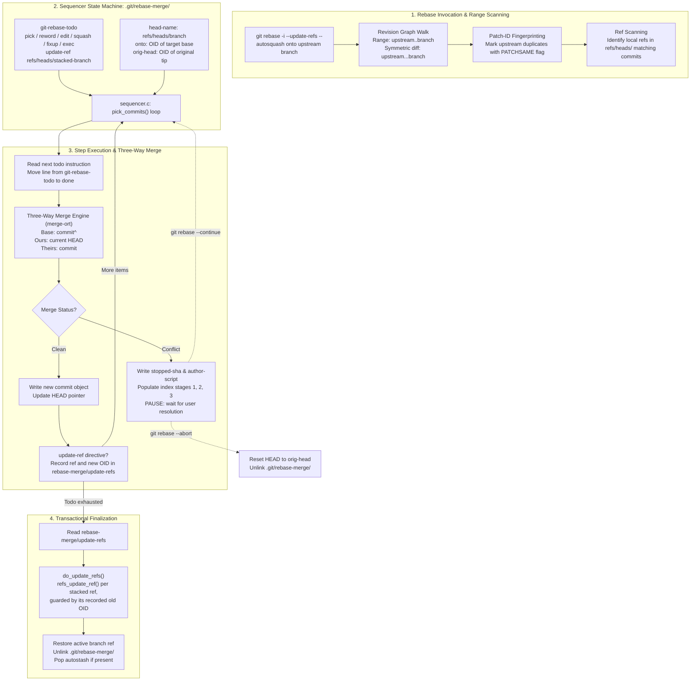
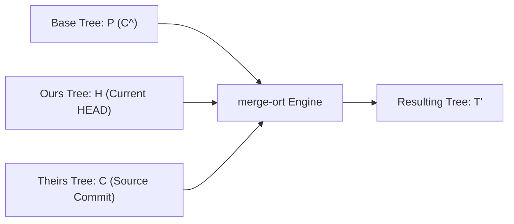

# Git Rebase Internals and Stacked Branches

> [!summary] Claim:
> Git rebase is a stateful sequencer engine that computes patch equivalence with patch IDs (the in-process `patch-ids.c` machinery behind `git log --cherry-mark`) and replays commits onto a target base using three-way tree merges.
> The sequencer coordinates its finite state machine entirely through the `.git/rebase-merge/` directory, maintaining the unexecuted instruction stream in `git-rebase-todo` and logging completed steps in `done`.
> Stacked branch hierarchies traditionally became detached when intermediate commits were rewritten, requiring manual multi-base rebasing.
> The `--update-refs` engine solves this by scanning local branch decorations, embedding `update-ref` directives directly into the sequencer instruction sheet, and, when the todo list is exhausted, updating each recorded branch with a compare-and-swap ref update against its pre-rebase OID (`sequencer.c::do_update_refs()`, one `refs_update_ref()` call per branch, not one multi-ref transaction).



## The Mechanism

`git rebase` is the primary porcelain tool for transforming non-linear history into a linear chain of commits.
While users perceive rebasing as moving a branch, Git never moves commits in place.
Instead, the sequencer engine synthesizes a brand-new series of commit objects with identical diffs, updated parent pointers, fresh committer timestamps, and new object identifiers (OIDs).
Every internal mechanism below reflects the unified C sequencer implementation in Git 2.56.0.

### 1. Architectural History: From Shell Scripts to the Unified Sequencer

In early versions of Git, history rewriting was fragmented across divergent shell scripts:

- `git-rebase.sh`: Handled standard non-interactive rebasing by generating formatted patches with `git format-patch` and piping them into `git am` (the `am` backend).
- `git-rebase--interactive.sh`: Managed interactive rebasing through shell loops calling `git cherry-pick`.
- `git-rebase--merge.sh`: Managed rebasing with three-way merges.

The `am` backend operated on unified diffs rather than trees.
Because patches carry too little tree information to build accurate fake ancestors, directory rename detection is disabled in the `apply` backend, so files added to a directory that the other side renamed are silently left behind (`git-rebase(1)`, BEHAVIORAL DIFFERENCES).
Furthermore, the `apply` backend drops intentionally empty commits, has no option to control commits that become empty, and cannot recreate merge commits (`--rebase-merges` is merge-backend only).

Git 2.20.0 reimplemented both `git rebase` and `git rebase -i` in C (Git 2.20.0 release notes), with the todo-list engine living in `sequencer.c`.
In Git 2.26.0, the merge backend (the sequencer) became the default for all rebases (Git 2.26.0 release notes; `rebase.backend = merge`).
The legacy backend remains accessible via `git rebase --apply` or `rebase.backend = apply`.
In Git 2.34.0, `ort` replaced `recursive` as the default merge strategy (Git 2.34.0 release notes), which the sequencer inherits for every pick.
The release notes state the switch without quantifying any speedup; [[Git-Three-Way-Merge-ORT-and-Diff-Algorithms]] owns the merge-engine details.

### 2. Revision Filtering, Patch-ID Computation, and Upstream Deduplication

When invoked as `git rebase <upstream> <branch>`, Git determines which commits require replay by executing an ancestry walk across the revision graph.
The target range is computed as `upstream..branch`, which selects all commits reachable from `<branch>` that are not reachable from `<upstream>`.
[[Git-Revision-Selection-and-Graph-Walks]] owns the formal traversal algorithms and set mathematics governing revision ranges.

Before building the instruction sheet, the engine checks whether any commits on `<branch>` were already merged into `<upstream>` under different commit hashes.
This occurs routinely when patches are cherry-picked into trunk or applied via merge queues.
`builtin/rebase.c` hands the sequencer the symmetric range `upstream...branch`, and `sequencer.c::sequencer_make_script()` walks it with `revs.cherry_mark` and `revs.right_only` set, the in-process equivalent of `git log --cherry-mark --right-only`.
This preliminary drop is skipped when `--reapply-cherry-picks` or `--keep-base` is passed (`git-rebase(1)`, `--empty`).

For each commit in the symmetric range, Git calculates a patch fingerprint with the patch-ID machinery in `patch-ids.c` (the same idea that `git patch-id`, `builtin/patch-id.c`, exposes as a command).
`git-patch-id(1)` defines a patch ID as a sum of hashes of the file diffs "with line numbers ignored", so it eliminates volatile metadata:

1. It strips commit author names, emails, and author timestamps.
2. It strips committer metadata and commit messages.
3. It ignores the line numbers in hunk headers (`@@ -k,l +m,n @@`).
4. It ignores whitespace by default (`git patch-id --verbatim` turns that off for the command).

If a commit on `<branch>` yields the identical patch ID as a commit on `<upstream>`, Git marks the commit's in-memory `struct object` with the `PATCHSAME` bit flag (`#define PATCHSAME (1u<<9)` in `revision.h`).
During the creation of the sequencer todo list in `sequencer.c::make_script_with_merges()` or `sequencer.c::sequencer_make_script()`, commits bearing the `PATCHSAME` flag (and not empty) are omitted from the instruction sheet.
This automated patch skipping ensures that already-upstreamed commits are not replayed a second time, avoiding redundant conflicts.

```
Upstream:  U1 --- U2 --- U3 (cherry-pick of F1)
             \
Feature:      F1 --- F2 --- F3

Patch-ID analysis:
patch_id(F1) == patch_id(U3) -> F1 receives PATCHSAME flag.
Sequencer todo list generated:
  pick F2
  pick F3
```

### 3. The Sequencer State Directory: `.git/rebase-merge/`

When a rebase operation begins, Git instantiates a private state directory under the repository metadata tree: `.git/rebase-merge/`.
In worktree setups, this directory resides in `.git/worktrees/<name>/rebase-merge/`.
The existence of this directory signals to Git that a rebase is actively in flight.
Commands like `git status`, `git commit`, `git checkout`, and `git branch` inspect this directory to gate operations and display interactive progress.

The `.git/rebase-merge/` directory encapsulates the complete serialized state of the sequencer finite state machine:

| File Path in `.git/rebase-merge/` | C Helper Macro in `sequencer.c` | Data Format and Lifecycle Role |
| :--- | :--- | :--- |
| `git-rebase-todo` | `rebase_path_todo()` | UTF-8 plain text file holding unexecuted sequencer instructions, popped line by line as execution advances. |
| `git-rebase-todo.backup` | `rebase_path_todo_backup()` | Immutable snapshot of the initial todo list before the user edited it in `$EDITOR`. |
| `done` | `rebase_path_done()` | Append-only text log of every instruction successfully executed so far. |
| `head-name` | `rebase_path_head_name()` | Raw refname of the branch being rebased (for example `refs/heads/feature/auth`). |
| `onto` | `rebase_path_onto()` | Hexadecimal hash of the target base commit onto which history is being replayed. |
| `orig-head` | `rebase_path_orig_head()` | Hexadecimal hash of the commit pointed to by HEAD when `git rebase` was invoked. |
| `stopped-sha` | `rebase_path_stopped_sha()` | Hexadecimal hash of the commit being processed, written by `make_patch()` when a pick conflicts or an `edit` stops; a `break` (`stopped_at_head()`) or a failed `exec` does not write it (verified with Git 2.56.0, macOS). |
| `author-script` | `rebase_path_author_script()` | Shell-escaped exports (`GIT_AUTHOR_NAME`, `GIT_AUTHOR_EMAIL`, `GIT_AUTHOR_DATE`) preserved for the commit under construction. |
| `message` | `rebase_path_message()` | Draft commit message buffer for the active step. |
| `message-squash` | `rebase_path_squash_msg()` | Accumulated commit messages during chained `squash` and `fixup` sequences. |
| `update-refs` | `rebase_path_update_refs(wt_git_dir)` | Three lines per branch: refname, pre-rebase OID, and new OID (all zeros until its `update-ref` line runs); written when the todo list is built and consumed by `do_update_refs()` at the end. |
| `autostash` | `rebase_path_autostash()` | Stash commit hash created by `rebase.autoStash` before checkout, popped when rebase terminates. |
| `quiet` / `verbose` | `rebase_path_quiet()` / `rebase_path_verbose()` | Empty marker files signaling command output verbosity modes. |
| `strategy` / `strategy_opts` | `rebase_path_strategy()` / `rebase_path_strategy_opts()` | Merge strategy name and `-X` strategy options, written only when passed. |

### 4. Sequencer Command Grammar and Execution Semantics

The core execution engine is governed by `sequencer.c::pick_commits()`.
The file `git-rebase-todo` is parsed into an in-memory `struct todo_list`, which contains an array of `struct todo_item` elements:

```c
/* Defined in sequencer.h */
struct todo_item {
    enum todo_command command;
    struct commit *commit;
    unsigned int flags;
    int arg_len;
    size_t offset_in_buf, arg_offset;
};

struct todo_list {
    struct strbuf buf;
    struct todo_item *items;
    int nr, alloc, current;
    int done_nr, total_nr;
};
```

`enum todo_command` in `sequencer.h` has 15 values (`TODO_PICK` through `TODO_COMMENT`): the thirteen rebase todo verbs below, plus `TODO_REVERT` (the `revert` verb, used by `git revert` sequences and absent from the rebase help text) and `TODO_COMMENT` (comment lines, which have no verb):

1. `pick <commit> <title>`: Replays `<commit>` onto current `HEAD` via three-way merge.
2. `reword <commit> <title>`: Replays `<commit>` exactly like `pick`, but pauses immediately after tree merging to open `$EDITOR` on the commit message before committing.
3. `edit <commit> <title>`: Replays `<commit>`, then halts the sequencer loop.
   Working tree and index are clean; the user may amend the commit, split it, or stage additional files before running `git rebase --continue`.
4. `squash <commit> <title>`: Melds `<commit>` into the immediately preceding commit.
   The sequencer appends the current commit's message to `.git/rebase-merge/message-squash` and launches `$EDITOR` so the user can curate the combined message.
5. `fixup [-C | -c] <commit> <title>`: Melds `<commit>` into the preceding commit, discarding this commit's log message by default.
   If `-C` is passed (Git 2.32.0, which added `git commit --fixup=amend:` and its `amend!` commits that autosquash turns into `fixup -C`), Git replaces the previous commit message entirely with the fixup commit's message.
   If `-c` is passed, Git replaces the message and opens `$EDITOR` to allow further refinement.
6. `exec <command>`: Executes `<command>` using the system shell (`sh -c <command>`).
   If `<command>` exits with a non-zero exit status, the rebase immediately suspends, leaving the repository state intact for debugging.
7. `break`: Halts execution at the current position without changing index or working tree.
8. `drop <commit> <title>`: Discards the commit.
   Explicitly dropping a line or deleting it from `git-rebase-todo` produces the identical outcome, except that a deleted line trips `rebase.missingCommitsCheck` when it is set to `warn` or `error` (`git-config(1)`).
9. `label <name>`: Associates the symbolic label `<name>` with the current `HEAD` commit.
   Used exclusively by `--rebase-merges` (`-r`) to reconstruct non-linear branching topologies.
10. `reset <name>`: Resets `HEAD` to the commit identified by label `<name>`.
11. `merge [-C <commit> | -c <commit>] <label> [# <oneline>]`: Merges label `<label>` into current `HEAD` using the three-way merge machinery, preserving merge commit topologies.
12. `update-ref <ref>`: Registers reference `<ref>` to be updated to the current `HEAD` commit upon completion of the rebase run.
13. `noop`: No operation; `sequencer.c::complete_action()` inserts it when the generated todo list is empty.

### 5. Replay Mechanics: Three-Way Merge Engine and Conflict Resolution

Each `pick` command in the sequencer is conceptually a cherry-pick executed via a three-way merge.
[[Git-Three-Way-Merge-ORT-and-Diff-Algorithms]] owns the core merge algorithms, tree traversal, and conflict markers.
For each commit $C$ with parent $P$ being applied onto the current replay tip $H$:

$$\text{Merge Target} = \text{merge-ort}(\text{Base} = P, \;\text{Ours} = H, \;\text{Theirs} = C)$$

- **Base Tree ($P$):** The tree snapshot of the commit's original parent ($C\text{\textasciicircum}$).
- **Ours Tree ($H$):** The tree snapshot of the current rebased HEAD.
- **Theirs Tree ($C$):** The tree snapshot of the commit being replayed.



If `merge-ort` encounters clean modifications across distinct files or non-overlapping hunks within the same file, it computes resulting tree $T'$.
Git writes a new commit object $C'$ with tree $T'$, parent $H$, author metadata copied from $C$ (via `author-script`), and committer metadata derived from the active session (`committer_date = now`).
`HEAD` is advanced to $C'$.

When conflicting hunks collide:

1. `merge-ort` leaves higher-order stage entries in the Git index:
   - Stage 1: Common ancestor ($P$) blob hash.
   - Stage 2: Target branch ($H$) blob hash (`ours`).
   - Stage 3: Applied commit ($C$) blob hash (`theirs`).
2. Conflict markers (`<<<<<<<`, `=======`, `>>>>>>>`) are written into the working tree.
   If `merge.conflictStyle` is set to `diff3` or `zdiff3`, the stage 1 ancestor lines are embedded between `|||||||` and `=======`.
3. The sequencer records the failing commit hash into `.git/rebase-merge/stopped-sha`.
4. The remaining unexecuted commands remain in `.git/rebase-merge/git-rebase-todo`.
5. Execution stops and control returns to the terminal.

When the developer resolves conflicts and executes `git rebase --continue`:

1. `builtin/rebase.c` refreshes the index and refuses to continue while tracked files have unstaged changes ("You must edit all merge conflicts and then mark them as resolved using git add").
2. A new commit is created from stage 0 of the index using author metadata from `.git/rebase-merge/author-script` (`sequencer.c::commit_staged_changes()`).
3. The interrupted command needs no bookkeeping: `pick_commits()` already moved its line from `git-rebase-todo` to `done` before executing it (the Worked Example shows the failed `exec false` already in `done`).
4. `sequencer.c::pick_commits()` re-enters its processing loop.

### 6. Stacked Branches and the `--update-refs` Mechanics

A stacked branch workflow decomposes large architectural initiatives into a sequential chain of smaller, dependent pull requests:

$$\text{main} \longrightarrow \text{feat/layer1} \longrightarrow \text{feat/layer2} \longrightarrow \text{feat/layer3}$$

Each branch builds on the tip of the preceding branch.
Before Git 2.38.0, stacked branches suffered from reference detachment whenever an earlier commit in the stack was modified.
If an engineer added a commit to `feat/layer1` or amended commit $A_1$, the hash of $A_1$ changed to $A_1'$.
Consequently, `feat/layer2` and `feat/layer3` remained anchored to the discarded commit history ($A_1 \leftarrow A_2$).

```
Before Rebase:
main --- A1 --- A2 (feat/layer1)
                 \
                  B1 --- B2 (feat/layer2)
                          \
                           C1 (feat/layer3)

Amend A1 -> A1' via interactive rebase on feat/layer3:
main --- A1' --- A2' (detached HEAD)
    \
     A1 --- A2 (feat/layer1 still points here!)
             \
              B1 --- B2 (feat/layer2 still points here!)
```

Realigning the stack manually required repetitive cherry-picking or calculating upstream boundaries with `git rebase --onto`:

```bash
git rebase --onto feat/layer1-new feat/layer1-old feat/layer2
git rebase --onto feat/layer2-new feat/layer2-old feat/layer3
```

This procedure was tedious, error-prone, and required developers to scrape old commit hashes from `git reflog`.
[[Git-Refs-Reflog-and-Reftable]] owns reflog storage and reference transaction mechanics.

#### The `--update-refs` Subsystem (Git 2.38+)

Git 2.38.0 introduced `git rebase --update-refs` (Git 2.38.0 release notes; configurable via `git config --global rebase.updateRefs true`).
The underlying engine functions as follows:

1. **Decoration Scanning:**
   When rebase initializes, `sequencer.c::todo_list_add_update_ref_commands()` loads branch decorations and, for every todo item that names a commit, calls `add_decorations_to_list()`.
   Any local branch (`DECORATION_REF_LOCAL`) pointing to a commit within the replay range is flagged as a stacked branch; the branch being rebased (current `HEAD`) is skipped because the rebase updates it anyway.
   Branches checked out in any worktree (`branch_checked_out()`) are excluded and replaced by a todo comment `# Ref <ref> checked out at '<path>'` (verified with Git 2.56.0, macOS).
2. **Instruction Sheet Injection:**
   The sequencer automatically injects `update-ref <refname>` instructions into `git-rebase-todo` directly following the commit that was the tip of that branch (placeholder hashes; the real todo also prints `# ` before each subject and a blank line after each `update-ref`, as the Worked Example shows):

```text
pick 1a2b3c4 feat(layer1): initial db schema
pick 2b3c4d5 feat(layer1): add user repository
update-ref refs/heads/feat/layer1
pick 3c4d5e6 feat(layer2): add auth controller
pick 4d5e6f7 feat(layer2): add jwt validation
update-ref refs/heads/feat/layer2
pick 5e6f7a8 feat(layer3): add user routes
```

3. **Deferred Reference Recording:**
   When the sequencer encounters an `update-ref <ref>` line during execution, it does not mutate the reference on disk immediately.
   Modifying references eagerly would destroy recovery if an intermediate step failed or the user ran `git rebase --abort`.
   Instead, `sequencer.c::do_update_ref()` reads the current `HEAD` into the ref's "after" slot in `.git/rebase-merge/update-refs`, which was already written with each ref's "before" OID when the todo list was built.
4. **Guarded Per-Ref Updates:**
   When `git-rebase-todo` is fully exhausted, `pick_commits()` calls `sequencer.c::do_update_refs()`, which loops over the recorded refs and calls `refs_update_ref()` once per ref with the recorded "before" OID as the expected old value and the reflog message "rewritten during rebase".
   Each update is its own compare-and-swap, not one all-or-nothing transaction: a branch that moved during the rebase fails alone and is listed under "Failed to update the following refs with --update-refs", while the others still move.
   If the rebase is aborted at any point prior to finalization, `.git/rebase-merge/` is deleted, and all stacked branches remain untouched at their original tips.

### 7. Experimental Worktree-Free Rewriting: `git history` (Git 2.54+)

A primary operational cost of `git rebase` is that it requires an active worktree and index.
Every applied commit checks out trees, writes blobs to disk, updates the `.git/index` stat cache, and fires filesystem events.
In massive repositories, checkout I/O dominates rebase execution time.
[[Git-Index-Stat-Cache-and-Fsmonitor]] owns the index binary format, stat cache, and filesystem monitor integrations.

Git 2.54.0 introduced the experimental `git history` porcelain command (`builtin/history.c`) with `reword` and `split`; `fixup` arrived in Git 2.55.0 and `drop` in Git 2.56.0 (release notes for each).
`git history` provides targeted history transformations without worktree manipulation (as of 2026-11, Both):

```bash
git history reword <commit>
git history drop <commit>
git history fixup <commit>
git history split <commit>
```

Under the hood, `git history` uses the tree-only replay engine originally developed for `git replay` (`builtin/history.c` includes `replay.h` and calls `replay_revisions()`).
[[Git-Replay-and-Server-Side-History-Rewriting]] owns server-side and worktree-free history rewriting.
Key mechanical differences between `git rebase` and `git history` (`git-history(1)`, Git 2.56.0):

- **Worktree Elimination:** `git history` computes tree merges entirely in memory using `merge-ort`, bypassing checkout and stat dirtying.
  Most subcommands run inside bare repositories; `fixup` is the exception because it reads staged changes from the index, and when `HEAD` itself is rewritten the index and worktree are updated to match.
  It also runs no hooks, and it does not yet handle histories that contain merges.
- **Fail-Fast Conflict Policy:** Unlike `git rebase`, which suspends on conflict and yields to user intervention, `git history` refuses operations that would conflict, by design, because history rewrites are not meant to be stateful.
  If an operation (such as dropping an earlier commit) cannot be replayed without triggering a merge conflict, `git history` aborts with an error instead of pausing.
- **Automatic Descendant Updating:** `git history` updates all local branches that descend from the rewritten commit by default (`--update-refs=branches`; `--update-refs=head` limits it to `HEAD`), eliminating the need to opt in.

## Commands and Numbers to Know

Values and defaults in the reference table below were checked against Git 2.56.0 source, `git-config(1)`, and `git-rebase(1)`; the Introduced column comes from the Git release notes or, where those are silent, from the first tagged `Documentation/` or header file that contains the item (as of 2026-11, Both Linux and macOS).

| Command / Configuration / Constant | Value / Default | Introduced | Platform | Description and Operational Impact |
| :--- | :--- | :--- | :--- | :--- |
| `rebase.backend` | `merge` | Git 2.26.0 | Both | Default rebase engine. Controls whether rebase uses the C sequencer (`merge`) or patch pipes (`apply`). |
| `rebase.autoSquash` | `false` | Git 1.7.3 | Both | Enables `--autosquash` by default for interactive rebase only (`git-config(1)`); reorders `fixup!`, `squash!`, and `amend!` commits. The `--autosquash` flag itself dates from Git 1.7.0 and also works non-interactively since Git 2.44.0. |
| `rebase.autoStash` | `false` | Git 1.8.4 (`rebase.autostash` is in `Documentation/config.txt` at v1.8.4 and absent at v1.8.3) | Both | Stashes uncommitted index and worktree changes before rebase and applies them after; Git 2.6.0 taught `git pull --rebase` to honor the config. |
| `rebase.updateRefs` | `false` | Git 2.38.0 (`--update-refs`) | Both | Enables `--update-refs` by default: injects `update-ref` directives for local branches pointing into the rebased range, except branches checked out in a worktree. |
| `rebase.missingCommitsCheck` | `ignore` | Git 2.6.0 (in `Documentation/config.txt` at v2.6.0, absent at v2.5.0) | Both | Warns or aborts if user deletes commits from todo list. Allowed values: `ignore`, `warn`, `error`. |
| `rebase.rescheduleFailedExec` | `false` | Git 2.21.0 (rescheduling of failed `exec`) | Both | Reschedules a failed `exec` so it runs again after `git rebase --continue`, same as `--reschedule-failed-exec`; interactive or `--exec` only. |
| `rebase.forkPoint` | unset (fork-point used only when no `<upstream>` is given) | Git 2.31.0 (`--fork-point` itself: Git 1.9.0) | Both | Setting it to `false` makes `--no-fork-point` the default; fork-point mode consults the upstream reflog so commits from a rewound upstream are not replayed. |
| `--empty` (command-line only; there is no `rebase.empty` key) | `drop`; `-i` implies `stop`; `--exec` without `-i` implies `keep` | Git 2.26.0 as `--empty={drop,keep,ask}` (absent from `git-rebase.txt` at v2.25.0); Git 2.45.0 renamed `ask` to `stop` and kept `ask` as a deprecated synonym, and added `--empty` to `git cherry-pick` | Both | Governs handling of commits that become empty during replay. Values: `drop`, `keep`, `stop`. |
| `merge.conflictStyle` | `merge` | Git 2.35.0 for the `zdiff3` value (in `Documentation/config/merge.txt` at v2.35.0, absent at v2.34.0); `diff3` is older (Git 1.7.1 release notes label its markers) | Both | Conflict marker format. Values: `merge` (2-way), `diff3` (3-way with base), `zdiff3` (zealous diff3, removes matching lines from the conflict region). |
| `GIT_SEQUENCE_EDITOR` | (unset) | Git 1.7.8 (`sequence.editor`) | Both | Highest-precedence editor for rebase todo lists, ahead of `sequence.editor`, `core.editor`, and `EDITOR`. |
| `TODO_PICK` through `TODO_COMMENT` | 15 enum values (Git 2.56.0) | n/a (count changes as verbs are added) | Both | Distinct action codes in `sequencer.h::enum todo_command`; 13 of them are rebase todo verbs. |
| `PATCHSAME` bitmask | `(1u<<9)` | Git 1.7.5 (in `revision.h` at v1.7.5, absent at v1.7.4; the same release added `--cherry-mark`) | Both | Bit flag in `struct object.flags` (`revision.h`) marking commits whose patch ID matches a commit on the other side of the symmetric range. |
| `git history` subcommands | `reword`, `split` (2.54.0), `fixup` (2.55.0), `drop` (2.56.0) | Git 2.54.0 | Both | Experimental worktree-free history editing suite executing in-memory tree replays without worktree checkout. |

## Multi-Language Comparison: C / Python / Rust

Rebasing and commit replay mechanics can be orchestrated at the library level across systems programming languages:

| Operation / Concept | C / C++ (`libgit2` v1.9.0) | Python (`pygit2` / Shell Bridge) | Rust (`git2` / `gix` gitoxide) |
| :--- | :--- | :--- | :--- |
| Rebase Initialization | `git_rebase_init(&rebase, repo, branch, upstream, onto, &opts)` (annotated commits) | `repo.rebase_init(branch, upstream, onto)` (pygit2 1.20.0+, 2026-08-08) | `repo.rebase(Some(&branch), Some(&upstream), Some(&onto), Some(&mut opts))` (`git2` crate, `AnnotatedCommit` arguments) |
| Step Iteration | `git_rebase_next(&operation, rebase)` | `operation = next(rebase)` or `for operation in rebase:` | `rebase.next()` returning `Option<Result<RebaseOperation, Error>>` (`Rebase` implements `Iterator`) |
| Conflict Detection | `git_index_has_conflicts(index) == 1` | `repo.index.conflicts is not None` (`Index.conflicts` returns `None` when the index has no conflicts) | `index.has_conflicts()` |
| Commit Creation | `git_rebase_commit(&oid, rebase, NULL, committer, NULL, NULL)` | `rebase.commit(committer=sig)` (author and message optional) | `rebase.commit(None, &committer, None)` |
| Stacked Branch Management | Custom reference transaction iterating ref log table | Wrapper invoking `git rebase -i --update-refs` with `GIT_SEQUENCE_EDITOR` script | `gix::Repository::edit_references()` applying `RefEdit` values in one `gix_ref` transaction |
| Worktree-Free Replay | `git_merge_trees()` in memory without checkout | `pygit2.Repository.merge_trees()` | `gix::Repository::merge_trees()` in-memory tree merge (`gix_merge::blob::Platform` handles only per-blob merges) |

## Worked Example: Sequencer State Machine and Stacked Branch Replay

This worked example is the lab `code/02-Version-Control/rebase_sequencer/` (`run.sh`, plus the editor helper `insert_exec.sh`).
It builds throwaway repositories with pinned author and committer dates, so every hash below is reproducible, and it traces the sequencer state machine in `.git/rebase-merge/`.
Every output block is copied byte for byte from `expected/darwin-arm64.txt`, recorded on macOS (arm64) with Git 2.55.0.
The lab was also run with Git 2.56.0 and printed identical output (as of 2026-11).
Run it with `cd code && make verify LAB=02-Version-Control/rebase_sequencer/`.
Each `ok:` line is a check that makes the script exit non-zero when it fails, so a change in Git's behavior fails `make verify` instead of leaving a stale claim in this note.

### 1. Environment Setup and Repository Construction

`run.sh` pins `GIT_CONFIG_GLOBAL`, `GIT_CONFIG_SYSTEM`, `LC_ALL`, the author and committer identity, and a fixed `GIT_COMMITTER_DATE` (rebased commits otherwise take the wall-clock time, which would change their hashes on every run).
It then builds the stack with this function, once per scenario:

```bash
commit_at() { # commit_at <iso-date> <git commit args...>
    local when="$1"
    shift
    GIT_AUTHOR_DATE="${when}" GIT_COMMITTER_DATE="${when}" git commit -q "$@"
}

# Stack: main(M1) -> feat/layer1(L1) -> feat/layer2(L2 + fixup! L1); main then advances with M2.
build_stack() {
    mkdir "$1"
    cd "$1"
    git init -q -b main
    echo "package main" > main.go
    git add main.go
    commit_at 2026-11-01T10:00:00Z -m "M1: Initial main service"
    git checkout -q -b feat/layer1
    echo 'func DataLayer() string { return "v1" }' >> data.go
    git add data.go
    commit_at 2026-11-01T11:00:00Z -m "L1: Add storage data layer"
    git checkout -q -b feat/layer2
    echo 'func ServiceLayer() string { return DataLayer() }' >> service.go
    git add service.go
    commit_at 2026-11-01T12:00:00Z -m "L2: Add service business logic"
    echo 'func DataLayer() string { return "v1-patched" }' > data.go
    git add data.go
    commit_at 2026-11-01T13:00:00Z --fixup=":/L1: Add storage data layer"
    git checkout -q main
    echo "// production telemetry probe" >> main.go
    git add main.go
    commit_at 2026-11-01T14:00:00Z -m "M2: Add telemetry instrumentation"
}
```

### 2. Inspecting the Instruction Sheet with `--update-refs` and `--autosquash`

From branch `feat/layer2`, the lab prints the interactive rebase instruction sheet for a rebase onto `main`.
`GIT_SEQUENCE_EDITOR="cat"` prints the generated `git-rebase-todo` and leaves it unchanged, so the rebase then runs to completion and moves both branches.
The lab cuts the printout at the `# Commands:` help block, whose wording changes between Git releases:

```bash
GIT_SEQUENCE_EDITOR="cat" git rebase -i --update-refs --autosquash main
```

#### Observed Sequencer Instruction Output (macOS, Git 2.55.0):

```text
== 1. Initial stack ==
* 65cdba9 M2: Add telemetry instrumentation
| * 67bde55 fixup! L1: Add storage data layer
| * d328096 L2: Add service business logic
| * d1a2495 L1: Add storage data layer
|/
* dbfb6a6 M1: Initial main service

== 2. Todo for: git rebase -i --update-refs --autosquash main ==
pick d1a2495 # L1: Add storage data layer
fixup 67bde55 # fixup! L1: Add storage data layer
update-ref refs/heads/feat/layer1

pick d328096 # L2: Add service business logic

# Rebase 65cdba9..67bde55 onto 65cdba9 (4 commands)
#
== 3. Rebase report on stderr ==
Updated the following refs with --update-refs:
  refs/heads/feat/layer1
```

The `# ` before each subject comes from the default `rebase.instructionFormat` of `# %s` in `sequencer.c::sequencer_make_script()`.
The same stderr report lists `refs/heads/feat/layer1` as updated, which is the only branch other than the one being rebased.

#### Mechanics Demonstrated by the Generated Todo List:

1. **Autosquash Reordering:** The fixup commit `67bde55` was created after `L2` in linear time, but `--autosquash` relocated it to line 2, immediately following its target `L1`.
2. **Stacked Branch Detection:** Git detected that `refs/heads/feat/layer1` pointed to `L1`.
   It automatically synthesized `update-ref refs/heads/feat/layer1` on line 3, immediately after the fixup application.
3. **Result:** After the run, `feat/layer1` is the parent of the new `feat/layer2` tip, and the squashed `data.go` contains the fixup:

```text
== 4. Checks after the rebase ==
ok: todo has an update-ref line for feat/layer1
ok: fixup was reordered next to its target
ok: feat/layer1 moved off its old tip
ok: feat/layer1 is the parent of feat/layer2
ok: feat/layer2 is based on main
ok: feat/layer2 moved off its old tip
ok: fixup was squashed into feat/layer1
ok: rebase state directory is gone
* f2a1337 L2: Add service business logic
* f8a567b L1: Add storage data layer
* 65cdba9 M2: Add telemetry instrumentation
* dbfb6a6 M1: Initial main service
```

### 3. The Same Rebase Without `--update-refs`

The lab repeats the rebase on a fresh copy of the stack without the flag:

```text
== 5. Todo for: git rebase -i --autosquash main (no --update-refs) ==
pick d1a2495 # L1: Add storage data layer
fixup 67bde55 # fixup! L1: Add storage data layer
pick d328096 # L2: Add service business logic

# Rebase 65cdba9..67bde55 onto 65cdba9 (3 commands)
#
== 6. Checks: the stack is left behind ==
ok: todo has no update-ref line
ok: feat/layer1 still points at its old tip
ok: feat/layer1 is no longer an ancestor of feat/layer2
```

The todo list has no `update-ref` line, `feat/layer1` keeps pointing at the pre-rebase commit, and it is no longer an ancestor of `feat/layer2`: the stack is detached.

### 4. State Directory Triage During Mid-Rebase Interruption

`insert_exec.sh` is the `GIT_SEQUENCE_EDITOR` for this scenario.
It inserts an `exec false` line before line 3 of the todo (a portable `awk` replacement for the BSD-only `sed -i.bak '3i\'` form, which also leaves no backup file in `.git/rebase-merge/`):

```bash
GIT_SEQUENCE_EDITOR="bash insert_exec.sh" git rebase -i --update-refs --autosquash main
```

The sequencer runs `L1` and the `fixup`, then halts on the failing `exec`.
The lab inspects `.git/rebase-merge/` and `git status`, then runs `git rebase --continue` in the repository and `git rebase --abort` in a copy of it:

```text
== 7. State directory after the failing exec ==
done
end
git-rebase-todo
git-rebase-todo.backup
head-name
interactive
msgnum
no-reschedule-failed-exec
onto
orig-head
rewritten-list
update-refs
[head-name]
refs/heads/feat/layer2
[onto]
65cdba9bdec8e4ba322a5ff3ed9b96ba7cc6543d
[git-rebase-todo]
update-ref refs/heads/feat/layer1

pick d32809637284eb5eef622a99c47c450cc9e85258 # L2: Add service business logic
[done]
pick d1a249512f64b5aa4fe82ed2f4abcebec966d705 # L1: Add storage data layer
fixup 67bde5563d09b10cc5e97ac2a050e2ca893a9d0f # fixup! L1: Add storage data layer
exec false
[update-refs]
refs/heads/feat/layer1
d1a249512f64b5aa4fe82ed2f4abcebec966d705
0000000000000000000000000000000000000000
[git status]
Last commands done (3 commands done):
   fixup 67bde55 # fixup! L1: Add storage data layer
   exec false
  (see more in file .git/rebase-merge/done)

== 8. Checks while the rebase is stopped ==
ok: the failing exec made git rebase exit non-zero
ok: stopped-sha is not written for a failed exec
ok: author-script is not written for a failed exec
ok: failed exec is the last line of done
ok: update-refs still holds an all-zero new OID
ok: update-refs records the pre-rebase OID
ok: feat/layer1 is untouched while stopped
ok: --continue finishes the rebase
ok: --continue moved feat/layer1 under feat/layer2
ok: --continue left feat/layer1 off its old tip
ok: --abort removes the state directory
ok: --abort leaves feat/layer1 at its old tip
ok: --abort restores feat/layer2
ok: --abort checks feat/layer2 out again
```

The inspection reveals the state machine boundary:
- The completed `L1` and `fixup` actions were popped from `git-rebase-todo` and logged to `done`, and so was the failed `exec false`.
- `git status` reads `rebase-merge/done` and prints its last two lines under "Last commands done" (`wt-status.c::show_rebase_information()`).
- There is no `stopped-sha` or `author-script`: a failed `exec` stops without writing them.
- `HEAD` points to the newly synthesized, squashed `L1'` commit.
- `update-ref refs/heads/feat/layer1` is the next command waiting to execute, and `update-refs` still holds the all-zeros "after" OID for it; `feat/layer1` itself is untouched.
- `git rebase --continue` executes the remaining instructions and then moves `feat/layer1` to `L1'` with a compare-and-swap update against `d1a2495`.
- `git rebase --abort` wipes `.git/rebase-merge/` and leaves both branches and `HEAD` where they were.

### 5. Patch-ID Skipping of Commits Already Upstream

The lab cherry-picks `F1` from `topic` onto `main` with `-x`, so the copy has a different parent, committer date, and message, and then checks the patch IDs and the generated todo:

```text
== 9. Patch IDs: F1 on topic versus its cherry-pick U1 on main ==
ok: F1 and U1 have different commit IDs
ok: F1 and U1 have different messages
ok: F1 and U1 have the same patch ID
ok: F1 and F2 have different patch IDs

== 10. Todo for: git rebase -i main topic (F1 is already upstream) ==
pick a344fcd # F2: feature 2
pick a85ae05 # F3: feature 3

# Rebase 7916b51..a85ae05 onto 7916b51 (2 commands)
#
== 11. Todo with --reapply-cherry-picks ==
pick bf590bf # F1: feature 1
pick a344fcd # F2: feature 2
pick a85ae05 # F3: feature 3

# Rebase 7916b51..a85ae05 onto 7916b51 (3 commands)
#
== 12. Checks: duplicate skipping ==
ok: F1 is omitted from the default todo
ok: F2 and F3 are in the default todo
ok: F1 is back with --reapply-cherry-picks
```

### 6. Branches Checked Out in Another Worktree

The lab checks `feat/layer1` out in a linked worktree before running the same `--update-refs` rebase:

```text
== 13. Checks: worktree-checked-out branches ==
ok: todo has no update-ref line for the checked-out branch
ok: todo carries a comment naming the worktree
ok: the checked-out branch stays on its old tip
ok: rebasing the checked-out branch itself is refused
ok: the refusal names the worktree
```

## Pitfalls

> [!warning] Pitfall: Orphaned Stacked Branches Without `--update-refs`
> Rebasing an intermediate branch in a stack without passing `--update-refs` (or setting `rebase.updateRefs = true`) detaches all downstream branches.
> Downstream branches remain rooted on the pre-rebase commit hashes.
> Subsequent rebases of downstream branches re-apply the original parent commits, generating duplicate changes and massive merge conflicts.

> [!warning] Pitfall: Autostash Conflict Traps
> When `rebase.autoStash` is enabled and the rebase succeeds, Git applies the autostash (`sequencer.c::apply_save_autostash_oid()` runs a stash apply, not a pop).
> If the rebased changes conflict with the stashed uncommitted edits, the apply leaves conflicts in the worktree and Git runs `git stash store` so the changes are also kept as a stash entry (`stash@{0}`).
> In this scenario, Git marks the rebase as complete and tells you to resolve the conflicts and then `git stash drop`, or to `git reset --hard` and `git stash pop` later.
> Running `git stash pop` after already resolving the conflicts re-applies the same changes on top of the resolution instead of discarding the saved copy.

> [!warning] Pitfall: Force-Pushing Stacked Branches Without Lease
> Updating stacked branches on a shared remote requires pushing new OIDs.
> Executing `git push --force` overwrites remote refs unconditionally, destroying commits pushed by collaborators.
> Always use `git push --force-with-lease --force-if-includes`: the lease refuses the push if the remote ref no longer matches your remote-tracking ref, and `--force-if-includes` additionally refuses it if that remote-tracking tip was fetched but never integrated locally (`git-push(1)`; the option arrived in Git 2.30.0).

> [!warning] Pitfall: Rebasing Active Secondary Worktrees
> Git explicitly prevents rebasing a branch that is currently checked out in another linked worktree (Git prints `fatal: 'feat/layer1' is already used by worktree at '...'`; the lab checks the "is already used by worktree at" text).
> Furthermore, `--update-refs` intentionally ignores branches currently checked out in other worktrees.
> If a branch in your stack is checked out in an idle worktree, `--update-refs` skips it, leaving only a `# Ref refs/heads/<branch> checked out at '<path>'` comment in the todo list (checked by the lab); without `-i` nobody sees that comment, and the branch stays on the old commits while its descendants move.

> [!warning] Pitfall: Modifying the Root Commit Without `--root`
> Invoking `git rebase -i <commit>` cannot rebase or squash the repository's initial root commit because the root commit has no parent ($C\text{\textasciicircum}$) to serve as the upstream base.
> To rewrite, reword, or squash the initial commit of a repository, you must explicitly pass the `--root` flag (`git rebase -i --root`).

## At Scale

At enterprise scale, history rewriting evolves from an individual code hygiene preference into a mission-critical infrastructure boundary.
Organizations with 1,000 to 50,000 engineers operating on monorepos encounter specific systemic constraints:

### 1. The Merge vs. Rebase Decision Threshold

The debate between pure merge workflows and pure rebase workflows is governed by monorepo scale and commit volume:

```
Low Scale (<50 Engineers):
- Standard PR branching.
- Developers rebase locally to keep linear history.
- Low rebase contention on trunk.

Enterprise Monorepo Scale (1,000 - 50,000 Engineers):
- Trunk receives commits more often than a test suite finishes.
- Local developer rebasing against trunk becomes a race that cannot be won:
  by the time the suite for a rebased branch completes, trunk has already moved again.
- Solution: Developers rebase within stacked feature branches only.
  Trunk integration is handed entirely to automated Speculative Merge Queues.
```

[[Decision-Record-Merge-vs-Rebase-and-Branching]] owns the formal architectural decision record comparing merge versus rebase topologies.
[[Git-Branching-Models-Merge-Queues-and-Code-Review]] owns trunk-based branch policies, review invariants, and automated merge queue infrastructure.

### 2. Worktree I/O Costs and Sparse-Checkout Bottlenecks

In monorepos containing millions of files (such as Chromium, Windows, or enterprise banking codebases), checking out files during a rebase causes severe filesystem latency.
Every pick in `sequencer.c` updates the index and worktree for the files the merge touches (the in-process equivalent of `read-tree -m -u`) and refreshes `lstat()` cache entries in `.git/index`.
Anything that hooks file writes, such as endpoint security scanners or filesystem event watchers, charges its cost on every one of those writes, so measure a representative rebase (`GIT_TRACE2_PERF=1 git rebase ...`) before choosing a mitigation.

Architectural decision rules for scaling rebase in large codebases:

1. **Mandate Cone-Mode Sparse-Checkout:** Restrict the active worktree to the minimal working set directory using `git sparse-checkout set --cone`.
   This confines index updates and tree expansions during `merge-ort` to touched subdirectories.
2. **Enable Virtual Filesystem Shims:** Use Scalar, VFS for Git, or EdenFS to stub out unread blobs with virtual filesystem placeholders.
   [[Git-At-Scale-VFS-Scalar-and-Monorepos]] owns large-scale monorepo filesystem virtualization.
3. **Migrate to Server-Side History Rewriting:** Shift large patch series rewriting off developer laptops to remote build farm services running `git replay` or worktree-free `git history`.
   [[Git-Replay-and-Server-Side-History-Rewriting]] owns the mechanics of worktree-free server-side replay engines.
4. **Transition to Next-Generation VCS Models:** High-velocity engineering organizations increasingly adopt patch-oriented version control systems such as Jujutsu (`jj`) or Sapling (`sl`).
   These tools treat stacked changes as first-class DAG nodes, automatically evolving descendant commits via operation logs (`op-log`) without interactive rebase execution loops.
   [[Beyond-Git-Jujutsu-Sapling-and-Patch-Theory]] owns the operational models of Jujutsu, Sapling, and Pijul patch theory.

## Practice Drill

> [!tip] Practice Drill: Manual Sequencer Rescue and Stacked Ref Realignment
> 1. Construct a deterministic 3-level stacked branch repository (`main -> stack-1 -> stack-2 -> stack-3`) with two commits on each branch using the script from the Worked Example.
> 2. Execute `git checkout stack-3 && git rebase -i main` without passing `--update-refs`.
> 3. Amend the second commit of `stack-1` by altering its commit message and adding a new file.
>    Complete the rebase.
> 4. Inspect `git log --graph --oneline --all`.
>    Observe how `stack-1` and `stack-2` were left behind pointing to the abandoned commit tree.
> 5. Without using `git reset --hard` to start over, rescue the stack:
>    - Locate the new corresponding commit hashes for the tips of `stack-1` and `stack-2` in the new rebased history.
>    - Use `git update-ref refs/heads/stack-1 <new-oid>` and `git update-ref refs/heads/stack-2 <new-oid>` to snap each branch pointer forward (each `git update-ref` call is one atomic single-ref update; `git update-ref --stdin` with `start`/`commit` would make both one transaction).
> 6. Reset your repository and repeat the entire exercise using `git rebase -i --update-refs main`.
>    Verify that Git performs the identical reference updates automatically via `.git/rebase-merge/update-refs`.

## Interview Questions

### L5: Foundational Mechanisms

#### Question 1: What is the fundamental mechanism difference between `git rebase` and `git merge` when integrating changes from an upstream branch?
> [!success]- Answer
> `git merge` executes a three-way merge between the target branch tip and current `HEAD`, creating a brand-new merge commit object with two distinct parent pointers ($P_1 = \text{HEAD}, P_2 = \text{target}$).
> Merge preserves the exact historical graph topology, author timestamps, committer timestamps, and commit hashes of all contributing branches.
>
> `git rebase` calculates the set of commits in `upstream..HEAD` and replays them one by one as cherry-picks onto the tip of `upstream`.
> Each replayed commit is an entirely new commit object with a new tree, a single parent pointer ($P_1$ pointing to the preceding replayed commit), an updated committer timestamp, and a new commit hash.
> The historical commits are abandoned and eventually garbage-collected once their reflog entries expire.
> Merge preserves non-linear history; rebase synthesizes linear history.

#### Question 2: Explain the internal contents and role of `.git/rebase-merge/`. How does the sequencer know which commit caused a conflict?
> [!success]- Answer
> `.git/rebase-merge/` is the state directory for Git's sequencer engine (`sequencer.c`).
> It contains `git-rebase-todo` (the remaining unexecuted rebase instructions), `done` (the completed instructions), `head-name` (the branch being rebased), `onto` (the target base commit hash), and `orig-head` (the commit hash of the branch tip prior to rebasing).
>
> When a three-way merge encounters conflicts, `sequencer.c::make_patch()` writes the full hex OID of the failing commit into `.git/rebase-merge/stopped-sha` (40 hex digits in a SHA-1 repository).
> It also serializes the commit author metadata into `.git/rebase-merge/author-script` and populates the index with stages 1, 2, and 3.
> The failing command is also the last line of `done`, and `git status` lists the last two lines of `done` under "Last commands done" (`wt-status.c::show_rebase_information()`); on `git rebase --continue` the sequencer uses `author-script` to preserve original authorship when committing the resolution.

### L6: Advanced Architecture and Diagnostics

#### Question 3: Predict the Output (Predict-the-Output)
An engineer has a feature branch with three commits:
- `c100000` ("feat: add base model")
- `c200000` ("feat: add controller")
- `c300000` ("fixup! feat: add base model")

The engineer runs:
```bash
GIT_SEQUENCE_EDITOR="cat" git rebase -i --autosquash HEAD~3
```
Predict the exact instruction lines that Git outputs to standard output (the hashes in this question are placeholders).

> [!success]- Answer
> Git outputs:
> ```text
> pick c100000 # feat: add base model
> fixup c300000 # fixup! feat: add base model
> pick c200000 # feat: add controller
> ```
> Followed by the commented rebase instructions and command key (the `# ` before each subject is the default `rebase.instructionFormat` in Git 2.56.0).
> Because `cat` leaves the todo unchanged, the rebase then actually executes it and squashes the fixup.
> The `--autosquash` engine parses the `fixup! <subject>` prefix, matches it against the titles (or hashes) of earlier commits in the list, and relocates `c300000` to execute immediately following `c100000`, switching its command verb from `pick` to `fixup`.

#### Question 4: How does `git rebase` detect and skip commits that have already been integrated upstream under a different commit hash?
> [!success]- Answer
> `git rebase` computes patch equivalence with patch IDs (`patch-ids.c`, the machinery `git patch-id` exposes as a command).
> During initialization, Git performs a symmetric difference walk `upstream...branch` with `cherry_mark` and `right_only` set, the in-process form of `git log --cherry-mark --right-only`; `--reapply-cherry-picks` or `--keep-base` skips this step.
> For every commit in the range, Git computes a normalized diff hash that excludes author identities, timestamps, commit messages, and diff hunk line numbers (`@@ -l,s +l,s @@`), and ignores whitespace, so it effectively hashes file paths and changed line contents.
>
> If a commit on `branch` generates the identical patch ID as a commit on `upstream`, Git marks its in-memory `struct object` with the `PATCHSAME` flag (`(1u<<9)` in `revision.h`).
> During todo list construction, `sequencer.c` checks `commit->object.flags & PATCHSAME`; if set, the commit is omitted from `git-rebase-todo`.
> Consequently, the sequencer never attempts to re-apply the already-merged patch.

#### Question 5: What is the stacked branches problem, and how does `git rebase --update-refs` solve it safely (and is the final update atomic)?
> [!success]- Answer
> Stacked branches represent a chain of dependent feature branches ($B_1 \rightarrow B_2 \rightarrow B_3$).
> In Git, a branch is merely a reference pointing to a single commit.
> When $B_1$ is rebased or amended, its tip commit hash changes to $B_1'$.
> However, $B_2$ still points to the old commit chain rooted in old $B_1$.
> Rebasing $B_2$ requires manual intervention (`git rebase --onto B1' B1 B2`).
>
> `git rebase --update-refs` solves this by having `sequencer.c::todo_list_add_update_ref_commands()` look up the local branch decorations of every commit in the todo list.
> For any branch pointing to a commit within the rebase range (other than the branch being rebased and branches checked out in a worktree), Git inserts an `update-ref <refname>` instruction directly after that commit in `git-rebase-todo` and records the branch's current OID in `.git/rebase-merge/update-refs`.
> As each `update-ref` line runs, Git records the current `HEAD` as that branch's new OID in the same file, without touching the branch.
> Upon completing the entire todo list, `sequencer.c::do_update_refs()` calls `refs_update_ref()` once per branch, each guarded by the recorded old OID; this is not one atomic multi-ref transaction, so a branch that moved concurrently fails on its own and is reported.
> If the rebase is aborted, all branch references remain untouched.

#### Question 6: Debug This (Debug-This)
An engineer resolves a merge conflict during a rebase, runs `git add .`, and then runs `git rebase --continue`.
Git responds with:
```text
You must edit all merge conflicts and then
mark them as resolved using git add
```
Running `git status` shows:
```text
interactive rebase in progress; onto 4f8a1b2
Changes to be committed:
    modified: core/engine.go
Changes not staged for commit:
    modified: core/engine.go
Untracked files:
    core/engine.go.orig
```
Why did `git rebase --continue` reject the execution, and what is the exact command sequence to resolve it safely (the `git status` listing is an illustrative scenario)?

> [!success]- Answer
> **Diagnosis:**
> Something rewrote the tracked file `core/engine.go` after `git add` (an editor save, a formatter, or the merge tool writing its final result), so the worktree content no longer matches the staged entry.
> The `--continue` path in `builtin/rebase.c` first refreshes the index (`refresh_index()`), so a pure stat-only mismatch is repaired automatically, then calls `has_unstaged_changes()`; a real content difference in a tracked file makes it print the message above and exit 1 before the sequencer resumes (Git 2.56.0 source).
> The untracked `core/engine.go.orig` backup does not block `--continue`; only tracked files are checked.
>
> **Resolution:**
> 1. Run `git diff` to identify the unstaged change on tracked files.
> 2. If the unstaged changes belong to the resolution: run `git add -u`; otherwise discard them with `git restore core/engine.go`.
> 3. Optionally remove the tool artifact (`rm core/engine.go.orig`, or set `mergetool.keepBackup=false`) so it is not committed later.
> 4. Re-run `git rebase --continue`.

#### Question 7: How does `rebase.autoStash` interact with merge conflicts during rebase, and what happens if the post-rebase stash restoration conflicts?
> [!success]- Answer
> When `rebase.autoStash = true`, Git creates a stash commit with `git stash create` from dirty working tree and index changes before checking out the rebase base; it is not yet on `refs/stash`.
> It writes the stash commit OID into `.git/rebase-merge/autostash`.
>
> Throughout the rebase, intermediate cherry-pick conflicts do not affect the autostash.
> The developer resolves conflicts and continues replaying commits normally.
> Once all rebase instructions in `git-rebase-todo` are exhausted and the branch ref is updated, Git reads `autostash` and applies it (`apply_save_autostash_oid()` runs a stash apply).
>
> If the stashed changes conflict with the newly rebased branch:
> 1. Git leaves the working tree with standard conflict markers.
> 2. The rebase itself is marked as successful; Git does not roll back or abort the rebase.
> 3. Git runs `git stash store` so the changes are preserved as an entry in the stash list (`refs/stash`).
> 4. The user must manually resolve the working tree conflict and then run `git stash drop` to discard the preserved stash entry, as Git's own message instructs.

### L7+: Distinguished Architecture & Scale

#### Question 8: Contrast the worktree-based sequencer engine in `sequencer.c` with worktree-free history rewriting (`git replay`, `git history`, and Jujutsu/Sapling). What are the I/O, concurrency, and virtual filesystem implications for a 50,000-engineer monorepo?
> [!success]- Answer
> **Worktree-based Sequencer (`sequencer.c`):**
> Operates sequentially by updating the filesystem worktree, writing blobs, invalidating index stat cache entries (`lstat(2)`), and mutating `.git/rebase-merge/`.
> - *I/O Profile:* High disk write volume, heavy filesystem cache churning, triggering operating system file watch events (`fsmonitor`, `fseventsd`).
> - *Concurrency:* Strictly single-threaded and lock-exclusive per worktree.
>   Only one rebase can execute in a worktree at a time.
> - *Monorepo Scale Impact:* Unusable for automated server-side integration queues; every pick pays checkout I/O for the files it touches, so the cost grows with the size of the working set (measure with `GIT_TRACE2_PERF=1`).
>
> **Worktree-free Rewriting (`git replay`, `git history`):**
> Operates directly on the object database using `merge-ort` in memory.
> Computes three-way tree merges by walking tree objects without touching the index or writing files to a working tree.
> - *I/O Profile:* Read-only access to existing tree/blob objects; writes only newly created tree and commit objects to the object database or packfile.
> - *Concurrency:* No worktree or index is involved, so rewrites of different repositories or clones do not contend on a checkout, and most subcommands run inside bare repositories on server infrastructure, `git history fixup` excepted because it reads the index; ref updates still take the normal per-ref locks.
>
> **Modern VCS DAG Engines (Jujutsu `jj` / Sapling `sl`):**
> Decouple commit identity from cryptographic tree hash mutation by introducing stable Change-IDs.
> Rebase operations are logical DAG mutations recorded in an append-only operation log (`op-log`).
> When a parent commit changes, descendant changes are evolved lazily or in-memory.
> Working tree updates are deferred or projected via virtual filesystems (EdenFS), eliminating physical checkout overhead entirely.

## Further Reading

- Git Reference Manual: `git-rebase(1)`, Git 2.56.0, 2026 (`https://git-scm.com/docs/git-rebase`)
  Authoritative specification of rebase invocation flags, config parameters, and sequencer controls.
- Git Reference Manual: `git-patch-id(1)`, Git 2.56.0, 2026 (`https://git-scm.com/docs/git-patch-id`)
  Reference manual for diff normalization and patch-id calculation algorithms.
- Git Reference Manual: `git-history(1)`, Git 2.56.0, 2026 (`https://git-scm.com/docs/git-history`)
  Specification of the experimental worktree-free history manipulation porcelain introduced in Git 2.54.
- Git Source Code: `sequencer.c` and `sequencer.h`, Git 2.56.0, 2026 (`https://github.com/git/git/blob/v2.56.0/sequencer.c`)
  Primary implementation of the finite state machine, instruction parser, and stacked branch updating engine.
- Taylor Blau, Highlights from Git 2.38, The GitHub Blog, 2022 (`https://github.blog/open-source/git/highlights-from-git-2-38/`)
  Technical design and rationale behind the introduction of `--update-refs` for stacked branches.
- Scott Chacon and Ben Straub, Pro Git, 2nd Edition, Chapter 3 Git Branching - Rebasing, Apress, 2014 (`https://git-scm.com/book/en/v2/Git-Branching-Rebasing`)
  Foundational conceptual treatise on linear history rewriting and patch application.

## Related

- Prerequisites: [[Git-Three-Way-Merge-ORT-and-Diff-Algorithms]]
- Next: [[Git-Replay-and-Server-Side-History-Rewriting]]
- See also: [[Git-Branching-Models-Merge-Queues-and-Code-Review]], [[Beyond-Git-Jujutsu-Sapling-and-Patch-Theory]], [[Recover-Lost-Git-Work]]
- Lab: `code/02-Version-Control/rebase_sequencer/`
