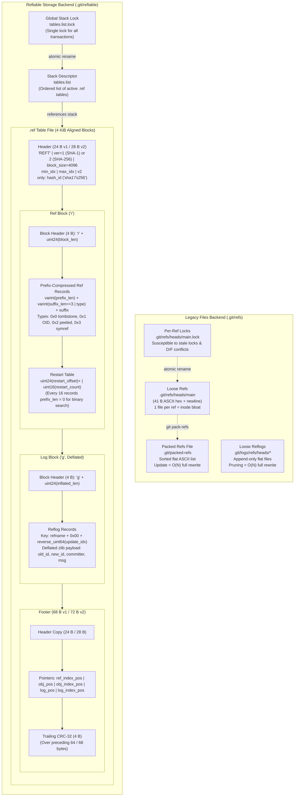

# Git Refs, Reflogs, and Reftable

> [!summary] Claim:
> A Git reference is an ASCII or binary mapping that binds a human-readable hierarchical name to an immutable object identifier.
> The traditional files backend splits references between loose filesystem files and a sorted `packed-refs` flat file, requiring per-ref lockfiles and full-file rewrites that bottleneck enterprise monorepos.
> The modern `reftable` storage backend replaces loose files and global locks with an append-only stack of immutable, binary block-indexed tables governed by a single `tables.list` lock.
> Inside each 4 KiB reftable block, keys use prefix compression paired with periodic uncompressed restart points, enabling fanout-bounded binary search, instant reverse object mapping, and atomic transactions at scale.



## The Mechanism

[[Git-Object-Model-and-Content-Addressing]] establishes that Git stores objects in an immutable directed acyclic graph addressed by cryptographic hashes.
References are the mutable entry points into this graph.
Without references, every commit tip would require remembering an arbitrary 40-character hexadecimal string, and unreferenced objects would be collected by [[Git-GC-Maintenance-MIDX-and-Commit-Graph]].
Managing references efficiently requires sub-millisecond point lookups, fast prefix scans, append-only history tracking via reflogs, and strictly atomic multi-reference updates.

### 1. The Files Backend: Loose Refs, Packed-Refs, and Lockfiles

The original Git reference storage engine is the files backend (`refs/files-backend.c`).
It separates references into two tiers: loose references on the filesystem and a monolithic `packed-refs` file.

#### Loose References
A loose reference is a plain text file stored under `.git/refs/` whose filesystem path mirrors the reference name.
For example, the branch `refs/heads/main` lives at `.git/refs/heads/main`.
The file contains exactly 41 bytes for SHA-1 repositories: 40 hexadecimal ASCII characters representing the object ID, followed by a newline byte (`0x0A`).
In SHA-256 repositories, the file contains 65 bytes: 64 hexadecimal characters plus a newline.

A symbolic reference (symref) points indirectly to another reference rather than directly to an object ID.
The most prominent symbolic reference is `.git/HEAD`.
A symref file begins with the ASCII prefix `ref: `, followed by the target reference name and a newline:

```text
ref: refs/heads/main
```

When Git resolves a reference via `refs_resolve_ref_unsafe()`, it starts by checking for a loose file.
If the loose file contains a `ref: ` prefix, Git parses the target path and recursively traverses symbolic links up to a hardcoded depth limit of 5 iterations to detect cycles (`SYMREF_MAXDEPTH`).

#### The `packed-refs` File
Loose references incur substantial filesystem overhead: each ref consumes an entire filesystem block (typically 4 KiB) and an inode.
A repository with 500,000 loose branches spends about 1.9 GiB (500,000 x 4 KiB) of disk space on metadata alone, and traversing deep directory trees on cold storage degrades read performance.

To mitigate this, `git pack-refs` consolidates loose references into a single flat file located at `.git/packed-refs`.
The file begins with a header specifying its capabilities:

```text
# pack-refs with: peeled fully-peeled sorted
```

Every subsequent line records an object ID, a space delimiter, and the full reference name:

```text
3333333333333333333333333333333333333333 refs/heads/main
aaaaaaaaaaaaaaaaaaaaaaaaaaaaaaaaaaaaaaaa refs/tags/v1.0.0
^3333333333333333333333333333333333333333
```

The `^` marker denotes a "peeled" value: when the preceding ref points to an annotated tag object, the `^` line beneath it caches the object that tag ultimately points to (usually a commit).
This caching prevents Git from opening packfiles and inflating tag objects during network reachability negotiation.

Because the lines in `packed-refs` are sorted lexicographically by reference name using raw byte comparisons (`strcmp`), Git performs an in-memory binary search (`bsearch`) over the file contents once mapped.
However, resolution precedence requires checking loose refs first: if `.git/refs/heads/main` exists on disk, it shadows any entry for `refs/heads/main` inside `packed-refs`.

### 2. Failure Modes of the Files Backend: D/F Conflicts and Lock Contention

While simple, the files backend suffers from fundamental architectural flaws rooted in POSIX filesystem semantics.

#### Directory/File (D/F) Conflicts
In POSIX filesystems, a path cannot simultaneously exist as a regular file and a directory.
If a branch named `refs/heads/feature` exists as a loose file, Git cannot create `refs/heads/feature/login`.
On disk, creating `feature/login` would need the directory `.git/refs/heads/feature/`, which the regular file `feature` already occupies.
`lock_raw_ref()` in `refs/files-backend.c` first calls `safe_create_leading_directories()`, which reports `SCLD_EXISTS` for that case.
Only then does it call `refs_verify_refname_available()` (refs.c) to produce the message `'refs/heads/feature' exists; cannot create 'refs/heads/feature/login'`, which `lock_ref_for_update()` prefixes with `cannot lock ref 'refs/heads/feature/login': ` (git.git v2.56.0).

Conversely, an empty leftover directory `.git/refs/heads/feature/` does not block a later `refs/heads/feature`: `raceproof_create_file()` in `refs/files-backend.c` handles `EISDIR` by removing the empty directory and retrying (refs/files-backend.c, git.git v2.56.0).

While `packed-refs` can theoretically store both `refs/heads/feature` and `refs/heads/feature/login` because it is a flat text file, loose reference creation immediately breaks down whenever a branch under that namespace is checked out or modified.

#### Lock Contention and Stale Lockfiles
Mutating a loose reference requires creating an auxiliary lockfile using POSIX `open(path, O_CREAT | O_EXCL | O_WRONLY, 0666)`.
To update `refs/heads/main`, Git creates `.git/refs/heads/main.lock`, writes the new hash, flushes buffers with `fsync(2)`, and executes an atomic `rename(2)` over `.git/refs/heads/main`.

This approach introduces severe failure modes in production:

1. **Stale Lockfiles:** If a Git process is terminated abruptly via `SIGKILL`, the Linux OOM killer, or a system crash while holding `.lock` files, the lockfiles remain orphaned on disk.
   All subsequent writes targeting that reference fail, after retrying for `core.filesRefLockTimeout` (default 100 ms, Documentation/config/core.adoc), with:
   `fatal: Unable to create '.git/refs/heads/main.lock': File exists`.
2. **Global Packed-Refs Contention:** Deleting or updating a packed reference requires locking the monolithic `.git/packed-refs.lock`.
   To delete a single branch out of 500,000, Git locks `packed-refs.lock`, reads the entire 25 MiB file, copies every non-deleted line into a temporary file, calls `fsync(2)`, and renames it.
   Under high write concurrency, such as automated CI systems pushing branch updates simultaneously, dozens of processes contend on `packed-refs.lock`, leading to lock timeouts and write starvation.

The 25 MiB figure is an illustrative estimate (about 50 bytes per line), not a measurement.

```
Write Amplification = Total File Size / Updated Reference Size
                    = 25,000,000 bytes / 41 bytes
                    ~ 609,756x write amplification
```

### 3. Reflogs: Append-Only Traversal and Expiration Policies

Reflogs record the historical trajectory of reference updates.
Whenever a reference moves due to a commit, checkout, merge, rebase, or reset, Git appends a line to its corresponding log file.
Reflogs power relative revision selectors like `HEAD@{1}` or `main@{yesterday}` (detailed in [[Git-Revision-Selection-and-Graph-Walks]]) and provide the foundation for [[Recover-Lost-Git-Work]].

In the files backend, reflogs live under `.git/logs/`.
The log for `HEAD` is located at `.git/logs/HEAD`, while branch reflogs reside at `.git/logs/refs/heads/<branch>`.
Each line is formatted as:

```text
<old-oid> <new-oid> <committer-name> <<committer-email>> <timestamp> <tz-offset>\t<message>\n
```

A concrete entry illustrates the byte structure:

```text
0000000000000000000000000000000000000000 3333333333333333333333333333333333333333 Alice Engineer <alice@example.com> 1700000000 -0500\tcommit (initial): production release
```

Reflogs are strictly append-only during normal development.
However, because reflogs prevent old commits from being pruned by [[Git-GC-Maintenance-MIDX-and-Commit-Graph]], Git enforces automatic expiration policies via `git reflog expire`:

- `gc.reflogExpire`: Controls how long reachable reflog entries are retained (default: 90 days).
- `gc.reflogExpireUnreachable`: Controls how long entries pointing to unreachable commits are retained (default: 30 days).

Expiring reflogs under the files backend requires locking each log file with a `.lock` extension, reading every line, evaluating commit reachability via graph walks, rewriting surviving entries to a temporary file, and executing an atomic `rename(2)`.

### 4. Atomic Ref Transactions and the Two-Phase Commit Protocol

Git provides multi-reference transactional guarantees through `git update-ref --stdin`.
Transactions adhere to ACID semantics: either all requested reference updates succeed simultaneously, or none take effect.

In `refs/files-backend.c`, transactions use a two-phase commit protocol:

```text
Transaction Lifecycle:
1. PREPARE:
   For each ref update in batch:
     a. Acquire per-ref lockfile: open("<ref>.lock", O_CREAT | O_EXCL)
     b. Verify old object ID matches expected value (Compare-and-Swap)
     c. Validate D/F path constraints against existing directory tree
   If packed-refs must be updated:
     d. Acquire global lockfile: open("packed-refs.lock", O_CREAT | O_EXCL)
   If ANY step fails:
     -> ABORT (delete all acquired .lock files, exit error)

2. COMMIT:
   For each locked ref:
     a. Write new object ID into "<ref>.lock"
     b. Call fsync("<ref>.lock")
     c. Execute rename("<ref>.lock", "<ref>")
     d. Append corresponding reflog entry to ".git/logs/<ref>"
   If packed-refs was locked:
     e. Execute rename("packed-refs.lock", "packed-refs")
   Release remaining lock structures.
```

The weakness of this design is contention rather than deadlock.
If Process 1 attempts to atomically update `refs/heads/A` and `refs/heads/B` while Process 2 concurrently updates `refs/heads/B` and `refs/heads/A`, crossed lock order could deadlock with blocking locks.
Git's lockfiles are not blocking: `O_EXCL` creation retries only for `core.filesRefLockTimeout` (default 100 ms) and then fails, so a crossed pair ends with one or both transactions aborting rather than hanging (Documentation/config/core.adoc, git.git v2.56.0).
`ref_transaction_prepare()` in `refs.c` sorts only the separate `transaction->refnames` list, for duplicate and D/F checks.
`files_transaction_prepare()` then takes the per-ref locks by looping over `transaction->updates[]` in the order the caller queued the updates, so lock order is caller order, not sorted order (refs.c and refs/files-backend.c, git.git v2.56.0).
Lock acquisition remains $O(K)$ in filesystem operations (where $K$ is the number of refs updated), and any process failure leaves orphan locks on disk.

### 5. The Reftable Format: Binary Blocks and Wire Layout

To resolve the scalability bottlenecks of the files backend, Shawn Pearce designed the `reftable` storage format for JGit and Gerrit.
It is specified in `Documentation/technical/reftable.adoc` and was merged into Git core as an experimental backend in Git 2.45.0 (`git init --ref-format=reftable`), with `git refs migrate` from the files backend "with limitations" and the `reftable.*` write knobs added in Git 2.46.0 (RelNotes 2.45.0 and 2.46.0; GitHub Blog, Highlights from Git 2.45).
As of 2026-11 (Git 2.56.0, Both), `files` remains the default; `setup.c` selects reftable by default only when `features.experimental` is enabled.

A reftable repository eliminates loose reference files and the flat `packed-refs` file entirely.
All references and reflogs are stored in an append-only stack of binary `.ref` table files inside `.git/reftable/`, indexed by a single control file named `tables.list`.
For compatibility, Git still writes `.git/HEAD` as `ref: refs/heads/.invalid` and `.git/refs/heads` as a regular file containing `this repository uses the reftable format`, so older Git versions refuse the repository (`refs_create_refdir_stubs()` in refs.c, git.git v2.56.0).

A reftable file is organized into fixed-size, variable-length binary blocks (typically 4096 bytes).
Every reftable file ends with a footer that indexes the internal block positions.

```text
Reftable File Overall Architecture:
+-------------------------------------------------------+
| File Header (24 bytes v1, 28 bytes v2)                |
+-------------------------------------------------------+
| Ref Block 0 (Shares first disk block with Header)     |
| ...                                                   |
| Ref Block N                                           |
+-------------------------------------------------------+
| Ref Index Block(s) (Written if >= 4 ref blocks)       |
+-------------------------------------------------------+
| Object Block(s) ('o', Reverse OID-to-Ref index)       |
+-------------------------------------------------------+
| Object Index Block(s) (Optional)                      |
+-------------------------------------------------------+
| Log Block(s) ('g', Deflated zlib payload)             |
+-------------------------------------------------------+
| Log Index Block(s) (Optional)                         |
+-------------------------------------------------------+
| File Footer (68 bytes v1, 72 bytes v2)                |
+-------------------------------------------------------+
```

#### The Header
Every reftable file begins with a fixed header:

- **Version 1 (24 bytes):** What Git writes for every SHA-1 repository; `writer_version()` in `reftable/writer.c` returns 1 for SHA-1 and 2 otherwise, following the spec's advice to use version 1 for SHA-1 tables (git.git v2.56.0).
  - `4 B`: Magic ASCII string `REFT` (`0x52454654`).
  - `1 B`: Version byte (`0x01`).
  - `3 B`: `block_size` as a 24-bit big-endian integer (`uint24`).
    A size of `0` denotes an unaligned file.
  - `8 B`: `min_update_index` as a 64-bit big-endian integer (`uint64`).
  - `8 B`: `max_update_index` as a 64-bit big-endian integer (`uint64`).
- **Version 2 (28 bytes):** What Git writes for SHA-256 repositories.
  - Identical to Version 1, plus a trailing 4-byte hash identifier (`uint32`):
    `sha1` (`0x73686131`) for 20-byte SHA-1 repositories, or `s256` (`0x73323536`) for 32-byte SHA-256 repositories.

The very first reference block in the file shares the physical disk block with the header.
Therefore, the first reference block begins right after the header (offset 24 in v1, 28 in v2) and is that many bytes shorter than subsequent blocks.
Its `block_len` includes the file header, and its `restart_offset` values are relative to file position 0 (Documentation/technical/reftable.adoc, git.git v2.56.0).

#### The Footer
The file ends with an extended footer that provides random-access pointers into the table:

```text
Header copy (24 bytes for v1, 28 bytes for v2)
uint64( ref_index_position )
uint64( (obj_position << 5) | obj_id_len )
uint64( obj_index_position )
uint64( log_position )
uint64( log_index_position )
uint32( CRC-32 of all preceding footer bytes )
```

The footer length is exactly 68 bytes for Version 1 and 72 bytes for Version 2.
To read a reftable, a client reads the header at offset 0 to determine the version, seeks to `file_length - FOOTER_LENGTH` (68 or 72 bytes, with `file_length` from a trusted source such as `stat(2)`), reads the footer, and verifies the trailing CRC-32 against the preceding 64 (v1) or 68 (v2) bytes (Documentation/technical/reftable.adoc, git.git v2.56.0).
If the CRC-32 check fails, the table is rejected as corrupted.

### 6. Restart Points, Prefix Compression, and Binary Search

Within a reference block (`block_type = 'r'`), individual records are stored sorted lexicographically by reference name.
Because Git reference names share extensive common paths (such as `refs/heads/`, `refs/tags/`, or `refs/pull/`), storing full names repeatedly wastes space.
Reftables apply prefix compression: each record records only the length of the prefix shared with the preceding record, followed by the unique suffix.

#### Variable-Length Integer (Varint) Encoding
To pack integer fields tightly, reftable uses the same 7-bit continuation encoding as Git packfile `ofs-delta` offsets (the spec states the encoding is identical; the decoder is `get_var_int()` in `reftable/record.c`, git.git v2.56.0).
Unlike standard LEB128, this encoding is big-endian (most significant group first) and adds an increment bias on each continuation byte, guaranteeing that every integer has exactly one representation:

```c
// Variable-length integer decoder, reftable/record.c in git.git v2.56.0 (comment trimmed)
int get_var_int(uint64_t *dest, struct string_view *in)
{
    const unsigned char *buf = in->buf;
    unsigned char c;
    uint64_t val;

    if (!in->len)
        return -1;
    c = *buf++;
    val = c & 0x7f;

    while (c & 0x80) {
        val += 1;
        if (!val || (val & (uint64_t)(~0ULL << (64 - 7))))
            return -1; /* overflow */
        if (buf >= in->buf + in->len)
            return -1;
        c = *buf++;
        val = (val << 7) + (c & 0x7f);
    }

    *dest = val;
    return buf - in->buf;
}
```

#### Reference Record Layout (`ref_record`)
Each reference entry inside a block is serialized as:

```text
varint( prefix_length )
varint( (suffix_length << 3) | value_type )
suffix bytes
varint( update_index_delta )
value payload...
```

The update index represents the database transaction ID that authored the record.
To save space, the record stores `update_index_delta = update_index - min_update_index`.
The `value_type` field occupies the lower 3 bits:

| `value_type` | Meaning | Payload Layout |
| :--- | :--- | :--- |
| `0x0` | Deletion (Tombstone) | Empty (0 bytes). Masks older records in earlier tables. |
| `0x1` | Direct Object ID | Hash length (20 bytes for SHA-1, 32 bytes for SHA-256). |
| `0x2` | Peeled Tag | Two hashes: tag object ID (20/32 B) + peeled target ID (20/32 B). |
| `0x3` | Symbolic Reference | `varint( target_length )` + target name string. |

#### Restart Points
Prefix compression normally creates a sequential dependency: to read record 100, a parser would have to read records 0 through 99 to reconstruct the name prefixes.
To restore random access, the reftable writer injects "restart points" at fixed intervals (controlled by `restart_interval`, default 16 records).

At a restart point:
1. Prefix compression is reset: `prefix_length` is forced to `0`.
2. The record contains the full reference name in `suffix`.
3. The byte offset of the record start is appended to the block's trailing restart table.

The tail of every reference block contains:

```text
uint24( restart_offset )+
uint16( restart_count )
```

To look up a reference name like `refs/heads/main` inside a block:
1. The reader reads `restart_count` from the last 2 bytes of the block.
2. It binary searches the `restart_offset` table by jumping to the restart offsets, reading the uncompressed restart keys, and comparing them against the target.
3. The binary search isolates the interval `[restart[i], restart[i+1])` bounding the target.
4. The reader jumps directly to `restart[i]` and performs a short linear scan across at most 15 prefix-compressed records to find the target.

```
Lookup Cost = O(log2(Restart Count)) + O(Restart Interval)
            = O(log2(N / 16)) + O(16)
```

In a 4 KiB block holding ~100 references, the restart table contains 7 offsets (records 0, 16, ..., 96).
The binary search evaluates $\lceil \log_2 7 \rceil = 3$ keys, followed by an average of 8 record reads.
No latency is claimed for this lookup here; the Scale Comparison table below cites the measured numbers from the format's own specification.

### 7. The Reftable Stack, Atomic Transactions, and Geometric Compaction

A working repository cannot rewrite its entire reference database on every commit.
Reftable achieves high-throughput writes using an LSM-tree (Log-Structured Merge-tree) architecture managed by `reftable/stack.c`.

#### The `tables.list` File
The reference database consists of an ordered stack of immutable `.ref` table files recorded in `.git/reftable/tables.list`:

```text
0x000000000001-0x000000000002-1111aaaa.ref
0x000000000003-0x000000000003-2222bbbb.ref
```

The file names encode `min_update_index`-`max_update_index`-`random`.ref: Git formats them with `"0x%012" PRIx64 "-0x%012" PRIx64 "-%08x"`, where the last field is a random 32-bit value, not a hash (`reftable/stack.c`, git.git v2.56.0).
Tables are ordered from oldest (bottom) to newest (top).
When resolving a reference, Git scans the stack from newest to oldest:
- If the newest table contains a matching record, its value is returned immediately.
- If the record has `value_type = 0x0` (deletion tombstone), Git reports the reference as non-existent, ignoring any matching records in older tables beneath it.
- If no newer table matches, resolution falls through to older tables.

#### Atomic Commit Protocol
To execute a transaction updating $K$ references:
1. It acquires `.git/reftable/tables.list.lock`, retrying for `reftable.lockTimeout` (`reftable_stack_init_addition()` calls `flock_acquire()` with `lock_timeout_ms`).
2. Under the lock, it checks that its view of `tables.list` is up to date (`stack_uptodate()`), reloading if another writer got there first, and picks `update_index = max_update_index + 1`.
3. It writes a temporary table containing only the $K$ updated records or tombstones plus their log entries.
4. It renames the temporary table to its final name (e.g., `0x000000000004-0x000000000004-3333cccc.ref`).
5. It writes the old list plus the new name into `tables.list.lock` and renames it over `tables.list`.

This is the order in the spec's "Update transactions" section and in `reftable/stack.c` (git.git v2.56.0): the new table is written while the lock is held, not before.
The write cost is proportional to $O(K)$, completely independent of the total reference count $N$.
The format itself accepts both `refs/heads/feature` and `refs/heads/feature/login` as distinct adjacent keys, and the spec lets implementations "continue to reject" such conflicts for compatibility.
Git does reject them: the reftable backend calls `refs_verify_refnames_available()` during transaction prepare (`refs/reftable-backend.c`, git.git v2.56.0), so D/F conflicts behave the same in both backends.

#### Geometric Compaction
As transactions accumulate, the table stack grows.
Scanning dozens of tables degrades read performance.
To balance write amplification against read latency, Git executes geometric compaction during `reftable_stack_auto_compact()`.

Table sizes follow a geometric progression governed by a growth factor (default: 2).
The compaction algorithm (`suggest_compaction_segment` in `reftable/stack.c`) inspects table sizes from newest to oldest:

```c
// Segment selection logic from reftable/stack.c in git.git v2.56.0 (comments trimmed)
struct segment suggest_compaction_segment(uint64_t *sizes, size_t n,
                                          uint8_t factor)
{
    struct segment seg = { 0 };
    uint64_t bytes;
    size_t i;

    if (!factor)
        factor = DEFAULT_GEOMETRIC_FACTOR;
    if (n <= 1)
        return seg;

    for (i = n - 1; i > 0; i--) {
        if (sizes[i - 1] < sizes[i] * factor) {
            seg.end = i + 1;
            bytes = sizes[i];
            break;
        }
    }
    for (; i > 0; i--) {
        uint64_t curr = bytes;
        bytes += sizes[i - 1];
        if (sizes[i - 1] < curr * factor) {
            seg.start = i - 1;
            seg.bytes = bytes;
        }
    }
    return seg;
}
```

The caller passes each table's size minus a fixed per-table overhead (`header_size(version) - 1`), not the raw file size (`reftable/stack.c`, git.git v2.56.0).

When a segment of adjacent tables violates the geometric ratio, Git merges them into a single consolidated table, purges obsolete tombstones, acquires `tables.list.lock`, and updates `tables.list` in one atomic replacement.

## Commands and Numbers to Know

Reference defaults, file format constants, and operational limits across Git reference subsystems (as of 2026-11, Both):

| Parameter / Constant | Value / Default | Subsystem | Significance |
| :--- | :--- | :--- | :--- |
| `reftable.blockSize` | `4096` bytes | Reftable | Default block size; need not be a power of 2, but must exceed the longest ref name or log entry (Both). |
| `reftable.restartInterval` | `16` records | Reftable | Uncompressed key frequency inside prefix-compressed blocks; at most 65535 restart points per block (Both). |
| `reftable.geometricFactor` | `2` | Reftable | Growth ratio threshold triggering auto-compaction; maximum 256 (Both). |
| `reftable.lockTimeout` | `100` ms | Reftable | Retry window when acquiring `tables.list.lock`; `0` never retries, `-1` retries forever (Both). |
| `Header Size (v1 / v2)` | `24` / `28` bytes | Reftable | Magic `REFT` + version + block size + index bounds, plus hash ID in v2; Git writes v1 for SHA-1 (Both). |
| `Footer Size (v1 / v2)` | `68` / `72` bytes | Reftable | Header copy + 5 section offsets + trailing CRC-32 (Both). |
| `Max Block Size` | `16777215` bytes | Reftable | Upper bound for `uint24` block length (15.99 MiB per the config docs) (Both). |
| `gc.reflogExpire` | `90` days | Reflogs | Retention horizon for reachable reflog history (Both). |
| `gc.reflogExpireUnreachable` | `30` days | Reflogs | Retention horizon for unreachable dangling tips (Both). |
| `SYMREF_MAXDEPTH` | `5` links | Core Refs | Maximum symbolic link depth before cycle detection aborts (Both). |
| `Loose Ref Size (SHA-1)` | `41` bytes | Files | 40 hexadecimal characters + newline delimiter (Both). |
| `Loose Ref Size (SHA-256)` | `65` bytes | Files | 64 hexadecimal characters + newline delimiter (Both). |
| `core.logAllRefUpdates` | `true` | Reflogs | Default for non-bare repos; logs `HEAD` and branch movements (Both). |
| `extensions.refStorage` | `reftable` / `files` | Config | Declares active reference backend in `.git/config` (Both). |

## Multi-Language Comparison: C / Python / Rust

How reference backends, binary searching, and atomic transactions are approached across low-level toolchain ecosystems:

| Feature / Concern | C (git core / `git.git` v2.56.0) | Python (`reftable_reader` lab / standard lib) | Rust (`gix-ref` 0.69.1 / gitoxide 0.61.0, as of 2026-11) |
| :--- | :--- | :--- | :--- |
| **Reference Resolution** | `refs_resolve_ref_unsafe()` in `refs.c`; scans loose files, then bsearches `packed-refs` | Raw binary slicing over the `.ref` bytes held in memory (`bytes`) | `gix_ref::file::Store` finds a single ref by name and iterates by prefix over loose and packed refs; reftable is an unchecked item in gitoxide's crate-status (as of 2026-11) |
| **Varint Decoding** | `get_var_int()` in `reftable/record.c`; 7-bit continuation loop with increment bias | Bitwise operations with integer accumulation over `bytes` | No published reftable crate: `gix-reftable` is only a planned, unchecked item in gitoxide's crate-status and returns 404 on crates.io (as of 2026-11) |
| **Block Binary Search** | `binsearch()` in `reftable/basics.c`, called from `reftable/block.c` over the uint24 restart offset table | Hand-written `lo`/`hi` loop over decoded restart keys, followed by linear scan | Not applicable without a reftable reader (as of 2026-11) |
| **Atomic Transactions** | `ref_transaction_commit()` in `refs.c`; two-phase commit over `.lock` files or `tables.list` | Not implemented in the lab; the stdlib idiom is `O_CREAT \| O_EXCL` plus `os.replace()` | The loose-file store supports multi-ref transactions that handle the reflog and delete from packed-refs; rename and copy are not yet implemented (gitoxide crate-status, as of 2026-11) |
| **D/F Conflict Handling** | Rejected in both backends via `refs_verify_refname(s)_available()`, although the reftable format could store both | The lab stores both keys in one table; it models the format, not Git's policy | No claim: gitoxide's crate-status does not describe D/F conflict handling |

## Worked Lab Example

The companion lab in `code/02-Version-Control/reftable_reader/` implements a minimal single-block reftable writer, reader, and stack simulator in pure Python without external dependencies.
It validates Version 2 headers, verifies trailing CRC-32 checksums, decodes prefix-compressed reference records, binary searches the restart table and then walks records forward from the chosen restart offset, inflates zlib reflog blocks, resolves multi-table stacks with tombstones, and evaluates geometric compaction with the same size inputs as Git (file size minus footer minus `header_size(version) - 1`).
Its limits are stated plainly:

- Its writer emits v2 headers with a `sha1` hash ID, where Git writes v1 for SHA-1, so the main tables are not byte-compatible with what `git` would write.
- It has never parsed a table produced by `git`; the only table it reads that its own writer did not produce is a one-ref v1 table assembled by hand from the specification, which proves the v1 header and footer offsets against the written spec and nothing more.
- It has no ref index, object block, or multi-block tables, and it models the format, not Git's refusal of D/F conflicts.
- It uses `restart_interval=2` to force several restart points, and table names follow Git's `0x<min>-0x<max>-<random>.ref` shape, which the harness would scrub to `0xADDR`, so the output prints the parsed fields instead.

Execute the lab and verify output against recorded golden data:

```bash
cd code
python3 -m _harness.verify 02-Version-Control/reftable_reader/
```

Expected output on `darwin-arm64` (byte-identical to `expected/darwin-arm64.txt`):

```text
=== REFTABLE BINARY FORMAT & STACK LAB ===

--- Varint Vectors (7-bit groups, big-endian, +1 bias per continuation) ---
  0 -> 00 -> 0 (consumed 1)
  127 -> 7f -> 127 (consumed 1)
  128 -> 8000 -> 128 (consumed 2)
  129 -> 8001 -> 129 (consumed 2)
  16511 -> ff7f -> 16511 (consumed 2)
  16512 -> 808000 -> 16512 (consumed 3)
Header: version=2 block_size=4096 min_idx=1 max_idx=2 hash=sha1
Footer: ref_idx_pos=0 log_pos=4096 obj_pos=0 CRC32=VALID

--- Binary Search Trace: 'refs/heads/main' ---
  Restart count: 3
    restart[0]: offset=32 key='HEAD'
    restart[1]: offset=97 key='refs/heads/feature/login'
    restart[2]: offset=172 key='refs/tags/v1.0.0'
  Binary search step: lo=0 hi=2 mid=1 cand='refs/heads/feature/login'
  Binary search step: lo=2 hi=2 mid=2 cand='refs/tags/v1.0.0'
  Bounded restart: index=1 (key='refs/heads/feature/login', offset=97)
  Linear scan examine: 'refs/heads/feature/login'
  Linear scan examine: 'refs/heads/main'
  Found match: 'refs/heads/main'
Result: RefRecord('refs/heads/main', update_index=1, OID=3333333333333333333333333333333333333333)

--- Binary Search Miss: 'refs/heads/gone' ---
  Linear scan examine: 'refs/heads/main'
  Sorted past target: 'refs/heads/main' > 'refs/heads/gone'
  Target not found
Result: None

--- All Records in Table 1 (No D/F Conflict) ---
  RefRecord('HEAD', update_index=1, SYMREF=refs/heads/main)
  RefRecord('refs/heads/feature', update_index=1, OID=1111111111111111111111111111111111111111)
  RefRecord('refs/heads/feature/login', update_index=1, OID=2222222222222222222222222222222222222222)
  RefRecord('refs/heads/main', update_index=1, OID=3333333333333333333333333333333333333333)
  RefRecord('refs/tags/v1.0.0', update_index=2, OID=aaaaaaaaaaaaaaaaaaaaaaaaaaaaaaaaaaaaaaaa, PEELED=3333333333333333333333333333333333333333)

--- Reflog Records in Table 1 (Deflated Log Block) ---
  LogRecord(refs/heads/main@2: 33333333 -> 44444444 by Alice Engineer <alice@example.com> at 1700000100 [-0500]: commit: second release)
  LogRecord(refs/heads/main@1: 00000000 -> 33333333 by Alice Engineer <alice@example.com> at 1700000000 [-0500]: commit: initial production release)

--- Stack Resolution (tables.list with Tombstone Masking) ---
Active tables in stack: 2
  table min_update_index=1 max_update_index=2 suffix=1111aaaa.ref
  table min_update_index=3 max_update_index=3 suffix=2222bbbb.ref
Query 'refs/heads/feature': None (Masked by tombstone in Table 2)
Query 'refs/heads/feature/login': RefRecord('refs/heads/feature/login', update_index=1, OID=2222222222222222222222222222222222222222) (Preserved from Table 1)
Query 'refs/heads/main': RefRecord('refs/heads/main', update_index=3, OID=4444444444444444444444444444444444444444) (Updated by Table 2)
Stack rejected a malformed name: True
Stack rejected a name that disagrees with the header: True

--- Geometric Compaction Analysis ---
Stack sizes as Git feeds them to the search (file - footer - header overhead): [8165, 4069]
Compaction segment for the 2-table stack: None
Compaction segment for sizes [64, 32, 16, 8, 4, 2, 1]: None
Compaction segment for sizes [64, 32, 16, 8, 4, 3, 1]: (0, 6)
Compaction segment for sizes [128, 32, 16, 8, 4, 3, 1]: (1, 6)

Temporary stack directory removed: True

--- Hand-Assembled v1 Table (Spec-Derived, Not Written by git) ---
Header: version=1 block_size=4096 min_idx=1 max_idx=1 hash=sha1
Lookup 'refs/heads/main': RefRecord('refs/heads/main', update_index=1, OID=5555555555555555555555555555555555555555)
Lookup 'refs/heads/zzz': None

--- Integrity Verification: Bit-Flip Corruption Detection ---
Flip in a footer pointer byte: rejected, calculated != stored is True
Flip in the stored CRC-32 byte: rejected, calculated != stored is True
```

### Key Insights from the Lab Execution
1. **D/F Conflict Freedom in the Format:** `refs/heads/feature` and `refs/heads/feature/login` coexist within Table 1 without error, showing that the binary format can hold both.
   Git itself still rejects this pair in both backends (`refs_verify_refnames_available()`), so the lab proves a format property, not Git behavior.
2. **Binary Search Efficiency:** Finding `refs/heads/main` required only 2 binary search steps across the 3 restart points, followed by decoding 2 records forward from restart offset 97; a miss such as `refs/heads/gone` stops at the first record sorted past the target.
3. **Varint Bias:** `128` encodes as `8000` and `16512` as `808000`, which a plain LEB128 or a bias-free big-endian scheme would not produce.
4. **Newest Reflog First:** The two reflog entries were added oldest first but are read back newest first, because the key stores `0xFFFFFFFFFFFFFFFF - update_index`.
5. **Tombstone Masking:** Querying `refs/heads/feature` in the combined stack returned `None` because Table 2 contained a tombstone (`value_type = 0x0`) with `update_index = 3`, shadowing Table 1.
6. **Compaction Inputs:** The two-table stack needs no compaction once the fixed per-table overhead is subtracted (8165 is not below 2 x 4069), while the sequence `64, 32, 16, 8, 4, 3, 1` selects `(0, 6)` and `128, 32, 16, 8, 4, 3, 1` selects `(1, 6)`.
7. **Integrity Validation:** Inverting a single bit in a footer pointer byte or in the stored CRC-32 caused `ReftableReader` to reject the table, preventing silent state corruption.

## Pitfalls

> [!warning] Pitfalls: Reference Subsystem Traps
>
> 1. **Blindly Deleting `.git/refs/heads/*.lock` Files:**
>    When automated builds crash, engineers often run `rm .git/refs/heads/*.lock`.
>    If another background process (like `git fetch` or `git gc`) is actively running, removing the lockfile breaks mutual exclusion, resulting in truncated reference files and dangling commits.
>    Always check `pgrep git` and verify process trees before removing lockfiles.
>
> 2. **Assuming Branch Deletion Frees Space Immediately:**
>    Deleting a branch via `git branch -D feature` merely writes a tombstone or removes a loose ref file.
>    The underlying commits can remain reachable through other reflogs, typically `HEAD`'s, for up to 90 days (`gc.reflogExpire`) or 30 days once unreachable from the current tip (`gc.reflogExpireUnreachable`); the deleted branch's own reflog does not survive in either backend: the files backend unlinks `.git/logs/<ref>` when a deletion commits (`files_transaction_finish()`), and the reftable backend writes tombstones over every log entry of the deleted ref (`reftable-backend.c`, git.git v2.56.0).
>    Reclaiming space requires running `git reflog expire --expire=now --all` prior to `git prune` or `git gc`.
>
> 3. **Migrating to Reftable While External Tooling Expects Loose Files:**
>    Running `git refs migrate --ref-format=reftable` replaces `.git/refs/heads/` with a regular stub file containing `this repository uses the reftable format`, and `.git/HEAD` with `ref: refs/heads/.invalid` (`refs_create_refdir_stubs()` in refs.c, git.git v2.56.0).
>    Third-party scripts, deployment harnesses, or legacy IDE plugins that manually parse `.git/refs/heads/main` using filesystem calls will immediately fail.
>    Use porcelain commands like `git rev-parse --verify <ref>` or `git for-each-ref` instead of reading filesystem paths directly.
>
> 4. **Concurrent Writers Exhausting `tables.list.lock` Timeout:**
>    In reftable repositories with hundreds of automated CI workers pushing to the same remote, write operations serialize on `tables.list.lock`.
>    If `reftable.lockTimeout` is set too low (e.g., 0 or < 50 ms), busy workers fail with lock acquisition errors instead of backing off and retrying.
>
> 5. **Dangling Symref Creation:**
>    `git symbolic-ref HEAD refs/heads/nonexistent` succeeds silently.
>    Git allows symbolic references to point to missing targets to support unborn branches in newly initialized repositories.
>    Scripts that inspect `git symbolic-ref` must separately verify whether `git rev-parse --verify` succeeds on the target.

## At Scale

Operating Git reference infrastructure changes dramatically as team size expands:

```text
Fleet Scaling Horizon (complexity classes, not timings):
1 Developer         -> hundreds of refs, files backend: a packed-refs rewrite is cheap and invisible.
1,000 Engineers     -> tens of thousands of refs: CI pushes contend on packed-refs.lock, every deletion is O(N).
50,000 Engineers    -> millions of refs: inode pressure from loose refs and O(N) rewrites per deletion.
                       Reftable: lookup is binary search over the index plus restarts, writes are O(K).
```

The sizes and timings below are the measurements published in the format's own specification (Android with 866k refs, JGit `reftable.md`, retrieved 2026-11); this note ran no benchmark.

### Scale Comparison: Files Backend vs. Reftable

| Operational Metric | Files Backend | Reftable Backend | Engineering Impact |
| :--- | :--- | :--- | :--- |
| **Point Ref Lookup (866k refs, cold cache)** | 409,660 usec (packed-refs) | 33.9 usec | The spec's own measurement; hot-cache by-name lookup is 6,844.6 usec vs 20.2 usec. |
| **Full Ref Scan (866k refs, cold cache)** | 402 ms (packed-refs) | 112 ms | Faster ref advertisement on large repositories. |
| **Branch Creation Cost** | $O(1)$ loose file creation (adds inode) | $O(1)$ append of a small new `.ref` table | Eliminates filesystem metadata fragmentation. |
| **Branch Deletion Cost** | $O(N)$ full `packed-refs` rewrite | $O(1)$ append of a small tombstone record | Eliminates push-gate serialization storms. |
| **Ref Storage Size (Android, 866k refs)** | 62.2 MB (`packed-refs`) plus loose files | 36.1 MB (58.0% of packed-refs) | The spec reports this for its own writer. |
| **Reflog Storage (149,932 entries)** | 173 MB in `$GIT_DIR/logs` | 5 MB | Deflated, prefix-compressed log blocks. |
| **D/F Namespace Safety** | Rejected by `refs_verify_refname_available()`; also impossible on disk | Format could store both, but Git still rejects them for compatibility | No change in allowed branch names when migrating. |

### Decision Rules for Repository Administrators
1. **Repository Reference Threshold:**
   When a repository exceeds 100,000 total references (including branches, tags, and pull request review refs), migrate from `files` to `reftable` using `git refs migrate --ref-format=reftable`.
2. **Server-Side Push Gate Optimization:**
   On Gerrit, GitLab, or GitHub Enterprise appliances hosting monorepos, enable reftable storage to prevent CI workers from timing out on `packed-refs.lock`.
3. **Compaction Tuning:**
   On high-churn repositories (> 10 pushes per second), set `reftable.geometricFactor = 4` to decrease compaction frequency at the expense of slightly deeper table stacks during peak hours.
4. **Maintenance Automation:**
   Schedule background maintenance via [[Git-GC-Maintenance-MIDX-and-Commit-Graph]] to run `git maintenance run --task=pack-refs` hourly (there is no `refs` task; the task list is in Documentation/git-maintenance.adoc), consolidating table stacks outside peak developer traffic.

## Practice Drill

> [!tip] Practice Drill:
> Reproduce a stale ref lock, a D/F conflict, and a reftable migration in a scratch repository, as below.

Consolidate understanding of reference locking, failure recovery, and backend migration through hands-on terminal experimentation:

1. **Simulate a Production Stale Lock Incident:**
   Initialize a test repository using the files backend:
   ```bash
   mkdir /tmp/drill-refs && cd /tmp/drill-refs
   git init -q -b main
   git commit --allow-empty -m "initial" -q
   touch .git/refs/heads/main.lock
   git commit --allow-empty -m "blocked"
   ```
   Observe the failure message.
   `-b main` matters: without `init.defaultBranch`, Git 2.56.0 still names the first branch `master` (refs.c), and the lock on `main` would block nothing.
   Verify that removing `.git/refs/heads/main.lock` immediately unblocks the transaction.
2. **Demonstrate Files Backend D/F Conflict:**
   Attempt to create conflicting branches:
   ```bash
   git branch feature/login
   git branch feature
   ```
   Observe the error: `fatal: cannot lock ref 'refs/heads/feature': 'refs/heads/feature/login' exists; cannot create 'refs/heads/feature'`.
3. **Migrate to Reftable and Overcome D/F Limitations:**
   Convert the repository to reftable storage (requires Git 2.46.0+):
   ```bash
   git refs migrate --ref-format=reftable
   git branch feature
   git branch --list
   ```
   Observe that `git branch feature` is still rejected: Git's reftable backend keeps the D/F check (`refs_verify_refnames_available()` in refs/reftable-backend.c, git.git v2.56.0) even though the format could store both names.
   Inspect `.git/reftable/tables.list`, the `.git/refs/heads` stub file, and the resulting `.ref` binary tables.

## Interview Questions

### L5: Reference Resolution Mechanics
> [!question] L5: How does Git resolve a reference name like `main` or `HEAD` under the files backend, and what is the exact precedence between loose refs and `packed-refs`?
>
> > [!success]- Answer
> > Reference resolution begins in `refs_resolve_ref_unsafe()` in `refs.c`.
> > Git first checks if the reference is a symbolic reference by reading `.git/<refname>` (or `.git/refs/<refname>`).
> > If the file starts with the ASCII sequence `ref: `, Git extracts the target path and recursively repeats resolution up to a depth of 5 iterations to detect cycles.
> > If it is not a symref, Git searches for a loose reference file under `.git/refs/<refname>`.
> > If the loose file exists, its 40-character hexadecimal content is read, validated, and returned as the authoritative object ID.
> > If no loose file exists, Git falls back to `.git/packed-refs`.
> > It parses the sorted flat file using binary search (`bsearch`).
> > Loose references strictly take precedence over packed references.
> > This shadowing mechanism allows Git to write new commits quickly as loose files without rewriting the monolithic `packed-refs` file on every single update.

### L5: Predict the Output
> [!question] L5: Predict the terminal output and exit behavior of the following command sequence under both the files backend and the reftable backend:
> ```bash
> git init repo && cd repo
> git commit --allow-empty -m "c1" -q
> git branch feature
> git branch feature/test
> echo $?
> ```
>
> > [!success]- Answer
> > **Under the Files Backend:**
> > Creating `feature` creates the regular file `.git/refs/heads/feature`.
> > Running `git branch feature/test` would need the directory `.git/refs/heads/feature/`, which the file occupies.
> > `lock_raw_ref()` in `refs/files-backend.c` fails to create the leading directories (`SCLD_EXISTS`) and then calls `refs_verify_refname_available()` to report the conflict.
> > Terminal output:
> > `fatal: cannot lock ref 'refs/heads/feature/test': 'refs/heads/feature' exists; cannot create 'refs/heads/feature/test'`
> > Exit code `$?`: `128`, because `create_branch()` in `branch.c` reports the failed transaction with `die()`, which exits with 128 (`usage.c`, git.git v2.56.0).
> >
> > **Under the Reftable Backend:**
> > The format could store both `refs/heads/feature` and `refs/heads/feature/test` as distinct sorted keys.
> > Git still rejects the second branch: the reftable backend calls `refs_verify_refnames_available()` during transaction prepare to stay compatible with the files backend (refs/reftable-backend.c, git.git v2.56.0).
> > Terminal output: `fatal: 'refs/heads/feature' exists; cannot create 'refs/heads/feature/test'`; the reftable backend does not add the `cannot lock ref` prefix that the files backend adds in `lock_ref_for_update()`.
> > Exit code `$?`: `128`, by the same `die()` path.
> > The messages and exit codes in this answer come from reading the v2.56.0 source, not from running `git`.

### L6: Debugging a Production Push Incident
> [!question] L6: A continuous deployment pipeline fails with `fatal: Unable to create '.git/refs/heads/release.lock': File exists` while no git processes are running; debug the root cause, stale lock origin, and recovery procedure.
>
> > [!success]- Answer
> > **Failure Chain & Root Cause:**
> > The files backend uses a two-phase commit protocol.
> > A previous Git process attempted to update `refs/heads/release` and created `.git/refs/heads/release.lock` using `open(path, O_CREAT | O_EXCL)`.
> > Before the process could call `rename(2)` to commit the lockfile, the process was abruptly killed (e.g., via `SIGKILL`, a container OOM event, a host kernel panic, or an abrupt runner abort).
> > Because `SIGKILL` prevents user-space exit handlers and signal handlers from running, the temporary `.lock` file was never unlinked.
> > Subsequent Git commands attempt atomic creation with `O_EXCL`, fail because the file exists on disk, and abort immediately to protect against race conditions.
> >
> > **Safe Recovery Procedure:**
> > 1. Verify mutual exclusion: run `pgrep -fl git` and inspect `fuser .git/refs/heads/release.lock` or `lsof` to prove no active process holds an open file descriptor on the lock.
> > 2. Inspect the lockfile content: view `.git/refs/heads/release.lock` to check if it contains a complete, valid commit hash.
> > 3. If the lockfile contains a valid commit that should have landed, execute `mv .git/refs/heads/release.lock .git/refs/heads/release`.
> > 4. If the lockfile is empty or truncated, safely delete it: `rm .git/refs/heads/release.lock`.
> > 5. In high-scale environments, migrate the repository to `reftable` to eliminate individual per-branch lockfiles.

### L6: Multi-Ref Transaction Atomicity
> [!question] L6: How does `git update-ref --stdin` enforce ACID guarantees across a batch of 50 reference updates under the files backend, and why does this architecture risk deadlocks?
>
> > [!success]- Answer
> > Under `refs/files-backend.c`, atomic batches execute via a two-phase commit:
> > In the **Prepare phase**, Git loops through all 50 updates.
> > For each ref, it creates an individual `<ref>.lock` file on disk.
> > It verifies that the current ref value matches the expected `old_oid` (Compare-and-Swap).
> > If any single ref lock fails, or if an `old_oid` does not match, the entire transaction aborts: Git unlinks all `<ref>.lock` files created so far and exits without touching actual refs.
> > If all locks succeed, the **Commit phase** writes new hashes, calls `fsync(2)`, and executes `rename(2)` for every locked ref.
> >
> > **Deadlock Risk:**
> > If Transaction 1 locks `refs/heads/A` and attempts to lock `refs/heads/B`, while concurrent Transaction 2 locks `refs/heads/B` and attempts to lock `refs/heads/A`, blocking locks would deadlock.
> > Git's lockfiles never block indefinitely: each `O_EXCL` attempt retries for `core.filesRefLockTimeout` (default 100 ms) and then fails, so the crossed pair aborts one or both transactions instead of hanging.
> > Only the separate `transaction->refnames` list is sorted, for duplicate and D/F checks; `files_transaction_prepare()` locks refs in the caller's `transaction->updates[]` order, so a client that queues refs in a consistent order avoids crossed pairs.
> > Lock contention remains $O(K)$, and concurrent writes to `packed-refs` serialize globally behind `packed-refs.lock`.

### L6: Reftable Restart Points and Prefix Compression
> [!question] L6: What is the design trade-off between the `restart_interval` setting and prefix compression efficiency in a reftable block when interval varies between 1 and 64?
>
> > [!success]- Answer
> > Reftable blocks use prefix compression to store keys compactly: each record stores only `prefix_len` (bytes shared with the prior key) and `suffix` (unique trailing bytes).
> > However, prefix compression creates a sequential dependency that prevents random access.
> > Restart points resolve this by periodically forcing `prefix_len = 0` and recording the uncompressed record's byte offset in a trailing restart table.
> >
> > **If `restart_interval = 1`:**
> > Every single record is a restart point (`prefix_len = 0`).
> > Prefix compression is completely disabled, and the restart table contains an entry for every record in the block.
> > Binary search can jump directly to any record with zero linear scanning overhead.
> > However, file size balloons due to uncompressed redundant prefixes and large restart tables (high storage footprint).
> >
> > **If `restart_interval = 64`:**
> > A full key is written only once every 64 records.
> > Prefix compression achieves maximum efficiency, yielding minimal block sizes and dense disk packing.
> > However, after binary searching the sparse restart table, the reader must linearly scan and decompress up to 63 intermediate records to locate the target key, increasing point lookup latency.
> > The default of `16` balances the two with an average linear scan of about 8 records; the config docs suggest 16 for 4k or 8k blocks and 64 for 64k blocks (Documentation/config/reftable.adoc).

### L7: Write Starvation in Enterprise Monorepos
> [!question] L7: Why do high-concurrency CI branch deletions cause write starvation under the files backend, and how does reftable eliminate this bottleneck?
>
> > [!success]- Answer
> > **Files Backend Bottleneck:**
> > In a 5,000,000 reference repository, virtually all references are consolidated in `.git/packed-refs` (a file that grows linearly with the ref count).
> > Deleting a single reference (e.g., `git push origin --delete branch-123`) cannot be done via an in-place edit on a flat text file.
> > Git must acquire the global `.git/packed-refs.lock`.
> > It then reads the entire file into memory, parses 5,000,000 lines, writes 4,999,999 lines into a new file on disk, calls `fsync(2)`, and renames it over `packed-refs`.
> > Under a load of 50 branch deletions per minute from CI pipelines, every deletion holds `packed-refs.lock` for a time proportional to the file size.
> > All concurrent developer pushes stall waiting for `packed-refs.lock`, causing cascading timeouts and queue backpressure.
> >
> > **Reftable Elimination:**
> > Reftable stores references as an LSM-tree stack of immutable tables tracked by `tables.list`.
> > Deleting a branch does not touch existing tables or rewrite existing data.
> > Git acquires `tables.list.lock`, writes a new small table holding the deletion tombstone (`value_type = 0x0`), appends its name to `tables.list`, and executes `rename(2)`: $O(K)$ work where $K=1$.
> > Obsolete references are purged asynchronously during background geometric compaction without blocking active writers.

### L7: Reverse Update Index Encoding in Reftables
> [!question] L7: In a reftable log block (`'g'`), keys are formatted as `refname \0 reverse_uint64(update_index)`. Why is `update_index` inverted, and how does this enable $O(1)$ discovery of the latest reflog entry?
>
> > [!success]- Answer
> > Reftable stores all keys sorted in strict lexicographical (ascending byte) order.
> > A reference's reflog records changes over time, where `update_index` increments monotonically (1, 2, 3...).
> > If the update index were stored as a standard integer, ascending byte sort would place the oldest entry first (`update_index = 1`) and the newest entry last.
> > To inspect the current state of a branch or resolve relative selectors like `HEAD@{0}`, Git would have to scan forward through the entire historical reflog chain to find the tail entry.
> >
> > By inverting the index via `0xFFFFFFFFFFFFFFFF - update_index` (or bitwise NOT `~update_index`) and formatting it as an 8-byte big-endian integer, larger update indices produce smaller byte values.
> > In standard ascending sort:
> > `refname \0 reverse(100)` sorts *before* `refname \0 reverse(1)`.
> > Consequently, the most recent reflog entry is physically the very first record encountered under that reference's namespace.
> > Git can seek to `refname \0` and read the latest reflog entry in $O(1)$ time with zero forward scanning.

### L8+: Reftable Compaction and Lock Contention Architecture
> [!question] L8+: How do you design reftable auto-compaction and transaction locking in an enterprise forge hosting high-traffic monorepos to prevent write amplification from degrading push SLA?
>
> > [!success]- Answer
> > **Concurrency Architecture:**
> > 1. **Lock Contention Management:** Transaction writes acquire `tables.list.lock` exclusively to update the table manifest.
> >    Git writes each new `.ref` table while holding `tables.list.lock` (`reftable_stack_init_addition()` locks before the table is written, matching the spec's update protocol), so the critical section scales with transaction size $K$.
> >    Keep transactions small and batch-free on hot paths, and size `reftable.lockTimeout` to the expected queue depth rather than the 100 ms default.
> > 2. **Asynchronous Compaction:** Never run full table compaction synchronously inside developer push transactions.
> >    Push transactions evaluate `reftable_stack_auto_compact()`, which merges only small top-of-stack tables whose sizes violate the geometric factor ($2$).
> > 3. **Geometric Compaction Progression:** Use geometric factor 2 or 4.
> >    Compacting adjacent tables of roughly equal size ($S_i \approx S_{i+1}$) ensures that each byte is rewritten at most $O(\log_F N)$ times across the entire lifecycle, bounding write amplification.
> > 4. **Concurrent Compaction Protocol:** Long-running full compactions (merging base tables into a single table) run in a separate background daemon.
> >    The background worker copies the stack slice `[0..M]`, compacts them into `new_base.ref`, and acquires `tables.list.lock` only to splice `new_base.ref` into the bottom of `tables.list`.
> >    If concurrent pushes appended tables `M+1..M+K` during compaction, the splice preserves the new tables at the top of the stack, eliminating writer lockouts.
> >    Git's own compaction in `reftable/stack.c` follows this shape: it locks `tables.list`, locks the individual tables in the range, releases the list lock while merging, then re-acquires it and re-checks for concurrent changes before the swap (git.git v2.56.0).

## Further Reading

- `Documentation/config/reftable.adoc` (Git 2.56.0): The `reftable.*` knobs with their defaults and limits; there is no `gitformat-reftable(5)` page on git-scm.com (404 as of 2026-11).
- `Documentation/technical/reftable.adoc` (Git 2.56.0): The normative format specification and update protocol for reftable headers, blocks, records, footers, and stacks.
- `refs/files-backend.c` and `refs/packed-backend.c` in `git.git`: Implementation of loose reference files, `packed-refs` parsing, and two-phase lockfile transactions.
- `reftable/record.c`, `reftable/block.c`, `reftable/basics.c`, and `reftable/stack.c` in `git.git`: Core C implementation of varint encoding, restart point binary searching, and geometric stack compaction.
- Patrick Steinhardt, "A beginner's guide to the Git reftable format" (GitLab Blog, 2024): The reftable backend author's walkthrough of why the files backend breaks down and how the new format works.
- Taylor Blau, "Highlights from Git 2.45" (The GitHub Blog, 2024): Announces Git 2.45's experimental reftable support alongside SHA-256 interoperability work.
- Shawn Pearce, "reftable: A binary format for refs" (Gerrit Code Review, 2017): Original technical proposal detailing the shortcomings of filesystem-based reference storage in Android development.
- Scott Chacon and Ben Straub, *Pro Git*, 2nd Edition, Chapter 10: Foundational walkthrough of `.git/refs/` directory layouts, symbolic references, and `packed-refs`.

## Related

- Prerequisites: [[Git-Object-Model-and-Content-Addressing]]
- Next: [[Git-Revision-Selection-and-Graph-Walks]]
- See also: [[Git-GC-Maintenance-MIDX-and-Commit-Graph]], [[Recover-Lost-Git-Work]], [[Git-At-Scale-VFS-Scalar-and-Monorepos]], [[Beyond-Git-Jujutsu-Sapling-and-Patch-Theory]], [[Repair-a-Corrupted-Git-Repository]], [[Git-Branching-Models-Merge-Queues-and-Code-Review]]
- Lab: `code/02-Version-Control/reftable_reader/`
