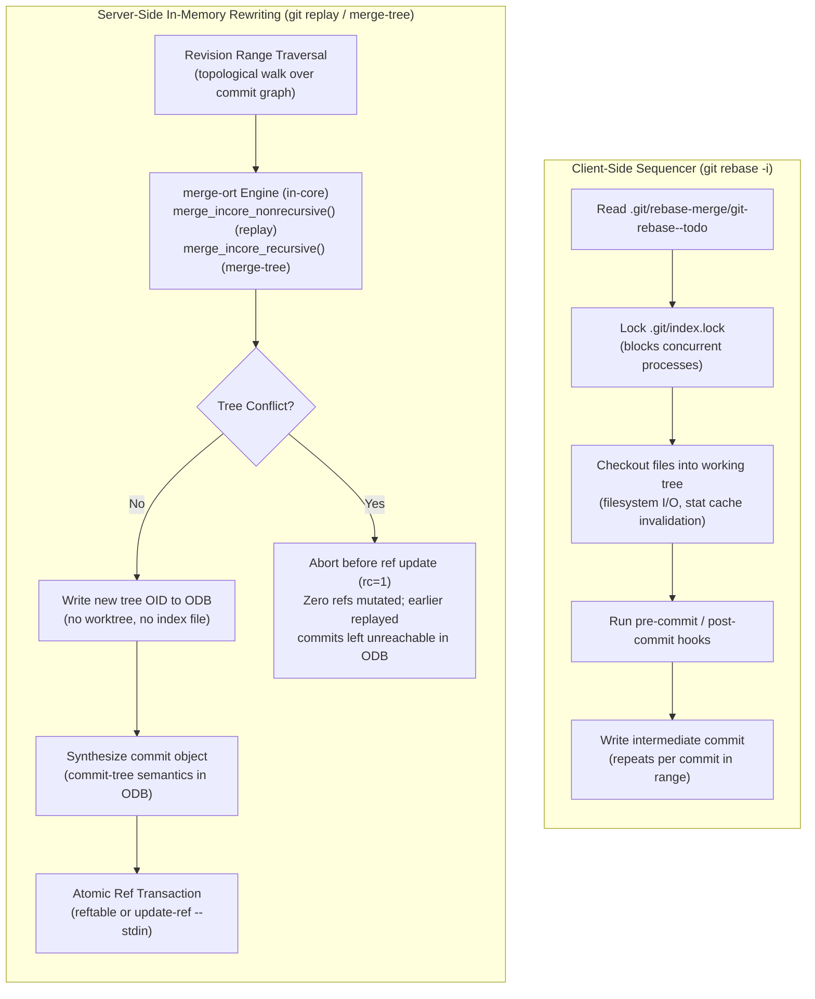
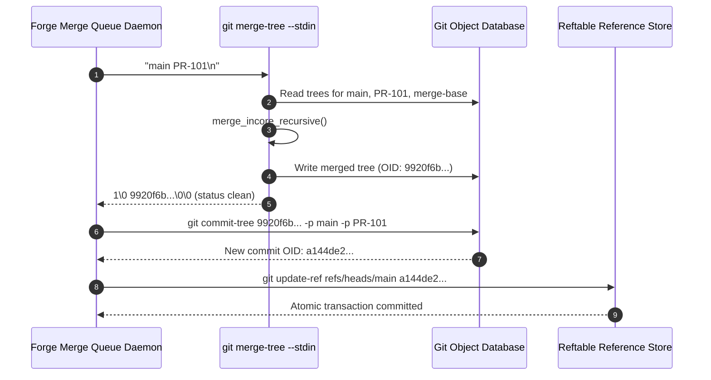
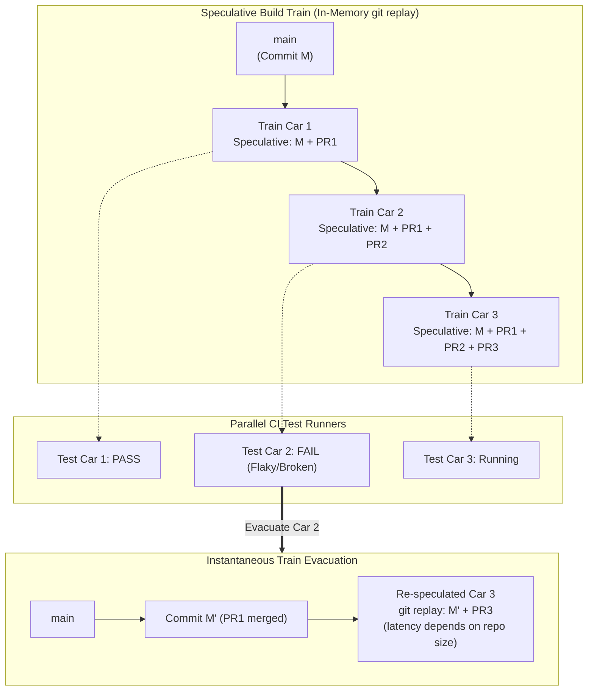

# Git Replay and Server-Side History Rewriting

> [!summary] Claim:
> Traditional history rewriting via `git rebase` requires a working tree, checks out every intermediate snapshot, acquires `.git/index.lock`, and forces serial execution on local filesystems.
> Server-side history rewriting synthesizes commit graphs directly inside the object database using in-memory three-way tree merges (`merge_incore_recursive` and `merge_incore_nonrecursive` in the `merge-ort` engine) without worktree checkouts or index file locks.
> Modern Git exposes this capability through `git merge-tree --write-tree` (added in Git 2.38.0, not marked experimental) and `git replay` (added in Git 2.44.0, still marked EXPERIMENTAL in Git 2.55.0).
> These primitives let forge backends and merge queues speculatively rebase many pull requests in parallel processes, emit atomic reference transactions, and detect conflicts without touching a working tree.



## The Mechanism

Client-side history rewriting mechanisms such as `git rebase` and `git cherry-pick` are managed by Git's sequencer subsystem.
[[Git-Rebase-Internals-and-Stacked-Branches]] details how the sequencer writes instructions to `.git/rebase-merge/git-rebase--todo`, updates `HEAD` for every commit in the sequence, synchronizes files to the working directory, runs client-side hooks, and repeatedly locks `.git/index.lock`.
On a developer laptop modifying ten commits across a few dozen files, this overhead is negligible.
On a shared Git forge backend, CI merge queue, or enterprise repository hosting millions of paths, the sequencer architecture fails catastrophically.
A server daemon cannot afford to check out thousands of files into disk directories for every speculative merge, nor can it tolerate global repository lock contention.
Server-side history rewriting completely decouples commit graph transformation from the filesystem working tree and index.

### 1. The Bottlenecks of Client-Side History Rewriting

When a tool executes `git rebase <upstream> <branch>` on a repository, Git enforces four physical constraints:

1. **Working Tree Dependency:** The sequencer inspects the working tree to ensure no uncommitted modifications exist.
   During each rebase step, modified files are checked out to disk, invoking path normalization, CRLF conversion, and stat cache updates.
2. **Index File Contention:** Every commit application acquires an exclusive lock file on `.git/index.lock`.
   If a repository daemon attempts to process two rebase operations concurrently in the same checkout, the second rebase aborts with `fatal: It seems that there is already a rebase-merge directory`, and any other index writer fails with `Unable to create '<repo>/.git/index.lock': File exists.` (both reproduced locally with Git 2.55.0, macOS, as of 2026-11).
3. **Reference Churn and Detached HEAD:** The sequencer detaches `HEAD` to point to the base commit, sequentially moving `HEAD` forward step by step.
   This mutates repository state in-place, making concurrent reads or speculative branches impossible within the same repository instance.
4. **Filesystem Disk Amplification:** In an enterprise monorepo containing 500,000 files and occupying 10 GB on disk, applying a one-line change across five commits rewrites the whole index file at each step, which is tens of megabytes of I/O per step: a measured index of 100,000 entries with 28-character paths was 8,800,032 bytes (about 88 bytes per entry; Git 2.55.0, macOS, as of 2026-11), so 500,000 entries of that shape extrapolate to about 44 MB, and longer paths make it larger.

Server-side platforms require pure in-memory transformation: given commit $A$, commit $B$, and their common ancestor base $O$, compute the resulting Merkle tree $T'$ and commit $C'$ solely by querying the object database (ODB), without touching the index or disk working tree.

### 2. The `merge-ort` In-Memory Architecture

The technical foundation for worktree-free history rewriting is `merge-ort` ("Ostensibly Recursive's Twin"), written by Elijah Newren, already selectable as `-s ort` by Git 2.32.0 (its release notes call it "an explicit `-s ort` choice"), announced as ready for use in Git 2.33.0, and made the default in Git 2.34.0, superseding `merge-recursive` (Git 2.32.0 and 2.34.0 release notes; Highlights from Git 2.33).
`merge-ort` was explicitly designed with a clean API boundary separating the computation of tree merges from the application of changes to the working tree.
In `merge-ort.h` (v2.55.0, verified), Git exposes the core in-memory engine; `git replay` calls this non-recursive form with an explicit base, while `git merge-tree --write-tree` calls `merge_incore_recursive()` on the computed merge bases unless `--merge-base` is given (`builtin/merge-tree.c`, `real_merge()`):

```c
void merge_incore_nonrecursive(struct merge_options *opt,
                               struct tree *merge_base,
                               struct tree *side1,
                               struct tree *side2,
                               struct merge_result *result);
```

The algorithm operates through four distinct architectural phases:

1. **Conflict-Free Subtree Pruning:** Because Git tree objects are Merkle trees, two identical subdirectories share the exact same object hash (OID).
   When `merge-ort` walks `merge_base`, `side1`, and `side2`, any tree entry where the OID is unchanged between `merge_base` and `side2` is kept directly from `side1` in $O(1)$ time.
   Subtrees that are identical between `side1` and `side2` require zero recursion.
2. **In-Memory Conflict and Rename Detection:** For paths with differing OIDs, `merge-ort` collects structural modifications and executes rename detection.
   Unlike `merge-recursive`, which used the index and working tree as its scratch space (higher-order stage entries in the index), `merge-ort` records rename pairings in internal heap-allocated `strmap` and `strset` tables in `struct rename_info`, including the `cached_pairs`, `cached_target_names`, and `cached_irrelevant` caches that let a rebase reuse rename work across consecutive picks (`merge-ort.c`, v2.55.0; the draft's `memoized_renames` does not exist in the source).
3. **In-Core Object Synthesis:** Content merges are computed via three-way line matching using Git's internal xdiff engine (`merge-ort.c` calls `ll_merge()`, whose default text driver runs `xdl_merge`).
   When content merges cleanly, `merge-ort` creates the new blob in memory, writes it into the object database via `odb_write_object()` (the v2.55.0 name; older releases called it `write_object_file()`), and constructs the new tree hierarchy.
   The resulting top-level tree OID is returned in `result->tree`.
4. **Decoupled Disk Application:** In traditional commands like `git merge`, Git subsequently invokes `merge_switch_to_result(opt, head, result, update_worktree_and_index, display_update_msgs)`.
   Server-side commands simply skip this final call entirely.
   The working tree and on-disk index file are never opened, read, locked, or modified.

### 3. Plumbing Tree Merging: `git merge-tree --write-tree`

In Git 2.38.0, Git introduced the modern `--write-tree` mode to the low-level plumbing command `git merge-tree`.
Prior to Git 2.38.0, `git merge-tree` only supported the trivial-merge mode (now documented as deprecated and spelled `--trivial-merge`), which could not handle rename detection, directory-rename conflicts, or three-way content resolution.
Modern `git merge-tree --write-tree <branch1> <branch2>` computes a real three-way merge using `merge-ort` in a bare repository or without a working tree.

```bash
git merge-tree --write-tree main feat-A
```

#### Clean Merges
When the merge contains no conflicting edits, `git merge-tree` prints exactly one line to stdout: the 40-character (or 64-character for SHA-256) hexadecimal OID of the newly written top-level tree object, and exits with return code `0`.
The tree object is already safely persisted in `.git/objects/`.
A server script can immediately pass this tree OID to `git commit-tree` to generate a new commit without checking out a single file:

```bash
NEW_TREE=$(git merge-tree --write-tree main feat-A)
NEW_COMMIT=$(git commit-tree "${NEW_TREE}" -p main -p feat-A -m "Merge branch feat-A into main")
git update-ref refs/heads/main "${NEW_COMMIT}"
```

#### Conflicted Merges
When conflicting edits exist, `git merge-tree` exits with return code `1` and outputs three structured sections:

```text
<OID of toplevel tree>
<Conflicted file info>
<Informational messages>
```

1. **The Conflict Tree OID:** Even during conflicts, `git merge-tree` writes a valid top-level tree into the object database.
   For conflicted files, the blob written into the tree contains standard Git three-way conflict markers (`<<<<<<<`, `=======`, `>>>>>>>`).
   This allows web forges to render conflict resolution interfaces directly from object storage without checking out branches.
2. **Conflicted File Info:** Lines matching `ls-files -u` format (`<mode> <oid> <stage> <path>`).
   Stage 1 represents the common merge-base ancestor, Stage 2 represents our branch (`branch1`), and Stage 3 represents their branch (`branch2`).
3. **Informational Messages:** Human-readable diagnostic notices, including auto-merging notices, directory rename warnings, and content collision messages.

#### High-Throughput Batch Merging via `--stdin`
In high-frequency merge queues, spawning a new `git merge-tree` process for every evaluation incurs significant process creation and repository initialization overhead.
Git supports batch execution via `git merge-tree --write-tree --stdin`.
Input lines are supplied as `[<base-commit> -- ]<branch1> <branch2>`.
`--stdin` implies `-z`: each result is prefixed by a merge status (`1` clean, `0` conflicted) followed by NUL, and the process exit status is `0` for both clean and conflicted merges, so callers must read the per-merge status (git-merge-tree(1), Git 2.55.0).
Each input line runs an independent `real_merge()` that ends in `merge_finalize()`, so no `merge-ort` caches carry over between lines; the saving is process startup and repository initialization (`builtin/merge-tree.c`, v2.55.0).
The lab does not time this, and no throughput figure is claimed here; measure merges per second on your own repository before sizing a queue.



### 4. Server-Side Graph Traversal and Replaying: `git replay`

While `git merge-tree` operates on individual pairs of trees, rebasing or cherry-picking a branch requires replaying a sequence of commits across a graph topology.
In Git 2.44.0, Elijah Newren and Christian Couder introduced `git replay`, "a tool meant on the server side without working tree to recreate a history" (Git 2.44.0 release notes).
In v2.55.0 the option parsing and ref updates live in `builtin/replay.c` (`cmd_replay()`, `handle_ref_update()`), while the replay loop lives in the top-level `replay.c` (`replay_revisions()`, `pick_regular_commit()`, `create_commit()`).
GitHub ran Newren's `git replay` in its own Git fork for server-side rebases before it was upstream (Scaling merge-ort across GitHub, 2023).

```text
(EXPERIMENTAL!) git replay ([--contained] --onto=<newbase> | --advance=<branch> | --revert=<branch>)
                           [--ref=<ref>] [--ref-action=<mode>] <revision-range>
```

#### Execution Loop in `replay.c`
When executed, `git replay` carries out the following steps:

1. **Topology Sort:** It initializes a revision walk across `<revision-range>` (for example `upstream..topic`) with `revs.topo_order = 1`, `revs.sort_order = REV_SORT_IN_GRAPH_ORDER`, and `revs.reverse = !revert`, so picks run oldest to newest and `--revert` runs newest to oldest (`builtin/replay.c`, v2.55.0).
2. **In-Memory Parent Mapping:** It maintains an in-memory hash table (`kh_oid_map_t *replayed_commits`) mapping old commit OIDs to newly synthesized commits.
   The initial parent of the replayed series is initialized to `<newbase>`.
3. **Iterative In-Core Merge Loop:** For each commit $C_i$ with tree $T_i$ and parent $P_i$:
   - It fetches the newly mapped parent $P'_i$.
   - It invokes `merge_incore_nonrecursive()` using $T(P_i)$ as the base tree, $T(P'_i)$ as side 1, and $T(C_i)$ as side 2.
   - If a merge conflict occurs, `git replay` stops with exit code `1`, emits no stderr output, and mutates zero references (git-replay(1) OUTPUT and EXIT STATUS).
     Commits already replayed earlier in the same run were written to the ODB and stay behind as unreachable objects until `git gc` prunes them (reproduced locally: a two-commit replay whose second pick conflicts left one unreachable commit, Git 2.55.0, as of 2026-11).
   - If the merge is clean, it extracts the resulting tree OID $T'_i$.
     Since Git 2.54.0 a commit whose changes become empty after replay is dropped (Git 2.54.0 release notes).
4. **Commit Synthesis:** It constructs a new commit buffer matching $C_i$'s author name, author email, author date, and commit message.
   The committer identity and timestamp are updated to the executing entity, and the parent is set to $P'_i$.
   In `--revert` mode the author is the current user and the message follows `git revert` conventions (`Revert "<subject>"`, `This reverts commit <hash>.`), per git-replay(1).
   The commit object is written to the ODB, and its new OID is recorded in the mapping table.
5. **Reference Updating:**
   - With `--advance=<branch>`, the specified branch is advanced to the final synthesized commit tip.
   - With `--onto=<newbase>`, the branch tips identified in the revision range are updated to their newly replayed positions.
   - With `--contained --onto=<newbase>`, `git replay` identifies all branches pointing to any commit within the replayed range (such as stacked pull requests) and rewrites all branch pointers simultaneously in a single atomic transaction.
   - With `--revert=<branch>` (introduced in Git 2.54.0 per its release notes), commits in the revision range are inverted (reverting their changes) and committed on top of `<branch>`; it is mutually exclusive with `--onto` and `--advance` and incompatible with `--contained`.

#### Decoupling Reference Mutation: `--ref-action`
In Git 2.53.0, `git replay` learned to perform ref updates itself in a transaction by default (Git 2.53.0 release notes), controlled by `--ref-action=<mode>` and the `replay.refAction` configuration variable:

- `--ref-action=update` (Default): Invokes Git's internal `ref_transaction` API to commit all updated references atomically; each `ref_transaction_update()` call passes the old OID, so the update is compare-and-swap (`handle_ref_update()` in `builtin/replay.c`, v2.55.0).
  All target branches update simultaneously, or none update if an invariant fails.
- `--ref-action=print`: Suppresses reference mutation entirely.
  Instead, `git replay` prints standard update instructions to stdout:
  ```text
  update refs/heads/branch1 8ef3d9217507fb207e74da77f7525d211757d9f3 0297f6f089b0f18ccbb31ac6762719c00781e475
  update refs/heads/branch2 f604433e536d2e07aee1e8805d745e5ff3ca34c2 b53483696dd6241e31eabd9777af06adabdd6af6
  ```
  This stdout stream can be inspected, logged, validated against branch protection policies, or piped directly into `git update-ref --stdin`.

### 5. Atomic Reference Updating and the Reftable Backend

A critical scaling requirement for server-side rewriting is atomic reference transactions.
[[Git-Refs-Reflog-and-Reftable]] details reference storage backends.
Under Git's legacy `files` backend, updating three branches requires acquiring individual lock files: `refs/heads/branch1.lock`, `refs/heads/branch2.lock`, and rewriting `packed-refs`.
If two concurrent merge queue runners attempt to update references simultaneously, the filesystem locks collide.

Under the modern `reftable` storage backend (introduced in Git 2.45.0):
1. Reference updates are written into an append-only block of binary index tables.
2. An atomic transaction writes a single new table file containing all updated refs and atomically renames the table list file.
3. Writers serialize on a single `tables.list.lock`: it is acquired when the transaction starts (`reftable_stack_init_addition` in `reftable/stack.c`, v2.55.0), the new table list is written through it, and it is renamed onto `tables.list` to publish the change; readers take no lock and retry if a listed table disappears (git-scm.com reftable format document).
   The format document says writers may busy-spin with backoff for a bounded wait and abort if the repository is too busy; no hold duration is claimed here.
   This is ref-store contention only; `.git/index.lock` belongs to the index, which `git replay` never touches under either backend.

| Operation Stage | Client-Side `git rebase` | Server-Side `git replay` |
| :--- | :--- | :--- |
| Execution Context | Local non-bare checkout with working tree | Bare repository or worktree-free daemon |
| Memory vs Disk | Sequential checkout of all files to disk | Pure in-memory tree traversal (`merge-ort`) |
| Index Contention | Locks `.git/index.lock` for every commit step | Zero index access; `.git/index` never opened |
| Head Mutability | Moves `HEAD` through intermediate states | `HEAD` is never detached or mutated |
| Stacked Branches | Requires complex sequencer `--update-refs` | Handled natively via `--contained` |
| Conflict Abort State | Leaves working tree in dirty conflicted state | Exit rc=1 with zero refs changed; earlier replayed commits remain only as unreachable objects |
| Reference Updates | Step-by-step ref log writes | Single atomic `ref_transaction` at completion |

## Commands and Numbers to Know

All reference metrics, defaults, and command behaviors are stamped `(as of 2026-11)` on `Both` macOS and Linux platforms unless explicitly noted.

| Parameter / Command | Value / Syntax | Platform and Date | Operational Role |
| :--- | :--- | :--- | :--- |
| `git merge-tree --write-tree` | `git merge-tree --write-tree <b1> <b2>` | Both (as of 2026-11) | In-memory three-way tree merge without index or worktree |
| `git merge-tree --stdin` | `[<base> -- ]<b1> <b2>` over stdin | Both (as of 2026-11) | Persistent process batch streaming of tree merges |
| `git merge-tree` clean exit | `0` | Both (as of 2026-11) | Outputs top-level tree OID on stdout |
| `git merge-tree` conflict exit | `1` | Both (as of 2026-11) | Outputs conflict tree OID, stage entries, and messages |
| `git replay` status | Experimental (`builtin/replay.c`) | Both (as of 2026-11) | Built-in server-side commit graph rewriting command |
| `git replay --onto` | `git replay --onto=<base> <range>` | Both (as of 2026-11) | Replays revision range onto new base; updates branch tips |
| `git replay --advance` | `git replay --advance=<branch> <range>` | Both (as of 2026-11) | Replays range on top of branch and moves branch pointer |
| `git replay --contained` | `git replay --contained --onto=<b1> <range>` | Both (as of 2026-11) | Rewrites all branches pointing within range (stacked PRs) |
| `git replay --revert` | `git replay --revert=<branch> <range>` | Both (as of 2026-11) | Reverts range onto branch in-memory (added in Git 2.54.0) |
| `git replay --ref-action` | `update` (default) or `print` | Both (as of 2026-11) | Direct atomic transaction vs pipeline output (Git 2.53.0) |
| `replay.refAction` | Config variable: `update` or `print` | Both (as of 2026-11) | Sets repository default for `git replay` reference updating |
| `git replay` clean exit | `0` | Both (as of 2026-11) | Non-conflicted replay succeeded; refs updated |
| `git replay` conflict exit | `1` | Both (as of 2026-11) | Merge conflict encountered; aborts with zero ref mutation |
| `merge.renameLimit` | Defaults to `diff.renameLimit`, else `7000` | Both (as of 2026-11) | Files considered in the exhaustive portion of rename detection during a merge (git-config(1)) |
| `merge.directoryRenames` | `true`, `false`, `conflict` (default `conflict`) | Both (as of 2026-11) | Controls directory rename detection in `merge-ort` |
| `reftable` writer lock | One `tables.list.lock` per repository, renamed onto `tables.list` to commit | Both (as of 2026-11) | Serializes ref writers; readers take no lock (reftable format document) |
| `merge-ort` speedup | over `500x` (one large merge with many renames), over `9000x` (series of similar merges in a rebase) | Both (as of 2026-11) | Cases chosen as worst cases for `merge-recursive`; typical merges are only somewhat faster (Highlights from Git 2.33) |

## Multi-Language Comparison: C / Python / Rust

Server-side version control systems and merge queue orchestrators utilize different low-level libraries and runtimes to execute in-memory tree synthesis and commit replaying.

| Concern | C (`git.git` v2.55.0 / `libgit2` main) | Python (`Dulwich` 1.2.21 / Lab Harness) | Rust (`gitoxide`: `gix-merge` 0.23.0) |
| :--- | :--- | :--- | :--- |
| In-Memory Tree Merge | `merge_incore_nonrecursive()` in `merge-ort.c`; `git_merge_trees()` in `libgit2` | `dulwich.merge.Merger.merge_trees()` and `three_way_merge()`, which take an object store and return a tree plus conflicted paths; the lab harness drives `git merge-tree` | `gix_merge::tree()` in `gix-merge` crate |
| Merge Index Requirement | `merge-ort` requires no index; `git_merge_trees()` in `libgit2` returns a `git_index` through an out parameter that the caller frees | `Merger.merge_trees()` takes `Tree` objects, not an index | `gix_merge::tree()` takes `our_tree`, `their_tree`, and a `base_tree` |
| Commit Graph Traversal | `revision.c` topological rev-list walker; `git_revwalk` in `libgit2` | Dulwich `Repo.get_walker()` walking commit parent pointers | `gix_revwalk` crate (`Graph`, a commit graph that can attach data to each commit) |
| Commit Object Synthesis | `create_commit()` in top-level `replay.c` (v2.55.0); `git_commit_create()` in `libgit2` | Dulwich `Commit()` object serialized directly to ODB | `gix_object::Commit` written via `gix_odb::Write` |
| Reference Transactions | `refs/reftable-backend.c` atomic transactions; `git_transaction` in `libgit2` | Dulwich `RefsContainer.set_if_equals()` and `add_if_new()` (compare-and-swap style updates; the files container and a reftable container in `dulwich/reftable.py` both implement them) | `gix_ref::transaction`: prepare locks the refs against other writers, then commit finalizes |
| Batch Merge Streaming | `git merge-tree --stdin` persistent loop over standard input | Python subprocess piping lines over stdin and parsing NUL tokens | In-process calls to `gix_merge::tree()` from the embedding service; no process boundary, so no stdin protocol |

## Worked Lab Example

The reproducible lab is located in `code/02-Version-Control/replay_harness/`.
The harness requires Python 3 and Git 2.54.0 or later (`--revert`; `--ref-action` needs 2.53.0); it was recorded with Git 2.55.0.
It executes purely in a bare repository (`server.git`), which has no working tree and no index by construction.
The lab sets `GIT_INDEX_FILE` to a path in a directory that does not exist, so any command that tries to write an index fails, and it scans `server.git` for `index` and `index.lock` after every one of its git commands.
A positive control proves the scan can see an index: `git read-tree` run in a copy of the repository must produce exactly one.
Every step is also checked by assertion (exit codes, parents, trees, ref snapshots), so a wrong result stops the lab with a nonzero exit instead of printing a plausible line.
On Git older than 2.54.0 the lab exits with status 2 and a message naming the required version.

The lab exercises three operational scenarios:
1. Worktree-free tree merging using `git merge-tree --write-tree`, demonstrating clean resolution, conflicted resolution with embedded conflict markers, and persistent `--stdin` streaming.
2. Server-side commit graph rewriting using `git replay`, verifying `--ref-action=print` (no ref changes), an atomicity probe (a held `feat-B.lock` must abort the whole `--contained` update), multi-branch rewriting across stacked branches (`--contained`), branch advancement (`--advance`) with a freshly synthesized commit, revert generation (`--revert`), and conflict rollback safety.
3. A speculative merge queue simulation demonstrating a three-car build train, showing immediate clean re-speculation upon worker failure.

Execute the lab locally:

```bash
cd code/02-Version-Control/replay_harness
bash run.sh
```

### Verified Output

The following output was recorded on `darwin-arm64` on 2026-11-07 and verified by `make verify` against `code/02-Version-Control/replay_harness/expected/darwin-arm64.txt`:

```text
=== Worktree-Free & Index-Free Verification ===
Repository mode: bare (core.bare = true)
git rev-parse --is-inside-work-tree: false, --show-toplevel exit code is nonzero: True
Index artifacts in server.git: 0
Positive control (git read-tree in a copy): index artifacts seen: 1

=== 1. Plumbing Three-Way Tree Merging (git merge-tree) ===
Clean merge exit code: 0
Clean merged tree OID: 9920f6b9a1c4967ab9fc0c1063bec0972b4e3761
Clean tree entries:
  100644 blob README.md (b4ad6e9e8d70e861d8c502dac5cd70aa9b7cc7ab)
  040000 tree src (9f0f73df79e77317e10ae1e4452008432e7cd32e)
Conflicted merge exit code: 1
Conflicted merged tree OID: 507fa54f95c13fcf62cfaf5b89699f43b303107c
Conflicted stage entries:
  stage 1 (base): 2040365ba27962736829b22f662ad64233bc4981 README.md
  stage 2 (ours): b4ad6e9e8d70e861d8c502dac5cd70aa9b7cc7ab README.md
  stage 3 (theirs): 25403bb164c1afe15ed217ab1e3c22944815b806 README.md
Conflicted blob conflict markers:
  <<<<<<< main
  =======
  >>>>>>> feat-conflict
Stdin batch merge stream (2 requests):
  request 1 status: 1 (clean), tree: 9920f6b9a1c4967ab9fc0c1063bec0972b4e3761
  request 2 status: 0 (conflict), tree: 507fa54f95c13fcf62cfaf5b89699f43b303107c

=== 2. Server-Side History Rewriting (git replay) ===
Single branch replay preview (--ref-action=print):
  update refs/heads/feat-A 8ef3d9217507fb207e74da77f7525d211757d9f3 0297f6f089b0f18ccbb31ac6762719c00781e475
  refs modified by the preview: 0
Atomicity probe (--contained with refs/heads/feat-B.lock held):
  replay failed: True, refs modified: 0
Stacked branches atomic replay (--contained --onto=main):
  exit code: 0
  refs/heads/feat-A: 8ef3d9217507fb207e74da77f7525d211757d9f3 (parent: 9ea3c58432e5ddecfae77ea3f76162f45b14a4be)
  refs/heads/feat-B: f604433e536d2e07aee1e8805d745e5ff3ca34c2 (parent: 8ef3d9217507fb207e74da77f7525d211757d9f3)
Branch advance replay (--advance=advance-branch):
  git replay exit code: 0
  refs/heads/advance-branch: de82756df8c10214ebb16584e0cabddb57c0220b (parent: 9ea3c58432e5ddecfae77ea3f76162f45b14a4be)
  new commit synthesized: True
  tree equals merge-tree result: True
Server-side revert replay (--revert=revert-branch):
  git replay exit code: 0
  revert commit: d63ffe2f2fc77673beca27a10f997be3871490d7
  commit message: Revert "Add extra_hook"
  tree equals main's tree: True
Conflict abort behavior:
  exit code: 1 (stdout len: 0, stderr len: 0, refs modified: 0)

=== 3. High-Throughput Speculative Merge Queue Simulation ===
Speculative Build Train:
  Car 1 (main + PR-1): tip=971832a tree=5b9f61b
  Car 2 (Car-1 + PR-2): tip=2acc861 tree=f7cba6c
  Car 3 (Car-2 + PR-3): tip=cd175df tree=bf821f4
Simulating CI test failure on PR-1:
Evacuation and rapid re-speculation:
  New Car 2 (main + PR-2): tip=978c439 tree=ff1ce68
  New Car 3 (New Car-2 + PR-3): tip=c7124d8 tree=811efe3
Ancestry of New Car 3:
  * c7124d8 PR 3: telemetry metrics
  * 978c439 PR 2: payment billing engine
  * 9ea3c58 Update README on main
  * bd02d59 Base commit

=== Integrity and Lock Invariants ===
Git commands run, each followed by an index scan: 136
Index artifacts in server.git at the end: 0
Entries outside the bare layout (a checkout would add some): 0
```

### Reading the Result

- **Zero Filesystem Footprint:** `git rev-parse --is-inside-work-tree` prints `false` and `--show-toplevel` fails, so Git itself reports no working tree.
  The lab ran 136 git commands, scanned `server.git` for `index` and `index.lock` after each, and found none; the scan is end-state per command, so a lock created and removed inside a single command would not be caught.
  `GIT_INDEX_FILE` pointed into a nonexistent directory, so any index write would have failed loudly, and the positive control shows the scan does detect an index when `git read-tree` creates one.
  At the end, `server.git` held only the standard bare layout, so no checkout wrote files into it.
- **Tree Synthesis vs Working Files:** For clean merge `main` and `feat-A`, `git merge-tree` computed tree `9920f6b...` directly in the ODB.
  The tree contains `README.md` from `main` (`b4ad6e9...`, the same blob as stage 2 below) and the `src/` subtree from `feat-A` (`9f0f73d...`); the lab asserts both edits are present in the merged blobs.
  The lab does not measure which objects were read.
- **Conflict Representation in Tree Storage:** On conflict between `main` and `feat-conflict`, `git merge-tree` exited with return code `1`, but still wrote tree `507fa54...`.
  Inspecting `507fa54...:README.md` reveals that Git synthesized a blob containing literal conflict markers (`<<<<<<< main ... ======= ... >>>>>>> feat-conflict`), accompanied by Stage 1, 2, and 3 entries.
- **Batch Processing via Stdin:** The `--stdin` batch stream produced the same tree hashes (`9920f6b...` and `507fa54...`) as the two separate invocations, with per-merge status `1` (clean) and `0` (conflicted) as git-merge-tree(1) specifies; the lab asserts the equality.
  The lab does not measure process startup savings.
- **Preview Changes Nothing:** `--ref-action=print` emitted one `update` line and a before-and-after snapshot of every ref was identical.
- **Atomic Stacked History Rewriting:** With `refs/heads/feat-B.lock` held, `git replay --contained --onto=main <base>..feat-B` failed and a snapshot of all refs was unchanged, so `feat-A` was not updated alone.
  Once the lock was removed, the same command rebased both branches: `feat-B` (`f604433...`) has parent `feat-A` (`8ef3d92...`), which has parent `main` (`9ea3c58...`).
  The probe shows an all-or-nothing outcome for one failure mode (a held ref lock) on the `files` backend; it is not a proof for every failure or for `reftable`.
- **Advance Synthesizes a Real Commit:** `feat-C` was forked from the base and never rewritten, so `--advance=advance-branch` had to create a new commit.
  The lab asserts it differs from the original `feat-C`, has the old `advance-branch` tip (`main`, `9ea3c58...`) as parent, has the same tree as `git merge-tree --write-tree main feat-C`, and keeps the message.
  The `exit code` lines are the status of `git replay` itself.
- **Revert Restores the Tree:** `--revert=revert-branch` on the single commit that `advance-branch` added produced a commit titled `Revert "Add extra_hook"` whose tree equals `main`'s tree and whose parent is the old `revert-branch` tip.
- **Conflict Abort:** The conflicting replay exited `1` with empty stdout and stderr, and a before-and-after ref snapshot showed `refs modified: 0` as a measurement.
- **Speculative Train Evacuation:** In Scenario 3, when Car 1 (`PR-1`) failed CI, Car 2 and Car 3 were re-speculated directly on `main`.
  The lab asserts each car's parent, that Car 3 carries all three PRs, and that the re-speculated Car 3 carries `PR-2` and `PR-3` but not `auth.c` from `PR-1`.
  The commit graph log of New Car 3 confirms that `PR-1` was cleanly evicted, producing a new linear branch topology (`c7124d8 -> 978c439 -> 9ea3c58 -> bd02d59`).
  The lab does not time any of this.

## Pitfalls

> [!warning] Pitfall: trusting the printed tree OID without checking the merge status
> In custom automation, developers sometimes run `git merge-tree --write-tree` and use the first line of stdout as the merge result.
> When conflicts occur, `git merge-tree` exits with code `1`, but still writes a valid tree object and prints its OID to stdout.
> With `--stdin` the exit status is `0` for clean and conflicted merges alike, so the per-merge status token (`1` clean, `0` conflicted) is the only signal (git-merge-tree(1)).
> An automation script that captures stdout without checking the process exit status will treat the conflict tree (which contains unresolved conflict markers) as a valid merge commit, shipping broken code to production.
> Always assert that the process exit code (or, under `--stdin`, the merge status) reports a clean merge before passing the resulting tree OID to `git commit-tree`.

> [!warning] Pitfall: re-merging stage OIDs manually instead of reading the conflict tree
> A common anti-pattern in forge tooling is parsing the Stage 1, 2, and 3 OIDs from the `Conflicted file info` section and invoking `git merge-file` on them to display conflicts.
> The Git manual explicitly cautions against this in its MISTAKES TO AVOID section: re-merging stage blobs loses information, notably the original branch annotations and, when renames were involved, the original filename.
> Instead, look up the conflicted path directly within the generated conflict tree OID (`git cat-file -p <conflict-tree>:<path>`).
> This blob already contains accurately annotated conflict markers with the original branch identifiers and rename tracking intact.

> [!warning] Pitfall: assuming `git replay` prints error diagnostics to stderr on conflict
> Unlike `git rebase` or `git cherry-pick`, which print verbose conflict messages, `git replay` produces zero stdout and zero stderr on conflict (git-replay(1): "There is no stderr output on conflicts"; reproduced by the lab).
> It indicates conflict failure exclusively through its exit code (`1`).
> Scripts that expect error text in stderr to diagnose why a replay failed will find empty buffers.
> If detailed conflict diagnosis is required, servers should execute `git merge-tree --write-tree` on the failing commit pair to obtain the structured `Conflicted file info` and `Informational messages` blocks.

> [!warning] Pitfall: running non-atomic ref updates with `--ref-action=print` under high concurrency
> Piping `git replay --ref-action=print` directly into `git update-ref --stdin` without verifying the old OID can overwrite concurrent pushes.
> `git replay --ref-action=print` outputs lines formatted as `update <ref> <new-oid> <old-oid>`.
> If your script strips `<old-oid>` or uses simple `git update-ref <ref> <new-oid>`, it performs a blind force-push.
> Always preserve the `<old-oid>` argument so that Git validates that the branch tip has not moved concurrently, guaranteeing Compare-And-Swap (CAS) safety (git-update-ref(1)).
> The default `--ref-action=update` already passes the old OID to `ref_transaction_update()`, so it is CAS-safe without a pipeline.

> [!warning] Pitfall: using `--merge-base` with multiple common ancestors
> When using `git merge-tree --merge-base=<tree-ish>`, Git skips its recursive ancestor consolidation algorithm and calls `merge_incore_nonrecursive()` with that single base (`builtin/merge-tree.c`, v2.55.0).
> If `<branch1>` and `<branch2>` have criss-cross merge history with multiple common ancestors, supplying a single explicit merge-base can result in silent regression of changes made on another ancestor branch.
> Omit `--merge-base` unless you have explicitly verified that the history is linear or that a single unambiguous base exists.

## At Scale

At the scale of 1,000 to 50,000 engineers operating in large monolithic or multi-service repositories, the merge queue is the central coordination bottleneck.
[[Git-Branching-Models-Merge-Queues-and-Code-Review]] discusses branch governance and pull request velocity.
When hundreds of pull requests are approved daily, serial integration is mathematically impossible: if CI takes 30 minutes, a purely serial merge queue can merge at most 48 pull requests per day.

To achieve high throughput, engineering platforms implement speculative merge queues (such as GitHub Merge Queue, GitLab Merge Trains, and Bors-ng).



### Speculative Build Trains
1. **Parallel Speculation:** When PR 1, PR 2, and PR 3 enter the queue, the queue synthesizes three speculative branches:
   - Car 1: `main + PR 1`
   - Car 2: `Car 1 + PR 2`
   - Car 3: `Car 2 + PR 3`
2. **Parallel Testing:** CI triggers test suites across all three speculative branches concurrently.
   If all three pass, `main` advances directly to Car 3 in a single fast-forward step.
3. **Train Evacuation:** If Car 1 fails tests, Car 2 and Car 3 must be evacuated and re-speculated.
   With traditional `git rebase`, re-speculating requires checking out the repository, resetting disk state, and running file-level rebases.
   With in-memory `git replay --advance`, the queue server reconstructs Car 2 as `main + PR 2` and Car 3 as `New Car 2 + PR 3` without a checkout; this note claims no latency figure for it and the lab does not time it.
   For scale, GitHub reported that moving its merges to `merge-ort` cut P50 merge time on its monolith from about 71 ms to about 7.7 ms, and that `git replay`-based rebases took under 10 minutes total across an experiment where libgit2 took about 2.56 hours (Scaling merge-ort across GitHub, 2023).
   The revised commit graphs are pushed to CI runners before they even terminate their previous containers.

### Monorepo Partitioning and Rename Scaling
In repositories with millions of paths, `merge-ort` scales because it leverages tree hashes to skip identical directory trees.
However, rename detection remains an $O(N \times M)$ algorithm across deleted and added paths when files are moved.
To maintain sub-second server-side replaying at scale:
- Set `merge.renameLimit` appropriately (e.g., `10000`) on forge workers to prevent Git from disabling rename detection during large refactors.
- Avoid massive whole-tree directory renames on long-lived branches.
- Do not expect cone-mode sparse-checkout to help: it limits a working tree, and a bare-repository `merge-ort` merge walks trees regardless; the speedup comes from skipping subtrees whose OIDs match.

### Architectural Decision Matrix

| Organization Scale | Primary Bottleneck | Recommended Engine Strategy | Ref Backend |
| :--- | :--- | :--- | :--- |
| **1 - 50 Engineers** | Local developer conflict resolution | Client-side `git rebase` / manual PR merge | `files` backend |
| **50 - 500 Engineers** | CI test flakiness and serial queue delays | Basic forge merge queue; single-car speculation via `git merge-tree` | `files` or `reftable` |
| **500 - 5,000 Engineers** | Merge queue throughput; disk I/O on runners | Multi-car speculative build train using `git replay --advance` | `reftable` with atomic CAS |
| **5,000 - 50,000+ Engineers** | Worker process limits; rename detection cost | Persistent daemon running `git merge-tree --stdin` + custom ODB replayer | Sharded `reftable` + distributed object store |

[[Decision-Record-Merge-vs-Rebase-and-Branching]] details organizational trade-offs between merge commits and linear history.
[[Git-At-Scale-VFS-Scalar-and-Monorepos]] covers client-side filesystem virtualization in enterprise repositories.

## Practice Drill

> [!tip] Practice Drill:
> Write a shell script that initializes a bare Git repository and performs a complete worktree-free rebase of a three-commit branch onto `main` using only low-level plumbing commands (`git merge-tree --write-tree`, `git commit-tree`, and `git update-ref`).
> Then, introduce a conflicting change on `main` and verify that your script catches the conflict exit status (`rc=1`), extracts the conflicting file paths from stage entries, and extracts the annotated conflict markers directly from the resulting conflict tree without ever creating a working tree or index file.

```bash
export GIT_CONFIG_GLOBAL=/dev/null
export GIT_CONFIG_SYSTEM=/dev/null
export LC_ALL=C
export GIT_AUTHOR_NAME="Drill Engineer"
export GIT_AUTHOR_EMAIL="drill@example.com"
export GIT_COMMITTER_NAME="Drill Committer"
export GIT_COMMITTER_EMAIL="committer@example.com"
export GIT_AUTHOR_DATE="2026-11-08T12:00:00Z"
export GIT_COMMITTER_DATE="2026-11-08T12:00:00Z"

DIR=$(mktemp -d) && cd "$DIR"
git init -b main --bare repo.git
cd repo.git

# 1. Synthesize baseline commit
B0=$(echo "int main() { return 0; }" | git hash-object -w --stdin)
T0=$(printf "100644 blob %s\tmain.c\n" "$B0" | git mktree)
C0=$(git commit-tree "$T0" -m "Initial baseline")
git update-ref refs/heads/main "$C0"

# 2. Advance main
B_MAIN=$(echo "int main() { /* main edit */ return 0; }" | git hash-object -w --stdin)
T_MAIN=$(printf "100644 blob %s\tmain.c\n" "$B_MAIN" | git mktree)
C_MAIN=$(git commit-tree "$T_MAIN" -p "$C0" -m "Main edit")
git update-ref refs/heads/main "$C_MAIN"

# 3. Create topic branch with conflicting edit
B_TOPIC=$(echo "int main() { /* topic edit */ return 1; }" | git hash-object -w --stdin)
T_TOPIC=$(printf "100644 blob %s\tmain.c\n" "$B_TOPIC" | git mktree)
C_TOPIC=$(git commit-tree "$T_TOPIC" -p "$C0" -m "Topic edit")
git update-ref refs/heads/topic "$C_TOPIC"

# 4. Attempt in-memory merge-tree
set +e
MERGE_OUT=$(git merge-tree --write-tree main topic)
RC=$?
set -e

echo "Merge exit code: $RC"
CONFLICT_TREE=$(echo "$MERGE_OUT" | head -n 1)
echo "Conflict tree OID: $CONFLICT_TREE"

# 5. Extract conflict markers directly from conflict tree blob
git cat-file -p "${CONFLICT_TREE}:main.c"

cd / && rm -rf "$DIR"
```

## Interview Questions

> [!question] L5: Why cannot client-side `git rebase` run safely inside a high-throughput server-side daemon or forge backend?
>
> > [!success]- Answer
> > Client-side `git rebase` requires a working tree and depends on the sequencer subsystem (`.git/rebase-merge/`).
> > During execution, the sequencer updates the working directory files on disk for each replayed commit, checks for dirty working tree state, executes local hooks, and acquires an exclusive lock file on `.git/index.lock`.
> > In a server daemon processing concurrent requests, multiple workers cannot share a single repository checkout without colliding on `.git/index.lock`.
> > Furthermore, checking out hundreds of thousands of files to disk for speculative merges causes severe filesystem I/O amplification and latency.
> > Server-side rewriting solves this by performing three-way tree merges in memory (`merge-ort`) and writing commit objects directly into the object database, touching neither the index nor a working directory.

> [!question] L5: [Predict the Output] Predict the stdout, stderr, and exit code when `git merge-tree --write-tree` encounters a two-sided edit conflict on `src/main.c`, and contrast its output with `git replay --onto=main topic`.
>
> > [!success]- Answer
> > `git merge-tree --write-tree` exits with status `1`.
> > Its stdout contains:
> > 1. Line 1: The OID of the generated top-level conflict tree.
> > 2. Stage entries for the conflicted file:
> >    ```text
> >    100644 <base_oid> 1	src/main.c
> >    100644 <ours_oid> 2	src/main.c
> >    100644 <theirs_oid> 3	src/main.c
> >    ```
> > 3. Informational messages: `Auto-merging src/main.c` and `CONFLICT (content): Merge conflict in src/main.c`.
> >
> > In contrast, `git replay --onto=main topic` exits with status `1`, produces empty stdout (zero bytes), and produces empty stderr (zero bytes).
> > `git replay` aborts silently and cleanly on conflict, leaving all references untouched.

> [!question] L6: How does the `merge-ort` engine perform rename detection and tree merging without reading or writing an on-disk index file?
>
> > [!success]- Answer
> > Git's legacy `merge-recursive` engine relied on the index and working tree as its scratchpad, recording higher-order stage entries (1, 2, 3) in the index for conflicted paths during merge evaluation.
> > `merge-ort` completely bypasses the index file.
> > It walks the Merkle tree objects of the base and the two merge heads directly.
> > Subtrees that share identical object hashes are resolved in $O(1)$ time without descending into their child entries.
> > For paths with different hashes, `merge-ort` allocates internal in-memory hash tables (`strmap`) to track additions, deletions, and rename candidates.
> > When content merges cleanly via `ll_merge()` (xdiff's `xdl_merge`), it writes the resulting blob into `.git/objects/` via `odb_write_object()` (v2.55.0), synthesizes the parent tree objects recursively in memory, and returns the root tree OID in `struct merge_result`.
> > The disk index file is never opened or locked.

> [!question] L6: Why does `git merge-tree --write-tree` generate a top-level tree object even when a merge fails with conflicts, and how is that conflict tree structured?
>
> > [!success]- Answer
> > Writing a tree object on conflict allows server-side applications (such as GitHub or GitLab web UIs) to access the conflicted state directly through object storage without having to maintain a working directory.
> > In the generated conflict tree, files that merged cleanly are stored as normal merged blobs.
> > Files with content conflicts are stored as newly created blob objects containing standard Git conflict markers (`<<<<<<<`, `=======`, `>>>>>>>`) with original branch names annotated.
> > This enables web editors to display the conflicted file directly to users by requesting `<conflict_tree_oid>:<path>`.
> > The tree is valid in the object database, but the exit code `1` warns automation that the tree contains unresolved conflicts.

> [!question] L7: Debug a race condition in high-concurrency forge pipelines with git replay and update-ref
>
> A custom forge merge queue runs `git replay --ref-action=print --onto=main ^base feat1 feat2` and pipes the output to `git update-ref --stdin`.
> Under high load, branches occasionally fast-forward to stale states or overwrite concurrent commits.
> Diagnose the race condition and design the atomic fix.
>
> > [!success]- Answer
> > The bug arises from mishandling the old reference OID in the `update-ref` pipeline.
> > `git replay --ref-action=print` outputs lines in the format:
> > `update <ref> <new_oid> <old_oid>`.
> > If the script strips `<old_oid>` (e.g. running `update <ref> <new_oid>`), `git update-ref` performs an unconditional update, clobbering any concurrent commits pushed to `<ref>` between the start of the replay and the ref update.
> > If `<old_oid>` is preserved, `git update-ref` enforces Compare-And-Swap (CAS): it verifies that `<ref>` still points to `<old_oid>` before updating.
> > `git update-ref --stdin` already applies its whole input all-or-nothing: if every `<ref>` can be locked with a matching `<old-oid>`, all modifications are performed, otherwise none (git-update-ref(1)); concurrent readers may still observe a subset mid-commit.
> > The explicit transaction markers are optional and make the boundary visible:
> > ```text
> > start
> > update refs/heads/feat1 <new1> <old1>
> > update refs/heads/feat2 <new2> <old2>
> > commit
> > ```
> > If any branch tip has changed concurrently, the entire transaction aborts, preventing stale fast-forwards.
> > Alternatively, using modern `git replay` with the default `--ref-action=update` (Git 2.53.0 or later) executes this atomic, old-OID-checked transaction internally on either ref backend.

> [!question] L7: Explain how a speculative merge queue uses `git replay --advance` to achieve sub-second re-speculation when an intermediate build train car fails CI.
>
> > [!success]- Answer
> > In a speculative build train with three pull requests, the queue creates three speculative branch tips:
> > Car 1 (`main + PR1`), Car 2 (`Car 1 + PR2`), and Car 3 (`Car 2 + PR3`).
> > If Car 1 fails tests, PR 1 must be ejected.
> > With traditional rebase, the queue would have to checkout a clone, reset to `main`, cherry-pick PR 2, and then cherry-pick PR 3, taking tens of seconds.
> > With `git replay --advance`, the queue operates purely in-memory on a bare repository:
> > 1. It creates `train/car-2` pointing to `main` and runs `git replay --advance=train/car-2 base_pr2..pr2`.
> > 2. It creates `train/car-3` pointing to `train/car-2` and runs `git replay --advance=train/car-3 base_pr3..pr3`.
> > Because `merge-ort` operates directly on tree objects and skips unchanged subtrees, neither replay pays a checkout cost; the lab does not time them and no latency figure is claimed.
> > The queue updates the reference pointers and notifies CI runners of the new commit hashes immediately.

> [!question] L8+: Design a server-side merge architecture for a 500 GB monorepo handling 10,000 merge requests daily
>
> You are architecting a server-side merge service for a 500 GB enterprise monorepo handling 10,000 merge requests daily.
> Design the architecture to prevent worker disk exhaustion and CPU saturation.
>
> > [!success]- Answer
> > A distinguished engineer's design addresses three pillars:
> > 1. **Zero-Worktree Execution:** Workers operate exclusively against bare repositories mounted over local high-speed NVMe storage.
> >    No working trees are ever provisioned on merge workers.
> >    All candidate evaluations run via persistent daemons using `git merge-tree --write-tree --stdin` to amortize process initialization costs.
> > 2. **Object Store and Packfile Isolation:** Speculative merge trees and commits generate loose objects rapidly.
> >    Point `GIT_OBJECT_DIRECTORY` at an ephemeral directory and list the primary object store in `GIT_ALTERNATE_OBJECT_DIRECTORIES`, the same quarantine pattern `receive-pack` uses for incoming pushes, so speculative objects land in the ephemeral directory while existing objects stay readable.
> >    If a speculative train car fails or is abandoned, the ephemeral directory is wiped, preventing object database bloating and garbage collection pressure in the primary repository.
> > 3. **Reference Storage and Lock Contention:** Replace the legacy `files` ref backend with `reftable`.
> >    `reftable` provides atomic reference transactions via binary block tables, replacing per-ref `.git/refs/heads/*.lock` files with one `tables.list.lock` (reftable format document); no latency figure is claimed.
> > 4. **Rename Detection Caching:** Large monorepos can bottleneck on rename detection during tree merging.
> >    Tune `merge.renameLimit` (default `7000`) to bound the exhaustive pairing scan, keep large directory renames off long-lived branches (sparse-checkout does not narrow a bare-repository merge), and maintain a shared commit-graph file with generation numbers (`commitGraph.generationVersion=2`) to accelerate topological ancestry walks.

> [!question] L8+: Walk through the locking and concurrency guarantees of the legacy `files` backend versus the `reftable` backend when multiple `git replay` workers execute concurrently.
>
> > [!success]- Answer
> > Under the legacy `files` backend:
> > 1. Updating loose references requires creating lock files on disk: `refs/heads/<branch>.lock`.
> > 2. If a reference is packed, Git must lock and rewrite `.git/packed-refs.lock`.
> > 3. When multiple workers execute `git replay`, even though they avoid `.git/index.lock`, their reference transactions collide whenever two workers touch overlapping ref hierarchies or contend on `packed-refs`.
> > 4. The `files` backend locks every ref before committing and performs all or none of the updates, but each ref file is renamed into place separately, so a concurrent reader may see a subset of the modifications (git-update-ref(1)).
> >
> > Under the `reftable` backend (`refs/reftable-backend.c`):
> > 1. All references and reflogs are stored in immutable, ordered, block-indexed binary tables.
> > 2. A transaction writes newly created or updated references into a single new table file (`<prefix>.ref`).
> > 3. Committing the transaction requires only acquiring `tables.list.lock`, appending the new table name to `tables.list`, and atomically replacing `tables.list` via POSIX `rename()`.
> > 4. Lock contention is confined to holding `tables.list.lock` while the new table is written and `tables.list` is replaced, and transactions are all-or-nothing: all reference updates in `git replay --contained` succeed together or fail together, and readers see either the old or the new `tables.list`, never a subset.

## Further Reading

- `git-merge-tree(1)` (Git 2.55.0): Normative documentation of `--write-tree`, conflict stage formatting, and the persistent `--stdin` protocol.
- `git-replay(1)` (Git 2.55.0): Reference manual for in-memory commit replaying, covering `--onto`, `--advance`, `--revert`, and `--ref-action`.
- `replay.c`, `builtin/replay.c`, and `builtin/merge-tree.c` in `git.git` (v2.55.0): The core implementation of server-side commit synthesis and reference updating.
- `merge-ort.c` and `merge-ort.h` in `git.git` (v2.55.0): The `merge_incore_nonrecursive` architecture, conflict memoization, and in-memory rename detection.
- Taylor Blau, "Highlights from Git 2.33" (The GitHub Blog, 2021): The release announcement of `merge-ort` with its 500x and 9000x worst-case speedups and their caveats; Matt Cooper, "Scaling merge-ort across GitHub" (The GitHub Blog, 2023): production merge and `git replay` rebase measurements on github.com.
- Patrick Steinhardt, `reftable(5)` and `refs/reftable-backend.c`: Architecture of block-indexed reference storage and atomic transactions.
- GitHub, "GitHub merge queue is generally available" (The GitHub Blog, 2023): Product announcement describing merge groups built from the base branch plus queued pull requests.

## Related

- Prerequisites: [[Git-Rebase-Internals-and-Stacked-Branches]], [[Git-Three-Way-Merge-ORT-and-Diff-Algorithms]]
- Next: [[Git-Archaeology-Log-Blame-and-Bisect]]
- See also: [[Git-Object-Model-and-Content-Addressing]], [[Git-Refs-Reflog-and-Reftable]], [[Git-Branching-Models-Merge-Queues-and-Code-Review]], [[Decision-Record-Merge-vs-Rebase-and-Branching]], [[Git-At-Scale-VFS-Scalar-and-Monorepos]], [[Rebuild-Mini-Git-Lab]]
- Lab: `code/02-Version-Control/replay_harness/`
