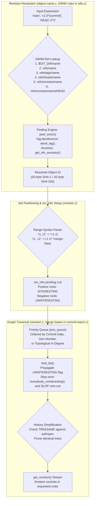
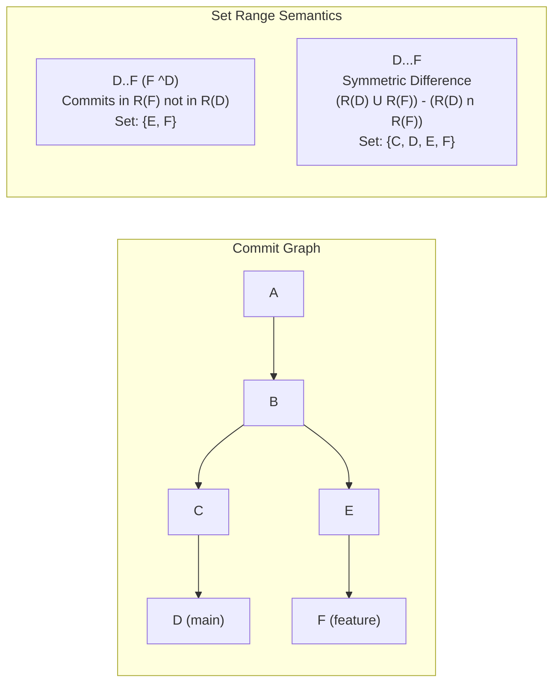

# Git Revision Selection and Graph Walks

> [!summary] Claim:
> Revision resolution evaluates string expressions into object identifiers through a deterministic six-rule refname fallback, an iterative peeling engine for annotated tags, and orthogonal ancestry operators where caret selects siblings and tilde selects first-parent generations.
> Revision set expressions partition the commit directed acyclic graph into reachability intervals where double-dot computes set difference and triple-dot computes symmetric difference.
> The traversal engine walks the commit graph by propagating per-object flag bits (a 29-bit `flags` field) including SEEN and UNINTERESTING down to common ancestors, ordering output via priority queues across chronological, topological, or date-ordered constraints.
> Corrected commit dates and generation numbers convert expensive graph traversals into bounded cutoff operations, while history simplification prunes treesame edges along merge boundaries.



## The Mechanism

[[Git-Object-Model-and-Content-Addressing]] owns loose and packed objects addressed by immutable cryptographic hashes, and [[Git-Refs-Reflog-and-Reftable]] owns reference pointers and append-only reflogs.
Git revision selection bridges human-readable strings to raw object identifiers and traverses the resulting Directed Acyclic Graph (DAG) of commit objects.
Every mechanism, data structure, and flag defined in this section is checked against Git 2.56.0 source code (`object-name.c`, `refs.c`, `revision.c`, `commit-reach.c`, `object.h`, and `revision.h`) unless another source is cited; command output was produced with Git 2.55.0 on macOS arm64 (as of 2026-11).

### 1. Revision Resolution Grammar (`object-name.c`)

When a Git command receives an argument specifying an object or revision, it passes the string to `repo_get_oid()` in `object-name.c`.
The parser follows a multi-tiered grammar to disambiguate object names, reference names, ancestry dereferences, peeling operators, and tree-ish path lookups.

#### The DWIM Reference Resolution Rules

If a string does not match a 40-character SHA-1 or 64-character SHA-256 hexadecimal hash, `get_oid_basic()` in `object-name.c` calls `repo_dwim_ref()` in `refs.c` to "Do What I Mean".
Git evaluates reference namespaces in a strict six-step fallback order (`ref_rev_parse_rules[]` in `refs.c`):

1. `$GIT_DIR/<refname>`: Matches repository-level pseudo-refs and operation state files located directly inside `$GIT_DIR`.
   These include `HEAD`, `FETCH_HEAD`, `ORIG_HEAD`, `MERGE_HEAD`, `REBASE_HEAD`, `CHERRY_PICK_HEAD`, `BISECT_HEAD`, and `AUTO_MERGE`.
2. `refs/<refname>`: Matches top-level refs such as `refs/stash`.
3. `refs/tags/<refname>`: Matches annotated and lightweight tags under the tag namespace.
4. `refs/heads/<refname>`: Matches local development branches.
5. `refs/remotes/<refname>`: Matches remote-tracking branches.
6. `refs/remotes/<refname>/HEAD`: Matches the default branch of a named remote.

Because step 3 precedes step 4, if a repository contains both a tag named `release` (`refs/tags/release`) and a branch named `release` (`refs/heads/release`), evaluating the bare token `release` resolves to `refs/tags/release`.
Git prints `warning: refname 'release' is ambiguous.` to standard error, but execution succeeds using the tag.
The exception is `git checkout <name>` and `git switch`, which treat a name that matches a local branch as that branch (Worked Lab Example, step 9, recorded with Git 2.55.0: `git checkout v1.0` printed the warning and then `Switched to branch 'v1.0'`).
To bypass DWIM evaluation, fully-qualified refnames (such as `refs/heads/release`) must be used.

#### Reflog Suffixes

References maintain append-only transaction logs when `core.logAllRefUpdates` is active.
The grammar provides temporal and positional accessors into these logs:

- `<ref>@{<n>}`: Evaluates the state of `<ref>` $n$ changes prior to its current value.
  `HEAD@{0}` is the current commit of `HEAD`, while `HEAD@{1}` is the commit pointed to immediately prior to the latest state transition.
- `<ref>@{<date>}`: Evaluates the value of `<ref>` at a specific point in time using human or ISO timestamps, such as `main@{yesterday}` or `HEAD@{2026-11-01 12:00:00}`.
  Git parses the date and scans the reflog backwards, selecting the newest reflog entry whose timestamp is older than or equal to the requested time.
- `@{<n>}`: Omitting the refname reads the reflog of the current branch (on branch `blabla`, `@{1}` means `blabla@{1}`, per `gitrevisions(7)`).
- `<ref>@{upstream}` or `<ref>@{u}`: Resolves to the remote-tracking branch configured as upstream for `<ref>` via `branch.<name>.remote` and `branch.<name>.merge`.
- `<ref>@{push}`: Resolves to the remote-tracking branch where `<ref>` would be pushed under the active `push.default` configuration (introduced in Git 2.5.0, per its release notes).
  In a triangular workflow (pull from one remote, push to another via `remote.pushDefault` or `branch.<name>.pushRemote`), `@{upstream}` and `@{push}` differ; in a non-triangular workflow they are the same (`gitrevisions(7)`); `triangular` is not a `push.default` value.

#### Ancestry Traversal: Caret (`^`) versus Tilde (`~`)

Ancestry navigation moves backwards through the commit DAG across parent edges:

- `<rev>^` or `<rev>^<n>`: Selects the $n$-th direct parent of commit `<rev>`.
  `<rev>^` defaults to `<rev>^1`.
  For a linear commit with a single parent, only `<rev>^1` exists; `<rev>^2` raises an error.
  For a merge commit $M$, $M\text{\textasciicircum}1$ is the first parent (the branch checked out when the merge was executed, known as mainline), $M\text{\textasciicircum}2$ is the second parent (the branch merged into mainline), and $M\text{\textasciicircum}3$ is the third parent in an octopus merge.
  As a special case, `<rev>^0` peels the revision to a commit object without traversing parents; if `<rev>` is an annotated tag pointing to commit $C$, `<rev>^0` evaluates directly to $C$.
- `<rev>~` or `<rev>~<n>`: Selects the $n$-th generational ancestor following exclusively first parents.
  `<rev>~3` is mathematically identical to `<rev>^1^1^1`.
  Tilde traversal never follows a second or third parent edge.

The distinction between caret and tilde becomes critical on merge commits:

```text
       B --- C (feature, merged via second parent)
      /       \
A --- D ------- M --- E (main)
```

In this DAG, $M$ has parents $D$ (parent 1) and $C$ (parent 2):

- `M~1` evaluates to $D$.
- `M^1` evaluates to $D$.
- `M^2` evaluates to $C$.
- `M~2` evaluates to $A$ (first parent of $D$).
- `M^2~1` evaluates to $B$ (first parent of $C$).
- `M~1^2` raises an error if $D$ is a non-merge commit.

#### Object Peeling with `^{type}` (`peel_onion()`)

Annotated tags in Git are separate header objects that point to another object ID.
The peeling syntax `^{type}` instructs `object-name.c::peel_onion()` to recursively dereference the object until the requested target type is reached:

- `<rev>^{commit}`: Dereferences an annotated tag repeatedly until a commit object is reached.
  If `<rev>` is already a commit, it returns `<rev>`.
  If `<rev>` points to a tree or blob and cannot be resolved to a commit, peeling fails with a fatal error.
- `<rev>^{tree}`: Dereferences an annotated tag, commit, or tree down to its corresponding tree object.
  For a commit, it returns the root tree recorded in the commit's header.
- `<rev>^{blob}`: Dereferences a tag that points directly to a blob.
- `<rev>^{}`: Empty peeling syntax.
  Instructs Git to peel an annotated tag recursively until a non-tag object is reached, regardless of whether that object is a commit, tree, or blob.
  If `<rev>` is not a tag, `<rev>^{}` returns `<rev>` unchanged.
- `<rev>^{/<text>}`: Walks the commit history backwards starting from `<rev>`, returning the first commit whose message matches the specified regular expression in a commit-date-ordered walk (the youngest match when clocks are sane; with the skewed C4 of the Worked Lab Example, step 2, the walk reaches C4 before its parent C3).
- `:/<text>`: Global commit search.
  Scans all commits reachable from any reference in the repository for a commit message matching `<text>`.

#### Tree and Index Path Lookups

The colon `:` operator shifts resolution from commit objects to trees and the staging index:

- `<rev>:<path>`: Resolves `<rev>` to its root tree, then traverses the directory tree hierarchy to locate `<path>`.
  It returns the object ID of the blob or subtree at that path.
  For example, `HEAD:src/main.c` returns the blob object ID for `src/main.c` in the current commit.
- `:<path>` or `:<n>:<path>`: Looks up a path directly inside the Git staging index (`.git/index`).
  The stage number $n$ corresponds to conflict resolution states:
  - `:0:<path>`: The staged file in normal, non-conflicting state.
  - `:1:<path>`: The common merge-base ancestor version during a merge conflict.
  - `:2:<path>`: The target branch version (our branch, `HEAD`) during a merge conflict.
  - `:3:<path>`: The incoming branch version (their branch, `MERGE_HEAD`) during a merge conflict.
  - If $n$ is omitted (e.g., `:src/main.c`), Git names the stage 0 entry only (`gitrevisions(7)`); during a conflict it fails with `fatal: path 'src/main.c' is in the index, but not at stage 0` and a `hint: Did you mean ':1:src/main.c'?` (Worked Lab Example, step 10, recorded with Git 2.55.0).

### 2. Revision Ranges and Set Algebra (`revision.c`)

When multiple revisions or range operators are supplied to commands like `git rev-list` or `git log`, Git treats them as set operations over the commit DAG.
Let $R(X)$ denote the set of all commits reachable from commit $X$, including $X$ itself and all its historical ancestors down to root commits.



#### Range Operators

- **Single Revision (`X`):** Includes $R(X)$.
- **Negative Revision (`^X`):** Excludes $R(X)$.
  All commits reachable from $X$ are marked with the `UNINTERESTING` bitmask flag and pruned from output.
- **Double-Dot Range (`A..B`):** Syntactic sugar for `^A B` (or `B ^A`).
  Represents set difference:
  $$R(B) \setminus R(A)$$
  This produces all commits reachable from $B$ that are not reachable from $A$.
  If either endpoint is omitted, it defaults to `HEAD`:
  `..B` is equivalent to `HEAD..B`, and `A..` is equivalent to `A..HEAD`.
- **Triple-Dot Range (`A...B`):** Represents symmetric difference:
  $$(R(A) \cup R(B)) \setminus (R(A) \cap R(B))$$
  This produces all commits reachable from $A$ or $B$, but excludes commits reachable from both.
  In Git's internal machinery, `A...B` is converted into:
  $$A \; B \; \text{--not} \; \text{merge-base}(A, B)$$
  If either endpoint is omitted, it defaults to `HEAD`:
  `...B` is equivalent to `HEAD...B`, and `A...` is equivalent to `A...HEAD`.
- **Parent Shorthands:**
  - `C^@`: All parents of $C$.
    Equivalent to passing each parent as an independent positive argument (`C^1 C^2 ...`), excluding $C$ itself.
  - `C^!`: Commit $C$ excluding all of its parents (`C ^C^1 ^C^2 ...`).
    Outputs only commit $C$ itself, unless $C$ is a root commit (where no parents exist to exclude).
  - `C^-` or `C^-<n>`: Commit $C$ excluding its $n$-th parent (`C ^C^n`).
    `C^-` defaults to `C ^C^1`.

#### Range Flags: Boundary, Left-Right, and Cherry-Mark

- `--boundary`: Outputs boundary commits that were marked `UNINTERESTING` but are direct parents of un-excluded commits.
  Boundary commits are displayed with a leading minus sign `-`.
- `--left-right`: When used with symmetric difference `A...B`, marks commits reachable from the left side ($A$) with `<` and commits reachable from the right side ($B$) with `>`.
  Internally, commits reachable from $A$ receive the `SYMMETRIC_LEFT` flag.
- `--cherry-mark`: Detects equivalent changes committed on both sides of a symmetric difference.
  Git computes a patch-id (a hash of the normalized diff hunks ignoring line numbers and whitespace) for each commit.
  Commits on either side with matching patch-ids are marked with the `PATCHSAME` flag and displayed with `=`; inequivalent commits are displayed with `+`, or with `<` and `>` when `--left-right` is also given (`rev-list-options`).
- `--cherry-pick`: Omits commits whose patch-id matches a commit on the opposing branch.
- `--left-only` and `--right-only`: Limits output strictly to one side of the symmetric difference.

#### Semantic Divergence: `git log` versus `git diff`

A major source of confusion in Git toolchains is the contrasting interpretation of range syntax between history traversal (`git log`, `git rev-list`) and tree comparison (`git diff`):

| Syntax | `git log` / `git rev-list` Semantics | `git diff` Semantics |
| :--- | :--- | :--- |
| `A B` | Commits in $R(A) \cup R(B)$ | Compares tree of commit $A$ directly against tree of commit $B$ |
| `A..B` | Commits in $R(B) \setminus R(A)$ | Identical to `git diff A B`: compares tree $A$ directly to tree $B$ |
| `A...B` | Symmetric difference: $(R(A) \cup R(B)) \setminus (R(A) \cap R(B))$ | Compares `merge-base(A, B)` against tree $B$ (changes on $B$ since divergence) |

In `git diff`, `A..B` does not mean set difference; it is an alias for comparing two tree states.
`git diff A...B` is the standard mechanism used by GitHub and GitLab pull requests to display only the changes introduced by branch $B$ since it branched from $A$ (GitHub documents that pull requests show a three-dot diff: GitHub Docs, About comparing branches in pull requests, as of 2026-11; no claim is made here about other hosts).

### 3. Refspec Grammar and Negative Refspecs

Refspecs govern reference mapping during network operations (`git fetch`, `git push`) and are parsed in `refspec.c`.
A refspec string has the formal grammar:

$$[+]\text{<src>}:[\text{<dst>}]$$

- `+`: Optional leading plus sign disables fast-forward safety checks, setting the `force` bit of `struct refspec_item` (`refspec.h`) and allowing non-fast-forward updates to `<dst>`.
- `<src>`: Source ref pattern on the remote (for fetch) or local (for push).
- `<dst>`: Destination ref pattern on the local (for fetch) or remote (for push).
- `*`: Glob pattern wildcard.
  A pattern refspec must have exactly one `*` in both `<src>` and `<dst>`, and the matched part of the source is substituted into the destination (for example, `+refs/heads/*:refs/remotes/origin/*`).
- Empty `<src>`: In push operations, an empty `<src>` (e.g., `:refs/heads/feature`) instructs the remote server to delete the reference.

#### Negative Refspecs (`^<pattern>`)

Introduced in Git 2.29.0 for both `git fetch` and `git push` (2.29.0 release notes), negative refspecs allow excluding references from broad wildcard mappings:

- Syntax: Begins with a leading caret `^` and specifies a `<src>` pattern without a destination (e.g., `^refs/heads/qa/*`).
- Evaluation: Git matches references against all positive refspecs, then removes any reference that matches any negative refspec.
- Limitation: Negative refspecs cannot contain colons, cannot specify destinations, and cannot use raw object hashes.
- Use Case: In large repositories with thousands of automated branches, configuring:
  `fetch = +refs/heads/*:refs/remotes/origin/*`
  `fetch = ^refs/heads/scratch/*`
  fetches all team branches while completely omitting ephemeral scratch branches.

### 4. Graph Traversal Engines and In-Memory Data Structures (`revision.c`)

The revision walk engine converts parsed CLI options into graph traversals.
Its execution state is encapsulated in `struct rev_info` (`revision.h`).

```c
/* Abridged excerpt of revision.h at v2.56.0; fields shown in source order. */
struct rev_info {
    struct commit_list *commits;
    struct object_array pending;
    struct object_array boundary_commits;
    struct rev_cmdline_info cmdline;
    /* ... */
    unsigned int no_walk:1,
                 /* ... */
                 topo_order:1,
                 /* ... */
                 boundary:2,
                 left_right:1,
                 /* ... */
                 reverse:1,
                 /* ... */
                 cherry_mark:1,
                 ancestry_path:1,
                 /* ... */
                 first_parent_only:1;
    /* ... */
    enum rev_sort_order sort_order;          /* --date-order, --author-date-order */
    /* ... */
    struct topo_walk_info *topo_walk_info;   /* holds topo_queue, explore and indegree queues */
};
```

`--date-order` is not a bitfield; it sets `sort_order`, and the incremental topo-walk queues (`topo_queue`, `explore_queue`, `indegree_queue`) live in `struct topo_walk_info` in `revision.c`, not in `rev_info`.

#### Object Flags Bitmask

Every loaded in-memory object carries a `flags` bitfield of `FLAG_BITS` = 29 bits (`unsigned flags : FLAG_BITS;` in `object.h`), shared by subsystems according to the allocation table in `object.h`; the revision walker owns bits 0 to 10, 15, and 23 to 28 (`revision.h`):

| Bit Flag | Mask Value | Semantic Function During Graph Traversal |
| :--- | :--- | :--- |
| `SEEN` | `1u << 0` | Object has been visited, parsed, or enqueued into the traversal priority queue |
| `UNINTERESTING` | `1u << 1` | Object is an excluded boundary (from `^A`); propagates transitively to all ancestors |
| `TREESAME` | `1u << 2` | Commit introduces zero changes for the filtered pathspec relative to a parent |
| `SHOWN` | `1u << 3` | Commit has been emitted to standard output by `get_revision()` |
| `TMP_MARK` | `1u << 4` | Temporary traversal marker; cleared immediately after isolated subroutines |
| `BOUNDARY` | `1u << 5` | Commit is an uninteresting parent of an interesting commit; emitted under `--boundary` |
| `CHILD_SHOWN` | `1u << 6` | At least one child commit has already been displayed to the user |
| `ADDED` | `1u << 7` | Parents of this commit have already been parsed and enqueued into the commit list |
| `SYMMETRIC_LEFT` | `1u << 8` | Commit is reachable from the left side ($A$) of a symmetric difference `A...B` |
| `PATCHSAME` | `1u << 9` | Commit diff matches an opposing commit's patch-id under `--cherry-mark` |
| `BOTTOM` | `1u << 10` | Commit is a bottom (excluded endpoint) of a range, such as `A` in `A..B` or the merge bases of `A...B`; `--ancestry-path` uses these as its implicit bottoms |

#### The Paint-Down-to-Common Algorithm (`commit-reach.c`)

Two related walks exist, and they use different flags.
A negative range (`^A B`) in a limited walk is evaluated by `limit_list()` in `revision.c`; merge bases (for `A...B`, `git merge-base`, and merges) are computed by `paint_down_to_common()` in `commit-reach.c`.

`limit_list()` for `^A B`:

1. All positive roots (from $B$) and negative roots (from $A$) are inserted into a priority queue (`prio_queue`) ordered by commit date.
   Negative roots carry `UNINTERESTING`.
2. The walk pops the newest commit $C$ and calls `process_parents()` to enqueue its parents.
3. If $C$ has the `UNINTERESTING` bit set, `mark_parents_uninteresting()` sets `UNINTERESTING` on its parents and their already-parsed ancestors, so a parent that was queued as interesting is rewritten.
4. If $C$ is interesting, it is appended to the result list.
5. **Early Termination:** after each uninteresting pop, `still_interesting()` checks the queue; once `everybody_uninteresting()` reports that every queued commit is `UNINTERESTING` and no queued commit is newer than the last interesting one, a `SLOP` counter (`#define SLOP 5`) allows five more uninteresting commits as a guard against clock skew, then the walk stops.
   Git does not walk the remainder of history down to the root commit once the frontier is saturated with `UNINTERESTING` marks.

`paint_down_to_common()` for merge bases paints commits reachable from one side with `PARENT1` and from the other with `PARENT2` (`commit-reach.c` bits 16 and 17), records commits carrying both as `RESULT`, and marks their ancestors `STALE`.
It uses a queue ordered by generation number then commit date (`compare_commits_by_gen_then_commit_date`) and stops when no non-`STALE` commit remains queued (an O(1) check through `struct nonstale_queue`), or, when only one merge base is wanted and the queue is generation-ordered, at the first result.

### 5. Ordering Traversal: Chronological, Topological, and Generation Numbers

Git supports multiple commit ordering algorithms:

#### Chronological Order (Default)

By default, Git sorts commits strictly by committer timestamp (`commit->date`).
Commits from parallel branches are interleaved based on their wall-clock time.
This algorithm requires minimal memory because commits can be yielded as soon as the priority queue verifies no newer timestamp can be discovered.
However, chronological order is vulnerable to committer clock skew: if a developer commits changes with an incorrect clock, a commit can carry a timestamp older than its ancestors, so an ancestor reached through another path is printed before that descendant (the Worked Lab Example, step 6, shows root `C1` printed before its descendant `C4`).
A direct parent is never printed before the child that enqueued it, because parents enter the queue only when the child is popped.

#### Topological Order (`--topo-order`)

Topological sorting guarantees that no parent commit is ever emitted before all of its children have been displayed.
In older Git versions, `--topo-order` required parsing the entire history down to root commits inside `limit_list()` to compute in-degrees (the count of unvisited children for each commit).
Commits with an in-degree of zero were pushed to a display queue, and popping a commit decremented its parents' in-degrees.
This imposed severe latency on large repositories because not a single commit could be emitted until the full graph was traversed.

#### Generation Numbers and Incremental Topo-Walk

To eliminate full-graph traversals, Git introduced commit-graph generation numbers and the incremental topological walk engine (`topo_walk_info` in `revision.c`):

- **Generation 1: Topological Level:**
  Defined recursively as:
  $$\text{gen}(C) = 1 + \max_{P \in \text{parents}(C)} \text{gen}(P)$$
  Root commits have $\text{gen} = 1$.
  If $\text{gen}(A) < \text{gen}(B)$, commit $B$ cannot be an ancestor of commit $A$.
  This provides an $O(1)$ negative reachability check.
- **Generation 2: Corrected Commit Date (CDAT):**
  Introduced in Git 2.31.0 (2.31.0 release notes), stored in the optional `GDAT` chunk rather than a new file format version, and controlled by `commitGraph.generationVersion`, which defaults to 2; Git 2.36.0 corrected how generation number v2 data is handled (2.36.0 release notes):
  $$\text{cdate}(C) = \max\left(\text{date}(C), \, 1 + \max_{P \in \text{parents}(C)} \text{cdate}(P)\right)$$
  A root commit's corrected date equals its committer date (`commit-graph.adoc`).
  Corrected commit dates enforce monotonic growth along every ancestry path while closely tracking real timestamps.
  This allows the traversal engine (`init_topo_walk()` and `explore_to_depth()`) to explore only down to the generation number of the highest candidate commit, yielding commits incrementally without reading ancient history.

#### Date Order (`--date-order`)

`--date-order` enforces topological constraints identical to `--topo-order` (no parent before a child), but when multiple unrelated branches have commits with in-degree zero, it resolves ties strictly using committer date.

#### First-Parent Order (`--first-parent`)

`--first-parent` instructs the revision walker to follow exclusively the first parent edge when encountering a merge commit.
Side branches merged into mainline are completely skipped.
This linearizes repository history into a high-level sequence of release or feature merges.

### 6. Pathspec Limiting, TREESAME, and History Simplification

When a pathspec is passed to `git log` (e.g., `git log -- path/to/file.c`), Git activates history simplification to prune commits that did not modify the target path.

#### The TREESAME Flag

For every commit $C$ in the walk, Git compares the tree object of $C$ against the tree object of each parent $P$ for the specified path:

- If the tree or blob OID for the path in $C$ is identical to that in $P$, $C$ is `TREESAME` to $P$.
- For a single-parent commit, if it is `TREESAME` to its parent, the commit did not change the file and is pruned from display.
- If the file was modified, $C$ is `!TREESAME` and is retained.

#### Merge Simplification Rules

Merge commits have multiple parents, leading to different simplification behaviors:

- **Default Simplification:** If a merge commit is `TREESAME` to *any* parent, Git treats that parent as the sole source of the file, marks the commit `TREESAME`, and follows *only* that parent.
  The other parent branches are pruned from traversal completely.
  This makes history simple and linear, but if a feature branch introduced a file change that was subsequently reverted or overwritten during the merge, the entire feature branch is hidden from `git log -- path`.
- **`--full-history`:** Disables pruning of `TREESAME` parents on merge commits.
  Git traverses all parents of every merge commit, displaying all branches where the file existed or was modified; a merge that is `!TREESAME` to at least one parent is shown.
- **`--simplify-merges`:** An advanced post-processing algorithm that walks the full history and removes redundant merge commits whose parents have identical tree contents for the path, producing a minimal DAG.
- **`--ancestry-path[=<commit>]`:** Filters a revision range `A..B` to display only commits that are descendants of $A$ (and therefore, being in the range, ancestors of $B$).
  Commits on unrelated side branches that diverged before $A$ and merged before $B$ are pruned.
  Git 2.38.0 extended this option to accept an explicit commit (`--ancestry-path=<commit>`, 2.38.0 release notes): only commits in the range that are ancestors of `<commit>`, descendants of `<commit>`, or `<commit>` itself are shown, and the option can be repeated (`rev-list-options`).

## Commands and Numbers to Know

| Item | Value | Platform and Date | What It Controls |
| :--- | :--- | :--- | :--- |
| `SEEN` | `1u << 0` (`0x0001`) | Both (as of 2026-11) | Bitmask flag in `struct object.flags` indicating object has been parsed or enqueued |
| `UNINTERESTING` | `1u << 1` (`0x0002`) | Both (as of 2026-11) | Bitmask flag marking excluded revision boundaries (`^A`); propagates downward |
| `TREESAME` | `1u << 2` (`0x0004`) | Both (as of 2026-11) | Bitmask flag indicating commit introduced no diff for pathspec against parent |
| `SHOWN` | `1u << 3` (`0x0008`) | Both (as of 2026-11) | Bitmask flag indicating commit has been emitted to output stream |
| `BOUNDARY` | `1u << 5` (`0x0020`) | Both (as of 2026-11) | Bitmask flag marking boundary parents emitted under `git log --boundary` |
| `SYMMETRIC_LEFT` | `1u << 8` (`0x0100`) | Both (as of 2026-11) | Bitmask flag marking left side of symmetric difference range `A...B` |
| `PATCHSAME` | `1u << 9` (`0x0200`) | Both (as of 2026-11) | Bitmask flag marking identical patch-id match under `--cherry-mark` |
| `BOTTOM` | `1u << 10` (`0x0400`) | Both (as of 2026-11) | Bitmask flag marking base boundary commit in `--ancestry-path` |
| DWIM search order | 6 sequential rules | Both (as of 2026-11) | `$GIT_DIR`, `refs/`, `refs/tags/`, `refs/heads/`, `refs/remotes/`, `.../HEAD` |
| Min abbreviation | 4 hex characters | Both (as of 2026-11) | Hard lower limit for `core.abbrev` (`minimum_abbrev = 4` in `environment.c`; `core.abbrev=3` is rejected as out of range) |
| Default `core.abbrev` | `auto` | Both (as of 2026-11) | Length is `ceil((msb(approximate object count) + 1) / 2)` hex characters, raised to at least `FALLBACK_DEFAULT_ABBREV` = 7, then lengthened per object source until the name is unambiguous; no cap short of the full hash length (`odb_find_abbrev_len()` in `odb.c`, `object-name.h`, v2.56.0) |
| SHA-1 hash length | 40 hex characters (20 B) | Both (as of 2026-11) | Standard Git object identifier length |
| SHA-256 hash length | 64 hex characters (32 B) | Both (as of 2026-11) | Extended Git object identifier length (`--object-format=sha256`) |
| Generation v1 | Topological Level | Both (as of 2026-11) | $1 + \max(\text{parent levels})$; monotonic path length from roots |
| Generation v2 | Corrected Commit Date | Both (as of 2026-11) | $\max(\text{date}, 1 + \max(\text{parent cdates}))$; introduced in Git 2.31.0, `commitGraph.generationVersion` defaults to 2 |
| Default traversal order | Reverse chronological | Both (as of 2026-11) | Priority queue sorted by `commit->date` committer timestamps |
| Negative refspecs | `^<pattern>` | Both (as of 2026-11) | Reference exclusion in `fetch` / `push` (introduced in Git 2.29.0) |
| Explicit ancestry path | `--ancestry-path=<commit>` | Both (as of 2026-11) | Ancestry filtering against arbitrary base (introduced in Git 2.38.0) |

## Multi-Language Comparison: C / Python / Rust

Git core is written in C, while client tooling and language bindings implement revision parsing and DAG traversal using native abstractions.

| Concern | C (git.git v2.56.0) | Python (Dulwich 1.2 / pygit2 1.21, as of 2026-11) | Rust (gitoxide: `gix` 0.90, `gix-revwalk` 0.38, `gix-traverse` 0.64, as of 2026-11) |
| :--- | :--- | :--- | :--- |
| Revision parsing | `object-name.c::repo_get_oid()` and `peel_onion()` | Dulwich `dulwich.objectspec.parse_commit()`, `parse_object()`, `parse_commit_range()`; pygit2 `Repository.revparse()` wraps libgit2 `git_revparse()` | `gix_revision::spec::parse()` driving a `Delegate` |
| Graph allocation | Block allocator in `alloc.c` (`BLOCKING` = 1024 nodes per slab); `struct commit` with linked `parents` | Python heap-allocated `Commit` objects; pygit2 wraps `git_commit` pointers | `gix_revwalk::Graph`, a hash map from object ID to per-commit data, optionally backed by the commit-graph |
| Object flags | 29-bit intrusive bitfield in `struct object.flags` (`FLAG_BITS`) | Walker state kept in Python containers on the walker | Private `WalkFlags` bitflags (`u16`) in `gix_traverse::commit::topo` |
| Priority queue | Binary heap in `prio_queue.c` using custom comparison callbacks | Python `heapq` module in `dulwich/walk.py` | `gix_revwalk::PriorityQueue`, a wrapper over `std::collections::BinaryHeap` |
| Topological sort | `revision.c::init_topo_walk()` using generation numbers and in-degrees | `dulwich.walk.Walker` with `order=ORDER_TOPO` (`_topo_reorder()`) | `gix_traverse::commit::Topo` walker |
| Peel operation | `tag.c::deref_tag()` iterative unwrapping down to raw object | `parse_object()` then follow `Tag.object` until a non-tag | `gix::Object::peel_to_commit()` and `peel_tags_to_end()` |

## Worked Lab Example

The lab is `code/02-Version-Control/revision_walks/`; it needs only `bash` and `git`.

`run.sh` builds six deterministic repositories with fixed author and committer identities and dates, `GIT_CONFIG_GLOBAL=/dev/null`, `GIT_CONFIG_SYSTEM=/dev/null`, `LC_ALL=C`, and `--object-format=sha1`, so the hashes in the output are reproducible.
Every command is echoed with a leading `$`, and its standard error is merged into the output unless the line says otherwise.
A nonzero exit status is printed as `(exit N)`, and a command with no output prints `(no output)`.

1. The reference repository `ref`: C1 (10:00) is the root, C2 (11:00) continues `main`, `feature` branches from C1 with C3 (12:00) and C4 (09:00, a skewed committer date older than its parent), `main` merges `feature` with a merge commit M (14:00) that is tagged with the annotated tag `v1.0`, and C6 (16:00) follows.
   A local branch `v1.0` pointing at M forces a tag and branch name collision.
2. A private copy `collide` of `ref` where the branch `v1.0` is moved back to C2, for the collision pitfall.
3. A repository `conflict` that stops in a conflicted merge, for the index stages.
4. A repository `cherry` holding one patch applied on both sides, for `--cherry-mark`.
5. A local repository `remote` and three fetching clones, for negative refspecs.
6. A repository `drill` holding an octopus merge, for the Practice Drill.

```bash
cd code/02-Version-Control/revision_walks
bash run.sh
```

### Verified output

Recorded by `make record` on darwin-arm64 with Git 2.55.0 on 2026-11-07 and re-checked by `make verify`; the file is `code/02-Version-Control/revision_walks/expected/darwin-arm64.txt`, and every output block in this section is copied from it byte for byte.
The lab proves behavior of the `git` binary; the source-level claims in this note (flag bit values, queue behavior, generation number formulas) come from the v2.56.0 source and are not exercised by it.

### Step 1: DWIM Disambiguation

Querying the bare token `v1.0` triggers the six-rule DWIM engine.
Rule 3 (`refs/tags/v1.0`) precedes Rule 4 (`refs/heads/v1.0`), so Git resolves the identifier to the tag object `5792230...` and warns on standard error (the warning is merged into the output here; Git prints no "proceed using" line for it, per `warn_msg` in `object-name.c`).
The branch of the same name points at the commit `baff5fa...`, and `cat-file -t` shows that the tag is a `tag` object while the branch tip is a `commit`.

```text
== 1. DWIM: tag and branch both named v1.0 ==
$ git rev-parse v1.0
warning: refname 'v1.0' is ambiguous.
5792230e9850816ab8a872c6bb3feeb1ff6e71ba
$ git rev-parse refs/tags/v1.0
5792230e9850816ab8a872c6bb3feeb1ff6e71ba
$ git rev-parse refs/heads/v1.0
baff5fa73ab418d035e4fb1707b9e45da67d19ca
$ git cat-file -t refs/tags/v1.0
tag
$ git cat-file -t refs/heads/v1.0
commit
```

### Step 2: Peeling

Standard error is discarded for the bare name `v1.0` in the peeling and ancestry commands, because every use repeats the ambiguity warning.
`^{commit}`, `^{}`, and `^0` all yield the merge commit M, `baff5fa73ab418d035e4fb1707b9e45da67d19ca`, bypassing the tag object.
`^{tree}` yields the tree recorded in M, which is also the tree of `main~1` (M is one commit behind `main`).
`^{/Feature}` returns C4: both C3 and C4 messages match, and the date-ordered walk from `main` reaches C4 first.
Peeling a tree to a commit fails with exit status 128.

```text
== 2. Peeling ==
$ git rev-parse 'v1.0^{commit}'
baff5fa73ab418d035e4fb1707b9e45da67d19ca
$ git rev-parse 'v1.0^{}'
baff5fa73ab418d035e4fb1707b9e45da67d19ca
$ git rev-parse v1.0^0
baff5fa73ab418d035e4fb1707b9e45da67d19ca
$ git rev-parse 'v1.0^{tree}'
7a73e693682a024b3c919a9f860e6f11cd6a2a13
$ git rev-parse 'refs/heads/main~1^{tree}'
7a73e693682a024b3c919a9f860e6f11cd6a2a13
$ git rev-parse 'refs/heads/main^{/Feature}'
28f81949ce2e5284e92b17559cbb5f0be3dfe758
$ git rev-parse --verify 'refs/heads/main^{tree}^{commit}'
error: refs/heads/main^{tree}^{commit}: expected commit type, but the object dereferences to tree type
fatal: Needed a single revision
(exit 128)
```

### Step 3: Ancestry on the Merge Commit

M has two parents, so `^1` is C2 and `^2` is C4, `~2` is C1, and `^2~1` is C3.
`v1.0~1^2` (C2 has one parent) and `v1.0^3` do not exist, and `rev-parse --verify -q` reports that with exit status 1 and no output.
`^@` lists the parents, `^!` shows M alone, and `^-` shows M together with the side branch (C4 and C3), excluding what is reachable from the first parent.

```text
== 3. Ancestry on the merge commit ==
$ git log -1 --format=%s v1.0^1
C2: Advance main
$ git log -1 --format=%s v1.0^2
C4: Feature skew older
$ git log -1 --format=%s v1.0~2
C1: Initial commit
$ git log -1 --format=%s v1.0^2~1
C3: Feature start
$ git rev-parse --verify -q v1.0~1^2
(no output)
(exit 1)
$ git rev-parse --verify -q v1.0^3
(no output)
(exit 1)
$ git log --no-walk --oneline v1.0^@
9b6911b C2: Advance main
28f8194 C4: Feature skew older
$ git log --oneline 'v1.0^!'
baff5fa M: Merge feature into main
$ git log --oneline v1.0^-
baff5fa M: Merge feature into main
28f8194 C4: Feature skew older
57097b8 C3: Feature start
```

### Step 4: Ranges and Output Markings

`feature..main` lists the three commits reachable from `main` but not from `feature`, and `main..feature` is empty because every `feature` commit was merged.
`main...feature` marks all three with `<` because `feature` is an ancestor of `main`.
A genuine divergence needs a pair such as `main~2...feature` (C2 and C4), which marks C2 with `<` and the side branch with `>`.
`--boundary` appends the excluded parents of the shown commits, prefixed with `-`.
`--is-ancestor` reports through its exit status: 0 when `feature` is an ancestor of `main`, 1 in the other direction.

```text
== 4. Ranges and symmetric difference ==
$ git log --oneline feature..main
e3cc93a C6: Post-merge work
baff5fa M: Merge feature into main
9b6911b C2: Advance main
$ git log --oneline main..feature
(no output)
$ git log --oneline --left-right main...feature
< e3cc93a C6: Post-merge work
< baff5fa M: Merge feature into main
< 9b6911b C2: Advance main
$ git log --oneline --left-right refs/heads/main~2...refs/heads/feature
< 9b6911b C2: Advance main
> 28f8194 C4: Feature skew older
> 57097b8 C3: Feature start
$ git log --oneline --boundary feature..main
e3cc93a C6: Post-merge work
baff5fa M: Merge feature into main
9b6911b C2: Advance main
- 7d15f96 C1: Initial commit
- 28f8194 C4: Feature skew older
$ git merge-base --is-ancestor feature main
(no output)
$ git merge-base --is-ancestor main feature
(no output)
(exit 1)
$ git merge-base refs/heads/main~2 feature
7d15f96 C1: Initial commit
```

### Step 5: git diff Does Not Mean What git log Means

For the same two endpoints, `main~2..feature` compares the two trees (so `file.txt` shows as modified), while `main~2...feature` diffs the merge base C1 against `feature` and shows only `feature.txt`.

```text
== 5. git diff: two dots versus three dots ==
$ git diff --name-status refs/heads/main~2..feature
A	feature.txt
M	file.txt
$ git diff --name-status refs/heads/main~2...feature
A	feature.txt
```

### Step 6: Traversal Ordering under Committer Date Skew

Commit C4 carries 09:00, older than its parent C3 (12:00) and older than C1 (10:00).
The default order pops by committer date, so root C1 is printed before its descendant C4 and C3 is printed last: C3 is queued only after C4 is popped.
`--topo-order` prints C4 and C3 before C2 and C1; `--date-order` keeps children before parents but interleaves the two lines of history by date.
`--first-parent` skips the side branch altogether.

```text
== 6. Ordering under committer date skew ==
$ git log '--format=%ad %s' --date=format:%H:%M main
16:00 C6: Post-merge work
14:00 M: Merge feature into main
11:00 C2: Advance main
10:00 C1: Initial commit
09:00 C4: Feature skew older
12:00 C3: Feature start
$ git log --topo-order '--format=%ad %s' --date=format:%H:%M main
16:00 C6: Post-merge work
14:00 M: Merge feature into main
09:00 C4: Feature skew older
12:00 C3: Feature start
11:00 C2: Advance main
10:00 C1: Initial commit
$ git log --date-order '--format=%ad %s' --date=format:%H:%M main
16:00 C6: Post-merge work
14:00 M: Merge feature into main
11:00 C2: Advance main
09:00 C4: Feature skew older
12:00 C3: Feature start
10:00 C1: Initial commit
$ git log --first-parent '--format=%ad %s' --date=format:%H:%M main
16:00 C6: Post-merge work
14:00 M: Merge feature into main
11:00 C2: Advance main
10:00 C1: Initial commit
```

### Step 7: Ancestry Path

`feature~1..main` is the range C3..main.
Without `--ancestry-path` it includes C2; with it, C2 is dropped because C2 is not a descendant of C3.
`--ancestry-path=<commit>` (Git 2.38.0) keeps commits that are ancestors or descendants of the named commit: with `feature` (C4) as the commit and the range C2..main, C3 appears because it is an ancestor of C4.

```text
== 7. Ancestry path ==
$ git log --oneline refs/heads/feature~1..main
e3cc93a C6: Post-merge work
baff5fa M: Merge feature into main
9b6911b C2: Advance main
28f8194 C4: Feature skew older
$ git log --oneline --ancestry-path refs/heads/feature~1..main
e3cc93a C6: Post-merge work
baff5fa M: Merge feature into main
28f8194 C4: Feature skew older
$ git log --oneline --ancestry-path=refs/heads/feature refs/heads/main~2..main
e3cc93a C6: Post-merge work
baff5fa M: Merge feature into main
28f8194 C4: Feature skew older
57097b8 C3: Feature start
```

### Step 8: History Simplification and TREESAME Pruning

In default mode, merge commit M is `TREESAME` to its second parent C4 for `feature.txt`, so M is pruned and the walk shows only C4 and C3.
`--full-history` keeps M, because it is `!TREESAME` to its first parent C2, where `feature.txt` does not exist.
Adding `--simplify-merges` drops M again, because only one of its parents leads to history that touches the path.

```text
== 8. History simplification ==
$ git log --oneline -- feature.txt
28f8194 C4: Feature skew older
57097b8 C3: Feature start
$ git log --oneline --full-history -- feature.txt
baff5fa M: Merge feature into main
28f8194 C4: Feature skew older
57097b8 C3: Feature start
$ git log --oneline --full-history --simplify-merges -- feature.txt
28f8194 C4: Feature skew older
57097b8 C3: Feature start
```

### Step 9: Name Collision on a Private Copy

With the branch `v1.0` at C2 (`9b6911b`) and the tag `v1.0` on M, `git checkout v1.0` treats the name as the branch, but `git reset --hard v1.0` resolves it to the tag and moves the branch forward to M (`baff5fa`).

```text
== 9. Name collision pitfall (private clone of the repository) ==
$ git rev-parse --short refs/heads/v1.0
9b6911b
$ git checkout v1.0
warning: refname 'v1.0' is ambiguous.
Switched to branch 'v1.0'
$ git rev-parse --short HEAD
9b6911b
$ git reset --hard v1.0
warning: refname 'v1.0' is ambiguous.
warning: refname 'v1.0' is ambiguous.
HEAD is now at baff5fa M: Merge feature into main
$ git rev-parse --short refs/heads/v1.0
baff5fa
```

### Step 10: Index Stages during a Conflict

`git ls-files -u` lists stages 1 (base), 2 (ours), and 3 (theirs).
`:src.txt` without a stage names stage 0 only and fails with exit status 128 and a hint, while `:1:`, `:2:`, and `:3:` resolve to the base blob, the `HEAD` blob, and the `MERGE_HEAD` blob.

```text
== 10. Index stages during a conflict ==
$ git ls-files -u
100644 a999a0c211215fd28e77d6a7c66ade6ec76ccbcb 1	src.txt
100644 b19a1e93bec1317dc6097229e12afaffbfa74dc2 2	src.txt
100644 950b81b7eee953d050aa05a641f8e056c85dd1bd 3	src.txt
$ git rev-parse :src.txt
fatal: path 'src.txt' is in the index, but not at stage 0
hint: Did you mean ':1:src.txt'?
:src.txt
(exit 128)
:1:src.txt == HEAD~1:src.txt: yes
:2:src.txt == HEAD:src.txt: yes
:3:src.txt == MERGE_HEAD:src.txt: yes
```

### Step 11: Cherry-Mark

The commit "topic: add six" exists on both sides with the same patch, so `--cherry-mark` marks both copies with `=`, while the commits unique to each side keep `<` and `>` under `--left-right`.
`--cherry-pick` omits the equivalent pair.

```text
== 11. Cherry-mark and cherry-pick ==
$ git log --oneline --left-right --cherry-mark main...topic
< c9a60d3 main: add h
= acdf0bc topic: add six
> 295ffbb topic: add g
= 411c26e topic: add six
$ git log --oneline --left-right --cherry-pick main...topic
< c9a60d3 main: add h
> 295ffbb topic: add g
```

### Step 12: Negative Refspecs

Each clone fetches from the local repository `remote` with the refspecs shown.
A negative refspec removes the matching branches from the positive wildcard; the lab filters out `origin/HEAD`, which newer Git creates on fetch.
The `^refs/heads/test-*` pattern also removes `test-release-v1`, which is the silent omission described in the Pitfalls.

```text
== 12. Negative refspecs ==
$ fetch +refs/heads/*:refs/remotes/origin/*
refs/remotes/origin/main
refs/remotes/origin/scratch/tmp
refs/remotes/origin/teams/a
refs/remotes/origin/test-release-v1
$ fetch +refs/heads/*:refs/remotes/origin/* ^refs/heads/scratch/*
refs/remotes/origin/main
refs/remotes/origin/teams/a
refs/remotes/origin/test-release-v1
$ fetch +refs/heads/*:refs/remotes/origin/* ^refs/heads/test-*
refs/remotes/origin/main
refs/remotes/origin/scratch/tmp
refs/remotes/origin/teams/a
```

### Steps 13 to 17: The Practice Drill

The lab also builds the octopus repository of the Practice Drill and prints the parent count, the peeled tree, the three parents, the boundary frontier, and the ancestry-path result.
Predict them first, then compare with `expected/darwin-arm64.txt`.

## Pitfalls

> [!warning] Pitfall: Confusing `A..B` with `A...B` between `git log` and `git diff`
> In `git log`, `A..B` is a range representing commits reachable from $B$ excluding $A$, whereas `A...B` is symmetric difference.
> In `git diff`, `A..B` completely ignores ranges and compares tree $A$ directly against tree $B$.
> Conversely, `git diff A...B` computes `merge-base(A, B)` and diffs that ancestor against $B$.
> Running `git diff main..feature` compares the tips of both branches, including changes made on `main` after divergence.
> Running `git diff main...feature` compares the common ancestor to `feature`, displaying only changes authored on the feature branch.

> [!warning] Pitfall: Refname collisions between branches and tags
> Because step 3 of DWIM reference resolution (`refs/tags/`) precedes step 4 (`refs/heads/`), creating a tag with the same name as a branch causes unqualified revision arguments to resolve to the tag.
> `git checkout release` still switches to the branch, because checkout treats a name matching a local branch as that branch, but commands that take a revision argument, such as `git reset --hard release`, `git rev-parse release`, and `git log release`, use the tag behind only a warning.
> Worked Lab Example, step 9 (Git 2.55.0): on branch `v1.0` at `9b6911b`, `git reset --hard v1.0` resolved to the tag and moved the branch to `baff5fa`.
> Always use fully-qualified references (`refs/heads/<name>`) in automated scripts and CI pipelines.

> [!warning] Pitfall: Assuming `HEAD~2` is equivalent to `HEAD^2` on merge commits
> The tilde operator `~2` traverses two generations backwards strictly along the first-parent chain (`HEAD^1^1`).
> The caret operator `^2` selects the second parent of `HEAD`.
> On a merge commit, `HEAD^2` targets the head of the merged feature branch, while `HEAD~2` targets two commits back on the mainline branch.
> Confusing the two operators causes rebases and cherry-picks to target completely incorrect ancestry branches.

> [!warning] Pitfall: Relying on chronological `git log` in environments with clock skew
> Default `git log` traversal sorts commits strictly by `commit->date`.
> Virtual machines with drifting hardware clocks, developers changing timezones, or rebased commits with preserved author dates cause committer timestamps to violate topological order.
> In automated release-note generation, chronological ordering can emit a bugfix commit after a release commit that actually contained the fix.
> Always pass `--topo-order` or `--date-order` when DAG topological validity is required.

> [!warning] Pitfall: Missing changes due to default merge simplification
> When filtering history with `git log -- <path>`, Git drops merge commits that are `TREESAME` to any parent.
> If a feature branch modified a file, but an evil merge or conflict resolution reverted the file back to the mainline state, the merge commit is `TREESAME` to mainline.
> Default simplification prunes the entire feature branch from the log, completely concealing who wrote the original change and when it was merged.
> Pass `--full-history` when conducting security audits or investigating lost file edits.

> [!warning] Pitfall: Unintended omissions from negative refspecs
> Negative refspecs (`^<pattern>`) take precedence over all positive refspecs.
> If a configuration contains `fetch = +refs/heads/*:refs/remotes/origin/*` and `fetch = ^refs/heads/test-*`, any branch matching `test-*` is omitted from fetch operations.
> If a remote team creates a critical production branch named `test-release-v1`, developers and CI runners will fail to fetch the branch without reporting an error.

## At Scale

At enterprise scale (1,000 to 50,000 engineers and repositories containing tens of millions of commits), graph traversal algorithms change from instantaneous operations into severe CPU and memory bottlenecks.

### Commit-Graph Acceleration of Reachability Queries

In a repository with 10 million commits, checking whether commit $A$ is an ancestor of commit $B$ (`git merge-base --is-ancestor A B`) requires walking the DAG backwards.
Without auxiliary indexes, Git must unpack and parse commit objects from packfiles, allocating `struct commit` instances and expanding parent lists in memory.
If $A$ and $B$ diverged years apart, the walk visits every commit on both sides back to their merge base, so its cost scales with that distance (this note gives no measured time or memory figures).

[[Git-GC-Maintenance-MIDX-and-Commit-Graph]] owns the binary chunk format of the commit-graph file (`.git/objects/info/commit-graph`).
From the graph traversal perspective, the commit-graph provides two critical optimizations:

1. **Pre-Parsed Parents:** Each commit has a fixed `CDAT` record of H + 16 bytes (36 bytes for SHA-1): the root tree OID, two 4-byte parent positions into the sorted OID list, and the generation and commit time; octopus parents beyond the second go in the `EDGE` chunk (`gitformat-commit-graph`).
   Git navigates parent links via direct array indexing without inflating zlib packfile buffers.
2. **Corrected Commit Dates (Generation 2):**
   Every commit record stores its corrected commit date $\text{cdate}(C)$.
   When evaluating reachability:
   $$\text{cdate}(A) > \text{cdate}(B) \implies A \notin R(B)$$
   If $\text{cdate}(A) > \text{cdate}(B)$, Git immediately returns `false` in $O(1)$ time without visiting a single parent node.
   During positive walks, priority queues sorted by generation number prune search frontiers the moment the queue's maximum generation drops below $\text{cdate}(A)$.

### CI Merge Queues and Speculative Build Trains

High-throughput trunk-based workflows rely on automated merge queues to test speculative pull request combinations.
Before initiating a merge or rebase, the merge queue must verify fast-forward eligibility:

```bash
git merge-base --is-ancestor main feature
```

- If exit code is 0: `feature` contains `main`; fast-forward merge is possible.
- If exit code is 1: `feature` has diverged; speculative merge commit must be constructed.

Rather than checking out complete working trees, merge queues use plumbing commands (`git merge-tree --write-tree` or `git replay`) to evaluate mergeability.
[[Git-Three-Way-Merge-ORT-and-Diff-Algorithms]] and [[Git-Replay-and-Server-Side-History-Rewriting]] own these mechanisms, but they depend fundamentally on `commit-reach.c::repo_get_merge_bases()` to identify common ancestors.
When branches contain multiple cross-merges, Git discovers multiple criss-cross merge bases.
The merge machinery (merge-ort) then recursively merges the merge bases themselves to synthesize a virtual common ancestor, preventing false textual conflict markers.

### Filtering Massive Fetch Traffic with Negative Refspecs

In centralized engineering fleets, CI systems run thousands of automated build jobs per minute.
Developers push temporary feature branches, personal review forks, and automated scratch branches to the central server.
If every CI runner executes `git fetch origin`, the server must negotiate reachability across hundreds of thousands of ephemeral refs.

Enterprise Git servers enforce refspec partitioning:

```ini
[remote "origin"]
    url = git@github.com:enterprise/monorepo.git
    fetch = +refs/heads/main:refs/remotes/origin/main
    fetch = +refs/heads/release/*:refs/remotes/origin/release/*
    fetch = +refs/heads/teams/*:refs/remotes/origin/teams/*
    fetch = ^refs/heads/teams/scratch/*
    fetch = ^refs/heads/users/*
```

This configuration ensures that build runners fetch all shared production and release branches while excluding individual user scratch spaces, eliminating megabytes of packfile transfer and saving millions of object reachability calculations.

### Decision Rules for Large Engineering Fleets

1. **Enable Commit-Graphs Fleet-Wide:**
   Ensure `core.commitGraph=true` and `gc.writeCommitGraph=true` are configured across all developer laptops and CI nodes.
   Verify that commit-graphs are written with generation version 2 (`commitgraph.generationVersion=2`).
2. **Mandate `--first-parent` for Release Auditing:**
   On repositories utilizing merge commits, enforce `git log --first-parent` in CI deployment scripts.
   This guarantees that release changelogs reflect only mainline pull request merges, preventing cherry-picked or rebased side-commits from polluting release notes.
3. **Use `--ancestry-path` and `--first-parent` for Bisecting Regressions:**
   `git bisect start` has no `--ancestry-path` option (synopsis in `git-bisect(1)` at v2.56.0); when running automated bisection across nonlinear history, inspect the candidate set with `git rev-list --ancestry-path <good>..<bad>`, and use `git bisect start --first-parent <bad> <good>` to bisect only mainline merges.
   This prunes independent branches that merged between `<good>` and `<bad>` but did not contribute to the mainline regression path.
4. **Enforce Fully-Qualified Refs in Automation:**
   Never permit bare branch names like `main` or `release` in production shell scripts or CI configuration files.
   Always specify `refs/heads/main` or `refs/tags/v1.0.0` to eliminate ambiguous ref warnings and protect against maliciously pushed tag names that match branch identifiers.

## Practice Drill

> [!tip] Practice Drill: Construct and Untangle an Octopus Merge Graph
> Build a synthetic repository containing an octopus merge, an intentional committer date skew, and an annotated tag.
> Predict and execute four verification tasks:
> 1. Use the peeling syntax `^{type}` to extract the raw tree OID from the annotated tag and verify it matches the tree reported by `git cat-file -p`.
> 2. Determine the exact revision string needed to select the second parent of the octopus merge without using commit hashes.
> 3. Execute `git log` across the range with `--boundary` and `--left-right` to identify the common ancestor frontier.
> 4. Run an ancestry-path query isolating only the commits that connect the initial commit to the octopus merge along a specific feature branch.
>
> Because `main` still points at `Root` when the merge runs, Git fast-forwards to `branch-a` first, so the octopus has three parents (`Commit A`, `Commit B`, `Commit C (skewed)`), not four (lab step 13, recorded with Git 2.55.0).

The lab runs this same scenario in its steps 13 to 17 (`expected/darwin-arm64.txt`); try your predictions before reading them.

Execute the following script to create the drill scenario:

```bash
#!/usr/bin/env bash
set -euo pipefail

export GIT_CONFIG_GLOBAL=/dev/null
export GIT_CONFIG_SYSTEM=/dev/null
export LC_ALL=C
export GIT_AUTHOR_NAME="Drill Candidate"
export GIT_AUTHOR_EMAIL="drill@example.com"
export GIT_COMMITTER_NAME="Drill Candidate"
export GIT_COMMITTER_EMAIL="drill@example.com"

DIR=$(mktemp -d) && cd "$DIR"
git init -q -b main

# Root commit
echo "root" > file.txt && git add file.txt
GIT_AUTHOR_DATE="2026-11-01T10:00:00Z" GIT_COMMITTER_DATE="2026-11-01T10:00:00Z" \
    git commit -q -m "Root"

# Branch A
git checkout -q -b branch-a
echo "branch-a" >> file.txt && git add file.txt
GIT_AUTHOR_DATE="2026-11-01T11:00:00Z" GIT_COMMITTER_DATE="2026-11-01T11:00:00Z" \
    git commit -q -m "Commit A"

# Branch B
git checkout -q -b branch-b main
echo "branch-b" > b.txt && git add b.txt
GIT_AUTHOR_DATE="2026-11-01T12:00:00Z" GIT_COMMITTER_DATE="2026-11-01T12:00:00Z" \
    git commit -q -m "Commit B"

# Branch C (with skewed older date)
git checkout -q -b branch-c main
echo "branch-c" > c.txt && git add c.txt
GIT_AUTHOR_DATE="2026-11-01T08:00:00Z" GIT_COMMITTER_DATE="2026-11-01T08:00:00Z" \
    git commit -q -m "Commit C (skewed)"

# Merge branches A, B, and C into main via octopus merge
git checkout -q main
GIT_AUTHOR_DATE="2026-11-01T14:00:00Z" GIT_COMMITTER_DATE="2026-11-01T14:00:00Z" \
    git merge -q -m "Octopus Merge" branch-a branch-b branch-c

# Tag the octopus merge
git tag -a -m "Octopus Release" v1.0-octo HEAD

# Verification checks
echo "=== Check 1: Peeling Tag to Tree ==="
git rev-parse v1.0-octo^{tree}
git cat-file -p v1.0-octo^{commit} | grep tree

echo "=== Check 2: Octopus Parent Selection ==="
git log -1 --format="%s" v1.0-octo^1
git log -1 --format="%s" v1.0-octo^2
git log -1 --format="%s" v1.0-octo^3

echo "=== Check 3: Boundary and Left-Right Frontier ==="
git log --oneline --boundary --left-right branch-b...branch-c

echo "=== Check 4: Ancestry Path Isolation ==="
# Range Root..octopus, kept only where it is an ancestor or descendant of branch-b's tip
git log --oneline --ancestry-path=v1.0-octo^2 v1.0-octo^2~1..v1.0-octo

cd / && rm -rf "$DIR"
```

## Interview Questions

> [!question] L5: What is the exact difference between `HEAD~2` and `HEAD^2`, and when are they identical?
>
> > [!success]- Answer
> > `HEAD~2` traverses two generations backwards strictly along the first-parent ancestry line, identical to `HEAD^1^1`.
> > `HEAD^2` selects the second direct parent of `HEAD`, which exists only if `HEAD` is a merge commit.
> > In ordinary history they differ: for a merge commit, `HEAD~2` points to the grandparent on the mainline branch, while `HEAD^2` points to the tip of the merged secondary branch.
> > They name the same commit only in a contrived graph where the second parent of `HEAD` is also its first-parent grandparent, which `git merge` will not create but `git commit-tree -p HEAD~1 -p HEAD~2` can.
> > For a non-merge commit, `HEAD~2` resolves to its grandparent, while `HEAD^2` fails with a fatal error because no second parent exists.

> [!question] L5 (Predict the output): A repository has both a tag `refs/tags/v2.0` and a local branch `refs/heads/v2.0`.
> Predict the output of `git rev-parse v2.0` and explain the mechanism.
>
> > [!success]- Answer
> > `git rev-parse v2.0` prints `warning: refname 'v2.0' is ambiguous.` to standard error, and prints the object ID of the tag `refs/tags/v2.0` to standard output.
> > The underlying mechanism is Git's six-step DWIM reference lookup: `repo_dwim_ref()` in `refs.c`, driven by `ref_rev_parse_rules[]`.
> > Step 3 searches `refs/tags/<refname>`, while step 4 searches `refs/heads/<refname>`.
> > Because step 3 evaluates first, the tag matches and takes precedence over the branch.

> [!question] L6: Contrast the behavior of `git log A..B` versus `git diff A..B`, and `git log A...B` versus `git diff A...B`.
>
> > [!success]- Answer
> > In `git log`:
> > - `A..B` represents the set difference $R(B) \setminus R(A)$: all commits reachable from $B$ that are not reachable from $A$.
> > - `A...B` represents symmetric difference $(R(A) \cup R(B)) \setminus (R(A) \cap R(B))$: commits reachable from either $A$ or $B$, but not from both.
> > In `git diff`:
> > - `A..B` completely ignores revision set algebra and acts as an alias for `git diff A B`: it compares the tree state at commit $A$ directly against the tree state at commit $B$.
> > - `A...B` finds the common merge base `merge-base(A, B)` and compares that ancestor tree against commit $B$.
> > This displays only the modifications introduced on branch $B$ since it diverged from $A$, which is the exact mechanism used by pull request review UIs.

> [!question] L6: How does the `paint_down_to_common()` algorithm terminate early when evaluating a negative range `^A B`?
>
> > [!success]- Answer
> > The premise needs correcting: a negative range `^A B` is evaluated by `limit_list()` in `revision.c`, while `paint_down_to_common()` in `commit-reach.c` computes merge bases.
> > `limit_list()` inserts all positive endpoints ($B$) and negative endpoints ($A$) into a priority queue ordered by commit date.
> > Negative endpoints are flagged with the `UNINTERESTING` bitmask (`1u << 1`).
> > As commits are popped, any commit carrying `UNINTERESTING` passes it to its parents through `mark_parents_uninteresting()`.
> > After each uninteresting pop, `still_interesting()` asks `everybody_uninteresting()` whether any queued commit is still interesting, caching the last interesting one it found so the check is usually O(1).
> > Once every queued commit is `UNINTERESTING` and none is newer than the last interesting commit, Git spends a `SLOP` of five more uninteresting commits as insurance against clock skew and then stops, without walking down to root commits.
> > `paint_down_to_common()` terminates analogously with its own flags: it paints `PARENT1` and `PARENT2`, marks ancestors of found bases `STALE`, and stops when no non-`STALE` commit remains in its generation-ordered queue.

> [!question] L7 (Debug-this): A developer reports that `git log -- path/to/file.c` does not show the commit that created the file on a feature branch after it was merged into `main`.
> What is the root cause and how do you diagnose and fix it?
>
> > [!success]- Answer
> > The root cause is Git's default history simplification in `revision.c`.
> > When filtering by pathspec, Git compares the tree of each commit against its parents.
> > If a merge commit is `TREESAME` to *any* parent (for example, if the merge resolved a conflict by discarding the feature branch's changes or matching mainline), Git treats that parent as the sole source of history and follows *only* that parent branch.
> > The feature branch is pruned from the traversal, completely concealing the creation commit.
> > To diagnose, run `git log --full-history -- path/to/file.c`.
> > `--full-history` disables `TREESAME` parent pruning, walking all parents of every merge commit and revealing the commit on the feature branch.
> > To view only the non-redundant merge topology, combine it as `git log --full-history --simplify-merges -- path/to/file.c`.

> [!question] L7: Explain how generation numbers (topological levels versus corrected commit dates) eliminate full-graph walks in `--topo-order`.
>
> > [!success]- Answer
> > In traditional Git, `--topo-order` required `limit_list()` to parse the entire graph down to root commits to compute in-degrees (number of children per commit) before emitting the first commit.
> > Generation numbers in the commit-graph provide monotonic depth metrics:
> > - Generation 1 (Topological Level): $\text{gen}(C) = 1 + \max(\text{gen}(P))$.
> >   If $\text{gen}(A) < \text{gen}(B)$, $B$ cannot be an ancestor of $A$, providing an $O(1)$ negative reachability check.
> > - Generation 2 (Corrected Commit Date): $\text{cdate}(C) = \max(\text{date}(C), 1 + \max(\text{cdate}(P)))$.
> >   Enforces monotonic growth while tracking timestamps.
> > The incremental topo-walk engine (`topo_walk_info`) explores history only down to the generation level of the current candidate commits (`explore_to_depth()`).
> > Commits whose in-degree reaches zero are pushed to `topo_queue` and yielded immediately via `get_revision()`, transforming a blocking $O(V+E)$ full walk into a streaming $O(k)$ operation.

> [!question] L8+: Design a zero-checkout pre-merge validation gate for an enterprise monorepo with 50 million commits.
>
> > [!success]- Answer
> > The validation gate must verify fast-forward eligibility, identify merge bases, and test mergeability without checking out files onto disk:
> > 1. **Commit-Graph Acceleration:** Ensure all server replicas maintain up-to-date commit-graphs with corrected commit dates (`generationVersion=2`).
> > 2. **Fast-Forward Check:** Execute `git merge-base --is-ancestor refs/heads/main refs/pull/123/head`.
> >    The generation number check executes in $O(1)$ time if the PR branch is older than `main`, or terminates in milliseconds by walking only the unmerged frontier.
> > 3. **Mergeability Test:** If not fast-forward, invoke `git merge-tree --write-tree --merge-base=$(git merge-base refs/heads/main refs/pull/123/head) refs/heads/main refs/pull/123/head`.
> >    `merge-tree` operates exclusively on in-memory tree objects via the ORT merge engine, returning 0 and emitting a new tree OID if clean, or emitting conflict file lists without touching a working directory.
> > 4. **Linearity Enforcement:** If company policy requires linear history, enforce `git rev-list --count refs/heads/main..refs/pull/123/head` to verify single-commit PRs, or trigger server-side `git replay` to rebase the commits virtually before updating the ref.

> [!question] L8+: How does `--ancestry-path` interact with criss-cross merges, and why was `--ancestry-path=<commit>` added in Git 2.38?
>
> > [!success]- Answer
> > Traditionally, `git rev-list --ancestry-path A..B` filters $R(B) \setminus R(A)$ to include only commits that are descendants of $A$ AND ancestors of $B$.
> > In complex criss-cross merges where multiple branches diverge from $A$ and merge into $B$ through parallel pathways, `--ancestry-path` retains all branches that descend from $A$, which can still be noisy.
> > More critically, if a developer wanted to isolate ancestry between an intermediate cherry-pick or fix $C$ inside the range $A..B$, `--ancestry-path` could not do it because the bottom boundary was hard-coded to the range's exclusion root $A$.
> > Git 2.38 added `--ancestry-path=<commit>` to allow decoupling the reachability range from the ancestry filter:
> > `git rev-list --ancestry-path=C A..B` restricts the output of $A..B$ to commits that are ancestors of $C$, descendants of $C$, or $C$ itself (`rev-list-options`; 2.38.0 release notes), and the option can be repeated, enabling precise regression isolation across nonlinear DAG topologies.

## Further Reading

- `gitrevisions(7)` (Git 2.56.0): The normative specification for revision syntax, range operators, reflog dereferences, and peeling grammar.
- `git-rev-parse(1)` (Git 2.56.0): Plumbing manual for parameter parsing, flag verification, and object disambiguation.
- `git-rev-list(1)` and `git-log(1)` (Git 2.56.0): Plumbing and porcelain documentation for commit limiting, ordering flags, and history simplification.
- `object-name.c` and `refs.c` at v2.56.0: Git source code implementing `repo_get_oid()`, `peel_onion()`, and the DWIM rules in `repo_dwim_ref()`.
- `revision.c` and `revision.h` at v2.56.0: Git source code defining `struct rev_info`, object flag bitmasks, `limit_list()`, and `topo_walk_info`.
- `commit-reach.c` at v2.56.0: Git source code implementing `paint_down_to_common()`, merge base resolution, and reachability algorithms.
- Derrick Stolee, "Supercharging the Git Commit Graph III: Generations and Graph Algorithms" (Microsoft DevOps Blog, 2018): Defines generation numbers and shows how they cut the number of commits a walk visits.
- `Documentation/RelNotes/2.38.0.adoc` (git.git v2.56.0): The release note that introduces `--ancestry-path=<commit>`.
- Scott Chacon and Ben Straub, *Pro Git*, Chapter 7 (Apress, 2014): Architectural walkthrough of revision selection, ranges, and reachability.

## Related

- Prerequisites: [[Git-Object-Model-and-Content-Addressing]], [[Git-Refs-Reflog-and-Reftable]]
- Next: [[Git-Index-Stat-Cache-and-Fsmonitor]]
- See also: [[Git-GC-Maintenance-MIDX-and-Commit-Graph]], [[Git-Three-Way-Merge-ORT-and-Diff-Algorithms]], [[Git-Archaeology-Log-Blame-and-Bisect]], [[Git-Rebase-Internals-and-Stacked-Branches]], [[Git-Replay-and-Server-Side-History-Rewriting]], [[Git-Branching-Models-Merge-Queues-and-Code-Review]], [[Beyond-Git-Jujutsu-Sapling-and-Patch-Theory]]
- Lab: `code/02-Version-Control/revision_walks/`
