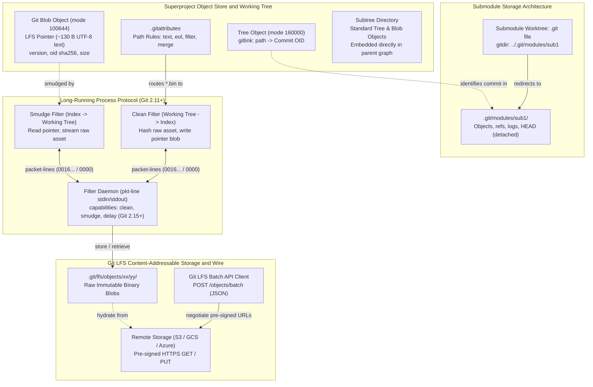
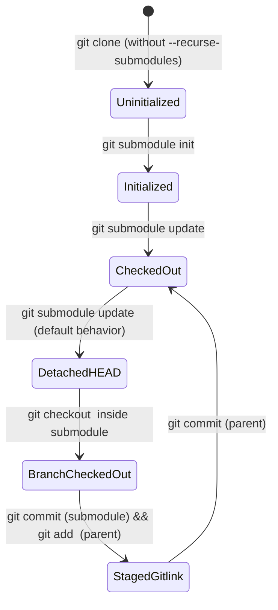
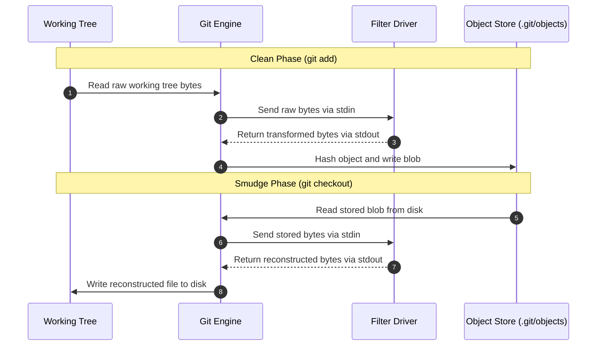
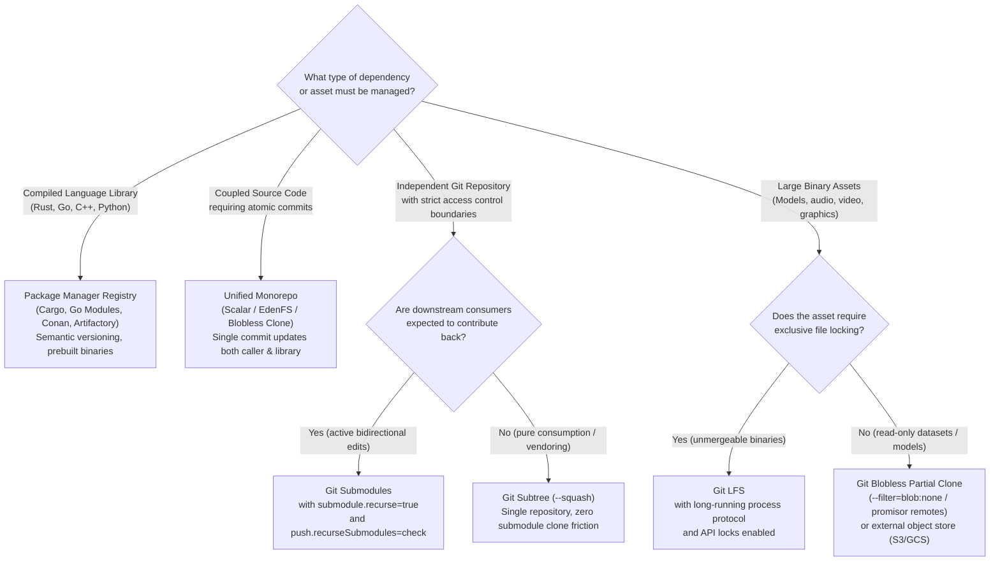

# Git Submodules, Subtrees, Git LFS, and Attributes

> [!summary] Claim:
> Git manages external repository composition, path transformations, and large binary storage through three distinct plumbing abstractions: gitlinks, filter processes, and pointer redirection.
> A submodule is a tree entry with octal mode 160000 recording a foreign commit hash in the superproject tree without embedding foreign objects, using `.gitmodules` and a redirected `.git` file pointing to `$GIT_DIR/modules/<name>/`.
> A subtree splices external trees directly into the superproject root or a subdirectory as ordinary Git objects, using synthetic merge commits or commit trailers without gitlinks.
> `.gitattributes` orchestrates line-ending normalization, custom merge drivers, and clean/smudge filters, where the long-running process protocol multiplexes bidirectional packet-line streaming over standard I/O to eliminate per-file process spawn overhead.
> Git LFS leverages this protocol to replace multi-gigabyte binary assets in Git's object store with structured text pointers of roughly 130 bytes (exactly 130 for a five-digit byte size), offloading raw binary payloads to a content-addressable storage pool managed over an HTTP Batch REST API.



## The Mechanism

Git's fundamental object model represents a snapshot of tracked files as a Merkle tree of blobs and directory trees, as detailed in [[Git-Object-Model-and-Content-Addressing]].
Standard Git objects fail to scale when repositories must consume independent codebases or store large non-diffable binary files.
Git addresses these constraints through three mechanisms: gitlinks for submodules, tree grafting for subtrees, and stream-filtering attributes for Git LFS and text normalization.
Every format and protocol detail below is grounded in Git 2.55.0 and the git-lfs main-branch specification fetched 2026-11 (local client git-lfs 3.8.0).

### 1. Submodules and the `160000` Gitlink Entry

A submodule allows a Git repository (the superproject) to embed another Git repository at a specific path while maintaining completely independent commit histories.
The superproject does not store the submodule's trees or blobs in its own object store.
Instead, it records a specialized tree entry called a gitlink.

#### Octal File Modes in Tree Objects

When Git serializes a directory tree object, each entry begins with an octal mode, a space, the filename terminated by a null byte (`\0`), and the binary object hash (20 bytes for SHA-1, 32 bytes for SHA-256):

$$\text{Tree Entry} = \langle\text{mode}\rangle \; \text{ASCII space} \; \langle\text{path}\rangle \; \text{0x00} \; \langle\text{binary-OID}\rangle$$

The mode is written without leading zeros: a subdirectory is stored as `40000` in the raw tree object, which `git ls-tree` pads to `040000` for display (checked with `git cat-file tree HEAD` on Git 2.55.0).

| Octal Mode | POSIX Interpretation | Git Object Type | Description |
| :--- | :--- | :--- | :--- |
| `100644` | Normal non-executable file | `blob` | Regular tracked file |
| `100755` | Executable file | `blob` | Tracked executable binary or script |
| `120000` | Symbolic link | `blob` | Symlink target path stored as blob content |
| `040000` | Directory | `tree` | Subdirectory containing another tree |
| `160000` | S_IFGITLINK | `commit` | Submodule gitlink pointing to a foreign commit OID |

Mode `160000` (`#define S_IFGITLINK 0160000` in Git's `object.h` at v2.55.0) identifies the path as a submodule.
The object ID attached to mode `160000` is the exact commit hash that the superproject expects the submodule to check out.
Git's tree walk parser treats `160000` as a leaf node; it does not attempt to resolve the OID within the superproject's `.git/objects/` database.

#### The `.gitmodules` Configuration File

Because a tree entry records only a path and a commit hash, Git relies on a tracked configuration file named `.gitmodules` at the root of the superproject to store remote metadata:

```ini
[submodule "libs/engine"]
    path = libs/engine
    url = https://github.com/example/engine.git
    branch = main
    shallow = true
    update = checkout
```

- `path`: The working tree directory path relative to the superproject root.
- `url`: The remote repository location used by `git submodule init` and `git clone --recurse-submodules`.
- `branch`: The remote tracking branch used when running `git submodule update --remote`.
- `shallow`: When set to `true`, the clone of the submodule (made by `git submodule update` or `git clone --recurse-submodules`; `git submodule init` clones nothing) is shallow with depth 1 unless the user explicitly asks for a full clone (gitmodules(5)).
- `branch`: When omitted, `update --remote` uses the remote `HEAD`; the special value `.` means the branch with the same name as the superproject's current branch (gitmodules(5)).
- `update`: Defines the default update procedure (`checkout`, `rebase`, `merge`, or `none`); `.gitmodules` rejects the `!command` form for security reasons, and the value is only copied into `.git/config` by `git submodule init` (gitmodules(5)).

Git configuration follows a strict three-tier precedence hierarchy for submodules:
1. Command-line flags (e.g., `--recurse-submodules`, `--remote`).
2. Superproject local configuration in `.git/config` (populated from `.gitmodules` by `git submodule init`).
3. The tracked `.gitmodules` file in the working tree.

`git submodule sync` copies only the remote URL from `.gitmodules` into `.git/config`, and only for submodules that already have a URL entry there, so a changed upstream URL does not take effect locally until it runs (git-submodule(1)); other keys follow the per-key override rules in gitmodules(5).

#### Storage Layout: Separated `.git` Directories

Prior to Git 1.7.8 (2011), submodules stored their full `.git/` directory inside the submodule's working tree folder.
Switching to a superproject branch that lacks the submodule, or deleting the submodule directory, therefore also deleted the submodule's history and reflog.
Since Git 1.7.8, newly populated submodules keep their administrative data inside the superproject and reference it through the gitfile mechanism, "to make it possible to switch between branches in superproject that has and does not have the submodule" (Git 1.7.8 release notes):

$$\text{Submodule Gitdir} = \text{\textdollar GIT\_DIR/modules/}\langle\text{submodule-name}\rangle\text{/}$$

The submodule's working tree contains only a lightweight stub file named `.git`:

```text
gitdir: ../../.git/modules/libs/engine
```

When an engineer runs `git submodule absorbgitdirs` (introduced in Git 2.12), Git crawls the repository, moves any legacy embedded `.git` directories into `.git/modules/`, and replaces them with `gitdir:` pointer files.

#### Submodule Lifecycle State Machine

A submodule in a cloned repository exists in one of four states:

1. **Uninitialized:** The gitlink exists in the superproject tree and `.gitmodules` is present, but `.git/modules/<name>/` does not exist, `.git/config` has no submodule entry, and the working tree path is an empty directory.
2. **Initialized:** `git submodule init` has copied the URL and configuration from `.gitmodules` into the local `.git/config` file under `submodule.<name>.*`, and set `submodule.<name>.active = true` (`builtin/submodule--helper.c` at v2.55.0).
3. **Cloned and Checked Out:** `git submodule update` has cloned the remote repository into `.git/modules/<name>/`, written the `.git` pointer file, and checked out the exact commit recorded in the superproject's gitlink.
4. **Detached HEAD:** By default, `git submodule update` detaches HEAD at the gitlink commit rather than checking out a local tracking branch.
   Commits made here will be orphaned upon subsequent updates unless an explicit branch checkout was executed first.



#### Three-Way Merges of Submodule Gitlinks

When merging two branches in the superproject that touch the same submodule gitlink, Git executes a three-way merge on the commit OIDs:
- Base commit gitlink: $O$
- Ours commit gitlink: $A$
- Theirs commit gitlink: $B$

If $A = B$, there is no conflict.
If $O = A$, the merge fast-forwards to $B$.
If $O = B$, the merge fast-forwards to $A$.
When both $A$ and $B$ have changed relative to $O$, Git consults the submodule repository (`merge_submodule()` in `merge-ort.c` at v2.55.0):
- The submodule must be checked out and all three commits present, otherwise the merge fails with "not checked out" or "commits not present".
- $O$ must be an ancestor of both $A$ and $B$, otherwise Git reports that the commits do not follow the merge base and declares a conflict.
- If $B$ is an ancestor of $A$ within the submodule's commit graph, Git automatically selects $A$ as a fast-forward merge.
- If $A$ is an ancestor of $B$ within the submodule's commit graph, Git automatically selects $B$.
- If neither $A$ nor $B$ is an ancestor of the other, Git declares a merge conflict, and suggests an existing submodule merge commit that contains both when it can find one.

Unlike textual files, Git cannot insert conflict markers (`<<<<<<<`, `=======`, `>>>>>>>`) into a directory.
Instead, Git records stage 1 ($O$), stage 2 ($A$), and stage 3 ($B$) entries in the index for the submodule path with mode `160000`, as described in [[Git-Index-Stat-Cache-and-Fsmonitor]].
The developer must resolve the conflict by navigating into the submodule, checking out or merging the desired commit, and running `git add <submodule-path>` in the superproject to stage the chosen gitlink.

### 2. Subtrees: Direct Commit Graph Splicing

Git subtree (distributed in git.git's `contrib/subtree` since Git 1.7.11, so whether it is installed depends on the packager) takes the opposite approach to external code composition.
Instead of referencing an external commit via a gitlink pointer, `git subtree` imports the external project's files directly as native blobs and trees inside the superproject.

#### Synthetic Merge Commits and History Splicing

When adding a subtree with `git subtree add --prefix=<dir> <repository> <ref>`, Git performs three operations:
1. It fetches the external repository's objects into the superproject's object database.
2. It constructs a synthetic tree object where the external repository's root tree is mounted under `<dir>`.
3. It creates a merge commit joining the superproject's current HEAD with the external ref:

$$\text{Commit Parents} = [\text{HEAD}_{\text{super}}, \; \text{HEAD}_{\text{subproject}}]$$

The plain add merge commit is titled `Add '<dir>/' from commit '<oid>'` and carries `git-subtree-dir`, `git-subtree-mainline`, and `git-subtree-split` trailers.
With the `--squash` flag, `git subtree` creates one squash commit holding the imported tree and then a merge commit (`Merge commit '<squash>' as '<dir>'`) joining it to HEAD, preventing the foreign project's entire history from polluting the superproject's `git log`.
The squash commit carries only the `git-subtree-dir` and `git-subtree-split` trailers, and `git-subtree-split` holds the full upstream commit OID (`squash_msg()` in `contrib/subtree/git-subtree.sh` at v2.55.0):

```text
Squashed 'vendor/libnet/' content from commit 8f9b2a1

git-subtree-dir: vendor/libnet
git-subtree-split: <full 40-hex OID of upstream commit 8f9b2a1...>
```

#### Algorithmic Complexity of `git subtree split`

Exporting changes made within the subtree back to the upstream repository requires `git subtree split --prefix=<dir> -b <branch>`.
The split algorithm executes a historical graph walk:
1. It traverses all commits from the current HEAD back to the original subtree import commit.
2. For each commit, it extracts the sub-tree at `<dir>`.
3. If the commit did not modify `<dir>`, it is skipped.
4. If the commit modified `<dir>`, Git synthesizes a new commit containing only the files in `<dir>` promoted to the repository root, copying author, timestamp, and log message.
5. It caches the mapping between original commits and split commits in a per-run cache directory, `$GIT_DIR/subtree-cache/<pid>/` (`git-subtree.sh` at v2.55.0).

Because `git subtree split` inspects every historical commit, its execution time scales linearly with total repository commit depth:

$$\text{Time Complexity} = O(N_{\text{commits}} \times \text{Tree-Walk-Cost})$$

On large repositories, running `git subtree split` costs time proportional to the history it must walk, unless earlier splits were recorded with `--rejoin`, which lets "future splits ... search only the part of history that has been added since the most recent '--rejoin'" (git-subtree(1)).

### 3. Git Attributes (`.gitattributes`)

The `.gitattributes` system provides path-specific configuration for line ending normalization, custom diff algorithms, custom merge drivers, and content transformation filters.

#### Attribute Precedence Resolution

When Git resolves attributes for a given file path, it evaluates configurations in descending order of precedence:
1. `$GIT_DIR/info/attributes`: Local to the repository checkout; not committed.
2. `.gitattributes` in the directory containing the file.
3. `.gitattributes` in parent directories walking up to the top level of the work tree (a submodule is its own work tree and does not read the superproject's files).
4. The index copy of a `.gitattributes` file is not a separate tier: it is the fall-back when the working tree file is missing, and during checkout the index copy is read first with the working tree file as fall-back (gitattributes(5)).
5. `core.attributesFile`: User global configuration (`$XDG_CONFIG_HOME/git/attributes`, or `~/.config/git/attributes`).
6. System-wide configuration: `$(prefix)/etc/gitattributes`.

#### Attribute States and Syntax

Each pattern line in `.gitattributes` assigns states to attributes:
- `pattern attr`: Set (boolean `true`).
- `pattern -attr`: Unset (boolean `false`).
- `pattern attr=value`: Set to string value.
- `pattern !attr`: Unspecified (resets attribute, ignoring lower-precedence rules).

#### Line Ending Normalization (`text`, `eol`)

Cross-platform line ending corruption occurs when Windows checkouts (CRLF) mix with Unix checkouts (LF).
Git uses attributes to guarantee canonical storage in the object database:
- `* text=auto`: Git decides by itself whether the file is text; `convert_is_binary()` in `convert.c` treats the content as binary if it contains a NUL byte, a lone CR, or more than one non-printable byte per 128 printable ones.
  The 8000-byte NUL scan (`FIRST_FEW_BYTES` in `xdiff-interface.c`) is the separate binary check used by diff, not by `text=auto`.
  On `git add` (clean), CRLF is converted to LF in the index, unless the file was already in Git with CRLF endings (gitattributes(5)).
  On checkout (smudge), LF is converted to the platform's native line ending unless overridden.
- `*.sh text eol=lf`: Enforces LF in both index and working tree across all operating systems.
- `*.bat text eol=crlf`: Enforces CRLF in working tree, normalized to LF in index.
- `*.png binary`: A built-in macro equivalent to `-diff -merge -text`.

#### Custom Merge Drivers and Exit Codes

When two branches modify the same file, Git's default three-way merge engine attempts textual line merging, as covered in [[Git-Three-Way-Merge-ORT-and-Diff-Algorithms]].
For structured data (e.g., JSON, Protocol Buffers, XML), textual merges produce invalid syntax.
An organization can configure a custom merge driver:

In `.gitattributes`:
```text
*.json merge=jsonmerge
```

In `.git/config`:
```ini
[merge "jsonmerge"]
    name = Custom JSON 3-way structural merge driver
    driver = json-merge-tool %O %A %B %L %P
    recursive = binary
```

The format placeholders provide temporary file paths:
- `%O`: Ancestor (base) version.
- `%A`: Current branch version (the file that must be overwritten with the merged result).
- `%B`: Other branch version.
- `%L`: Conflict marker size (default 7).
- `%P`: Original file path.

The driver contract requires:
- Exit code `0`: Merge succeeded cleanly; Git reads the result from `%A` and stages it.
- Exit code non-zero: Merge encountered a conflict; Git keeps `%A` exactly as the driver left it (including any markers the driver chose to write) and flags the path as conflicted in the index.
- Exit code above 128 (for example, killed by SEGV): the driver crashed, and the merge fails rather than producing a conflict (gitattributes(5)).

### 4. Content Filtering: One-Shot vs. Long-Running Filter Process

Git provides content transformation hooks via the `filter` attribute.
Filters operate in two directions:
- **Clean Filter:** Runs during `git add` (Working Tree $\to$ Index).
  Transforms working tree bytes before Git hashes and writes the blob.
- **Smudge Filter:** Runs during `git checkout`, `git switch`, or `git restore` (Index $\to$ Working Tree).
  Transforms the indexed blob before writing it to disk.



#### The One-Shot Filter Mechanism and Fork Bottleneck

Historically, filters were defined as one-shot shell commands:

```ini
[filter "lfs"]
    clean = git-lfs clean -- %f
    smudge = git-lfs smudge -- %f
    required = true
```

For every single file matched by the pattern, Git executed `fork()`, `execve()`, opened two pipes, streamed the file, and waited for `exit()`.
In a checkout of 50,000 files, this means 50,000 process creations, which is the "process creation overhead" that the Git 2.11.0 release notes say the process filter reduces.
This note states no measured ratio, because none was taken.

#### The Long-Running Process Protocol (Git 2.11+)

To resolve the fork bottleneck, Git 2.11.0 (November 2016) introduced `filter.<driver>.process`.
Instead of spawning a new process per file, Git spawns a single persistent filter daemon at the start of a command and communicates over standard input and standard output using Git's packet-line (`pkt-line`) protocol.

A packet-line is formatted with a 4-hex-digit length prefix (lowercase hexadecimal) representing the total byte count of the packet, including the 4-byte header:

$$\text{Packet-Line} = \langle\text{4-byte-hex-length}\rangle \; \langle\text{payload}\rangle$$

Special packets include:
- `0000`: Flush packet (terminates a list of keys or stream section).
- `0001`: Delimiter packet (wire protocol v2 only; the filter protocol uses only flush packets).

#### Protocol Handshake Phase

When Git encounters the first file requiring the filter, it executes the command defined in `filter.<driver>.process`.
The sequence below matches a `GIT_TRACE_PACKET=1 git add` capture on Git 2.55.0 against the lab's filter; the hex lengths are computed from the payloads:

```text
Git  ->  Filter:  0016git-filter-client\n
Git  ->  Filter:  000eversion=2\n
Git  ->  Filter:  0000
Filter -> Git:   0016git-filter-server\n
Filter -> Git:   000eversion=2\n
Filter -> Git:   0000
Git  ->  Filter:  0015capability=clean\n
Git  ->  Filter:  0016capability=smudge\n
Git  ->  Filter:  0015capability=delay\n
Git  ->  Filter:  0000
Filter -> Git:   0015capability=clean\n
Filter -> Git:   0016capability=smudge\n
Filter -> Git:   0000
```

#### Command Execution Phase

For each file to be processed, Git sends command parameters terminated by a flush packet, followed by chunked content packets (up to 65,516 bytes per chunk, `LARGE_PACKET_DATA_MAX` in `pkt-line.h`) terminated by another flush packet:

```text
Git  ->  Filter:  0012command=clean\n
Git  ->  Filter:  001epathname=data/weights.bin\n
Git  ->  Filter:  0000
Git  ->  Filter:  <raw payload bytes chunk 1>
Git  ->  Filter:  0000
Filter -> Git:   0013status=success\n
Filter -> Git:   0000
Filter -> Git:   <cleaned payload bytes>
Filter -> Git:   0000
Filter -> Git:   0000
```

The second flush packet from the filter terminates an empty key-value update list, indicating that `status=success` remains unchanged.
Git neither stops nor restarts the filter on an `error` or `abort` status, but sets its exit code according to `filter.<driver>.required`, so with `required = true` the command fails (gitattributes(5)).

#### Asynchronous Delayed Smudging (`delay`)

If the filter advertises the `delay` capability (Git 2.15+), Git can send `can-delay=1` during smudge requests.
The filter can immediately reply with `status=delayed\n0000` without returning content.
Git continues processing other files, and later sends `command=list_available_blobs\n0000`.
The filter responds with paths that have finished asynchronous downloading, allowing high-concurrency background network fetching during large checkouts.

### 5. Git LFS (Large File Storage) Architecture

Git LFS addresses Git's inability to compress large binary files via delta compression, as analyzed in [[Git-Packfiles-and-Delta-Compression]].
Instead of storing multi-megabyte binary assets inside Git packfiles, Git LFS extracts the binary data, stores it in a separate content-addressable storage pool, and commits a tiny text pointer into Git.

#### Pointer File Specification (v1)

A Git LFS pointer is a strictly structured UTF-8 text file under 1024 bytes containing three required fields formatted as sorted key-value pairs:

```text
version https://git-lfs.github.com/spec/v1
oid sha256:cb32d042cafabe5b84ce4d037dff6a9e2fd345ef39dc97ecd5299e1c27920f9e
size 65536
```

1. Line 1: `version https://git-lfs.github.com/spec/v1\n`. Git LFS always writes this URL and also reads pointers from the pre-release tool that carry `version https://hawser.github.com/spec/v1` (spec.md).
2. Line 2: `oid <hash-algo>:<64-hex-digest>\n`. The cryptographic hash of the raw binary payload (SHA-256).
3. Line 3: `size <integer-byte-count>\n`. Exact byte length of the uncompressed binary asset.

Git hashes and commits this pointer file as an ordinary blob (mode `100644`).
Git repository snapshots remain lightweight because commits, trees, and packfiles store only these text blobs of roughly 130 bytes (130 exactly here: 43 + 76 + 11 bytes per line).

#### Local Content-Addressable Storage (CAS) Layout

When the clean filter runs, Git LFS copies the raw asset into the local repository's administrative directory:

$$\text{Local CAS Path} = \text{\textdollar GIT\_DIR/lfs/objects/}\langle\text{oid}[0:2]\rangle\text{/}\langle\text{oid}[2:4]\rangle\text{/}\langle\text{oid}\rangle$$

For example, an asset with SHA-256 beginning `cb32d04...` is stored at `.git/lfs/objects/cb/32/cb32d042cafabe5b...`.
The two-level fanout keeps each directory small, as Git's own loose-object `xx/` fanout does; spec.md defines the layout and states no rationale, so treat the reason as a design inference.

#### The Batch API Wire Protocol

When pushing or pulling LFS assets, the Git LFS client communicates with an LFS server via the Batch API.
The client derives the LFS server URL from the remote, for example `https://git-server.com/foo/bar.git/info/lfs`, and posts to `<server>/objects/batch` (batch.md); `lfs.url` overrides the derived URL.

The client issues an HTTP `POST` request with JSON content:

```http
POST /example/repo.git/info/lfs/objects/batch HTTP/1.1
Host: git.example.com
Accept: application/vnd.git-lfs+json
Content-Type: application/vnd.git-lfs+json

{
  "operation": "download",
  "transfers": ["basic"],
  "ref": { "name": "refs/heads/main" },
  "objects": [
    {
      "oid": "cb32d042cafabe5b84ce4d037dff6a9e2fd345ef39dc97ecd5299e1c27920f9e",
      "size": 65536
    }
  ],
  "hash_algo": "sha256"
}
```

The server responds with an action map containing pre-signed object storage URLs (e.g., AWS S3, Google Cloud Storage, Azure Blob):

```http
HTTP/1.1 200 OK
Content-Type: application/vnd.git-lfs+json

{
  "transfer": "basic",
  "objects": [
    {
      "oid": "cb32d042cafabe5b84ce4d037dff6a9e2fd345ef39dc97ecd5299e1c27920f9e",
      "size": 65536,
      "authenticated": true,
      "actions": {
        "download": {
          "href": "https://storage.example.com/lfs-blobs/cb32d04...",
          "header": {
            "Authorization": "Bearer signed-token-7f9a2",
            "Accept": "application/octet-stream"
          },
          "expires_in": 86400
        }
      }
    }
  ]
}
```

The client streams the raw binary payload to or from the returned `href` using standard HTTP `GET` or `PUT`; when the server hands out object-store URLs, as here, the transfer bypasses the Git server's compute and memory.

#### File Locking API (`api/locks`)

Binary files (such as 3D models, compiled assets, and media) cannot be merged with three-way diff algorithms.
Git LFS provides a centralized server-side File Locking API to prevent concurrent modifications:
- `POST /locks`: Claims an exclusive lock on a tracked path for a specific branch ref.
- `GET /locks`: Queries active locks.
- `POST /locks/verify`: Called by the Git LFS pre-push hook, governed by `lfs.<url>.locksverify`.
  If the user attempts to update a file locked by another user, the client-side pre-push hook halts the push, so no refs are sent (git-lfs-config(5)).
- Client enforcement: files marked `lockable` by `git lfs track --lockable` are made read-only in the working copy when not locked by the user, controlled by `lfs.setlockablereadonly` (git-lfs-config(5)).

### 6. Architectural Boundaries

To avoid toolchain anti-patterns, distinguished engineers establish strict boundaries between these version control mechanisms and adjacent systems:

- **Git LFS vs. Git Partial Clone:**
  As covered in [[Git-Transfer-Protocol-and-Partial-Clone]], Git 2.17+ supports blobless partial clones (`git clone --filter=blob:none`; `builtin/clone.c` first parses `--filter` at v2.17.0, and protocol v2 gained partial clone support in 2.18).
  Partial clone allows native Git objects to be fetched on demand from promisor remotes without pointer indirection, maintaining cryptographic Merkle tree integrity.
  However, Git LFS remains mandatory when binary assets must be offloaded to third-party object stores (S3/GCS) rather than Git packfiles, or when binary file locking is required.
- **Submodules vs. Monorepo Virtualized Filesystems:**
  Submodules partition repositories horizontally across independent remotes.
  When a codebase scales past 5,000 engineers, submodule synchronization friction, diamond dependency conflicts, and detached HEAD states break developer workflows.
  Organizations transition from submodules to unified monorepos managed by virtualized file systems (Scalar, EdenFS, VFS for Git), as detailed in [[Git-At-Scale-VFS-Scalar-and-Monorepos]].
- **Submodules vs. Language Package Managers:**
  Submodules should never be used to manage compiled software dependencies that have stable package management registries (Cargo, npm, Maven, PyPI, Conan).
  Package managers support semantic version resolution, pre-built binary caching, and dependency isolation that submodules cannot provide.

## Commands and Numbers to Know

| Item | Value | Platform and date | What it controls |
| :--- | :--- | :--- | :--- |
| `S_IFGITLINK` octal mode | `160000` | Both (as of 2026-11) | Tree entry mode identifying a submodule commit pointer |
| LFS pointer max size | `1024` bytes | Both (as of 2026-11) | Specification limit for valid Git LFS v1 pointer files |
| LFS standard pointer size | `~130` bytes | Both (as of 2026-11) | Size of standard v1 pointer (SHA-256 OID + byte count) |
| Git pkt-line max length | `65520` bytes | Both (as of 2026-11) | Maximum packet length including the 4-byte header (`LARGE_PACKET_MAX`); the payload maximum is `65516` (`LARGE_PACKET_DATA_MAX`, `pkt-line.h`) |
| Git pkt-line flush | `0000` | Both (as of 2026-11) | 4-byte delimiter indicating section or stream termination |
| `filter.<driver>.process` | command string | Both (as of 2026-11) | Spawns persistent long-running filter process (introduced Git 2.11) |
| `filter.<driver>.required` | `true` or `false` | Both (as of 2026-11) | If true, filter failure aborts the Git operation with fatal error |
| `submodule.recurse` | `false` (default) | Both (as of 2026-11) | Makes commands that accept `--recurse-submodules` enable it by default (introduced Git 2.14) |
| `submodule.active` | unset | Both (as of 2026-11) | Pathspec of submodules of interest (introduced Git 2.13); a submodule is active if `submodule.<name>.active` is true, else if its path matches `submodule.active`, else if `submodule.<name>.url` is set (gitsubmodules(7)) |
| `submodule.<name>.update` | `checkout` (default) | Both (as of 2026-11) | Update strategy: `checkout`, `rebase`, `merge`, `none`, or `!cmd` (`!cmd` only in `.git/config`, never in `.gitmodules`) |
| `submodule.<name>.branch` | remote `HEAD` (default) | Both (as of 2026-11) | Upstream branch used by `git submodule update --remote`; `.` means the superproject's current branch name |
| `diff.submodule` | `short` (default) | Both (as of 2026-11) | Submodule diff format (`short`, `log`, `diff`) (git-config(1) `diff.submodule`, Git 2.55.0) |
| `status.submoduleSummary` | `false` (disabled) | Both (as of 2026-11) | Number of submodule commits summarized during `git status` |
| Submodule gitdir layout | `$GIT_DIR/modules/<name>` | Both (as of 2026-11) | Separated metadata storage location (default since Git 1.7.8) |
| `git submodule absorbgitdirs` | CLI command | Both (as of 2026-11) | Moves embedded `.git` directories into `$GIT_DIR/modules/` (introduced Git 2.12) |
| `lfs.<url>.locksverify` | unset (default) | Both (as of 2026-11) | Lock check in the pre-push hook; unset means try and warn on error, then record `true`, or `false` on a `501` response (git-lfs-config(5)) |
| Textconv cache ref | `refs/notes/textconv/<driver>` | Both (as of 2026-11) | Git notes reference caching converted binary diff strings when `diff.<driver>.cachetextconv` is set |

## Multi-Language Comparison: C / Python / Rust / Go

Tools interacting with Git submodules, filter attributes, and LFS pointers handle parsing and protocol execution across different languages:

| Concern | C (Git core v2.55.0 / libgit2) | Python (Dulwich / Filter Engine) | Rust (gitoxide `gix`) | Go (Official `git-lfs`) |
| :--- | :--- | :--- | :--- | :--- |
| Gitlink Mode Check | `S_ISGITLINK(mode)` (`((m) & S_IFMT) == S_IFGITLINK`) in `object.h` | Explicit comparison `stat.S_IFMT(mode) == 0o160000` (`stat.S_ISDIR` is false for gitlinks) | `gix_object::tree::EntryKind::Commit` (`= 0o160000`) | `git/ls_tree_scanner.go` parses `git ls-tree -l -z` output and skips every entry whose type is not `blob`, so gitlinks (type `commit`) are never scanned |
| Attribute Evaluation | `git_check_attr()` and `git_all_attrs()` walking directory hierarchy in `attr.c` | Stack of parsed `.gitattributes` files evaluated per relative path | `gix_attributes::Search` engine with pathspec glob matching | Attributes parser in the `git/gitattr` package |
| Filter Protocol Framing | `packet_read()` and `packet_write()` in `pkt-line.c` | Hex length slice decode `int(hdr, 16)` and 4-byte formatting `f"{len:04x}"` | `gix_packetline::StreamingPeekableIter` and `PacketLineRef` | `github.com/git-lfs/pktline` module (in git-lfs `go.mod`) |
| LFS Pointer Parsing | None: Git core stores the pointer as an opaque blob and never parses it | String splitting on `\n` and key-value mapping over UTF-8 bytes | None in `gix-filter` (its modules are `driver`, `eol`, `ident`, `pipeline`, `worktree`) | `lfs.DecodePointer` in `lfs/pointer.go`, which rejects keys out of the fixed order `version`, `oid`, `size` |
| Content Hashing | `the_hash_algo->init_fn()`, SHA-1/SHA-256 in `hash.h` | `hashlib.sha256()` from standard library | `sha2::Sha256` crate | `crypto/sha256` from standard library |
| CAS File Storage | None for LFS: Git core has no LFS store; its own loose objects are written to a `tmp_obj_XXXXXX` temp file by `create_tmpfile()` and moved into place by `finalize_object_file_flags()` (link, falling back to rename) in `object-file.c` | `os.makedirs()` and atomic file replace | `std::fs::create_dir_all` and atomic rename | `os.MkdirAll` and atomic file write in `git-lfs/tools` |

## Worked Lab Example

The reproducible lab is located at `code/02-Version-Control/lfs_filter_demo/`.
It implements a complete Git long-running filter process daemon in Python conforming to Git packet-line protocol version 2, registers it inside `.gitattributes`, tests clean/smudge round-trip transformations, and prints illustrative Git LFS Batch API payloads.

### Running the Lab

Execute the verification harness:

```bash
cd code/02-Version-Control/lfs_filter_demo
bash run.sh
```

### Verified output

Recorded on `darwin-arm64` on 2026-11-08 and verified by `make verify`; the file is `code/02-Version-Control/lfs_filter_demo/expected/darwin-arm64.txt`.

```text
=== Git LFS Long-Running Filter and Batch API Verification ===
Original working tree asset size: 65536 bytes
Original asset SHA-256: cb32d042cafabe5b84ce4d037dff6a9e2fd345ef39dc97ecd5299e1c27920f9e

--- Git Object Database Inspection ---
Git object type and mode: 100644 blob
Git stored blob size: 130 bytes (raw binary was 65536 bytes)
Stored pointer content:
  version https://git-lfs.github.com/spec/v1
  oid sha256:cb32d042cafabe5b84ce4d037dff6a9e2fd345ef39dc97ecd5299e1c27920f9e
  size 65536
Pointer schema validation: PASS (version, sorted oid/size, <1024 B)
Largest object after repack: 223 bytes (limit 1024, raw binary was 65536 bytes)

--- Content-Addressable Storage (CAS) Inspection ---
CAS location: .git/lfs/objects/cb/32/cb32d042cafabe5b84ce4d037dff6a9e2fd345ef39dc97ecd5299e1c27920f9e
CAS file size: 65536 bytes
CAS SHA-256 match: True

--- Smudge Filter Restoration ---
Restored working tree size: 65536 bytes
Restored SHA-256 match: True
Smudge with a missing CAS object: checkout fails and writes no file

--- Git LFS Batch API Wire Schema Verification ---
Batch API Request payload:
  {
    "hash_algo": "sha256",
    "objects": [
      {
        "oid": "cb32d042cafabe5b84ce4d037dff6a9e2fd345ef39dc97ecd5299e1c27920f9e",
        "size": 65536
      }
    ],
    "operation": "download",
    "ref": {
      "name": "refs/heads/main"
    },
    "transfers": [
      "basic"
    ]
  }
Batch API Response payload:
  {
    "objects": [
      {
        "actions": {
          "download": {
            "expires_in": 86400,
            "header": {
              "Accept": "application/octet-stream",
              "Authorization": "Bearer signed-token-7f9a2"
            },
            "href": "https://storage.blob.core.windows.net/lfs-store/cb32d042cafabe5b84ce4d037dff6a9e2fd345ef39dc97ecd5299e1c27920f9e"
          }
        },
        "authenticated": true,
        "oid": "cb32d042cafabe5b84ce4d037dff6a9e2fd345ef39dc97ecd5299e1c27920f9e",
        "size": 65536
      }
    ],
    "transfer": "basic"
  }
Batch API schema handshake: PASS (valid pair accepted, 3 broken cases rejected)
```

### Reading the Result

- The original working tree asset `weights.bin` contains 65,536 bytes of binary data with SHA-256 digest `cb32d042cafabe5b84ce4d037dff6a9e2fd345ef39dc97ecd5299e1c27920f9e`.
- When `git add` executed, Git initiated the long-running process handshake over standard I/O, streamed the 64 KiB payload to the clean filter, and received the 130-byte Git LFS pointer.
- `git ls-tree` and `git cat-file -s :weights.bin` prove that Git's internal index and commit tree store only the 130-byte text pointer blob (mode `100644`); after `git repack -a -d` the lab also bounds every object in the database with `git cat-file --batch-all-objects --batch-check`, and the largest is 223 bytes, so no raw payload reached a loose object or a packfile.
- The local Content-Addressable Storage file exists at `.git/lfs/objects/cb/32/cb32d04...` and holds exactly 65,536 bytes with identical SHA-256 integrity.
- Upon deleting the file from the working tree and running `git checkout -- weights.bin`, Git routed the stored 130-byte pointer blob through the smudge filter over packet-lines, which retrieved the binary asset from CAS and restored all 65,536 bytes bit-for-bit.
- Deleting the CAS object and running `git checkout -- weights.bin` again fails and writes no file, because the filter answers `status=error` and `filter.lfsdemo.required` is `true`; a pointer with no object behind it is never restored as text.
- The Batch API section prints a request and response shaped after `docs/api/batch.md` (`operation`, `transfers`, `ref`, `objects`, `hash_algo`; `transfer`, `authenticated`, `actions.download.href`, `header`, `expires_in`).
  The lab's own validators accept that pair and reject three broken copies (bad operation, short oid, response lacking the requested action), but they encode the lab author's reading of the spec and no server was contacted, so this illustrates the schema rather than proving conformance.

## Pitfalls

> [!warning] Pitfall: Pushing superproject commits with unpushed submodule revisions
> A developer makes a commit inside a submodule, runs `git add <submodule-path>` and commits in the superproject, then pushes the superproject to the remote remote repository while forgetting to push the submodule.
> When team members or CI runners pull the superproject, Git attempts to check out the new gitlink OID, which does not exist on any remote server.
> On Git 2.55.0, `git clone --recurse-submodules` exits 128 with `fatal: remote error: upload-pack: not our ref <sha>` followed by `fatal: Fetched in submodule path 'vendor/lib', but it did not contain <sha>. Direct fetching of that commit failed.` (captured by running the Practice Drill).
> Remedy: Configure `git config push.recurseSubmodules check` or `on-demand` globally (git-config(1) accepts `check`, `on-demand`, `only`, or `no`, default `no`), forcing Git to verify or automatically push modified submodules before permitting superproject pushes.

> [!warning] Pitfall: Silent work loss from detached HEAD checkouts in submodules
> Running `git submodule update` checks out the commit recorded in the superproject gitlink, placing the submodule in a detached HEAD state.
> If an engineer authors commits inside the submodule while detached, those commits belong to no local branch ref.
> A subsequent `git submodule update` or branch checkout in the superproject will detach to a different commit, leaving the author's commits unreferenced and subject to garbage collection pruning.
> Remedy: Always execute `git checkout <branch>` inside the submodule before editing, or configure `submodule.<name>.update = rebase` or `merge` in `.git/config`.

> [!warning] Pitfall: Committing raw binary files when Git LFS is uninstalled or unconfigured
> If an engineer clones a repository without `git-lfs` installed, or runs `git add` before `git lfs install` has configured local filter hooks, `.gitattributes` filter rules fail silently: "a missing filter driver definition in the config ... is not an error but makes the filter a no-op passthru" (gitattributes(5)), and `filter.lfs.required` cannot help because it lives in Git config, which a clone does not copy.
> Git adds the multi-gigabyte raw binary file directly into loose objects and packfiles.
> Once committed and pushed, the entire repository history is permanently bloated for every collaborator.
> Remedy: Run `git lfs install` on every workstation and CI image (it writes `filter.lfs.clean`, `filter.lfs.smudge`, `filter.lfs.process`, and `filter.lfs.required = true`, checked with git-lfs 3.8.0) and deploy server-side pre-receive hooks that inspect incoming blobs to reject files exceeding size thresholds if they lack LFS pointer formatting.

> [!warning] Pitfall: Omitting `git add --renormalize` after modifying `.gitattributes`
> Adding or changing line ending attributes (e.g., `* text=auto`) in `.gitattributes` has no retroactive effect on files already staged in the index.
> Subsequent diffs will show phantom whitespace changes across thousands of lines whenever another developer touches those files.
> Remedy: Immediately after editing `.gitattributes`, execute `git add --renormalize .` to force Git to re-evaluate clean filters across the entire working tree and stage normalized blobs.

> [!warning] Pitfall: Performance collapse during deep history `git subtree split`
> Running `git subtree split --prefix=<path>` traverses the full commit graph of the host repository.
> In a monolithic repository, splitting a subdirectory without a recorded `--rejoin` re-walks the host history on every run, so the cost grows with commit count (no timing is claimed here).
> Remedy: Split with `--rejoin` so the synthetic history is merged back and later splits search only history added since the last rejoin (git-subtree(1)); `git subtree split` accepts exactly one revision, so a range such as `<commit-id>..HEAD` is rejected (`cmd_split()` in `git-subtree.sh` at v2.55.0).

> [!warning] Pitfall: Modifying filter command definitions without invalidating index stat caches
> If a developer modifies `filter.<driver>.clean` or `filter.<driver>.smudge` in `.git/config`, Git's index stat cache (as analyzed in [[Git-Index-Stat-Cache-and-Fsmonitor]]) still records files as clean based on file size and mtime.
> Running `git status` or `git commit` will not re-run the updated filter because Git detects no stat drift.
> Remedy: Force an index cache invalidation by updating file timestamps (`touch`) or executing a clean index refresh via `git checkout-index -f -u -a` or `git add --renormalize .`.

## At Scale

Managing composite repositories and binary assets shifts dramatically from individual developers to enterprise engineering organizations scaling to 50,000 contributors:

- **1 to 50 Engineers:**
  Submodules or subtrees are viable for vendor libraries.
  Git LFS easily handles game design assets, UI graphics, and ML test fixtures backed by GitHub or GitLab LFS endpoints.
  Manual branch synchronization and detached HEAD triage can be managed via engineering onboarding guides.
- **500 to 5,000 Engineers:**
  Submodule diamond dependencies and version drift become severe friction points.
  Teams encounter submodule merge conflicts in CI pipelines daily.
  Unsynchronized submodule pushes regularly break trunk builds.
  At this scale, teams automate submodule pointer updates using automated dependency-update bots and mandate `git push --recurse-submodules=check`.
  Git LFS bandwidth and cloud storage costs become significant budget line items; organizations configure local LFS caching proxies on CI build runners.
- **5,000 to 50,000+ Engineers:**
  Submodules collapse under organizational cognitive load.
  Submodule tree traversal degrades graph walks and status checks across massive codebases.
  Git LFS experiences concurrency bottlenecks on popular assets and, being keyed by whole-file SHA-256, deduplicates only identical files, with no delta or chunk-level deduplication.
  Enterprise organizations abandon both submodules and Git LFS in favor of unified monorepos powered by virtualized file systems (Scalar, EdenFS) and blobless partial clones (`--filter=blob:none`), storing third-party code in monorepo third-party directories managed by package managers or source ingestion pipelines.



### Enterprise Decision Matrix

| Dimension | Git Submodules | Git Subtree | Git LFS | Git Partial Clone | Artifact Registries |
| :--- | :--- | :--- | :--- | :--- | :--- |
| Storage Location | Separate remote repositories | Inside parent Git object database | Object store (S3/GCS) via HTTP | Git promisor packfiles on demand | Artifact binary storage (Artifactory) |
| Pointer Type | Mode `160000` commit OID | Normal Git trees and blobs | Mode `100644` text pointer (~130 B) | Standard Git blob OID (promisor ref) | Dependency lockfile (`Cargo.lock`) |
| Atomic Cross-Repo Commits | No (requires two separate commits) | Yes (single superproject commit) | Yes (pointer committed with code) | Yes (native commit) | No (version bump commit) |
| Clone Bandwidth Impact | Zero until `submodule update` runs | Full (entire foreign tree cloned) | Pointers for history; checkout downloads the assets at the checked-out commit unless smudge is skipped | Minimal (blobs skipped via filter) | Zero (artifacts fetched at build time) |
| CI Pipeline Complexity | High (recursive cloning, auth tokens) | Low (single standard git clone) | Medium (LFS client install, auth) | Low (native Git wire protocol v2) | Low (standard build cache) |
| File Locking Support | No | No | Yes (`api/locks` protocol) | No | No |

## Practice Drill

> [!tip] Practice Drill:
> Author a self-contained shell script that simulates a multi-repository submodule environment, intentionally breaks a superproject with a dangling submodule commit, and demonstrates recovery.
> The drill must:
> 1. Initialize a remote upstream repository `upstream_lib.git` and commit an initial library version.
> 2. Initialize a `superproject.git` and add `upstream_lib` as a submodule under `vendor/lib`.
> 3. Clone `superproject.git` into `alice_workspace`.
> 4. In `alice_workspace`, navigate into `vendor/lib`, create a new commit, return to the superproject, stage the gitlink, and push the superproject to origin WITHOUT pushing the submodule.
> 5. Clone `superproject.git` into `bob_workspace` with `--recurse-submodules` and capture the exact fatal error Git emits when attempting to resolve the dangling gitlink.
> 6. Fix the failure by returning to Alice's submodule workspace, pushing the missing commit to `upstream_lib.git`, and verifying that Bob can successfully run `git submodule update`.

```bash
#!/usr/bin/env bash
set -euo pipefail

DRILL_DIR=$(mktemp -d)
trap 'rm -rf "${DRILL_DIR}"' EXIT
cd "${DRILL_DIR}"

export GIT_CONFIG_GLOBAL=/dev/null
export GIT_CONFIG_SYSTEM=/dev/null
export GIT_AUTHOR_NAME="Drill Engineer"
export GIT_AUTHOR_EMAIL="drill@example.com"
export GIT_COMMITTER_NAME="Drill Engineer"
export GIT_COMMITTER_EMAIL="drill@example.com"
export LC_ALL=C
# Pin the branch name and allow file:// submodule transport for this sandbox only.
# Without these, the push to main fails (init.defaultBranch is unset) and the
# recursive clone fails on protocol.file.allow instead of the dangling gitlink.
export GIT_CONFIG_COUNT=2
export GIT_CONFIG_KEY_0=init.defaultBranch GIT_CONFIG_VALUE_0=main
export GIT_CONFIG_KEY_1=protocol.file.allow GIT_CONFIG_VALUE_1=always

# 1. Set up bare remotes
git init --bare -q upstream_lib.git
git init --bare -q superproject.git

# 2. Seed upstream_lib
git clone -q upstream_lib.git lib_work
cd lib_work
echo "export function version() { return '1.0.0'; }" > lib.js
git add lib.js
git commit -m "Initial library 1.0.0" -q
git push -q origin main
cd ..

# 3. Seed superproject with submodule
git clone -q superproject.git super_work
cd super_work
git -c protocol.file.allow=always submodule add -q ../upstream_lib.git vendor/lib
git commit -m "Add vendor/lib submodule" -q
git push -q origin main
cd ..

# 4. Alice introduces a dangling gitlink
git clone -q superproject.git alice_work
cd alice_work
git -c protocol.file.allow=always submodule update --init -q
cd vendor/lib
git checkout -b feature-2.0 -q
echo "export function version() { return '2.0.0-unpushed'; }" > lib.js
git commit -am "Bump lib to 2.0.0" -q
ALICE_SUB_COMMIT=$(git rev-parse HEAD)
cd ../..
git add vendor/lib
git commit -m "Update vendor/lib to 2.0.0 commit ${ALICE_SUB_COMMIT}" -q
# Alice pushes superproject but forgets to push vendor/lib!
git push -q origin main
cd ..

# 5. Bob attempts to clone and encounters failure
echo "--- Bob clones superproject with unpushed submodule ---"
set +e
git clone -q --recurse-submodules superproject.git bob_work 2> bob_error.log
BOB_EXIT=$?
set -e
echo "Bob clone exit code: ${BOB_EXIT}"
cat bob_error.log | tail -n 2

# 6. Alice remediates by pushing the submodule
echo "--- Alice pushes missing submodule commit ---"
cd alice_work/vendor/lib
git push -q origin feature-2.0:main
cd ../../..

# 7. Bob updates successfully
echo "--- Bob re-runs submodule update ---"
cd bob_work
git -c protocol.file.allow=always submodule update --init -q
cd vendor/lib
echo "Bob verified submodule version:"
cat lib.js
cd ../..
```

## Interview Questions

> [!question] L5: When you stage a file tracked by Git LFS, what object type, file mode, and byte content are recorded in Git's index and commit tree?
>
> > [!success]- Answer
> > Git records a standard `blob` object with octal file mode `100644` (or `100755` if the executable bit is set) in both the index and the tree object.
> > Git does not record the raw binary asset in its object store.
> > Instead, the blob content is a lightweight UTF-8 text file (typically 120 to 140 bytes, strictly under 1024 bytes) conforming to the Git LFS v1 specification:
> > - Line 1: `version https://git-lfs.github.com/spec/v1`
> > - Line 2: `oid sha256:<64-character-hex-digest>`
> > - Line 3: `size <integer-byte-count-of-raw-asset>`
> > The actual binary content is intercepted by the clean filter and stored in `.git/lfs/objects/<oid[0:2]>/<oid[2:4]>/<oid>`.

> [!question] L5: Why does `git submodule update` leave a submodule in a detached HEAD state by default, and how can an engineer change this behavior?
>
> > [!success]- Answer
> > A superproject gitlink tree entry points to an explicit commit hash, not a branch name or symbolic reference.
> > When `git submodule update` executes, its contract is to guarantee that the submodule working tree matches that exact commit hash.
> > Checking out an explicit commit hash naturally results in a detached HEAD state.
> > To make `git submodule update` track a local branch, an engineer can:
> > 1. Configure `submodule.<name>.update = rebase` or `submodule.<name>.update = merge` in `.git/config` or `.gitmodules`.
> > 2. Specify the tracking branch via `git config -f .gitmodules submodule.<name>.branch <branch-name>`.
> > 3. Pass `--remote` and `--merge` or `--rebase` to `git submodule update`.

> [!question] L6: Predict the output: Walk through the following terminal session and state the exact output of `git ls-tree` and `git cat-file -p` for the committed path.
> ```bash
> git init -q
> git config filter.demo.clean "sed 's/SECRET/REDACTED/g'"
> git config filter.demo.smudge "cat"
> echo "token.txt filter=demo" > .gitattributes
> echo "API_KEY=SECRET_999" > token.txt
> git add .gitattributes token.txt
> git commit -m "Add token" -q
> git ls-tree HEAD token.txt
> git cat-file -p HEAD:token.txt
> ```
>
> > [!success]- Answer
> > The output of `git ls-tree HEAD token.txt` is:
> > `100644 blob <blob-oid>	token.txt`
> > The output of `git cat-file -p HEAD:token.txt` is:
> > `API_KEY=REDACTED_999`
> > Mechanism:
> > When `git add token.txt` runs, Git evaluates `.gitattributes` and finds `filter=demo`.
> > It executes the clean filter `sed 's/SECRET/REDACTED/g'`, streaming the working tree file via stdin.
> > The clean filter replaces `SECRET` with `REDACTED`.
> > Git hashes and stores the filtered text `API_KEY=REDACTED_999\n` (21 bytes) into the object database.
> > In the working tree, `token.txt` still contains `API_KEY=SECRET_999` until smudged or checked out.

> [!question] L6: Debug this: Submodule merge conflict with absent conflict markers
> A team merges a release branch into `main` and encounters a merge conflict on a submodule path `vendor/crypto`.
> Running `git status` reports `both modified: vendor/crypto`.
> The engineer opens files inside `vendor/crypto` but finds no conflict markers (`<<<<<<<`) anywhere.
> Why are conflict markers absent, and how do you resolve the conflict?
>
> > [!success]- Answer
> > Conflict markers are absent because `vendor/crypto` is not a textual file; it is a directory tracked as a gitlink entry (octal mode `160000`).
> > Git cannot write conflict markers into a directory object or working directory root.
> > Instead, Git marks the path in the index with conflict stages:
> > - Stage 1: Commit OID of `vendor/crypto` at the common ancestor.
> > - Stage 2: Commit OID of `vendor/crypto` on our branch (`HEAD`).
> > - Stage 3: Commit OID of `vendor/crypto` on their branch (`release`).
> > Diagnosis:
> > Run `git ls-files -u vendor/crypto` to view the three conflicting commit OIDs.
> > Resolution:
> > 1. Enter the submodule: `cd vendor/crypto`.
> > 2. Inspect the commit graph to determine if one commit is an ancestor of the other or if a code merge is required: `git log --graph --oneline <stage-2-oid> <stage-3-oid>`.
> > 3. Check out the desired final commit, or merge them inside the submodule: `git checkout <target-oid>`.
> > 4. Return to the superproject root: `cd ../..`.
> > 5. Stage the resolved gitlink: `git add vendor/crypto`.
> > 6. Complete the merge: `git commit`.

> [!question] L6: Explain the architectural overhead differences between single-shot filter drivers (`filter.<driver>.clean`) and long-running filter processes (`filter.<driver>.process`).
>
> > [!success]- Answer
> > Single-shot filters (`clean` and `smudge`) invoke a separate shell process for every matching file:
> > For $N$ files, Git executes $N$ `fork()` and `execve()` system calls, establishes two Unix pipes per file, incurs kernel process teardown, and forces external runtimes (such as Python or Node.js) to re-initialize from scratch $N$ times.
> > On a 10,000-file checkout, this consumes minutes of CPU time in process creation overhead alone.
> > The long-running process protocol (`filter.<driver>.process`) spawns exactly one external process when the first file is encountered.
> > It performs a one-time capability handshake using packet-line formatting (`git-filter-client` / `git-filter-server`, version 2).
> > All subsequent files are streamed over the existing standard input/output pipes as chunked packets terminated by flush packets (`0000`).
> > Process creation cost drops from $O(N)$ to $O(1)$, memory allocations can be reused across files, and initialization latency is completely amortized.

> [!question] L7: Under what conditions does Git automatically resolve a 3-way merge conflict on a submodule gitlink without prompting the user?
>
> > [!success]- Answer
> > When merging branch $A$ and branch $B$ with common ancestor $O$, Git inspects the commit graph of the submodule repository, which must be checked out with all three commits present (`merge_submodule()` in `merge-ort.c`):
> > 1. Trivial merge: If $A = B$, both branches chose the same commit, so no conflict exists.
> > 2. Fast-forward merge: If $A = O$, branch $B$ introduced changes; Git advances the gitlink to $B$. Conversely, if $B = O$, Git advances to $A$.
> > 3. Submodule commit-graph ancestry: When both $A \neq O$ and $B \neq O$, Git first requires $O$ to be an ancestor of both $A$ and $B$, then checks whether one commit is an ancestor of the other within the submodule's repository.
> >    If commit $B$ is a descendant of commit $A$, Git automatically selects $B$.
> >    If commit $A$ is a descendant of $B$, Git automatically selects $A$.
> > Only when neither $A$ nor $B$ is an ancestor of the other does Git declare an unresolvable merge conflict and assign stages 1, 2, and 3 in the index.

> [!question] L7: Compare `git submodule` versus `git subtree` for managing a shared common library in an enterprise repository.
> What are the operational trade-offs across repository structure, cloning overhead, atomic changes, and upstream contribution workflows?
>
> > [!success]- Answer
> > 1. Repository Structure and Cloning:
> >    - `submodule`: Stores only a mode `160000` commit pointer in the superproject tree.
> >      Superproject clone size is unaffected.
> >      However, consumers must run `git submodule update --init --recursive`, requiring additional network authentication and separate repository access permissions.
> >    - `subtree`: Imports all files and directories directly into the superproject object database.
> >      A plain `git clone` gets the complete code immediately with zero configuration.
> >      However, superproject repository size and packfiles grow by the size of the imported project.
> > 2. Commits and Atomic Changes:
> >    - `submodule`: Modifying both the library and superproject requires committing and pushing inside the submodule first, then updating and committing the gitlink in the superproject.
> >      Atomic cross-project commits are impossible.
> >    - `subtree`: Code changes spanning both the library and superproject can be committed in a single atomic Git commit.
> > 3. Upstream Contribution and Splitting:
> >    - `submodule`: Trivial.
> >      The submodule is an independent Git repository; standard branch checkouts and pushes apply.
> >    - `subtree`: Complex.
> >      Pushing changes back to upstream requires `git subtree split`, which executes an $O(N)$ historical graph walk that becomes prohibitively slow on large repositories.
> > 4. Decision Rule: Use submodules when downstream teams contribute active daily development back to the upstream library and clone size matters; use subtrees (with `--squash`) when vendoring stable, third-party code where downstream consumers should never need to manage submodule recursion.

> [!question] L8+: Designing large binary asset storage architecture across an enterprise fleet
> An engineering fleet checks in 500 GB of binary datasets and ML model checkpoints across 5,000 repositories, saturating Git server memory.
> Compare Git LFS, Git Blobless Partial Clones (`--filter=blob:none`), and external artifact registries.
> Which architecture should be deployed?
>
> > [!success]- Answer
> > 1. Git LFS:
> >    - Replaces large files in Git packfiles with ~130-byte text pointers; binary payloads are offloaded to object stores (S3/GCS) via the Batch API.
> >    - Pros: Supports centralized file locking (`api/locks`), prevents Git packfile bloat, offloads CDN transfer bandwidth.
> >    - Cons: Pointer indirection creates friction (accidental raw commits if uninstalled), lacks cross-file delta compression, requires secondary authentication endpoints, and binary files are not part of Git's cryptographic Merkle tree.
> > 2. Git Blobless Partial Clones (`--filter=blob:none`):
> >    - Native Git feature (Git 2.17+, protocol v2 support since 2.18) where the server omits blobs from the initial clone, fetching them on-demand as promisor objects during checkout.
> >    - Pros: Native Git tooling with no pointer files or third-party client dependencies, preserves cryptographic commit integrity, and leverages delta compression within promisor packfiles.
> >    - Cons: High read traffic hits Git server infrastructure unless CDN bundle URIs are configured, does not support unmergeable binary file locking, and large multi-gigabyte models will severely bloat server-side packfile storage over time.
> > 3. External Artifact Registries (S3 / Artifactory / OCI Registries):
> >    - Large binaries and model weights are decoupled entirely from version control, referenced by URI or digest in configuration lockfiles.
> >    - Pros: Full deduplication, lifecycle expiration policies (TTL/retention), optimized chunked streaming, and complete isolation of VCS from asset storage.
> >    - Cons: Lacks atomic coupling with code snapshots; developers must run separate sync commands during local builds.
> > Architecture Recommendation:
> > Deploy External Artifact Registries or S3 bucket storage with lockfiles for large datasets and model weights (>100 MB).
> > Use Git Blobless Partial Clones for standard monorepos with code and moderate documentation.
> > Restrict Git LFS strictly to unmergeable designer binary assets (UI graphics, 3D models) where the File Locking API is required.

> [!question] L8+: Triage and remediation of air-gapped CI build failure caused by Git LFS smudge filter
> You are auditing a production CI pipeline where `git checkout` fails with `fatal: smudge filter 'lfs' failed` on air-gapped build agents.
> Explain the failure mechanism and design a zero-downtime remediation architecture.
>
> > [!success]- Answer
> > Failure Mechanism:
> > 1. Git config sets `filter.lfs.required = true` (written by `git lfs install`); `.gitattributes` only assigns `filter=lfs` to paths and cannot hold driver settings.
> > 2. When `git checkout` runs, Git encounters LFS-tracked files and passes their pointer blobs to the `git-lfs smudge` filter.
> > 3. If the asset is not cached in local CAS (`.git/lfs/objects/`), `git-lfs` attempts an HTTP network request to the remote LFS server to download the binary.
> > 4. On an air-gapped runner with no outbound internet access, the connection times out or fails with network unreachable.
> > 5. Because `required = true` is set, Git treats the smudge filter non-zero exit code as fatal and aborts checkout, leaving the working tree empty.
> > Remediation Architecture:
> > 1. Immediate CI override: Set `GIT_LFS_SKIP_SMUDGE=1` in the runner's environment variables or run `git lfs install --skip-smudge`, which writes both `filter.lfs.smudge = git-lfs smudge --skip -- %f` and `filter.lfs.process = git-lfs filter-process --skip` (checked with git-lfs 3.8.0); changing `filter.lfs.smudge` alone has no effect because a configured `process` filter "takes precedence over a configured single blob filter" (gitattributes(5)).
> >    Git checkout will succeed by writing the 130-byte text pointers to disk instead of failing, allowing build stages that do not require binary assets to proceed.
> > 2. Internal CAS Proxy: Deploy an internal, air-gapped Git LFS cache proxy (e.g., an internal Artifactory or MinIO instance mirroring the upstream LFS store).
> > 3. Build Runner Shared Cache: Mount a shared read-only directory on the runners and configure `lfs.storage = /shared/lfs/cache`, allowing all build containers to hydrate LFS assets locally from pre-populated CAS storage without network access (`lfs.storage` overrides the LFS storage directory, git-lfs-config(5); git-lfs warns against running `git lfs prune` on a shared store).

## Further Reading

- `gitattributes(5)` (Git 2.55.0): The normative specification for path attributes, line-ending conversion mechanics, and custom drivers.
- `gitsubmodules(7)` and `git-submodule(1)` (Git 2.55.0): Architecture of submodule gitlinks, separated git directories, and recursion flags.
- `git-subtree(1)` (Git 2.55.0): Subtree history splicing, commit squashing, and the algorithmic mechanics of `git subtree split`.
- Lars Schneider, *Long Running Process Protocol* (`Documentation/technical/long-running-process-protocol.adoc` in git.git): The packet-line communication specification for persistent clean and smudge filter daemons.
- Git LFS Team, *Git Large File Storage Specification* (`docs/spec.md`, Git LFS v3.8.1): Formal specification of v1 pointer text formatting and local CAS directory organization.
- Git LFS Team, *Git LFS Batch API Specification* (`docs/api/batch.md`): Schema for HTTP POST transfer negotiation and pre-signed cloud storage URL actions.
- Git LFS Team, *Git LFS File Locking API Specification* (`docs/api/locking.md`): Wire protocol for unmergeable binary file concurrency protection.
- Scott Chacon and Ben Straub, *Pro Git*, 2nd Edition: Chapters 7 and 8 providing foundational workflows for submodules and attributes.

## Related

- Prerequisites: [[Git-Object-Model-and-Content-Addressing]], [[Git-Index-Stat-Cache-and-Fsmonitor]]
- Next: [[Git-Hooks-and-Cryptographic-Signing]]
- See also: [[Git-Transfer-Protocol-and-Partial-Clone]], [[Git-Three-Way-Merge-ORT-and-Diff-Algorithms]], [[Git-At-Scale-VFS-Scalar-and-Monorepos]], [[Decision-Record-Monorepo-vs-Polyrepo]]
- Lab: `code/02-Version-Control/lfs_filter_demo/`
