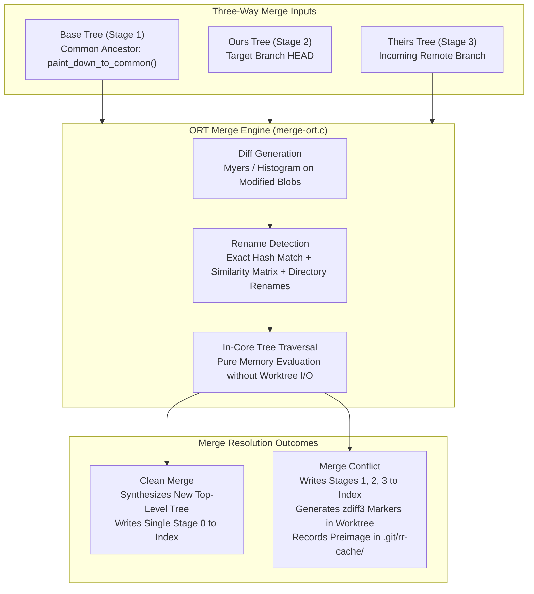
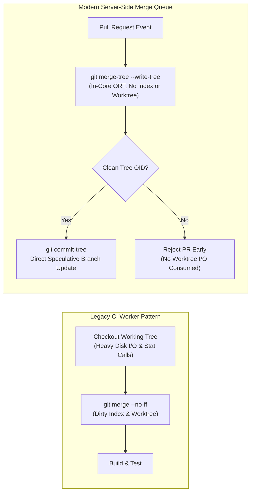

# Git Three-Way Merge, ORT Strategy, and Diff Algorithms

> [!summary] Claim:
> Git branch convergence relies on finding common ancestor trees via commit graph walks and synthesizing three-way textual diffs between a base, local HEAD, and incoming remote branches.
> Text comparison algorithms choose between greedy Shortest Edit Scripts (Myers) and content-anchored Longest Common Subsequences (Patience and Histogram), directly determining hunk alignment and conflict cleanliness.
> The modern ORT merge engine ("Ostensibly Recursive's Twin", default since Git 2.34) executes tree merges and directory rename detection in memory without touching the working tree or index until final commitment; only new blob and tree objects reach the object database.
> Conflicts populate index stages 1, 2, and 3 and write conflict hunks into the working tree file, which `git rerere` normalizes and records; staging the resolved file collapses the stages into stage 0.



## The Mechanism

Branch convergence in Git transforms two diverged histories into a unified snapshot.
Unlike two-way patch tools that naively apply line deltas without context, Git executes a three-way merge.
A three-way merge compares both divergent states against their closest shared ancestor, differentiating intentional modifications from untouched code.
Every source cited below is verified against `git.git` at v2.55.0 unless an earlier release is specifically noted.

### 1. Difference Generation Algorithms

Textual comparison in Git converts two line sequences $A$ (length $N$) and $B$ (length $M$) into an edit script composed of insertions, deletions, and preserved blocks.
Git implements four algorithms in its internal LibXDiff engine (`xdiff/`), selectable via `diff.algorithm` or `--diff-algorithm=`.

#### Myers Greedy Algorithm (`xdiff/xdiffi.c`)

Published by Eugene Myers in 1986, this algorithm treats difference computation as finding the Shortest Edit Script (SES) in an edit graph.
The edit graph spans an $(N+1) \times (M+1)$ grid where horizontal edges represent deletions from $A$, vertical edges represent insertions into $B$, and diagonal edges represent matching lines with zero cost.
The algorithm searches diagonals defined by $k = x - y$.

```text
       x -> (Deletions from A)
    (0,0)-----(1,0)-----(2,0)-----(3,0)
      |         | \       |         |
      |         |  \ (snake)        |
y   (0,1)-----(1,1)-----(2,1)-----(3,1)
|     |         |         |         |
v   (0,2)-----(1,2)-----(2,2)-----(3,2)
(Insertions into B)
```

At each edit distance step $D \in [0, N+M]$, the algorithm tracks the furthest-reaching point along diagonal $k \in [-D, D]$ in steps of 2:

$$x = \begin{cases} V[k+1] & \text{if } k = -D \text{ or } (k \ne D \text{ and } V[k-1] < V[k+1]) \\ V[k-1] + 1 & \text{otherwise} \end{cases}$$

After stepping horizontally or vertically, the algorithm greedily traverses any available diagonal matches ("snakes") while $A[x+1] == B[y+1]$.
Myers operates in $O((N+M)D)$ time and $O(N+M)$ space using divide-and-conquer middle-snake partitioning.
While mathematically minimal, Myers is structurally blind to programming syntax.
When boilerplate lines (such as closing braces `}` or empty lines) repeat across multiple functions, Myers greedily matches them, resulting in shifted hunks that interleave new and old function blocks.

#### Patience Diff Algorithm (`xdiff/xpatience.c`)

Described by Bram Cohen (his post "Patience Diff Advantages" is dated March 30 2010) and added to `git diff` as `--patience` in Git 1.6.2 (RelNotes/1.6.2), Patience diff prioritizes human readability over minimal edit distance.
The algorithm operates in five phases:

1. Trims identical common prefix and suffix lines from both files.
2. Identifies lines that are strictly unique in sequence $A$ and strictly unique in sequence $B$, and match across both.
3. Computes the Longest Increasing Subsequence (LIS) of these unique common lines using patience sorting in $O(K \log K)$ time.
4. Uses these matched lines as immutable anchors, dividing the file into disjoint sub-regions.
5. Recursively applies the algorithm to sub-regions between anchors, falling back to Myers (`fall_back_to_classic_diff()`, which calls `xdl_fall_back_diff()`) only when a sub-region contains no unique common lines.

Because solitary closing braces and common control statements appear multiple times, Patience diff ignores them during initial anchor selection.
This prevents structural boundaries from shifting across unrelated functions.

#### Histogram Diff Algorithm (`xdiff/xhistogram.c`)

Developed in JGit by Shawn Pearce and ported into Git's LibXDiff engine, Histogram extends Patience diff to eliminate performance degradation when files lack strictly unique lines.
Rather than requiring strict uniqueness, Histogram constructs an occurrence table in `struct histindex`:

```c
struct histindex {
    struct record {
        unsigned int ptr, cnt;
        struct record *next;
    } **records, **line_map;
    chastore_t rcha;
    unsigned int *next_ptrs;
    unsigned int table_bits, records_size, line_map_size;
    unsigned int max_chain_length, key_shift, ptr_shift;
    unsigned int cnt, has_common;
    xdfenv_t *env;
    xpparam_t const *xpp;
};
```

In `find_lcs()`, the algorithm builds a histogram of line frequencies in region $A$.
When searching for an anchor, it selects the matching line with the lowest occurrence count ($cnt$).
If unique lines exist, it selects a unique match, behaving identically to Patience diff.
If no unique lines exist, it splits along the lowest-frequency element rather than aborting to Myers.
It still falls back to the classic diff (`fall_back_to_classic_diff()`) when every candidate line occurs more often than `max_chain_length`, which `xhistogram.c` sets to 64.
This yields the structural cleanliness of Patience diff with superior throughput on repetitive code and configuration files.

### 2. Common Ancestor Walks (`commit-reach.c`)

Before merging trees, Git must locate the best common ancestor commit between target commit $A$ (Ours) and incoming commit $B$ (Theirs).
This is computed via `paint_down_to_common()` in `commit-reach.c`.

The algorithm initializes a priority queue ordered by `compare_commits_by_gen_then_commit_date` (plain commit date when no generation data is available):

1. Commit $A$ is pushed with flag `PARENT1` (`1u<<16`).
2. Commit $B$ is pushed with flag `PARENT2` (`1u<<17`).
3. The queue pops the highest-generation commit and propagates its flags down to all direct parent commits.
4. When a commit accumulates both flags (`PARENT1 | PARENT2`), it is identified as a common ancestor candidate and marked `RESULT` (`1u<<19`).
5. The parents of a discovered common ancestor are marked with the `STALE` flag (`1u<<18`), and the walk stops once only stale commits remain in the queue, preventing redundant deep ancestry traversals.
6. `remove_redundant()` runs a reachability check over all candidate commits, discarding any candidate that is an ancestor of another candidate.

```text
    A --- D --- F (branch1, PARENT1)
   / \   /
  X   \ /
   \   X
    \ / \
    B --- E --- G (branch2, PARENT2)
```

In a linear or simple branching history, `remove_redundant()` leaves exactly one commit: the unique merge base.
If no common ancestor exists, the walk terminates with zero candidates, causing `git merge` to reject the operation with `fatal: refusing to merge unrelated histories` unless overridden with `--allow-unrelated-histories`.

#### Criss-Cross Merges and Virtual Merge Bases

In a criss-cross merge topology, two branches merge each other's intermediate states across independent development tracks.
Here, multiple independent merge bases remain after filtering.
Neither candidate is an ancestor of the other.

To merge heads with multiple merge bases, Git uses recursive merge base synthesis:
The merge engine recursively merges merge base $B_1$ and merge base $B_2$ to generate an in-memory virtual common ancestor commit $O_{\text{virt}}$.
This virtual ancestor tree is then supplied as the base tree (Stage 1) for the top-level three-way merge between $A$ and $B$.

### 3. The ORT Merge Strategy (`merge-ort.c`)

From Git v0.99.9k until v2.33.0, the default strategy for two heads was `recursive`, implemented in C as `merge-recursive.c` (`Documentation/merge-strategies.adoc`).
Since v2.50.0, `-s recursive` is a synonym for `ort`, and `merge-recursive.c` no longer exists in the v2.55.0 tree.
While functional, `merge-recursive` suffered from architectural flaws:
It coupled tree calculations directly to the repository index (`struct index_state`) and working tree: its `unpack_trees` setup ran against `opt->repo->index`, and every file update was gated on `update_cache` and `update_working_directory` flags (`merge-recursive.c` at v2.33.0).
For the virtual ancestor merges of a criss-cross history (`call_depth > 0`), it updated the index but skipped the working directory (`update_working_directory = !call_depth && !no_wd`).
The in-core ORT functions instead leave the "working tree and index untouched" (`merge-ort.h`) and write them only in `merge_switch_to_result()`.

Written from scratch by Elijah Newren, the **ORT** strategy ("Ostensibly Recursive's Twin") replaced `merge-recursive` as the default engine in Git 2.34.0 (November 2021).
ORT exposes two primary in-core entry points declared in `merge-ort.h`:

```c
void merge_incore_nonrecursive(struct merge_options *opt,
                               struct tree *merge_base,
                               struct tree *side1,
                               struct tree *side2,
                               struct merge_result *result);

void merge_incore_recursive(struct merge_options *opt,
                            const struct commit_list *merge_bases,
                            struct commit *side1,
                            struct commit *side2,
                            struct merge_result *result);
```

#### In-Core Execution Model

ORT decouples merge resolution entirely from the filesystem.
It performs tree diffing, rename detection, 3-way content resolution, and directory conflict tracking entirely in memory.
When resolving virtual common ancestors, intermediate trees are synthesized without writing worktree files or populating index stages, although the resulting blob and tree objects are written to the object database (which is why `git merge-tree --quiet` documents that it "allows it to avoid writing most objects created by merges").
Only once the final top-level merge tree is completely resolved does Git call `merge_switch_to_result()`:

```c
void merge_switch_to_result(struct merge_options *opt,
                            struct tree *head,
                            struct merge_result *result,
                            int update_worktree_and_index,
                            int display_update_msgs);
```

A caller that passes `update_worktree_and_index` as zero leaves the index and working tree untouched.
`git merge-tree` does not call `merge_switch_to_result()` at all: `builtin/merge-tree.c` calls `merge_incore_recursive()` (or `merge_incore_nonrecursive()` with `--merge-base`), prints `result.tree`, and releases state with `merge_finalize()`.

### 4. Directory Rename Detection and Caching

Detecting file renames across branches is computationally expensive.
Given $N$ file deletions in branch $A$ and $M$ file additions in branch $B$, naive pairwise similarity comparison requires $O(N \times M)$ content diff evaluations.
ORT introduces three optimizations that accelerate rename handling by orders of magnitude:

#### Exact Match Pruning and Subtree Skipping

Before invoking similarity hashing, ORT matches additions and deletions that share identical object IDs (exact renames) through a hash table (`find_exact_renames()` in `diffcore-rename.c`), in expected linear time.
Furthermore, if a directory tree object in branch $A$ has the exact same hash as in the merge base, ORT proves that no file within that subtree was modified or renamed on branch $A$.
The engine skips descending into that subtree entirely.

#### Directory Rename Detection (`Documentation/technical/directory-rename-detection.adoc`)

If branch $A$ renames an entire directory (for example moving all files in `src/legacy/` to `src/core/`), and branch $B$ concurrently creates a new file `src/legacy/telemetry.c`, a naive merge leaves `telemetry.c` orphaned in the defunct directory.
ORT analyzes the destination paths of all files originally residing in `src/legacy/`.
If `src/legacy/` no longer exists on the renaming side (a directory that still exists on both sides is never considered renamed), at least one file was renamed out of it, and the majority of those renames went to `src/core/`, ORT deduces that `src/legacy/` was renamed to `src/core/`.
It automatically relocates the incoming addition to `src/core/telemetry.c`.
This behavior is controlled by `merge.directoryRenames`:
- `true`: Relocates the file to the new directory automatically and prints `Path updated: ... moving it to ...`.
- `conflict` (default as of 2026-11, Both): Reports `CONFLICT (file location): ... suggesting it should perhaps be moved to ...`; on Git 2.55.0 the file is placed at the suggested new path at a non-zero stage (stage 2 for an addition on `HEAD`, checked with `git ls-files --stage`).
- `false`: Disables directory rename detection; new files remain in the original directory path.

#### Rename Memoization across Sequential Merges (`Documentation/technical/remembering-renames.adoc`)

During operations that execute multiple sequential merges (such as `git rebase` or `git cherry-pick`), `merge-recursive` re-ran exhaustive rename detection for every single commit in the series.
ORT caches rename detection pairings in `struct rename_info` (`cached_pairs[3]`, `cached_target_names[3]`, and `cached_irrelevant[3]` in `merge-ort.c`).
Because every pick in the series merges against the same upstream side, renames that side made are detected once and reused for later picks; the cache is thrown away when a merge stops for the user to resolve conflicts (`remembering-renames.adoc`).

### 5. Conflict Resolution Mechanics and Index Stages

When a three-way merge cannot resolve modifications automatically, it registers a conflict and halts.
In the Git index (`.git/index`), file entries carry a 2-bit stage indicator in bits 12-13 of the 16-bit flags field:

| Stage | Name | Role in Three-Way Merge |
| :--- | :--- | :--- |
| `0` | Normal | Clean state; no conflict exists on this path. |
| `1` | Ancestor | The blob version recorded in the merge base tree ($O$). |
| `2` | Ours | The blob version on the current target branch ($A$, `HEAD`). |
| `3` | Theirs | The blob version on the incoming branch being merged ($B$). |

A conflicted path has no stage 0 entry.
Instead, it holds up to three distinct entries sharing the same pathname.
If a file was added on our branch and concurrently added with different content on the incoming branch, stages 2 and 3 exist, while stage 1 is absent.
If a file was modified on our branch and deleted on the incoming branch, stages 1 and 2 exist, while stage 3 is absent.

```text
[Binary .git/index Entry]
+---------------------------------------------------------+
| 40 B: ctime, mtime, dev, ino, mode, uid, gid, size     |
+---------------------------------------------------------+
| 20 B / 32 B Object ID (Blob SHA-1 / SHA-256)            |
+---------------------------------------------------------+
| 16-bit Flags: [15: assume-valid] [14: extended]         |
|               [13..12: STAGE (0..3)] [11..0: path length]|
+---------------------------------------------------------+
| Null-terminated Pathname + 1..8 null padding bytes       |
+---------------------------------------------------------+
```

#### Conflict Styles

When materializing conflicts into the working tree, Git formats conflicted hunks based on `merge.conflictStyle`:

- `merge` (default): Standard two-way conflict markers showing only local and remote variants:
  ```text
  <<<<<<< HEAD
  port = 7070
  =======
  port = 9090
  >>>>>>> feat_b
  ```
- `diff3`: Three-way markers including the common ancestor block:
  ```text
  <<<<<<< HEAD
  port = 7070
  ||||||| 23c3559
  port = 8080
  =======
  port = 9090
  >>>>>>> feat_b
  ```
- `zdiff3` (zealously condensed diff3, added in Git 2.35.0):
  Standard `diff3` can keep lines inside the conflict boundary that both sides changed identically.
  `zdiff3` pulls such lines, common to ours and theirs at the start and end of the block, outside the `<<<<<<<` and `>>>>>>>` markers, shrinking the visual conflict zone to strictly divergent lines.

#### Staging as Conflict Resolution

Running `git add <path>` on a conflicted file computes the SHA-1/SHA-256 hash of the working tree file, writes a new loose blob into `.git/objects/`, removes stages 1, 2, and 3 from the index, and inserts a single stage 0 entry for that path.
Running `git rm <path>` resolves delete/modify conflicts by removing stages 1, 2, and 3 without inserting a stage 0 entry.

### 6. Reuse Recorded Resolution (`rerere.c`)

Git's `rerere` facility ("Reuse Recorded Resolution") automates the replay of identical conflict resolutions.
When enabled via `git config rerere.enabled true`, Git intercepts merge failures:

1. **Preimage Recording:** When a conflict occurs, `rerere.c` parses all conflicted hunks in the working tree.
   It strips commit hashes and branch names from the conflict markers, normalizing the raw conflict text.
   It hashes this normalized text using SHA-1/SHA-256 to create a signature directory under `.git/rr-cache/<hash>/`.
   It writes the whole conflicted file, with label-free markers and without the base section, into `.git/rr-cache/<hash>/preimage` (the lab's 58-byte preimage is exactly that).
2. **Postimage Recording:** Once the developer resolves the conflict and executes `git add` or commits the result, `git rerere` inspects the working tree or index.
   It writes the clean, resolved hunk into `.git/rr-cache/<hash>/postimage`.
3. **Automated Replay:** When a subsequent merge or rebase encounters an identical conflict, `rerere` computes the hunk signature, locates the `.git/rr-cache/<hash>/` directory, and performs a three-way merge between `preimage`, the current file, and `postimage`.
   If clean, it applies the resolved lines directly to the working tree.
   If `rerere.autoUpdate` is set to `true`, it automatically executes `git add` to stage the resolution; otherwise, it leaves the file unstaged for developer verification.

### 7. Worktree-Free In-Core Merges (`git merge-tree`)

Before ORT, `git merge` itself needed a working tree, so CI systems built on the `git` CLI kept physical checkouts on disk to evaluate pull request merges, while hosts such as GitHub used libgit2's worktree-free merge instead (GitHub Blog, "Scaling merge-ort across GitHub", 2023).
Filesystem checkouts incur stat call overhead and disk I/O contention.

Overhauled by Elijah Newren in Git 2.38.0, `git merge-tree --write-tree` provides a pure plumbing interface to the ORT engine.
It accepts two commit references and executes an in-core merge without reading or writing `.git/index` or touching a working tree:

```bash
git merge-tree --write-tree <branch1> <branch2>
```

- If the merge is clean: It prints the hexadecimal object ID of the synthesized top-level tree object and exits with code 0.
  The server creates a merge commit object directly via `git commit-tree <tree-oid> -p <branch1> -p <branch2>`.
- If the merge has conflicts: It prints the top-level tree object (containing raw conflict markers inside the conflicted blobs), followed by higher-order stage tuples `(mode, oid, stage, path)` and informational messages, exiting with code 1.

## Commands and Numbers to Know

Every entry below reflects Git 2.55.0 defaults stamped `(as of 2026-11)`.

| Parameter / Command | Default Value | Target Platform | Operational Significance |
| :--- | :--- | :--- | :--- |
| `diff.algorithm` | `myers` | Both | Default difference generation algorithm; alternates are `minimal`, `patience`, `histogram`. |
| `merge.conflictStyle` | `merge` | Both | Conflict marker format; alternates are `diff3` and `zdiff3` (Git 2.35+). |
| `merge.directoryRenames` | `conflict` | Both | Directory rename detection behavior; options are `true`, `false`, `conflict`. |
| `diff.renameLimit` | `1000` | Both | Maximum files considered during quadratic pairwise copy/rename similarity detection in `git diff`. |
| `merge.renameLimit` | `7000` | Both | Maximum files evaluated during rename detection in merges (falls back to `diff.renameLimit` if set). |
| `rerere.enabled` | `false` | Both | Activates conflict resolution recording and automatic replay under `.git/rr-cache/`. |
| `rerere.autoUpdate` | `false` | Both | When `true`, automatically stages files that `rerere` resolved cleanly. |
| `git merge-base --all A B` | N/A | Both | Prints all common ancestor commits between $A$ and $B$, exposing criss-cross ancestry. |
| `git merge-tree --write-tree A B` | N/A | Both | Computes in-core three-way merge via ORT without touching index or working tree (Git 2.38+). |
| `git ls-files --stage` | N/A | Both | Displays raw index stages: stage 0 (normal), stage 1 (base), stage 2 (ours), stage 3 (theirs). |
| `git checkout --ours / --theirs` | N/A | Both | Extracts Stage 2 or Stage 3 blob content directly into working tree file. |
| `git checkout -m <path>` | N/A | Both | Re-creates three-way conflict markers in working tree from existing index stages 1, 2, and 3. |

## Multi-Language Comparison: C / Python / Rust

| Concern | C (Git Native LibXDiff / Core) | Python (`difflib` / `pygit2`) | Rust (`imara-diff` / `gix`) |
| :--- | :--- | :--- | :--- |
| **Diff Engine** | `xdiff/xdiffi.c` (Myers), `xdiff/xhistogram.c` (Histogram); C pointers, arena-allocated line records. | `difflib.SequenceMatcher` (Ratcliff-Obershelp heuristic, not Myers); `pygit2` links to `libgit2`. | `imara-diff` (pure Rust Myers and Histogram); `gix-diff` in `gitoxide`. |
| **Complexity** | $O((N+M)D)$ time, $O(N+M)$ space with middle snake recursion. | Quadratic time worst case, linear best case, per the `difflib` docs (Timing note). | $O((N+M)D)$ time for Myers; the `imara-diff` README says Histogram beats its Myers by 10% to 100% (README claim, not measured here). |
| **Index Inspection** | Direct binary parsing of `struct cache_entry` in `read-cache.c`. | Struct unpacking via `struct.unpack(">10I20sH", data)` reading `.git/index`. | Type-safe binary deserialization using `gix-index::File`. |
| **Three-Way Merge** | In-core ORT engine in `merge-ort.c` with directory rename detection. | `pygit2.Repository.merge_trees()` calling `libgit2` in-memory merge. | `gix-merge`, a `gitoxide` crate that provides blob, tree, and commit merges (docs.rs). |
| **Memory Footprint** | Heap arenas (`struct mem_pool pool` in `merge-ort.c`, `chastore_t` in `xdiff/`), direct pointers. | Heavy Python object overhead (`sys.getsizeof` on CPython 3.15.2: 41 bytes for an empty ASCII `str` plus 1 byte per character, as of 2026-11). | Contiguous `Vec<u8>` buffers, explicit lifetimes, zero-copy string slices. |

## Worked Lab Example

The companion lab in `code/02-Version-Control/merge_diff/` exercises difference generation, criss-cross ancestry walks, in-core `merge-tree` evaluation, binary index stage decoding, directory rename detection, and `rerere` replay.
All terminal blocks below are byte-identical excerpts of `expected/darwin-arm64.txt`, recorded on `darwin-arm64` with Git 2.55.0 (as of 2026-11, macOS).
The script exits early with an error on a Git older than 2.38, because `git merge-tree --write-tree` does not exist before it.

### 1. Diff Algorithms: Myers vs Histogram

The lab generates two source files from Git's canonical `frobnitz` benchmark (`t/lib-diff-alternative.sh`), inserting `fib()` and relocating `frobnitz()` relative to `fact()`.

```text
=== 1. Diff Algorithms: Myers vs Histogram (Frobnitz Test) ===
--- Git Myers Diff ---
diff --git a/file1.c b/file2.c
index beed2e1..1968d45 100644
--- a/file1.c
+++ b/file2.c
@@ -1,26 +1,25 @@
 #include <stdio.h>
 
-// Frobs foo heartily.
-int frobnitz(int foo)
+int fib(int n)
 {
-	int i;
-	for(i = 0; i < 10; i++)
+	if(n > 2)
 	{
-		printf("Your answer is: ");
-		printf("%d\n", foo);
+		return fib(n-1) + fib(n-2);
 	}
+	return 1;
 }
 
-int fact(int n)
+// Frobs foo heartily.
+int frobnitz(int foo)
 {
-	if(n > 1)
+	int i;
+	for(i = 0; i < 10; i++)
 	{
-		return fact(n-1) * n;
+		printf("%d\n", foo);
 	}
-	return 1;
 }
 
 int main(int argc, char **argv)
 {
-	frobnitz(fact(10));
+	frobnitz(fib(10));
 }
--- Git Histogram Diff ---
diff --git a/file1.c b/file2.c
index beed2e1..1968d45 100644
--- a/file1.c
+++ b/file2.c
@@ -1,26 +1,25 @@
 #include <stdio.h>
 
+int fib(int n)
+{
+	if(n > 2)
+	{
+		return fib(n-1) + fib(n-2);
+	}
+	return 1;
+}
+
 // Frobs foo heartily.
 int frobnitz(int foo)
 {
 	int i;
 	for(i = 0; i < 10; i++)
 	{
-		printf("Your answer is: ");
 		printf("%d\n", foo);
 	}
 }
 
-int fact(int n)
-{
-	if(n > 1)
-	{
-		return fact(n-1) * n;
-	}
-	return 1;
-}
-
 int main(int argc, char **argv)
 {
-	frobnitz(fact(10));
+	frobnitz(fib(10));
 }
--- Git Diff Size per Algorithm (git diff --numstat: added deleted) ---
myers     10 11
patience  10 11
histogram 10 11
--- Reference Myers & Anchor Analysis ---
Myers Edit Distance D=21 (Deletions=11, Insertions=10)
Patience Unique Common Line Anchors Found: 8
  Line A:1 == Line B:1 -> '#include <stdio.h>'
  Line A:3 == Line B:12 -> '// Frobs foo heartily.'
  Line A:4 == Line B:13 -> 'int frobnitz(int foo)'
  Line A:6 == Line B:15 -> 'int i;'
  Line A:7 == Line B:16 -> 'for(i = 0; i < 10; i++)'
```

Notice the semantic corruption in Myers:
Myers keeps the repeated braces and blank lines as matches, so it presents `frobnitz()` as rewritten into `fib()` and `fact()` as rewritten into `frobnitz()`.
Both scripts have the same size: `git diff --numstat` reports 10 added and 11 deleted lines for `myers`, `patience`, and `histogram` alike, matching the Python reference (D=21, 11 deletions, 10 insertions), so Myers is not more minimal here, only worse aligned.
The Python tool finds eight lines unique in both files (it prints the first five; `printf("%d\n", foo);`, `return 1;`, and `int main(...)` are the rest); it implements the Patience anchor rule, not Git's histogram code.
Histogram anchors on such low-occurrence lines, cleanly presenting the addition of `fib()`, the deletion of `fact()`, and the localized deletion of `printf("Your answer is: ");` inside `frobnitz()`.

### 2. Criss-Cross Ancestry and Worktree-Free Merge

The lab constructs a criss-cross merge topology between `branch1` (commit D) and `branch2` (commit E), executes common ancestor detection, and synthesizes an in-core merge tree:

```text
=== 2. Criss-Cross Merge & Multiple Merge Bases ===
Merge bases between branch1 (F, child of D) and branch2 (G, child of E):
65d83166e53442b70cc3e1bce1411063a58b9787
ffdccdefee46edd2299ac628334f3bfcdc6a798a
--- Virtual Merge Base Made Explicit ---
Virtual ancestor = merge(B, C) over A, tree 36f7bdedf88933a7bfeedf90cfdd878a1ee6c083:
  file1.txt: line 1|branch 1 edit|
  file2.txt: line 2|branch 2 edit|
Commit B alone: file2.txt = line 2|
Commit C alone: file1.txt = line 1|

=== 3. In-Core Worktree-Free Merge (git merge-tree) ===
Clean merge-tree synthesized OID: aaf5893642142baf254b5556a26592c15c5bfa8c
  file1.txt: line 1|branch 1 edit|branch 1 later|
  file2.txt: line 2|branch 2 edit|branch 2 later|
```

Git identifies two independent merge bases (`65d83166...` and `ffdccdef...`), commits B and C, even though each branch has since gained one more commit (F and G).
The lab then builds the virtual ancestor by hand with `git merge-tree --write-tree --merge-base=commit-A commit-B commit-C`: its tree holds both the `branch 1 edit` and the `branch 2 edit` lines, while B alone lacks the second and C alone lacks the first.
ORT synthesizes the same kind of tree internally, then merges F and G against it, which yields tree `aaf58936...` carrying both `later` edits, without touching the index or working tree.
The lab does not extract ORT's own internal virtual ancestor; it reproduces the construction with `--merge-base` on the same inputs.

### 3. Binary Index Stages and Directory Renames

The lab triggers a merge conflict under `merge.conflictStyle=zdiff3`, extracts raw stages from the binary `.git/index` file, resolves the conflict with `git add`, and demonstrates directory rename detection:

```text
=== 4. Conflict Markers (zdiff3) and Binary Index Stage Extraction ===
Triggering three-way merge conflict:
Auto-merging service.conf
CONFLICT (content): Merge conflict in service.conf
Recorded preimage for 'service.conf'
Automatic merge failed; fix conflicts and then commit the result.
--- Conflicted File Markers (zdiff3) ---
# Global Config
service_name = payment_gateway
<<<<<<< HEAD
port = 7070
||||||| 22d6e4c
port = 8080
=======
port = 9090
>>>>>>> feat_conflict_b
max_workers = 16
timeout_sec = 30
--- Binary Index Stage Extraction (.git/index) ---
Index Header: Signature=DIRC, Version=2, Entries=5
  [0] stage=0 (normal) mode=0o100644 oid=89b24ece path=file1.txt
  [1] stage=0 (normal) mode=0o100644 oid=b7e242c0 path=file2.txt
  [2] stage=1 (base  ) mode=0o100644 oid=b1c65b3e path=service.conf
  [3] stage=2 (ours  ) mode=0o100644 oid=b7f9af9b path=service.conf
  [4] stage=3 (theirs) mode=0o100644 oid=1ff999a5 path=service.conf
--- zdiff3 vs diff3: common lines at the edge of a conflict (git merge-file) ---
[diff3]
start
<<<<<<< ours
mine
shared
||||||| base
base
=======
theirs
shared
>>>>>>> theirs
end
[zdiff3]
start
<<<<<<< ours
mine
||||||| base
base
=======
theirs
>>>>>>> theirs
shared
end
--- Resolving Conflict via git add ---
Binary Index Stage Inspection After Resolution:
Index Header: Signature=DIRC, Version=2, Entries=3
  [0] stage=0 (normal) mode=0o100644 oid=89b24ece path=file1.txt
  [1] stage=0 (normal) mode=0o100644 oid=b7e242c0 path=file2.txt
  [2] stage=0 (normal) mode=0o100644 oid=25649d1b path=service.conf

=== 5. Directory Rename Detection (merge.directoryRenames) ===
Merging with merge.directoryRenames=false (then aborting):
Automatic merge went well; stopped before committing as requested
Unmerged index entries (mode stage path):
Telemetry path in worktree:
src/legacy/telemetry.c
Merging with merge.directoryRenames=conflict (then aborting):
CONFLICT (file location): src/legacy/telemetry.c added in HEAD inside a directory that was renamed in dir_rename_branch, suggesting it should perhaps be moved to src/core/telemetry.c.
Automatic merge failed; fix conflicts and then commit the result.
Unmerged index entries (mode stage path):
100644 2 src/core/telemetry.c
Telemetry path in worktree:
src/core/telemetry.c
Merging with merge.directoryRenames=true:
Path updated: src/legacy/telemetry.c added in HEAD inside a directory that was renamed in dir_rename_branch; moving it to src/core/telemetry.c.
telemetry.c
util.c
worker.c
```

`service.conf` produces stages 1, 2, and 3 in the index.
The unchanged `service_name`, `max_workers`, and `timeout_sec` lines sit outside the markers, showing only the diverging `port` line alongside ancestor `port = 8080`.
That is true of every conflict style, since unchanged lines never enter a conflict region, so this hunk renders identically under `diff3`.
The separate `git merge-file -p` block shows what `zdiff3` adds: the line `shared`, common to both sides at the edge of the conflict, stays inside both sides under `diff3` but is moved below the closing marker under `zdiff3`.
Upon running `git add`, Git purges stages 1, 2, and 3, writing resolved blob `25649d1b` directly to stage 0.
The `merge.directoryRenames` runs differ on the same merge: `false` leaves `src/legacy/telemetry.c` where it was with no unmerged entries, `conflict` reports `CONFLICT (file location)` and places the file at `src/core/telemetry.c` at stage 2, and `true` moves `src/legacy/telemetry.c` to `src/core/telemetry.c` silently apart from the `Path updated` notice.

### 4. Rerere Recording and Automated Replay

```text
=== 6. Reuse Recorded Resolution (git rerere) ===
Triggering merge to create initial rerere record:
Auto-merging rate_limit.conf
CONFLICT (content): Merge conflict in rate_limit.conf
Recorded preimage for 'rate_limit.conf'
Automatic merge failed; fix conflicts and then commit the result.
Resolving conflict and recording postimage:
Recorded resolution for 'rate_limit.conf'.
--- rr-cache Verification ---
Found 2 recorded conflict signature(s) in rr-cache:
  Conflict ID: 524d4db4978f66c8d1efdda2c10282244836d1cb
    Artifacts: postimage (93 bytes), preimage (129 bytes)
  Conflict ID: 66ba0734fc6f92002d139f3780bf0fba531d76d2
    Artifacts: postimage (22 bytes), preimage (58 bytes)
--- Resetting and Re-merging to Test Rerere Replay ---
Auto-merging rate_limit.conf
CONFLICT (content): Merge conflict in rate_limit.conf
Resolved 'rate_limit.conf' using previous resolution.
Automatic merge failed; fix conflicts and then commit the result.
File content auto-resolved by rerere:
burst = 500
rate = 10
```

`rerere` records the normalized preimage (58 bytes) and postimage (22 bytes) in `.git/rr-cache/66ba0734...`; the other entry is the earlier `service.conf` conflict.
The preimage is the whole file with label-free markers and no base section: `<<<<<<<`, `burst = 300`, `=======`, `burst = 200`, `>>>>>>>`, `rate = 10` is 8 + 12 + 8 + 12 + 8 + 10 = 58 bytes, and the postimage `burst = 500`, `rate = 10` is 12 + 10 = 22 bytes.
After executing a hard reset and re-merging, `rerere` intercepts the identical conflict, prints `Resolved 'rate_limit.conf' using previous resolution.`, and injects the recorded resolution (`burst = 500`); the merge still stops, so the result needs `git add` and a commit.

## Pitfalls

> [!warning] Pitfall: semantic merge conflicts undetected by text diffs
> A three-way textual merge succeeds cleanly whenever modifications occur on different lines.
> If branch $A$ changes the signature of a C function from `int query(int id)` to `int query(int id, unsigned flags)`, and branch $B$ adds a call site `query(42)` elsewhere in the file, Git merges the branch cleanly without conflict markers.
> The resulting code fails compilation or causes runtime memory corruption.
> Never assume a clean Git merge is functionally correct; verify all merges through test suites and build gates.

> [!warning] Pitfall: accidental code reversal in criss-cross virtual merges
> When resolving multiple merge bases, ORT merges the bases together to construct a virtual ancestor.
> If a change was merged into one base and reverted in another, the three-way merge between the bases can silently re-introduce or re-revert the patch inside the virtual ancestor tree.
> The final three-way merge evaluates against this synthetic tree, silently dropping expected code changes without reporting a conflict.

> [!warning] Pitfall: rename detection limits silently disabling inexact renames
> If a merge needs more rename candidates than `merge.renameLimit` allows (default 7000 when neither it nor `diff.renameLimit` is set; `diff.renameLimit` alone defaults to 1000 for `git diff`), Git skips the exhaustive similarity pass and warns `exhaustive rename detection was skipped due to too many files.`
> Moved files that only an inexact match would pair degrade into deletions and additions, generating spurious conflicts.
> Watch for that warning and raise `merge.renameLimit` before bulk renames.

> [!warning] Pitfall: sharing `.git/rr-cache` across distributed teams
> Teams occasionally attempt to share `.git/rr-cache` over NFS or commit it to a shared repository to avoid repeated conflict resolutions across developers.
> If a developer records an incorrect or temporary conflict resolution (such as commenting out broken tests), that poisoned postimage replays silently on every peer workstation.
> Confine `rerere` to local developer machines or vetted merge queue agents.

> [!warning] Pitfall: directory rename collisions with newly created directories
> If branch $A$ renames `dir_old/` to `dir_new/`, and branch $B$ concurrently creates an independent directory named `dir_new/` containing a file with an identical name, `merge.directoryRenames=true` forces a path collision.
> Git halts with a directory/file or rename/rename conflict that requires manual path resolution.

## At Scale

At single-developer scale, merge strategy choices rarely impact developer velocity.
Across engineering fleets scaling from 1,000 to 50,000 contributors, merge mechanics become primary drivers of infrastructure cost and deployment latency.



### Server-Side Merge Queues and Speculative Trains

In an enterprise monorepo receiving hundreds of commits per hour, traditional merge pipelines that check out physical files break down under filesystem bandwidth limits.
Merge queues and internal monorepo train dispatchers can execute speculative merges without a checkout using `git merge-tree --write-tree`.
GitHub moved pull request merge commits, then rebases, from libgit2 to merge-ort; its rebases run through `git replay`, which uses merge-ort without a worktree, and over 730k experimental rebases libgit2 took 2.56 hours against under 10 minutes for merge-ort (GitHub Blog, "Scaling merge-ort across GitHub").
That post names neither `git merge-tree` nor a merge queue, so the steps below are a design pattern, not a description of GitHub's implementation.
1. When pull request $N$ arrives, the merge queue runs `git merge-tree --write-tree HEAD PR_N`.
2. The ORT engine resolves the trees without reading or writing the index or working tree (`merge-ort.h`), so no stat calls on a worktree are needed.
3. If conflicts occur, the PR is rejected immediately without allocating CI build capacity.
4. If clean, the resulting tree OID is committed via `git commit-tree`, and the speculative commit is tested in a shared build container.
See [[Git-Replay-and-Server-Side-History-Rewriting]] and [[Git-Branching-Models-Merge-Queues-and-Code-Review]] for end-to-end merge queue architecture.

### Monorepo Scaling and Rename Detection Overhead

In monorepos containing millions of tree objects, $O(N \times M)$ rename matrix evaluations can stall CI agents for tens of minutes.
Organizations enforce three operational rules:
- **Set Diff Algorithm to Histogram:** Mandate `git config --global diff.algorithm histogram` across all developer and CI images to prevent misaligned merge conflicts on refactored code blocks.
- **Enforce Trunk-Based Development:** Long-lived feature branches foster criss-cross topologies that multiply virtual merge base evaluations.
  Mandate short-lived branches (< 48 hours) so common ancestor walks stay shallow and criss-cross histories rarely form.
  See [[Decision-Record-Merge-vs-Rebase-and-Branching]].
- **Leverage Cone Mode Sparse-Checkouts:** ORT touches the index and worktree only when recording a conflicted merge, and there it checks each conflicted path with `path_in_sparse_checkout()` (`merge-ort.c`), expanding a sparse index only if a conflict lies outside the cone.
  Rename detection is not shown to be skipped outside the cone, so size `merge.renameLimit` for the full tree.
  See [[Git-Index-Stat-Cache-and-Fsmonitor]] and [[Git-At-Scale-VFS-Scalar-and-Monorepos]].

## Practice Drill

> [!tip] Practice Drill:
> Replicate a three-way merge conflict and inspect its binary index stages and `zdiff3` markers directly from the shell.
> Create a scratch repository, construct two divergent branches that edit the same region of one file, trigger a three-way conflict, and parse the raw stages from `.git/index` using Python.
> Then inspect `.git/rr-cache/` to observe preimage generation before clearing stages with `git add`.

```bash
export GIT_CONFIG_GLOBAL=/dev/null
export GIT_CONFIG_SYSTEM=/dev/null
export LC_ALL=C
DIR=$(mktemp -d) && cd "$DIR"
git init -b main -q
git config user.name "Drill Engineer"
git config user.email "drill@example.com"
git config merge.conflictStyle zdiff3
git config rerere.enabled true

cat << 'EOF' > database.py
def connect():
    host = "localhost"
    port = 5432
    timeout = 10
    return (host, port, timeout)
EOF
git add database.py
git commit -m "base: initial database config" -q

git checkout -b feature_pool -q
cat << 'EOF' > database.py
def connect():
    host = "localhost"
    port = 5432
    pool_size = 20
    timeout = 10
    return (host, port, timeout)
EOF
git commit -am "feature_pool: add pool_size" -q

git checkout main -q
git checkout -b feature_ssl -q
cat << 'EOF' > database.py
def connect():
    host = "localhost"
    port = 5432
    ssl_mode = "require"
    timeout = 10
    return (host, port, timeout)
EOF
git commit -am "feature_ssl: add ssl_mode" -q

git checkout feature_pool -q
git merge feature_ssl || true

echo "=== 1. zdiff3 Conflict Markers in database.py ==="
cat database.py

echo "=== 2. Raw Index Stages (git ls-files --stage) ==="
git ls-files --stage database.py

echo "=== 3. Binary Index Inspection via Python ==="
python3 -c '
import struct
with open(".git/index", "rb") as f:
    data = f.read()
sig, ver, entries = struct.unpack(">4sII", data[:12])
print(f"Index Magic: {sig.decode()}, Version: {ver}, Entries: {entries}")
idx = 12
for i in range(entries):
    start = idx
    (mode,) = struct.unpack(">I", data[idx+24:idx+28])
    oid, flags = struct.unpack(">20sH", data[idx+40:idx+62])
    stage = (flags >> 12) & 0x3
    idx += 62
    path = bytearray()
    while data[idx] != 0:
        path.append(data[idx])
        idx += 1
    pad = (8 - ((idx - start + 1) % 8)) % 8
    idx += 1 + pad
    print(f"  Entry {i}: stage={stage}, mode={oct(mode)}, oid={oid.hex()[:8]}, path={path.decode()}")
'

echo "=== 4. rr-cache Preimage Signature ==="
ls -l .git/rr-cache/

cd / && rm -rf "$DIR"
```

## Interview Questions

> [!question] L5: What are the three stages recorded in Git's index during a merge conflict, and what command converts them back into stage 0?
>
> > [!success]- Answer
> > During an unmerged conflict, Git populates higher-order index stages:
> > Stage 1 stores the blob from the common ancestor (merge base).
> > Stage 2 stores the blob from our current branch (`HEAD`).
> > Stage 3 stores the blob from the incoming branch being merged.
> > Running `git add <file>` hashes the resolved working tree content into a new blob object, deletes the entries for stages 1, 2, and 3 from the index, and writes a single Stage 0 entry for that path.

> [!question] L5 (Predict the Output): What does `git merge-tree --write-tree main feature` output when a clean merge occurs versus when a conflict occurs?
>
> > [!success]- Answer
> > For a clean merge, `git merge-tree --write-tree` prints exactly one line containing the 40-character (or 64-character in SHA-256) hexadecimal object ID of the synthesized top-level tree object, exiting with status 0.
> > For a conflicted merge, it prints the top-level tree object ID (which contains conflict markers written into the conflicted blobs), followed by higher-order stage tuples `(mode, oid, stage, path)` for every conflicted path, followed by informational messages (such as `Auto-merging <path>` and `CONFLICT`), exiting with status 1.

> [!question] L6: Walk through Eugene Myers' diff algorithm: what do the diagonals $k = x - y$ and "snakes" represent, and why is its time complexity $O((N+M)D)$?
>
> > [!success]- Answer
> > The Myers algorithm models text difference as finding the Shortest Edit Script (SES) in an $(N+1) \times (M+1)$ edit graph, where horizontal steps represent deletions from $A$, vertical steps represent insertions into $B$, and diagonal edges represent matching lines.
> > Diagonals are indexed by $k = x - y$.
> > A "snake" is a zero-cost greedy traversal along a diagonal that consumes consecutive matching lines between $A$ and $B$.
> > At edit distance $D$, the search explores diagonals $k \in [-D, D]$ in steps of 2, updating the furthest-reaching point $x$ on each diagonal.
> > Because there are $d+1$ active diagonals at step $d$, summing over $D$ iterations yields $\sum_{d=0}^{D} (d+1) = (D+1)(D+2)/2 = O(D^2)$ search steps.
> > Incorporating line comparisons along snakes bounds total execution time to $O((N+M)D)$ in the worst case, making it fast for highly similar files where $D \ll (N+M)$.

> [!question] L6 (Debug This): A developer merges branch $B$ into branch $A$.
> A critical bug fix previously made on branch $B$ mysteriously disappears from the merged code, yet `git merge` reported no conflicts.
> How did this happen?
>
> > [!success]- Answer
> > This is the classic criss-cross merge regression.
> > When multiple common merge bases exist (e.g. intermediate commits $X$ and $Y$), Git's recursive merge engine synthesizes a virtual common ancestor by merging $X$ and $Y$.
> > If the bug fix was committed on $X$ but subsequently reverted on $Y$ during an earlier experimental merge, the three-way merge between $X$ and $Y$ evaluates the revert as an intentional modification, baking the reverted state into the virtual common ancestor tree.
> > When the top-level three-way merge runs between $A$ and $B$ against this virtual ancestor, Git compares the current branch against the synthetic ancestor.
> > Because the virtual ancestor already reflects the reverted state, the bug fix is evaluated as unchanged or obsolete, silently discarding the fix without triggering conflict markers.

> [!question] L7: Walk through the architectural differences between `merge-recursive.c` and `merge-ort.c`.
> Why does ORT dramatically outperform recursive on rebases?
>
> > [!success]- Answer
> > `merge-recursive` was tied directly to the filesystem and on-disk index (`struct index_state`).
> > In criss-cross merges, `merge-recursive` wrote intermediate virtual ancestor trees to disk and mutated index stages, creating heavy I/O overhead and leaving dirty index states on intermediate conflicts.
> > Furthermore, during multi-commit operations like `git rebase`, `merge-recursive` re-evaluated quadratic $O(N \times M)$ rename detection matrices for every single commit patch from scratch.
> > `merge-ort` ("Ostensibly Recursive's Twin") operates purely in memory (`in-core`).
> > It performs tree diffing, rename detection, and virtual ancestor consolidation within heap-allocated structures without touching `.git/index` or the working tree until final resolution; only new blob and tree objects are written to the object database.
> > Crucially, ORT remembers renames (`cached_pairs`, `cached_target_names`, and `cached_irrelevant` in `struct rename_info`), so later picks in a rebase reuse the upstream side's rename pairings instead of recomputing them.
> > It also skips subtree descents when directory object hashes match the base.
> > On GitHub's 2023 production experiment, rebases took under 10 minutes of compute with merge-ort versus 2.56 hours with libgit2 over 730k runs (a libgit2 comparison, not a `merge-recursive` one).

> [!question] L7: Under what specific conditions does Git's directory rename detection relocate an incoming file to a new path, and when does it declare a conflict?
>
> > [!success]- Answer
> > Directory rename detection applies when one side of history renames a directory (such as `dirA/` to `dirB/`), and the other side concurrently adds a new file inside the old directory (`dirA/new.txt`).
> > Git relocates `new.txt` to `dirB/new.txt` if:
> > 1. `merge.directoryRenames` is set to `true` (if set to `conflict`, it reports a conflict; if `false`, it leaves the file in `dirA/`).
> > 2. The directory `dirA/` no longer exists on the branch that renamed it because it was completely evacuated.
> > 3. At least one file originally in `dirA/` was renamed, and the majority destination of files renamed out of `dirA/` was `dirB/`.
> > Git declares a directory rename conflict if:
> > 1. `dirA/` was split, with equal numbers of files moving to different destinations without a clear majority (`CONFLICT (directory rename split)` in `merge-ort.c`).
> > 2. The destination path `dirB/new.txt` already exists on the other side of history with conflicting content.
> > 3. If both branches renamed `dirA/`, ORT does not declare a directory conflict: `handle_directory_level_conflicts()` drops that directory rename from both sides ("Directory rename skipped since directory was renamed on both sides"), and the individual file renames are merged, conflicting per file if their targets differ.

> [!question] L8+: Design a server-side merge queue infrastructure capable of merging 5,000 pull requests per hour in an enterprise monorepo without disk I/O bottlenecks.
>
> > [!success]- Answer
> > Traditional merge workers that check out physical files cannot sustain this throughput due to stat cache thrashing and disk bandwidth saturation.
> > The architecture must be built on worktree-free, in-core primitives:
> > 1. **Worker Pools on Bare Repositories:** Deploy stateless worker containers attached to bare Git object stores (or local NVMe mirrors using object alternates).
> > 2. **In-Core Evaluation:** Workers execute `git merge-tree --write-tree --messages HEAD PR_COMMIT`.
> >    Because ORT never touches an index or worktree, the only disk writes are new blob and tree objects (`git merge-tree` documentation).
> > 3. **Fast-Path Speculative Trains:** If `merge-tree` exits with status 0, write the resulting tree OID directly into a speculative commit object using `git commit-tree <tree_oid> -p HEAD -p PR_COMMIT -m "Merge PR"`.
> >    Batch speculative commits into a build train for containerized CI validation.
> > 4. **Early Conflict Rejection:** If `merge-tree` exits with status 1, parse the `<Conflicted file info>` stream, format an immediate diagnostic response to the pull request author, and reject the PR without allocating test runner capacity.
> > 5. **Atomic Ref Updates:** Upon successful CI validation of the speculative train, update target branch `main` with a compare-and-swap `git update-ref refs/heads/main <new-oid> <expected-old-oid>`, which fails if `main` moved.

> [!question] L8+: An infrastructure team proposes distributing `.git/rr-cache` across all developer workstations via a shared network filesystem or S3 bucket to eliminate duplicate conflict resolutions.
> Critique this proposal and detail its operational failure modes.
>
> > [!success]- Answer
> > Distributing `.git/rr-cache` globally across an engineering organization is a critical anti-pattern that introduces silent corruption and security vulnerabilities:
> > 1. **Context-Insensitive Preimages:** Preimage signatures are computed from normalized conflict hunks.
> >    Identical conflict markers can appear in completely different semantic contexts (e.g. a standard `version = 1.0` bump in different microservices or branches).
> >    A postimage recorded for service $A$ would silently apply to service $B$, corrupting logic without warning.
> > 2. **Poisoned Resolution Propagation:** If developer $X$ resolves a conflict hastily or incorrectly (e.g. commenting out a failing assertion, hardcoding a dummy token, or deleting a security check), that poisoned postimage immediately replicates to all developers and CI runners.
> > 3. **Race Conditions and Write Corruption:** The `.git/rr-cache/` file structure uses simple `preimage` and `postimage` files without distributed locking or transactional concurrency.
> >    Concurrent writes from multiple workstations across NFS or object storage corrupt cache files.
> > 4. **Remediation:** Keep `rerere` strictly local to individual developer machines.
> >    For organizational convergence, rely on merge queues, automated rebase bots, and trunk-based branch policies rather than shared conflict replay caches.

## Further Reading

- Eugene W. Myers, *An O(ND) Difference Algorithm and Its Variations* (1986): The foundational mathematical paper defining edit graph diagonal traversals and middle-snake linear space partitioning.
- Bram Cohen, *Patience Diff Advantages* (2010): The blog post introducing unique line anchor matching to preserve source code block semantics.
- Shawn O. Pearce, *HistogramDiff.java* (JGit, 2010): The architectural source code defining low-occurrence frequency histograms for robust diff splitting.
- Elijah Newren, `merge-ort.c`, `directory-rename-detection.adoc`, and `remembering-renames.adoc` (Git 2.34+): The canonical technical documentation and source code detailing Git's modern in-core merge engine.
- Junio C Hamano, `commit-reach.c` and `rerere.c` (Git core): The authoritative implementations of generation-number merge base walks and conflict resolution recording.
- `git-merge-tree(1)` Reference Manual: Normative specification for modern programmatic, worktree-free in-core three-way merges.
- Scott Chacon and Ben Straub, *Pro Git*, Chapter 7: Clear operational walkthroughs of three-way merging, conflict marker anatomy, and `rerere` lifecycle.

## Related

- Prerequisites: [[Git-Index-Stat-Cache-and-Fsmonitor]], [[Git-Revision-Selection-and-Graph-Walks]]
- Next: [[Git-Rebase-Internals-and-Stacked-Branches]]
- See also: [[Git-Replay-and-Server-Side-History-Rewriting]], [[Git-Branching-Models-Merge-Queues-and-Code-Review]], [[Git-At-Scale-VFS-Scalar-and-Monorepos]]
- Lab: `code/02-Version-Control/merge_diff/`
