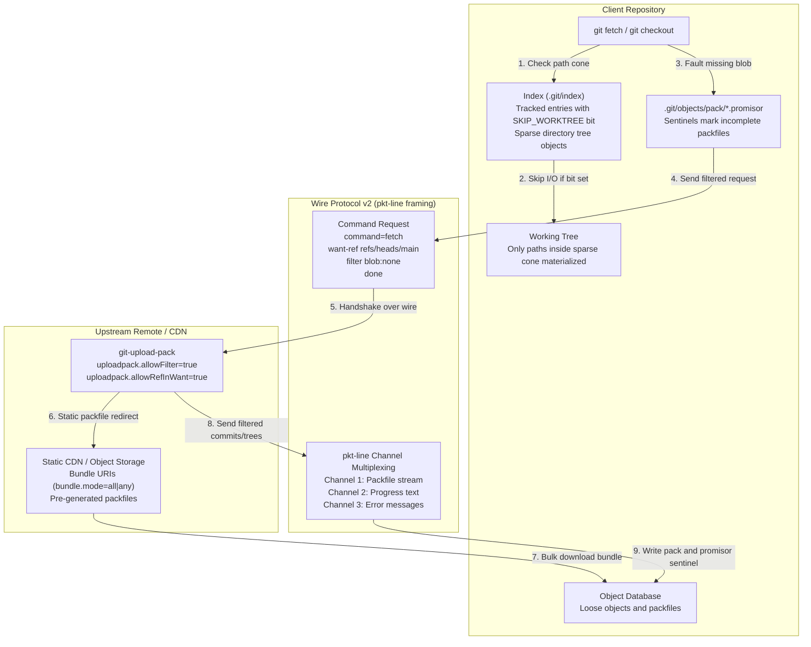

# Git Transfer Protocol v2, Partial Clone, and Sparse Checkout

> [!summary] Claim:
> Git Wire Protocol v2 replaces unconditional ref advertisements with stateless, command-oriented pkt-line exchanges (`ls-refs` with `ref-prefix`, and `fetch` with `ref-in-want`), removing the up-front advertisement of every ref, which is tens of megabytes per connection on repositories with hundreds of thousands of refs.
> Partial clone couples protocol filtering (`--filter=blob:none` or `tree:0`) with local promisor remotes that track omitted objects via `.promisor` packfile sentinels, faulting in missing blobs on demand or in batched runs via `git backfill`.
> Static bundle URIs offload initial object transfer to CDN edge storage using creation token heuristics to bypass Git server CPU saturation.
> Cone-mode sparse checkout replaces O(N x M) gitignore-style pattern matching with hash-based directory prefix lookups, flipping the `SKIP_WORKTREE` bit in index entries; pattern files are per-worktree, and `extensions.worktreeConfig` keeps the sparse-checkout config keys per-worktree too.



## The Mechanism

Network synchronization in Git historically required downloading the entire directed acyclic graph and all reachable object content.
In repositories with millions of files and hundreds of thousands of refs, this architectural assumption breaks down across network latency, server memory, and client disk footprint.
[[Git-Object-Model-and-Content-Addressing]] owns loose object hashing, while [[Git-Packfiles-and-Delta-Compression]] owns packfile delta compression on disk.
Three tightly integrated subsystems solve this scalability challenge: Wire Protocol v2, Partial Clone with Promisor Remotes, and Cone-Mode Sparse Checkout.
[[Git-Submodules-Subtrees-LFS-and-Attributes]] leaves large binary pointer interception to Git LFS, while this note owns wire transfer and selective object omission.

### 1. Wire Protocol Framing and Packet-Line Primitives

All communication in Git network transfers relies on packet-line (`pkt-line`) framing, defined normatively in `gitprotocol-common` and `gitprotocol-v2`.
A packet line is a stream of bytes prefixed by a 4-character hexadecimal length indicator.
The length indicator is encoded in ASCII hexadecimal and specifies the total byte count of the packet line, including the 4 length bytes themselves.

```text
+-------------------+---------------------------------------------------+
| 4-byte hex length | Payload (up to 65516 bytes)                       |
+-------------------+---------------------------------------------------+
```

Four reserved packet lengths define out-of-band protocol control signals:

- `0000` (Flush Packet / `flush-pkt`): Indicates the end of a transmission or a negotiation section.
- `0001` (Delimiter Packet / `delim-pkt`): Introduced in Protocol v2 to separate distinct logical sections within a single command request or response.
- `0002` (Response End Packet / `response-end-pkt`): Signals the absolute termination of a response in stateless HTTP remote helper transports.
- `0004`: An empty packet containing zero payload bytes, which implementations SHOULD NOT send (`gitprotocol-common(5)`).

The maximum legal length of a pkt-line is 65,520 bytes (`0xfff0`), consisting of 4 header bytes and 65,516 payload bytes.
`gitprotocol-common(5)` states that implementations MUST NOT send a pkt-line longer than 65,520 bytes, so a longer packet is a protocol violation.

When streaming packfile data, Git uses sideband multiplexing: in protocol v2 the `packfile` section is always multiplexed and the `sideband-all` feature extends multiplexing to the whole response (`gitprotocol-v2(5)`), while v0/v1 negotiate it with the `side-band-64k` capability.
The first byte of the pkt-line payload designates the sideband channel:

- Channel 1 (`0x01`): Primary payload stream (raw packfile bytes).
- Channel 2 (`0x02`): Progress information destined for the user's terminal `stderr`.
- Channel 3 (`0x03`): Error messages that trigger client abortion.

In sideband mode, the maximum payload is 65,515 bytes, plus 1 channel byte and 4 length bytes, totaling 65,520 bytes (`send_sideband()` in `sideband.c` caps each chunk at `packet_max - 5`; the "65519 data bytes" figure in `gitprotocol-pack(5)` omits the 4 length bytes).

### 2. Protocol v2 Negotiation and Command Architecture

In Git Protocol v1, connecting to a remote server triggered an immediate, unconditional ref advertisement.
Before a client could request a single commit, the server ran `for-each-ref` and transmitted every branch, tag, notes ref, and pull request head over the socket.
Each advertised ref costs about 60 to 90 bytes (4 length bytes, a 40-hex OID, a space, the ref name, and a newline), so a repository with 500,000 refs sends roughly 30 to 45 megabytes before negotiation can begin, more with peeled tags (an arithmetic estimate, not a measurement).
[[Git-Refs-Reflog-and-Reftable]] details how references are stored in packed-refs or reftables and scanned on the server.

Protocol v2 (introduced in Git 2.18.0, made the default in Git 2.26.0, demoted again in Git 2.27.0 for "remaining rough edges", and the default for good since Git 2.29.0, per those release notes) reverses this control flow.
Communication in Protocol v2 is command-oriented and stateless.
The client requests Protocol v2 by transmitting an out-of-band environment variable or transport header:

- For SSH and local file transports: `GIT_PROTOCOL=version=2`.
- For smart HTTP transports: `Git-Protocol: version=2` HTTP request header.
- For git daemon transports: `0035git-upload-pack /repo.git\0host=server\0\0version=2\0`.

Upon receiving the request, the server emits a capability advertisement terminated by `flush-pkt` (`0000`).
The block below is from a server with `uploadpack.allowFilter` and `uploadpack.allowRefInWant` set to `true`; `filter` and `ref-in-want` are advertised only when those are set, and the `agent` suffix names the server OS (`-Darwin` on macOS, observed with Git 2.55.0):

```text
000eversion 2\n
001bagent=git/2.55.0-Linux\n
0013ls-refs=unborn\n
0033fetch=shallow wait-for-done filter ref-in-want\n
0012server-option\n
0017object-format=sha1\n
0000
```

Notice that the server advertises zero repository references.
The client then executes commands against the advertised capabilities.

#### Targeted Reference Discovery with `ls-refs`

When the client needs to inspect refs, it invokes the `ls-refs` command.
Crucially, the client can supply one or more `ref-prefix` arguments:

```text
0014command=ls-refs\n
0001
001fref-prefix refs/heads/main\n
0000
```

The server evaluates `ref-prefix` against its ref store, transmitting only references that match the prefix.
Tags, developer branches, and internal CI refs are left out of the response, so its size scales with the matching refs rather than the total ref count (the lab's Step 1 shows `experimental` and `v1.0.0` suppressed).

#### Single-Round-Trip Fetches with `ref-in-want`

Without `ref-in-want`, a v2 client must first run `ls-refs` to resolve the branch name to an Object ID (OID), then send `want <oid>` (and any `have <oid>` lines) in a separate `fetch` request.

Protocol v2 provides the `ref-in-want` feature.
If advertised by the server (`uploadpack.allowRefInWant=true`), the client can omit `ls-refs` entirely and send a `want-ref` directive inside the `fetch` command:

```text
0012command=fetch\n
001bagent=toolchain-client\n
0001
001dwant-ref refs/heads/main\n
0015filter blob:none\n
0009done\n
0000
```

The server resolves `refs/heads/main` internally, outputs a `wanted-refs` section mapping the ref name to its current OID, emits a delimiter packet (`0001`), and immediately streams the packfile payload.
This removes the `ls-refs` round trip: after the capability advertisement, one `fetch` request both resolves the ref and returns the pack, and the ref is resolved at fetch time rather than at listing time.

### 3. Partial Clone and Promisor Remotes

Traditional Git operations require all objects reachable from requested commits to be locally present.
Partial clone (defined in `Documentation/technical/partial-clone.adoc`) relaxes this invariant.
During clone or fetch, the client passes an object filter specification to the server using the `filter` capability (`uploadpack.allowFilter=true`).

#### Object Filter Specifications

The filter specification is evaluated by `git pack-objects` on the server during graph traversal:

- `blob:none`: Blobless clone.
  The server includes all reachable commits and all reachable trees, but excludes every blob.
- `tree:<depth>`: Treeless clone when `<depth>` is 0 (`tree:0`).
  The server includes only reachable commits, omitting all trees and all blobs.
- `blob:limit=<n>[k|m|g]`: Size-based filtering.
  Blobs of size at least `<n>` bytes are omitted (`git-rev-list(1)`; a 10-byte blob is omitted by `blob:limit=10`, observed with Git 2.55.0).
- `sparse:oid=<oid>`: Path-based filtering where omitted objects are determined by a sparsity specification stored in a tree or blob.
- `combine:<filter1>+<filter2>`: Composition of multiple filters.

#### The Promisor Packfile Architecture

When a client receives an incomplete packfile from a filtered clone, it must prevent local integrity checks (`git fsck`) from declaring repository corruption.
Git records the remote as a promisor remote by setting:

```text
remote.origin.promisor = true
remote.origin.partialCloneFilter = blob:none
```

When writing the received packfile to disk, Git writes three companion files into `.git/objects/pack/`:

1. `pack-<hash>.pack`: The raw packed objects (commits and trees).
2. `pack-<hash>.idx`: The pack index version 2.
3. `pack-<hash>.promisor`: A sentinel file; in Git 2.55.0 a clone writes one `<oid> <refname>` line per fetched ref into it (observed), but only its existence is significant.

The existence of `pack-<hash>.promisor` informs Git's object database runtime that this packfile originated from a promisor remote.
`partial-clone.adoc` defines a promisor object as one the promisor remote has promised to have, either because it is in a local promisor packfile or because another promisor object refers to it.
When `git fsck` or revision graph walkers encounter a missing object referenced by a promisor object, they treat its absence as expected rather than reporting database corruption.

#### Dynamic Object Faulting via `promisor_remote_get_direct()`

When local plumbing commands encounter a missing promisor object, Git does not crash.
In Git 2.55.0 the object lookup in `odb.c` (where the global `fetch_if_missing` is defined; older releases kept this code in `sha1-file.c` and then `object-file.c`) inspects `fetch_if_missing`.
If `fetch_if_missing` is non-zero and a promisor remote is configured, Git invokes `promisor_remote_get_direct()` in `promisor-remote.c`.
That function's `fetch_objects()` runs a child `git -c fetch.negotiationAlgorithm=noop fetch <remote> --no-tags ... --filter=blob:none --stdin` process, which sends the missing OIDs as `want` lines followed by `done`, with no `have` negotiation (`partial-clone.adoc`; the Practice Drill's `GIT_TRACE_PACKET` output shows exactly `want <oid>` then `done`).
The newly delivered object is written to disk inside a new, small promisor packfile, and the failed object lookup is retried.

### 4. The Waterfall of Fetches and Batched Backfill

Dynamic on-demand faulting introduces a critical performance pathology known as the "waterfall of fetches" or the N+1 query problem.
If an engineer runs a history traversal command that inspects file contents across hundreds of revisions - such as `git blame`, `git log -S <string>`, or `git log -p` - Git halts execution at each commit, invokes a standalone network fetch subprocess for the single missing blob, waits for network latency, and resumes.
For a file with 1,000 historical versions, this generates 1,000 sequential network connections.
Because each object is fetched in isolation, the server cannot delta versions of the file against each other, and `partial-clone.adoc` notes that each dynamic fetch may also cost a separate authentication request.

To eliminate the waterfall of fetches, Git implements two bulk retrieval mechanisms:

#### Unpack-Trees Prefetching

Commands that update the index and working directory (such as `git checkout`, `git switch`, `git merge`, and `git rebase`) operate via `unpack-trees.c`.
Before modifying the filesystem, `unpack-trees` (via `prefetch_cache_entries()` when a promisor remote exists) collects every missing blob required by the destination state and issues a single batched fetch request for all of them.
This is why checking out a branch in the lab's blobless clone creates exactly one new promisor packfile containing all files for that commit.

#### Batched Historical Backfill with `git backfill`

For historical operations outside `checkout`, Git 2.49.0 introduced the experimental command `git backfill` (`builtin/backfill.c`, documented in `git-backfill(1)`).
The `git backfill` command crawls the revision graph from `HEAD` (or a specified revision range), identifies missing blobs, and groups missing objects by path.
By ordering the missing blob request by pathname, the upstream server's `pack-objects` engine can delta-compress adjacent historical versions against one another.
The missing objects are requested in batches of at least `--min-batch-size=<n>` objects (default 50,000; the last set of blobs seen at a path may exceed it, per `git-backfill(1)`).
Running `git backfill` transforms a blobless clone into a fully hydrated repository in a handful of high-throughput network transfers without re-cloning.

### 5. Bundle URIs and CDN Offloading

While partial clone reduces the quantity of objects transferred, the Git server must still compute custom packfiles on the fly for thousands of concurrent clones.
Packfile generation is heavily CPU-bound, requiring delta compression searches and object reachability walks.

The Bundle URI specification (`Documentation/technical/bundle-uri.adoc`) addresses this bottleneck by decoupling bulk object transport from the Git daemon.
A Git bundle (`gitformat-bundle(5)`) is a standalone file combining a ref header with a standard packfile stream:

- Format v2: Starts with `# v2 git bundle\n`, followed by prerequisite lines (`-<oid> <comment>\n`), ref lines (`<oid> <refname>\n`), a blank line, and raw packfile bytes.
- Format v3: Adds capability lines (`@<key>[=<value>]\n`), including `@object-format` and `@filter=<spec>`.
  `gitformat-bundle(5)` requires that a pack unbundled from a bundle with the `filter` capability be marked as a `.promisor` pack.
  `git bundle create <file> --filter=blob:none <rev>` writes such a v3 bundle (observed with Git 2.55.0; the filter goes after the file name, among the rev-list arguments).

In Wire Protocol v2, a server with `uploadpack.advertiseBundleURIs=true` advertises the `bundle-uri` capability.
When a client with `transfer.bundleURI=true` runs `git clone`, it requests the bundle list, and the server responds with a URI pointing to a static file hosted on Amazon S3, Google Cloud Storage, or an edge CDN; `git clone --bundle-uri=<uri>` supplies one directly.
The URI can reference a single bundle or a bundle list formatted as a Git config file.

```ini
[bundle]
    version = 1
    mode = all
    heuristic = creationToken

[bundle "base"]
    uri = https://cdn.example.com/repo-base.bundle
    creationToken = 100

[bundle "daily"]
    uri = https://cdn.example.com/repo-daily-inc.bundle
    creationToken = 200
```

With `bundle.heuristic = creationToken`, the client downloads bundles in decreasing order of `creationToken` until their prerequisites are satisfied, unbundles them in increasing order into its local object database, and records the highest creation token seen (`bundle-uri.adoc`).
Finally, the client runs a small incremental `git fetch` against the origin server to retrieve only the commits created since the latest bundle was generated.
This shifts most initial-clone bandwidth and pack-generation CPU from primary Git servers to static edge CDNs; the share depends on bundle freshness.

### 6. Sparse Checkout Cone Mode and the Sparse Index

Fetching fewer objects solves the network bottleneck, but does not solve filesystem or index overhead.
In a monorepo with 3,000,000 files, checking out all files consumes millions of inodes, swamps OS page caches, and slows IDE indexing to a halt.

#### The Quadratic Bottleneck of Full Pattern Matching

Sparse checkout allows a repository to materialize only a subset of files in the working tree.
Historically, sparse checkout relied on arbitrary `.gitignore`-style glob patterns stored in `.git/info/sparse-checkout`.
To determine whether a file should exist in the working directory during checkout or status, Git had to match every index entry against every pattern line.
For $M$ paths in the index and $N$ patterns, pattern evaluation requires $O(N \times M)$ string matches (`git-sparse-checkout(1)` and `sparse-checkout.adoc` both name this cost).
When $M$ is 2,000,000 and $N$ is 10,000, a branch switch can require up to 20 billion pattern-match operations.

#### Cone-Mode Trie Matching

To eliminate this scaling wall, Git 2.25.0 introduced the `git sparse-checkout` command with cone mode (`core.sparseCheckoutCone = true`), and Git 2.37.0 made cone mode the default unless `core.sparseCheckoutCone` is explicitly `false` (`git-sparse-checkout(1)` at v2.36.0 versus v2.37.0).
In cone mode, users do not write arbitrary globs.
Instead, users specify directories to include:

```bash
git sparse-checkout set --cone src/auth
```

Git automatically compiles the directory argument into a restricted two-level pattern set written to `.git/info/sparse-checkout`:

1. Parent patterns: Include files immediately inside the root and intermediate directories.
2. Recursive patterns: Include all files at any depth under the targeted directory.

For `src/auth`, Git writes (observed with Git 2.55.0):

```text
/*
!/*/
/src/
!/src/*/
/src/auth/
```

Because these patterns represent strict directory prefixes rather than arbitrary wildcards, Git bypasses glob engines completely.
Internally (`dir.c`), Git loads the patterns into two hashsets on `struct pattern_list`, `recursive_hashmap` (directories included at any depth) and `parent_hashmap` (directories whose immediate files are included); `git-sparse-checkout(1)` calls these "faster hash-based algorithms".
Testing whether a pathname belongs to the sparse checkout cone reduces to hash lookups of its leading directory components.
The algorithmic complexity drops from $O(N \times M)$ to $O(L)$, where $L$ is the directory depth of the path (typically 3 to 8 string hash operations), independent of the total number of patterns.

#### The `SKIP_WORKTREE` Index Bit

When Git determines that a tracked file falls outside the sparse cone, it sets the `SKIP_WORKTREE` bit in the index entry: in memory it is `CE_SKIP_WORKTREE`, `(1 << 30)` in `ce_flags`, defined in `read-cache-ll.h` in Git 2.55.0 (it was in `cache.h` before that header was split), and on disk it is the "1-bit skip-worktree flag" in the 16-bit extended flags of an index v3 or later entry (`gitformat-index(5)`).
[[Git-Index-Stat-Cache-and-Fsmonitor]] details how the index maintains stat cache metadata and interacts with file system monitoring.
The presence of `SKIP_WORKTREE` has profound operational effects:

- Checkout: Git unlinks the file from the working tree or avoids creating it on disk.
- Status and Diff: Git skips `lstat()` system calls for the file entirely.
- Commit: `git commit -a` does not record the missing working tree file as deleted.
- Tooling: `git ls-files -t` outputs `S` next to the filename (as opposed to `H` for cached/present).

#### The Sparse Index

Even with `SKIP_WORKTREE` clearing files from disk, a dense index file still contains an individual entry for every tracked file in the monorepo: 62 bytes of fixed fields plus the path, NUL-padded to a multiple of 8 in index v2 and v3 (`gitformat-index(5)`), roughly 100 bytes with typical monorepo paths.
A 3,000,000-file repository produces a 300 megabyte `.git/index` that must be read, parsed, and rewritten on every Git operation.

Introduced in Git 2.32 (`index.sparse` and `--sparse-index` first appear in the v2.32.0 documentation, with command integration following from Git 2.33 and 2.34 onward), the sparse index (`index.sparse = true`) transforms the index file format itself.
When a directory falls completely outside the sparse cone, Git removes all individual file entries under that directory from the index.
In their place, Git inserts a single index entry representing the directory itself, with the pathname ending in a slash (for example `docs/`) and pointing to the Git tree object hash.
This sparse directory entry carries the `SKIP_WORKTREE` bit.
The index shrinks from 3,000,000 entries down to a few thousand entries, and index read and write time falls roughly in proportion to the entry count.

#### Multi-Worktree Isolation via `extensions.worktreeConfig`

When multiple git worktrees (`git worktree add`) share a single `.git` repository, the pattern file is already private to each worktree: `info/sparse-checkout` is not in the common-directory list in `path.c`, so a linked worktree reads `.git/worktrees/<id>/info/sparse-checkout` (`git rev-parse --git-path info/sparse-checkout` prints it), and `git worktree add` copies the current worktree's patterns into the new one (observed with Git 2.55.0).
What is shared by default is configuration: `core.sparseCheckout`, `core.sparseCheckoutCone`, and `index.sparse` written to `.git/config` would switch sparsity on or off, or change its mode, for every worktree at once.

To prevent this collision, `git sparse-checkout set` automatically configures worktree-specific configuration (`git-sparse-checkout(1)`):

```text
extensions.worktreeConfig = true
```

When enabled, Git splits configuration into two tiers:

- Shared repository settings remain in `.git/config`.
- Worktree-specific settings, including the sparse-checkout keys, are stored in `config.worktree` (`.git/config.worktree` for the main worktree, `.git/worktrees/<id>/config.worktree` for a linked one).
- The sparse-checkout patterns stay in each worktree's own file, `.git/worktrees/<id>/info/sparse-checkout` for a linked worktree, whether or not the extension is enabled.

This allows dozens of concurrent worktrees to exist within a single monorepo clone, each focused on an entirely distinct service directory with zero configuration leakage.

## Commands and Numbers to Know

| Item | Value | Platform and date | What it controls |
| :--- | :--- | :--- | :--- |
| `protocol.version` | `2` (default since Git 2.29.0; first default in 2.26.0, demoted in 2.27.0) | Both (as of 2026-11) | Global or local wire protocol version |
| `uploadpack.allowFilter` | `true` | Both (as of 2026-11) | Server config permitting client partial clone requests |
| `uploadpack.allowRefInWant` | `true` | Both (as of 2026-11) | Server config allowing `want-ref` in `fetch` commands |
| `core.sparseCheckout` | `true` when sparse enabled | Both (as of 2026-11) | Activates sparsity pattern evaluation in the index |
| `core.sparseCheckoutCone` | `true` (default since Git 2.37.0 unless set `false`) | Both (as of 2026-11) | Enforces hash-based directory prefix patterns |
| `index.sparse` | `true` (enabled via `--sparse-index`) | Both (as of 2026-11) | Replaces out-of-cone index entries with sparse directory entries that point at tree objects |
| `extensions.worktreeConfig` | `true` | Both (as of 2026-11) | Enables per-worktree `config.worktree` (pattern files are per-worktree regardless) |
| `extensions.partialClone` | remote name (e.g. `origin`) | Both (as of 2026-11) | Legacy key designating the promisor remote; `git clone --filter` in Git 2.55.0 does not write it (observed) |
| `remote.<name>.promisor` | `true` | Both (as of 2026-11) | Marks remote as capable of serving missing objects |
| `remote.<name>.partialCloneFilter` | filter string (e.g. `blob:none`) | Both (as of 2026-11) | Filter specification applied during clone/fetch |
| `fetch.bundleURI` | URI string, set by `git clone --bundle-uri` for a creationToken bundle list | Both (as of 2026-11) | Bundle URI downloaded before each incremental fetch; `transfer.bundleURI=true` opts clones in to server-advertised bundles |
| `git backfill --min-batch-size` | `50000` objects | Both (as of 2026-11) | Batch size for bulk missing blob retrieval |
| Maximum pkt-line size | `65520` bytes | Both (as of 2026-11) | 65516 payload + 4 length header bytes |
| Sideband maximum payload | `65515` bytes | Both (as of 2026-11) | 65515 data + 1 channel byte + 4 length header |
| Special packet `0000` | Flush packet (`flush-pkt`) | Both (as of 2026-11) | Signals end of transmission or command section |
| Special packet `0001` | Delimiter packet (`delim-pkt`) | Both (as of 2026-11) | Separates sections within Protocol v2 messages |
| Special packet `0002` | Response End packet (`response-end-pkt`) | Both (as of 2026-11) | Terminates stateless HTTP response streams |
| `SKIP_WORKTREE` flag | `CE_SKIP_WORKTREE` (`1 << 30` in in-memory `ce_flags`, `read-cache-ll.h`; extended-flags bit on disk) | Both (as of 2026-11) | Index bit marking file omitted from working directory |
| `git ls-files -t` flag | `S` = skip-worktree, `H` = cached | Both (as of 2026-11) | CLI visibility for working tree sparsity state |

## Multi-Language Comparison: C / Python / Rust / C++

Git is implemented in C, but modern engineering organizations integrate with Git repositories through diverse language ecosystems.
The table below compares how Protocol v2, partial clones, and sparse checkouts are supported across runtimes.

| Capability / Concern | C (Git v2.55.0) | Python (Dulwich / Lab) | Rust (gitoxide `gix`) | C++ / C (libgit2 v1.9.x) |
| :--- | :--- | :--- | :--- | :--- |
| Wire Protocol v2 | Native implementation in `connect.c` and `transport.c` | Client support for v2 `ls-refs` and `fetch`, initial support in 0.22.2 (Dulwich NEWS) | Implemented in `gix-transport` and `gix-protocol` (v2 handshake and v2 refs parsing checked off in `crate-status.md`; negotiation in `gix-negotiate`) | Not supported: no `GIT_PROTOCOL`, `ls-refs`, or `command=` handling in `src/libgit2/transports/smart*.c` at v1.9.1 or `main` (as of 2026-11) |
| `ls-refs` prefixing | Native server and client support via `ref-prefix` | Client sends `ref-prefix` lines in `ls-refs` (`dulwich/protocol.py`); default prefix added in 0.22.4 (Dulwich NEWS) | "ls-refs with ref-spec filter" checked off in `crate-status.md` (as of 2026-11) | Not supported (no v2 `ls-refs`) |
| `ref-in-want` | Direct execution in `upload-pack.c` and `fetch-pack.c` | No `ref-in-want` or `want-ref` handling found in `dulwich/client.py`, `dulwich/protocol.py`, or the NEWS file (as of 2026-11) | `ref-in-want` checked off under `fetch`; `wanted-ref` not checked off in `crate-status.md` (as of 2026-11) | Not supported (no v2 `fetch`) |
| Promisor detection | `.promisor` files in `.git/objects/pack/` | Manual inspection of pack directory sentinels | Not in released `gix`; initial partial clone support is open PR GitoxideLabs/gitoxide#2375 (as of 2026-11) | Not supported; libgit2/libgit2#5564 and #7364 are open (as of 2026-11) |
| Dynamic faulting | `promisor_remote_get_direct()` child `git fetch` invocation | No native fallback; requires explicit fetch call | Not in released `gix` (same PR) | Not supported (same issues) |
| Historical backfill | `builtin/backfill.c` with path-grouped batching | Manual rev-list walk and batch fetch invocation | Can be orchestrated via graph traversal APIs | Manual revision walk and packfile fetch |
| Cone-mode matching | Two hashsets in `dir.c`, $O(L)$ lookups per path | Cone mode added in 0.22.8 (Dulwich NEWS); `compute_included_paths_cone` in `sparse_patterns.py` is a simplified matcher that implements recursive cone behavior only | "sparse checkout support" is not checked off in `crate-status.md` (as of 2026-11) | Not supported (libgit2/libgit2#7364 open, as of 2026-11) |
| Sparse index format | Native sparse directory index entries, expanded by `ensure_full_index()` when needed | Reads and writes `sdir` entries and expands and collapses the index, since 0.24.7 (Dulwich NEWS) | Reads the `sdir` marker; expanding sparse directory entries from the tree is not checked off (`crate-status.md`, as of 2026-11) | Not supported (libgit2/libgit2#7260 open, as of 2026-11) |

## Worked Lab Example

The companion lab is located at `code/02-Version-Control/partial_clone_negotiate/`.
It executes an automated verification of Protocol v2 pkt-line framing, server-side ref prefix filtering, `ref-in-want` single-round-trip fetching with `blob:none`, promisor packfile generation, checkout blob faulting, historical backfill, and multi-worktree cone-mode isolation.

`negotiate.py` sets reproducible identity dates (`2026-11-07T12:00:00Z`), neutralizes external configs (`GIT_CONFIG_GLOBAL=/dev/null`, `GIT_CONFIG_SYSTEM=/dev/null`), and sets `LC_ALL=C`.
The lab exits with an error unless Git is 2.49 or later, because `git backfill` first shipped in Git 2.49.0.
It does not pin the exact version: the expected output was recorded with Git 2.55.0, whose capability lines appear in Step 1.
Only the darwin-arm64 expected file exists; a Linux recording has not been made.

```bash
cd code/02-Version-Control/partial_clone_negotiate
bash run.sh
```

### Verified Output

The output below was recorded by `python3 -m _harness.verify --record` on darwin-arm64 and verified via `make verify`:

```text
=== Step 1: Wire Protocol v2 Capabilities and Negotiation ===
Server capability advertisement:
  version 2
  agent=git/<VERSION>
  ls-refs=unborn
  fetch=shallow wait-for-done filter ref-in-want
  server-option
  object-format=sha1

ls-refs response (filtered by ref-prefix refs/heads/main):
  f407394a226ee5680bf3bb943b9e8abc67228902 refs/heads/main

fetch response (ref-in-want + filter blob:none):
  wanted-refs
  f407394a226ee5680bf3bb943b9e8abc67228902 refs/heads/main
  [delimiter-pkt 0001]
  packfile
  [packfile payload]: signature=PACK version=2 object_count=8

=== Step 2: Blobless Partial Clone and Promisor Remotes ===
Promisor packfile count (pre-checkout): 1
  companion pack=True, idx=True
Config: remote.origin.promisor=true, partialCloneFilter=blob:none
Missing objects in local object store (pre-checkout): 5

=== Step 3: Checkout and Working Tree Blob Faulting ===
Fetch requests during checkout: 1 (blobs requested: 3)
Working tree files after checkout: README.md docs/manual.txt src/main.c
Promisor packfile count (post-checkout): 2
Missing objects in local object store (post-checkout): 2

=== Step 4: Batched Historical Backfill ===
Fetch requests during backfill: 1 (blobs requested: 2)
Missing objects after git backfill: 0

=== Step 5: Sparse Checkout Cone Mode and Index Flags ===
Cone patterns in .git/info/sparse-checkout:
  /*
  !/*/
  /src/
Index skip-worktree status flags (ls-files -t):
  H README.md
  H src/main.c
  S docs/manual.txt
Working tree files after sparse-checkout set: README.md src/main.c

=== Step 6: Multi-Worktree Sparse Isolation ===
extensions.worktreeConfig enabled: true
Main worktree cone paths: /* !/*/ /src/
Linked worktree cone paths: /* !/*/ /docs/
core.sparseCheckout in shared .git/config: False
core.sparseCheckout in main config.worktree: True
core.sparseCheckout in linked config.worktree: True
Linked worktree directory entries: README.md docs
```

### Reading the Result

- In Step 1, the server advertises Protocol v2 capabilities.
  When `ls-refs` is called with `ref-prefix refs/heads/main`, the server transmits only `refs/heads/main`, completely omitting the existing `experimental` branch and `v1.0.0` tag.
- When `fetch` requests `want-ref refs/heads/main` with `filter blob:none`, the server responds with a `wanted-refs` header, a delimiter packet (`0001`), and a packfile containing exactly 8 objects (2 commits and 6 trees).
  All 5 blobs across the two commits are omitted from the packfile.
- In Step 2, cloning with `--no-checkout --filter=blob:none` creates exactly one promisor packfile accompanied by its `.promisor` file.
  `git rev-list --objects --missing=print HEAD` confirms that 5 blobs are missing locally.
- In Step 3, checking out `main` triggers `unpack-trees` prefetching.
  Git bulk-downloads the 3 blobs required to populate `HEAD` (`README.md`, `src/main.c`, and `docs/manual.txt`), writing them to a second promisor packfile.
  The trace shows one fetch request carrying 3 `want` lines, and the working tree holds exactly those 3 files.
  The 2 historical blobs from commit 1 remain omitted from the local object database.
- In Step 4, running `git backfill` identifies the 2 historical blobs and fetches them in one request with 2 `want` lines, reducing missing objects to 0.
  Both request counts come from `GIT_TRACE_PACKET` lines beginning `fetch> command=fetch` and `fetch> want `.
- In Step 5, applying cone mode for `src` generates the three-line pattern set in `.git/info/sparse-checkout`.
  `git ls-files -t` marks `README.md` and `src/main.c` as `H` (cached/present), while `docs/manual.txt` is tagged with `S` (`SKIP_WORKTREE`).
  The lab also lists the working tree: `docs/manual.txt` is gone from disk.
- In Step 6, `extensions.worktreeConfig = true` is already set, by the Step 5 `git sparse-checkout set` in the main worktree.
  The main worktree retains its `src` cone, while the linked worktree keeps its `docs` cone in `.git/worktrees/wt-docs/info/sparse-checkout`, showing that the pattern files are per-worktree.
  `core.sparseCheckout` is absent from the shared `.git/config` and present in both `config.worktree` files, which is what `extensions.worktreeConfig` isolates.
  The linked worktree directory holds `README.md` and `docs`, so its cone is applied on disk.
  The lab does not compare against a repository without the extension, so it shows where the keys live, not what would happen without it.

## Pitfalls

> [!warning] Pitfall: The N+1 Waterfall of Fetches
> In a blobless partial clone, running content-inspection commands like `git log -S <string>`, `git log -G <regex>`, or `git blame` across long histories triggers on-demand faulting for each commit individually.
> A file with 500 revisions can spawn hundreds of sequential network requests, turning a local command into one bounded by round-trip latency while the server builds many tiny, undeltified packs.
> Remedy: Run `git backfill <revision-range>` before running extensive history archaeology, or use `git rev-list --missing=allow-any` for object walks that do not need blob content.

> [!warning] Pitfall: Treeless Clones on Developer Workstations
> Creating a treeless clone via `git clone --filter=tree:0` downloads only commit objects.
> Every subsequent `git checkout`, `git switch`, `git diff HEAD~1`, or merge operation requires fetching tree objects over the network.
> If a developer goes offline (on an airplane or train), basic branch switching fails completely with network timeout errors.
> Remedy: Reserve `tree:0` for ephemeral CI build containers that execute a single checkout.
> Mandate blobless clones (`--filter=blob:none`) for human developers, ensuring all commit graphs and directory trees remain fully local.

> [!warning] Pitfall: Accidental Quadratic Degradation with Non-Cone Sparse Checkout
> Running `git sparse-checkout set --no-cone` (or setting `core.sparseCheckoutCone = false`; cone mode is the default since Git 2.37.0, which also deprecated non-cone mode) allows arbitrary gitignore-style glob syntax in `.git/info/sparse-checkout`.
> In monorepos with hundreds of thousands of files, updating the index requires $O(N \times M)$ pattern comparisons, causing massive latency during `git checkout`, `git status`, and `git rebase`.
> Remedy: Always enforce `core.sparseCheckoutCone = true` across the organization, restricting sparsity definitions strictly to directory paths.

> [!warning] Pitfall: Worktree Pattern Contamination
> The pattern files are always per-worktree, but if `core.sparseCheckout`, `core.sparseCheckoutCone`, or `index.sparse` are written to the shared `.git/config` (by hand, or by tooling that bypasses `git sparse-checkout`) without `extensions.worktreeConfig = true`, they apply to every worktree.
> Turning sparse checkout on or off in Worktree B then changes how Worktree A is materialized at its next checkout.
> Remedy: Configure sparsity only through `git sparse-checkout`, which enables `extensions.worktreeConfig` and writes the keys to `config.worktree`, and check `git config --show-origin --get-regexp 'core.sparse|index.sparse'` across multi-worktree enlistments.

> [!warning] Pitfall: Silent Expansion of the Sparse Index
> The sparse index stores collapsed tree objects in place of out-of-cone file entries.
> However, third-party Git tools or older plumbing commands that do not understand sparse directories will automatically trigger a full index expansion.
> When expanded, the index balloons from 2,000 entries back to 2,000,000 entries, silently degrading performance until `git sparse-checkout reapply` or `git reset` collapses it.
> Remedy: Monitor `.git/index` file size in telemetry.
> A jump in index file size indicates an external tool or unsupported command expanded the index.

## At Scale

Scaling Git to fleets of 1,000 to 50,000 engineers operating on a unified monorepo requires replacing default behaviors with structured paved roads.
The table below contrasts operational architectures across organizational tiers.

| Operational Dimension | Single Developer | Team (50-500 Engineers) | Enterprise Monorepo (1,000-50,000 Engineers) |
| :--- | :--- | :--- | :--- |
| Clone Strategy | Full dense clone (`git clone`) | Blobless clone (`--filter=blob:none`) | Blobless clone with CDN Bundle URIs and creation tokens |
| Working Tree Scope | Full dense checkout | Full working tree | Cone-mode sparse checkout (`--cone`) with sparse index |
| Protocol Version | Protocol v2 (default) | Protocol v2 with `ref-in-want` | Protocol v2 with ref prefixes, `packfile-uris`, and edge caching |
| Worktree Management | Single working tree | Manual worktrees | Worktrees paired with `extensions.worktreeConfig` |
| CI Pipeline Strategy | Dense clone with caching | Shallow blobless clone | Treeless clone (`--filter=tree:0 --no-tags --single-branch`) |
| Network Egress Load | Minimal | Moderate Git daemon load | Most initial-clone egress offloaded to static CDN object storage |

### Monorepo Decision Matrix

1. Human Developers: Deploy blobless partial clone (`--filter=blob:none`) combined with cone-mode sparse checkout (`git sparse-checkout set --cone <service>`).
   This guarantees that all commits and directory structures are instantly searchable offline (`git log`, `git checkout`), while local disk footprint scales with the engineer's service boundary rather than the company's total codebase.
2. Ephemeral CI Runners: Deploy treeless partial clone (`--filter=tree:0 --depth=1 --no-tags`).
   CI runners compile a single commit and discard the container.
   Downloading trees or blobs for historical commits is wasted network bandwidth and server CPU.
3. Server-Side Infrastructure: Configure `uploadpack.allowFilter = true` and `uploadpack.allowRefInWant = true`.
   Deploy scheduled nightly batch jobs that generate complete bundles of the repository, upload them to geo-distributed CDN buckets, and advertise them via `bundle-uri`.
   This ensures morning clone storms from thousands of engineers hit static HTTP servers rather than primary Git application nodes.

[[Git-At-Scale-VFS-Scalar-and-Monorepos]] details client-side virtualization layers and automated background maintenance.
[[Git-GC-Maintenance-MIDX-and-Commit-Graph]] covers server-side reachability bitmaps and geometric repacking strategies that keep large object databases performant.

## Practice Drill

> [!tip] Practice Drill:
> Execute the script below in an empty directory.
> It creates an upstream server with multiple branches and tags, performs a blobless partial clone, inspects the `.promisor` packfile marker, demonstrates that missing blobs do not fail `git fsck`, sets a cone-mode sparse checkout, and traces the exact pkt-line wire exchange during on-demand blob faulting.

```bash
export GIT_CONFIG_GLOBAL=/dev/null
export GIT_CONFIG_SYSTEM=/dev/null
export LC_ALL=C
WORKDIR=$(mktemp -d)
cd "$WORKDIR"

# 1. Initialize server repository with multiple branches and tags
git init -b main server
cd server
git config user.name "Server Admin"
git config user.email "admin@example.com"
git config uploadpack.allowFilter true
git config uploadpack.allowRefInWant true

mkdir -p core auth
echo "Core Engine" > core/engine.c
echo "Auth Token" > auth/token.c
echo "Global Readme" > README.md
git add .
git commit -m "Initial architecture"

git branch feature-auth
git tag -a v1.0.0 -m "Release 1.0.0"
cd ..

# 2. Execute blobless clone
git clone --no-checkout --filter=blob:none "file://$WORKDIR/server" client
cd client

# Verify promisor sentinel
echo "--- Promisor files on disk ---"
ls -la .git/objects/pack/*.promisor

# Verify fsck passes despite missing objects
echo "--- Running git fsck ---"
git fsck --connectivity-only

# 3. Configure cone mode sparse checkout for core only
git sparse-checkout set --cone core
git checkout main

echo "--- Working directory contents ---"
ls -la
echo "--- Files in auth directory present on disk? ---"
test -d auth && echo "auth exists" || echo "auth omitted"

# 4. Trace packet exchange during on-demand fault of auth/token.c
echo "--- Tracing on-demand fetch packet traffic ---"
AUTH_BLOB=$(git rev-parse main:auth/token.c)
GIT_TRACE_PACKET=1 git cat-file -p "$AUTH_BLOB"

cd "$WORKDIR"
rm -rf "$WORKDIR"
```

## Interview Questions

> [!question] L5: What exact changes occur in the `.git` directory when a repository is cloned with `git clone --filter=blob:none` compared to a standard clone?
>
> > [!success]- Answer
> > In a blobless clone, three distinct structural changes occur inside `.git`:
> > First, in `.git/config`, Git sets `remote.origin.promisor = true`, `remote.origin.partialCloneFilter = blob:none`, and `core.repositoryFormatVersion = 1` (observed with Git 2.55.0, which does not write the legacy `extensions.partialClone`).
> > Second, in `.git/objects/pack/`, each packfile delivered by the promisor remote is accompanied by a companion `.promisor` sentinel file (for example `pack-<hash>.promisor`) alongside the `.pack` and `.idx` files.
> > Third, the clone's initial packfile contains only commit and tree objects; unless `--no-checkout` is given, the checkout then fetches the blobs of `HEAD` into a second promisor pack, so only blobs outside `HEAD` stay absent, and `git rev-list --objects --missing=print HEAD` prints each absent object as `?<oid>`.

> [!question] L5 (Predict the Output): In a repository cloned with `--filter=blob:none --no-checkout`, predict the output of `git rev-list --objects --missing=print HEAD` before and after running `git checkout main`.
>
> > [!success]- Answer
> > Before running `git checkout main`, the output lists every reachable commit and tree hash normally, but every single blob reachable from `HEAD` is printed as a bare OID with a leading question mark and no path (`--missing=print-info` adds extra detail):
> > `?<hash>`
> > After running `git checkout main`, `unpack-trees` performs a batched prefetch of all blobs required by the commit's tree, storing them in a new promisor packfile.
> > Consequently, all blobs present in the `HEAD` tree are now printed normally, with their path:
> > `<hash> <path>`
> > Any historical blobs that were modified in earlier commits but do not exist in the current `HEAD` commit remain omitted and will still be printed with a leading `?`.

> [!question] L6 (Debug This): An engineer on your team reports that running a pickaxe search on a blobless monorepo clone froze for 40 minutes and failed when the server rate-limited their IP address.
> Diagnose the root cause and provide the production remedy.
>
> > [!success]- Answer
> > The root cause is the "waterfall of fetches" (N+1 query problem).
> > The `git log -S` command performs pickaxe diffing across commit history, inspecting blob content modifications at each step.
> > Because historical blobs were omitted during the blobless clone, Git's object lookup hits `promisor_remote_get_direct()` as the walk reaches each missing blob, spawning a child `git fetch` subprocess each time (`partial-clone.adoc`: dynamic fetching runs once for each item).
> > For a file or branch spanning thousands of commits, this creates thousands of sequential connections, each possibly re-authenticating, which trips server-side rate-limiting rules.
> > Remedy:
> > 1. Bulk prefetch historical blobs in batched, path-grouped packfiles using `git backfill <revision-range>` before executing pickaxe searches.
> > 2. If the pickaxe search can be scoped to specific directories, combine `git backfill --sparse` with sparse checkout.
> > 3. On modern hosting infrastructure, use server-side code search engines (such as Sourcegraph or GitHub code search) rather than client-side exhaustive graph walks over partial clones.

> [!question] L6: Why does sparse checkout cone mode exhibit $O(L)$ algorithmic complexity where non-cone mode exhibits $O(N \times M)$ complexity, and how does this affect working tree updates?
>
> > [!success]- Answer
> > Non-cone mode allows arbitrary `.gitignore` pattern matching, including wildcards, globbing (`**`), and file extension negations (`!*.c`).
> > Because a glob pattern can match at any point in the path hierarchy, Git must evaluate every one of the $N$ pattern rules against every one of the $M$ tracked index entries.
> > This yields $O(N \times M)$ string matching comparisons on every index traversal.
> > In contrast, cone mode restricts sparsity specifications strictly to directory paths (`A/B/C`).
> > Git compiles these directory rules into two hashsets in `dir.c` (`recursive_hashmap` and `parent_hashmap`).
> > To check if a file path is included in the sparse cone, Git splits the path into directory components and performs a direct hash lookup for each leading directory.
> > The search cost depends solely on the directory depth $L$ of the file (typically 3 to 8 hash operations) and is completely independent of the total number of patterns $N$ or the size of the repository $M$.

> [!question] L6: What is a sparse index (`index.sparse = true`), what data structures are stored inside `.git/index` to represent omitted directories, and what happens when an unsupported tool reads the index?
>
> > [!success]- Answer
> > In a traditional dense index with sparse checkout, every tracked file still has an entry of roughly 100 bytes (62 fixed bytes plus the padded path) in `.git/index` with the `SKIP_WORKTREE` bit set.
> > In a 2,000,000-file repository, the index remains 200+ megabytes on disk.
> > A sparse index replaces entire directory subtrees outside the sparse checkout cone with a single directory cache entry.
> > The entry's name ends in a trailing slash (e.g. `services/billing/`), its mode is `040000` (directory/tree), its hash points to the tree object, and its flags have `SKIP_WORKTREE` set.
> > This collapses millions of file entries into a handful of directory entries, shrinking index size by 99%.
> > When an unsupported tool or plumbing command accesses the index, Git detects that the caller does not understand sparse directory entries and executes `ensure_full_index()`.
> > This dynamically parses the referenced tree objects and expands the sparse directories back into individual file entries, preserving correctness at the cost of transient latency.

> [!question] L7: Explain how Wire Protocol v2 multiplexes sideband data, and walk through the exact packet sequence of a single-round-trip fetch using `ref-in-want`.
>
> > [!success]- Answer
> > Wire Protocol v2 uses 4-byte hexadecimal length headers (`0000` to `fff0`).
> > In sideband mode (`sideband-all` capability), the entire response is multiplexed across channels using the first byte after the 4-byte header: `0x01` for raw data (packfile stream), `0x02` for progress text, and `0x03` for fatal error messages.
> > In a single-round-trip fetch with `ref-in-want`, the client sends:
> > 1. `0012command=fetch\n`: The command header.
> > 2. Capability lines (e.g. `agent=client\n`).
> > 3. `0001`: Delimiter packet separating command headers from arguments.
> > 4. `want-ref refs/heads/main\n`: Direct ref target.
> > 5. `filter blob:none\n`: Filter specification.
> > 6. `done\n`: Signals that negotiation terminates immediately.
> > 7. `0000`: Flush packet ending the request.
> > The server responds in a single streaming response:
> > 1. `wanted-refs\n` followed by `<hash> refs/heads/main\n`.
> > 2. `0001`: Delimiter packet separating sections.
> > 3. `packfile\n`: Header introducing the packfile stream.
> > 4. Packfile bytes wrapped in sideband channel 1 (`0x01`), with sideband channel 2 (`0x02`) emitting progress strings.
> > 5. `0000`: Flush packet terminating the fetch.

> [!question] L7: How do multi-worktree enlistments handle sparse-checkout without corrupting each other's working directories, and what configuration extension governs this isolation?
>
> > [!success]- Answer
> > Sparse patterns are already per-worktree: `info/sparse-checkout` is not a common-directory path (`path.c`), so a linked worktree uses `.git/worktrees/<id>/info/sparse-checkout`, and `git worktree add` copies the current worktree's patterns into it.
> > The shared part is configuration: linked worktrees share `.git/config`, so `core.sparseCheckout` set there would switch sparsity for every worktree.
> > Git prevents this via `extensions.worktreeConfig = true`, which `git sparse-checkout set` enables.
> > When enabled, Git reads per-worktree configuration from `config.worktree` (`.git/config.worktree` for the main worktree, `.git/worktrees/<id>/config.worktree` for linked ones).
> > Common settings (like remotes and object formats) remain in `.git/config`, while `git sparse-checkout` writes the working-tree specific settings (`core.sparseCheckout`, `core.sparseCheckoutCone`, `index.sparse`) to `config.worktree`.
> > Each worktree independently computes its own trie, updates its own private index (`.git/worktrees/<id>/index`), and sets its own `SKIP_WORKTREE` bits without touching sibling worktrees.

> [!question] L8+: You are the principal architect for an enterprise repository containing 4,000,000 files, 600,000 refs, and 40,000 engineers.
> Morning clone storms frequently trigger server OOM and CPU exhaustion.
> Design an end-to-end data transfer and workstation management architecture to eliminate the bottleneck.
>
> > [!success]- Answer
> > An enterprise monorepo architecture at this scale must decouple Git daemon execution from bulk byte transport and eliminate unneeded filesystem I/O:
> > 1. Server-Side Protocol Configuration:
> >    Enforce Wire Protocol v2 universally.
> >    Enable `uploadpack.allowRefInWant = true` to allow clients to skip reference advertisements.
> >    Enable `uploadpack.allowFilter = true` to permit partial clones.
> >    Set up delta islands (`pack.island`) to prevent cross-fork delta churn during packfile generation.
> > 2. CDN Bundle Offloading:
> >    Configure an automated pipeline that runs every 4 hours, executing `git bundle create <file> --filter=blob:none <heads>` over all primary branch heads.
> >    Push these static bundles to an edge CDN (such as Cloudflare or AWS CloudFront) backed by object storage (S3/GCS).
> >    Configure Git servers to advertise `bundle-uri` (`uploadpack.advertiseBundleURIs=true`) with a bundle list using `bundle.mode=all` and `bundle.heuristic=creationToken`, and set `transfer.bundleURI=true` on clients.
> >    New clones download most objects directly from CDN HTTP endpoints, so Git servers only generate packs for the incremental tail.
> > 3. Client Workstation Paved Road:
> >    Distribute an onboarding tool (such as Microsoft Scalar or an internal CLI) that configures enlistments with:
> >    - Blobless clone (`--filter=blob:none`).
> >    - Cone-mode sparse checkout (`core.sparseCheckoutCone=true`) restricting checkouts to the engineer's domain team.
> >    - Sparse index (`index.sparse=true`) so index size scales with the cone rather than the 4,000,000-file repository.
> >    - Background maintenance (`git maintenance start`) scheduling hourly `prefetch` and `commit-graph` tasks and daily `loose-objects` and `incremental-repack` tasks (`git-maintenance(1)`).
> > 4. Multi-Worktree Orchestration:
> >    Enable `extensions.worktreeConfig=true` by default, allowing engineers to maintain parallel worktrees across different service cones on a single local object database.
> > 5. Ephemeral CI Optimization:
> >    Enforce treeless shallow clones (`--filter=tree:0 --depth=1 --no-tags`) in CI pipelines, ensuring build runners fetch only the single commit tree being tested.

## Further Reading

- `gitprotocol-v2(5)` (Git 2.55.0): Normative specification for Git wire protocol version 2 packet formats, capability advertisements, and command definitions.
- `gitprotocol-common(5)` (Git 2.55.0): Specification of low-level packet-line framing, length indicators, and special flush/delimiter packets.
- `gitformat-bundle(5)` (Git 2.55.0): The normative layout for Git bundles version 2 and 3, including capability headers and prerequisite object lists.
- `git-sparse-checkout(1)` (Git 2.55.0): Reference documentation for cone mode, pattern file compilation, and worktree isolation.
- `git-backfill(1)` (Git 2.55.0): Manual page for the experimental bulk object retrieval command in blobless partial clones.
- `Documentation/technical/partial-clone.adoc` (Git 2.55.0): Foundational architecture for promisor remotes, `.promisor` packfile sentinels, and on-demand object faulting.
- `Documentation/technical/bundle-uri.adoc` (Git 2.55.0): Technical design for offloading Git clone and fetch operations to static CDN bundle providers.
- `Documentation/technical/sparse-index.adoc` (Git 2.55.0): Deep internal design of sparse directory index entries and lazy expansion rules.
- Brandon Williams, "Introducing Git protocol version 2" (Google Open Source Blog, 2018): The protocol's author explaining stateless command execution and the end of unconditional ref dumps.
- Derrick Stolee, "Bring your monorepo down to size with sparse-checkout" (The GitHub Blog, 2020): Practical guide to the move from O(N x M) pattern matching to hash-based cone-mode matching.

## Related

- Prerequisites: [[Git-Packfiles-and-Delta-Compression]], [[Git-Index-Stat-Cache-and-Fsmonitor]]
- Next: [[Git-Three-Way-Merge-ORT-and-Diff-Algorithms]]
- See also: [[13-Agentic-AI/Agentic-Harness/components/treehouse|treehouse]]
- Lab: `code/02-Version-Control/partial_clone_negotiate/`
