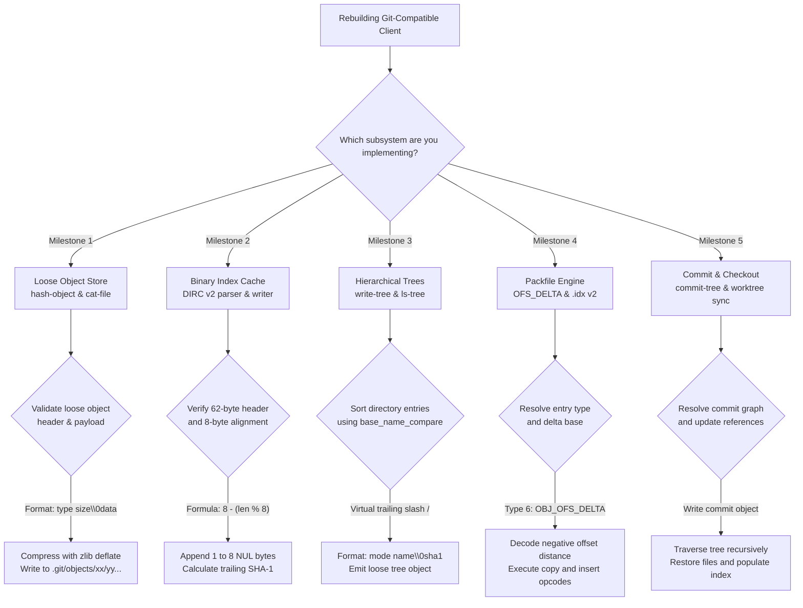

# Rebuild Lab: Implementing a Mini Git in Python and Rust

> [!summary] Scope
> Owns the pedagogical specification, architecture, and step-by-step milestones for rebuilding a functional, Git-compatible version control client.
> Reaches the Rebuild rung by guiding implementation of loose object writing and hashing, reading and modifying the binary index, traversing tree hierarchies, reading packfiles with OFS_DELTA inflation, and executing a basic commit and branch checkout.
> Synthesizes knowledge from the object model, index, and packfile concept notes into runnable code.

The foundational object model and content addressing are owned by [[Git-Object-Model-and-Content-Addressing]].
Binary index stat cache mechanics and change detection are owned by [[Git-Index-Stat-Cache-and-Fsmonitor]].
Packfile layout, sliding-window delta compression, and index v2 fanout tables are owned by [[Git-Packfiles-and-Delta-Compression]].
This playbook guides the from-scratch rebuild of a functional Git client in Python and Rust, written from Git's documented loose object, index v2, tree, and pack v2 formats.
The lab checks the Python writer against a byte-level parser in the test, against hand-built vectors, and against its own Python and Rust readers.
The lab never runs the `git` binary, so this note does not claim that `git fsck`, `git verify-pack`, or `git ls-files --debug` accept the generated files.

## Trigger and Symptoms

Activate this rebuild playbook when you must:

- Onboard senior systems engineers and toolchain architects to the exact binary wire and disk formats of Git.
- Build high-performance custom version control tooling, virtual filesystem drivers, or repository proxies without linking heavy third-party runtimes or C libraries.
- Diagnose and repair subtle repository corruption when native `git fsck`, `git index-pack`, or `git checkout` fails with cryptic parsing errors.
- Implement an embedded version control client for resource-constrained targets, secure enclaves, or WebAssembly environments where executing the full C Git CLI is impossible.
- Verify binary interoperability between distinct language ecosystems (Python and Rust) exchanging Git objects, index caches, and delta-compressed packfiles.

## Decision Tree



## Prerequisites

The rebuild runs on any standard Unix development environment (macOS or Linux).
No third-party packages or crates are required; all code relies strictly on standard libraries and system C libraries.

### Python Environment

- Python 3 with standard library modules only: `hashlib`, `zlib`, `struct`, `os`, `sys`, `stat`, `subprocess`.
  The lab was run with Python 3.15.2 on macOS arm64 `(as of 2026-11)`; no older interpreter was tried, so no minimum version is claimed.
- Verify with:

```bash
python3 -c "import hashlib, zlib, struct; print('Python CAS toolchain: OK')"
```

### Rust Environment

- Stable Rust toolchain (`rustc` and `cargo`) on PATH.
  The lab was run with rustc and cargo 1.99.0 `(as of 2026-11)`; no older toolchain was tried, so no minimum version is claimed.
  `run.sh` stops with `mini_git lab needs 'cargo' on PATH` when a tool is missing, because the STYLE `requires:` tokens cannot express a Rust toolchain and the lab therefore cannot be skipped.
- System `libz` dynamic library (standard on macOS and Linux).
- Verify with:

```bash
cargo --version && rustc --version
```

## Commands and Numbers to Know

| Constant or Field | Value `(as of 2026-11)` | Target Platform | Why It Matters |
| :--- | :--- | :--- | :--- |
| Index Magic Signature | `DIRC` (`0x44495243`) | Both | First 4 bytes of `.git/index` identifying Directory Cache. |
| Supported Index Version | `2` (`0x00000002`) | Both | Standard portable binary index format implemented by Mini Git. |
| Index Entry Header Size | 62 bytes | Both | Fixed stat cache metadata preceding the variable path string. |
| Index Entry Alignment | 8 bytes | Both | Index v2 and v3 entries are padded with 1 to 8 NUL bytes to an 8-byte multiple; v4 drops this padding (gitformat-index). |
| Index Trailer Size | 20 bytes (SHA-1) | Both | Trailing checksum covering all preceding bytes of `.git/index`. |
| Packfile Magic Signature | `PACK` (`0x5041434b`) | Both | First 4 bytes of `.pack` file. |
| Pack Index v2 Magic | `\xfftOc` (`0xff744f63`) | Both | First 4 bytes of `.idx` v2 file. |
| Packfile Header Length | 12 bytes | Both | 4-byte magic, 4-byte version (2), 4-byte big-endian object count. |
| Fanout Table Entries | 256 entries (1024 B) | Both | First-level lookup table bounding binary search in `.idx` v2. |
| `OBJ_COMMIT` Type Code | `1` (`001b`) | Both | Commit object type in packfile header bits 6..4. |
| `OBJ_TREE` Type Code | `2` (`010b`) | Both | Tree object type in packfile header bits 6..4. |
| `OBJ_BLOB` Type Code | `3` (`011b`) | Both | Blob object type in packfile header bits 6..4. |
| `OBJ_OFS_DELTA` Type Code | `6` (`110b`) | Both | Delta entry referencing base via negative byte offset in pack. |
| Directory Mode in Tree | `040000` (`"40000"`) | Both | Octal mode written without leading zero in canonical tree entries. |
| Regular File Mode in Tree | `0100644` (`"100644"`) | Both | Octal mode for standard non-executable files. |
| Executable File Mode in Tree| `0100755` (`"100755"`) | Both | Octal mode for executable scripts and binaries. |
| Delta Copy Size for Zero | `0x10000` (65,536 B) | Both | `patch-delta.c` turns a decoded copy size of 0 into `0x10000`; `diff-delta.c` caps each copy at `0x10000`. |

## Step-by-Step Execution

Follow these six implementation milestones to build and verify Mini Git.

### Step 1: Content-Addressable Storage (CAS) and Loose Object Store

A Git repository stores every revision artifact as an immutable, content-addressed loose object under `.git/objects/xx/yy...`.
The object payload is formatted with an ASCII header containing the object type, a space, the decimal payload length, a NUL byte (`\x00`), and the raw data bytes:

```text
+------+---+-------------+------+----------------------+
| type |   | size_string | 0x00 | binary_payload_bytes |
+------+---+-------------+------+----------------------+
```

The object ID is the 40-character hexadecimal SHA-1 checksum of this combined header and payload.
The entire byte sequence is compressed using zlib deflate and written to disk.

Execute the Python CAS reference implementation:

```bash
python3 -c '
import hashlib, zlib, os

def hash_object(repo_dir, data, obj_type="blob", write=True):
    header = f"{obj_type} {len(data)}\x00".encode("utf-8")
    store = header + data
    sha = hashlib.sha1(store).hexdigest()
    if write:
        obj_dir = os.path.join(repo_dir, ".git", "objects", sha[:2])
        os.makedirs(obj_dir, exist_ok=True)
        with open(os.path.join(obj_dir, sha[2:]), "wb") as f:
            f.write(zlib.compress(store))
    return sha

os.makedirs(".git/objects", exist_ok=True)
oid = hash_object(".", b"hello world\n", "blob", True)
print(f"Computed OID: {oid}")
'
```

**Verification:**
Verify that the loose object file exists under `.git/objects/3b/18e512dba79e4c8300dd08aeb37f8e728b8dad`.
Read and inflate the object, verifying the header and body:

```bash
python3 -c '
import zlib
with open(".git/objects/3b/18e512dba79e4c8300dd08aeb37f8e728b8dad", "rb") as f:
    raw = zlib.decompress(f.read())
nul = raw.find(b"\x00")
print("Header:", raw[:nul].decode())
print("Body:", raw[nul+1:].decode().strip())
'
```

Expected output:

```text
Header: blob 12
Body: hello world
```

### Step 2: Binary Index Parsing and Serialization (Index v2)

The Git index (`.git/index`) acts as the staging area between the working tree and the object database.
The binary file consists of:
1. A 12-byte header: `DIRC` magic (4 bytes), big-endian version `2` (4 bytes), and entry count (4 bytes).
2. A sequence of cache entries sorted lexicographically by path name.
3. A 20-byte SHA-1 checksum trailer over all preceding bytes in the index.

Each cache entry begins with a 62-byte fixed header:
- `ctime` seconds and nanoseconds: 8 bytes (`>II`).
- `mtime` seconds and nanoseconds: 8 bytes (`>II`).
- `dev` and `ino`: 8 bytes (`>II`).
- `mode`: 4 bytes (`>I`).
- `uid` and `gid`: 8 bytes (`>II`).
- `file_size`: 4 bytes (`>I`).
- `sha1`: 20 bytes binary hash.
- `flags`: 2 bytes (`>H`), encoding assume-valid (bit 15), extended (bit 14), merge stage (bits 13..12), and path length (bits 11..0).

The path string follows immediately in UTF-8 bytes.
Crucially, Git enforces an 8-byte alignment rule: the entry must be terminated with 1 to 8 NUL bytes (`\x00`) so that the total entry size is a multiple of 8:

$$\text{padding\_len} = 8 - ((62 + \text{path\_len}) \pmod 8)$$

If $(62 + \text{path\_len}) \pmod 8 == 0$, exactly 8 NUL bytes are appended.
An index v2 or v3 entry is never padded with 0 NUL bytes; at least one NUL byte is mandatory to terminate the path string (gitformat-index: "1-8 nul bytes as necessary to pad the entry to a multiple of eight bytes while keeping the name NUL-terminated"; `read-cache.c` `align_padding_size`).
Index v4 drops this padding and prefix-compresses the path instead.

Execute the index serialization check:

```bash
python3 -c '
import struct, hashlib

path = b"hello.txt"
raw_len = 62 + len(path)
pad_len = 8 - (raw_len % 8)
print(f"Path: {path.decode()}, raw len: {raw_len}, padding: {pad_len}, total: {raw_len + pad_len}")
assert (raw_len + pad_len) % 8 == 0
'
```

**Verification:**
The script prints total length 72 bytes (a multiple of 8).

### Step 3: Hierarchical Tree Synthesis and Slash-Sort Ordering

A Git tree object represents a directory snapshot.
It contains an array of directory entries serialized without inter-entry padding:

```text
<mode_octal_no_leading_zero> <entry_name>\x00<20_bytes_binary_sha1>
```

For subdirectories, the mode is written as `"40000"`.
For regular files, the mode is `"100644"`.
For executable files, the mode is `"100755"`.

#### The Canonical Tree Sorting Invariant (`base_name_compare`)

In standard ASCII lexicographic ordering, punctuation characters sort before letters:
- `'-'` is ASCII 45
- `'.'` is ASCII 46
- `'/'` is ASCII 47
- `'0'` is ASCII 48

Git's `tree.c` implements `base_name_compare()`, which compares tree entries as if directory names had a trailing slash `'/'` appended to them.
Consider four entries: regular file `a-b`, regular file `a.c`, directory `a`, and regular file `a0`.
Standard string sorting orders them: `a`, `a-b`, `a.c`, `a0`.
Git canonical sorting orders them:
1. `a-b` (comparing index 1: `'-'` is 45 < `'/'` 47)
2. `a.c` (comparing index 1: `'.'` is 46 < `'/'` 47)
3. `a` (directory virtual name `a/`: `'/'` is 47)
4. `a0` (comparing index 1: `'0'` is 48 > `'/'` 47)

If a custom client sorts tree entries without virtual trailing slashes, `git fsck` reports `error in tree <oid>: treeNotSorted: not properly sorted` (`fsck.c` `FSCK_MSG_TREE_NOT_SORTED`, format string in `builtin/fsck.c`).

Execute the tree sorting verification:

```bash
python3 -c '
def base_name_key(name, mode):
    is_dir = (mode == 0o040000)
    return (name + "/") if is_dir else name

entries = [("a.c", 0o100644), ("a-b", 0o100644), ("a0", 0o100644), ("a", 0o040000)]
sorted_entries = sorted(entries, key=lambda x: base_name_key(x[0], x[1]))
print("Canonical Git Sort Order:")
for name, mode in sorted_entries:
    print(f"  {mode:06o} {name}")
assert [x[0] for x in sorted_entries] == ["a-b", "a.c", "a", "a0"]
'
```

**Verification:**
The script asserts successfully and prints `a-b`, `a.c`, `a`, `a0`.

### Step 4: Packfile Architecture and OFS_DELTA Reconstruction

A packfile bundles hundreds of thousands of objects into a single file with delta compression.
The `.pack` file consists of a 12-byte header (`PACK`, version 2, object count), a sequence of compressed entries, and a 20-byte SHA-1 checksum trailer.

#### Variable-Length Header Decoding

Each entry begins with a variable-length header encoding type and size:
- First byte: Bit 7 continuation flag, bits 6..4 object type (`OBJ_COMMIT`=1, `OBJ_TREE`=2, `OBJ_BLOB`=3, `OBJ_OFS_DELTA`=6), bits 3..0 lowest 4 bits of size.
- Continuation bytes: Bit 7 continuation flag, bits 6..0 next 7 bits of size (least significant group first).

#### OFS_DELTA Backwards Offset Encoding

For `OBJ_OFS_DELTA` (type 6), the entry header is followed by a variable-length negative offset pointing backwards to the base object:
```python
def decode_ofs_delta_offset(data, pos):
    c = data[pos]
    pos += 1
    offset = c & 0x7F
    while c & 0x80:
        c = data[pos]
        pos += 1
        offset = ((offset + 1) << 7) | (c & 0x7F)
    return offset, pos
```

The `+ 1` bias guarantees a unique, bijective encoding for every integer without wasting redundant representations.
The biased encoding is defined by `builtin/pack-objects.c` (`dheader[pos] = ofs & 127; while (ofs >>= 7) dheader[--pos] = 128 | (--ofs & 127);`) and by gitformat-pack: concatenate the low 7 bits of each byte, then for n >= 2 bytes add 2^7 + 2^14 + ... + 2^(7*(n-1)).
So 127 is `7f`, 128 is `80 00`, 16511 is `ff 7f`, and 16512 is `80 80 00`; the lab pins these four vectors for both the encoder and the decoder.
It also places a 200-byte filler blob between the first base and its delta, so that delta needs a two-byte offset, and gives the other two deltas a 64 KiB base, so they need three bytes; a decoder or encoder without the `+ 1` fails the lab.
The base object position in the packfile is:

$$\text{base\_entry\_offset} = \text{current\_entry\_offset} - \text{offset}$$

#### Delta Instruction Stream Execution

Inflating the delta bytes yields an instruction stream applied to the base object:
1. Two variable-length integers: base object size and target object size.
2. An array of instructions:
   - Copy Instruction (`opcode & 0x80 != 0`): Bits 0..3 flag presence of 1 to 4 offset bytes; bits 4..6 flag presence of 1 to 3 size bytes.
     If the size bits decode to zero, the length is exactly `0x10000` (65,536) bytes (`patch-delta.c`: `if (cp_size == 0) cp_size = 0x10000;`).
   - Insert Instruction (`opcode & 0x80 == 0`): The opcode itself is the byte count (1 to 127), followed immediately by literal data bytes.

### Step 5: Commit Graph and Working Tree Checkout

A commit object points to a root tree and zero or more parent commit hashes:

```text
tree 41261768fa21aefe3c0c8ae8511724b6cd1369cf
author Toolchain Engineer <engineer@example.com> 1700000000 +0000
committer Toolchain Engineer <engineer@example.com> 1700000000 +0000

Initial repository commit
```

The branch reference under `.git/refs/heads/main` stores the 40-character hexadecimal commit hash followed by a newline.
`.git/HEAD` stores a symbolic reference: `ref: refs/heads/main\n`.

Checking out a commit requires:
1. Reading the commit object and extracting the root `tree` hash.
2. Recursively walking tree objects, creating directories, and writing blob payloads to disk.
3. Applying file mode permissions (`chmod 0755` for executable blobs, `chmod 0644` for normal blobs).
4. Populating `.git/index` with the restored files and recording their `lstat()` timestamps to make the stat cache clean.

### Step 6: High-Performance Systems Engine in Rust

Compile and execute the native systems implementation in `code/02-Version-Control/mini_git/minigit_rs/`:

```bash
cd code/02-Version-Control/mini_git/minigit_rs
cargo build --release
```

The Rust binary links directly against system `libz` and parses index cache entries, tree objects, and packfile delta streams into owned `Vec` and `String` buffers; it allocates, so it is not zero-allocation.
It re-hashes every loose object it reads, recomputes each pack entry's CRC32 and compares it with the `.idx` CRC32 column, reads all six pack objects (not only one), requires tree entries in `base_name_compare` order, and applies the file mode on checkout into a fresh directory that it then checks.

## Worked Example: Mini Git Rebuild Lab

Run the comprehensive end-to-end verification harness across Python and Rust:

```bash
cd code && python3 -m _harness.verify 02-Version-Control/mini_git/
```

The output below was recorded directly on darwin-arm64:

```text
=== Step 1: Content-Addressable Storage (CAS) Loose Objects ===
Initialized repository in /TMP
Stored blob "hello world\n": oid=3b18e512dba79e4c8300dd08aeb37f8e728b8dad size=12
Loose object path exists: .git/objects/3b/18e512dba79e4c8300dd08aeb37f8e728b8dad
Read loose object: type=blob size=12 payload="hello world"
SHA-1 verification: PASS

=== Step 2: Binary Index Parsing and Serialization (Index v2) ===
Staged 4 files:
  [0] mode=100755 size=27 path=build.sh oid=2c58f20ad95a63f0e5ec38ecdbef604c7254c844
  [1] mode=100644 size=12 path=hello.txt oid=3b18e512dba79e4c8300dd08aeb37f8e728b8dad
  [2] mode=100644 size=39 path=src.txt oid=c5ef23603ee3e5ad82aa49fa9ce1d2bac02aee69
  [3] mode=100644 size=25 path=src/main.c oid=76e8197013aabca95639bb3d9e5de847b0c0a5fd
Serialized index: header=DIRC version=2 entries=4
Index 8-byte entry alignment: PASS (entry offsets: [12, 84, 156, 228, 308])
Index trailer SHA-1 checksum: PASS (corrupt trailer and corrupt body both rejected)
Index boundary: a 2-byte path (62 + 2 = 64) takes 8 NUL bytes, entry 72 bytes: PASS

=== Step 3: Hierarchical Tree Traversal and Slash-Sort Ordering ===
Testing canonical Git directory sorting (base_name_compare):
Input unsorted names: ['a.c', 'a-b', 'a0', 'a/']
Sorted tree entries (directories end with /):
  100644 blob a-b
  100644 blob a.c
  040000 tree a
  100644 blob a0
Tree sorting matches Git canonical order: PASS (the stored tree bytes list a-b, a.c, a, a0)
Built root tree: oid=41261768fa21aefe3c0c8ae8511724b6cd1369cf
Tree recursive traversal:
  100755 blob 2c58f20ad95a63f0e5ec38ecdbef604c7254c844 build.sh
  100644 blob 3b18e512dba79e4c8300dd08aeb37f8e728b8dad hello.txt
  100644 blob c5ef23603ee3e5ad82aa49fa9ce1d2bac02aee69 src.txt
  040000 tree f67bc41327fe605a56df4f06537f1f182637de86 src
  100644 blob 76e8197013aabca95639bb3d9e5de847b0c0a5fd src/main.c

=== Step 4: Packfile Decompression and OFS_DELTA Reconstruction ===
Created packfile with 6 objects (3 undeltified blobs, 3 OFS_DELTA blobs):
Packfile header: magic=PACK version=2 count=6
Base entry at pack offset 12: type=OBJ_BLOB size=61
Delta entry 1: type=OBJ_OFS_DELTA delta_size=33 ofs_bytes=2 base_offset=12
Applying delta instructions: copy 32B@0, insert 24B, copy 16B@45
Delta entry 2: type=OBJ_OFS_DELTA delta_size=13 ofs_bytes=3 ops: copy 65536B@0, insert 5B
Delta entry 3: type=OBJ_OFS_DELTA delta_size=15 ofs_bytes=3 ops: copy 291B@2587, insert 4B
Target reconstructed payload matches: PASS
Target reconstructed SHA-1 matches: PASS
Index v2 fanout table binary search: PASS
Packfile checksum and index checksum trailers: PASS (per-entry CRC32 and corrupt pack and index rejected)

=== Step 5: Commit Graph and Working Tree Checkout ===
Created initial commit: oid=c64c4e4804319672a1b7fdd3b01d6d7c44adecb8
HEAD points to: ref: refs/heads/main
refs/heads/main points to: c64c4e4804319672a1b7fdd3b01d6d7c44adecb8
Executing checkout to clean working directory /TMP:
Restored files:
  build.sh (mode=100755)
  hello.txt (mode=100644)
  src.txt (mode=100644)
  src/main.c (mode=100644)
Restored file contents verified: PASS
Index stat cache initialized: PASS (entries match lstat of each restored file and survive an index round trip)

=== Step 6: Cross-Language Verification (Rust Engine) ===
Building and running Rust mini-git engine...
Rust cat-file verified loose blob: PASS
Rust index parser verified DIRC v2 alignment and trailer: PASS
Rust tree parser verified slash-sorted hierarchy: PASS
Rust packfile engine verified 6 objects (3 OFS_DELTA) with SHA-1 and CRC32 checks: PASS
Rust checkout verified working tree restore and modes: PASS
=== Rebuild Lab Verification Complete ===
```

Every PASS line above is printed after a check that fails when the mechanism is broken.
The index walk uses the closed form "next multiple of 8 above the unpadded length" and the path length from the flags field, not the writer's formula, and a sweep of 19 path lengths pins the boundary case (62 + 2 = 64 takes 8 NUL bytes).
The pack holds six objects: three stored whole, one delta with a two-byte OFS offset, and two deltas with three-byte offsets, one of which is a copy with no size bytes (0x10000 bytes) and one a copy with two offset bytes and two size bytes.
The line `Applying delta instructions` is decoded from the real delta bytes: copy 32 B at offset 0, insert 24 B, copy 16 B at offset 45, which sums to the 72-byte target.
The pack and index trailers, the per-entry CRC32 (recomputed in the test from the pack bytes), and a corrupted pack, index, and loose object are all rejected.
The empty blob (`e69de29bb2d1d6434b8b29ae775ad8c2e48c5391`), the empty tree (`4b825dc642cb6eb9a060e54bf8d69288fbee4904`), and `hello world\n` (`3b18e512...`) are pinned constants, cross-checked here with `shasum -a 1` on the `<type> <size>\0<data>` envelope.
The tree, commit, and pack object IDs beyond those constants come from the lab's own code, and the lab never runs `git`, so it does not prove acceptance by `git fsck`.
The recorded output for this note exists only for darwin-arm64.

## Rollback Procedure

If an implementation step produces an invalid repository state:

1. **Aborted Index Serialization:**
   Delete `.git/index` and recreate it from the previous valid tree object with `git read-tree <tree-oid>` (`write-tree` goes the other way, index to tree; `minigit.py` exposes only an `init` command, so in the lab call `checkout_tree` from Python).
2. **Corrupted Loose Object:**
   Remove the offending shard file under `.git/objects/xx/yy...` and recompute the blob hash from the source file.
3. **Mismatched Working Tree Checkout:**
   Wipe the destination checkout directory and re-execute checkout against the verified root commit object.
4. **Invalid Packfile Generation:**
   Delete `.git/objects/pack/pack-*.pack` and companion `.idx` files.
   Git falls back to loose object store automatically when packfiles are absent.
   This is safe only when every packed object also exists loose, as in this lab; in a real repository, deleting a pack deletes the only copy of its objects.

## Failure Modes of the Procedure

| Failure Mode | Root Cause | Observable Symptom | Recovery Runbook |
| :--- | :--- | :--- | :--- |
| `treeNotSorted: not properly sorted` | Tree entries sorted with standard ASCII `strcmp` instead of virtual slash `base_name_compare`. | `git fsck` or `minigit` rejects tree object with sorting error. | Reorder entries by appending `'/'` to directories before sorting; regenerate tree hashes. |
| `index file corrupt` | Cache entry padding calculation used `0..7` bytes instead of `1..8` bytes. | Index parser fails reading subsequent entries; trailer checksum mismatch. | Apply formula `pad_len = 8 - (raw_len % 8)`; ensure at least one NUL byte follows path. |
| Negative offset underflow in `OBJ_OFS_DELTA` | Variable-length offset decoded without `+ 1` continuation bias. | Pack parser jumps to wrong base offset; zlib returns `Z_DATA_ERROR`. | Implement biased offset decoding: `offset = ((offset + 1) << 7) \| (b & 0x7F)`. |
| Copy opcode memory fault | Copy instruction offset + size exceeds length of base object. | Delta engine panics with out-of-bounds slice access. | Add explicit bounds check before slicing base object; reject corrupt packfile. |
| Loose object header truncation | Missing NUL separator between `<type> <size>` header and object payload. | Decompressor parses raw payload as header text, failing with invalid integer. | Format header strictly with terminating `\x00` byte prior to zlib compression. |

> [!warning] Pitfalls:
> - **Assuming 0-byte padding in `.git/index`:** If `62 + len(path)` is an exact multiple of 8, developers often omit padding.
>   Git strictly requires 8 NUL bytes in this scenario so that the path is null-terminated.
> - **Ignoring endianness on multi-byte fields:** Index header and entry fields, the pack header, and the `.idx` fanout, CRC32, and offset tables use network byte order (big-endian); object IDs are raw bytes with no byte order.
>   Using host-endian `u32` casts corrupts data on little-endian architectures (x86-64 and arm64).
> - **Reconstructing deltas with entry header size:** The entry header in a packfile for `OBJ_OFS_DELTA` encodes the size of the *uncompressed delta data*, not the size of the reconstructed object (gitformat-pack: "For deltified objects, it is the size of the uncompressed delta").
>   Target object size is decoded from the first varint inside the decompressed delta payload.
> - **Non-atomic index updates:** Writing directly to `.git/index` without a temporary file (`.git/index.lock`) exposes concurrent readers to partially written, corrupt headers.

## At Scale

As repository scale expands from a single developer to enterprise monorepos:

- **Loose Object File Count:**
  Every loose object costs one file and one inode, so object lookups and directory scans degrade as loose objects accumulate.
  `git gc --auto` packs them once there are approximately more than `gc.auto` loose objects (default 6700, git-config `(as of 2026-11)`, Both).
  Large hosts keep pack counts bounded with geometric repacking (`git repack --geometric=<factor>`), which arranges packs so that each successive pack holds at least `<factor>` times the objects of the next-largest.
- **Index Serialization Bottlenecks:**
  An index v2 entry is 62 bytes plus the path plus 1 to 8 NUL bytes, so with 40-byte paths each entry takes 104 bytes and 5,000,000 tracked files give about 520 MB (arithmetic from the entry layout above; with 60-byte paths it is about 640 MB).
  Every command that reads the index reads that whole file and checks its trailer SHA-1, which is why the mitigations below exist; no timing is claimed here because none was measured.
  Mitigations include:
  1. `index.sparse=true` with cone-mode sparse checkout (`core.sparseCheckout` and `core.sparseCheckoutCone`): writes the index with sparse-directory entries, so directories outside the cone collapse to one entry each; it has no effect unless both settings are enabled (git-config).
  2. `core.splitIndex`: Splits index into a large immutable shared index and a tiny modifications file.
  3. `index.version 4`: Replaces full path strings with prefix-compressed paths, which git-update-index documents as reducing index size by 30%-50% on large repositories.
- **Packfile Delta Chains:**
  Deep delta chains reduce disk space but add CPU latency to random-access object reads; `pack.depth` defaults to 50 with a maximum of 4095 (git-config `(as of 2026-11)`, Both).
  git-pack-objects documents the trade-off: `--depth` limits the maximum delta depth, and making it too deep hurts the unpacker, because the delta data is applied that many times to reach the needed object (git-pack-objects and git-repack, `(as of 2026-11)`, Both).
  Lowering `pack.depth` is therefore the lever for read latency; this note gives no recommended value because no primary source names one.

> [!tip] Practice Drill:
> Complete [[Drill-Git-Detached-Rebase-and-Dangling-Tree-Recovery]] to practice manual object reconstruction and detached tree traversal using the plumbing concepts implemented in this lab.

## Interview Questions

> [!question] L5
> Why does `echo "hello world" | sha1sum` produce a completely different hash than `git hash-object` on the same string?
>
> > [!success]- Answer
> > Git does not hash raw file contents directly; it hashes an envelope header prepended to the data.
> > The envelope header format is `<type> <size>\0<content>`, where `<type>` is `blob`, `commit`, `tree`, or `tag`, `<size>` is the decimal byte count of the content, and `\0` is a null byte separator.
> > For `hello world\n` (12 bytes), `sha1sum` hashes 12 bytes (`22596363b3de40b06f981fb85d82312e8c0ed511`, checked with `shasum -a 1`), whereas Git hashes `blob 12\0hello world\n` (19 bytes), yielding `3b18e512dba79e4c8300dd08aeb37f8e728b8dad`.

> [!question] L5
> How does Git format padding between variable-length path names in Index v2, and why does an entry have between 1 and 8 NUL bytes instead of 0 to 7?
>
> > [!success]- Answer
> > Each index entry has a 62-byte fixed metadata struct followed by the path string.
> > Git enforces an 8-byte alignment rule relative to the beginning of the entry.
> > In addition, the path string must be null-terminated.
> > If Git used 0 to 7 padding bytes, a path whose length satisfies `(62 + len) % 8 == 0` would receive 0 padding bytes, leaving the path without a terminating NUL byte.
> > Therefore, Git adds between 1 and 8 NUL bytes: `pad_len = 8 - ((62 + len) % 8)`.
> > If the entry is already a multiple of 8, a full 8-byte padding block of NUL bytes is appended.

> [!question] L6: Predict-the-output
> A repository contains files `a-b`, `a.c`, `a0` and a directory `a` containing `file.txt`.
> What is the exact sort order of these four entries inside the root Git tree object?
>
> > [!success]- Answer
> > The exact sort order is:
> > 1. `100644 blob ... a-b`
> > 2. `100644 blob ... a.c`
> > 3. `040000 tree ... a`
> > 4. `100644 blob ... a0`
> >
> > Git implements `base_name_compare()`, which compares tree entries as if directory names had a trailing slash `'/'` appended.
> > The ASCII values at index 1 are:
> > - `'-'` is ASCII 45
> > - `'.'` is ASCII 46
> > - `'/'` (virtual trailing slash for directory `a`) is ASCII 47
> > - `'0'` is ASCII 48
> > Standard lexical sorting without the slash would sort directory `a` first; Git's canonical sort orders `a-b` and `a.c` before directory `a`, and `a0` after directory `a`.

> [!question] L6: Debug-this
> A developer implemented a custom Git index writer.
> Running `git status` against the generated repository fails with:
> `fatal: index file corrupt`
> The binary header reads: `44 49 52 43 00 00 00 02 00 00 00 01`.
> The single entry has path `test.txt` (8 bytes), followed by 2 null bytes, followed by a valid 20-byte SHA-1 hash.
> Why did Git reject the file?
>
> > [!success]- Answer
> > The framing shown is correct, so the padding is not the bug.
> > The fixed entry header is 62 bytes.
> > With `test.txt` (8 bytes), the unpadded length is `62 + 8 = 70` bytes.
> > To reach the next 8-byte boundary (72 bytes), the required padding is `8 - (70 % 8) = 2` bytes, which is exactly what was written.
> > Padding is measured from the start of the entry (offset 12, after the 12-byte `DIRC` header), and 72 is a multiple of 8, so the 20-byte trailer correctly starts at offset 84 (`12 + 72`) and the file is 104 bytes.
> > The remaining suspects are the trailer and the flags.
> > If the trailer is not the SHA-1 of bytes 0 to 83, `verify_hdr()` in `read-cache.c` reports `bad index file sha1 signature` and the reader dies with `index file corrupt`.
> > If the flags field sets the extended bit (bit 14), the reader does not check the version: it reads 2 more flag bytes and computes the entry size from them, which misaligns the entry and dies with `unknown index entry format` when those bytes carry unknown bits; gitformat-index says the bit must be zero in version 2.
> > Check the trailer first: it is the only field that the shown bytes do not already rule out.

> [!question] L6
> In Git packfiles, what is the architectural difference between `OBJ_REF_DELTA` (type 7) and `OBJ_OFS_DELTA` (type 6), and why does Git prefer `OBJ_OFS_DELTA`?
>
> > [!success]- Answer
> > `OBJ_REF_DELTA` identifies its base object by embedding the full 20-byte (SHA-1) or 32-byte (SHA-256) object hash.
> > Locating the base requires an index binary search, and storing the hash costs 20-32 bytes per delta.
> > `OBJ_OFS_DELTA` identifies its base by embedding a variable-length negative byte offset measured backwards from the delta entry header to the base entry header inside the same packfile.
> > The negative offset typically fits in 1 to 4 bytes, saving 16 to 28 bytes per delta across millions of objects.
> > Furthermore, decompressing an `OBJ_OFS_DELTA` requires zero index lookups: the decompressor simply seeks backwards in the packfile buffer, improving locality and decompression throughput.

> [!question] L7
> How does Git delta decompression handle a Copy opcode whose size field decodes to zero, and why was this designed?
>
> > [!success]- Answer
> > In Git's delta instruction format, bit 7 of the opcode indicates a Copy instruction (`1xxxxxxx`).
> > Bits 4..6 indicate which of the three size bytes (`size1`, `size2`, `size3`) are present.
> > If all three size bits are zero, or if the decoded integer evaluates to zero, `patch-delta.c` explicitly interprets the size as `0x10000` (65,536 bytes).
> > The decoder accepts up to three size bytes, so `0x10000` could also be written as `size3 = 0x01`.
> > The encoder never does that: `diff-delta.c` caps each copy at `0x10000` bytes and emits only the low two size bytes (`0x10`, `0x20`), so a full 64 KiB copy is emitted with no size bytes at all.
> > Mapping size `0` to `65,536` bytes makes that 16-bit encoder able to express its largest copy and saves a byte per maximal copy.

> [!question] L7
> In a monorepo with 10 million files, running `git status` takes 18 seconds even when no files are modified.
> How does Mini Git's index stat cache prevent full content rehashing, and why does stat-cache checking break across network filesystems (NFS)?
>
> > [!success]- Answer
> > Mini Git only writes the stat fields at checkout; it implements no `status`, so this answer describes Git.
> > Git avoids reading blob data by comparing cached file stat metadata in `.git/index` against `lstat()` values from the filesystem: `mtime`, `ctime` (when `core.trustCtime` is set), `uid`, `gid`, `ino`, file size, and `dev` only if Git was built with `USE_STDEV` (`statinfo.c` `match_stat_data`).
> > If they match, Git treats the file as unchanged without hashing it, except for racily clean entries whose mtime is not older than the index file, which Git re-checks by content.
> > Across NFS or network mounts, stat caching breaks because:
> > 1. Clock skew between NFS client and server causes `mtime` discrepancies or timestamp quantization (1-second granularity vs nanosecond timestamps).
> > 2. Inode numbers (`ino`) and device IDs (`dev`) fluctuate dynamically across NFS mount reconnects or container restarts.
> > 3. A stat mismatch forces Git to mark the entry "stat-dirty" and read the entire file from network storage to recompute SHA-1.
> > Remediation includes enabling `core.checkStat = minimal` (drops sub-second mtime and ctime, uid, gid, ino, and dev, leaving whole-second mtime, ctime if `core.trustCtime`, and file size; git-config), using `fsmonitor` daemons, or mounting monorepos via virtual filesystems (EdenFS or VFS for Git).

> [!question] L8+
> Design a custom high-concurrency Git object store that serves read/write traffic for 50,000 developers while eliminating loose object locking contention and packfile repacking pauses.
>
> > [!success]- Answer
> > Architecture:
> > 1. **Storage Tiering:** Shard incoming writes into an immutable, append-only log structured storage engine (e.g., RocksDB or distributed NVMe key-value store) keyed by 20-byte binary object ID, bypassing POSIX directory inode limits.
> > 2. **Delta Indexing:** Incoming push batches are written as immutable mini-packs with companion `.idx` and `.rev` (reverse index) files.
> > 3. **Incremental Compaction:** Replace full `git gc` repacks with geometric repacking (`git repack --geometric=2`), which rolls up only the small packs needed so that each successive pack holds at least twice the objects of the next-largest, keeping repack cost proportional to new data.
> > 4. **Batched Ref Updates:** Replace flat `.git/refs/` files with the reftable format (Git technical documentation `reftable`), which stores refs in sorted, prefix-compressed blocks and commits updates by appending a table; writers still serialize on one `tables.list.lock`, so this trades per-ref lock files for a single short lock rather than removing locking.

## Further Reading

- Git Contributors, gitformat-index(5), https://git-scm.com/docs/gitformat-index.
  Authoritative specification of binary index format versions 2, 3, and 4, cache entry headers, and extension blocks.
- Git Contributors, gitformat-pack(5), https://git-scm.com/docs/gitformat-pack.
  Specification of the packfile v2 container format, OFS_DELTA encoding, and companion index v2 layout.
- Git Contributors, read-cache.c, https://github.com/git/git/blob/master/read-cache.c.
  Git source implementation of index parsing, 8-byte entry alignment, and stat cache verification.
- Git Contributors, tree.c and tree-walk.c, https://github.com/git/git/blob/master/tree.c.
  Reference implementation of `base_name_compare()` and canonical tree sorting.
- Nicolas Pitre, patch-delta.c, https://github.com/git/git/blob/master/patch-delta.c.
  The core delta decompression virtual machine executing Copy and Insert instructions.
- Scott Chacon and Ben Straub, Pro Git, Chapter 10: Git Internals, https://git-scm.com/book/en/v2/Git-Internals-Plumbing-and-Porcelain.
  Comprehensive overview of Git plumbing commands, object hashing, and index manipulation.
- IETF, RFC 1951: DEFLATE Compressed Data Format Specification, https://datatracker.ietf.org/doc/html/rfc1951.
  The underlying compression standard used by Git loose objects and packfile streams.

## Related

- Prerequisites: [[Git-Object-Model-and-Content-Addressing]], [[Git-Index-Stat-Cache-and-Fsmonitor]], [[Git-Packfiles-and-Delta-Compression]]
- Next: [[Drill-Git-Detached-Rebase-and-Dangling-Tree-Recovery]]
- See also: [[Git-Revision-Selection-and-Graph-Walks]], [[Git-Trace2-Telemetry-and-Diagnostics]], [[Repair-a-Corrupted-Git-Repository]], [[Git-GC-Maintenance-MIDX-and-Commit-Graph]]
- Lab: `code/02-Version-Control/mini_git/`
