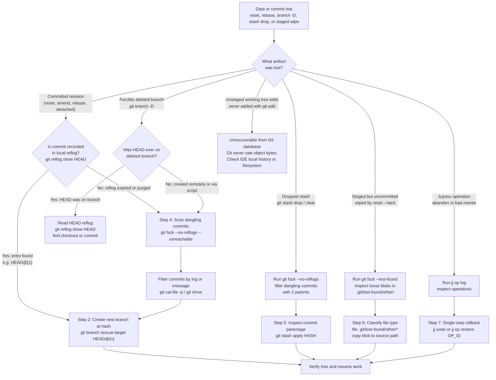
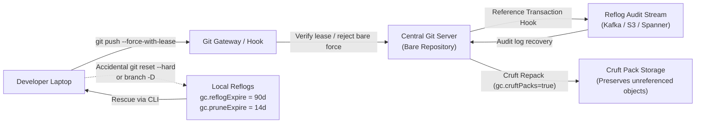

# Playbook: Recover Lost Git Work and Dangling Commits

> [!summary] Claim:
> Git almost never deletes committed or staged data immediately; mutations merely update reference pointers or unstage trees, leaving the underlying object graph intact on disk until explicit garbage collection.
> Commits orphaned by hard resets, failed rebases, deleted branches, or detached HEAD navigation remain fully recorded in local reflogs for at least 30 days by default.
> Dropped stashes and uncommitted files that were staged with git add exist as unreferenced objects recoverable via git fsck --lost-found or git cat-file.
> In modern operations using Jujutsu, an append-only operation log tracks every repository mutation and working copy snapshot, enabling single-command recovery via jj undo or jj op restore.

The internal storage layout of blobs, trees, and commit objects is owned by [[Git-Object-Model-and-Content-Addressing]].
Reference storage, reflog file layout, and reftable blocks are owned by [[Git-Refs-Reflog-and-Reftable]].
Packfile generation, reachability bitmaps, and geometric repacking are owned by [[Git-GC-Maintenance-MIDX-and-Commit-Graph]].
Physical file corruption and truncated object recovery are owned by [[Repair-a-Corrupted-Git-Repository]].
This playbook owns emergency operational procedures for locating and restoring orphaned source code, lost commits, wiped stashes, and detached branches.

## Trigger and Symptoms

Activate this playbook when source code or revision history has disappeared following a destructive or unexpected Git command.

- An accidental `git reset --hard <target>` moved the active branch pointer backward and wiped working tree changes.
- A `git rebase --abort` or botched interactive rebase discarded intermediate conflict resolutions or newly committed rebase steps.
- A feature branch was forcibly deleted via `git branch -D <name>`, destroying the local ref pointer and its dedicated branch reflog file.
- A developer committed work while in a detached HEAD state (`HEAD detached at <hash>`) and switched to another branch (`git checkout main`), leaving commits detached from any named branch or tag reference.
- A developer executed `git stash drop` or `git stash pop` on an important stash, or ran `git stash clear`.
- A commit was overwritten by `git commit --amend`, and the pre-amend commit tree or message is required.
- Staged work (`git add`) was wiped from the working tree and index by `git reset --hard` before being committed.
- In a repository managed with Jujutsu (`jj`), a change was accidentally abandoned via `jj abandon` or rewritten unintentionally.

## Decision Tree



## Prerequisites

Do all recovery operations inside the local repository before running any maintenance or cleanup tools.
Treat the existing `.git/` folder as a critical preservation zone: halt all background processes that perform pruning or repacking.

```bash
command -v git awk grep file
```

Permissions and configuration checks:
- Write access to the repository `.git/` directory.
- Verify that reflog logging was active prior to the incident: `git config core.logAllRefUpdates` (defaults to `true` in all non-bare repositories).
- Free disk space on the local filesystem: running `git fsck --lost-found` writes loose files into `.git/lost-found/` and requires enough disk space to hold decompressed blobs.
- Critical safety rule: immediately stop all background maintenance jobs, scheduled cron tasks, or IDE auto-fetch routines that invoke `git gc`, `git prune`, or `git maintenance run`.

**Verification:**

```bash
git config --get core.logAllRefUpdates || echo "unset (default: true in a non-bare repository, false in a bare one)"
git rev-parse --is-inside-work-tree
```

The commands must output `true` (or the `unset` message in a non-bare repository) and `true`.

## Commands and Numbers to Know

| Parameter or Command | Platform | Value `(as of 2026-11)` | Operational Meaning and Consequence |
| :--- | :--- | :--- | :--- |
| `gc.reflogExpire` | Both | `90 days` | Default expiration period for reflog entries reachable from the current tip of any reference. |
| `gc.reflogExpireUnreachable` | Both | `30 days` | Default expiration period for reflog entries no longer reachable from any current reference tip. |
| `gc.pruneExpire` | Both | `2.weeks.ago` | Grace period for loose unreachable objects before `git gc` or `git prune` unlinks them from disk. |
| `gc.cruftPacks` | Both | `true` | Default since Git 2.41.0 (2.41.0 release notes); unreachable objects are packed into `.mtimes` cruft packs instead of remaining loose. |
| `core.logAllRefUpdates` | Both | `true` (non-bare) / `false` (bare) | Controls whether Git appends reference transition logs to `$GIT_DIR/logs/<ref>`. |
| `gc.worktreePruneExpire` | Both | `3.months.ago` | Expiration window for stale linked working tree administrative files in `.git/worktrees/`. |
| `git fsck` reachability roots | Both | Index, `refs/*`, and all reflogs | Default reachability trace treats reflog entries as roots, hiding unreachable commits from dangling lists. |
| `git fsck --no-reflogs` | Both | Command flag | Disables reflog heads, surfacing all commits that have dropped out of active branch tips. |
| `git fsck --lost-found` | Both | Command flag | Writes dangling commits to `.git/lost-found/commit/` and extracts raw blob contents to `.git/lost-found/other/`; it also implies `--no-reflogs` (`builtin/fsck.c` sets `include_reflogs = 0`). |
| Stash commit parents | Both | `2` (normal) or `3` (`-u`) | Parent 1 is HEAD commit; Parent 2 is index tree commit; Parent 3 is untracked files tree commit. |
| `ORIG_HEAD` | Both | Reference file | Set by `am`, `reset`, `merge`, and `rebase` (gitrevisions(7)) to record the previous tip of HEAD before drastic movement. |

## Step-by-Step Execution

Each step ends with a concrete check.
Do not proceed to subsequent steps until the check passes.

### Step 1: Halt repository garbage collection and freeze maintenance

Before running diagnostic walks, prevent background daemons or IDE hooks from pruning unreachable objects.

```bash
git config gc.auto 0
git config maintenance.auto 0
```

Setting `gc.auto 0` disables the automatic invocation of `git gc --auto` upon commands like `git merge`, `git commit`, or `git rebase`.
This preserves all loose objects, expired reflog targets, and cruft packfiles in `.git/objects/`.

**Verification:**

```bash
git config gc.auto
```

The output must be `0`.

### Step 2: Recover commits lost to hard reset, rebase, or amend via reflog

When a branch pointer is moved backward via `git reset --hard` or rewritten via `git commit --amend`, Git does not delete the prior commit.
It appends an entry to `.git/logs/HEAD` and `.git/logs/refs/heads/<branch>`.

```bash
git reflog show HEAD -n 25
```

Examine the reflog entries.
Each line has the format:
`<short-hash> HEAD@{<n>}: <action>: <message>`
Adding `--date=iso` replaces the index with a timestamp, printing `HEAD@{2026-11-07 23:14:36 -0500}` instead of `HEAD@{1}` (checked on Git 2.55.0, macOS); use it to correlate times, then switch back to the numbered form to pick a selector.

Common action patterns to search for:
- `reset: moving to HEAD~1` (the commit immediately preceding it at `HEAD@{1}` is your lost commit).
- `rebase (finish): returning to refs/heads/<branch>` (the pre-rebase commit tip is preserved in the branch reflog as `<branch>@{1}`).
- `commit (amend):` (the pre-amend commit object is at `HEAD@{1}`).

To recover the commit and all its history, attach a new branch reference directly to that reflog selector:

```bash
LOST_COMMIT="HEAD@{1}"
git branch rescue-commit "${LOST_COMMIT}"
git log -1 --stat rescue-commit
```

**Verification:**

```bash
git rev-parse --verify rescue-commit
git show -s --format="%h %s" rescue-commit
```

The command prints the expected commit hash and original commit subject line.

### Step 3: Recover branches deleted via `git branch -D`

When `git branch -D feature` is executed, Git deletes `.git/refs/heads/feature` and its reflog `.git/logs/refs/heads/feature`.
However, if HEAD was checked out on that branch at any point, `.git/logs/HEAD` still contains the record of all commits created while on that branch.

```bash
git reflog show HEAD -n 50 | grep -E 'commit|checkout' | head -n 10
```

Find the last commit made on the deleted branch.
If the commit hash was `8c5f571`, recreate the branch pointer instantly:

```bash
RECOVERED_HASH="8c5f571"
git branch feature "${RECOVERED_HASH}"
```

If HEAD was never checked out on that branch (for example, the branch was created via `git branch feature <start>` and never visited), proceed to Step 4.

**Verification:**

```bash
git branch --list feature
git log -1 --oneline feature
```

The deleted branch reappears in the local branch list pointing to the salvaged commit.

### Step 4: Scan for orphaned commits using `git fsck --no-reflogs`

If a commit is not present in any reflog (because reflogs were expired, disabled, or purged), use `git fsck` with `--no-reflogs`.
By default, plain `git fsck` treats all reflog entries as reachability roots, which conceals orphaned commits.
Passing `--no-reflogs` instructs the object graph traversal to ignore reflogs, identifying all commits that are not reachable from current branch tips or tags.

```bash
git fsck --no-reflogs --unreachable | grep commit | awk '{print $3}' > /tmp/dangling_commits.txt
while read -r hash; do
    git log -1 --format="%h %ci %an: %s" "${hash}" 2>/dev/null
done < /tmp/dangling_commits.txt | sort -k2,3
```

Locate the lost commit by inspection of the commit date, author, and subject.
Once identified, re-anchor it to a branch:

```bash
git branch rescue-orphaned-commit <chosen-hash>
```

**Verification:**

```bash
git log -1 --format="%h %s" rescue-orphaned-commit
```

The orphaned commit is re-attached to the active revision graph.

### Step 5: Locate and reapply dropped or popped stashes

A stash in Git is not a diff file.
It is an unreferenced commit object containing a multi-parent tree structure.
A standard stash commit has two parents:
- Parent 1 (`<stash>^1`): the commit on HEAD when the stash was created.
- Parent 2 (`<stash>^2`): a commit representing the staged index state at stash time.
If `git stash push -u` (or `--all`) was used, it contains a third parent (`<stash>^3`) holding untracked files.

When `git stash drop` or `git stash clear` is executed, Git updates or deletes `refs/stash`.
The stash commit object and its subtrees remain in the object store (loose, or in a pack if a repack already ran) until pruned; git-stash(1) documents the same `git fsck --unreachable` recovery recipe.
Dropping an entry also removes it from the stash reflog, so plain `git fsck` already lists the commit as dangling (checked on Git 2.55.0, macOS); `--no-reflogs` is kept in the pipeline so one command serves every scenario in this playbook.

```bash
git fsck --no-reflogs 2>/dev/null | grep 'dangling commit' | awk '{print $3}' | while read -r hash; do
    parents=$(git rev-list --parents -n 1 "${hash}" | awk '{print NF - 1}')
    if [ "${parents}" -ge 2 ]; then
        msg=$(git log -1 --format="%s" "${hash}")
        echo "${hash} (parents: ${parents}): ${msg}"
    fi
done
```

The output surfaces dropped stash commits, displaying subjects like `WIP on main: ...` or custom stash names.
Inspect the diff of the identified stash candidate:

```bash
STASH_HASH="8aacdc4b4eaf15ac6dff0f0954799c2af531fc47"
git stash show -p "${STASH_HASH}"
```

Reapply the stash directly without recreating `refs/stash`; `--index` also reinstates the staged state:

```bash
git stash apply --index "${STASH_HASH}"
```

Without `--index`, staged modifications to tracked files come back unstaged and only newly added files stay staged (checked on Git 2.55.0, macOS).

**Verification:**

```bash
git status --short
```

The modified and staged files from the dropped stash reappear in the working tree and index.

### Step 6: Salvage uncommitted files staged prior to hard reset

If a developer staged new or modified files with `git add`, Git created loose blob objects in `.git/objects/`.
If the developer subsequently ran `git reset --hard HEAD` without committing, the working tree files and index entries were deleted, but the loose blob objects were left intact in `.git/objects/`.

Use `git fsck --lost-found` to write all dangling objects, loose or packed, to `.git/lost-found/`.
Blobs are unpacked directly into `.git/lost-found/other/`:

```bash
git fsck --lost-found
ls -l .git/lost-found/other/
```

Identify the salvaged file by content or file type:

```bash
file .git/lost-found/other/*
grep -rn "Critical lock-free queue hotfix" .git/lost-found/other/
```

Once the hash matching the lost file is identified, copy it back into the working tree:

```bash
SALVAGED_BLOB=".git/lost-found/other/5e2007dd8b025e38759a2c7f49e0ac6aa7a5f8cd"
cp "${SALVAGED_BLOB}" src/hotfix_core.c
```

**Verification:**

```bash
head -n 5 src/hotfix_core.c
git status
```

The lost uncommitted code is restored to the working directory.

### Step 7: Recover lost states in Jujutsu (`jj`) repositories

In repositories using Jujutsu on top of Git, every mutation (including working-copy edits, rebases, and branch modifications) is recorded in an append-only operation log.
Jujutsu working copies are always live commits, meaning work is never truly uncommitted.

Inspect the operation log:

```bash
jj op log -n 10
```

Each entry displays:
- Operation ID (e.g. `de351e740bf7`).
- User and timestamp.
- The command and arguments that executed the operation (e.g. `args: jj abandon`).

To preview the repository differences between two operations before rolling back:

```bash
jj op diff --from <prior-op-id> --to @
```

To roll back the immediate last operation:

```bash
jj undo
```

To restore the repository state to any arbitrary historical operation:

```bash
jj op restore <prior-op-id>
```

**Verification:**

```bash
jj status
jj log -r @
```

Jujutsu restores the exact working-copy tree and commit topology that existed at that operation.

## Worked Example: Lost Work Recovery Lab

The lab in `code/02-Version-Control/lost_work_recovery/` exercises all four recovery scenarios against a clean Git repository.

1. `run.sh` initializes an isolated repository with `git init --object-format=sha1 -b main -q`.
   It sets pinned author, committer, and timestamp variables to enforce deterministic SHA-1 hashes.
2. In Scenario 1, it creates two commits, executes `git reset --hard HEAD~1`, and asserts that no branch contains the reset commit.
   Plain `git fsck` reports 0 dangling objects because the commit is preserved in the `HEAD` and `main` reflogs, and `git fsck --no-reflogs` reports exactly that commit as dangling.
   It reads the reflog action and `HEAD@{1}` back from Git and rescues the commit with `git branch recovered-feature HEAD@{1}`.
3. In Scenario 2, it creates an uncommitted C source file `hotfix_core.c`, stages it with `git add`, and wipes it with `git reset --hard HEAD`.
   It checks that the blob is in the object store but not in the index, runs `git fsck --lost-found`, finds the dangling blob in `.git/lost-found/other/`, and restores a file identical to the original.
4. In Scenario 3, it leaves one staged and one unstaged edit to `base.txt` plus a staged new file, pushes a stash, and drops it.
   It uses `git fsck --no-reflogs` to list dangling commits, selects the stash by its subject, confirms it has 2 parents (parent 1 is `HEAD`, parent 2 is the `index on main:` commit), and restores the changes with `git stash apply --index`.
   It then asserts that the staged edit is back in the index and the unstaged edit is back in the working tree only.
   A second stash made with `git stash push -u` shows 3 parents, and its third parent holds the untracked file.
5. In Scenario 4, it checks out a detached HEAD, commits experimental work, and switches back to `main`.
   It asserts that no branch contains the detached commit, reads the reflog action back from Git, retrieves the commit from `HEAD@{1}`, and binds it to `rescued-experiment`.
6. Every printed claim is read back from Git and asserted.
   A failed assertion aborts the lab with a nonzero exit status, and a `PASS` line in the summary is printed only after all assertions of its scenario succeeded.

### Verified output

Recorded on darwin-arm64 with Git 2.55.0 (as of 2026-11); the file is `code/02-Version-Control/lost_work_recovery/expected/darwin-arm64.txt`.

```text
=== Step 1: Recover Commit Lost via Hard Reset (Reflog Walk) ===
Initial commit created: ddc7d59 Initial commit
Target commit created: 55e3859 Critical feature patch
Executed: git reset --hard HEAD~1
Default git fsck reports dangling objects: 0
git fsck --no-reflogs reports dangling commit: 55e3859
Reflog scan: HEAD@{1} points to 55e3859 (action: reset: moving to HEAD~1)
Recovery command: git branch recovered-feature HEAD@{1}
Verification: commit recovered-feature is 55e3859 Critical feature patch
Content verification: feature.txt recovered with 'Critical kernel patch'

=== Step 2: Recover Staged Uncommitted Work (Dangling Blob Rescue) ===
Created uncommitted source: hotfix_core.c
Staged file: git add hotfix_core.c (blob hash: 5e2007dd8b025e38759a2c7f49e0ac6aa7a5f8cd)
Executed: git reset --hard HEAD
Working tree check: hotfix_core.c removed from filesystem
Executed: git fsck --lost-found
Found in .git/lost-found/other/: 5e2007dd8b025e38759a2c7f49e0ac6aa7a5f8cd
Blob content inspected: // Critical lock-free queue hotfix
Recovery command: cp .git/lost-found/other/5e2007dd8b025e38759a2c7f49e0ac6aa7a5f8cd hotfix_core.c
Content verification: recovered hotfix_core.c matches staged source

=== Step 3: Recover Dropped Stash (Multi-Parent Tree Re-Application) ===
Created dirty working tree and staged index changes
Executed: git stash push -m "WIP: uncommitted queue refactor"
Executed: git stash drop
Active stashes in repository: 0
Executed: git fsck --no-reflogs
Identified dangling stash commit: 8aacdc4b4eaf15ac6dff0f0954799c2af531fc47
Commit parents: 2 (parent 1 is HEAD, parent 2 subject starts with 'index on main:')
Recovery command: git stash apply --index 8aacdc4b4eaf15ac6dff0f0954799c2af531fc47
Verification: index staged (base.txt, staged_patch.txt) and working tree modified (base.txt)
Stash with -u: 3 parents (parent 3 holds untracked_notes.txt)

=== Step 4: Recover Detached HEAD Commits (Reflog Pointer Re-Attachment) ===
Checked out detached HEAD
Created experimental commit: 83ce111 Detached experimental work
Checked out branch main: HEAD moved away from detached commit
Reflog scan: HEAD@{1} points to 83ce111 (action: checkout: moving from 83ce11180581095e4e855bf473b38a51218e9ed9 to main)
Recovery command: git branch rescued-experiment HEAD@{1}
Verification: commit rescued-experiment is 83ce111 Detached experimental work

=== Summary: Recovery Playbook Scenarios Verified ===
Scenario 1 (Hard Reset Commit): PASS
Scenario 2 (Staged Uncommitted Blob): PASS
Scenario 3 (Dropped Stash Commit): PASS
Scenario 4 (Detached HEAD Commits): PASS
```

## Rollback Procedure

Executing recovery procedures creates temporary branches, staging artifacts, and files in `.git/lost-found/`.
Clean them up once verified work is integrated.

1. **Remove temporary rescue branches:** Once recovered commits are cherry-picked or merged into your primary branch, delete the rescue pointers:
   ```bash
   git branch -D rescue-commit rescue-orphaned-commit rescued-experiment recovered-feature
   ```
   **Check:** `git branch --list 'rescue*'` prints nothing.
2. **Clean up extracted lost-found files:** The `.git/lost-found/` directory contains duplicated unpacked files that consume local inode space:
   ```bash
   rm -rf .git/lost-found
   ```
   **Check:** `test ! -d .git/lost-found && echo "cleaned"` prints `cleaned`.
3. **Restore automatic garbage collection:** If auto-gc was disabled in Step 1, revert the configuration override:
   ```bash
   git config --unset gc.auto
   git config --unset maintenance.auto
   ```
   **Check:** `git config --get gc.auto` returns exit status 1.
4. **Undo an erroneous stash application:** If `git stash apply <hash>` was applied to the wrong branch or created messy merge conflicts:
   ```bash
   git reset --hard HEAD
   git clean -fd
   ```
   **Check:** `git status` reports working tree clean.

## Failure Modes of the Procedure

| Failure Mode | How It Shows Up | Root Cause | Recovery Procedure |
| :--- | :--- | :--- | :--- |
| Commit missing from reflog and fsck | `git reflog` has no entry; `git fsck --no-reflogs` lists 0 dangling commits | Expiration timer expired (`gc.reflogExpireUnreachable = 30 days`) and `git gc --prune=now` ran | Commit object was permanently purged from `.git/objects/`. Retrieve from remote tracking branch, teammate clone, or CI server workspace. |
| File was never staged | `git fsck --lost-found` creates no corresponding blob in `.git/lost-found/other/` | `git add` was never run; file only existed in filesystem page cache / working tree | Git never received object bytes. Recover from editor swap files (e.g. Vim `.swp`), IDE local history (VSCode/JetBrains), or filesystem snapshots. |
| Reflog empty in bare clone | `git reflog show HEAD` prints nothing and exits 0, and `$GIT_DIR/logs/` does not exist (Git 2.55.0, macOS) | `core.logAllRefUpdates` defaults to `false` in bare repositories | Bare repos do not create reflogs unless `core.logAllRefUpdates` is set to `true` (branches, remotes, notes, `HEAD`) or `always` (every ref under `refs/`). Run `git fsck --no-reflogs` to find dangling commit objects directly. |
| Dangling commits buried in cruft pack | `.git/objects/` has no loose objects (`git count-objects -v` reports `count: 0`), so a manual hunt through `.git/objects/??/` finds nothing | Objects are bundled inside a cruft pack (`.mtimes` file) created by `git gc` or `git repack --cruft` | `git fsck --no-reflogs` still reports packed dangling commits, and `git cat-file --batch-all-objects --batch-check` lists every object; `git rev-list --objects --all` does not, because it walks only reachable objects (all three checked on Git 2.55.0, macOS). |
| Dropped stash apply conflict | `git stash apply` fails with `error: Your local changes to the following files would be overwritten by merge` | Working tree has uncommitted edits colliding with stash tree | Run `git stash push` to store current edits under `refs/stash` (a bare `git stash create` only prints a hash and leaves the edits dangling), re-run `git stash apply <hash>`, then `git stash pop` and merge. |
| Future timestamps ignored | `git fsck` surfaces commit as dangling despite active reflog entry | Reflog entry timestamp is in the future relative to system clock | `fsck_handle_reflog_ent()` in `builtin/fsck.c` returns early when `timestamp > now`, with `now = time(NULL)`. Fix host clock or use explicit reflog selector `HEAD@{1}` directly. |

## Pitfalls

> [!warning] Running git gc --prune=now in panic
> When code appears missing, never run `git gc`, `git prune`, or `git repack -a -d`.
> These commands permanently unlink unreferenced loose objects and drop unreachable cruft.
> Always inspect reflogs and set `git config gc.auto 0` before attempting recovery.

> [!warning] Believing unstaged files can be recovered by Git
> Git is a content-addressable database of objects written to `.git/objects/`.
> If `git add` was never executed on a newly created file, its contents were never hashed or compressed into Git's object store.
> Running `git reset --hard` overwrites unstaged modifications to tracked files; it leaves never-added untracked files in place, and `git clean -fd` is what deletes those (checked on Git 2.55.0, macOS).
> In either case the lost bytes never reached the object store, so Git cannot help you; immediately search OS-level editor history or filesystem undo mechanisms.

> [!warning] Running plain git fsck without --no-reflogs
> Engineers frequently run `git fsck` and conclude their lost commit was deleted because the output is completely empty.
> Plain `git fsck` uses all entries in `$GIT_DIR/logs/` as reachability heads.
> Because the lost commit is still referenced by `HEAD@{1}`, `git fsck` considers it reachable and hides it from dangling output.
> Always pass `--no-reflogs` when hunting for commits disconnected from branch tips.

> [!warning] Re-stashing while in an unmerged state
> If you apply a recovered stash and hit conflict markers, running `git stash` again fails with `<path>: needs merge` and `error: could not write index`, so the reflex save attempt silently saves nothing.
> A conflicted `git stash apply` writes no `MERGE_HEAD`, so `git merge --abort` fails with `There is no merge to abort (MERGE_HEAD missing)`; resolve the paths or run `git reset --hard HEAD` before further stash operations (both checked on Git 2.55.0, macOS).
> The stash commit is unaffected by a failed apply, so the same hash can be re-applied afterwards.

> [!warning] Assuming bare mirrors retain local reflogs
> When a developer pushes an accidental force push (`git push --force`) to a central repository (GitHub, GitLab, Gerrit), a self-hosted bare repository keeps no reflog for it by default, because `core.logAllRefUpdates` defaults to `false` in bare repositories (core.adoc).
> This playbook makes no claim about whether a hosted forge keeps its own push history; check that forge's documentation before relying on it.
> A bare server repository will not save you unless `core.logAllRefUpdates` is enabled, or server-side audit logs or reference transaction hooks are configured.
> Recover the commit from the pushing developer's local `git reflog show <branch>` before their local repository prunes it.

## At Scale

In engineering fleets spanning 1,000 to 50,000 developers, even a very low per-developer rate of destructive-command mistakes produces lost-work incidents on a regular basis.
Tooling architecture must ensure accidental operations are instantly reversible and that server-side pushes cannot permanently erase history.



### Fleet reflog and garbage collection tuning

- Default Git configuration in corporate developer setups should enforce `core.logAllRefUpdates = always` in global templates.
  This ensures that even temporary or non-standard reference updates under `refs/` are logged to disk.
- Never set `gc.pruneExpire = now` in shared developer images or continuous integration pipelines.
  Keep `gc.pruneExpire = 2.weeks.ago` (the Git default) so that developers who accidentally unstage or reset work have a two-week window for recovery.
- Enable `gc.cruftPacks = true` fleet-wide.
  Cruft packs group unreachable objects together alongside `.mtimes` auxiliary files, avoiding hundreds of thousands of loose files that degrade filesystem inode operations on developer laptops.

### Server-side safety and force push prevention

- A bare repository on a central server has `core.logAllRefUpdates = false` unless an administrator sets it.
  If a developer force pushes with `git push --force` to such a repository, the orphaned commits have no reflog entry and can be pruned during server-side maintenance.
- Enforce `git push --force-with-lease` via client-side git config aliases and server-side pre-receive hooks.
  `--force-with-lease` refuses to overwrite the remote branch unless the remote ref matches the caller's expected commit, preventing blind clobbering of colleagues' work.
- Deploy reference transaction hooks (`reference-transaction` hook added in Git 2.28) on central Git servers.
  Every push mutation logs old and new object IDs to an external append-only log (such as Kafka, Cloud Storage, or an audit database).
  Even if a branch is deleted on the remote forge, the audit log records the exact SHA-1 / SHA-256 commit hash for instant reconstruction.

### Transitioning to change-based VCS (Jujutsu / Sapling)

- Traditional Git conflates the working directory state with untracked status, making unstaged files uniquely vulnerable to `git reset --hard` and `git clean -fd`.
- Systems like Jujutsu (`jj`) eliminate the distinction between committed and uncommitted states: every modification to a file in the workspace is snapshotted into the working-copy commit at the start of the next `jj` command, and that snapshot is itself an operation (`snapshot working copy` in `jj op log`, checked on jj 0.47.1).
- Large technology fleets migrating to Jujutsu or Sapling drastically reduce data loss incidents because commands like `jj undo` and `jj op restore` can reverse any sequence of rebases, branch deletions, or conflict resolutions across the entire enterprise workspace history.

## Practice Drill

> [!tip] Practice Drill: Rescue under pressure
> Reproduce the four disaster recovery scenarios on a local machine and restore lost work in under 5 minutes without consulting notes.
> 1. Initialize a scratch repo, commit two files, and execute `git reset --hard HEAD~1`.
>    Locate the reset commit using `git reflog show HEAD` and restore it to branch `rescue-1`.
> 2. Create `crucial_algo.c`, stage it with `git add`, and immediately execute `git reset --hard HEAD`.
>    Run `git fsck --lost-found`, inspect `.git/lost-found/other/`, and restore the exact source file.
> 3. Modify a file, run `git stash push -m "drill-stash"`, and drop it with `git stash drop`.
>    Use `git fsck --no-reflogs` to identify the multi-parent stash commit, and re-apply it cleanly with `git stash apply`.
> 4. Checkout detached HEAD, make a commit, and switch to `main`.
>    Re-anchor the detached commit to branch `rescue-4` using `HEAD@{1}`.
> Target time: under 300 seconds for all 4 scenarios.

## Interview Questions

> [!question] L5
> A developer runs `git reset --hard HEAD~1` and immediately runs `git fsck`.
> Predict the output of `git fsck`, and explain why it behaves that way.
>
> > [!success]- Answer
> > `git fsck` prints nothing (0 dangling objects).
> > By default, `git fsck` treats the index, all references under `refs/*`, and all reflogs (under `$GIT_DIR/logs/`) as reachability heads.
> > When `git reset --hard HEAD~1` runs, Git updates the branch reflog and `HEAD` reflog, recording the previous commit at `HEAD@{1}`.
> > Because `HEAD@{1}` holds a valid reference pointer to the commit, `git fsck` considers the commit fully reachable.
> > To make `git fsck` surface the reset commit as dangling, the developer must pass `git fsck --no-reflogs`, which instructs Git to ignore reflogs during the reachability walk.

> [!question] L5
> You made three commits while in a detached HEAD state, then executed `git checkout main`.
> Terminal scrollback is gone.
> How do you find and recover those commits?
>
> > [!success]- Answer
> > Run `git reflog show HEAD`.
> > Git reflogs track every change to the symbolic ref `HEAD`, including navigation between detached states.
> > The top entries will show `HEAD@{0}: checkout: moving from <hash3> to main`, followed by `HEAD@{1}: commit: ...`, `HEAD@{2}: commit: ...`, and `HEAD@{3}: commit: ...`.
> > The third commit hash is located at `HEAD@{1}`.
> > Run `git branch rescued-work HEAD@{1}` to bind all three commits to a new named branch.
> > Because Git commits retain ancestral parent links, `rescued-work` recovers commit 3, commit 2, and commit 1 in a single command.

> [!question] L6 (Debug This)
> A teammate ran `git stash drop` on their only stash containing two days of uncommitted work.
> Running `git stash list` outputs nothing.
> Write the exact command pipeline to discover the dropped stash commit and apply it without recreating `refs/stash`.
>
> > [!success]- Answer
> > When a stash is dropped, Git unlinks `refs/stash`, but the stash commit remains in the object store (loose or packed) until pruned.
> > A stash commit is characterized by having at least two parents (Parent 1 is HEAD; Parent 2 is the index tree commit).
> > Locate it with:
> > ```bash
> > git fsck --no-reflogs 2>/dev/null | grep 'dangling commit' | awk '{print $3}' | while read -r hash; do
> >     parents=$(git rev-list --parents -n 1 "$hash" | awk '{print NF - 1}')
> >     if [ "$parents" -ge 2 ]; then
> >         echo "$hash $(git log -1 --format='%ci %s' "$hash")"
> >     fi
> > done
> > ```
> > Filter by author date or message (e.g. `WIP on ...`).
> > Once the commit hash is identified (e.g. `8aacdc4b...`), restore the work directly using:
> > ```bash
> > git stash apply 8aacdc4b4eaf15ac6dff0f0954799c2af531fc47
> > ```
> > `git stash apply` accepts any arbitrary commit object ID formatted as a stash commit; it does not require an active entry in `git stash list`.

> [!question] L6
> A developer created a new file, ran `git add file.c`, but never ran `git commit`.
> They accidentally ran `git reset --hard HEAD`.
> Can this file be recovered?
> Explain the exact filesystem and Git database mechanism.
>
> > [!success]- Answer
> > Yes, the file can be completely recovered.
> > When `git add file.c` is executed, Git immediately computes the SHA-1/SHA-256 object hash of `blob <length>\0<content>`, applies zlib deflation, and writes the object to `.git/objects/xx/yyyy...`.
> > It also updates the index file (`.git/index`) to point path `file.c` to that blob hash.
> > When `git reset --hard HEAD` runs, Git resets the index to match HEAD's tree and deletes `file.c` from the working directory.
> > However, Git does NOT delete unreferenced loose objects during a reset.
> > The blob remains in `.git/objects/` as a dangling object until `git prune` or `git gc` runs after `gc.pruneExpire` (default: 14 days).
> > The developer recovers it by running `git fsck --lost-found`, which extracts all unreferenced blobs to `.git/lost-found/other/<hash>`, or by locating the hash via `git fsck` and printing it with `git cat-file -p <hash>`.

> [!question] L6
> What is `ORIG_HEAD`, when is it updated, and why can relying solely on `ORIG_HEAD` fail during an interactive rebase?
>
> > [!success]- Answer
> > `ORIG_HEAD` is a temporary reference file written to `.git/ORIG_HEAD` by commands that perform drastic state movements: `git am`, `git reset`, `git merge`, and `git rebase` (gitrevisions(7)), and therefore `git pull`, which runs a merge or rebase.
> > It stores the SHA-1 of the commit where HEAD was positioned before the operation initiated.
> > While `git reset --hard ORIG_HEAD` works cleanly to undo a single `git reset` or failed `git merge`, it can fail during interactive rebase.
> > During an interactive rebase with multiple conflict stops, any manual `git reset` you run rewrites `ORIG_HEAD` to the then-current `HEAD`, so the pre-rebase tip is lost from it (checked on Git 2.55.0, macOS).
> > A plain `git rebase --abort` leaves `ORIG_HEAD` at the pre-rebase tip, and `git cherry-pick` does not touch it (both checked on Git 2.55.0, macOS).
> > The true source of truth for rebase recovery is the branch reflog (`git reflog show <branch>`), where `<branch>@{1}` unconditionally points to the commit tip before the rebase started.

> [!question] L7
> In an enterprise monorepo with 50,000 active developers, why does standard reflog expiration (`gc.reflogExpire = 90d`) cause performance degradation, and how does the reftable backend solve this?
>
> > [!success]- Answer
> > In standard Git using the files reference backend, each reflog is stored as a flat text file in `.git/logs/refs/heads/<branch>`.
> > A reflog gains one line per ref update and is trimmed only when `git reflog expire` runs (normally from `git gc`), so in a repository with heavy ref traffic the longest reflogs hold up to 90 days of updates.
> > Every ref also has its own reflog file, so the files backend multiplies the file count; the reftable design document names this inode cost, and the syscalls needed to traverse many small files, as a motivation (Documentation/technical/reftable.adoc).
> > The `reftable` backend (introduced in Git 2.45.0 via `git init --ref-format=reftable`, per the 2.45.0 release notes) stores both references and reflogs in sorted, block-structured binary tables that are kept as a stack of files.
> > Log record keys are `ref_name '\0' reverse_int64(update_index)`, so the log records of one ref are adjacent and ordered newest first, and a reader can use the index block and binary search within a block instead of scanning a text file.
> > Writers compact the stack to restore a geometric sequence of table sizes (factor 2 by default, `suggest_compaction_segment` in `reftable/stack.c`), which keeps the number of table files small.
> > This playbook did not benchmark either backend, so treat the size of any speedup as workload dependent.

> [!question] L7
> Compare Git's data loss recovery model with Jujutsu's (`jj`) operation log model.
> Where does Git fundamentally fail to protect developers that Jujutsu guarantees?
>
> > [!success]- Answer
> > Git's data recovery model is passive and fragmented:
> > 1. Git reflogs only record changes to named references and symbolic HEAD; unstaged changes are invisible.
> > 2. Staged uncommitted changes exist only as detached loose blobs without path names or directory structure.
> > 3. Unstaged changes exist solely in filesystem inodes and are permanently wiped by `git reset --hard` or `git checkout -f`.
> > 4. Reflogs are strictly local, and a linked worktree keeps its own `HEAD` reflog (`.git/worktrees/<id>/logs/HEAD`, gitrepository-layout(5), checked on Git 2.55.0, macOS), so a recovery search must be run in the worktree where the loss happened.
> >
> > Jujutsu implements an active, unified operation log:
> > 1. Jujutsu automatically snapshots the working copy on every command invocation, turning working tree state into a real commit in the DAG.
> > 2. Operations (commits, rebases, abandons, conflict resolutions, branch updates) are recorded as first-class, immutable transaction nodes in an append-only operation log (`.jj/repo/op_store/`, with current heads in `.jj/repo/op_heads/`, checked on jj 0.47.1).
> > 3. Any operation can be undone via `jj undo` or restored via `jj op restore <op-id>`, returning commits, branch pointers, and working copy files to their exact historical state.
> > 4. Concurrent operations do not overwrite each other; divergent operation heads are modeled explicitly and merged when the next command loads the repo, and any resulting conflicts are reported by `jj st` or `jj log` rather than lost (Jujutsu operation log docs, "Divergent operations").

> [!question] L8+
> Design an enterprise-wide safety harness for a 30,000-engineer engineering organization that eliminates catastrophic uncommitted and committed code loss without impacting local Git command performance.
>
> > [!success]- Answer
> > A comprehensive enterprise safety harness combines local client-side hooks, file-level snapshotting, and server-side transaction logging:
> > 1. Client-side shell wrapper / Git alias paved road:
> >    - Alias destructive commands (`reset --hard`, `clean -fd`, `branch -D`) to run a lightweight auto-stash snapshot (`git stash create`) before mutating state, writing the commit hash to a local recovery log (`.git/safety_net.log`).
> >    - Enforce `core.logAllRefUpdates = always` in the global system `/etc/gitconfig`.
> > 2. Filesystem-level protection:
> >    - Deploy APFS (macOS) or Btrfs/ZFS (Linux) local filesystem snapshotting triggered on pre-command hooks or terminal sessions, taking copy-on-write snapshots of the workspace tree; ZFS documents its snapshots as atomic (zfs-snapshot(8)), and this playbook did not measure snapshot latency on any filesystem.
> >    - IDE local history integration (VSCode/JetBrains) configured with a minimum 30-day retention policy to capture unstaged file edits that never touched `git add`.
> > 3. Server-side reference transaction logging:
> >    - Install `reference-transaction` hooks on all central bare Git servers.
> >    - Stream all pre-update and post-update reference tuples `(ref_name, old_oid, new_oid, pusher_identity)` to a distributed, append-only Kafka audit log.
> >    - Configure server-side object storage so that even if a branch is force-pushed or deleted, object pruning retains unreachable objects in cruft storage for an organization-chosen window (a design target such as 60 days) before physical deletion.
> > 4. Operational Runbook Automation:
> >    - Provide an internal CLI tool (`corp-git-rescue`) that automates reflog scanning, dangling blob classification, and dropped stash recovery, with a design target of a recovery time under 60 seconds.

## Further Reading

- Scott Chacon and Ben Straub, Pro Git, Chapter 10: Git Internals - Maintenance and Data Recovery, https://git-scm.com/book/en/v2/Git-Internals-Maintenance-and-Data-Recovery.
  Authoritative explanation of reflogs, dangling object recovery, and `git fsck`.
- Git Community, git-fsck(1) Reference Manual, Git 2.56.0, 2026, https://git-scm.com/docs/git-fsck.
  Specification of reachability traversal rules, `--no-reflogs`, and `--lost-found` directory creation.
- Git Community, git-reflog(1) Reference Manual, Git 2.56.0, 2026, https://git-scm.com/docs/git-reflog.
  Syntax for the `show`, `expire`, `delete`, and `exists` reflog subcommands and their expiry settings.
- Git Community, git-gc(1) Reference Manual, Git 2.56.0, 2026, https://git-scm.com/docs/git-gc.
  Details on pruning grace periods (`gc.pruneExpire`), reflog expiry, and cruft pack generation.
- Git Community, git-stash(1) Reference Manual, Git 2.56.0, 2026, https://git-scm.com/docs/git-stash.
  The multi-parent commit architecture of stashes and recovery of dropped stash commits.
- Git Community, Git source code: builtin/fsck.c, git/git GitHub repository, 2026, https://github.com/git/git.
  The C implementation of `include_reflogs`, `write_lost_and_found`, and reachability marking.
- Martin von Zweigbergk and Jujutsu Contributors, Jujutsu Operation Log Documentation, v0.47.1, 2026, https://docs.jj-vcs.dev/latest/operation-log/.
  Design and command reference for Jujutsu operation logs, `jj undo`, and `jj op restore`.

## Related

- Prerequisites: [[Git-Refs-Reflog-and-Reftable]], [[Git-Object-Model-and-Content-Addressing]]
- Next: [[Repair-a-Corrupted-Git-Repository]]
- See also: [[Git-GC-Maintenance-MIDX-and-Commit-Graph]], [[Beyond-Git-Jujutsu-Sapling-and-Patch-Theory]], [[Drill-Git-Detached-Rebase-and-Dangling-Tree-Recovery]]
- Lab: `code/02-Version-Control/lost_work_recovery/`
