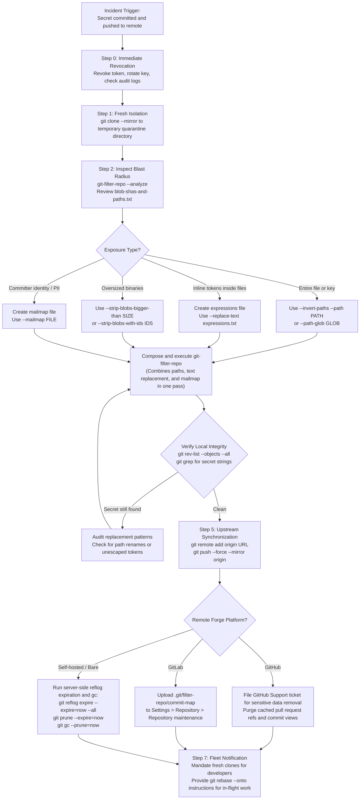

# Playbook: Remove Secrets and Rewrite Git History with git-filter-repo

> [!summary] Scope
> Owns the complete security procedure for permanently purging accidentally committed credentials, private keys, and oversized binary blobs across all branches, tags, and reflogs.
> Reaches Use, Debug, and Decide at Scale rungs by operating git-filter-repo, handling replacement commits, rewriting commit messages, sanitizing mailmaps, purging cached remote PR refs on forges, and orchestrating downstream force-push notifications.
> Emphasizes that exposed secrets must be revoked immediately regardless of history rewriting.

The foundational Merkle Directed Acyclic Graph (DAG) and blob hashing mechanics are owned by [[Git-Object-Model-and-Content-Addressing]].
Reference storage, packed-refs compaction, and reflog expiration policies are owned by [[Git-Refs-Reflog-and-Reftable]].
Garbage collection heuristics, packfile repacking, and multi-pack indexing are owned by [[Git-GC-Maintenance-MIDX-and-Commit-Graph]].
This playbook owns the end-to-end incident response runbook for permanently excising compromised credentials, sanitizing committer metadata, and rewriting repository history safely across client fleets and remote hosting forges.

## Trigger and Symptoms

Activate this playbook immediately when any of the following conditions occur:

- An engineer, CI pipeline, or third-party audit reports that a plaintext secret (such as an AWS access key, private SSH/TLS certificate, API token, or database password) was committed and pushed to an internal or external repository.
- Automated secret detection scanners (such as Trufflehog, Gitleaks, GitHub Secret Scanning, or GitLab Secret Detection) trigger a high-severity alert on a historical commit.
- An oversized binary file, disk image, or database dump was committed to the repository, inflating the packfile footprint and degrading clone performance across the engineering fleet.
- An engineer requests the complete erasure of personally identifiable information (PII) or stale internal domain names across commit logs and committer headers to satisfy compliance or privacy audits.

> [!danger] The First Invariant of Secret Exposure
> The moment a commit containing a plaintext secret is pushed to a remote repository, assume that secret has been scraped and compromised.
> History rewriting in Git does not un-leak a secret.
> GitHub's guidance is that the first step is to revoke or rotate the secret, because removed data can still be reachable through other users' clones, forks, and cached views by SHA-1 (GitHub Docs, as of 2026-11).
> Step 0 of every incident is immediate revocation and rotation at the issuing credential provider before modifying local history.

## Decision Tree



## Prerequisites

Execute this procedure from an isolated workstation or secure triage host, never inside an existing shared workspace or production deployment root.

### Required Software and Tools

Verify the availability of the required version control tools:

```bash
command -v git python3 git-filter-repo
```

- `git`: git-filter-repo needs Git 2.22.0 at a minimum and Git 2.24.0 or later for some features (git-filter-repo `README.md`, 2.47.0); Git 2.55.0 was used to record the verified lab output (as of 2026-11, macOS).
- `python3`: Python 3.6 or higher is required to drive the `git-filter-repo` engine (git-filter-repo `README.md`, 2.47.0); Python 3.15.2 was on the recording host.
- `git-filter-repo`: Version 2.47.0 or later is needed for `--sensitive-data-removal`, which GitHub's sensitive-data guide requires; 2.47.0 recorded the lab (installed via `brew install git-filter-repo`, `pip install git-filter-repo`, or distribution package managers) (as of 2026-11, macOS).

### Permission and Configuration Verification

Before beginning the rewrite, confirm access privileges:

- **Forge Administrative Rights:** Ensure you hold Maintainer or Owner permissions on the upstream remote repository to temporarily disable branch protection rules (e.g., "Require signed commits", "Require pull request reviews before merging", or "Include administrators").
- **Audit Access:** Ensure security engineering access to the administrative console of the exposed service (e.g., AWS IAM, Google Cloud IAM, Stripe Dashboard, HashiCorp Vault) to revoke compromised tokens and export access logs.
- **Dedicated Scratch Disk:** Ensure the triage host has free disk space for a full mirror clone of the repository plus the repacked copy that `git-filter-repo` writes; the fast-export stream passes through a pipe and is not buffered to disk.

## Step-by-Step Execution

### Step 0: Immediate Secret Revocation and Blast Radius Assessment

Do not touch git history until the credential is dead.
Revoking the credential eliminates the active exploit window while history rewriting takes place.

1. **Deactivate the Secret:**
   Navigate to the issuing provider and revoke the token, invalidate the private key, or disable the compromised IAM credentials immediately.
2. **Review Access Logs:**
   Query the provider's audit log (such as AWS CloudTrail or GCP Cloud Audit Logs) spanning the timestamp from the commit creation to the current time to determine whether unauthorized API calls were made using the leaked credential.
3. **Notify Security Leadership:**
   Open a formal security incident ticket detailing the exposed credential identity, the target repository name, and the estimated public exposure duration.

### Step 1: Fresh Isolation and Mirror Clone

`git-filter-repo` alters the repository in place and, by design, refuses to execute on a repository that is not freshly packed, has a remote other than `origin`, has more than one entry in any reflog, has stashes, or (in a non-bare repository) has staged, unstaged, or untracked changes, unpushed branches, or extra worktrees (`RepoFilter.sanity_check` in git-filter-repo 2.47.0).
Never run this procedure on a developer working tree.
Always operate on a freshly created mirror clone.

```bash
# Define incident environment variables
export REPO_URL="git@github.com:example-org/payment-gateway.git"
export INCIDENT_DIR="$(mktemp -d /tmp/git-remediation-XXXXXX)"

cd "${INCIDENT_DIR}"

# Create a full mirror clone capturing all branches, tags, notes, and remote references
git clone --mirror "${REPO_URL}" repo-mirror.git

# Create a pristine safety backup before any destructive mutation
git clone --mirror repo-mirror.git repo-backup.git

cd repo-mirror.git
```

The `--mirror` flag ensures that all refs under `refs/heads/*`, `refs/tags/*`, and other ref namespaces are cloned identically to the remote bare repository.

### Step 2: History Inspection and Blast-Radius Mapping

Execute `git-filter-repo --analyze` to parse the object graph without modifying any commits:

```bash
git-filter-repo --analyze
```

This command generates detailed analytical reports in `.git/filter-repo/analysis/` (or `filter-repo/analysis/` in a bare mirror repository):

- `blob-shas-and-paths.txt`: Lists all blob object hashes, their unpacked sizes, packed sizes, and historical file paths sorted in descending order of packed size.
- `path-deleted-sizes.txt`: Lists paths that have been deleted from the branch tips but remain packed in history, with their deletion dates, by reverse accumulated size.
- `renames.txt`: Lists the renames detected in history.
- Sibling reports (`path-all-sizes.txt`, `directories-*-sizes.txt`, `extensions-*-sizes.txt`) aggregate the same sizes by path, directory, and extension (git-filter-repo 2.47.0 analysis writer).

Inspect the top findings to confirm the exact historical paths and object IDs of the sensitive files:

```bash
head -n 10 filter-repo/analysis/blob-shas-and-paths.txt
```

### Step 3: Targeted History Scrubbing

`git-filter-repo` combines path filtering, text redaction, blob stripping, and committer sanitization into a single high-performance pipeline.
Construct the configuration files required for the incident:

#### 1. Define Content Replacement Expressions

If the secret was committed inline inside a file that cannot be completely deleted (such as a production configuration file or source module), define replacement expressions in a text file.
Each line is `<match>==><replacement>`; the match is literal by default and takes a `regex:` or `glob:` prefix for other styles, and a line without `==>` is replaced with `***REMOVED***`.
The `--replace-text` parser has no comment syntax: a `#` line is itself a literal match, and a comment containing `==>` silently rewrites matching text in every blob (verified with git-filter-repo 2.47.0, `FilteringOptions.get_replace_text`), so keep the file free of comments.

```bash
cat << 'EOF' > "${INCIDENT_DIR}/expressions.txt"
wJalrXUtnFEMI/K7MDENG/bPxRfiCYEXAMPLEKEY==>[REDACTED-AWS-KEY]
sk_live_EXAMPLE-NOT-A-REAL-KEY==>[REDACTED-STRIPE-KEY]
EOF
```

#### 2. Define Mailmap Identity Sanitization

If private emails, internal usernames, or contractor addresses must be sanitized throughout historical commit headers and annotated tags, define a standard Git mailmap file:

```bash
cat << 'EOF' > "${INCIDENT_DIR}/mailmap.txt"
# Format: Proper Name <proper@email.xx> Commit Name <commit@email.xx>
Staff Engineer <engineer@example.com> Leaky Contractor <leaky@external-vendor.internal>
EOF
```

#### 3. Execute git-filter-repo

Execute `git-filter-repo` specifying the union of all required transformations:

```bash
git-filter-repo \
  --invert-paths --path keys/service_account.pem \
  --replace-text "${INCIDENT_DIR}/expressions.txt" \
  --mailmap "${INCIDENT_DIR}/mailmap.txt"
```

For a sensitive-data incident, the git-filter-repo manual and GitHub's guide both direct you to add `--sensitive-data-removal` (2.47.0 or later): it fetches every ref from `origin` first, reports the `First Changed Commit(s)` and any orphaned LFS objects, and keeps the `origin` remote, so skip `git remote add origin` in Step 5 when you use it.

During execution, `git-filter-repo` performs the following operations:
1. Spawns `git fast-export` with `--show-original-ids`, `--signed-tags=strip`, `--tag-of-filtered-object=rewrite`, `--fake-missing-tagger`, and `--reference-excluded-parents`.
2. Intercepts and parses the fast-export stream in Python memory.
3. Excludes `keys/service_account.pem` from every tree object where it appears.
4. Searches every blob for matches against `${INCIDENT_DIR}/expressions.txt` and rewrites blob content in flight.
5. Rewrites commit and tag headers using `${INCIDENT_DIR}/mailmap.txt`.
6. Recalculates parent commit hashes for all descendants, automatically updating references to old commit hashes inside commit messages (not tag messages).
7. Pipes the modified stream into `git fast-import`.
8. Automatically removes the `origin` remote to prevent accidental pushes of mixed old and new history (skipped under `--sensitive-data-removal`).
9. Expires all reflogs immediately (`git reflog expire --expire=now --all`) and executes aggressive garbage collection (`git gc --prune=now`).
10. Writes the commit transformation map to `.git/filter-repo/commit-map`.

### Step 4: Verification and Local Validation

Validate that the secret is completely purged from the rewritten mirror repository:

```bash
# 1. Verify that the sensitive path does not exist in any revision tree
git rev-list --objects --all | grep "keys/service_account.pem" || echo "CLEAN: Path absent from all trees"

# 2. Verify that secret string values do not exist in any commit
git grep -I "wJalrXUtnFEMI" $(git rev-list --all) || echo "CLEAN: Secret string absent from all blobs"

# 3. Verify that the previous secret blob hash is unreachable
export OLD_BLOB_HASH="38e061452333836a41d156efae00f602ebaa682a"
git cat-file -e "${OLD_BLOB_HASH}" 2>/dev/null || echo "CLEAN: Secret blob purged from object database"

# 4. Review the commit-map generated by git-filter-repo
head -n 10 filter-repo/commit-map
```

### Step 5: Remote Upstream Synchronization and Force-Push

Once local validation is confirmed, reconnect the remote and force-push the rewritten history:

```bash
# 1. Temporarily disable branch protection on the remote repository (GitHub/GitLab settings)

# 2. Reconnect the origin remote
git remote add origin "${REPO_URL}"

# 3. Force-push all branches, tags, and references in mirror mode
git push --force --mirror origin

# 4. Re-enable branch protection rules on the remote repository
```

### Step 6: Forge-Level Remediation

Force-pushing branches and tags updates `refs/heads/*` and `refs/tags/*`, but does not eliminate cached commit views or pull request references on remote hosting platforms.

#### Platform A: GitHub

On GitHub, pull request heads live under `refs/pull/<PR_NUMBER>/head` and `refs/pull/<PR_NUMBER>/merge`, which GitHub marks read-only, so `git push --force --mirror` fails for those refs.
Furthermore, GitHub keeps cached views of old commits reachable by SHA.
Visiting `https://github.com/<org>/<repo>/commit/<OLD_SHA>` will continue to display the leaked commit until GitHub Support removes the cached views.
Copies in forks stay accessible; GitHub cannot give you fork owners' contact details, so coordinate with them directly (GitHub Docs, as of 2026-11).

1. Open a ticket through the GitHub Support portal at `https://support.github.com`.
2. Ask for sensitive data removal; Support helps only when the risk cannot be mitigated by rotating the affected credentials.
3. Submit a ticket providing:
   - The owner and repository name.
   - The number of affected pull requests.
   - The `First Changed Commit(s)` reported by `git-filter-repo --sensitive-data-removal`.
   - The orphaned LFS objects file, if `git-filter-repo` reported one.
4. GitHub Support dereferences or deletes the affected pull requests, runs a server-side garbage collection, and removes cached views.

#### Platform B: GitLab

GitLab provides a native self-service repository cleanup tool:

1. Locate the `commit-map` file generated in `filter-repo/commit-map` (or `.git/filter-repo/commit-map`).
2. A large `commit-map` can make the background cleanup time out, so GitLab advises splitting it and uploading the parts, starting at 20000 lines and reducing as needed:
   ```bash
   split -l 20000 filter-repo/commit-map filter-repo/commit-map-
   ```
3. GitLab runs the cleanup's garbage collection with a 30-minute grace period, so objects written less than 30 minutes earlier survive it.
4. Open the project in GitLab and navigate to **Settings > Repository** and expand **Repository maintenance**.
5. Upload the `commit-map` file and select **Start cleanup**.
6. GitLab removes the internal Git references (so associated merge request commits and pipelines become unavailable), unlinks unused LFS objects, and runs `git gc --prune=30.minutes.ago` (GitLab Docs, Repository size, as of 2026-11).

#### Platform C: Self-Hosted / Bare Git Server

On a self-hosted Git server or Gerrit instance, execute administrative garbage collection directly on the bare repository directory:

```bash
ssh git-admin@git-server.internal "
  cd /var/git/payment-gateway.git && \
  git reflog expire --expire=now --all && \
  git prune --expire=now && \
  git gc --prune=now
"
```

### Step 7: Downstream Fleet Coordination

When an upstream branch is force-pushed, a developer whose clone has no `pull.rebase` or `pull.ff` setting gets `fatal: Need to specify how to reconcile divergent branches.` from `git pull` (verified with Git 2.55.0), but one with `pull.rebase=false` performs a three-way merge between the old local branch and the rewritten upstream branch, and one with `pull.rebase=true` replays the old commits, including the one that added the secret.
Either path brings the old history back into the repository, re-introducing the leaked secret into the graph (re-contamination).

Publish an emergency coordination notice to all repository contributors:

```text
ATTENTION: History Rewrite Completed for payment-gateway

A security incident required rewriting git history to purge exposed credentials.
DO NOT run 'git pull' on existing local clones.
Doing so will resurrect deleted secrets.

Action Required:
1. If you have no uncommitted or unpushed work:
   Delete your local repository and perform a fresh clone:
     rm -rf payment-gateway
     git clone git@github.com:example-org/payment-gateway.git

2. If you have active in-flight feature branches:
   Do not merge or pull.
   Rebase your feature branch onto the new upstream commit:
     git fetch origin
     # Identify the merge-base with the old main branch
     git rebase --onto origin/main <OLD_BASE_COMMIT> <your-feature-branch>
```

## Verification

The following reproducible lab demonstrates the complete sequence, from initial secret leak and history analysis to path stripping, token replacement, mailmap rewriting, commit hash message updating, and server-side verification.

The lab output was recorded on macOS (darwin-arm64):

```text
=== Initial Repository State ===
Commit 2 hash: 0b2c166c9294ea290ff5b2229504261fb016a1e1
Secret PEM blob hash: 38e061452333836a41d156efae00f602ebaa682a
5a205de Staff Engineer <engineer@example.com> fix: add worker queue following credentials commit 0b2c166c9294ea290ff5b2229504261fb016a1e1
0b2c166 Leaky Contractor <leaky@external-vendor.internal> feat: integrate payment credentials and infra keys
6f02405 Staff Engineer <engineer@example.com> feat: initialize payment gateway service
=== Top Blobs from History Analysis ===
=== Files by sha and associated pathnames in reverse size ===
Format: sha, unpacked size, packed size, filename(s) object stored as
  a6bdc5ba19fd5721628c4b02066cc513c865a49c        102        103 config/credentials.env
  38e061452333836a41d156efae00f602ebaa682a        111         95 keys/service_account.pem
  b8f79eb87a25f680ebbe0364c3a6fcdeb9a1b879         53         69 src/payment.py
Note: A branch outside the refs/remotes/ hierarchy was not removed;
to delete it, use:
  git branch -d main
NOTICE: Removing 'origin' remote; see 'Why is my origin removed?'
        in the manual if you want to push back there.
        (was <ORIGIN_URL>)

Parsed 1 commits
Parsed 3 commits
New history written in X.XX seconds; now repacking/cleaning...
Repacking your repo and cleaning out old unneeded objects
Completely finished after X.XX seconds.
=== Verification Checks ===
Check A PASSED: keys/service_account.pem completely purged from tree objects
Check B PASSED: AWS secret key purged and replaced
Check C PASSED: Secret PEM blob purged by post-rewrite repack
Check D PASSED: Remote 'origin' removed by git-filter-repo to prevent accidental push
Rewritten Commit 2 hash: 47ce6dc00e7e85fb6cd1cdb06c5a43ca03ef7c36
Rewritten Commit 3 message:
fix: add worker queue following credentials commit 47ce6dc00e7e85fb6cd1cdb06c5a43ca03ef7c36
Check E PASSED: commit 3 message cites the rewritten hash of commit 2, not the old one
Rewritten Commit Authors:
9ec38f9 Staff Engineer <engineer@example.com> fix: add worker queue following credentials commit 47ce6dc00e7e85fb6cd1cdb06c5a43ca03ef7c36
47ce6dc Staff Engineer <engineer@example.com> feat: integrate payment credentials and infra keys
6f02405 Staff Engineer <engineer@example.com> feat: initialize payment gateway service
Check F PASSED: no author or committer identity from external-vendor.internal remains
Check G PASSED: Stripe key replaced in src/payment.py, file kept
Check H PASSED: config/credentials.env kept, secret key redacted, access key id untouched
Server Check PASSED: Secret blob completely expunged from origin server
```

The verification output confirms:
- The secret file `keys/service_account.pem` was stripped from all tree objects in the revision graph.
- The inline AWS secret key string is absent from every revision (Check B) and the Stripe key is replaced in place in `src/payment.py` (Check G).
- `config/credentials.env` survives with `AWS_SECRET_ACCESS_KEY=[REDACTED-AWS-KEY]`, while the access key id is left untouched because the lab's replacement rules do not cover it (Check H); rotate it regardless.
- The historical blob hash `38e061452333836a41d156efae00f602ebaa682a` was destroyed and cannot be retrieved via `git cat-file`.
- Commit 3 originally referenced Commit 2's hash (`0b2c166...`) in its message; after filtering, `git-filter-repo` automatically updated the commit message text to reference the rewritten hash `47ce6dc...`, looked up by old hash in `commit-map` (Check E).
- Commit 2's author was transformed from `Leaky Contractor <leaky@external-vendor.internal>` to `Staff Engineer <engineer@example.com>` via the mailmap filter, and no commit header still names the external vendor (Check F).
- After server-side garbage collection on `origin.git`, the secret blob is unreachable and pruned.

## Rollback Procedure

Because `git-filter-repo` performs an in-place destructive rewrite of the current directory, a rollback must restore from the pristine mirror backup created in Step 1.

### Scenario A: Local Rewrite Failure (Pre-Push)

If `git-filter-repo` was invoked with incorrect arguments, or if verification checks fail before pushing to the remote forge:

```bash
# 1. Delete the mutated mirror directory
cd "${INCIDENT_DIR}"
rm -rf repo-mirror.git

# 2. Re-clone from the pristine safety backup
git clone --mirror repo-backup.git repo-mirror.git

# 3. Enter the restored mirror and correct the filtering arguments
cd repo-mirror.git
```

### Scenario B: Upstream Push Failure (Post-Push)

If an incorrect rewrite was already force-pushed to the upstream remote forge, immediately restore the remote repository to its pre-rewrite state using the backup:

```bash
cd "${INCIDENT_DIR}/repo-backup.git"

# Verify that the backup remote points to the upstream forge
git remote set-url origin "${REPO_URL}"

# Force-push the original branches, tags, and references back to the remote forge
git push --force --mirror origin
```

Notify the security response team that the rollback was completed, and re-diagnose the filtering strategy.

## Failure Modes

| Failure Mode | Root Cause | Observable Diagnostic | Remediation |
| :--- | :--- | :--- | :--- |
| `Aborting: Refusing to destructively overwrite repo history since this does not look like a fresh clone` | Repository is not freshly packed, has a non-`origin` remote, a reflog with more than one entry, a stash, dirty or untracked files, unpushed branches, or extra worktrees. | Stderr names the failed check in parentheses, for example `(expected at most one entry in the reflog for HEAD)` or `(expected freshly packed repo)`. | Always execute on a fresh clone created via `git clone --mirror`, or pass `--force` if operating on an existing checkout is unavoidable. |
| History Re-Contamination | Collaborator with an un-rebased clone ran `git pull` or pushed a branch based on pre-rewrite commits. | Purged commit hashes reappear in `git log`, triggering secret scanner alerts on newly merged commits. | Re-run `git-filter-repo` and enforce automated pre-receive hooks that block commits containing known blacklisted hashes. |
| Forge Push Rejected | Remote repository branch protection rules prevent non-fast-forward force pushes. | Stderr: `remote: error: GH006: Protected branch update failed for refs/heads/<branch>.` (wording from GitHub Docs, About protected branches, as of 2026-11) | Temporarily grant administrative override to disable branch protection, force-push the rewritten refs, and immediately restore protections. |
| Incompatible `--stdin` and `--analyze` | `--analyze` writes reports directly, while `--stdin` expects a fast-export stream from standard input. | git-filter-repo exits with `Error: --analyze is incompatible with --stdin.` | Run `--analyze` as an isolated step without streaming options and review the generated reports before executing filtering flags. |
| Cryptographic Signature Stripping | Git commit and tag signatures cryptographically seal commit parent hashes and tree hashes. | `git log --show-signature` reports missing signatures on all rewritten commits. | Accept signature stripping as expected behavior and re-sign critical release tags manually post-rewrite using `git tag -s`. |
| Forge PR Views Still Visible | Web forge caches commit diffs and maintains pull request references outside `refs/heads/*`. | Visiting `https://github.com/org/repo/commit/<OLD_SHA>` still renders the secret diff. | File an emergency sensitive data removal ticket with GitHub Support, or run GitLab Repository Cleanup via `commit-map`. |

## Interview Questions

> [!question] L5
> What happens under the hood if a developer runs `git pull` on their local branch after an administrator force-pushes a rewritten history that removed an exposed secret?
>
> > [!success]- Answer
> > `git pull` executes `git fetch` followed by a merge or rebase of the upstream branch.
> > Because history was rewritten, the local branch and the upstream branch share an ancestor preceding the rewrite, but their commit graphs diverge at the first modified commit.
> > With no `pull.rebase` or `pull.ff` configured, Git 2.55.0 refuses with `fatal: Need to specify how to reconcile divergent branches.`; with `pull.rebase=false` (or `--no-rebase`) Git treats this as a standard non-fast-forward divergence and performs a three-way merge, and with `pull.rebase=true` it replays the old commits, secret included, on top of the new history.
> > The resulting merge commit combines the rewritten tree with the local developer's old tree, which still contains the secret blob and the old commit chain.
> > The old commits and the purged secret are re-introduced into the repository graph (re-contamination), and the developer's subsequent `git push` uploads the secret back to the remote server.
> > To avoid this, developers must discard their clones or rebase their feature branches using `git rebase --onto <new-base> <old-base> <feature-branch>`.

> [!question] L5
> Why does `git-filter-repo` automatically remove the `origin` remote by default upon completing a history rewrite?
>
> > [!success]- Answer
> > History rewriting changes the SHA-1 or SHA-256 object hashes of every commit from the point of the modification down to all leaf branches.
> > The manual's stated reason ("Why is my origin removed?") is that it is all too easy to merge the old history with the new one, for example `git pull && git push` from a pre-rewrite clone, or re-merging an old pull request, which brings back the old history and duplicates every commit.
> > Removing `origin` and suggesting a push to a new repository is a cheap forcing function against that mess; it also stops a muscle-memory `git push` of history that has not been inspected yet.
> > The operator must explicitly inspect the rewritten repository, verify that the secrets were completely removed, and deliberately re-add the remote before executing `git push --force`.
> > Under `--sensitive-data-removal` the remote is kept, because pushing back over the original is the point of that mode.

> [!question] L6
> An engineer runs `git-filter-repo --invert-paths --path secrets.env` in their standard working directory, and the command immediately aborts with:
> `Aborting: Refusing to destructively overwrite repo history since this does not look like a fresh clone. (expected at most one entry in the reflog for HEAD)`
> What specific repository conditions triggered this check, why does `git-filter-repo` enforce it, and what is the distinguished-engineer resolution?
>
> > [!success]- Answer
> > `git-filter-repo` enforces this check (`RepoFilter.sanity_check`, 2.47.0) by requiring a freshly packed object store (`git count-objects -v`: at most one pack and fewer than 100 loose objects), inspecting `git remote` (which must be exactly `origin`, or empty only in a new bare repository with no packs), requiring every reflog under `.git/logs/` to hold at most one entry (this message is the `HEAD` case), rejecting stashed changes (`refs/stash`), and, in a non-bare repository, rejecting staged, unstaged, or untracked changes, local branches that do not match `refs/remotes/origin/*`, and secondary worktrees.
> > The tool enforces this because it performs destructive, irreversible mutations in place, immediately expiring reflogs and running `git gc --prune=now`, which would destroy uncommitted developer work, unpushed branches, or stashes.
> > The proper distinguished-engineer resolution is not to casually pass `--force`, but to respect the design and execute the operation on a pristine mirror clone created with `git clone --mirror <URL>`.
> > This guarantees clean isolation from dirty developer states and ensures all remote branches and tags are rewritten in a single pass.

> [!question] L6
> Why do GPG and SSH commit signatures disappear when `git-filter-repo` rewrites history, and how does this affect repositories with branch protection rules requiring signed commits?
>
> > [!success]- Answer
> > A Git commit signature is stored in the commit object's `gpgsig` header.
> > The signature is a cryptographic digest computed over the exact byte payload of the commit object, which includes the tree hash, parent commit hashes, author/committer timestamps, and the commit message.
> > When any file in a tree is stripped or modified, the tree hash changes; cascading parent hashes change for all subsequent commits.
> > The existing cryptographic signature cannot validate the new hash, rendering the signature invalid.
> > Consequently, the signatures are dropped: git-filter-repo 2.47.0 passes `--signed-tags=strip` to `git fast-export`, and commit signatures are stripped because `--signed-commits` defaults to `strip` (Git 2.55.0 manual).
> > fast-export does not check validity; it strips every signature, even on commits the rewrite leaves unchanged.
> > In an enterprise environment enforcing signed commits, pushing rewritten history will be blocked by forge branch protection rules.
> > The administrator must temporarily suspend the signed commit requirement, force-push the sanitized history, and manually re-sign critical release tags before re-enabling the protection rule.

> [!question] L6
> In the lab output, Commit 3's message originally referenced Commit 2 using the string:
> `fix: add worker queue following credentials commit 0b2c166c9294ea290ff5b2229504261fb016a1e1`
> After running `git-filter-repo`, the commit message read:
> `fix: add worker queue following credentials commit 47ce6dc00e7e85fb6cd1cdb06c5a43ca03ef7c36`
> Explain the internal mechanism that performed this update, and compare it to the behavior of `git filter-branch` and BFG Repo-Cleaner.
>
> > [!success]- Answer
> > `git-filter-repo` tracks a commit translation dictionary (written out as `commit-map`) mapping old commit object IDs to new commit object IDs during stream parsing.
> > By default (unless `--preserve-commit-hashes` is specified), `git-filter-repo` scans every commit message (not tag messages) using the regular expression `\b[0-9a-f]{7,40}\b`.
> > When a matched hash corresponds to a known rewritten commit, it replaces the string with the new commit hash, abbreviated to the identical length of the original reference (`_translate_commit_hash`, 2.47.0).
> > `git filter-branch` does not perform this translation, so it requires custom scripts inside `--msg-filter` (git-filter-repo `README.md`).
> > BFG Repo-Cleaner does rewrite object IDs of 10 to 40 hex characters in commit messages (`CommitMessageObjectIdsUpdater`); when it is not in private-data mode it also appends `[formerly <old>]` and a `Former-commit-id` footer, and file deletion or text replacement turns private-data mode on so the old IDs are left out.

> [!question] L7
> An engineer accidentally pushes an AWS secret access key to a public GitHub repository.
> The security team immediately runs `git-filter-repo` on a mirror clone, force-pushes all branches and tags, and confirms that `git log` and `git clone` show no trace of the key.
> However, pasting the direct URL `https://github.com/org/repo/commit/<OLD_SHA>` into a browser still renders the commit diff containing the secret.
> Explain the underlying storage architecture causing this behavior, and specify the exact operational procedure required to permanently purge the data.
>
> > [!success]- Answer
> > In Git's content-addressable object database, objects are unreferenced when no ref in `refs/` can reach them.
> > However, hosting forges like GitHub do not instantly delete unreferenced objects; they retain loose objects and packfiles until asynchronous server-side garbage collection runs.
> > More importantly, GitHub maintains secondary references and web-tier caching:
> > 1. Pull requests create internal refs (`refs/pull/<PR_ID>/head` and `refs/pull/<PR_ID>/merge`) that GitHub marks read-only, so `git push --force --mirror` cannot update them and they keep the old commits reachable.
> > 2. GitHub keeps cached views of old commits that stay reachable directly by SHA.
> > 3. If the repository was forked before the rewrite, the commit stays accessible in those forks, and GitHub cannot give you the fork owners' contact details.
> > To achieve permanent purging:
> > 1. The AWS key must be revoked at the provider immediately (the primary defense).
> > 2. The incident team rewrites with `git-filter-repo --sensitive-data-removal` and submits a request through the GitHub Support portal with the owner and repository name, the number of affected pull requests, the `First Changed Commit(s)` that git-filter-repo reported, and any orphaned LFS objects file.
> > 3. GitHub Support dereferences or deletes the affected pull requests, runs a server-side garbage collection, and removes cached views; fork owners must clean up or delete their forks themselves (GitHub Docs, as of 2026-11).

> [!question] L7
> Analyze the architectural and system-level performance differences between `git-filter-repo` and `git filter-branch` when rewriting a repository containing 150,000 commits.
>
> > [!success]- Answer
> > `git filter-branch` operates by walking the commit DAG in topological order.
> > For each commit, it resets a temporary index file, checks out tree entries or applies an index filter, executes user-provided shell script snippets via subshell invocation (`fork()` and `execve()`), runs `git write-tree` to generate a new tree object, and runs `git commit-tree` to write the new commit object.
> > For 150,000 commits, `git filter-branch` invokes hundreds of thousands of process creations, subshell evaluations, and disk I/O operations against `.git/index`.
> > Process creation overhead and index I/O limit throughput to a few dozen commits per second: a measured `--index-filter 'git rm --cached --ignore-unmatch secret.env'` over a synthetic linear 5,000-commit, 51-file history took 268.6 s (about 19 commits per second) on an Apple M3 Pro with Git 2.55.0 (as of 2026-11, macOS), and the cost grows with tree size and filter complexity.
> > In contrast, `git-filter-repo` pipelines two native C binary processes: `git fast-export` and `git fast-import`, mediated by a single long-running Python process.
> > `git fast-export` streams the commit DAG sequentially into stdout; `git-filter-repo` parses the stream in memory, applies string and path filters directly to the stream buffers, and streams modified fast-import commands to `git fast-import` via standard input pipe.
> > There are zero subshells spawned per commit, zero filesystem checkouts, and zero index lock contentions.
> > On the same synthetic 5,000-commit history, `git-filter-repo --invert-paths --path secret.env` (2.47.0) wrote the new history in 0.28 s (about 18,000 commits per second) and finished, including repack, in 0.49 s, (as of 2026-11, macOS); the gap comes from spawning no process per commit, and blob-heavy filters such as `--replace-text` cost more per commit.

> [!question] L8+
> You are the Principal Infrastructure Architect for an organization with a 50 GB monorepo, 6,000 active software engineers, and 300 automated CI merge queue runs per hour.
> A critical private signing key was accidentally committed to the monorepo main branch 4 hours ago and has 40 descendant commits merged on top of it.
> Design an enterprise-grade incident response strategy.
> Should you rewrite git history, and if so, how do you orchestrate the rollout across the fleet?
>
> > [!success]- Answer
> > Step 1: Immediate Blast-Radius Containment.
> > Revoke and rotate the compromised signing key at the certificate authority or KMS immediately.
> > Invalidate all digital signatures or tokens issued by that key during the exposure window.
> > The security perimeter is defended by cryptographic revocation, not by git rewriting.
> > Step 2: Rewrite Decision Trade-off Analysis.
> > Rewriting 4 hours of history in a 50 GB monorepo with 6,000 engineers invalidates every developer's local checkout, breaks all in-flight merge queue pipelines, invalidates commit hashes in issue trackers, and risks catastrophic fleet re-contamination if even one developer pushes an un-rebased branch.
> > If the secret can be completely revoked and the repo is strictly private, the recommended architectural decision is often forward-fix: delete the file in a new commit, add the path to `.gitignore`, enable automated pre-receive push filters (e.g. GitHub Secret Scanning push protection), and avoid rewriting the entire monorepo DAG.
> > Step 3: Orchestrated Rewrite Protocol (if compliance mandates complete historical erasure).
> > If regulatory mandates (such as PCI-DSS or GDPR PII mandates) compel permanent erasure:
> > 1. Freeze the Monorepo: Lock push access and pause all merge queues and CI pipelines.
> > 2. Quarantine and Filter: On a dedicated bare runner, execute `git-filter-repo --invert-paths --path keys/signing.key` across all active branches and tags.
> > 3. Capture Divergence Boundary: Extract `commit-map` and publish the exact SHA-1 of the first modified commit.
> > 4. Force-Push and Purge: Force-push rewritten branches to the forge, execute server-side cache invalidation, and run server-side `git gc`.
> > 5. Fleet Remediation Script: Deploy an automated script via MDM or developer CLI that inspects developer worktrees:
> >    - If the local branch has no unpushed commits, hard-reset tracking branches to `origin/main`.
> >    - If the local branch has unpushed commits, automatically rebase using `git rebase --onto origin/main <FIRST_CHANGED_PARENT>`.
> >    - Install an aggressive pre-push hook across all developer machines that rejects any push containing the blacklisted pre-rewrite commit hashes.
> > 6. Unfreeze: Resume merge queues and monitor CI telemetry for re-contamination attempts.

## Further Reading

- Elijah Newren, git-filter-repo User Manual, https://htmlpreview.github.io/?https://github.com/newren/git-filter-repo/blob/docs/html/git-filter-repo.html.
  The authoritative reference manual documenting command-line flags, Python callbacks, mailmap integration, and the internals of fast-export filtering.
- Git Community, git-filter-branch(1) Reference Manual, https://git-scm.com/docs/git-filter-branch.
  Documents the historical pitfalls, safety hazards, and official deprecation warnings justifying the adoption of `git-filter-repo`.
- Git Community, git-fast-export(1) and git-fast-import(1) Manuals, https://git-scm.com/docs/git-fast-export.
  The core streaming plumbing protocol that powers fast history transformations.
- Git Community, git-replace(1) Reference Manual, https://git-scm.com/docs/git-replace.
  Explains replace references and how `refs/replace/` maps old commit identifiers to rewritten identifiers without breaking toolchains.
- GitHub Documentation, Removing sensitive data from a repository, https://docs.github.com/en/authentication/keeping-your-account-and-data-secure/removing-sensitive-data-from-a-repository.
  The official vendor protocol for coordinating pull request cache clearance and server-side garbage collection.
- GitLab Documentation, Reducing the repository size using Git, https://docs.gitlab.com/ee/user/project/repository/reducing_the_repo_size_using_git.html.
  Details the GitLab self-service Repository Cleanup mechanism driven by `git-filter-repo` commit-map uploads.
- Scott Chacon and Ben Straub, Pro Git, 2nd Edition, Chapter 10: Git Internals, Apress, 2014, https://git-scm.com/book/en/v2/Git-Internals-Git-Objects.
  Covers the fundamental object store mechanics, content addressing, and tree structures underlying history rewriting.

## Related

- Prerequisites: [[Git-Rebase-Internals-and-Stacked-Branches]], [[Git-GC-Maintenance-MIDX-and-Commit-Graph]]
- Next: [[Case-Study-SHAttered-SHA1-Collision-and-Git-Hardening]]
- See also: [[11-Security-And-Cryptography/README|README]]
- Lab: `code/02-Version-Control/filter_repo_secrets/`
