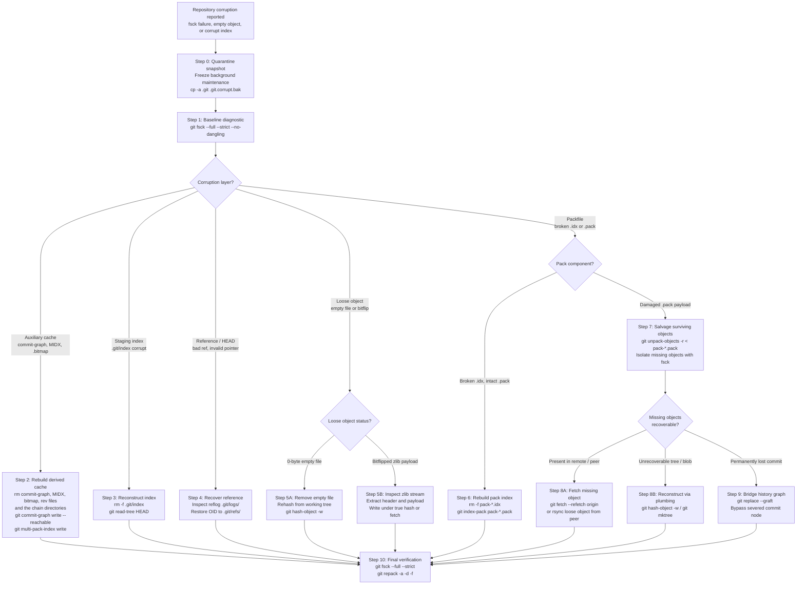
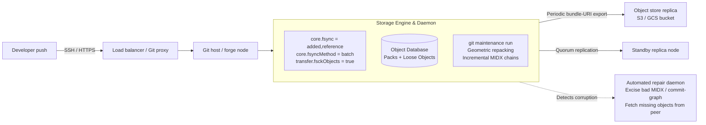

# Playbook: Repair a Corrupted Git Repository

> [!summary] Scope
> Owns operational remediation of filesystem, disk, and object-database corruptions in Git repositories.
> Reaches Debug and Rebuild rungs by diagnosing bitflipped loose objects via checksum mismatches, truncated pack and index files, broken multi-pack-index chains, corrupt commit-graph layers, and damaged index binary headers.
> Provides commands to rebuild indexes, excise dead objects, unpack valid objects from broken packs, and restore consistency while minimizing data loss.

Packfile format and delta compression internals are owned by [[Git-Packfiles-and-Delta-Compression]].
Commit-graph layers and multi-pack indexes are owned by [[Git-GC-Maintenance-MIDX-and-Commit-Graph]].
The content-addressable object store model is owned by [[Git-Object-Model-and-Content-Addressing]].
Reference backends and reflogs are owned by [[Git-Refs-Reflog-and-Reftable]].
The binary staging index format is owned by [[Git-Index-Stat-Cache-and-Fsmonitor]].
This playbook owns the emergency incident runbook to diagnose, isolate, and repair physical corruptions across the repository object database, references, and caches.

## Trigger and Symptoms

Activate this playbook when Git commands fail with low-level database errors, storage checksum mismatches, or binary header parse faults rather than merge conflicts or permissions issues.

- `fatal: index file corrupt` or `error: bad signature 0x...` appears during `git status`, `git add`, or `git checkout`.
- `error: object file ... is empty` appears following an unclean host shutdown, kernel panic, or sudden power interruption before the storage controller flushes dirty pages to non-volatile disk.
- `error: inflate: data stream error (incorrect data check)`, `(incorrect header check)`, or `(invalid distance too far back)` appears during `git log`, `git checkout`, or `git pack-objects`, indicating zlib decompression failure on disk; for a loose object it is followed by `fatal: loose object <oid> (stored in .git/objects/...) is corrupt` (all observed with Git 2.55.0, as of 2026-11, macOS).
- `error: hash mismatch <oid>` indicates that the content inside a loose object or packfile does not match its cryptographic content-addressed file name; Git 2.55.0 no longer contains the older `sha1 mismatch` wording (checked against the binary's strings, as of 2026-11).
- `error: commit-graph signature <X> does not match signature <Y>` or `commit-graph file is too small` occurs when an auxiliary commit-graph layer suffers bit rot or truncation.
- `multi-pack-index file ... is too small` or `multi-pack-index signature 0x... does not match signature 0x...` occurs when the multi-pack index cache is truncated or overwritten.
- `fatal: Cannot open existing pack idx file for '...'` (from `git verify-pack` or `git index-pack --verify`) occurs when a `.idx` file is missing, and `packfile ... does not match index` occurs when its trailing pack hash does not match the `.pack` archive; ordinary commands silently ignore a `.pack` that has no `.idx`, so its objects simply look missing.
- `fatal: your current branch appears to be broken` (empty or partial loose ref), `fatal: bad object HEAD` (ref holding a well-formed OID of a missing object), `fatal: your current branch '<branch>' does not have any commits yet` (`HEAD` naming a ref that does not exist), and `fatal: not a git repository` (garbage in `.git/HEAD`) are the reference-layer symptoms observed with Git 2.55.0 (as of 2026-11, macOS); `git fsck` reports the first two as `badRefContent` and `invalid sha1 pointer`.
- `git fsck` returns non-zero with an exit code that ORs the bitmask defined in `builtin/fsck.c` (v2.55.0, lines 54-61): `ERROR_OBJECT` (`01`), `ERROR_REACHABLE` (`02`), `ERROR_PACK` (`04`), `ERROR_REFS` (`010`), `ERROR_COMMIT_GRAPH` (`020`), `ERROR_MULTI_PACK_INDEX` (`040`), `ERROR_PACK_REV_INDEX` (`0100`), and `ERROR_BITMAP` (`0200`); the values are C octal literals, so the shell sees 1, 2, 4, 8, 16, 32, 64, and 128 (as of 2026-11, Both).

## Decision Tree



## Prerequisites

Execute this procedure on an isolated triage copy or directly on the host after disabling automated sync processes.
Never attempt repair on a live production share without taking a physical block-level or directory backup first.

### Tools and Environment

```bash
command -v git python3 find awk dd
```

- Git 2.36 or later is required for `git fetch --refetch` and `core.fsync` (Git 2.36 release notes), and Git 2.34 or later for `git multi-pack-index write --bitmap` (Git 2.34 release notes); every command here was run with `git version 2.55.0` on macOS darwin-arm64 (as of 2026-11).
- Python 3.8 or later is required for binary zlib decompression and raw loose object header inspection scripts.
- Standard POSIX utilities (`dd`, `find`, `awk`, `cp`, `tar`) are required for byte-level carving and file manipulation; the `${VAR:0:2}` substring syntax in the snippets needs bash or zsh.
- Storage capacity must cover the quarantine snapshot (one full copy of `.git`) plus the unpacked loose objects, which are stored zlib-compressed but without delta compression, so they can be considerably larger than the pack they came from; measure `du -sk .git` on the damaged copy and compare it with free space before unpacking.

### Security and Permission Checks

- Verify read and write permissions across all directories under `.git/objects/`, `.git/refs/`, and `.git/logs/`.
- Ensure no background automated garbage collection (`git maintenance` or cron jobs) is executing during remediation.

```bash
git maintenance stop 2>/dev/null || true
ps aux | grep -E "git (gc|repack|prune|maintenance)" | grep -v grep || true
```

**Verification:** The commands confirm that background maintenance daemons are halted and no concurrent Git writer holds file locks.

## Step-by-Step Execution

### Step 0: Immediate Quarantine Snapshot and Maintenance Freeze

Before running any command that touches repository state, take an exact physical copy of `.git`.
Git repair commands like `git prune` or `git checkout -f` can destroy recoverable dangling objects or uncommitted working files.

```bash
git maintenance stop 2>/dev/null || true
pkill -STOP -f "git (gc|maintenance)" 2>/dev/null || true
cp -a .git .git.corrupt.bak
```

**Verification:**

```bash
test -d .git.corrupt.bak && echo "QUARANTINE_BACKUP_OK"
```

The output must print `QUARANTINE_BACKUP_OK`.
If the storage volume is constrained, create a compressed tarball with `tar -cf - .git | gzip -1 > ../git_backup.tar.gz`.

### Step 1: Baseline Diagnostic Assessment

Run `git fsck` with full verification flags to identify the exact scope of corruption.
Suppress standard dangling commit warnings with `--no-dangling` so that normal unreferenced commits from everyday development do not obscure genuine corruptions.

```bash
git fsck --full --strict --no-dangling > fsck_initial_report.log 2>&1
FSCK_RC=$?
cat fsck_initial_report.log
```

Do not pipe `git fsck` into `tee` before reading `$?`: the pipeline's status is `tee`'s, which is `0` even when `fsck` fails (reproduced with Git 2.55.0, as of 2026-11).

The exit code of `git fsck` is an integer combining error bitmasks defined in `builtin/fsck.c` (v2.55.0, lines 54-61; C octal literals; as of 2026-11, Both):

- `01` (`ERROR_OBJECT`, exit bit 1): Defective loose object header, hash mismatch, or zlib inflate error.
- `02` (`ERROR_REACHABLE`, exit bit 2): Missing target object referenced by an existing commit or tree.
- `04` (`ERROR_PACK`, exit bit 4): A packfile failed verification.
- `010` (`ERROR_REFS`, exit bit 8): Corrupted reference file or invalid reflog entry.
- `020` (`ERROR_COMMIT_GRAPH`, exit bit 16): Inconsistent or invalid commit-graph binary data.
- `040`, `0100`, `0200` (`ERROR_MULTI_PACK_INDEX`, `ERROR_PACK_REV_INDEX`, `ERROR_BITMAP`; exit bits 32, 64, 128): The corresponding derived cache failed verification.

A zero-byte loose blob, for example, exits with `3` (`ERROR_OBJECT | ERROR_REACHABLE`) because the object is both unreadable and missing from the graph (measured with Git 2.55.0, as of 2026-11, macOS).

**Verification:**

```bash
echo "FSCK_EXIT_CODE: ${FSCK_RC}"
```

An exit code of `0` indicates no database corruption.
A non-zero exit code indicates active corruption matching the diagnostics saved in `fsck_initial_report.log`.

### Step 2: Purge and Rebuild Derived Auxiliary Caches

A substantial portion of apparent repository corruptions occur inside auxiliary cache files rather than the primary object database.
The files `.git/objects/info/commit-graph`, `.git/objects/pack/multi-pack-index`, `.git/objects/pack/*.bitmap`, and `.git/objects/pack/*.rev` are purely disposable caches derived from objects.
They contain no primary data.
With a zeroed commit-graph header, `git commit-graph verify` exits `1` with `error: commit-graph signature 0 does not match signature 43475048`, while `git log` prints the same error and still succeeds by falling back to the object database (Git 2.55.0, as of 2026-11, macOS).
If `fsck` or `commit-graph verify` reports signature errors, simply delete them and let Git regenerate them.

```bash
rm -f .git/objects/info/commit-graph
rm -rf .git/objects/info/commit-graphs
rm -f .git/objects/pack/multi-pack-index
rm -rf .git/objects/pack/multi-pack-index.d
rm -f .git/objects/pack/*.bitmap
rm -f .git/objects/pack/*.rev
git commit-graph write --reachable --no-progress
git multi-pack-index write --no-progress
```

Split commit-graph chains live in the directory `.git/objects/info/commit-graphs/` and incremental MIDX chains in `.git/objects/pack/multi-pack-index.d/`, so a bare `rm -f ...commit-graph*` glob fails with `is a directory` and leaves the chain in place (reproduced with Git 2.55.0, as of 2026-11, macOS).
Skip the `git multi-pack-index write` line if the repository did not use a MIDX before the incident.

**Verification:**

```bash
git commit-graph verify --no-progress && git multi-pack-index verify --no-progress
```

Both commands return exit status `0` with no error messages.
If the repository now passes `git fsck --full --strict --no-dangling`, the incident is resolved with zero data loss.

### Step 3: Reconstruct the Staging Index (`.git/index`)

When a developer encounters `fatal: index file corrupt` or `error: bad signature 0x00000000`, the binary staging index file (`.git/index`) has suffered truncation or header corruption.
Per `gitformat-index(5)`, the index starts with a 12-byte header: 4-byte signature `DIRC` (`0x44495243`), 4-byte version number (typically 2, 3, or 4), and 4-byte entry count.
The index is a staging cache between `.git/objects` and the working tree.
It can be regenerated from `HEAD` without touching repository history.

```bash
rm -f .git/index
git read-tree HEAD
git update-index --refresh 2>/dev/null || true
```

`git read-tree HEAD` reads the tree object referenced by `HEAD` and populates a pristine index.
`git update-index --refresh` refreshes the cached `stat` structure (dev, ino, mtime, size) against current working tree files.

**Verification:**

```bash
git status --porcelain
```

The command succeeds without throwing `fatal: index file corrupt`.
Any modified or untracked files in the working directory remain untouched and visible in porcelain status.

### Step 4: Validate and Repair Corrupted References and HEAD

If `.git/HEAD` contains garbage, Git no longer recognizes the directory as a repository and reports `fatal: not a git repository`, or silently operates on an enclosing repository if one exists higher up the path; set `GIT_CEILING_DIRECTORIES` before experimenting.
If `HEAD` names a reference that does not exist, `git log` reports `fatal: your current branch '<branch>' does not have any commits yet`.
If a loose branch file in `.git/refs/heads/<branch>` is empty (0 bytes) or contains a partial hexadecimal string, Git reports `fatal: your current branch appears to be broken`, `git status` warns `ignoring broken ref`, and `git fsck` reports `badRefContent`.
If it holds a well-formed OID whose object is missing, Git reports `fatal: bad object HEAD` and `git fsck` reports `invalid sha1 pointer` (all observed with Git 2.55.0, as of 2026-11, macOS).
The file edits below apply to the default `files` reference backend; a `reftable` repository (`git rev-parse --show-ref-format`) has no loose ref files and is repaired with `git update-ref` instead, see [[Git-Refs-Reflog-and-Reftable]].

1. Verify `.git/HEAD`.
   It must contain a single symbolic reference string ending in a newline: `ref: refs/heads/main\n`.
   If it is empty or corrupt:

```bash
echo "ref: refs/heads/main" > .git/HEAD
```

2. If a specific branch reference in `.git/refs/heads/<branch>` is 0 bytes or damaged, recover its last known commit object identifier from its reflog:

```bash
TARGET_BRANCH="main"
REFLOG_FILE=".git/logs/refs/heads/${TARGET_BRANCH}"
if [ -s "${REFLOG_FILE}" ]; then
    RECOVERED_OID="$(tail -n 1 "${REFLOG_FILE}" | awk '{print $2}')"
    echo "${RECOVERED_OID}" > ".git/refs/heads/${TARGET_BRANCH}"
    echo "Restored ${TARGET_BRANCH} to ${RECOVERED_OID} from reflog"
fi
```

3. If reflogs were disabled or damaged, search for the most recent valid commit object using `git fsck`:

```bash
git fsck --lost-found --no-progress | grep "dangling commit" | awk '{print $3}' | while read -r c; do
    echo "$c $(git log -1 --format='%ci %s' "$c" 2>/dev/null || true)"
done | sort -k 2,3 -r | head -n 5
```

Pick the desired root commit OID and write it into `.git/refs/heads/<branch>`.

**Verification:**

```bash
git rev-parse --verify HEAD
git log -1 --oneline
```

The commands output the commit hash and commit subject without reference errors.

### Step 5: Remediate Corrupted Loose Objects

A loose object lives at `.git/objects/xx/yyyy...` where `xx` is the first two hex characters of the hash and the remainder is the file name.
A loose object consists of a header `<type> <size>\0` concatenated with payload data, compressed with zlib.

#### Scenario 5A: Zero-Byte Loose Objects

An abrupt host power cut before the filesystem commits dirty blocks to storage often results in a 0-byte file created in `.git/objects/xx/`.
`git fsck` reports `error: object file ... is empty`, `object corrupt or missing`, and `missing blob <oid>` and exits `3`, while `git cat-file -p <oid>` reports `is empty` followed by `fatal: Not a valid object name <oid>` (observed with Git 2.55.0, as of 2026-11, macOS).

1. Identify the corrupt file path and missing object identifier from `fsck`:

```bash
CORRUPT_OID="3b18e512dba79e4c8300dd08aeb37f8e728b8dad"
CORRUPT_PATH=".git/objects/${CORRUPT_OID:0:2}/${CORRUPT_OID:2}"
```

2. Remove the empty 0-byte file so Git does not short-circuit future reads:

```bash
rm -f "${CORRUPT_PATH}"
```

3. If the object was a blob representing a file currently present in your working tree, rehash it:

```bash
find . -not -path './.git*' -type f | while read -r filepath; do
    CALC_OID="$(git hash-object "$filepath")"
    if [ "$CALC_OID" = "$CORRUPT_OID" ]; then
        git hash-object -w "$filepath"
        echo "Successfully reconstructed blob $CORRUPT_OID from $filepath"
        break
    fi
done
```

4. If the missing object is a commit or tree that exists on a remote repository or a coworker's clone, fetch it directly:

```bash
git fetch origin "${CORRUPT_OID}" 2>/dev/null || git fetch --refetch origin
```

Whether a bare OID fetch works depends on the wire protocol, not only on server configuration.
Over protocol v2, the default in Git 2.55.0, `gitprotocol-v2(5)` says wants "can be anything and are not limited to advertised objects", and a stock `git upload-pack` served an unreachable dangling commit with no configuration at all.
Over protocol v0 or v1, the same stock server refused both a reachable non-tip commit and the dangling commit with `Server does not allow request for unadvertised object`, until `uploadpack.allowAnySHA1InWant` was set to `true` (`uploadpack.allowReachableSHA1InWant` defaults to `false` and `allowAnySHA1InWant` is unset, git-config(1)); all of this was reproduced with `git fetch file://...` against a local bare repository on macOS with Git 2.55.0 (as of 2026-11).
These results describe stock Git only; a hosting service may restrict wants itself, so treat a rejected OID fetch as expected and fall back to `git fetch --refetch` (Git 2.36+), which re-downloads every object as a fresh clone would.

Alternatively, copy the exact loose object file `.git/objects/xx/yyyy...` over SSH or rsync from a healthy clone.
Because Git objects are strictly content-addressed and immutable, copying an object file between clones of the same repository is safe and preserves cryptographic integrity.

**Verification:**

```bash
git cat-file -t "${CORRUPT_OID}"
```

The command outputs the object type (`blob`, `tree`, or `commit`) without raising an error.

#### Scenario 5B: Bitflipped Loose Objects

If a hardware bitflip or disk error corrupts a loose object, `git cat-file -p <oid>` fails with `error: inflate: data stream error (...)`, `error: unable to unpack <oid> header`, and `fatal: loose object <oid> (stored in ...) is corrupt`, or with `hash mismatch <oid>` if the stream still inflates (Git 2.55.0, as of 2026-11).

Run this Python diagnostic snippet to inspect whether the zlib stream still inflates.
The path goes on the `python3` command line; the heredoc terminator must stand alone on its own line, or the shell never ends the heredoc.

```bash
python3 - "${CORRUPT_PATH}" <<'EOF'
import hashlib
import sys
import zlib

path = sys.argv[1]
with open(path, "rb") as f:
    raw = f.read()

d = zlib.decompressobj()
try:
    decompressed = d.decompress(raw)
    status = "complete"
except zlib.error as e:
    decompressed = b""
    status = f"failed: {e}"
null_idx = decompressed.find(b"\x00")
header = decompressed[:null_idx].decode("ascii", errors="replace") if null_idx >= 0 else "<none>"
print(f"Inflate: {status}; header: {header}; bytes: {len(decompressed)}")
if status == "complete":
    print(f"SHA-1 of inflated object: {hashlib.sha1(decompressed).hexdigest()}")
EOF
```

On an intact loose object this prints a SHA-1 equal to the file's path, and after a one-byte overwrite it prints `failed: Error -3 while decompressing data` (both run with Python 3 on macOS, as of 2026-11); use `hashlib.sha256` in a SHA-256 repository.
zlib's Adler-32 trailer (RFC 1950) makes a bitflipped stream fail to inflate in almost every case, so the usual outcome is that the bytes are unrecoverable and the object must be fetched or rebuilt as in Scenario 5A or Step 8.
If the stream does inflate but its SHA-1 differs from the file path, the file holds a different object: `git hash-object -w -t <type> <payload_file>` can store it under its own hash, but that does not restore the object that the path names.

### Step 6: Remediate Missing or Corrupted Packfile Index Files (`.idx`)

A packfile `.pack` contains the actual compressed objects; the `.idx` file is merely an index facilitating $O(\log N)$ binary searches over the packfile via a 256-entry fanout table.
If a `.idx` file is deleted or corrupted, Git cannot read objects within that packfile.
Per `git-index-pack(1)`, Git can rebuild a `.idx` file directly from the `.pack` file:

```bash
cd .git/objects/pack/
for packfile in pack-*.pack; do
    idxfile="${packfile%.pack}.idx"
    if [ ! -f "$idxfile" ] || ! git verify-pack "$idxfile" >/dev/null 2>&1; then
        echo "Rebuilding damaged index for $packfile..."
        rm -f "$idxfile"
        git index-pack "$packfile"
    fi
done
cd - >/dev/null
```

**Verification:**

```bash
git verify-pack -v .git/objects/pack/pack-*.idx
```

The command completes with exit status `0`, printing all contained object offsets, sizes, and delta chains.

### Step 7: Salvage Damaged Packfiles (`.pack`) via `git unpack-objects -r`

When a `.pack` file suffers bit rot or physical sector loss inside its payload, `git verify-pack` reports `fatal: pack has bad object at offset ...` or `error: inflate returned -3`.
Do not discard the packfile.
A large packfile may contain tens of thousands of healthy objects prior to the damaged byte offset.
Use `git unpack-objects` with the `-r` (recovery) flag.
Per `git-unpack-objects(1)`, `-r` instructs Git to continue unpacking surviving objects into individual loose objects even when decompression errors are encountered.

```bash
mkdir -p .git/corrupt_quarantine
mv .git/objects/pack/pack-broken.* .git/corrupt_quarantine/
git unpack-objects -r < .git/corrupt_quarantine/pack-broken.pack
```

`git unpack-objects` streams through the packfile, expands each valid entry, and writes it as a loose object into `.git/objects/??/`.
Per `git-unpack-objects(1)`, objects that already exist in the repository are not unpacked, which is why the damaged pack is moved out of `.git/objects/pack/` first.
When it meets the bad entry it logs `error: inflate: data stream error (...)` and `error: inflate returned -3` and carries on; at the end it exits `128` with `fatal: final sha1 did not match`, because the pack trailer no longer matches the damaged bytes.
The objects it wrote stay in the repository.
Without `-r`, the same damage made it stop with exit status `1` after the 4 objects that precede the bad entry; with `-r` it wrote 11 of the pack's 12 objects, including every one of the 7 entries stored after the damage (the lab's mid-pack case; the plain run was a scratch run on the lab's pack, Git 2.55.0, macOS, as of 2026-11).
`-r` is not a guarantee, because after an inflate error Git resumes at the byte where zlib stopped rather than at the next entry boundary, so the outcome depends on where the damage falls.
In the lab's pack, complementing one byte at each of the 35 positions of one 35-byte blob entry left 11 objects for 27 positions and only 4 or 5 objects for the 8 positions at entry offsets 0 to 4 and 28 to 30; overwriting four bytes in the middle of the entry with `0xff` left 8 objects; complementing one byte in the middle of the delta base tree `a2299883...` ended with `fatal: unresolved deltas left after unpacking` and 9 objects, because the base and both trees stored as deltas against it were lost (same pack, Git 2.55.0, macOS, as of 2026-11).
Because the command exits non-zero even when it recovered most objects, judge the outcome by the object count and `git fsck`, not by its exit status.

**Verification:**

```bash
find .git/objects -type f -not -path ".git/objects/info/*" | wc -l
```

The loose object count increases, confirming that surviving objects from the damaged packfile are restored to the database.

### Step 8: Reconstruct Missing Trees and Blobs via Plumbing

After unpacking surviving objects from a damaged pack, run `git fsck` to identify exactly which objects are missing from the graph.

```bash
git fsck --full --no-dangling --no-progress 2>&1 | tee fsck_missing.log
```

The output identifies broken links in this format (the lines below are the `[tail tree] fsck report:` block that the lab's fifth phase prints, byte for byte, Git 2.55.0, as of 2026-11, macOS):

```text
broken link from  commit 9c30325081b18a85c5b95ead1e00e4f7a90fb1e0
              to    tree ed46dd19f6204c92947780231982716d4016b9bb
missing tree ed46dd19f6204c92947780231982716d4016b9bb
```

A missing tree or commit is reported with a `broken link` pair naming its referrer, but the lab's mid-pack case, where a blob is absent, prints only `missing blob 9eba8819f998d58edd879aa284cf88c8d4c2ef9a`.
An object whose file exists but fails to inflate is reported as `object corrupt or missing` and `missing <type> <oid>` instead.

To repair a missing tree object `ed46dd...`:

1. Inspect the referencing commit object:

```bash
git cat-file -p 9c30325081b18a85c5b95ead1e00e4f7a90fb1e0
```

This displays the tree hash, author, committer, and commit message.

2. Determine what files were in that commit.
   If the commit was an initial commit or an incremental update whose file list is known, reconstruct the tree using `git mktree`.
   For example, if the tree consisted of a single file `main.c` whose blob was salvaged as `78f2de106c92b0d60772bd5aa6c1e6da7bf71005`:

```bash
printf "100644 blob 78f2de106c92b0d60772bd5aa6c1e6da7bf71005\tmain.c\n" | git mktree
```

`git mktree` builds the binary tree buffer, computes its cryptographic SHA-1/SHA-256 hash, and writes the loose tree object to `.git/objects/`.
If the reconstructed tree hash matches `ed46dd19f6204c92947780231982716d4016b9bb`, the broken link is resolved; in the lab, `78f2de...` is the blob of `int main(void) { return 0; }`, the lab compares the `git mktree` output with the tree it damaged and prints `MATCH`, and its final `git fsck` exits `0`.
If the hash does not match, the rebuilt tree cannot stand in for the missing one: `git replace` refuses a missing original (`Objects must be of the same type`), and `git fsck` ignores replace refs anyway.

**Verification:**

```bash
git fsck --full --no-dangling --no-progress
```

The previously reported broken link disappears from `git fsck` output.

### Step 9: Bridge Missing History Gaps via `git replace`

If an intermediate commit object in a long linear history was destroyed and cannot be retrieved from any remote mirror or developer backup, the commit graph is severed.
A child commit points to a missing parent OID, causing `git fsck` to fail with `missing commit <oid>` and stopping operations like `git log` or `git rebase`.
Use `git replace --graft` to bridge the graph across the missing node.

Suppose the history was `Grandparent (G) -> Parent (P) -> Child (C)`, and commit `P` is permanently lost.

```bash
CHILD_OID="183c488b58545a10762a49e53e0338cabbd9c68b"
GRANDPARENT_OID="e1f61b679196518375bfc09b11490cd939d25b90"

git replace --graft "${CHILD_OID}" "${GRANDPARENT_OID}"
```

Per `git-replace(1)`, `--graft` creates a new commit with the same content as `<CHILD_OID>` but with `<GRANDPARENT_OID>` as its parent, and a replacement ref `refs/replace/<CHILD_OID>` pointing at it.
Per the same page, replacement refs are used by all Git commands except those doing reachability traversal: `prune`, pack transfer, and `fsck`.
So `git log` and `git rebase` walk across the gap, but `git fsck` still reports `broken link from commit <CHILD_OID>` and `missing commit <P>` and exits non-zero, and `git gc` and `git prune` still die with `Failed to traverse parents` (all reproduced with Git 2.55.0, as of 2026-11, macOS).
`builtin/fsck.c` calls `disable_replace_refs()`, and the `git-replace(1)` CAVEATS section notes that replace refs also switch off commit-graph reads.

To make the replacement permanent across clones without requiring developers to fetch replace refs, rewrite history with `git filter-repo` as described in [[Remove-Secrets-and-Rewrite-Git-History]].

**Verification:**

```bash
git log --oneline "${CHILD_OID}"
```

`git log` walks seamlessly past the bridged commit into the earlier history, and `git log --decorate` labels the child `replaced`.
`git fsck`, `git gc`, `git repack -a`, and `git prune` stay broken until history is rewritten so that no ref reaches the original child, which means Step 10 cannot pass while only a graft is in place.

### Step 10: Final Verification and Compaction

Once all corrupt objects are repaired, caches regenerated, and broken links resolved, perform a strict repository verification and repack loose objects into a healthy, consolidated packfile.

```bash
git fsck --full --strict
git repack -a -d -f --depth=50 --window=250 -q
git prune --expire=now
git commit-graph write --reachable --no-progress
git multi-pack-index write --bitmap --no-progress
```

**Verification:**

```bash
git fsck --full --strict
```

The final verification returns exit status `0` with zero errors and zero broken links; without `--no-dangling` it may still list `dangling` objects, which are not errors.
After a Step 9 graft this holds only once the graft has been baked into rewritten history; while replace refs exist, the commit-graph written here is also not read (`git-replace(1)` CAVEATS).

## Worked Example: Repository Repair Lab

The lab in `code/02-Version-Control/repo_repair/` simulates and remediates all primary repository failure modes end-to-end.
The script runs five phases and exits non-zero by itself if any check fails, so a broken mechanism fails even before the golden-output diff:

1. **Commit-Graph Corruption:** Overwrites the `CGPH` magic header bytes in `.git/objects/info/commit-graph`, detects `error: commit-graph signature ... does not match`, purges the corrupt cache, and verifies clean regeneration via `git commit-graph write --reachable`.
2. **Index File Header Corruption:** Overwrites the `DIRC` magic header in `.git/index`, detects `fatal: index file corrupt`, purges the damaged file, and reconstructs the staging index from `HEAD` using `git read-tree HEAD`.
3. **Zero-Byte Loose Object Recovery:** Truncates a loose blob object in `.git/objects/??/` to zero bytes simulating power loss before storage sync, detects `is empty` via `git fsck`, removes the zero-byte file, and rehashes the blob directly from the working tree copy using `git hash-object -w`.
4. **Missing Packfile Index (.idx) Regeneration:** Deletes a pack index file, detects `Cannot open existing pack idx file` via `git verify-pack`, and reconstructs the index from the raw `.pack` file using `git index-pack`.
5. **Damaged Packfile Salvage and Object Reconstruction:** Keeps a pristine copy of a 12-object pack outside the repository, then runs two cases from an empty object store, each complementing one byte at offset 10 of the victim's pack entry before `git unpack-objects -r`:
   - **Mid-pack blob:** The victim is the `engine.c` blob, with 7 entries stored after it.
     The lab asserts exit status `128`, 11 of 12 objects recovered, all 7 later entries present (so `-r` continued past the damage), `git fsck` reporting exactly one `missing blob`, and `git hash-object -w engine.c` producing the victim's OID.
   - **Tail tree:** The victim is the root commit's tree, the last entry in the pack.
     The lab asserts the same exit status and count, `git fsck` reporting exactly one `missing tree`, and `git mktree` from the salvaged `main.c` blob producing the victim's OID.

   Both cases end with a clean `git fsck --full`.

### Verified Output

Recorded by `make record` on darwin-arm64 on 2026-11-08; the golden output file is `code/02-Version-Control/repo_repair/expected/darwin-arm64.txt`.
The lab needs no external network or elevated privileges and declares no `# requires:` line, so it runs on the recording host as is; it uses only Git and POSIX tools.
Only the darwin-arm64 output is recorded, from Git 2.55.0; the pinned Linux lab image installs no Git, so nothing in this note claims a Linux result.
Two consecutive runs on darwin-arm64 produced byte-identical output, and `python3 -m _harness.verify 02-Version-Control/repo_repair/` reports `PASS` (as of 2026-11).

```text
=== Step 1: Auxiliary Cache Repair (Commit-Graph) ===
Pre-repair commit-graph verify: CORRUPT (signature mismatch detected)
Post-repair commit-graph verify: VALID (exit 0)

=== Step 2: Index File Reconstruction (.git/index) ===
Pre-repair index status check: CORRUPT (fatal: index file corrupt detected)
Post-repair working tree status: CLEAN (matching HEAD)

=== Step 3: Zero-Byte Loose Object Recovery ===
Pre-repair fsck loose object check: EMPTY LOOSE OBJECT DETECTED (9eba8819f998d58edd879aa284cf88c8d4c2ef9a)
Rehashed blob object: MATCH (9eba8819f998d58edd879aa284cf88c8d4c2ef9a)
Post-repair fsck check: VALID (0 errors)

=== Step 4: Packfile Index (.idx) Regeneration ===
Pre-repair packfile verification: MISSING INDEX DETECTED
Post-repair verify-pack: VALID (all packed objects verified)

=== Step 5: Damaged Packfile Salvage and Object Reconstruction ===
Pack under test: 12 objects
[mid-pack blob] unpack-objects -r exit status: 128 (final sha1 did not match)
[mid-pack blob] Salvaged objects: 11 of 12
[mid-pack blob] Entries after the damaged one that survived: 7 of 7
[mid-pack blob] fsck report:
missing blob 9eba8819f998d58edd879aa284cf88c8d4c2ef9a
[mid-pack blob] Missing object identification: ISOLATED (missing blob 9eba8819f998d58edd879aa284cf88c8d4c2ef9a)
[mid-pack blob] Rebuilt blob with git hash-object: MATCH
[mid-pack blob] Final consistency check: REPAIRED (0 errors, graph fully connected)
[tail tree] unpack-objects -r exit status: 128 (final sha1 did not match)
[tail tree] Salvaged objects: 11 of 12
[tail tree] Entries after the damaged one that survived: 0 of 0
[tail tree] fsck report:
broken link from  commit 9c30325081b18a85c5b95ead1e00e4f7a90fb1e0
              to    tree ed46dd19f6204c92947780231982716d4016b9bb
missing tree ed46dd19f6204c92947780231982716d4016b9bb
[tail tree] Missing object identification: ISOLATED (missing tree ed46dd19f6204c92947780231982716d4016b9bb)
[tail tree] Rebuilt tree with git mktree: MATCH
[tail tree] Final consistency check: REPAIRED (0 errors, graph fully connected)
```

## Rollback Procedure

If an attempted repair worsens repository consistency or introduces unintended graft replacements, restore the repository to its exact pre-remediation state using the quarantine snapshot created in Step 0.

1. **Abort Active Operations:** Stop any running Git background process or script.

```bash
pkill -9 -f "git (fsck|repack|unpack-objects|index-pack)" 2>/dev/null || true
```

2. **Restore Quarantine Backup:** Remove the modified `.git` directory and restore the original snapshot:

```bash
rm -rf .git
cp -a .git.corrupt.bak .git
```

3. **Remove Temporary Quarantine Directories:** Remove any temporary extraction directories or test trees created during salvage:

```bash
rm -rf .git/corrupt_quarantine
rm -f fsck_initial_report.log fsck_missing.log
```

4. **Verify Rollback:** Confirm that `.git` matches the initial state:

```bash
test -f .git/config && echo "ROLLBACK_SUCCESSFUL"
```

The command confirms that the original repository state is restored.

## Failure Modes of the Procedure

| Failure | How it shows up | Recovery |
| :--- | :--- | :--- |
| Insufficient disk space during salvage | `fatal: write error: No space left on device` during `unpack-objects` or `repack` | `unpack-objects` expands compressed packfile entries into individual loose files, which consume significantly more inodes and disk blocks. Mount an external volume, set `GIT_OBJECT_DIRECTORY=/mnt/external/git_objects`, or unpack into a temporary directory on another filesystem. |
| Incompatible hash algorithm | `fatal: hash mismatch` or unexpected object length | Ensure the repository format matches the Git toolchain. SHA-1 repositories use 20-byte hashes (40 hex characters); SHA-256 repositories use 32-byte hashes (64 hex characters). Never copy loose objects between SHA-1 and SHA-256 repositories. |
| Corrupt pack header | `fatal: bad pack file` (bad signature) or `fatal: unknown pack file version <n>` from `unpack-objects` (observed with Git 2.55.0, as of 2026-11) | If the first 12 bytes of a `.pack` file (`PACK`, version 2, object count) are damaged, `git unpack-objects` will refuse to parse it. Use `dd` or a hex editor to restore the 4-byte ASCII signature `PACK` (`0x5041434b`) and 4-byte big-endian version `2` (`0x00000002`). |
| Missing delta base object | `error: failed to read delta-pack base object` during `unpack-objects` | The packfile is a "thin pack" containing `OBJ_REF_DELTA` entries (an `OBJ_OFS_DELTA` base is by definition inside the same pack) whose bases were located in another packfile that was moved or deleted. Run `git index-pack --stdin --fix-thin < packfile`; per `git-index-pack(1)`, `--fix-thin` only makes sense with `--stdin`, and it copies the missing bases from the object database into the pack. |
| Graft does not travel to other clones | Collaborators and CI still hit `missing commit` after you push | Default refspecs neither push nor fetch `refs/replace/*`, and pack transfer ignores replace refs (`git-replace(1)`). A stock Git server accepts an explicit `git push origin 'refs/replace/*:refs/replace/*'`, but a fresh clone of it carries zero replace refs (both reproduced against a local bare repository, Git 2.55.0, as of 2026-11); a hosting service can still refuse the push through its own ref rules, so do not rely on it. Bake the graft into rewritten history with `git filter-repo` before relying on it elsewhere. |
| Corrupt working tree file during rehash | `git hash-object` produces unexpected hash | If the working tree file itself was partially written during the crash, hashing it will not recover the missing blob. Pull the file from an automated backup, an IDE local history cache, or a peer's checkout. |
| Unresolved dangling commits | Hundreds of `dangling commit` lines in `git fsck` | Dangling commits are unreferenced commits created by rebases, stashes, or deleted branches. They are not errors. Filter them with `git fsck --no-dangling` to isolate true repository corruption. |

## Pitfalls

> [!warning] Never run `git gc --prune=now` on a damaged repository
> The standard advice for repository maintenance is `git gc --prune=now`.
> On a corrupted repository, running `git prune` destroys recovery material.
> When a reachable commit is missing, Git 2.55.0 does not delete its ancestors: `git prune` and `git gc` die with `error: Could not read <oid>` and `fatal: Failed to traverse parents of commit <oid>` (reproduced on macOS, as of 2026-11).
> The danger is everything else they do: `--prune=now` deletes the unreachable and dangling objects that Step 4 and Step 8 recover from (lost commits, salvaged blobs and trees not yet linked back in), and `git gc` also expires reflog entries that Step 4 reads.
> Never run `git prune` or `git gc` until full graph reachability has been validated with `git fsck` and every needed object has been relinked.

> [!warning] Never execute `git checkout -f` or `git reset --hard` before diagnosis
> When Git commands begin failing with index or tree corruption errors, developers frequently run `git reset --hard` in an attempt to clean the repository.
> If the index is corrupt or objects are missing, `git reset --hard` can wipe uncommitted changes from the working tree and destroy the only surviving copy of uncommitted blobs on disk.
> Always quarantine `.git` and leave the working tree untouched until diagnosis is complete.

> [!warning] Do not mistake auxiliary cache corruption for object loss
> A scary error message like `commit-graph signature ... does not match signature ...` or `multi-pack-index file ... is too small` sounds like repository destruction.
> In reality, commit-graph and MIDX files are ephemeral read caches.
> Deleting them does not lose a single line of commit history, tree structure, or file blob content.
> Always attempt Step 2 before resorting to drastic history rewriting.

> [!warning] Stale NFS/SMB file handles and caching glitches
> Running Git repositories over networked filesystems (NFS, SMB, CIFS) frequently produces phantom corruptions due to attribute caching (`actimeo`), write caching, and stale file handles.
> If `git fsck` reports missing objects on an NFS mount, unmount and remount with cache coherency flags, or clone the repository to local NVMe storage before performing recovery operations.

> [!warning] Modifying objects while background maintenance is active
> Modern Git enables background maintenance tasks via systemd timers or launchd (`git maintenance start`).
> If background maintenance runs an automatic repack or MIDX write while you are manually replacing packfiles or unpacking objects, concurrent processes will race on lockfiles (`.git/objects/pack/*.lock`), producing truncated packfiles and corrupted indexes.
> Always run `git maintenance stop` prior to starting repository surgery.

## At Scale

At enterprise scale (1,000 to 50,000 developers), individual repository repair is an automated, centralized reliability discipline rather than an ad-hoc local command-line exercise.



### Fleet Storage Durability Configurations

To prevent repository corruption across enterprise servers and developer workstations, configure Git's storage durability controls:

1. **Granular Fsync Controls (`core.fsync`):**
   Introduced in Git 2.36 (replacing `core.fsyncObjectFiles`, per the 2.36 release notes), `core.fsync` configures which repository components are hardened when created or modified.
   For server fleets, set:

```ini
[core]
    fsync = added,reference
    fsyncMethod = batch
```

   Per git-config(1) (Git 2.55.0, as of 2026-11), `committed` is currently equivalent to `objects` (`loose-object,pack`), and `added` is `committed,index`, so `added` hardens loose objects, packfiles, and the staging index; `reference` adds ref updates.
   Pack indexes, bitmaps, and commit-graphs (`derived-metadata`) are not included unless named or `all` is used; they are rebuildable, as Step 2 shows.
   The platform default on most systems is `committed,-loose-object`, and the default `core.fsyncMethod` on macOS is `writeout-only`, which may not be durable across a crash (git-config(1), Git 2.55.0, as of 2026-11).
   `core.fsyncMethod = batch` stages multiple updates with writeout-only flushes and then issues a single full fsync of a dummy file at the end of the operation; it currently applies only to loose-object files, and other data is hardened as if `fsync` were set.

2. **Network Integrity Ingestion Gates:**
   Never allow corrupted objects to be pushed into upstream repositories.
   Enforce strict verification on all push and fetch traffic across server infrastructure:

```ini
[receive]
    fsckObjects = true
[transfer]
    fsckObjects = true
[fetch]
    fsckObjects = true
```

   When `receive.fsckObjects` is enabled, the server validates every incoming packfile during `git-receive-pack`.
   Any packfile containing malformed tree entries, zero-padded filemodes, invalid commit timestamps, or broken delta chains is rejected at the network boundary before reaching the shared object store.

### Multi-Pack Index (MIDX) and Incremental Chains

Large monorepos scaling to hundreds of gigabytes cannot repack all objects into a single monolithic packfile during nightly garbage collection without incurring hours of I/O latency.
Modern Git fleets utilize geometric repacking (`git repack --geometric=<N>`) alongside incremental multi-pack indexes (`multi-pack-index.d/`) and reachability bitmaps.
Under this architecture:
- Each incremental layer in `multi-pack-index.d/` is written on top of a base layer named in `multi-pack-index-chain` (`git-multi-pack-index(1)`, `--base`), so a corrupted layer invalidates itself and every layer above it, not just its own file.
- The base packfiles remain completely intact.
- An automated repair daemon drops the damaged layer and those above it from the chain, or the whole chain, and rewrites them with `git multi-pack-index write --incremental` (a flag documented in Git 2.55.0, as of 2026-11; incremental MIDX work is noted as in progress in the Git 2.47 release notes).
- git-multi-pack-index(1) documents how to write layers (`--incremental`, `--base`, `--no-write-chain-file`) but no procedure for truncating a chain by hand, so this playbook does not do that: Step 2 deletes the whole `multi-pack-index.d/` directory and writes a fresh MIDX.

### Automated Server-Side Healing and Replicas

Production Git hosting architectures replicate each repository across several storage nodes at the Git application level, but not with Raft: GitHub Spokes updates replicas with a three-phase commit protocol and requires at least a quorum to accept every update ("Stretching Spokes", The GitHub Blog), and GitLab Gitaly Cluster (Praefect) writes synchronously to all healthy, up-to-date replicas with PostgreSQL holding replication metadata (GitLab Docs, as of 2026-11).
- The design this playbook recommends, not a description of any forge's internals: when a node meets a corrupted object or a failed packfile checksum on read, it leaves local surgery to humans, marks itself unhealthy, drops out of the write quorum, and is re-synced from a healthy replica.
- Disaster recovery pipelines maintain continuous off-site backups via bundle-URIs stored in immutable cloud object storage, guaranteeing zero data loss even in the event of catastrophic physical drive array failure.

## Practice Drill

> [!tip] Practice Drill: Manual Loose Object Carving and Graft Bridging
> `code/02-Version-Control/repo_repair/run.sh` deletes its repository on exit (`trap 'rm -rf ...' EXIT`), so build a three-commit scratch repository with loose objects in a fresh directory, with `GIT_CEILING_DIRECTORIES` set to that directory's parent.
> 1. Execute `git log --oneline` and record the top three commit hashes: C1, C2, C3.
> 2. Manually corrupt commit C2 by writing random bytes into its loose object file:
>    `printf "\xde\xad\xbe\xef" | dd of=".git/objects/${C2:0:2}/${C2:2}" bs=1 count=4 conv=notrunc`
> 3. Run `git log --oneline` and observe the failure: Git prints nothing, not even C3, because it parses C3's parent before emitting C3, and stops with `error: inflate: data stream error (incorrect header check)`, `error: unable to unpack <C2> header`, and `fatal: loose object <C2> (stored in ...) is corrupt`.
> 4. Run `git fsck --full --no-dangling` and verify that the output records `<C2>: object corrupt or missing: .git/objects/...`, four `invalid reflog entry <C2>` lines, and `missing commit <C2>`, with exit code `3`; there is no `broken link` line while the corrupt file is still present.
> 5. Bridge history around the destroyed commit using `git replace --graft <C3> <C1>`.
> 6. Re-run `git log --oneline --decorate` and verify that history now walks directly from C3 to C1, displaying `(HEAD -> main, replaced)`.
> 7. Run `git fsck --full --strict --no-dangling` with the replacement active, then `git reflog expire --expire=now --all`, then fsck again.
>    Observe that the reflog lines disappear but `missing commit <C2>` and exit `3` remain, because fsck ignores replace refs; delete the corrupt C2 file and fsck switches to `broken link from commit <C3> to commit <C2>` with exit `2`.
>    Every step of this drill was run with Git 2.55.0 on macOS (as of 2026-11).
> Target completion time: under 15 minutes.

## Interview Questions

> [!question] L5
> A software engineer runs `git status` and receives `error: bad signature 0x00000000` followed by `fatal: index file corrupt`.
> How do you resolve this error without losing uncommitted working tree changes?
>
> > [!success]- Answer
> > The error indicates that the binary header of `.git/index` has been zeroed out or truncated (often due to an unclean reboot or process termination while writing the index).
> > Because `.git/index` is simply a staging cache between the object database and the working directory, it can be safely rebuilt from `HEAD`.
> > Do not run `git reset --hard`, which would overwrite uncommitted changes in the working directory.
> > Instead, remove the damaged file with `rm -f .git/index`, restore the index cache from the latest commit with `git read-tree HEAD`, and refresh the filesystem stat cache with `git update-index --refresh`.
> > Running `git status` will now succeed cleanly, showing all uncommitted working tree modifications intact.

> [!question] L5
> Following an abrupt laptop power loss during a commit, `git fsck` reports `error: object file .git/objects/3b/18e5... is empty`.
> Why did this happen, and how do you restore the repository?
>
> > [!success]- Answer
> > When Git writes a new object, it creates the destination file in `.git/objects/xx/` and writes the zlib-compressed data.
> > If power is lost before dirty filesystem buffer pages are committed to physical storage, the filesystem journal may record file inode allocation while the data blocks remain unwritten, leaving a 0-byte file.
> > When Git subsequently reads the file, it detects a 0-byte size and reports it as corrupt.
> > To fix this:
> > 1. Delete the 0-byte file (`rm -f .git/objects/3b/18e5...`).
> > 2. If the missing object is a blob and the file exists in the working directory, recalculate and write its object with `git hash-object -w <path/to/file>`.
> > 3. If the object was a commit or tree, retrieve it from a remote repository via `git fetch origin <oid>` or copy the loose object file from a coworker's clone.
> > 4. Confirm with `git fsck --full --strict`.

> [!question] L5
> What is the purpose of the `-r` flag in `git unpack-objects -r`, and when should you use it?
>
> > [!success]- Answer
> > `git unpack-objects` reads a packed archive (`.pack`) from standard input and unpacks its contents into individual loose objects.
> > By default, if `git unpack-objects` encounters a corrupted object or zlib decompression error anywhere in the stream, it aborts immediately and every later object stays in the pack (in the lab, exit status `1` with 4 of 12 objects written).
> > The `-r` flag enables recovery mode: Git logs the error upon encountering a corrupted object and attempts to continue unpacking valid objects from the remainder of the packfile (in the lab, 11 of 12), but it resumes at the byte where zlib stopped, so some damage positions still cost neighbors, and the exit status is still `128`.
> > It is used when a packfile suffers data corruption and you need to salvage as many intact objects as possible into the loose object store before isolating and repairing the missing nodes.

> [!question] L6
> An automated CI runner fails with `error: commit-graph signature 0 does not match signature 43475048` (the lab's first phase reproduces this message).
> A junior engineer suggests recreating the repository from scratch because Git history is corrupted.
> How do you evaluate this claim, and what is the proper engineering fix?
>
> > [!success]- Answer
> > The junior engineer's claim is incorrect.
> > The commit-graph file (`.git/objects/info/commit-graph`) is an auxiliary read cache containing commit OIDs, parent pointers, generation numbers, and root tree hashes designed to accelerate graph traversal algorithms like `git log` and `git merge-base`.
> > It contains no primary or unique data.
> > All authoritative commit history resides in the loose objects and packfiles within `.git/objects/`.
> > The proper fix is to delete the corrupt cache (`rm -f .git/objects/info/commit-graph` and `rm -rf .git/objects/info/commit-graphs` for a split chain) and regenerate it from the primary object database using `git commit-graph write --reachable`.
> > The operation takes seconds, loses zero history, and requires no repository re-cloning.

> [!question] L6 (Predict the Output)
> A repository has all its objects stored in a single packfile `pack-abc.pack` with companion index `pack-abc.idx`.
> An engineer deletes `pack-abc.idx` and runs:
> ```bash
> git verify-pack .git/objects/pack/pack-abc.idx
> git index-pack .git/objects/pack/pack-abc.pack
> git verify-pack -v .git/objects/pack/pack-abc.idx | head -n 1
> ```
> Predict the exit codes, error messages, and behavior of each command.
>
> > [!success]- Answer
> > 1. `git verify-pack .git/objects/pack/pack-abc.idx` fails with exit code 1 (measured with Git 2.55.0, as of 2026-11, macOS) and prints:
> >    `fatal: Cannot open existing pack idx file for '.git/objects/pack/pack-abc.idx'`
> >    because `verify-pack` operates directly on index files, which no longer exists.
> > 2. `git index-pack .git/objects/pack/pack-abc.pack` reads the raw `.pack` file, parses every object header, verifies the SHA-1/SHA-256 checksum trailer, builds the fanout table, sorts the OIDs, computes CRCs, and writes a pristine `pack-abc.idx` file back to disk, exiting with status 0.
> > 3. `git verify-pack -v .git/objects/pack/pack-abc.idx | head -n 1` succeeds with exit status 0 and outputs the first object line in the format:
> >    `<OID> <type> <size> <size-in-packfile> <offset-in-packfile>`
> >    (for example: `4d7a54... commit 501 350 12`).

> [!question] L6 (Debug This)
> A corrupted repository exhibits the following `git fsck` output:
> ```text
> broken link from  commit a1b2c3d4...
>               to    tree e5f6a7b8...
> missing tree e5f6a7b8...
> ```
> Running `git cat-file -p a1b2c3d4...` shows the commit message was `"Update README and docs"`.
> Neither the remote server nor any peer has tree `e5f6a7b8...`.
> However, all blob objects are present in the repository.
> How do you recreate tree `e5f6a7b8...` using Git plumbing?
>
> > [!success]- Answer
> > To recreate a missing tree object when the child blobs are intact:
> > 1. Find the parent commit of `a1b2c3d4` by reading its commit object: `git cat-file -p a1b2c3d4` lists `parent <parent_oid>`.
> > 2. Inspect the parent commit's tree: `git ls-tree <parent_oid>`.
> >    This reveals all existing files and their blob hashes prior to commit `a1b2c3d4`.
> > 3. Since the commit message was `"Update README and docs"`, calculate the blob hashes of the updated files in the working directory:
> >    `git hash-object README.md` and `git hash-object docs/guide.md`.
> > 4. Construct the tree listing in standard `ls-tree` tab-delimited format:
> >    `<mode> blob <hash>\t<filename>` for each file.
> > 5. Pipe the formatted listing into `git mktree`:
> >    `printf "100644 blob <hash>\tREADME.md\n..." | git mktree`.
> > 6. If the resulting tree OID matches `e5f6a7b8`, `git fsck` immediately passes.
> >    If the exact hash differs (e.g. whitespace difference in a blob), the missing tree cannot be patched over: `git replace <e5f6a7b8> <new_tree_oid>` fails with `Objects must be of the same type` because the original object's type cannot be read, and `git fsck` ignores replace refs in any case (both checked with Git 2.55.0, as of 2026-11).
> >    Keep trying candidate blob versions (older working copies, editor history, peers) until the hash matches, or rewrite the commit and its descendants onto the rebuilt tree, see [[Remove-Secrets-and-Rewrite-Git-History]].

> [!question] L7
> Explain how Git detects corruptions using checksums across loose objects, packfiles, and indexes.
> How does a packfile v2 `.idx` file allow Git to execute a repack without decompressing object payloads?
>
> > [!success]- Answer
> > Git applies multi-tier checksumming:
> > 1. **Loose objects:** The compressed file name is derived from the SHA-1 or SHA-256 of `<type> <size>\0<content>`.
> >    Upon decompression, zlib validates the stream's Adler-32 trailer (RFC 1950), and `git fsck` additionally checks that the uncompressed content hashes to the expected file name.
> > 2. **Packfiles (`.pack`):** The trailing 20 or 32 bytes contain a running cryptographic hash of all preceding bytes in the packfile.
> > 3. **Pack indexes (`.idx` v2):** The index file stores a 4-byte CRC-32 checksum for every individual object entry in the packfile, located in a dedicated table following the sorted OID table.
> >    The end of the `.idx` file stores both the packfile's trailing checksum and a checksum of the `.idx` file itself.
> >
> > During `git repack`, when Git copies an existing packed object from an old packfile to a new packfile, it does not need to inflate and recompress the object to check for disk corruption.
> > It simply reads the raw compressed bytes from the `.pack` file, calculates their CRC-32, and compares it against the CRC-32 stored in the `.idx` file.
> > Per `gitformat-pack(5)`, the CRC32 table "is new in v2 so compressed data can be copied directly from pack to pack during repacking without undetected data corruption"; the CRC covers the entry header, any delta base reference, and the compressed data.
> > If they match, the compressed bytes are copied verbatim, which avoids the inflate and deflate cost for every reused object.

> [!question] L8+
> Design a storage resilience and disaster recovery architecture for an enterprise Git platform hosting 100,000 repositories with 50,000 active engineers.
> Address write durability, background maintenance hazards, corruption detection, and automated failover.
>
> > [!success]- Answer
> > An enterprise Git architecture balances write throughput against crash durability across four pillars:
> > 1. **Write Durability Configuration:**
> >    Configure `core.fsync = added,reference` with `core.fsyncMethod = batch`.
> >    Per git-config(1), this hardens loose objects, packfiles, the index, and refs, and `batch` amortizes the cost for loose-object writes with writeout-only flushes followed by one full fsync, so pushes stay fast without trading away crash durability.
> >    Enforce `receive.fsckObjects = true` at the ingress RPC tier to reject structurally invalid objects before write.
> > 2. **Replication and Consensus:**
> >    Deploy multi-replica (typically three), application-level Git replication with a write quorum, as GitHub Spokes (three-phase commit, quorum on every update) and GitLab Gitaly Cluster (synchronous writes to healthy replicas, PostgreSQL metadata) do; neither uses Raft.
> >    Push transactions require synchronous quorum acknowledgment from at least two nodes before returning success to the client.
> >    If a node detects a bad object checksum or corrupted packfile on disk, take it out of the write quorum and re-sync it from a healthy replica rather than repairing it in place.
> > 3. **Maintenance Isolation and Geometric Repacking:**
> >    Decouple garbage collection from front-end traffic.
> >    Use `git maintenance` with geometric repacking (`--geometric=2`) and incremental multi-pack index chains (`multi-pack-index.d/`) to eliminate multi-hour monolithic repack locks.
> >    Run maintenance jobs in the Linux idle CPU and I/O scheduling classes (`SCHED_IDLE`, `ionice -c 3`) and rely on Git's lockfiles to prevent race conditions with incoming push traffic.
> > 4. **Disaster Recovery and Bundle URI Mirrors:**
> >    Continuously stream incremental packfiles and refs to immutable cloud object storage (S3/GCS) configured with Object Lock (WORM).
> >    Generate pre-computed bundle-URIs for large monorepos, allowing developer CI clone storms and disaster recovery nodes to hydrate repository state directly from high-bandwidth CDN buckets without touching primary Git storage nodes.

## Further Reading

- git-fsck(1), Git Reference Manual, https://git-scm.com/docs/git-fsck.
  The definitive reference for object database verification flags, reachability traversal, and error diagnostics.
- git-index-pack(1), Git Reference Manual, https://git-scm.com/docs/git-index-pack.
  Plumbing documentation for indexing packfiles, reverse index generation, and fixing thin packs.
- git-unpack-objects(1), Git Reference Manual, https://git-scm.com/docs/git-unpack-objects.
  Details on expanding pack archives into loose objects and operating in recovery mode with `-r`.
- git-verify-pack(1), Git Reference Manual, https://git-scm.com/docs/git-verify-pack.
  Inspection command for validating packfile integrity, delta chain depths, and per-object CRC-32 checksums.
- gitformat-index(5), Git Reference Manual, https://git-scm.com/docs/gitformat-index.
  Specification of the binary index format, including `DIRC` headers, cache entries, and extension chunks.
- gitformat-pack(5), Git Reference Manual, https://git-scm.com/docs/gitformat-pack.
  Specification of packfile v2 binary headers, delta encoding formats, and `.idx` v2 fanout tables.
- gitformat-commit-graph(5), Git Reference Manual, https://git-scm.com/docs/gitformat-commit-graph.
  Binary layout of commit-graph chunk files, generation number encoding, and root tree lookups.
- Git configuration manual (`git-config`), https://git-scm.com/docs/git-config.
  Authoritative options for `core.fsync`, `core.fsyncMethod`, `receive.fsckObjects`, and `transfer.fsckObjects`.
- Pro Git, 2nd Edition, Chapter 10: Git Internals, https://git-scm.com/book/en/v2/Git-Internals-Maintenance-and-Data-Recovery.
  Comprehensive guide to Git storage layout, packfile internals, and data recovery techniques.
- Scaling Git's garbage collection, Taylor Blau, The GitHub Blog, 2022-09-13, https://github.blog/engineering/architecture-optimization/scaling-gits-garbage-collection/.
  Explains cruft packs, which store unreachable objects together so garbage collection, and therefore pruning decisions during repair, scale to very large, busy repositories.

## Related

- Prerequisites: [[Git-Packfiles-and-Delta-Compression]], [[Git-GC-Maintenance-MIDX-and-Commit-Graph]]
- Next: [[Remove-Secrets-and-Rewrite-Git-History]]
- See also: [[Git-Object-Model-and-Content-Addressing]], [[Git-Refs-Reflog-and-Reftable]], [[Git-Index-Stat-Cache-and-Fsmonitor]]
- Lab: `code/02-Version-Control/repo_repair/`
