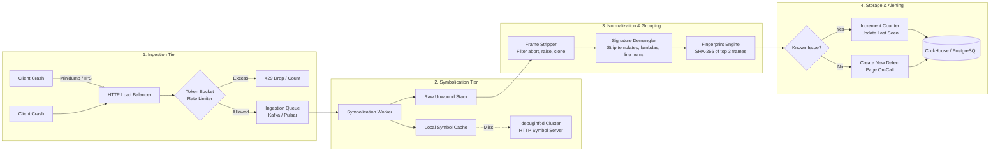

# Core Dumps, Minidumps, and Crash Reporting

> [!summary] Claim:
> A crash artifact captures a dying process's CPU registers, signal state, loaded module identifiers, and memory pages at the instant of fatal termination.
> Linux kernel core dumps stream ELF `ET_CORE` images whose `PT_NOTE` segments serialize thread registers (`NT_PRSTATUS`), mapped files (`NT_FILE`), and fault details (`NT_SIGINFO`), filtered by `/proc/[pid]/coredump_filter` and `MADV_DONTDUMP`.
> Out-of-process supervisors like Crashpad intercept faults via Mach exception ports (`EXC_CRASH`) or Unix socket handshakes, serializing lightweight minidumps (a selected subset of process state rather than the whole address space) that isolate unwinding from corrupted heaps.
> Fleet-scale crash reporting pipelines normalize inline frames, strip ephemeral variables, and generate deterministic stack hashes to cluster millions of raw crashes into deduplicated engineering defects.

```mermaid
flowchart TD
    subgraph CRASH["Fatal Process Fault"]
        SIG["Fatal Signal / Exception<br/>SIGSEGV, SIGBUS, SIGABRT, EXC_BAD_ACCESS"]
    end

    subgraph LINUX_KERNEL["Linux Kernel (fs/coredump.c)"]
        CHK{"Check Gate:<br/>dumpable flag (PR_SET_DUMPABLE,<br/>suid_dumpable after credential change)<br/>RLIMIT_CORE (file targets only)"}
        CP{"/proc/sys/kernel/core_pattern"}
        PIPE["Pipe (|)<br/>Piped to user-space handler"]
        FILE["Disk File<br/>core.%p or relative/absolute path"]
        FILTER["Memory Filter<br/>/proc/[pid]/coredump_filter<br/>MADV_DONTDUMP"]
        ELF["ELF ET_CORE<br/>PT_NOTE: NT_PRSTATUS, NT_FILE, NT_SIGINFO<br/>PT_LOAD: Filtered Memory Segments"]
    end

    subgraph SYSTEMD["systemd-coredump"]
        SD_PIPE["systemd-coredump stdin (%P %u %g %s %t %c %h)"]
        SD_CONF["coredump.conf<br/>Storage=external | Compress=yes"]
        JOURNAL["Systemd Journal Metadata<br/>Stack trace, UID, Comm, Signal"]
        ZSTD["/var/lib/systemd/coredump/<br/>core.*.zst"]
        CTL["coredumpctl gdb / debug"]
    end

    subgraph DARWIN["macOS / Darwin (XNU)"]
        MACH["Mach Exception Port<br/>EXC_BAD_ACCESS"]
        RC["ReportCrash Daemon"]
        IPS["DiagnosticReports (*.ips)<br/>RFC 8259 JSON format<br/>slice_uuid, threads, usedImages"]
        ATOS["xcrun atos / crashlog<br/>Symbolication via dSYM"]
    end

    subgraph CRASHPAD["Out-of-Process Crashpad"]
        CLIENT["Crashing Client Process<br/>Mach port / Unix domain socket"]
        HANDLER["crashpad_handler Supervisor<br/>Reads memory via ptrace / Mach VM"]
        DMP["Minidump Container (.dmp)<br/>MDMP Header + Stream Directory<br/>ThreadList, ModuleList, ExceptionStream"]
    end

    subgraph FLEET["Fleet Ingestion & Deduplication"]
        INGEST["HTTP Ingestion Endpoint<br/>Rate-limiting & Token Bucket"]
        SYM["Symbolication Worker<br/>minidump_stackwalk / Symbolicator"]
        DEB["debuginfod / Symbol Server<br/>Build ID & UUID Lookup"]
        NORM["Stack Normalizer<br/>Strip runtime frames, templates, lines"]
        HASH["Deduplication Engine<br/>Hierarchical Stack Fingerprint"]
        ISSUE["Aggregated Issue Tracker"]
    end

    SIG -->|Linux Kernel Fault| CHK
    CHK -->|Allowed| CP
    CP -->|Starts with '|'| PIPE
    CP -->|Path| FILE
    PIPE --> SD_PIPE
    FILE --> FILTER
    FILTER --> ELF
    SD_PIPE --> SD_CONF
    SD_CONF --> JOURNAL
    SD_CONF --> ZSTD
    ZSTD --> CTL

    SIG -->|Darwin Kernel Fault| MACH
    MACH --> RC
    RC --> IPS
    IPS --> ATOS

    SIG -->|Crashpad Intercept| CLIENT
    CLIENT -->|Out-of-Process Handshake| HANDLER
    HANDLER --> DMP
    DMP --> INGEST

    IPS --> INGEST
    INGEST --> SYM
    SYM <--> DEB
    SYM --> NORM
    NORM --> HASH
    HASH --> ISSUE

    ELF -.->|Diagnostic Target| CTL
    DMP -.->|Post-Mortem Triage| CTL
```

## The Mechanism

Post-mortem crash capture converts an ephemeral hardware exception or software abort into a durable, post-mortem diagnostic image.
The operating system, container runtime, and application libraries must cooperate to preserve execution state without exhausting disk input-output, deadlocking in corrupted process memory, or leaking sensitive customer data.

### 1. Linux Kernel Crash Capture Pipeline

When a thread encounters an unhandled fatal signal, the Linux kernel terminates all threads in the thread group and enters `do_coredump()` in `fs/coredump.c` (as of Linux v6.12; current mainline enters through `vfs_coredump()`, which calls a static `do_coredump()`).
The signals that trigger a core dump by default are defined by POSIX and the Linux signal architecture:
`SIGQUIT` (3), `SIGILL` (4), `SIGTRAP` (5), `SIGABRT` (6), `SIGBUS` (7), `SIGFPE` (8), `SIGSEGV` (11), `SIGXCPU` (24), `SIGXFSZ` (25), and `SIGSYS` (31).
Fatal signals such as `SIGKILL` (9), `SIGINT` (2), `SIGTERM` (15), and `SIGPIPE` (13) terminate the process immediately without invoking the core dumping subsystem.

Before allocating resources or writing bytes to disk, `do_coredump()` evaluates four gate conditions.
In the v6.12 source the dumpable check runs first, then `core_pattern` is parsed, and only then are the size limit (file targets) and `core_pipe_limit` (pipe targets) applied; the list below is grouped by concern, not by execution order:

1. **Resource Limits (`RLIMIT_CORE`):**
   The kernel reads the calling process's soft core dump resource limit (`current->signal->rlim[RLIMIT_CORE].rlim_cur`).
   For a file target, a limit below the binary format's `min_coredump` (so a limit of 0) abandons the dump (`if (cprm.limit < binfmt->min_coredump)` in v6.12).
   When writing to a regular file, the core file size is truncated at `rlim_cur` bytes.
   When writing to a piped user-space helper via `/proc/sys/kernel/core_pattern`, `RLIMIT_CORE` is not enforced (`core(5)`); the limit is forwarded to the helper as the `%c` specifier, and the helper decides (`systemd-coredump` processes a dump only when `RLIMIT_CORE` is sufficient).
   The one exception is a limit of exactly 1, which aborts a piped dump: the kernel sets the helper's own `RLIMIT_CORE` to `{1, 1}` so a crashing helper cannot recurse (`umh_pipe_setup()` in v6.12).

2. **Privilege Changes and Credentials (`suid_dumpable`):**
   If a process has invoked `setuid()`, `setgid()`, changed its filesystem UID/GID, or gained capabilities via `setcap`, the kernel clears its internal `dumpable` flag to prevent unauthorized memory inspection.
   The kernel checks `/proc/sys/fs/suid_dumpable`:
   - `0` (`SUID_DUMP_DISABLE`, default): The process does not produce a core dump.
   - `1` (`SUID_DUMP_USER`): The process dumps core, and the output file is created with the process's own (filesystem) credentials, because `filp_open()` runs as the dumping task.
     This mode is insecure for shared environments because non-root users can read memory areas previously mapped by setuid binaries.
   - `2` (`SUID_DUMP_ROOT` / "suidsafe"): Since Linux 3.6 the process dumps core only if `/proc/sys/kernel/core_pattern` specifies an absolute path starting with `/` or a pipe starting with `|` (`core(5)`).
     The kernel forces the fsuid to root before creating the file, so a disk file is owned by root; every core file is created with mode `0600` (`filp_open(..., 0600)` in v6.12).
   An unprivileged process can control its dumpability directly using `prctl(PR_SET_DUMPABLE, SUID_DUMP_USER)`.

3. **Core Pattern Resolution (`/proc/sys/kernel/core_pattern`):**
   The sysctl string (maximum 128 bytes, defined by `CORENAME_MAX_SIZE`) dictates whether the core dump is written to a filesystem path or piped to a user-space helper.
   If the first character is a pipe symbol (`|`), the kernel splits the remaining string on spaces into an executable path and command-line arguments.
   The helper runs as user and group root, in the initial namespaces (PID, mount, user, and so on), with the root directory as its working directory (`core(5)`); the command line is limited to 128 bytes in total.
   It is spawned by the usermode-helper machinery with `CLONE_PARENT`, which makes it a child of `kthreadd` (PID 2), not of PID 1 (`call_usermodehelper_exec_work()` in `kernel/umh.c`, v6.12).
   The core dump data is streamed directly into the helper's standard input (`stdin`, file descriptor 0).
   The kernel substitutes format specifiers during pipe command construction:
   - `%p`: PID of the dumped process as viewed in its own PID namespace.
   - `%P`: Global PID of the dumped process in the initial root PID namespace (added in Linux 3.12).
   - `%i`: Thread ID (TID) of the crashing thread in its own PID namespace.
   - `%I`: Global TID of the crashing thread in the initial root PID namespace.
   - `%u`: Numeric real UID of the dumped process.
   - `%g`: Numeric real GID of the dumped process.
   - `%s`: Number of the signal that triggered the termination.
   - `%t`: Epoch timestamp (seconds since 1970-01-01 00:00:00 UTC).
   - `%h`: Hostname of the system.
   - `%e`: The process or thread `comm` value, usually the executable filename truncated to 15 characters.
   - `%E`: Full executable path with forward slashes replaced by exclamation marks (Linux 3.0+).
   - `%c`: Soft resource limit `RLIMIT_CORE` of the crashed process (Linux 2.6.24+).
   - `%d`: Dump mode, the value `prctl(PR_GET_DUMPABLE)` returns (`1` for normal, `2` for suidsafe; Linux 3.7+).
   Newer specifiers include `%f` (actual executable filename, Linux 5.9), `%C` (CPU the task ran on, Linux 6.2), and `%F` (pidfd of the dumped process, Linux 6.16) (`core(5)`, as of 2026-11).
   Current mainline `fs/coredump.c` also accepts a leading `@` (coredump socket) or `@@` (socket request protocol) instead of `|` (as of 2026-11; first release not checked).

4. **Concurrent Pipe Throttling (`/proc/sys/kernel/core_pipe_limit`):**
   When piping core dumps to user-space helpers, `/proc/sys/kernel/core_pipe_limit` bounds the number of concurrent piped crash handlers.
   If `core_pipe_limit` is greater than 0 and the count of currently active pipe processes reaches this threshold, the kernel drops the core dump, terminates the crashing process, and logs `over core_pipe_limit, skipping core dump` to `dmesg` (through `coredump_report_failure()` in v6.12).
   If `core_pipe_limit` is set to `0` (the kernel default), concurrency is unlimited; however, the kernel does not wait for helper processes to exit, which can cause race conditions if the helper inspects the crashing process's `/proc/[pid]/` status files before process cleanup.

```text
/proc/sys/kernel/core_pattern configuration:
|/usr/lib/systemd/systemd-coredump %P %u %g %s %t %c %h
```

`systemd-coredump(8)` is the pipe crash receiver on distributions that enable it; it installs `/usr/lib/sysctl.d/50-coredump.conf`, which sets this `core_pattern`, `kernel.core_pipe_limit=16`, and `fs.suid_dumpable=2` (systemd `sysctl.d/50-coredump.conf.in`, as of 2026-11).
On kernels that support the coredump socket protocol, current systemd instead points `core_pattern` at `@@/run/systemd/coredumpd/kernel` (`systemd-coredump(8)`, as of 2026-11).
It is not the only receiver: Canonical's apport writes its own piped `core_pattern` (`|.../apport -p%p -s%s -c%c ...`) and sets `fs.suid_dumpable` to 2 when it starts (`start_apport()` in the apport source `data/apport`), so which receiver a host uses depends on the distribution and on what is enabled.
Upon receiving the core stream on stdin, it reads `/proc/[pid]/` metadata for the target global PID `%P`, attempts to extract a backtrace, and logs structured crash fields to the system journal (`MESSAGE`, which carries the backtrace when one was generated, plus `COREDUMP_EXE`, `COREDUMP_SIGNAL`, `COREDUMP_PID`, `COREDUMP_PROC_MAPS`, and others; there is no `COREDUMP_STACK` field).
It compresses the full ELF stream using zstd, lz4, or xz and stores the resulting file in `/var/lib/systemd/coredump/core.<comm>.<uid>.<boot_id>.<pid>.<timestamp in microseconds>`, plus a compression suffix such as `.zst` (the `asprintf()` format in `src/coredump/coredump-submit.c`, as of 2026-11).
Storage behavior is configured in `/etc/systemd/coredump.conf`:
`Storage=external` persists the compressed core to disk, `Storage=journal` stores it inside the journal database (limited by `JournalSizeMax=`), and `Storage=none` logs the stack trace while discarding the binary image.
`ProcessSizeMax=` and `ExternalSizeMax=` (defaulting to 32 GiB on 64-bit systems and 1 GiB on 32-bit systems; `JournalSizeMax=` defaults to 767 MiB) prevent disk exhaustion from large memory footprints, and `MaxUse=` (default 10% of the disk, capped at 4 GiB) and `KeepFree=` (default 15%, capped at 4 GiB) bound the total store (`coredump.conf(5)`, as of 2026-11).

### 2. ELF Core File Structure (`ET_CORE`) and Memory Filtering

The Linux kernel constructs core dump files using the Executable and Linkable Format (ELF) specified in `fs/binfmt_elf.c`.
The ELF header (`Elf64_Ehdr`) sets `e_type = ET_CORE` (constant value `4`).
An ELF core file normally contains no section headers (`e_shoff = 0`; the one exception is a single extended-numbering section header the kernel writes when there are more than `PN_XNUM` segments); it is structured as an array of program headers (`Elf64_Phdr`) pointing to two classes of segments:
a single `PT_NOTE` segment containing thread and process metadata, followed by multiple `PT_LOAD` segments containing the contents of the process's virtual memory areas.

```text
+-------------------------------------------------------+
| ELF Header (Elf64_Ehdr): e_type = ET_CORE (4)         |
+-------------------------------------------------------+
| Program Header Table:                                 |
|   1. PT_NOTE: Offset to Process Metadata Notes       |
|   2. PT_LOAD: Memory Segment 1 (vaddr, filesz, memsz) |
|   3. PT_LOAD: Memory Segment 2                        |
|   ...                                                 |
|   N. PT_LOAD: Memory Segment N                        |
+-------------------------------------------------------+
| PT_NOTE Segment Payload:                              |
|   +-------------------------------------------------+ |
|   | Elf64_Nhdr ("CORE"): NT_PRSTATUS (Crashing TID) | |
|   |   struct elf_prstatus (pr_info, registers, ...) | |
|   +-------------------------------------------------+ |
|   | Elf64_Nhdr ("CORE"): NT_PRPSINFO                | |
|   |   struct elf_prpsinfo (pr_fname, pr_psargs)     | |
|   +-------------------------------------------------+ |
|   | Elf64_Nhdr ("CORE"): NT_SIGINFO                 | |
|   |   siginfo_t (si_signo, si_code, si_addr)        | |
|   +-------------------------------------------------+ |
|   | Elf64_Nhdr ("CORE"): NT_AUXV                    | |
|   |   Auxiliary Vector (AT_PHDR, AT_ENTRY, ...)     | |
|   +-------------------------------------------------+ |
|   | Elf64_Nhdr ("CORE"): NT_FILE                    | |
|   |   Mapped file table (start, end, ofs, paths)    | |
|   +-------------------------------------------------+ |
|   | Elf64_Nhdr ("CORE"): NT_PRSTATUS (Thread 2)     | |
|   +-------------------------------------------------+ |
|   | Elf64_Nhdr ("LINUX"): NT_X86_XSTATE / NT_ARM_TLS| |
+-------------------------------------------------------+
| PT_LOAD Data Segments:                                |
|   Raw memory bytes corresponding to filtered VMAs     |
+-------------------------------------------------------+
```

Each note inside the `PT_NOTE` segment begins with an `Elf64_Nhdr` header:
`n_namesz` (length of the owner name string including null terminator), `n_descsz` (size of descriptor payload in bytes), and `n_type` (numeric note identifier).
The name field is padded with trailing null bytes to a 4-byte boundary, and the descriptor payload is similarly padded.
In Linux core dumps, the note owner name is `"CORE"` or `"LINUX"`.
The standard notes emitted by `fs/binfmt_elf.c` include:

- **`NT_PRSTATUS` (type 1, owner `"CORE"`):**
  Serialized as `struct elf_prstatus` (defined in `<linux/elfcore.h>`).
  The kernel emits one `NT_PRSTATUS` note for every active thread in the process.
  The first `NT_PRSTATUS` note always corresponds to the thread that received the fatal signal.
  Its fields contain:
  - `pr_info`: A `struct elf_siginfo` recording `si_signo`, `si_code`, and `si_errno`.
  - `pr_cursig`: Signal number being handled.
  - `pr_pid`: Thread identifier (`pid_t`).
  - `pr_utime`, `pr_stime`: User and system CPU execution time counters.
  - `pr_reg`: An architecture-dependent `elf_gregset_t` array containing general-purpose CPU registers at the moment of the crash.
    On x86-64, this holds 27 64-bit registers: `R15`, `R14`, `R13`, `R12`, `RBP`, `RBX`, `R11`, `R10`, `R9`, `R8`, `RAX`, `RCX`, `RDX`, `RSI`, `RDI`, `ORIG_RAX`, `RIP`, `CS`, `EFLAGS`, `RSP`, `SS`, `FS_BASE`, `GS_BASE`, `DS`, `ES`, `FS`, `GS`.
    On AArch64, it holds 34 64-bit registers: `X0` through `X30`, `SP`, `PC`, and `PSTATE`.

- **`NT_PRPSINFO` (type 3, owner `"CORE"`):**
  Serialized as `struct elf_prpsinfo`.
  Contains high-level process accounting details:
  `pr_state` (numeric process state), `pr_uid`, `pr_gid`, `pr_pid`, `pr_fname[16]` (the executable basename, truncated to 16 bytes), and `pr_psargs[80]` (the first 80 characters of the command-line argument string).

- **`NT_SIGINFO` (type `0x53494749`, owner `"CORE"`):**
  Contains the full, raw `siginfo_t` structure.
  This note provides `si_addr`, which records the exact memory address that caused a memory fault (e.g., null dereference or unmapped page in `SIGSEGV`, alignment error or truncated mmap in `SIGBUS`).

- **`NT_FILE` (type `0x46494c45`, owner `"CORE"`):**
  Introduced in Linux 3.7 to map core file virtual memory addresses back to on-disk binaries and libraries without embedding read-only executable pages into the dump.
  The descriptor layout consists of:
  1. `count` (`unsigned long`): Total number of mapped file segments.
  2. `page_size` (`unsigned long`): Host page size (typically 4096).
  3. An array of `count` entries, each containing three `unsigned long` values: `vm_start` (starting virtual address), `vm_end` (ending virtual address), and `file_ofs` (offset in the backing file, measured in units of `page_size`).
  4. A sequence of `count` null-terminated ASCII strings containing the absolute filesystem paths of the mapped files.
  Debuggers read `NT_FILE` to identify which shared libraries were loaded at which addresses, enabling symbol resolution through [[Symbol-Servers-and-debuginfod]].

- **`NT_AUXV` (type 6, owner `"CORE"`):**
  Contains an array of `Elf64_auxv_t` key-value pairs transferred from the kernel to user space during `execve()`.
  This records essential runtime addresses including `AT_PHDR` (program header address), `AT_ENTRY` (entry point), `AT_BASE` (dynamic linker base address), `AT_PAGESZ` (page size), and `AT_SYSINFO_EHDR` (virtual dynamic shared object, or vDSO, location).

- **`NT_X86_XSTATE` (type `0x202`, owner `"LINUX"`):**
  Emitted on x86 architectures to capture extended processor register states, including AVX, AVX-512, and AMX register files managed by the `XSAVE`/`XRSTOR` instructions.

Memory filtering determines which virtual memory areas (VMAs) produce `PT_LOAD` segments in the ELF output.
The filter is configured per-process via `/proc/[pid]/coredump_filter` (inherited across `fork()` and preserved across `execve()`).
The filter is a bitmask of mapping types:
- Bit 0 (`0x01`): Anonymous private memory (default on).
- Bit 1 (`0x02`): Anonymous shared memory (default on).
- Bit 2 (`0x04`): File-backed private memory (default off).
- Bit 3 (`0x08`): File-backed shared memory (default off).
- Bit 4 (`0x10`): ELF header pages of binary mappings (default on).
- Bit 5 (`0x20`): Private huge pages (hugetlb) (default on).
- Bit 6 (`0x40`): Shared huge pages (hugetlb) (default off).
- Bit 7 (`0x80`): Private DAX pages (Direct Access, non-volatile memory) (default off).
- Bit 8 (`0x100`): Shared DAX pages (default off).

The standard Linux kernel default filter is `0x33` (bits 0, 1, 4, and 5 enabled, decimal value 51; bit 4 only when `CONFIG_CORE_DUMP_DEFAULT_ELF_HEADERS` is enabled, per `core(5)` and `MMF_DUMP_FILTER_DEFAULT` in `include/linux/sched/coredump.h`).
This dumps all private and shared anonymous heap, stack, and mmap allocations, along with private huge pages and ELF file headers, while excluding large file-backed binaries.
Bit 4 dumps the whole first page of each mapping that starts with an ELF header, so when a small binary's `.rodata` shares that page (no `-z separate-code` layout), string literals land in the core.
Programmatic exclusion is achieved using `madvise(addr, length, MADV_DONTDUMP)` (Linux 3.4+).
Pages marked with `MADV_DONTDUMP` are skipped during core dump generation regardless of `/proc/[pid]/coredump_filter`.
This allows applications to exclude multi-gigabyte cache pools, memory-mapped databases, or private cryptographic keys from disk serialization, preventing disk exhaustion and security exposure.
`madvise(addr, length, MADV_DODUMP)` clears the flag.

### 3. macOS Crash Reporting and Mach-O Cores

Under macOS (Darwin / XNU kernel), native crash handling is rooted in Mach exception architecture rather than POSIX signals.
Hardware-level CPU traps (e.g., page translation faults, undefined instructions, floating-point traps) are intercepted by the XNU kernel and translated into Mach exceptions:
`EXC_BAD_ACCESS`, `EXC_BAD_INSTRUCTION`, `EXC_ARITHMETIC`, or `EXC_BREAKPOINT`.
The kernel dispatches the exception to a Mach exception port registered at the thread, task, or host level.
An exception nobody handles becomes a POSIX signal, and a process that dies from it raises the software exception `EXC_CRASH`; Crashpad's macOS client notes that "EXC_CRASH is how most crashes are received".

When an application fails to handle an exception, XNU forwards the message to the host crash reporter daemon (`/System/Library/CoreServices/ReportCrash`); Crashpad's source comments say that since macOS 10.15 the system crash reporter generates a report only when an `EXC_CORPSE_NOTIFY` exception is generated, and that forwarding `EXC_CRASH` to it is not sufficient (`handler/mac/crash_report_exception_handler.cc`).
`ReportCrash` inspects the target task across Mach boundaries using `task_threads()`, `thread_get_state()`, and `vm_read()`.
It extracts the register context and call stack for every thread, correlates virtual memory addresses with dynamic loader (`dyld`) load commands, and formats the diagnostic artifact as an `.ips` file: a one-line JSON header object followed by a JSON body object (observed on a local macOS 27 `bug_type` 309 crash report, as of 2026-11).

On macOS, `.ips` crash logs are stored in:
- `~/Library/Logs/DiagnosticReports/` for user-space GUI and CLI applications.
- `/Library/Logs/DiagnosticReports/` for root daemons and system-wide background agents.

The modern macOS `.ips` crash log contains a header line of execution metadata followed by a JSON body (field names observed in a local crash report, as of 2026-11):
- `app_name` (header): Binary executable name.
- `timestamp` (header): Local wall-clock time of the crash with its UTC offset (for example `2026-11-08 01:09:57.00 -0500`).
- `os_version` (header): Operating system build identifier.
- `incident_id` (header): Unique UUID generated for this crash instance; the header also carries `slice_uuid`, `bug_type`, and `app_version`.
- `exception` (body): Object detailing the Mach failure (`type: "EXC_BAD_ACCESS"`), POSIX translation (`signal: "SIGSEGV"`), the exception codes as a comma-separated string (`codes`) and as integers (`rawCodes`), and, for some types, a readable `subtype` (`"KERN_INVALID_ADDRESS at 0x0000000000000000"`; `subtype` not observed locally).
- `faultingThread`: Index of the thread that raised the exception.
- `threads`: Array of thread objects (`id`, `triggered`, `queue`, `threadState`, `frames`).
  Each thread contains an array of `frames`, where each frame specifies an `imageIndex` (pointing to the binary image table), `imageOffset` (byte offset from the image load address), and optional pre-symbolicated `symbol` and `symbolLocation`.
- `usedImages`: Array of loaded Mach-O dynamic libraries and executables.
  Each entry specifies the binary `name`, `path`, `source`, memory load `base`, `size`, architecture (`arm64` or `x86_64`), and its 128-bit Mach-O `uuid` (derived from the `LC_UUID` load command).

The example below merges the header line and the body into one object for brevity.

```json
{
  "app_name": "order_matcher",
  "timestamp": "2026-11-08 05:42:10.00 +0000",
  "incident_id": "9B2F1C28-4E4A-4A73-A785-5B5A18C16259",
  "exception": {
    "type": "EXC_BAD_ACCESS",
    "signal": "SIGSEGV",
    "subtype": "KERN_INVALID_ADDRESS at 0x0000000000000000",
    "codes": "0x0000000000000001, 0x0000000000000000",
    "rawCodes": [1, 0]
  },
  "faultingThread": 0,
  "threads": [
    {
      "triggered": true,
      "id": 14295,
      "frames": [
        {"imageIndex": 0, "imageOffset": 4412},
        {"imageIndex": 1, "imageOffset": 128450}
      ]
    }
  ],
  "usedImages": [
    {
      "name": "order_matcher",
      "arch": "arm64",
      "base": 4364435456,
      "size": 65536,
      "uuid": "7a8b9c0d-1e2f-3a4b-5c6d-7e8f9a0b1c2d",
      "path": "/usr/local/bin/order_matcher"
    }
  ]
}
```

Symbolication of `.ips` files is performed using `atos` or `xcrun crashlog` (both present in Xcode's `usr/bin`, checked locally as of 2026-11).
`atos` takes the dSYM path and load address explicitly (`atos -o <dSYM> -l <base> <address>`); LLDB's `crashlog` script extracts the `uuid` from `usedImages` and locates a `.dSYM` bundle with the same `LC_UUID`: it runs `dsymForUUID` when that executable exists, and otherwise queries Spotlight with `mdfind "com_apple_xcode_dsym_uuids == <uuid>"` (`lldb/examples/python/crashlog.py`, LLVM main, as of 2026-11).
Either way the call address is $\text{address} = \text{base} + \text{imageOffset}$.

macOS also supports legacy Mach-O core dump generation (`kern.coredump=1`), written to `/cores/core.<PID>`.
Mach-O core files begin with a `mach_header_64` whose `filetype` is `MH_CORE` (constant `4`), followed by `LC_SEGMENT_64` commands dumping VM pages and `LC_THREAD` commands encoding register flavors (`ARM_THREAD_STATE64` or `x86_THREAD_STATE64`).
In practice no cores appear by default even though `kern.coredump` is `1` and `kern.corefile` is `/cores/core.%P` (observed on Darwin 27.2, as of 2026-11): shells start with a soft `RLIMIT_CORE` of 0, and `/cores` is `drwxr-xr-x root wheel`, so non-root processes cannot write there.
Enabling it requires `ulimit -c unlimited`, write permission on `/cores`, and for processes spawned by launchd a raised launchd limit set by a privileged user with `launchctl limit core unlimited` (macOS `core(5)`, read locally on Darwin 27.2; `launchctl limit core` printed `core 0 unlimited` there, as of 2026-11).

### 4. Minidumps and the Out-of-Process Crashpad Architecture

While full ELF core dumps provide complete memory fidelity, they present severe operational drawbacks for client applications, distributed microservices, and edge appliances:
1. **Payload Size:** A full core dump scales with process RSS (often 100 MiB to 32 GiB).
   Uploading multi-gigabyte files across wide-area networks during outage spikes saturates ingress bandwidth and exhausts server storage.
2. **Privacy and PII Exposure:** Dumping anonymous memory regions inevitably captures raw application data, including decrypted TLS sessions, API tokens, passwords, and sensitive customer records.
3. **In-Process Unreliability:** Legacy crash reporters (such as Google Breakpad) execute an in-process signal handler within the crashed process.
   If the crash was caused by heap metadata corruption, stack exhaustion, or lock deadlocks, running user-space code inside the damaged address space inevitably triggers secondary crashes, deadlocks on internal allocator locks, or violates container sandbox policies.

The Minidump format, originally designed for Windows `MiniDumpWriteDump()` (`dbghelp.dll`) and adapted as a cross-platform standard by Breakpad and Crashpad, solves these constraints.
A minidump container (`.dmp`) stores only thread execution registers, thread stack memory slices, loaded module manifests, and targeted runtime annotations, so the artifact is much smaller than a full core; Crashpad's design document says the handler captures "a heuristically selected subset of the full state".

A minidump file begins with a 32-byte header (`MINIDUMP_HEADER`, defined in `minidump_format.h`):
- `Signature`: 4-byte magic constant `0x504d444d` (`MINIDUMP_SIGNATURE`, ASCII `"MDMP"`).
- `Version`: 32-bit version number (`MINIDUMP_VERSION`, low 16 bits `0xa793` = 42899).
- `NumberOfStreams`: 32-bit count of data streams cataloged in the stream directory.
- `StreamDirectoryRva`: Relative Virtual Address (32-bit byte offset from the beginning of the file) pointing to the stream directory array.
- `CheckSum`: Checksum field (commonly 0).
- `TimeDateStamp`: 32-bit Unix epoch timestamp.
- `Flags`: 64-bit bitmask (`MINIDUMP_TYPE`) defining dump options.

The stream directory is an array of `MINIDUMP_DIRECTORY` structures.
Each entry maps a 32-bit `StreamType` to a `MINIDUMP_LOCATION_DESCRIPTOR` (`DataSize` and `Rva` offset).
Standard stream types include:
- `ThreadListStream` (`3`): Points to `MINIDUMP_THREAD_LIST`.
  For each thread, it stores the Thread ID, an architecture-specific `CONTEXT` structure (CPU general-purpose and floating-point registers), and a `MINIDUMP_MEMORY_DESCRIPTOR` containing the base virtual address and raw byte content of the thread's active stack.
- `ModuleListStream` (`4`): Points to `MINIDUMP_MODULE_LIST`.
  Enumerates all mapped shared libraries and executables.
  Each module entry records its virtual base address, size, checksum, timestamp, and a pointer to a `CodeView` record (`CV_INFO_PDB70` or `CV_INFO_ELF`).
  On Linux, the `CodeView` record holds the full GNU Build ID, whose length depends on the linker style (20 bytes for `--build-id=sha1`, 16 for `md5` or `uuid`).
  On macOS, it holds the 16-byte Mach-O `LC_UUID`.
- `MemoryListStream` (`5`): Points to a list of explicitly dumped memory ranges (e.g., globals or referenced data structures).
- `ExceptionStream` (`6`): Points to `MINIDUMP_EXCEPTION_STREAM`.
  Records the crashing Thread ID, the exception code, exception flags, and the memory address where the fault occurred.
- `SystemInfoStream` (`7`): Points to `MINIDUMP_SYSTEM_INFO`.
  Records OS major/minor/build version, CPU architecture (`PROCESSOR_ARCHITECTURE_AMD64` = 9, `PROCESSOR_ARCHITECTURE_ARM64` = 12), and CPU core counts.
- `CrashpadInfoStream` (`0x43500001`): Crashpad extension stream (`MINIDUMP_CRASHPAD_INFO`).
  Stores pointers to process-level key-value annotations (`crashpad::AnnotationList`), module-level annotations, and user data dictionaries.

The layout below is illustrative, not taken from a real dump.
The 32-byte header, the 12-byte directory entries, and the sizes of the fixed-size `ExceptionStream` (168 bytes) and `SystemInfoStream` (56 bytes) are exact; the other sizes are placeholders (a real `MiscInfoStream` is one of the fixed `MINIDUMP_MISC_INFO_N` sizes, not `0x48`).

```text
Minidump (.dmp) File Layout:
+-------------------------------------------------------------+
| MINIDUMP_HEADER (32 bytes):                                 |
|   Signature: 0x504d444d ("MDMP")                            |
|   Version: 42899 | NumberOfStreams: 6                       |
|   StreamDirectoryRva: 0x00000020                            |
+-------------------------------------------------------------+
| MINIDUMP_DIRECTORY Table (6 x 12 bytes = 72 bytes):         |
|   1. ThreadListStream    (3) -> Rva: 0x0068, Size: 0x01A0   |
|   2. ModuleListStream    (4) -> Rva: 0x0208, Size: 0x0840   |
|   3. ExceptionStream     (6) -> Rva: 0x0A48, Size: 0x00A8   |
|   4. SystemInfoStream    (7) -> Rva: 0x0AF0, Size: 0x0038   |
|   5. MiscInfoStream     (15) -> Rva: 0x0B28, Size: 0x0048   |
|   6. CrashpadInfoStream (0x43500001) -> Rva: 0x0B70         |
+-------------------------------------------------------------+
| Stream Data Payloads:                                       |
|   Thread Contexts & Stack Memories (ThreadListStream)       |
|   Loaded Modules & GNU Build IDs / UUIDs (ModuleListStream) |
|   Crashing Exception Record (ExceptionStream)               |
|   OS & Hardware Versioning (SystemInfoStream)               |
|   Crashpad Key-Value Annotations (CrashpadInfoStream)       |
+-------------------------------------------------------------+
```

Google Crashpad replaces Breakpad's unsafe in-process signal handler with a supervised out-of-process architecture:
At application startup, the client initializes the Crashpad client library, which spawns an independent companion process (`crashpad_handler`).
The capture mechanisms differ fundamentally by platform:

- **macOS:**
  Crashpad registers a port monitored by `crashpad_handler` as the client task's exception port with mask `EXC_MASK_CRASH | EXC_MASK_RESOURCE` (plus `EXC_MASK_GUARD` before macOS 10.13), behavior `EXCEPTION_STATE_IDENTITY | MACH_EXCEPTION_CODES`, and flavor `MACHINE_THREAD_STATE` (`SetCrashExceptionPorts()` in `client/crashpad_client_mac.cc`).
  It does not take `EXC_BAD_ACCESS` directly; the source comment says such exceptions go to the host-level handler and "EXC_CRASH is how most crashes are received", after the fault has been converted to a fatal signal.
  The design document states that the handler needs no code "in the crash process at the time of the exception"; signal handlers the application installed itself still run before `EXC_CRASH` is raised.
  `crashpad_handler` reads client task memory across process boundaries using Mach VM calls (`mach_vm_read()`) and serializes the minidump to its local crash database.
  When system crash reporter forwarding is not disabled, the handler returns `MACH_RCV_PORT_DIED` for `EXC_CRASH`, which stops the kernel from searching for another handler and makes it raise `EXC_CORPSE_NOTIFY`; otherwise it returns `KERN_SUCCESS` (`CrashReportExceptionHandler::CatchMachException()` in `handler/mac/crash_report_exception_handler.cc`).

- **Linux:**
  Linux lacks kernel-level task exception ports, so Crashpad uses an async-signal-safe inter-process communication handshake.
  At startup, the client connects to `crashpad_handler` via a Unix domain socket pair and registers a POSIX signal handler on an alternate signal stack (`sigaltstack`).
  When a fatal signal arrives, the client's signal handler runs minimal async-signal-safe code: it sends a `kTypeCrashDumpRequest` message carrying its credentials over the socket (`UnixCredentialSocket::SendMsg()`), calls `prctl(PR_SET_PTRACER, pid, 0, 0, 0)` when the handler asks for ptrace permission, and then waits: with a shared handler it blocks in `sigtimedwait()` for the dump-done signal with a 5-second timeout, and with a private connection it blocks reading the socket until a `kTypeCrashDumpComplete` or `kTypeCrashDumpFailed` message (`util/linux/exception_handler_client.cc`).
  The `crashpad_handler` process wakes up, attaches to the client threads via ptrace (directly or through a ptrace broker process), reads memory through `/proc/[pid]/mem` with `pread64()` (`ProcessMemoryLinux` in `util/process/process_memory_linux.cc`) or, when that is unavailable, through the ptrace broker, reads the mappings from `/proc/[pid]/maps`, captures the register contexts and stack contents, writes the minidump file, and detaches, allowing the client to terminate.

## Commands and Numbers to Know

| Item | Value | Platform and date | What it controls |
| :--- | :--- | :--- | :--- |
| `kernel.core_pattern` | `core` (kernel default) or `\|/usr/lib/systemd/systemd-coredump ...` | Linux (as of 2026-11) | Sysctl defining the template path or piped user-space binary for ELF core dumping |
| `fs.suid_dumpable` | `0` (traditional), `1` (debug), `2` (suidsafe) | Linux (as of 2026-11) | Kernel gate governing core dumps for processes that changed UID/GID or capabilities |
| `kernel.core_pipe_limit` | `0` (kernel default: unlimited, no wait) or `16` (set by systemd's `50-coredump.conf`) | Linux (as of 2026-11) | Maximum concurrent processes permitted to pipe core dumps to user-space helpers |
| `kernel.core_uses_pid` | `0` (default) or `1` | Linux (as of 2026-11) | Appends `.PID` to the core filename when `core_pattern` does not contain `%p` |
| `/proc/[pid]/coredump_filter` | `0x33` (51 decimal) | Linux (as of 2026-11) | Bitmask selecting memory mapping types dumped into ELF PT_LOAD segments |
| `MADV_DONTDUMP` | Flag value `16` in `sys/mman.h` | Linux (as of 2026-11) | `madvise()` flag excluding specific virtual memory address ranges from core dumps |
| `RLIMIT_CORE` | Soft `0` in macOS shells (observed); on Linux, systemd PID 1 sets it to `infinity` for its children (`systemd-system.conf(5)`) | Both (as of 2026-11) | Soft resource limit governing maximum core dump file size in bytes |
| `Storage=` (`coredump.conf`) | `external` (default), `journal`, `none` | Linux (as of 2026-11) | Directs `systemd-coredump` to persist compressed cores, log to journal, or drop |
| `ProcessSizeMax=` | `32G` (64-bit) / `1G` (32-bit) | Linux (as of 2026-11) | Maximum size of an uncompressed core dump that `systemd-coredump` will process |
| `ExternalSizeMax=` | `32G` (64-bit) / `1G` (32-bit) | Linux (as of 2026-11) | Maximum (compressed or uncompressed) size of a core saved on disk in `/var/lib/systemd/coredump/` |
| `kern.coredump` | `1` (observed default, Darwin 27.2) | macOS (as of 2026-11) | Kernel toggle enabling legacy Mach-O core generation to `kern.corefile` (`/cores/core.%P`) |
| macOS `/cores` permission | `drwxr-xr-x root wheel` (observed, Darwin 27.2) | macOS (as of 2026-11) | Only root can write cores there by default; non-root dumping needs the directory opened up |
| Minidump Signature | `0x504d444d` (`"MDMP"`) | Both (as of 2026-11) | 32-bit magic header identifier for Windows / Crashpad minidump files |
| Minidump Version | `42899` (`0xa793`) | Both (as of 2026-11) | Standard 16-bit low-word version identifier inside `MINIDUMP_HEADER` |
| `ThreadListStream` | Stream Type `3` | Both (as of 2026-11) | Minidump directory stream indexing thread IDs, CPU registers, and stack pointers |
| `ModuleListStream` | Stream Type `4` | Both (as of 2026-11) | Minidump directory stream indexing loaded shared libraries, base addresses, and Build IDs |
| `ExceptionStream` | Stream Type `6` | Both (as of 2026-11) | Minidump directory stream recording the faulting thread ID and exception record |
| `CrashpadInfoStream` | Stream Type `0x43500001` | Both (as of 2026-11) | Crashpad custom stream storing client metadata and key-value annotation lists |
| `NT_PRSTATUS` | Note Type `1` (owner `"CORE"`) | Linux (as of 2026-11) | ELF core note containing `struct elf_prstatus` and thread general-purpose registers |
| `NT_PRPSINFO` | Note Type `3` (owner `"CORE"`) | Linux (as of 2026-11) | ELF core note containing `struct elf_prpsinfo`, executable name, and argument string |
| `NT_SIGINFO` | Note Type `0x53494749` (owner `"CORE"`) | Linux (as of 2026-11) | ELF core note containing raw `siginfo_t` and the faulting memory address `si_addr` |
| `NT_FILE` | Note Type `0x46494c45` (owner `"CORE"`) | Linux (as of 2026-11) | ELF core note containing mapped file ranges, page offsets, and file path strings |
| `NT_AUXV` | Note Type `6` (owner `"CORE"`) | Linux (as of 2026-11) | ELF core note recording auxiliary vectors passed from kernel during `execve()` |

## Multi-Language Comparison: C++ / Python / Rust

Crash reporting across compiled and managed languages exhibits diverging trade-offs between zero-cost hardware execution, signal safety, and runtime call stack preservation.

| Concern | C++ (Clang / GCC) | Python (CPython 3.12+) | Rust (rustc / Cargo) |
| :--- | :--- | :--- | :--- |
| **Crash Triggers** | Null pointer dereference (`SIGSEGV`), heap corruption (`SIGABRT`), `std::terminate()`, failed `assert()`. | Fatal C-extension segmentation faults, unhandled signals, or out-of-memory errors in underlying runtime. | Unrecoverable `panic!()` when compiled with `panic = "abort"`, explicit `std::process::abort()`, or unsafe memory bugs. |
| **Runtime Crash Interception** | `sigaction()` on alternate stack (`sigaltstack`); Crashpad client library; in-process signal handlers often deadlock. | `faulthandler.enable()` registers signal handlers that walk CPython frame chains and dump text tracebacks to stderr. | Custom panic hook (`std::panic::set_hook()`) formats backtraces before termination; unsafe faults bypass hooks. |
| **Memory State in Artifact** | Full ELF core dump includes native stack frames, heap objects, static buffers, and raw pointers. | ELF core contains CPython runtime state (`PyInterpreterState`, `PyThreadState`), requiring `python-gdb.py` to inspect Python frames. | ELF core contains native Rust frames; variables are subject to rustc and LLVM compiler optimizations. |
| **Minidump Client Library** | Official Crashpad C++ client (`crashpad::CrashpadClient`); registers Mach exception ports or ptrace signals. | Third-party C bindings or wrappers around Breakpad/Crashpad; rarely deployed for purely interpreted Python code. | Official Sentry Rust SDK (`sentry`), `crashpad-sys` wrappers, or minidump writer crates (`minidump-writer`). |
| **Symbolic Identifiers** | GNU Build ID (ELF `.note.gnu.build-id`) or Mach-O `LC_UUID` generated by linker. | Build ID embedded in `python` binary and compiled `.so` extension modules. | GNU Build ID or Mach-O `LC_UUID`; mangled symbol names use legacy or `v0` scheme (`_RNv...`). |
| **Stack Unwinding Metadata** | DWARF `.debug_frame`, `.eh_frame`, or Breakpad symbol files (`.sym`) derived from DWARF. | Internal CPython stack unwinding walks `PyFrameObject` structures on the heap via interpreter pointers. | DWARF `.eh_frame` or `.debug_frame`; Rust demangling handled during symbolication. |
| **Secret Memory Scrubbing** | `madvise(addr, len, MADV_DONTDUMP)` excludes sensitive allocations from core dumps. | Difficult to scrub individual Python strings or bytearrays due to small-object pymalloc heap pooling. | `madvise()` invoked via `libc::madvise` on custom allocators; `zeroize` crate clears registers on drop. |
| **Owning Sibling Notes** | [[Cpp-Playbook-Heap-Corruption\|Heap Corruption Playbook]] | [[Python-faulthandler-and-Crash-Diagnostics\|Python faulthandler]] | [[Rust-GDB-LLDB-Panics-and-Backtraces\|Rust Panics and Backtraces]] |

## Worked Example: End-to-End Crash Capture and Header Inspection

The lab is `code/03-Debugging/core_dump_filters/`; it needs `gcc`, `readelf`, and `python3` on Linux (`# requires: linux`).
Off Linux, `make verify` runs it in the pinned Ubuntu 24.04 container, where the kernel's `core_pattern` is the plain name `core`.
Every output block below is copied from `expected/linux-aarch64.txt`, recorded on linux-aarch64 (as of 2026-11-08); no linux-amd64 run exists yet, so the byte counts and note types named for aarch64 differ on x86-64.
The lab fails, rather than falling back to another mechanism, when `core_pattern` pipes to a handler or names a directory.

### Step 1: Compile with a GNU Build ID and check the premise

`crash.c` maps one page, fills it with a 32-byte secret computed at run time, optionally marks it `MADV_DONTDUMP`, and then stores to address 16, a NULL struct pointer plus a field offset, which raises `SIGSEGV`:

```c
static void fill(char *dst, int mul, int add, char base) {
    for (int i = 0; i < 32; i++) {
        dst[i] = (char)(base + (i * mul + add) % 26);
    }
    dst[32] = '\0';
}
```

```c
    fill(page, 7, 3, 'a');
    if (strcmp(mode, "runtime-plain") != 0 && madvise(page, 4096, MADV_DONTDUMP) != 0) {
        perror("madvise");
        return 2;
    }

    char *pub = malloc(128);
    fill(pub, 5, 1, 'A');
```

The secret is computed rather than written as a literal so that it exists nowhere in the executable; the lab greps the binary to prove it.
`literal.c` is a second, tiny program whose secret is a string literal, used in Step 4.
Both are built with the same command:

```bash
"${CC:-cc}" -g -O0 -fno-omit-frame-pointer -Wl,--build-id=sha1 crash.c -o crash
```

Output (linux-aarch64):

```text
== build ==
build id: 40 hex digits
run-time needle found in the binary: no
run-time needle found in the binary: no
literal needle found in the binary: yes
```

A SHA-1 Build ID is 20 bytes, 40 hex digits.
Neither run-time needle is in the binary, so a later hit in a core file came from process memory.
The literal needle is in `literal`, which is the point of that program.

### Step 2: Check the gates and trigger the crash

The lab refuses to continue unless `core_pattern` is a plain file name, then runs each variant in a subshell that sets the two per-process gates before `exec`:

```bash
( ulimit -c "$1"; echo "$2" > /proc/self/coredump_filter; exec "./$3" "${@:4}" report )
```

Output (linux-aarch64):

```text
== gates ==
core_pattern: a plain file name
core_uses_pid: 0
default coredump_filter: 00000033

== RLIMIT_CORE ==
ulimit -c 0: no core file
ulimit -c unlimited: core file written
```

`RLIMIT_CORE` 0 produced no file, and the same program with `unlimited` produced one.
The shell then reports exit status 139, which is 128 plus `SIGSEGV` (11); the lab fails if it sees anything else.
`00000033` is the kernel default for `coredump_filter`: bits 0, 1, 4, and 5.

### Step 3: Decode the ELF core headers and notes

`analyze.py anatomy` parses the core with `struct`, the same fields `readelf -h` and `readelf -n` print, because GNU `readelf` names the notes but does not decode `prstatus` or `siginfo` fields.
Output (linux-aarch64):

```text
== core anatomy (filter 0x33) ==
e_type: 4 (ET_CORE)
e_machine: EM_AARCH64
section headers: 0
PT_NOTE segments: 1
note types, in file order: NT_PRSTATUS NT_PRPSINFO NT_SIGINFO NT_AUXV NT_FILE NT_FPREGSET NT_ARM_TLS NT_ARM_HW_BREAK NT_ARM_HW_WATCH NT_ARM_SYSTEM_CALL NT_ARM_TAGGED_ADDR_CTRL
NT_SIGINFO: si_signo=11 si_errno=0 si_code=1 si_addr=16
NT_PRSTATUS: pr_info.si_signo=11 pr_info.si_errno=0 pr_info.si_code=0 pr_cursig=11 size=0x188
NT_PRPSINFO: pr_fname='crash'
```

- `e_type` 4 is `ET_CORE`, there are no section headers, and a single `PT_NOTE` segment holds every note.
- The note order matches `write_note_info()` in `fs/binfmt_elf.c`: the crashing thread's `NT_PRSTATUS`, then the process-wide `NT_PRPSINFO`, `NT_SIGINFO`, `NT_AUXV`, and `NT_FILE`, then that thread's remaining register sets (`NT_FPREGSET` and the `NT_ARM_*` sets here; `NT_X86_XSTATE` and others on x86-64).
- `NT_SIGINFO` carries the fault: `si_code` 1 is `SEGV_MAPERR` and `si_addr` is the 16 the program stored to.
- `NT_PRSTATUS` carries only the signal number in `pr_info` (`si_code` and `si_errno` are 0) and `pr_cursig`; the fault code and address come from `NT_SIGINFO`.
- `NT_PRSTATUS` is `0x188` bytes on aarch64 and `0x150` on x86-64.

### Step 4: Verify secret scrubbing and the filter bits

For each variant the lab reads the core and prints whether the secret page's `PT_LOAD` carries file bytes, whether `/proc/self/smaps` shows the `dd` flag on that page, and whether the secret, the public string, and the executable's Build ID appear anywhere in the core.
Output (linux-aarch64):

```text
== MADV_DONTDUMP and coredump_filter, secret built at run time ==
dontdump filter=0x33: secret-page-in-core-file=no smaps-dd=yes secret-in-core=no public-in-core=yes exe-build-id-in-core=yes
plain     filter=0x33: secret-page-in-core-file=yes smaps-dd=no secret-in-core=yes public-in-core=yes exe-build-id-in-core=yes
dontdump filter=0x23: secret-page-in-core-file=no smaps-dd=yes secret-in-core=no public-in-core=yes exe-build-id-in-core=no
```

- With `MADV_DONTDUMP` and the default filter, the secret page has no bytes in the core and the secret is absent, while the malloc'd public string is present.
- Without `MADV_DONTDUMP` (the control), the same page is dumped and the secret is in the core.
  This row is what makes the first row meaningful: the check can fail.
- Filter `0x23` is `0x33` with bit 4 (ELF headers) off, and the executable's Build ID drops out of the core.
  That is the bit that lets a debugger match a core to its binary.

The filter bits one at a time, with no `madvise`:

```text
== coredump_filter one setting at a time, no madvise ==
plain     filter=0x00: secret-page-in-core-file=no smaps-dd=no secret-in-core=no public-in-core=no exe-build-id-in-core=no
plain     filter=0x01: secret-page-in-core-file=yes smaps-dd=no secret-in-core=yes public-in-core=yes exe-build-id-in-core=no
plain     filter=0x10: secret-page-in-core-file=no smaps-dd=no secret-in-core=no public-in-core=no exe-build-id-in-core=yes
```

Bit 0 (anonymous private) carries the heap and the secret page, bit 4 carries only the executable's first page, and `0x00` leaves the registers and notes but no memory.

A secret that is a string literal behaves differently:

```text
== MADV_DONTDUMP and coredump_filter, secret is a string literal ==
literal   filter=0x33: secret-page-in-core-file=no secret-in-core=yes public-in-core=yes exe-build-id-in-core=yes
literal   filter=0x23: secret-page-in-core-file=no secret-in-core=no public-in-core=yes exe-build-id-in-core=no
```

`MADV_DONTDUMP` excluded the `mmap` page, but the literal also lives in the executable's read-only data.
On this aarch64 link the tiny `literal` program's `.rodata` sits in the first page of the executable, which is the page filter bit 4 dumps, so the secret leaked under `0x33` and disappeared under `0x23`.
That is layout dependent: a link that places read-only data outside the first page would not leak it this way, and this lab was not run on x86-64.
A real secret never exists as a literal in the binary; read it into the `MADV_DONTDUMP` page at run time.

### Step 5: Minidump container layout

No real Crashpad or Breakpad handler runs in the lab, and `minidump_dump` is not installed in the lab image.
`minidump_layout.py` instead hand-builds a minimal minidump with `struct`, following `minidump_format.h`, and decodes it back.
It proves that the quoted header size, directory entry size, and the 56-byte and 168-byte stream sizes follow from the field lists; it does not show what a real handler writes.
Output (linux-aarch64, though nothing in it depends on the platform):

```text
== minidump container layout ==
header size: 32 bytes, directory entry size: 12 bytes
Signature: 504d444d hex (MDMP)
Version: 0xa793 (42899)
NumberOfStreams: 2, StreamDirectoryRva: 0x20
stream 0: type 7 (SystemInfoStream), 56 bytes at rva 0x38
stream 1: type 6 (ExceptionStream), 168 bytes at rva 0x70
ExceptionStream exception code: 11 (SIGSEGV)
total file size: 280 bytes
```

The stream types are those of `MINIDUMP_STREAM_TYPE`: `SystemInfoStream` is 7 and `ExceptionStream` is 6.
For a real artifact, run Breakpad's `minidump_dump` (`src/processor/minidump_dump.cc`), Socorro's `minidump-stackwalk`, or the Python `minidump` package from PyPI against a dump your own Crashpad build produced.
Symbol lookup for the Build IDs it carries is in [[Symbol-Servers-and-debuginfod]]; triage of the core files is in [[Debug-a-Production-Crash-From-a-Core-Dump]].

## Pitfalls

> [!warning] Pitfall: Silent core loss from zero RLIMIT_CORE in container runtimes
> A container's processes inherit `RLIMIT_CORE` from the runtime unless it is overridden; upstream `docker.service` sets `LimitCORE=infinity` (moby `contrib/init/systemd/docker.service`), but a runtime, base image entrypoint, or init script that lowers the soft limit to 0 silently disables file cores.
> With a file `core_pattern`, the kernel sees the 0 limit and abandons the dump, leaving no trace on disk or in the container filesystem; with a pipe `core_pattern`, the kernel still streams the dump, but `systemd-coredump` discards it because the forwarded `%c` limit is insufficient.
> Setting `core_pattern` on the host does not resolve this if the container's process limit is zero.
> In Docker, set `--ulimit core=-1`; Kubernetes has no released per-container rlimit field (as of 2026-11): KEP-5758 proposes an alpha `securityContext.ulimits` list (entries with `name: core`, `soft`, `hard`) behind the `ContainerUlimits` feature gate, targeting v1.38, so today the limit comes from the container runtime's configuration.

> [!warning] Pitfall: Permission drops breaking core dumping via suid_dumpable
> Services that start as `root` and drop privileges in-process with `setuid(uid)` or `setgid(gid)` (any credential change that alters the effective or filesystem IDs) reset the kernel's internal process `dumpable` flag to the `fs.suid_dumpable` value, 0 by default; `commit_creds()` does this when the effective or filesystem UID or GID changes or when the new permitted capability set is not a subset of the old one, so dropping capabilities alone does not (`kernel/cred.c`, Linux v6.12).
> Unless `/proc/sys/fs/suid_dumpable` is set to `2` (suidsafe, which systemd's `50-coredump.conf` sets) or the program explicitly invokes `prctl(PR_SET_DUMPABLE, 1)`, subsequent crashes will not produce a core dump.
> In multi-tenant environments, setting `suid_dumpable = 1` creates security vulnerabilities; use mode `2` paired with a piped core pattern.

> [!warning] Pitfall: In-process signal handler deadlock in corrupted heaps
> Registering a traditional POSIX signal handler (`SIGSEGV`, `SIGBUS`) that calls `malloc()`, `free()`, C++ `iostream`, or logging libraries causes unrecoverable process deadlocks if the crash occurred while an internal allocator or logging mutex was held.
> POSIX explicitly mandates that only async-signal-safe functions (`write`, `sendmsg`, `sigaction`, `_exit`) may be invoked from signal handlers.
> Use out-of-process crash supervisors like Crashpad to avoid executing complex code inside a corrupted address space.

> [!warning] Pitfall: Container namespace mismatch using %p instead of %P in core_pattern
> When core dumps are piped to a host-level crash collector, using the `%p` specifier passes the PID as seen inside the container's PID namespace (frequently PID 1 or 2).
> The host-level collector attempts to inspect `/proc/1/` on the host, reading metadata from host `systemd` instead of the crashed containerized application.
> Always use `%P` (global PID) in `/proc/sys/kernel/core_pattern` so host crash collectors can access the target process at `/proc/%P/` before it is reaped.

> [!warning] Pitfall: Disk exhaustion and I/O starvation from concurrent crash storms
> When a cascading failure strikes a cluster (e.g., corrupted configuration or poison-pill network packet), hundreds of processes may crash simultaneously.
> Writing hundreds of uncompressed 10 GiB core files saturates disk I/O channels, starving healthy services and causing cascading node evictions.
> Guard against this by setting `/proc/sys/kernel/core_pipe_limit`, configuring `systemd-coredump` `MaxUse=` and `KeepFree=`, or deploying Crashpad minidumps.

> [!warning] Pitfall: Exposing credentials and customer PII in memory dumps
> Anonymous private heap allocations contain plaintext credentials, session tokens, and customer records.
> Writing unredacted core dumps to shared network storage or developer workstations violates privacy compliance frameworks (GDPR, HIPAA, PCI-DSS).
> Apply `madvise(addr, len, MADV_DONTDUMP)` to security-sensitive data structures, or enforce minidump-only policies for production crash reporting.

> [!warning] Pitfall: Recompiling binaries without preserved GNU Build IDs
> If a production binary was stripped of debug symbols and built without a deterministic GNU Build ID (`-Wl,--build-id=sha1`) or Mach-O `LC_UUID`, post-mortem debuggers cannot reliably verify that archived debug symbols match the core dump.
> Recompiling from source produces different code layouts and timestamp variations, resulting in misleading or completely broken backtraces.

## At Scale: Fleet Crash Capture, Normalization, and Deduplication

At small scale (1 to 50 engineers), local core dumps and `coredumpctl` suffice for debugging.
Engineers access staging servers via SSH, load core files directly into GDB or LLDB, and step through stack frames.
At fleet scale (1,000 to 50,000 engineers managing tens of millions of running instances across distributed clusters and client devices), this model collapses.
Operating a scalable post-mortem crash reporting architecture requires strict decoupling between client crash interception, ingest serialization, symbolication, and stack deduplication.

### Decision Rule: Core Dumps vs. Minidumps vs. OS Reports

- **Deploy Full ELF Core Dumps:**
  For server-side, low-latency, or algorithmic execution infrastructure running in private data centers where process RSS is bounded, network bandwidth is abundant (100 GbE), and deep variable inspection (e.g., examining corrupt ring buffers or uncommitted transaction logs) is essential.
  Always pair with `systemd-coredump` external zstd compression and `MADV_DONTDUMP` memory filtering.
- **Deploy Out-of-Process Minidumps (Crashpad):**
  For distributed microservices in public cloud environments, client-side desktop applications, edge hardware appliances, and latency-critical trading systems where crash capture must never perturb healthy threads or exhaust container volumes.
  Minidumps carry the data triage usually needs (register states, thread call stacks, crashing addresses, build IDs) in a payload far smaller than a full core; measure the size on your own workload before sizing storage and bandwidth.
- **Deploy Native OS Reports (`.ips`):**
  For Apple ecosystem deployments (macOS, iOS) where host sandboxing restricts custom ptrace supervisors, relying on the native `ReportCrash` daemon and symbolication pipelines using `.dSYM` archives.



### Crash Ingestion Pipeline Architecture

A production-grade fleet crash ingestion system processes incoming crash reports through four asynchronous stages:

1. **Edge Ingestion and Rate-Limiting:**
   Crashing clients transmit minidumps over HTTPS POST multipart requests containing the raw `.dmp` file and a JSON metadata payload (application version, environment, cluster, host ID).
   The edge ingress layer enforces token-bucket rate limiting (e.g., maximum 5 crashes per minute per host instance) to prevent crash storms during catastrophic rollout regressions.
   Valid payloads are committed to an asynchronous message broker (Apache Kafka or Pulsar) and acknowledged with HTTP 202 Accepted.

2. **Asynchronous Symbolication Workers:**
   Specialized symbolication workers (such as Sentry's Rust-based `symbolicator`, or the processor in Mozilla's Socorro, which extracts data from minidumps and generates crash signatures) consume messages from the broker.
   The worker inspects the minidump's `ModuleListStream`, extracts the GNU Build ID or Mach-O UUID for every mapped library, and queries local LRU symbol caches.
   On cache misses, the worker fetches debug symbols or `.sym` Breakpad files from internal [[Symbol-Servers-and-debuginfod\|debuginfod clusters]].
   Using DWARF Call Frame Information (CFI) or `.eh_frame` unwind tables, the worker unwinds the call stack of every thread, reconstructing function names and source file paths.

3. **Frame Normalization:**
   Raw stack traces are too volatile for direct grouping.
   Differences in compiler inlining, standard library versions, and thread entry points cause identical root-cause bugs to generate distinct raw stacks.
   The normalization engine processes the faulting thread's stack trace through three filters:
   - *Boilerplate Frame Stripping:* The engine removes system abort frames from the top of the stack (`__kernel_vsyscall`, `__restore_rt`, `raise`, `abort`, `__assert_fail`, `std::terminate`, `panic_abort`), Crashpad signal trampolines, and root thread initialization frames from the bottom (`clone`, `start_thread`, `__libc_start_main`).
   - *Signature Sanitization:* Function signatures are demangled and stripped of volatile parameters:
     Template arguments (`std::vector<Order, std::allocator<Order>>::push_back` becomes `std::vector::push_back`), lambda hashes (`Foo::{lambda()#1}::operator()` becomes `Foo::[lambda]`), and memory addresses are erased.
   - *Call-Site Anchor Selection:* The engine selects the top $N$ normalized application frames (typically $N=3$ or $N=5$) above the stripped boilerplate.

4. **Deterministic Fingerprinting and Crash Storm Suppression:**
   In this design the normalized frames are concatenated and hashed using SHA-256 to produce the crash fingerprint (the hash is a design choice here; Sentry's own grouping code hashes its grouping components with MD5, `src/sentry/grouping/utils.py`):

$$\text{Fingerprint} = \text{SHA-256}\Big(\text{Frame}_0 \;\Vert\; \text{Frame}_1 \;\Vert\; \text{Frame}_2\Big)$$

   The cluster updates a time-series analytics store (e.g., ClickHouse).
   If the fingerprint matches an existing issue, the service increments occurrence metrics and updates the "last seen" timestamp without re-storing duplicate minidump binaries.
   During fleet-wide crash storms where tens of thousands of instances report the same fingerprint per second, edge collectors activate duplicate suppression:
   recent fingerprints are cached in an edge Bloom filter or Redis set; incoming reports matching the cached fingerprint are immediately acknowledged and counted in metrics, while the heavy minidump payload is discarded before transmission.

## Practice Drill

> [!tip] Practice Drill:
> Work in a scratch copy of `code/03-Debugging/core_dump_filters/` and keep the original untouched.
> 1. Add a second anonymous page that is `MAP_SHARED | MAP_ANONYMOUS` and holds its own run-time-built needle, with no `madvise`.
>    Predict, before running, whether that needle is in the core under filter `0x01` and under filter `0x02`, and why.
> 2. Make the program drop the privilege flag with `prctl(PR_SET_DUMPABLE, 0)` before the crash and predict what happens to the core file under the lab's `core_pattern`.
>    Then read `core(5)` and `prctl(2)` to check your prediction, and run it.
> 3. Change `literal.c` so the secret is read from a file into the page at run time.
>    Predict the `literal`-style rows under filters `0x33` and `0x23`, then run them and compare with the rows in the Worked Example.
> 4. Put the secret inside a heap allocation of 100 KiB and mark only the first page `MADV_DONTDUMP`.
>    Predict which part of the secret is in the core, and say which kernel function decides it.
>    Check that `/proc/PID/smaps` shows the `dd` flag only on the part you marked.
> Success means every prediction was written down first, and each run either confirmed it or you can state which assumption was wrong.

## Interview Questions

> [!question] L5: What is the mechanical difference between `%p` and `%P` in Linux `/proc/sys/kernel/core_pattern`, and what failure occurs when running containers if the wrong one is used?
>
> > [!success]- Answer
> > `%p` represents the process ID as viewed within the crashed process's local PID namespace, whereas `%P` represents the global process ID in the host's initial root PID namespace (introduced in Linux 3.12).
> > When core dumps are piped to a user-space helper (such as `systemd-coredump`) running on the host, the helper executes in the root PID namespace.
> > If `%p` is configured, containerized processes crashing inside a container namespace report their virtualized PID (frequently PID 1, 2, or a small integer).
> > The host crash handler attempts to inspect `/proc/[pid]/` using the container-local PID, causing it to read the host's own `init` or system daemons rather than the crashed containerized application.
> > Using `%P` ensures that the host crash handler receives the globally unambiguous PID, allowing it to correctly access `/proc/%P/maps`, `/proc/%P/status`, and the container's root filesystem.

> [!question] L5: A daemon running under systemd crashes with SIGSEGV, but no core dump file appears in `/var/lib/systemd/coredump/`. List the four gate checks you must verify.
>
> > [!success]- Answer
> > 1. **Resource Limit (`RLIMIT_CORE`):** Check the unit's effective `LimitCORE=` (`systemctl show -p LimitCORE <unit>`). PID 1 sets `RLIMIT_CORE` to infinity and children inherit it (`systemd-system.conf(5)`), so a 0 limit comes from an explicit `LimitCORE=0`, a changed `DefaultLimitCORE=`, or the daemon itself; with a 0 limit the kernel still pipes the dump, but `systemd-coredump` does not process it.
> > 2. **Privilege Drop (`suid_dumpable`):** If the daemon starts as root and calls `setuid()` itself, verify that `/proc/sys/fs/suid_dumpable` is set to `2` (suidsafe) or the daemon called `prctl(PR_SET_DUMPABLE, 1)`.
> >    `User=` alone switches credentials before `execve()`, and `begin_new_exec()` then sets the process dumpable whenever its real and effective UID and GID match (an unreadable executable is the exception, via `would_dump()`), so it does not by itself make the daemon non-dumpable (`fs/exec.c`, Linux v6.12).
> > 3. **Disk Space and Size Limits (`coredump.conf`):** Check `/etc/systemd/coredump.conf` for `Storage=none`, or verify whether the process RSS exceeded `ProcessSizeMax=` or `ExternalSizeMax=` (defaulting to 32 GiB).
> > 4. **Concurrent Pipe Throttling (`core_pipe_limit`):** Check `dmesg` for `over core_pipe_limit` kernel warnings, indicating that concurrent crashes exceeded the maximum parallel pipe threshold.

> [!question] L6: Walk through the architectural differences between Google Breakpad's in-process crash handler and Google Crashpad's out-of-process architecture, and explain why in-process handling deadlocks under corrupted heaps.
>
> > [!success]- Answer
> > Breakpad installs an in-process signal handler (`sigaction`) inside the application.
> > When a crash occurs, the signal handler executes within the faulting thread's context, attempting to unwind the stack and write the minidump directly to disk.
> > If the crash was triggered by heap corruption (e.g., wild pointer writing over `ptmalloc` chunk metadata) or occurred while a thread held the allocator's internal arena mutex, any subsequent memory allocation or dynamic library call inside the signal handler deadlocks or crashes recursively.
> > Crashpad solves this by decoupling the client from an external supervisor process (`crashpad_handler`).
> > On macOS, Crashpad registers its handler's port as the task's `EXC_CRASH` (and `EXC_RESOURCE`) exception port; when the process dies from a fatal signal, the kernel sends `EXC_CRASH` to the supervisor, which needs no code in the crashed process at that point.
> > On Linux, the client signal handler executes on an alternate signal stack (`sigaltstack`), sends a minimal async-signal-safe crash-dump request across a pre-connected Unix domain socket, authorizes ptrace via `prctl(PR_SET_PTRACER)`, and waits for the handler to signal completion (or a 5-second timeout).
> > The supervisor attaches via ptrace and reads the client's memory out-of-process, isolating minidump generation from the corrupted user-space heap.

> [!question] L6: Predict the output: A Linux process with `/proc/self/coredump_filter` set to `0x33` maps a 100 MiB read-only binary `/opt/lib/liblarge.so` and a 10 MiB anonymous heap buffer; identify the sections generated in the ELF core dump and the exact metadata recorded in `NT_FILE`.
>
> > [!success]- Answer
> > Filter `0x33` has bits 0 (anon private), 1 (anon shared), 4 (ELF headers), and 5 (hugetlb private) enabled; bit 2 (file-backed private) is disabled.
> > 1. The 10 MiB anonymous heap buffer is dumped in full as a `PT_LOAD` segment.
> > 2. The 100 MiB file-backed binary is *not* dumped into `PT_LOAD` segments, except for its initial 4096-byte page containing the ELF file header (governed by bit 4).
> > 3. The `PT_NOTE` segment contains an `NT_FILE` note.
> > `NT_FILE` records `count = 1`, `page_size = 4096`, the starting and ending virtual memory addresses of `/opt/lib/liblarge.so`, its page offset (0), and the ASCII path string `"/opt/lib/liblarge.so"`.
> > This allows GDB to reconstruct the binary mapping table and load symbols without inflating the core dump by 100 MiB.

> [!question] L7: Debug this scenario: During a cascading microservice crash in Kubernetes, node disks fill up rapidly, `systemd-journald` consumes 100% CPU, `dmesg` logs segfault error 4, and `coredumpctl` reports thousands of truncated core dumps; diagnose the root cause and formulate an immediate remediation runbook.
>
> > [!success]- Answer
> > **Root Cause:**
> > A cascading crash storm is causing hundreds of concurrent container processes to write uncompressed core dumps to the host pipe handler simultaneously.
> > The disk writes saturate storage I/O, causing `systemd-coredump` workers to time out or exceed `ExternalSizeMax=`, leading to truncated core files.
> > `systemd-journald` is pegged attempting to append full stack traces and environment metadata for thousands of crashes into the journal.
> > **Remediation Runbook:**
> > 1. *Immediately stop the I/O storm:*
> >    Set `sysctl -w kernel.core_pattern="|/bin/false"` to drop all incoming core dumps: the kernel still spawns one trivial helper per crash, but it exits without reading stdin, so no bytes reach disk and no `systemd-coredump` or journal work happens.
> > 2. *Throttle concurrent pipe handlers:*
> >    Set `sysctl -w kernel.core_pipe_limit=4` so excess crashes are dropped immediately with kernel rate warnings instead of overwhelming system resources.
> > 3. *Reconfigure systemd-coredump:*
> >    In `/etc/systemd/coredump.conf.d/incident.conf`, set:
> >    ```ini
> >    [Coredump]
> >    Storage=none
> >    ProcessSizeMax=0
> >    ```
> >    Per `coredump.conf(5)`, this "disables all coredump handling except for a log entry".
> > 4. *Long-term Fix:*
> >    Transition the microservice from raw Linux kernel core dumps to out-of-process Crashpad minidumps with client-side token-bucket rate limiting.

> [!question] L7: How does Apple's modern `.ips` crash reporting format differ from legacy Mach-O core dumps, and how does the symbolication workflow resolve function names without local debug sections?
>
> > [!success]- Answer
> > Legacy Mach-O core dumps (`/cores/core.pid`) are raw binary files (`MH_CORE`) containing full memory segments (`LC_SEGMENT_64`) and register states (`LC_THREAD`).
> > Modern `.ips` files are structured JSON documents generated out-of-process by `ReportCrash`.
> > Instead of storing raw memory pages, an `.ips` file records only metadata: exception codes, the crashing thread index, thread call stacks (expressed as an array of `imageIndex` and `imageOffset` pairs), and a manifest of `usedImages`.
> > To symbolicate an `.ips` file without embedded debug sections, the symbolication tool (`atos` or LLDB's `crashlog`):
> > 1. Reads the 128-bit `uuid` from the `usedImages` entry for the target module.
> > 2. Locates a matching `.dSYM` companion bundle whose Mach-O header contains the identical `LC_UUID` (`atos` takes its path via `-o`; LLDB's `crashlog` script tries `dsymForUUID` and then Spotlight).
> > 3. Computes the target virtual memory address by adding the frame's `imageOffset` to the module's load `base` address.
> > 4. Resolves the address against the `.dSYM` file's DWARF `.debug_info` and `.debug_line` tables to output the exact function name, source file, and line number.

> [!question] L8+: Design a fleet-wide crash deduplication engine for 100,000 servers processing 50,000,000 client instances that prevents identical root-cause defects from fragmenting across compiler optimization levels (-O2 versus -O3) and inlined function shifts.
>
> > [!success]- Answer
> > Raw stack hashing causes catastrophic issue fragmentation because inlined frames, compiler optimization levels (`-O2` vs `-O3`), and line number shifts alter stack signatures.
> > The deduplication architecture must implement a normalized multi-tier grouping pipeline:
> > 1. **CFI Unwinding and Inlined Frame Expansion:**
> >    The symbolication worker unwinds physical frames with DWARF Call Frame Information, then expands each return address into inlined virtual frames using the `DW_TAG_inlined_subroutine` entries in `.debug_info` (there is no `.debug_inline` section), so an inlined call in `-O3` matches an explicit frame in `-O2`.
> > 2. **Frame Classification and Stripping:**
> >    Traverse the unwound call stack from frame 0 down, discarding non-actionable boilerplate frames using an explicit allowlist/denylist:
> >    - Discard system fault trampolines (`__restore_rt`, `[vdso]`, `EXC_BAD_ACCESS` handlers).
> >    - Discard standard runtime aborts (`abort`, `__assert_fail`, `std::terminate`, `panic_abort`).
> >    - Discard memory allocators (`malloc`, `free`, `je_malloc`) if the crash is heap corruption, pinning the blame on the caller.
> >    - Discard root thread initializers (`clone`, `start_thread`, `Thread::start`).
> > 3. **Symbol Normalization:**
> >    Sanitize the top 3-5 remaining application frames:
> >    - Strip template arguments: `folly::AtomicHashMap<K, V>::find` becomes `folly::AtomicHashMap::find`.
> >    - Strip lambda hashes and compiler-generated numeric suffixes (`lambda_12a4b` becomes `lambda`).
> >    - Strip source file line numbers, retaining only relative file paths and function identifiers (line numbers change across minor commits).
> > 4. **Hierarchical Fingerprinting:**
> >    Compute two hashes:
> >    - *Primary Signature:* SHA-256 of `(Frame_0_Func, Frame_1_Func, Frame_2_Func)`.
> >    - *Fallback Anchor:* SHA-256 of `(Module_Name, Frame_0_Func)`.
> >    Group incoming crashes primarily by the 3-frame signature; if a minor refactor alters `Frame_1`, link the new signature as a child variant of the fallback anchor issue.
> > 5. **Edge Storm Suppression:**
> >    Deploy an in-memory Bloom filter at API gateways; when a signature exceeds 100 crashes/second, reject minidump file uploads with HTTP 429 and stream increment-only metric counters to ClickHouse.

> [!question] L8+: Formulate a technical specification for post-mortem crash diagnostics on a low-latency kernel-bypass trading engine that mandates zero normal-path jitter, zero customer PII leakage, and bounded crash dump capture under 50 milliseconds.
>
> > [!success]- Answer
> > 1. **Zero Normal-Path Jitter:**
> >    Do not use ptrace-based tracing or in-process signal hooks with heap allocations.
> >    Configure memory filters at engine startup: pre-fault all operational order book memory pools and apply `madvise(pool_addr, pool_size, MADV_DONTDUMP)`.
> >    This ensures zero runtime overhead during trading while eliminating order book data, customer account IDs, and private keys from future core dumps.
> > 2. **Bounded Post-Mortem Capture (< 50 ms):**
> >    Standard core dumps writing gigabytes of memory to disk violate the 50 ms constraint.
> >    Deploy an out-of-process Crashpad supervisor running on an isolated, pinned housekeeping CPU core.
> >    Configure the client with an alternate signal stack (`sigaltstack`) allocated at initialization.
> >    Upon fatal fault, the signal handler sends the crash-dump request across a pre-connected Unix domain socket to the Crashpad supervisor and then blocks until the supervisor reports completion or a bounded timeout expires; it must not `_exit()` first, because the supervisor reads the client's live memory through ptrace and that memory disappears when the process exits.
> > 3. **Minidump Stack-Only Dump:**
> >    Stock Crashpad has no switch for choosing streams: `MinidumpFileWriter::InitializeFromSnapshot()` always adds the system info, misc info, thread list, and module list streams, the exception stream when the process has one, and the memory list, among others (`minidump/minidump_file_writer.cc`).
> >    A stack-only profile therefore means changing the handler, so measure the unmodified handler's end-to-end capture time on the target host against the 50 ms budget before committing to it.
> >    Write the minidump to a local memory-backed tmpfs (`/dev/shm`) to keep disk latency out of the measurement.
> > 4. **Asynchronous Fleet Transfer:**
> >    A background daemon with `ionice -c 3` (idle priority) compresses the minidump from `/dev/shm` and streams it over TLS to the internal debuginfod-linked symbolication pipeline without competing for execution CPU cycles or storage bandwidth.

## Further Reading

- The Linux Kernel Development Community, `fs/coredump.c` and `fs/binfmt_elf.c` in Linux v6.12: The authoritative implementation of Linux core dump generation, pipe streaming, and ELF `PT_NOTE` serialization.
- Michael Kerrisk, `core(5)` and `prctl(2)` in Linux Programmer's Manual: Normative reference for `core_pattern` specifiers, `coredump_filter` bits, and `PR_SET_DUMPABLE` security semantics.
- systemd project, `systemd-coredump(8)`, `coredumpctl(1)`, and `coredump.conf(5)`: Comprehensive manual for modern Linux user-space crash logging, compression, and journal integration.
- The Chromium Projects, `Crashpad Overview Design` and `minidump_format.h`: Architecture documentation detailing out-of-process crash supervision, Mach exception ports, and the binary minidump specification.
- Microsoft Corporation, `MiniDumpWriteDump` API Specification: Foundational specification for Windows minidump headers, streams, and directory layouts.
- Apple Inc., `Interpreting the JSON format of a crash report`: Official developer documentation for modern macOS and iOS `.ips` crash logs, `usedImages`, and symbolication rules.
- Mozilla Corporation, `Socorro Crash Ingestion Documentation`: Production architecture reference for processing millions of daily minidumps, stack normalization, and signature generation.
- Lab: `code/03-Debugging/core_dump_filters/` (`run.sh`, `crash.c`, `literal.c`, `analyze.py`, `minidump_layout.py`, `expected/linux-aarch64.txt`): the executable version of the Worked Example.
- Sentry Team, `Issue Grouping and Fingerprint Rules`: Practical engineering guide for constructing robust stack deduplication rules across diverse compiler optimization tiers.

## Related

- Prerequisites: none
- Next: [[Symbol-Servers-and-debuginfod]]
- See also: [[14-Low-Latency-Systems/13 - Reliability, Ops & Testing/Observability Without Perturbation|Observability Without Perturbation]]
- Diagnostic Triage: [[Debug-a-Production-Crash-From-a-Core-Dump]]
- Debugger Internals: [[How-Debuggers-Work-ptrace-Mach-and-Breakpoints]]
- Crash Diagnostics in Languages: [[Cpp-Playbook-Heap-Corruption]], [[Python-faulthandler-and-Crash-Diagnostics]], [[Rust-GDB-LLDB-Panics-and-Backtraces]]
