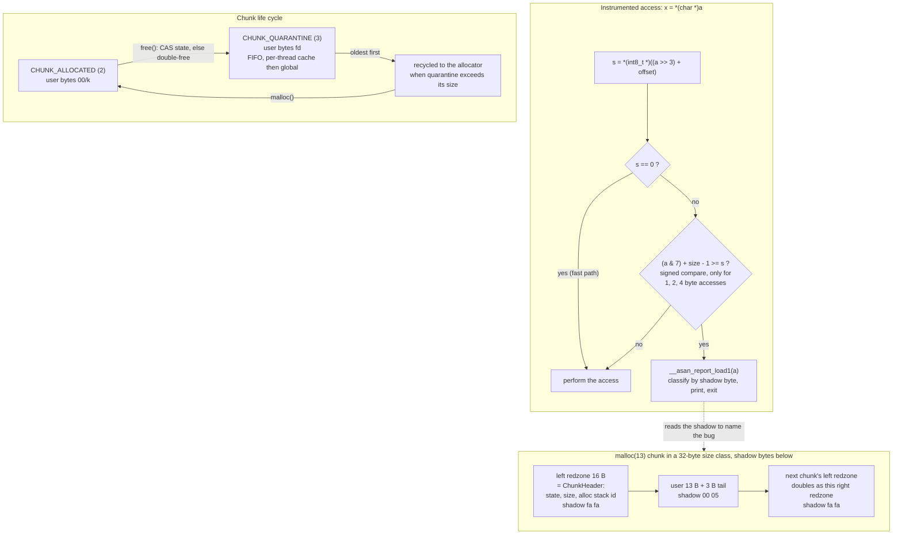

# C++ AddressSanitizer and LeakSanitizer Internals

> [!summary] Claim:
> AddressSanitizer (ASan) is a compiler pass plus a runtime: before each load and store the pass inserts a load of one shadow byte at `(addr >> 3) + offset` and a compare, and the runtime keeps that shadow current for every heap, stack, and global object.
> A shadow byte of `0` means all 8 bytes of the granule are addressable, `k` in 1..7 means only the first `k` are, and a negative value (`0xf1` to `0xfe`) names a kind of poison: heap redzone, freed memory, stack redzone, use-after-scope, global redzone, container overflow, or user poison.
> The runtime replaces `malloc`, surrounds each chunk with poisoned redzones that hold its 16-byte header, and parks freed chunks in a FIFO quarantine (256 MB by default on desktop targets) so that a dangling pointer keeps hitting `0xfd` instead of a new owner's data.
> LeakSanitizer (LSan) is a conservative mark phase at exit: it stops every thread, scans globals, stacks, registers, TLS, and registered root regions for word-aligned values that point anywhere into a live chunk, flood-fills from there, and reports what is left as direct or indirect leaks.



## The Mechanism

ASan was described by Serebryany, Bruening, Potapenko, and Vyukov at USENIX ATC 2012, which reported a 73% average slowdown and 3.4x memory use on SPEC CPU2006.
The clang documentation (fetched 2026-11-08) gives "typical slowdown" as 2x.
Every source fact below is from the llvm-project tree at tag `llvmorg-23.1.5` unless another source is named; GCC ships the same runtime as `libsanitizer`, merged from LLVM, so the runtime facts apply to GCC too unless a difference is stated.
The lab runs on Apple clang 21.0.0 (macOS 27.2, darwin-arm64) and on GCC 13.3.0 (Ubuntu 24.04, linux-aarch64), and its output is quoted in the Worked Lab Example.

### 1. Shadow memory and the 1:8 encoding

`asan_mapping.h` fixes `ASAN_SHADOW_SCALE` at 3 and defines the mapping as a macro:

```c
#define MEM_TO_SHADOW(mem) ((STRIP_MTE_TAG(mem) >> ASAN_SHADOW_SCALE) + (ASAN_SHADOW_OFFSET))
```

One shadow byte describes one 8-byte granule, so the shadow is one eighth of the application address space.
The paper says each shadow byte "encodes 2N + 1 different values" for scale N, so `2^3 + 1 = 9` states at scale 3: 0 (all addressable), 1 to 7 (partial), and fully unaddressable; the runtime splits that ninth state into many negative "poison kind" values, which still fit in a byte.
The encoding can only say "the first `k` bytes are good", never "the last `k` bytes are good", which is why every object ASan tracks starts on an 8-byte boundary: the allocator's minimum alignment is `ASAN_SHADOW_GRANULARITY` (8), and stack and global objects are aligned by the compiler.

The poison kinds are constants in `asan_internal.h`:

| Shadow byte | Constant | Meaning in a report |
| :--- | :--- | :--- |
| `00` | (none) | Addressable |
| `01`..`07` | (none) | Partially addressable: first `k` bytes valid |
| `fa` | `kAsanHeapLeftRedzoneMagic` | Heap left redzone (also used for the right side of the chunk) |
| `fd` | `kAsanHeapFreeMagic` | Freed heap region |
| `f1`, `f2`, `f3` | `kAsanStack{Left,Mid,Right}RedzoneMagic` | Stack left, mid, right redzone |
| `f5` | `kAsanStackAfterReturnMagic` | Stack after return |
| `f6` | `kAsanInitializationOrderMagic` | Global init order |
| `f7` | `kAsanUserPoisonedMemoryMagic` | Poisoned by user |
| `f8` | `kAsanStackUseAfterScopeMagic` | Stack use after scope |
| `f9` | `kAsanGlobalRedzoneMagic` | Global redzone |
| `fc` | `kAsanContiguousContainerOOBMagic` | Container overflow |
| `ac` | `kAsanArrayCookieMagic` | Array cookie |
| `bb` | `kAsanIntraObjectRedzone` | Intra object redzone |
| `ca`, `cb` | `kAsanAlloca{Left,Right}Magic` | Left and right alloca redzone |
| `fe` | `kAsanInternalHeapMagic` | ASan internal |

Every poison value has its top bit set, so read as `int8_t` it is negative, and that is what makes one signed compare handle both partial granules and poison.

#### Where the shadow lives

The offset is chosen per target by `getShadowMapping()` in `AddressSanitizer.cpp` and must match the runtime's `ASAN_SHADOW_OFFSET`:

- Linux x86_64: `0x7fff8000`, the value the AddressSanitizerAlgorithm wiki page gives for 64-bit.
- Linux AArch64: `1 << 36` (`kAArch64_ShadowOffset64`), confirmed by the lab on linux-aarch64.
- macOS x86_64: `1 << 44` (`kDefaultShadowOffset64`; `ASAN_SHADOW_OFFSET_CONST 0x0000100000000000` for `SANITIZER_APPLE`).
- macOS AArch64 and iOS: dynamic (`kDynamicShadowSentinel`); the instrumented code loads the offset from `__asan_shadow_memory_dynamic_address`, which the runtime picks at startup.

On Linux x86_64 the comment in `asan_mapping.h` lays out the address space:

| Range | Region |
| :--- | :--- |
| `[0x10007fff8000, 0x7fffffffffff]` | HighMem |
| `[0x02008fff7000, 0x10007fff7fff]` | HighShadow |
| `[0x00008fff7000, 0x02008fff6fff]` | ShadowGap |
| `[0x00007fff8000, 0x00008fff6fff]` | LowShadow |
| `[0x000000000000, 0x00007fff7fff]` | LowMem |

The shadow gap is the image of the shadow itself: `MEM_TO_SHADOW(0x02008fff7000)` is `0x4091ff6e00`, inside the gap.
The runtime `mprotect`s the gap (`protect_shadow_gap`, default true), so instrumented code that dereferences a shadow address faults instead of corrupting shadow.
The lab hit this while it was being written: an instrumented shadow reader died with `AddressSanitizer: BUS on unknown address` on darwin-arm64, which is why `shadow_of()` in `shadow_probe.cpp` carries `__attribute__((no_sanitize("address")))` (reproduced on 2026-11-08 by removing the attribute from `shadow_of()`: Apple clang 21 aborted the probe with signal 6 and that `BUS` error; the `make verify` output does not include it).
The clang docs warn that on 64-bit platforms ASan maps, but does not reserve, 16+ TB of virtual address space, so `ulimit -v` breaks it.

### 2. The inline check

`AddressSanitizer::instrumentAddress()` emits, for an access of `TypeStoreSize` bits:

1. `ShadowValue = load(memToShadow(addr))`, an 8-bit load for accesses up to 8 bytes and a 16-bit load for 16 bytes.
2. `Cmp = ShadowValue != 0`.
3. If the access is smaller than a granule (`TypeStoreSize < 8 * Granularity`), a slow path built by `createSlowPathCmp()`: `LastAccessedByte = (addr & 7) + size - 1`, then `icmp sge LastAccessedByte, ShadowValue`.
4. A branch, weighted unlikely, to `__asan_report_{load,store}{1,2,4,8,16}` or the `_n` variant.

In C, for a 1-, 2-, or 4-byte access:

```c
int8_t k = *(int8_t *)((a >> 3) + offset);
if (k != 0 && (int8_t)((a & 7) + size - 1) >= k)
    __asan_report_load4(a);   /* noreturn unless -fsanitize-recover=address */
```

The check assumes an N-byte access is aligned to N.
`doInstrumentAddress()` takes the single-check path only when the alignment is unknown, at least the granule, or at least the access size; otherwise `instrumentUnusualSizeOrAlignment()` checks the first and the last byte.
A misaligned access that the compiler believes is aligned, such as `*(uint64_t *)(p + 6)`, gets one granule check and misses a partial overflow; the wiki says it directly: "The current compact mapping will not catch unaligned partially out-of-bound accesses."
Functions with more than 7000 instrumented accesses switch to out-of-line callbacks (`-asan-instrumentation-with-call-threshold`, default 7000), and `-fsanitize-address-outline-instrumentation` forces callbacks everywhere to trade speed for code size.
The pass rewrites memory intrinsics into calls to `__asan_memcpy`, `__asan_memset`, and `__asan_memmove` (`instrumentMemIntrinsic()`), which check whole ranges, and the runtime's interceptors check libc string and memory functions (`replace_str` and `replace_intrin`, both default true).

### 3. The heap: redzones, the chunk header, and fill bytes

`Allocator::AllocateImpl()` in `asan_allocator.cpp` turns `malloc(size)` into a request for `needed_size = RoundUpTo(max(size, kChunkHeader2Size), alignment) + rz_size` bytes from the size-class allocator, where the left redzone size comes from `ComputeRZLog()`:

| User size (bytes) | Left redzone (bytes) |
| :--- | :--- |
| 1 to 48 | 16 |
| 49 to 96 | 32 |
| 97 to 448 | 64 |
| 449 to 3968 | 128 |
| 3969 to 16128 | 256 |
| 16129 to 32256 | 512 |
| 32257 to 64512 | 1024 |
| larger | 2048 |

The result is clamped between the `redzone` flag (default 16, a power of two of at least 16) and `max_redzone` (default 2048).
The 2012 paper gave the minimum heap redzone as 32 bytes; the current runtime's minimum is 16, exactly the size of the header.

There is no explicit right redzone for primary-allocator chunks: chunks of one size class sit back to back, so the next chunk's left redzone is this chunk's right redzone, and the bytes between `RoundUp(user_end, 8)` and the end of the size-class slot are poisoned `fa` as well.
Secondary (mmap-backed) chunks get `rz_size` added on the right explicitly.
For `malloc(13)` that means a 16-byte left redzone, 13 user bytes rounded to 16, a 32-byte slot, and shadow `fa fa 00 05` followed by the next slot's `fa fa`, which is what the lab prints.

The left redzone ends in a 16-byte `ChunkHeader` (`COMPILER_CHECK(kChunkHeaderSize == 16)`):

- `chunk_state` (1 byte): `CHUNK_INVALID` 0, `CHUNK_ALLOCATED` 2, `CHUNK_QUARANTINE` 3.
- `alloc_type` (2 bits, for `malloc`/`new`/`new[]` mismatch reports), `lsan_tag` (2 bits), and `user_requested_alignment_log` (3 bits).
- The requested size, split into a 16-bit high and a 32-bit low part.
- `alloc_context_id` (8 bytes): thread id and a `StackDepot` id of the allocation stack.

`ChunkBase` adds `free_context_id`, 8 bytes that overlap the first user bytes and are written only when the chunk is freed, so the free stack lives inside the dead object, as the paper describes.
When the left redzone is larger than the header, the first word of the block holds the magic `0xCC6E96B9CC6E96B9` and the second points to the header (`LargeChunkHeader`).

New memory is filled with `malloc_fill_byte` 0xbe for the first `max_malloc_fill_size` 4096 bytes, so reads of uninitialized heap tend to look like `0xbebebebe`; free-fill is off (`max_free_fill_size` 0, `free_fill_byte` 0x55 when enabled).
A zero-byte `malloc` is upgraded to 1 byte and its granule is poisoned, so `malloc(0)` returns a distinct pointer that cannot be dereferenced.
`kMaxAllowedMallocSize` is `1 << 40` on 64-bit targets; larger requests fail as `allocation-size-too-big` unless `allocator_may_return_null=1`.

### 4. Free, double free, and the quarantine

`free()` first flips `chunk_state` from `CHUNK_ALLOCATED` to `CHUNK_QUARANTINE` with an atomic compare-and-swap (`AtomicallySetQuarantineFlagIfAllocated()`); any other old state is reported as `attempting double-free` or `bad-free`, so two threads racing to free one pointer produce one report instead of a corrupted free list.
It then poisons the user bytes with `fd`, records the free stack, and pushes the chunk into the quarantine.

`sanitizer_quarantine.h` describes the structure: "Quarantine caches some specified amount of memory in per-thread caches, then evicts to global FIFO queue."
It continues: "When the queue reaches specified threshold, oldest memory is recycled."
The per-thread cache is a list of `QuarantineBatch` objects of up to 1021 pointers each; when it passes `thread_local_quarantine_size_kb` it is transferred to the global cache, and when the global cache passes `quarantine_size_mb`, `Recycle()` returns the oldest chunks to the allocator until it is back under 90% of the limit (`min_size_ = size / 10 * 9`).
`InitializeFlags()` in `asan_flags.cpp` resolves the `-1` defaults to 256 MB global and 1024 KB per thread on 64-bit desktop targets, and to 16 MB and 64 KB when `ASAN_LOW_MEMORY` is set (iOS and Android).
A chunk larger than the whole quarantine bypasses it and is recycled at once (`Quarantine::Put()`).

The consequence is the main limit of use-after-free detection: a dangling pointer is caught only while its chunk is still in quarantine.
After roughly 256 MB of later frees, the chunk can be reused, and a write through the stale pointer lands in a live object with addressable shadow; the lab demonstrates the miss directly by setting `quarantine_size_mb=0`.

### 5. Stack: frame layout, use-after-scope, and the fake stack

`ASanStackFrameLayout.cpp` packs a function's addressable locals into one frame with a 32-byte left redzone (`MinHeaderSize = max(LongSize / 2, Granularity)`, 32 on 64-bit), 16-byte minimum alignment per variable, and per-variable sizes from `VarAndRedzoneSize()`: 16 bytes for objects up to 4 bytes, 32 up to 16 bytes, `size + 32` up to 128, `size + 64` up to 512, `size + 128` up to 4096, and `size + 256` beyond.
The frame header holds `kCurrentStackFrameMagic` `0x41B58AB3`, a pointer to a frame description string, `<count>` then `<offset> <size> <name length> <name>` per variable (`ComputeASanStackFrameDescription()`; clang appends `:<line>` to the name, so `buf` at line 18 becomes `1 32 10 6 buf:18`), and the function's PC; that string is how a report can print `[32, 42) 'buf'` without debug info.
The prologue writes `f1` over the left redzone, `f2` between variables, and `f3` on the right, and the epilogue clears the frame's shadow back to `00`.

Use-after-scope (`f8`) poisons a local outside its lifetime markers; GCC's `-fsanitize=address` "enables `-fsanitize-address-use-after-scope`", and clang turns it on by default (the lab sees `stack-use-after-scope` with no extra flag on both compilers).

Use-after-return needs a frame that outlives the return, so instrumented functions can allocate their frame from a per-thread `FakeStack` instead of the real stack.
`asan_fake_stack.h` describes it as "a fast malloc-like allocator": 11 power-of-two size classes from 64 bytes to 64 KB (`kMinStackFrameSizeLog 6`, `kMaxStackFrameSizeLog 16`), round-robin reuse instead of a quarantine, and frames poisoned with `f5` on return.
`-fsanitize-address-use-after-return=` selects `never`, `runtime` (the default: code is emitted but gated on the `detect_stack_use_after_return` flag), or `always`.
The runtime flag defaults to `SANITIZER_LINUX && !SANITIZER_ANDROID`, so it is on for Linux and off for macOS, which the lab shows: the same binary reports `stack-use-after-return` on macOS only with `detect_stack_use_after_return=1`, while the GCC build reports it with default options on Linux.
Because locals live in the fake stack when it is active, their addresses no longer lie in the thread's stack mapping; the report still says "located in stack of thread T0".

### 6. Globals and user poisoning

The compiler appends a redzone to each instrumented global and registers it with the runtime at startup (`__asan_register_globals`).
`getRedzoneSizeForGlobal()` uses `MinRZ = max(32, 1 << Scale)`, so 32 bytes at scale 3: an object of at most 16 bytes gets `32 - size` bytes of redzone, and a larger one gets about a quarter of its size, clamped to `[32, 1 << 18]` and padded so that object plus redzone is a multiple of 32.
A 13-byte global therefore gets 19 bytes of redzone and the shadow `00 05 f9 f9`.
GCC sizes global redzones in its own pass, not in `getRedzoneSizeForGlobal()`, but the lab shows the same `00 05 f9 f9` for its build.

`__asan_poison_memory_region()` and `__asan_unpoison_memory_region()` (or the `ASAN_POISON_MEMORY_REGION` macros, which compile to nothing without ASan) let an arena or pool allocator mark its own free slots `f7`.
They are conservative because of the prefix-only encoding: the comment in `asan_poisoning.cpp` says that poisoning `[left, right)` poisons "at least `[left, AlignDown(right))`" and unpoisoning unpoisons "at most `[AlignDown(left), right)`".
Poisoning bytes 20 to 27 of a buffer writes `04` into the granule at 16 and leaves bytes 24 to 27 addressable, because a granule cannot express "first four bytes poisoned".

Container overflow (`fc`) uses `__sanitizer_annotate_contiguous_container()`: a container library marks `[size, capacity)` of its buffer as poisoned and moves the boundary on every push and pop.
libc++ annotates `std::vector` under ASan (the Apple clang build in the lab poisons the unused capacity), while libstdc++ does so only when `_GLIBCXX_SANITIZE_VECTOR` is defined, and its manual requires the macro "to the same value for all translation units that create, destroy, or modify vectors".

### 7. From a failed check to a report

`ErrorGeneric` in `asan_errors.cpp` names the bug from the shadow byte at the faulting address: it starts at `MemToShadow(addr)`, moves to the second shadow byte for accesses wider than a granule whose first byte is `00`, and moves one byte right when it sits on a partial value `1..127` followed by a poisoned byte.
That step is why an overflow of a 13-byte object reports `heap-buffer-overflow` although the bracketed byte in the report is the partial `05`: the classifier looked at the `fa` after it.
If neither step reaches a poison byte, the type stays `unknown-crash`, which is what GCC prints for an 8-byte range check that starts on a fully addressable granule.

The report then prints the access (`READ of size N`), a description of the address relative to the nearest chunk, frame, or global, the allocation and free stacks for heap addresses, a `SUMMARY:` line, the shadow bytes around the address with the faulting byte in brackets, and the legend.
`malloc_context_size` defaults to 30 frames under ASan (`kDefaultMallocContextSize`, overriding the common default of 1).
After printing, ASan exits with `exitcode` 1, or calls `abort()` when `abort_on_error` is true, which is its default on Apple and Android, so the same bug exits with status 1 on Linux and 134 (SIGABRT) on macOS in the lab.
`halt_on_error` defaults to true; continuing after a report needs both `-fsanitize-recover=address` at compile time and `halt_on_error=0` at run time (the GCC manual states both halves and calls ASan recovery "experimental"; the clang manual says ASan does not recover by default), and the clang docs give code that is faster and smaller "both by ~5%" as one reason exiting is the default.

### 8. LeakSanitizer: a conservative mark phase

LSan runs inside ASan (`-fsanitize=address`, on by default where supported) or alone (`-fsanitize=leak`), using the ASan allocator's chunk metadata either way; the clang docs say it "adds almost no performance overhead until the very end of the process".
`CAN_SANITIZE_LEAKS` in `lsan_common.h` is 1 for 64-bit Linux and Apple on x86_64, AArch64, and a few other architectures, but `detect_leaks` defaults to `!SANITIZER_APPLE` in `sanitizer_flags.inc`, so on macOS it must be enabled with `ASAN_OPTIONS=detect_leaks=1`.
Apple's own build of the runtime goes further: with Apple clang 21 the lab's leak binary aborts with `detect_leaks is not supported on this platform`, and the driver rejects `-fsanitize=leak` for `arm64-apple-darwin27.2.0`.
A Homebrew LLVM 23.1.5 build of the same program on darwin-arm64 accepted `detect_leaks=1` and reported the lab's `leaks.cpp` as four reports (direct 48, 40, and 32 bytes; indirect 80 bytes) with `SUMMARY: AddressSanitizer: 200 byte(s) leaked in 4 allocation(s)`, the same totals as the recorded Linux output (reproduced on 2026-11-08; the recorded lab runs Apple clang, so `make verify` does not cover it).

The check (`DoLeakCheck()` from an exit hook, or `__lsan_do_leak_check()`) works in four steps:

1. **Stop the world.**
   On Linux, `StopTheWorld()` in `sanitizer_stoptheworld_linux_libcdep.cpp` creates a tracer task with `internal_clone(CLONE_VM | CLONE_FS | CLONE_FILES | CLONE_UNTRACED)`, calls `prctl(PR_SET_PTRACER, tracer_pid)` so Yama allows it, and the tracer `PTRACE_ATTACH`es every thread that `ThreadLister` finds under `/proc/<pid>/task` for the traced process and reads registers with `PTRACE_GETREGSET` or `PTRACE_GETREGS`.
   The source explains why it is not a pthread: "The tracer task must be placed in a different thread group for ptrace to work", and why it uses raw syscalls: a suspended thread might hold a libc lock.
   On macOS, `sanitizer_stoptheworld_mac.cpp` uses `task_threads()`, `thread_suspend()`, and `thread_get_state()` instead.
   A process that is already being traced by gdb or strace cannot be attached again, which is why LSan's fatal-error hint says "LeakSanitizer does not work under ptrace (strace, gdb, etc)"; [[How-Debuggers-Work-ptrace-Mach-and-Breakpoints]] owns ptrace itself.
2. **Seed the root set.**
   `ClassifyAllChunks()` collects ignored chunks, then scans global data (`use_globals`), each thread's stack from its saved stack pointer (`use_stacks`), registers (`use_registers`), TLS (`use_tls`), and regions added with `__lsan_register_root_region()` (`use_root_regions`); `use_ld_allocations` (still default true) marks every allocation made by the dynamic linker reachable, but its own help text in `lsan_flags.inc` calls it "the old way to handle dynamic TLS" that "will be removed soon. Do not use this flag."
3. **Flood fill.**
   `ScanForPointers()` walks each range in steps of `pointer_alignment()` (8 bytes, or 1 with `use_unaligned=1`), and for each word that `PointsIntoChunk()` maps to an allocated chunk, tags the chunk `kReachable` and pushes it on a frontier; `FloodFillTag()` then scans each reachable chunk's own bytes.
   A pointer to any byte inside a chunk counts, as the 2015 design document says: "interior pointers are treated the same as pointers to the beginning of a block".
   Words in poisoned memory are skipped unless `use_poisoned=1`.
4. **Classify and report.**
   Every allocated chunk still tagged `kDirectlyLeaked` is a leak; `MarkIndirectlyLeakedCb()` scans each one and tags the chunks it points to `kIndirectlyLeaked`.
   The report prints direct leaks before indirect ones, then a `SUMMARY`, and the process exits with `exitcode` (1 under ASan, 23 for standalone LSan in `lsan.cpp`).

The scan is conservative in both directions.
A pointer value that survives in a dead stack slot or a callee-saved register keeps a leaked chunk alive (a false negative), and an integer that happens to equal a heap address does the same.
A pointer that is stored disguised (XOR-ed, compressed, or kept only in an `mmap`ed region LSan does not scan) makes a live chunk look leaked (a false positive); on Apple, `TransformPointer()` strips Objective-C runtime tag bits for this reason.
The fixes are `__lsan_register_root_region()` for custom memory, `__lsan_ignore_object()` or `__lsan::ScopedDisabler` for deliberate leaks, and `leak:<pattern>` suppressions matched against function, file, or module names in the allocation stack.

## Commands and Numbers to Know

| Item | Value | Platform and date | What it controls |
| :--- | :--- | :--- | :--- |
| Shadow scale | 3 (8-byte granule) | Both (as of 2026-11) | `ASAN_SHADOW_SCALE`; `-asan-mapping-scale` exists for experiments |
| Shadow offset | `0x7fff8000` x86_64, `1 << 36` AArch64 | Linux (as of 2026-11) | `MEM_TO_SHADOW`; lab prints `2^36` on linux-aarch64 |
| Shadow offset | `1 << 44` x86_64, dynamic on arm64 | macOS (as of 2026-11) | arm64 loads `__asan_shadow_memory_dynamic_address` |
| `redzone` / `max_redzone` | 16 / 2048 bytes | Both (as of 2026-11) | Heap left redzone bounds; actual size from `ComputeRZLog()` |
| `quarantine_size_mb` | 256 (16 on iOS and Android) | Both (as of 2026-11) | Global FIFO quarantine; recycles down to 90% |
| `thread_local_quarantine_size_kb` | 1024 on 64-bit (64 low-memory) | Both (as of 2026-11) | Per-thread batch cache before the global queue |
| `malloc_fill_byte` / `max_malloc_fill_size` | `0xbe` / 4096 | Both (as of 2026-11) | Fill for new heap memory |
| `free_fill_byte` / `max_free_fill_size` | `0x55` / 0 (off) | Both (as of 2026-11) | Fill for freed memory |
| `detect_stack_use_after_return` | true on Linux, false elsewhere | Both (as of 2026-11) | Runtime gate for the fake stack |
| `-fsanitize-address-use-after-return=` | `runtime` (default), `never`, `always` | Both, clang (as of 2026-11) | Whether fake-stack code is emitted and gated |
| `-fsanitize-address-use-after-scope` | on with `-fsanitize=address` | Both (as of 2026-11) | `f8` poisoning of locals outside their scope |
| `detect_leaks` | true on Linux, false on Apple | Both (as of 2026-11) | Apple clang 21 rejects `1` on darwin-arm64 |
| `abort_on_error` | false Linux, true Apple and Android | Both (as of 2026-11) | Exit status 1 vs SIGABRT (134 in a shell) |
| `exitcode` | 1 under ASan, 23 standalone LSan | Both (as of 2026-11) | Status after a report |
| `halt_on_error` | true | Both (as of 2026-11) | Needs `-fsanitize-recover=address` to continue |
| `malloc_context_size` | 30 under ASan | Both (as of 2026-11) | Frames kept per allocation and free |
| `detect_container_overflow` | true | Both (as of 2026-11) | Honors `__sanitizer_annotate_contiguous_container` |
| `detect_odr_violation` | 2 | Both (as of 2026-11) | Reports duplicate instrumented globals |
| `check_initialization_order` | false | Linux (as of 2026-11) | `f6` init-order checking; not supported on macOS |
| `protect_shadow_gap` | true | Both (as of 2026-11) | Faults instead of corrupting shadow |
| `-asan-instrumentation-with-call-threshold` | 7000 accesses | Both, clang (as of 2026-11) | Above it, a function uses callbacks |
| LSan `pointer_alignment()` | 8 bytes (1 with `use_unaligned=1`) | Both (as of 2026-11) | Scan stride for candidate pointers |
| LSan root flags | `use_globals`, `use_stacks`, `use_registers`, `use_tls`, `use_root_regions`, `use_ld_allocations` all true | Both (as of 2026-11) | What seeds the mark phase; `use_ld_allocations` is deprecated |
| `ASAN_OPTIONS=help=1` | prints every flag and default | Both (as of 2026-11) | Ground truth for the runtime you linked |

```bash
# Build and run with the defaults the docs recommend.
clang++ -O1 -g -fsanitize=address -fno-omit-frame-pointer app.cpp -o app
ASAN_OPTIONS=detect_leaks=1:detect_stack_use_after_return=1 ./app   # opt in on macOS
LSAN_OPTIONS=suppressions=lsan.supp:print_suppressions=0 ./app       # leak flags go in LSAN_OPTIONS
ASAN_OPTIONS=help=1 ./app 2>&1 | grep -E 'quarantine|redzone'       # inspect real defaults
```

## Multi-Language Comparison

| Concern | C++ (clang, GCC) | Python (CPython) | Rust |
| :--- | :--- | :--- | :--- |
| Enable ASan | `-fsanitize=address` at compile and link time | `./configure --with-address-sanitizer` (since 3.6) builds the interpreter with ASan | `RUSTFLAGS=-Zsanitizer=address`, nightly only (Unstable Book), usually with `-Zbuild-std` |
| What gets checked | Every instrumented load and store in your code; uninstrumented libraries are checked only at intercepted calls | The C interpreter and C extensions built with the same flags; Python code itself is memory safe | `unsafe` code, FFI, and the standard library if rebuilt with `-Zbuild-std` |
| Allocator interaction | ASan replaces `malloc`; custom pools need manual poisoning | pymalloc's small-object arenas hide allocations from ASan, so the docs suggest `--without-pymalloc` | Rust's global allocator calls `malloc`, so heap chunks get redzones |
| Leak detection | LSan at exit; on by default on Linux | LSan sees interpreter-level leaks in C; Python object leaks belong to [[Python-tracemalloc-gc-and-Memory-Leaks]] | `-Zsanitizer=leak`; LSan targets are `aarch64-unknown-linux-gnu`, `x86_64-apple-darwin`, `x86_64-unknown-linux-gnu` |
| Deeper coverage | [[Cpp-Sanitizers-and-Memory-Debugging-on-macOS]] for Darwin specifics | [[Python-Debugging-Hung-Processes-and-C-Extensions]] | [[Rust-Miri-Sanitizers-Loom-and-Cargo-Fuzz]] |

The Python and Rust entries come from the CPython 3 configure documentation and the Rust Unstable Book, both fetched 2026-11-08.

## Worked Lab Example

The lab is `code/03-Debugging/asan_shadow_mapping/`; it needs a C++17 compiler with ASan and `python3`, and it runs as is on macOS and Linux.

`run.sh` builds four binaries with `-std=c++17 -g -O0 -fno-omit-frame-pointer`; `-O0` keeps every planted bug in the binary, where the docs would otherwise suggest `-O1` for speed.
It clears `ASAN_OPTIONS` and `LSAN_OPTIONS` and passes the options of each run explicitly, with `symbolize=0` so no symbolizer is needed.

1. `shadow_probe.cpp` asks the runtime for the mapping with `__asan_get_shadow_mapping()`, then reads shadow bytes itself with an uninstrumented `shadow_of()` that computes `(addr >> scale) + offset`.
2. It prints the shadow of `malloc(n)` for seven sizes, of a heap chunk, a stack array, a global, a `std::vector` with spare capacity, and two manually poisoned ranges.
3. It rebuilds the compiler's inline check as `toy_check_fails()` and compares it with `__asan_region_is_poisoned()`, which tests every byte, for every naturally aligned 1-, 2-, 4-, 8-, and 16-byte access around a heap, stack, and global object.
4. It frees a chunk, prints its shadow, and checks whether any of the next 1000 `malloc(13)` calls returns it, first with the default quarantine and then with `quarantine_size_mb=0`.
5. `bugs.cpp` plants one bug per scenario, and `summarize.py` reduces each report to its error kind, access, location, and faulting shadow byte, dropping addresses and PIDs.
6. `leaks.cpp` creates seven allocations with distinct sizes held in different ways (listed in its header comment) and lets LSan classify them at exit, under ASan and standalone.

Every comparison can fail.
Two mutations of `shadow_probe.cpp` prove it (re-run on 2026-11-08 on Apple clang 21): dropping the slow-path compare (`return false;`) dropped agreement to 31/93, 29/124, and 62/124, and adding 1 to the offset dropped it to 63/93, 79/124, and 79/124; `make verify` fails on both.
Without `-fsanitize=address` the heap overflow exits 0 with no report, and without the quarantine the stale write goes unreported, both in the recorded output.

```bash
cd code/03-Debugging/asan_shadow_mapping
bash run.sh
```

### Verified output: shadow layout (darwin-arm64)

Recorded by `make record` on darwin-arm64 (Apple clang 21.0.0) on 2026-11-08 and re-checked by `make verify`; the file is `code/03-Debugging/asan_shadow_mapping/expected/darwin-arm64.txt`.

```text
compiler family: clang

== 1. Mapping: shadow = (addr >> scale) + offset
  scale 3, granule 8 bytes per shadow byte
  offset is not a power of two

== 2. Partial granules: shadow of malloc(n), first three granules
  malloc(1)                          01 fa fa
  malloc(7)                          07 fa fa
  malloc(8)                          00 fa fa
  malloc(9)                          00 01 fa
  malloc(13)                         00 05 fa
  malloc(16)                         00 00 fa
  malloc(17)                         00 00 01

== 3. Shadow around objects, one byte per 8-byte granule
  malloc(13) [-16,+32)               fa fa 00 05 fa fa
  char buf[10] on the stack [-32,+32) f1 f1 f1 f1 00 02 f3 f3
  global char g13[13] [0,+32)        00 05 f9 f9
  vector<char> size 5 cap 32 [0,+32) 05 fc fc fc
  poison [16,32) of malloc(64)       00 00 f7 f7 00 00 00 00
  poison [20,28) of malloc(64)       00 00 04 00 00 00 00 00

== 4. Rebuilt inline check vs __asan_region_is_poisoned
  heap   malloc(13): 93/93 aligned accesses agree
  stack  buf[10]:    124/124 aligned accesses agree
  global g13[13]:    124/124 aligned accesses agree
  unaligned 8-byte access at +6: one-granule check passes, byte-exact check fails

== 5. Free and quarantine
  malloc(13) after free [-16,+32)    fa fa fd fd fa fa
  freed chunk returned by one of the next 1000 malloc(13) calls: no
  same loop with ASAN_OPTIONS=quarantine_size_mb=0:
  freed chunk returned by one of the next 1000 malloc(13) calls: yes
```

The linux-aarch64 recording (GCC 13.3.0 in the pinned Ubuntu 24.04 lab image) is identical in sections 2 to 5 except one line, and differs in the mapping:

```text
compiler family: gcc

== 1. Mapping: shadow = (addr >> scale) + offset
  scale 3, granule 8 bytes per shadow byte
  offset 2^36 (a compile-time constant on this target)
```

```text
  vector<char> size 5 cap 32 [0,+32) 00 00 00 00
```

### Reading the shadow layout

- The darwin-arm64 offset is not a power of two because it is the dynamic offset the runtime chose at startup, while linux-aarch64 prints the compile-time `2^36`.
- `malloc(9)` is `00 01`: the first granule is whole and the second has one valid byte; `malloc(16)` ends exactly on a granule and goes straight to `fa`.
- `malloc(13)` sits between two `fa fa` pairs: the 16-byte left redzone that is its `ChunkHeader`, and the next chunk's header acting as its right redzone, so the whole slot is 32 bytes.
- The stack array starts at frame offset 32 behind four `f1` bytes and is followed by `f3`, the right redzone, matching `MinHeaderSize` and `VarAndRedzoneSize(10) = 32`.
- The 13-byte global gets 19 bytes of redzone, `f9 f9` after `00 05`, on both compilers: clang computes it in `getRedzoneSizeForGlobal()`, and GCC's own sizing lands on the same 32-byte layout.
- libc++ poisons the vector's unused capacity `05 fc fc fc`; libstdc++ without `_GLIBCXX_SANITIZE_VECTOR` leaves it `00 00 00 00`, so container overflows are invisible in the GCC build.
- Poisoning `[20,28)` produces `04 00`: the runtime poisoned bytes 20 to 23 and could not poison 24 to 27 without also poisoning 28 to 31.
- The rebuilt check agrees with the runtime on all 341 aligned accesses, and the one disagreement is the unaligned 8-byte access the instrumentation also gets wrong.
- The freed chunk turns `fd fd` and is not handed out again within 1000 allocations; with the quarantine off, it is.

### Verified output: report anatomy (darwin-arm64)

These lines are a contiguous excerpt of section 6 of `expected/darwin-arm64.txt`:

```text
-- heap-overflow
  exit status 134
  AddressSanitizer: heap-buffer-overflow
  READ of size 1
  located 0 bytes after 13-byte region
  shadow byte at the fault: 05 (Partially addressable)

-- heap-underflow
  exit status 134
  AddressSanitizer: heap-buffer-overflow
  READ of size 1
  located 1 bytes before 13-byte region
  shadow byte at the fault: fa (Heap left redzone)

-- use-after-free
  exit status 134
  AddressSanitizer: heap-use-after-free
  READ of size 1
  located 0 bytes inside of 13-byte region
  shadow byte at the fault: fd (Freed heap region)

-- double-free
  exit status 134
  AddressSanitizer: attempting double-free
  located 0 bytes inside of 13-byte region

-- stack-overflow
  exit status 134
  AddressSanitizer: stack-buffer-overflow
  READ of size 1
  located in stack of thread T0 at offset 42 in frame
  frame object [32, 42) 'buf'
  shadow byte at the fault: 02 (Partially addressable)
```

And the unaligned and quarantine cases from the same file:

```text
-- unaligned-cast
  8-byte load through a misaligned uint64_t* at +6: not detected
  exit status 0

-- unaligned-memcpy
  exit status 134
  AddressSanitizer: heap-buffer-overflow
  READ of size 8
  located 0 bytes after 13-byte region
  shadow byte at the fault: 05 (Partially addressable)

-- use-after-return, default options
  exit status 0

-- use-after-return, detect_stack_use_after_return=1
  exit status 134
  AddressSanitizer: stack-use-after-return
  READ of size 1
  located in stack of thread T0 at offset 32 in frame
  frame object [32, 48) 'buf'
  shadow byte at the fault: f5 (Stack after return)

-- stale-write-after-reuse, default quarantine
  new malloc(13) reuses the freed chunk: no
  exit status 134
  AddressSanitizer: heap-use-after-free
  WRITE of size 1
  located 0 bytes inside of 13-byte region
  shadow byte at the fault: fd (Freed heap region)

-- stale-write-after-reuse, quarantine_size_mb=0
  new malloc(13) reuses the freed chunk: yes
  write through the stale pointer: not detected
  exit status 0

-- heap-overflow built without -fsanitize=address
  exit status 0
```

On linux-aarch64 the GCC build differs in three instructive places, all from `expected/linux-aarch64.txt`:

```text
-- container-overflow
  exit status 0
```

```text
-- unaligned-memcpy
  exit status 1
  AddressSanitizer: unknown-crash
  READ of size 8
  located 0 bytes after 13-byte region
  shadow byte at the fault: 00 (Addressable)

-- use-after-return, default options
  exit status 1
  AddressSanitizer: stack-use-after-return
  READ of size 1
  located in stack of thread T0 at offset 64 in frame
  frame object [32, 40) 'p'
  frame object [64, 80) 'buf'
  shadow byte at the fault: f5 (Stack after return)
```

### Verified output: LeakSanitizer (linux-aarch64)

From `expected/linux-aarch64.txt` (GCC 13.3.0):

```text
== 7. LeakSanitizer reachability (sizes are listed in leaks.cpp)

-- ASan with LSan, detect_leaks=1
  exit status 1
  LeakSanitizer: detected memory leaks
  Direct leak: 48 bytes in 1 object(s)
  Direct leak: 40 bytes in 1 object(s)
  Direct leak: 32 bytes in 1 object(s)
  Indirect leak: 80 bytes in 1 object(s)
  summary from AddressSanitizer: 200 byte(s) leaked in 4 allocation(s)

-- standalone LSan, -fsanitize=leak
  exit status 23
  LeakSanitizer: detected memory leaks
  Direct leak: 48 bytes in 1 object(s)
  Direct leak: 40 bytes in 1 object(s)
  Direct leak: 32 bytes in 1 object(s)
  Indirect leak: 80 bytes in 1 object(s)
  summary from LeakSanitizer: 200 byte(s) leaked in 4 allocation(s)
```

And from `expected/darwin-arm64.txt` (Apple clang 21.0.0):

```text
-- ASan with LSan, detect_leaks=1
  exit status 134
  detect_leaks is not supported on this platform

-- standalone LSan, -fsanitize=leak
  the compiler driver rejects -fsanitize=leak for this target
```

### Reading the reports

- `heap-overflow` brackets `05` but is named `heap-buffer-overflow`: `ErrorGeneric` stepped from the partial byte to the `fa` after it.
- `heap-underflow` lands in the left redzone, the 16 bytes that hold the chunk header, which is why an underflow is caught before it can corrupt allocator metadata.
- `stack-overflow` reads offset 42 in a frame whose only object is `[32, 42) 'buf'`, the frame description string at work.
- `unaligned-cast` is a silent miss: the cast promises 8-byte alignment, so clang emitted one granule check on the fully addressable first granule; the `memcpy` version is caught because `__asan_memcpy` checks the whole range.
- GCC reports the same unaligned copy as `unknown-crash`: its check reported the first byte of the access, whose shadow is `00`, and `ErrorGeneric` only steps forward for accesses wider than 8 bytes; the location line comes from the heap description step in `asan_descriptions.cpp`, which measures the access against the chunk and still names the 13-byte region.
- `stale-write-after-reuse` is the quarantine's purpose in one pair: with the default 256 MB, the stale write hits `fd`; with none, the chunk is reused and the write silently corrupts the new owner.
- In the leak run, 48 is the XOR-hidden pointer, 40 the pointer held only in an unregistered `mmap` page, 32 the dropped list head, and 80 its tail, reported as indirect; the 56-byte chunk referenced from a registered root region, the 64-byte chunk held by an interior pointer from a global, and the 24-byte ignored chunk are absent.
- ASan's LSan exits 1 and standalone LSan exits 23, matching `exitcode` in `asan_flags.cpp` and `lsan.cpp`.

## Pitfalls

> [!warning] Pitfall: trusting a clean run after the quarantine has turned over
> Use-after-free is caught only while the chunk is still quarantined.
> A long-lived dangling pointer in a process that frees more than `quarantine_size_mb` in between is used against a reused chunk, and ASan sees an ordinary access to addressable memory.
> Raise `quarantine_size_mb` for UAF hunts, and for production-scale sampling use GWP-ASan or tagging from [[Cpp-HWASan-and-Hardware-Memory-Tagging]].

> [!warning] Pitfall: misaligned typed accesses
> A cast such as `*(uint64_t *)(p + 6)` is undefined behavior and also tells ASan the access is aligned, so it checks only the first granule and misses a partial overflow.
> Use `memcpy` for unaligned loads, which ASan checks byte-exactly, and run UBSan's alignment check from [[Cpp-UndefinedBehaviorSanitizer-and-UB-Field-Guide]] alongside.

> [!warning] Pitfall: reading `unknown-crash` as "ASan is confused"
> `unknown-crash` means the classifier found no poison byte at the reported address, which happens for wide or misaligned accesses that start in valid memory.
> Read the location line and the bracketed shadow row instead; they still point at the object that was overrun.

> [!warning] Pitfall: mixing annotated and unannotated containers
> Container-overflow annotations must be applied by every translation unit that modifies the container.
> Building some files with `_GLIBCXX_SANITIZE_VECTOR` and some without, or linking uninstrumented code that pushes into an instrumented vector, leaves stale `fc` bytes and produces false `container-overflow` reports; the clang docs warn that partially instrumented binaries cause both false positives and negatives.

> [!warning] Pitfall: hidden and stale pointers under LSan
> LSan cannot see a pointer that is XOR-ed, compressed, or stored in memory it does not scan, and reports the chunk as leaked; it also cannot tell a stale copy in a dead stack frame from a live pointer.
> The lab scrubs the dead frame of `make_allocations()` as insurance against stale copies; removing the scrub did not change the Linux GCC 13.3.0 report in a mutation run, so the scrub is a guard, not something that run proved necessary.
> Register custom memory with `__lsan_register_root_region()`, and treat a missing leak report as weak evidence, not proof.

> [!warning] Pitfall: losing stdout when ASan or LSan exits
> Reports end with `_exit()` or `abort()`, not `exit()`, so buffered `stdout` is never flushed; under a pipe the program's own last lines vanish.
> `bugs.cpp` calls `setvbuf(stdout, nullptr, _IONBF, 0)` for this reason, and test harnesses should do the same or set `log_path`.

> [!warning] Pitfall: LSan under a debugger, strace, or a restricted container
> The Linux tracer must `ptrace` every thread, so a process already traced by gdb or strace, or a sandbox that forbids `ptrace`, fails with "LeakSanitizer has encountered a fatal error".
> Run leak checks without a tracer attached, or call `__lsan_do_recoverable_leak_check()` from a test with `detect_leaks=1` only where the platform allows it.

> [!warning] Pitfall: comparing exit statuses across platforms
> The lab's identical bug exits 134 on macOS and 1 on Linux because `abort_on_error` defaults differ.
> CI that treats "exit 1" as the ASan signal must set `abort_on_error=0` (or match on `ERROR: AddressSanitizer`) on every platform.

> [!warning] Pitfall: reading the shadow from instrumented code
> Any instrumented load of a shadow address is itself checked, and the shadow of the shadow lies in the protected shadow gap, so the program dies with SEGV or BUS.
> Tools that inspect shadow must mark the reader `__attribute__((no_sanitize("address")))` or use `__asan_region_is_poisoned()`.

## At Scale

For one developer, ASan is a build flag and a habit: build tests with `-fsanitize=address`, read the first report, fix it, repeat.
For 1,000 to 50,000 engineers, the questions become which builds carry it, who owns suppressions, and how to keep reports actionable.

- **Separate build configuration.**
  ASan needs its runtime first in the library list (`verify_asan_link_order`), cannot be combined with TSan (Apple clang 21 rejects `-fsanitize=address,thread`) or HWASan (Homebrew clang 23.1.5 rejects `-fsanitize=address,hwaddress` with "not allowed with" for an `aarch64-linux-gnu` target, from `IncompatibleGroups` in `clang/lib/Driver/SanitizerArgs.cpp` at llvmorg-23.1.5, and the GCC manual says the option "cannot be combined with" `-fsanitize=hwaddress`) in one binary, and does not support static linking (clang docs), so it is a distinct CI configuration with its own cache and artifacts.
- **Budget for the cost.**
  The paper measured 73% average slowdown on SPEC CPU2006 and 3.4x memory, the docs say 2x typical slowdown and up to 3x stack, and quarantine alone holds up to 256 MB per process; size test shards and container memory limits for the sanitized configuration, not the release one.
- **Policy as code.**
  Check in `__asan_default_options()`, `__lsan_default_suppressions()`, and the `ASAN_OPTIONS` used by CI, so every engineer reproduces the same defaults; the clang docs note that `ASAN_OPTIONS` overrides compile-time defaults.
- **Suppressions with owners.**
  Every `leak:` line names a third-party module or a tracked bug; an unowned suppression file grows until LSan is noise.
- **Detection depth tiers.**
  Presubmit runs unit tests under ASan with defaults; nightly runs integration and fuzz targets with larger `quarantine_size_mb`, `detect_stack_use_after_return=1` everywhere, and `check_initialization_order=1` on Linux; [[Cpp-Clang-Tidy-Static-Analyzer-and-Fuzzing-libFuzzer-AFLPlusPlus]] owns the fuzzing tier.
- **Production is a different tool.**
  The docs say the ASan runtime "is not meant to be linked against production executables"; production memory-safety telemetry comes from sampling allocators and tagging in [[Cpp-HWASan-and-Hardware-Memory-Tagging]].

Decision rules:

- If a test suite runs on Linux and macOS, run ASan on both but LSan where the runtime supports it (Linux, or a non-Apple LLVM runtime on macOS), and set `abort_on_error=0` so status codes agree.
- If a component owns a custom allocator or arena, require it to poison free slots with `ASAN_POISON_MEMORY_REGION` before it is allowed in the sanitized build, or ASan sees one large addressable block.
- If a library is built with libstdc++, decide `_GLIBCXX_SANITIZE_VECTOR` once for the whole build, in the toolchain file, never per target.
- If a use-after-free reproduces only in long runs, raise `quarantine_size_mb` before adding logging, and switch to [[Cpp-Valgrind-Memcheck-Helgrind-and-DRD]] only for code you cannot recompile.
- If a report is in code that was not instrumented, rebuild that code with ASan before trusting either a clean run or a report; partial instrumentation is the main source of false container-overflow reports and missed bugs.
- Record the chosen tiers in [[Debugging-Decision-Records]] so the policy survives the people who set it.

## Practice Drill

> [!tip] Practice Drill:
> Predict, then run, three changes to the lab.
> First, change `malloc(13)` in section 3 of `shadow_probe.cpp` to `malloc(50)` and predict the shadow from -32 to +64; `ComputeRZLog()` says the left redzone grows to 32 bytes.
> Second, run the `stack-overflow` scenario with `ASAN_OPTIONS=detect_stack_use_after_return=1` and explain why the frame now lives at a heap-like address that the report still calls "stack of thread T0".
> Third, compile `bugs.cpp` with `-D_GLIBCXX_SANITIZE_VECTOR=1` in the Linux lab image (`g++` from GCC 13) and check that `container-overflow` now reports `fc`.
> As a stretch, add a root-region case to `leaks.cpp` that registers only half of an `mmap` page and stores pointers in both halves, and predict which chunk LSan reports.
> Then take [[Drill-Debugging-Use-After-Free-Core-Dump]] and solve it once with ASan and once from the core alone, and compare how long each took.

## Interview Questions

> [!question] L5: How does ASan decide whether a 4-byte load from address `a` is legal, and what does each kind of shadow value mean?
>
> > [!success]- Answer
> > The instrumented code loads the shadow byte at `(a >> 3) + offset` and treats it as signed.
> > Zero means all 8 bytes of the granule are addressable, so the fast path continues.
> > A value `k` from 1 to 7 means only the first `k` bytes are addressable, so the slow path checks `(a & 7) + 4 - 1 >= k`.
> > Any negative value, such as `fa` for a heap redzone or `fd` for freed memory, fails that same signed compare and the access is reported.

> [!question] L5: Predict the output: the lab prints the shadow of `malloc(9)` and then reads `p[9]`; what are the shadow bytes, and what bug type is reported?
>
> > [!success]- Answer
> > The shadow is `00 01 fa`: one whole granule, one granule with one valid byte (byte 8), then the next chunk's left redzone, as `expected/darwin-arm64.txt` shows.
> > `p[9]` is in the second granule with `k = 1`, and `(9 & 7) + 1 - 1 = 1 >= 1`, so the check fails.
> > The classifier starts on the partial byte `01`, steps to the following `fa`, and reports `heap-buffer-overflow`, "0 bytes after 9-byte region".

> [!question] L5: Why can a use-after-free go unreported under ASan, and how would you make it more likely to be caught?
>
> > [!success]- Answer
> > `free()` poisons the chunk `fd` and puts it in a FIFO quarantine, but only up to `quarantine_size_mb` (256 MB by default); after that the oldest chunks are recycled.
> > Once a chunk is reused, a stale pointer reads or writes a live object with addressable shadow, which the lab's `stale-write-after-reuse` case shows with the quarantine disabled.
> > Raise `quarantine_size_mb`, shorten the time between free and use in the test, or use a tagging tool whose tags change on reuse.

> [!question] L6: Debug this: a GCC-built CI job reports `ERROR: AddressSanitizer: unknown-crash ... READ of size 8`, with `0x... is located 0 bytes after 13-byte region`, and the bracketed shadow byte is `00`; what happened?
>
> > [!success]- Answer
> > The access began inside valid memory and ran past the end of the 13-byte object: an 8-byte read starting at offset 6, typically an unaligned `memcpy` or a packed-struct field read.
> > The check reported the access's first address, whose shadow is `00`, and `ErrorGeneric` only moves to the next shadow byte for accesses wider than one granule, so no poison byte was found and the type stayed `unknown-crash`.
> > The location line comes from a separate description step that measures the access against the chunk, so it correctly names the 13-byte region.
> > Fix the read to stay within 13 bytes; the lab's `unaligned-memcpy` case reproduces exactly this report on linux-aarch64, while clang names it `heap-buffer-overflow`.

> [!question] L6: LSan reports a 32-byte direct leak and an 80-byte indirect leak; what is the difference, and which do you fix first?
>
> > [!success]- Answer
> > A direct leak is an allocated chunk that no root (globals, stacks, registers, TLS, registered regions) and no reachable chunk points into.
> > An indirect leak is reachable only from leaked chunks; `MarkIndirectlyLeakedCb()` scans each directly leaked chunk and tags what it points to.
> > Fix the direct leak first: freeing the 32-byte list head, and the structure it owns, usually removes the indirect leak too, as in the lab's `leaks.cpp`.

> [!question] L6: The same ASan-detected bug exits with status 1 on Linux and 134 on macOS; why, and what do you change?
>
> > [!success]- Answer
> > ASan sets `exitcode` to 1, but `abort_on_error` defaults to true on Apple and Android, so on macOS the runtime calls `abort()` and the shell reports 128 + 6 = 134.
> > Set `abort_on_error=0` in the CI `ASAN_OPTIONS` (or in `__asan_default_options()`) on every platform, or match on the `ERROR: AddressSanitizer` line instead of the status.
> > Standalone LSan uses exit code 23, so leak jobs need their own expectation.

> [!question] L7: Why does ASan use an 8:1 shadow and prefix-only partial states, and what does that cost compared with a 16:1 tag scheme or Valgrind?
>
> > [!success]- Answer
> > Eight bytes per shadow byte gives one-eighth address-space overhead, a single-byte load per access, and enough values for a prefix length plus many poison kinds; the paper notes larger scales need bigger redzones and alignment and more complex checks for 8-byte accesses.
> > Prefix-only states force every object to start on an 8-byte boundary and make manual poisoning conservative, and they cannot catch an unaligned access that the compiler believes is aligned.
> > Detection depends on redzones and quarantine, so an overflow that jumps past the redzone into another valid object, or a UAF after reuse, is missed.
> > [[Cpp-HWASan-and-Hardware-Memory-Tagging]] replaces redzones with pointer and memory tags over 16-byte granules, and [[Cpp-Valgrind-Memcheck-Helgrind-and-DRD]] needs no recompilation because it tracks validity during binary translation, at a higher run-time cost; those notes own the comparison.

> [!question] L7: Walk through how LSan stops the world on Linux and why it cannot simply use a pthread and libc.
>
> > [!success]- Answer
> > It creates a tracer task with `clone(CLONE_VM | CLONE_FS | CLONE_FILES | CLONE_UNTRACED)` so it shares memory but sits in a different thread group, because ptrace refuses to attach to threads of its own group.
> > The parent calls `prctl(PR_SET_PTRACER, tracer_pid)` so Yama allows the attach, and the tracer `PTRACE_ATTACH`es every thread listed under `/proc/<pid>/task` and reads their registers.
> > The tracer uses raw syscalls only, because a suspended thread may hold a libc lock and because the cloned task has no TLS of its own.
> > It follows that LSan fails under gdb or strace, which already trace the process, and in sandboxes that deny ptrace.

> [!question] L7: A team's pool allocator hands out 64-byte slots from a large `malloc` block, and ASan finds nothing in a component with known UAF bugs; explain and fix.
>
> > [!success]- Answer
> > ASan sees one large addressable `malloc` chunk; slots carved from it have no redzones and freeing a slot never touches the shadow, so overflows between slots and UAF within the pool are invisible.
> > Poison each slot on release with `ASAN_POISON_MEMORY_REGION(slot, 64)` and unpoison it on allocation, leave a poisoned gap between slots, and delay reuse with a small FIFO to imitate the quarantine.
> > The macros compile to nothing without ASan, and the poisoning rules mean slot boundaries should be 8-byte aligned so poison is exact; a simpler option for the sanitized build is to route the pool to `malloc` directly.

> [!question] L8+: You own memory-safety tooling for a 10,000-engineer C++ monorepo; design the ASan and LSan program.
>
> > [!success]- Answer
> > Make ASan a first-class build configuration with a paved road: toolchain flags, checked-in `__asan_default_options()` and LSan suppressions, and the same options on every OS, including `abort_on_error=0`.
> > Run unit tests under ASan and LSan in presubmit, and integration tests, fuzzers, larger quarantines, and use-after-return everywhere in nightly runs, sized for 2x to 3x CPU and memory.
> > Require custom allocators to poison, decide container annotations once per toolchain, and forbid unowned suppressions with an expiry review.
> > Track mean time to fix and recurrence by bug class, keep ASan out of production builds as the docs require, and cover production with sampling allocators and memory tagging.
> > Record the tiers and their rationale in a decision record so trade-offs such as the macOS LSan gap are explicit.

## Further Reading

- Serebryany et al., "AddressSanitizer: A Fast Address Sanity Checker" (USENIX ATC 2012): the original design, encoding, allocator, and the 73% / 3.4x measurements.
- Clang AddressSanitizer and LeakSanitizer documentation: supported platforms, flags, use-after-return modes, suppressions, and the security warning about production use.
- google/sanitizers wiki, AddressSanitizerAlgorithm: the instrumentation pseudo-code and the stated false negatives.
- google/sanitizers wiki, AddressSanitizerLeakSanitizerDesignDocument (2015): the root set and the stop-the-world rationale from the authors.
- `asan_mapping.h` at `llvmorg-23.1.5`: every platform's shadow layout in one comment.
- `asan_allocator.cpp` and `sanitizer_quarantine.h` at `llvmorg-23.1.5`: redzone sizing, the chunk header, the free state machine, and the quarantine.
- `AddressSanitizer.cpp` and `ASanStackFrameLayout.cpp` at `llvmorg-23.1.5`: the emitted check, alignment rules, stack frame layout, and global redzones.
- `lsan_common.cpp` and `sanitizer_stoptheworld_linux_libcdep.cpp` at `llvmorg-23.1.5`: the mark phase and the ptrace tracer.
- GCC Program Instrumentation Options and the libstdc++ macros page: GCC's flag semantics and `_GLIBCXX_SANITIZE_VECTOR`.

## Related

- Prerequisites: none
- Next: [[Cpp-ThreadSanitizer-and-MemorySanitizer-Internals]]
- See also: [[02-Programming-Languages/C++/CPP_Zero_to_Godhood/Volume_08_Advanced_Systems/Chapter_105_Sanitizers_Fuzzing_Testing_Concurrency/Chapter_105_Sanitizers_Fuzzing_and_Testing_Concurrent_Code|Chapter_105_Sanitizers_Fuzzing_and_Testing_Concurrent_Code]], [[Cpp-HWASan-and-Hardware-Memory-Tagging]], [[Cpp-Sanitizers-and-Memory-Debugging-on-macOS]], [[Cpp-Valgrind-Memcheck-Helgrind-and-DRD]], [[Cpp-Playbook-Heap-Corruption]], [[Cpp-ODR-Violations-Static-Init-and-Linker-Template-Errors]]
- Lab: `code/03-Debugging/asan_shadow_mapping/`
