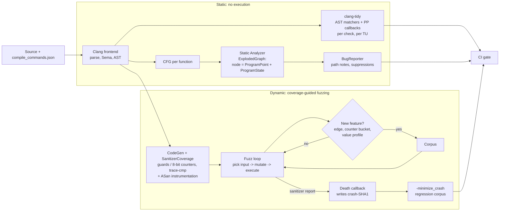

# C++ Clang-Tidy, Static Analyzer, and Fuzzing (libFuzzer, AFL++)

> [!summary] Claim:
> clang-tidy runs the Clang frontend once per translation unit and fires AST-matcher callbacks, so it finds patterns in one function's syntax and control flow in milliseconds, but only the patterns someone wrote a check for.
> The Clang Static Analyzer symbolically executes each function over its CFG, building an ExplodedGraph of (program point, immutable program state) nodes, inlining callees and pruning infeasible paths, which finds path-dependent bugs that no compiler warning sees, within hard budgets (225,000 nodes, 4 loop iterations, 4 inlined frames) and behind deliberate false-positive suppressions.
> Coverage-guided fuzzing executes the real code: SanitizerCoverage callbacks record which edges an input covered, the fuzzer keeps any input that covered something new and mutates it further, and a sanitizer turns a silent memory bug into a crash whose input is saved by a death callback.
> The three are complements, not substitutes: static tools reason about code that never runs, fuzzers prove bugs with a concrete input, and only the fuzzer's result is free of false positives.



## The Mechanism

[[Cpp-AddressSanitizer-and-LeakSanitizer-Internals]] owns how ASan turns an out-of-bounds write into a report; this note owns the three ways to reach that bug before a user does.
Every version-sensitive fact below was checked against LLVM 23.1.5 (Homebrew build) and Apple clang 21.0.0 (`clang-2100.4.1.1`) on darwin-arm64, and against AFL++ v5.03c sources and a v5.03c build made with that LLVM on the same machine, as of 2026-11.

### 1. Three tools, three questions

| Tool | Question it answers | Unit of work | Finds | Cannot find |
| :--- | :--- | :--- | :--- | :--- |
| clang-tidy | Does this code match a known bad pattern? | One TU's AST | Use-after-move, misuse of APIs, style and portability rules | Anything no check describes; most bugs that span files |
| Clang Static Analyzer | Is there a path through this function on which an invariant breaks? | One top-level function, with inlined callees | Null dereference, leaks, division by zero, double free along a specific path | Bugs past its node, loop, and inlining budgets; paths it suppresses on purpose |
| libFuzzer and AFL++ | Is there an input that crashes this code? | One execution of a harness | Any bug a sanitizer or assertion can detect, with a reproducer | Code the harness never reaches; bugs that need inputs the mutators never build |

### 2. clang-tidy: AST matchers over one translation unit

clang-tidy is a Clang tool: for every file it reads the compile command from `compile_commands.json` (found through `-p <build-dir>` or by searching the file's parent directories), runs the Clang frontend, and hands the AST to every enabled check.
CMake writes the database with `-DCMAKE_EXPORT_COMPILE_COMMANDS=ON`; without one, flags go after `--` on the command line, which is what the lab does.

A check is a subclass of `ClangTidyCheck` (`clang-tools-extra/clang-tidy/ClangTidyCheck.h` at llvmorg-23.1.5) with up to three hooks:

- `registerMatchers(ast_matchers::MatchFinder *Finder)` registers AST matcher expressions, such as `callExpr(callee(functionDecl(hasName("memcpy"))))`.
- `check(const ast_matchers::MatchFinder::MatchResult &Result)` runs once per match, reads the bound nodes, and emits a diagnostic, optionally with a fix-it.
- `registerPPCallbacks(...)` observes the preprocessor, for checks about macros and includes.

A module registers checks with `CheckFactories.registerCheck<...>()`, and `clang-tidy/add_new_check.py` generates the skeleton, docs, and test files (`Contributing.rst`).
Out-of-tree checks load with `--load=<plugin>`.

Most checks are syntactic, but some walk the CFG.
`bugprone-use-after-move` "takes control flow into account": it warns only when the use is reachable from the move, and not when the variable is reinitialized in between.
That is still one function and no symbolic values, which is the line between clang-tidy and the analyzer.

Three namespaces in the check list are not ordinary checks:

- `clang-diagnostic-<warning>` re-exports compiler warnings, so `-Wsizeof-pointer-memaccess` appears as `clang-diagnostic-sizeof-pointer-memaccess`.
- `clang-analyzer-<checker>` runs a Static Analyzer checker inside clang-tidy; the engine is the same one `clang --analyze` uses.
- `custom-<name>` holds query-based custom checks, added in clang-tidy 22: a `CustomChecks` list in `.clang-tidy` whose `Query` is a clang-query matcher string, enabled only with `--experimental-custom-checks`.
  The documentation warns that both the configuration structure and the query language may change between versions.

#### Defaults changed in clang-tidy 22

The Extra Clang Tools 22.1.0 release notes list three changes that matter for any CI configuration written before them:

- "Removed clang-analyzer-* checks from default checks", listed under Potentially Breaking Changes.
- clang-tidy "now displays warnings from all non-system headers by default"; before, `-header-filter='.*'` was needed.
- clang-tidy "no longer attempts to analyze code from system headers by default".

The lab confirms the result on clang-tidy 23.1.5: the built-in default is `Checks: 'clang-diagnostic-*'`, and because compiler diagnostics do not count as enabled checks, running clang-tidy with no configuration exits 1 with `Error: no checks enabled.` (as of 2026-11, Both).

#### Configuration, suppression, and exit codes

- `.clang-tidy` is read from the closest parent directory of each source file; `InheritParentConfig: true` layers it on the parent's file; on the command line, `--checks` and `--warnings-as-errors` are appended to the file's values, while `--header-filter`, `--exclude-header-filter`, `--system-headers`, and `--format-style` override them (`clang-tidy --help`, 23.1.5).
- `Checks` is an ordered glob list: `-*,bugprone-*,-bugprone-easily-swappable-parameters` enables a family and removes one member.
- `WarningsAsErrors` (or `--warnings-as-errors`) turns matching warnings into errors and makes the exit status nonzero, which is how CI fails a build; plain warnings exit 0, as the lab shows.
- `// NOLINT(check)`, `// NOLINTNEXTLINE(check)`, and `// NOLINTBEGIN(check)` ... `// NOLINTEND(check)` suppress named checks; a negative glob inside the parentheses is ignored.
- `--verify-config` checks that every check and option in the configuration exists without running anything, and `--explain-config` says where each check was enabled.
- `run-clang-tidy -p <build> -j N` runs one clang-tidy process per file in parallel, because each process analyzes one TU at a time.

### 3. The Clang Static Analyzer: path-sensitive symbolic execution

The analyzer's Checker Developer Manual describes the core in two sentences: it "performs symbolic execution of the given program", and "every possible path through the program is explored".
Exploring every path is impossible, so the engine is built around making the explosion finite.

#### The ExplodedGraph

- Each top-level function is analyzed from its CFG.
  An ExplodedNode is a ProgramPoint (a location such as "before this statement" or "entering this block") paired with a ProgramState.
- A ProgramState is immutable.
  A checker that changes state gets a new state back and must publish it with `CheckerContext::addTransition`.
- The state holds an Environment (expression to value), a Store (memory region to value), constraints on symbols, and a generic data map where checkers keep their own facts, such as "this pointer was freed".
- Values are SVals, which reference concrete values, symbols (an unknown but named value, such as the parameter `id`), or MemRegions (in the manual's words, "a lexicon of how to describe abstract memory": a variable, a field, a heap allocation).
- `ExplodedGraph::getNode()` profiles the (point, state) pair and looks it up in a folding set (`Nodes.FindNodeOrInsertPos`) before creating a node, so two paths that reach the same point in the same state merge into one node instead of being explored twice.
- At a branch whose condition is a symbol, the engine asks the constraint manager whether each outcome is satisfiable under the current constraints, and forks only into feasible ones; this is what keeps `guarded()` in the lab silent.
- A checker reports by calling `generateErrorNode()` (a sink: the path stops) or `generateNonFatalErrorNode()` (the path continues), then hands a bug report to the BugReporter, which walks back up the graph to build the path notes the lab prints.

#### Inter-procedural analysis by inlining

`IPA.rst` describes the modes of `-analyzer-config ipa`: `none`, `basic-inlining`, `inlining`, `dynamic`, and `dynamic-bifurcate`, the default in deep mode.
Inlining enters a new StackFrame through a CallEnter node and returns through CallExitBegin and CallExitEnd, so the callee is analyzed in the caller's context with the caller's constraints.
`dynamic-bifurcate` handles virtual calls with an imprecise receiver type by splitting the path: one branch assumes the known type and inlines, the other assumes a subclass and evaluates conservatively.
A callee is not inlined when its body is unavailable, it is variadic, the stack-depth bound is reached, or an earlier attempt exceeded the block budget; in that last case the engine replays the path from before the call with inlining switched off for it.
Without cross translation unit analysis, only bodies in the same TU can be inlined; CTU (`experimental-enable-naive-ctu-analysis`, `ctu-dir`, and an index built by `clang-extdef-mapping`) lifts that limit, and its documentation names CodeChecker as the preferred driver.

#### Budgets and deliberate blind spots

The lab dumps the effective configuration with the `debug.ConfigDumper` checker: `mode = deep`, `ipa = dynamic-bifurcate`, `max-nodes = 225000`, `max-inlinable-size = 100`, `exploration_strategy = unexplored_first_queue`, and `crosscheck-with-z3 = false`.
`clang/include/clang/Options/Options.td` at llvmorg-23.1.5 adds `-analyzer-max-loop` (default 4, stored as `maxBlockVisitOnPath`: a block is visited at most 4 times on one path) and `-analyzer-inline-max-stack-depth` ("4 by default" in the `-cc1` help; the stored value is 5 frames, the base frame plus 4 calls).
When a function's graph hits `max-nodes`, the remaining paths are dropped without a diagnostic, so silence from the analyzer is not a proof.

The most surprising default is `suppress-null-return-paths = true`, described in `-analyzer-config-help` as "a heuristic for avoiding bug reports with paths that go through inlined functions that are more defensive than their callers".
In the lab, `fill_qty()` dereferences the result of `find_order()`, which returns `nullptr` when `id` is out of range.
With the default the analyzer reports nothing for `fill_qty()`; with `suppress-null-return-paths=false` it reports `core.NullDereference` with a seven-note path through the callee.
The engine found the path both times; the BugReporter discarded it the first time, on the theory that a defensive callee does not imply a careless caller.

`crosscheck-with-z3` re-checks the constraints of each reported path with the Z3 solver to drop reports that the built-in range constraint manager wrongly considered feasible; it is off by default and needs an LLVM built with Z3.

### 4. Coverage-guided fuzzing: the feedback loop

A fuzzer without feedback is a random-input generator, and the lab shows what that buys: one million blind mutations of `AAAAA` never got past the first magic byte.
Coverage feedback changes the search from "guess four bytes at once" (about 1 in 2^32) into "guess one byte, keep the input, guess the next" (four searches of about 1 in 256 times the number of positions).

#### SanitizerCoverage: how the compiler reports coverage

SanitizerCoverage inserts a callback or counter on every edge of the control-flow graph.
At the default `edge` level it first splits critical edges (an edge from a block with several successors to a block with several predecessors) with dummy blocks, so that every edge has a block to instrument.

- `-fsanitize-coverage=trace-pc-guard` gives every edge its own `uint32_t` guard and emits a module constructor that calls `__sanitizer_cov_trace_pc_guard_init(uint32_t *start, uint32_t *stop)` with the module's guard range, then calls `__sanitizer_cov_trace_pc_guard(uint32_t *guard)` on every edge.
  The call is unconditional in LLVM 23.1.5 and Apple clang 21: `SanitizerCoverage.cpp` emits a plain call, and the lab counts eight call sites for the eight guards of `record.cpp` and still receives calls on edges whose guard it has set to 0, although the sample in the SanitizerCoverage documentation still says the compiler typically wraps the call in `if (*guard)` (as of 2026-11, Both).
  The callback must therefore test `*guard` itself, as the documentation's sample and `toyfuzz.cpp` do; setting a guard to 0 after the first hit reduces that edge to a call and an early return, not to nothing.
- `inline-8bit-counters` increments a byte per edge without a call, `inline-bool-flag` sets a byte, and `pc-table` emits a table mapping each counter to its PC.
- `trace-cmp` calls `__sanitizer_cov_trace_cmp{1,2,4,8}` and `__sanitizer_cov_trace_const_cmp{1,2,4,8}` with both operands of every comparison, `__sanitizer_cov_trace_switch` for switches, and `trace-div` and `trace-gep` hooks for divisors and array indices.

The lab's `toyfuzz.cpp` implements the two trace-pc-guard callbacks itself and so rebuilds the core of a coverage-guided fuzzer in 139 lines.

#### libFuzzer

libFuzzer is an in-process fuzzer linked into the target: the user writes `extern "C" int LLVMFuzzerTestOneInput(const uint8_t *data, size_t size)`, and libFuzzer supplies `main()`.
`-fsanitize=fuzzer` both links the runtime and, according to `SanitizerArgs.cpp` at llvmorg-23.1.5, turns on `inline-8bit-counters`, `indirect-calls`, `trace-cmp`, and `pc-table`, plus `stack-depth` on Linux only; `-fsanitize=fuzzer-no-link` instruments a library without linking libFuzzer's `main`.
The LLVM documentation states its status plainly: the original authors "have stopped active work on it" in favor of Centipede, and libFuzzer "is still fully supported in that important bugs will get fixed".

The loop, as implemented in `FuzzerLoop.cpp` and `FuzzerTracePC.*` at llvmorg-23.1.5:

1. Pick a corpus input, weighted by the Entropic power schedule (`-entropic=1` by default), which gives more energy to inputs that exercise rare features (Boehme, Manes, and Cha, ESEC/FSE 2020).
2. Apply up to `-mutate_depth=5` mutations: byte flips, inserts, erases, cross-over with another input, and insertion of dictionary entries.
3. Run the input, then convert each nonzero edge counter into a feature by AFL's bucket rule (`CounterToFeature()`: 1, 2, 3, 4-7, 8-15, 16-31, 32-127, 128+), so a loop that runs more often is new behavior even on the same edges.
4. Keep the input if it produced a feature never seen before; with `-reduce_inputs=1` a smaller input with the same features replaces a larger one.
5. Grow the length limit slowly (`-len_control=100`) so short inputs are explored first.

Comparison feedback is where libFuzzer and the toy differ.
`TracePC::HandleCmp()` records the operands of 4-byte and 8-byte comparisons in tables of recent compares (TORC4, TORC8), and libFuzzer uses them to splice the expected value into an input; `memcmp` and `strcmp` hooks do the same for buffers.
One-byte and two-byte comparisons never enter those tables; they feed only the value profile, which adds a feature per Hamming distance and per absolute distance between the operands, and the value profile is off unless `-use_value_profile=1` is passed, a flag that `FuzzerFlags.def` still labels experimental.
The lab's parser compares the magic one byte at a time, so with default flags libFuzzer must find each byte by mutation, and `-use_value_profile=1` cut the median runs-to-crash over ten seeds from 114,032 to 47,815.

When the sanitizer finds a bug, its runtime calls the death callback that libFuzzer registered with `__sanitizer_set_death_callback`, and `DeathCallback()` writes the current input as `crash-<sha1>` (or under `-artifact_prefix`, or at `-exact_artifact_path`).
Returning -1 from the target tells libFuzzer never to add that input to the corpus, and `FUZZING_BUILD_MODE_UNSAFE_FOR_PRODUCTION` is the conventional macro for disabling checksums, random seeding, and other fuzzing-hostile code in fuzz builds.

#### AFL++

AFL++ (v5.03c, released 2026-09-02) keeps the original AFL architecture: the fuzzer `afl-fuzz` and the target are separate processes, and coverage travels through shared memory.

- **Coverage map.** Michal Zalewski's AFL whitepaper defines the classic instrumentation as `shared_mem[cur_location ^ prev_location]++; prev_location = cur_location >> 1;` with a compile-time random `cur_location`, over a 64 kB map sized to stay in L2 cache; the shift keeps A->B distinct from B->A.
  Random IDs collide: the whitepaper's table gives 0.75% colliding tuples at 1,000 branches, 7% at 10,000, and 30% at 50,000.
  AFL++'s `include/config.h` at v5.03c still defaults `MAP_SIZE` to `1U << MAP_SIZE_POW2` with `MAP_SIZE_POW2` set to 16, but its default LLVM mode (`afl-clang-fast`) uses a PCGUARD SanitizerCoverage pass, `afl-clang-lto` assigns edge IDs at link time for "guaranteed non-colliding edge coverage", and v5.03c's release notes remove the classic colliding instrumentation from LLVM mode: `AFL_LLVM_INSTRUMENT=CLASSIC afl-clang-fast` now warns that it "was removed, using PCGUARD instead".
- **Fork server.** The target initializes once, then a fork server inside it forks a fresh child per input, which avoids paying for `execve()` and dynamic linking on every run; the AFL whitepaper credits this with 1.5x to 2x on fast targets.
  `__AFL_INIT()` defers the fork point past expensive setup.
- **Persistent mode.** `while (__AFL_LOOP(1000))` runs many inputs in one child, read through `__AFL_FUZZ_TESTCASE_BUF` and `__AFL_FUZZ_TESTCASE_LEN` from shared memory; `docs/fuzzing_in_depth.md` claims x2-x20 and `README.persistent_mode.md` "usually x10 to x20", and the latter warns that state not fully reset between iterations can produce false positives.
  This is libFuzzer's in-process model inside AFL's process model, and a `LLVMFuzzerTestOneInput` harness builds for AFL++ unchanged with `afl-clang-fast++ -fsanitize=fuzzer`: `afl-cc` replaces the flag with its own driver, `libAFLDriver.a`, and the lab's `fuzz_record.cpp` built that way runs under `afl-fuzz` with `target_mode : persistent shmem_testcase deferred` in `fuzzer_stats`.
- **Getting past comparisons.** CMPLOG (`AFL_LLVM_CMPLOG=1`, a separate binary passed with `-c`) logs comparison operands and applies the REDQUEEN idea of input-to-state correspondence: find where an operand's bytes appear in the input and replace them; laf-intel (`AFL_LLVM_LAF_ALL=1`) splits multi-byte comparisons into byte-wise ones so coverage itself becomes the gradient.
  `afl-clang-lto` also embeds an autodictionary of string comparison operands.
- **Schedules and scale.** `-p` selects the power schedule, `explore` by default; parallel runs use one `-M` main instance and many `-S` secondaries; `afl-cmin` and `afl-tmin` minimize corpora and test cases.
- **Version 5.x changes (as of 2026-11).** v5.00c moved the project to AGPL-3.0 (the README states that everything compiled into a harness stays Apache-2.0) and added LLVM 23 support; v5.02c requires recompiling persistent-mode and `LLVMFuzzerTestOneInput` targets; v5.03c switched macOS from SysV to POSIX shared memory, so older macOS builds must be recompiled (per the release notes and the Darwin branch of `GNUmakefile.llvm`, which sets `USEMMAP=1`; `docs/INSTALL.md` at v5.03c still describes SysV).
- **Run on macOS for this note (as of 2026-11).** AFL++ v5.03c built from source with Homebrew LLVM 23.1.5 on darwin-arm64 reported LLVM mode and LLVM LTO mode as built and the gcc plugin as failed.
  `afl-clang-fast++` and `afl-clang-lto++` each built the lab's harness, and `afl-fuzz` seeded with `AAAAA` saved the heap overflow as a `sig:06` crash in under one second, with and without a CMPLOG binary.
  `afl-fuzz` refused to start with `Crash reporter detected` until `AFL_I_DONT_CARE_ABOUT_MISSING_CRASHES=1` was set, and it needed no `sysctl` change: `kern.sysv.shmmax` was at its 4 MB default.
  Each configuration ran once, outside the lab's recorded output, so the runs show that the steps work and rank nothing.

### 5. Why the designs differ

The analyzer and clang-tidy live inside the compiler because they need its AST and semantics, which is also why both need the exact compile flags.
libFuzzer lives inside the process because a function call per input is cheaper than a fork, at the cost of sharing one heap and one global state with the target; AFL kept process isolation so it could fuzz unmodified programs that read files and leak or crash freely.
Each tool later borrowed from the other: AFL++ added persistent mode and accepts libFuzzer harnesses, and libFuzzer added `-fork` mode, which is still marked experimental, for crash- and OOM-resistant runs.

## Commands and Numbers to Know

| Item | Value | Platform and date | What it controls |
| :--- | :--- | :--- | :--- |
| clang-tidy built-in `Checks` | `'clang-diagnostic-*'`; no analyzer checks since 22 | Both (as of 2026-11) | A run with no configuration exits 1, `no checks enabled` |
| clang-tidy `HeaderFilterRegex` default | `'.*'` since 22 | Both (as of 2026-11) | Warnings from all non-system headers are shown |
| clang-tidy 23.1.5 check count | 602 with `-checks='*'`, 131 of them `clang-analyzer-*` | macOS, Homebrew (as of 2026-11) | Measured by the lab |
| `--experimental-custom-checks` | required for `CustomChecks` | Both (as of 2026-11) | Query-based checks, experimental since 22 |
| `-p <dir>` | reads `<dir>/compile_commands.json` | Both (as of 2026-11) | Exact compile flags per file |
| Analyzer `mode` / `ipa` | `deep` / `dynamic-bifurcate` | Both (as of 2026-11) | Inlining policy |
| Analyzer `max-nodes` | `225000` (75000 in shallow mode) | Both (as of 2026-11) | Graph budget per top-level function |
| Analyzer `max-inlinable-size` | `100` blocks (4 in shallow mode) | Both (as of 2026-11) | Largest callee that is inlined |
| `-analyzer-max-loop` | `4` | Both (as of 2026-11) | Loop iterations before the path is cut |
| `-analyzer-inline-max-stack-depth` | `4` calls (stored as 5 frames) | Both (as of 2026-11) | Inlined call depth |
| `suppress-null-return-paths` | `true` | Both (as of 2026-11) | Drops reports whose null came from a defensive callee |
| `crosscheck-with-z3` | `false` | Both (as of 2026-11) | Z3 refutation of reported paths |
| Stable analyzer checkers | 112 in Apple clang 21.0.0 | macOS (as of 2026-11) | Measured by the lab |
| `-fsanitize=fuzzer` coverage | `inline-8bit-counters,indirect-calls,trace-cmp,pc-table`, plus `stack-depth` on Linux | Both (as of 2026-11) | What libFuzzer sees |
| libFuzzer `-seed` / `-runs` | `0` (random) / `-1` (forever) | Both (as of 2026-11) | Set both for a reproducible bounded run |
| libFuzzer `-max_len` / `-len_control` | `0` (guessed from corpus) / `100` | Both (as of 2026-11) | Input size growth |
| libFuzzer `-timeout` / `-rss_limit_mb` | `1200` s / `2048` MB | Both (as of 2026-11) | Per-input timeout and memory cap |
| libFuzzer `-use_value_profile` / `-use_cmp` | `0` (experimental) / `1` | Both (as of 2026-11) | Comparison-distance features / CMP-guided mutation |
| libFuzzer `-entropic` | `1` | Both (as of 2026-11) | Entropic power schedule |
| libFuzzer `-error_exitcode` / `-timeout_exitcode` | `77` / `70` | Both (as of 2026-11) | Exit status for bugs libFuzzer itself detects |
| Sanitizer `abort_on_error` | `1` on Apple and Android, else `0` | Both (as of 2026-11) | A crash exits 134 (SIGABRT) on macOS, `exitcode=1` on Linux |
| libFuzzer runtime in Apple clang | absent: `libclang_rt.fuzzer_osx.a not found` | macOS, Xcode clang 21 (as of 2026-11) | Use Homebrew or upstream LLVM for `-fsanitize=fuzzer` |
| AFL++ `MAP_SIZE` | `1U << MAP_SIZE_POW2`, `MAP_SIZE_POW2` 16 (65,536) | Both, v5.03c (as of 2026-11) | Default coverage map entries |
| AFL++ `EXEC_TIMEOUT` | `1000` ms upper bound, auto-scaled | Both, v5.03c (as of 2026-11) | Hang detection |
| AFL++ `FORKSRV_FD` | `198` | Both, v5.03c (as of 2026-11) | Fork-server control descriptor |
| AFL++ default power schedule | `explore` | Both, v5.03c (as of 2026-11) | `-p` |
| AFL++ on macOS | builds from source with Homebrew LLVM; `afl-clang-fast` and `afl-clang-lto` both instrument and fuzz the lab's harness, the gcc plugin does not build, and `afl-fuzz` aborts with `Crash reporter detected` until the reporter is unloaded or `AFL_I_DONT_CARE_ABOUT_MISSING_CRASHES=1` is set | macOS arm64, v5.03c with LLVM 23.1.5 (as of 2026-11) | `docs/INSTALL.md` still says `afl-clang-lto` is "not working on macOS"; the v5.00c release notes, the `ld64.lld` branch of `GNUmakefile.llvm`, and the build run for this note say it works |

## Multi-Language Comparison: C++ / Python / Rust

| Concern | C++ | Python | Rust |
| :--- | :--- | :--- | :--- |
| Pattern linter | clang-tidy over the Clang AST | ruff or pylint over the Python AST | Clippy lints running inside rustc; see [[Rust-Borrow-Checker-Trait-Errors-Cargo-Expand-and-Clippy\|Clippy]] |
| Deep static reasoning | Clang Static Analyzer, path-sensitive symbolic execution | mypy or pyright type checking, which is not path-sensitive value analysis; see [[Python-Hypothesis-and-Type-Checkers-as-Bug-Prevention\|type checkers]] | The borrow checker proves memory safety for safe code at compile time; Miri checks `unsafe` code dynamically |
| Coverage-guided fuzzer | libFuzzer, AFL++ | Atheris, which is based on libFuzzer and also fuzzes native extensions | cargo-fuzz, which drives libFuzzer through `libfuzzer-sys`; afl.rs for AFL++; see [[Rust-Miri-Sanitizers-Loom-and-Cargo-Fuzz\|cargo-fuzz]] |
| What turns a bug into a crash | ASan, UBSan, MSan, assertions | Uncaught exceptions; sanitizers only inside native extensions | Panics, plus sanitizers for `unsafe` code |
| Property-based testing | libFuzzer harnesses that check invariants | Hypothesis | `cargo fuzz` harnesses that check invariants |

The C++ column needs the most tooling because the language gives the fewest guarantees: a memory bug in safe Rust is a compiler error, while in C++ it is silent until a sanitizer or a crash exposes it.

## Worked Lab Example

The lab is `code/03-Debugging/fuzzing_libfuzzer/`, and `bash run.sh` is its entry point.
It uses `${CXX:-c++}` (Apple clang 21.0.0 here) for the analyzer and the toy fuzzer, the `clang-tidy` on `PATH` (LLVM 23.1.5 here), and a libFuzzer-capable clang (Homebrew LLVM 23.1.5 here, because Apple clang has no libFuzzer runtime).
`run.sh` declares `# requires: macos`, so `make verify` skips it on Linux, where no output is recorded, and it stops with a named reason when `CXX` is not clang, clang-tidy is older than 22, or no compiler links libFuzzer.

All four parts share one bug in `record.cpp`: `parse_record()` checks the declared payload length against the input size but not against `out_cap`, so a record declaring more than 16 payload bytes overflows the harness's 16-byte heap buffer at the `memcpy` on line 27.
The magic `FUZZ` is checked one byte per `if`, so each matched byte is a new edge.

1. **clang-tidy.** The script copies the sources into a temp directory, so no `.clang-tidy` above the lab can leak in, and runs clang-tidy three ways: with no configuration, with `lab.clang-tidy`, and with `--warnings-as-errors='bugprone-*'` added.
   `lab.clang-tidy` enables compiler diagnostics, `bugprone-use-after-move`, one analyzer checker, and a query-based custom check `custom-no-raw-memcpy`.
2. **Static Analyzer.** It counts checkers, dumps the effective configuration, compiles `analyzer_target.cpp` with `-Wall -Wextra`, then runs `--analyze` with defaults and with `suppress-null-return-paths=false`, and prints the path notes of every report.
3. **Toy fuzzer.** `toyfuzz.cpp` defines the two trace-pc-guard callbacks, a splitmix64 PRNG with a fixed seed, four mutations, and a death callback; only `record.cpp` is instrumented.
   It runs once `blind` (mutate the seed, never keep anything) and once `guided` (keep any input that covered a new edge), with one million executions each.
   Before that, the script counts the guard call sites in the assembly of `record.cpp`, and `guard_probe.cpp` links the same instrumented object with a callback that sets each guard to 0 on its first hit and counts the calls that still arrive.
4. **libFuzzer.** It builds `fuzz_record.cpp` with `-fsanitize=fuzzer,address`, fuzzes with `-seed=1 -runs=2000000`, sweeps seeds 1-10 with and without `-use_value_profile=1`, minimizes the crash with `-minimize_crash=1 -seed=1 -runs=100000`, replays it against the buggy build and a `-DRECORD_FIXED` build, and fuzzes the fixed build for two million runs.

```bash
cd code/03-Debugging/fuzzing_libfuzzer
bash run.sh
```

### Verified output

Recorded with `python3 -m _harness.verify --record` on darwin-arm64 on 2026-11-10 and re-checked with `python3 -m _harness.verify`; the file is `code/03-Debugging/fuzzing_libfuzzer/expected/darwin-arm64.txt`.

```text
== Part 1: clang-tidy
built-in default Checks: 'clang-diagnostic-*'
checks available with -checks='*': 602, of which clang-analyzer-*: 131
run with no configuration: exit 1, first stderr line: Error: no checks enabled.
run with lab.clang-tidy: exit 0
record.cpp:27:5: [custom-no-raw-memcpy] raw memcpy; copy through a bounds-checked helper instead
tidy_target.cpp:10:12: [bugprone-use-after-move] 's' used after it was moved
tidy_target.cpp:15:34: [clang-diagnostic-sizeof-pointer-memaccess] 'memset' call operates on objects of type 'char' while the size is based on a different type 'char *'
tidy_target.cpp:20:31: [clang-analyzer-core.DivideZero] Division by zero
same run with --warnings-as-errors='bugprone-*': exit 1, errors: 1

== Part 2: Clang Static Analyzer
stable checkers listed by -analyzer-checker-help: 112
effective analyzer configuration (debug.ConfigDumper):
  crosscheck-with-z3 = false
  exploration_strategy = unexplored_first_queue
  ipa = dynamic-bifurcate
  max-inlinable-size = 100
  max-nodes = 225000
  mode = deep
  suppress-null-return-paths = true
-Wall -Wextra warnings: 0
--analyze with default options:
analyzer_target.cpp:32:26: [cplusplus.NewDeleteLeaks] Potential leak of memory pointed to by 'buf'
analyzer_target.cpp:49:18: [core.DivideZero] Division by zero
path notes with default options (the leak, then the division by zero):
  31:24 Assuming 'n' is > 0
  31:24 '?' condition is true
  31:16 Memory is allocated
  32:9 Assuming 'n' is > 100
  32:5 Taking true branch
  32:26 Potential leak of memory pointed to by 'buf'
  42:5 'count' initialized to 0
  43:21 Assuming 'i' is >= 'n'
  43:5 Loop condition is false. Execution continues on line 49
  49:18 Division by zero
--analyze with suppress-null-return-paths=false:
analyzer_target.cpp:18:12: [core.NullDereference] Access to field 'qty' results in a dereference of a null pointer (loaded from variable 'o')
analyzer_target.cpp:32:26: [cplusplus.NewDeleteLeaks] Potential leak of memory pointed to by 'buf'
analyzer_target.cpp:49:18: [core.DivideZero] Division by zero
path notes for the null dereference:
  17:16 Calling 'find_order'
  11:9 Assuming 'id' is < 0
  11:16 Left side of '||' is true
  11:28 Returning null pointer
  17:16 Returning from 'find_order'
  17:5 'o' initialized to a null pointer value
  18:12 Access to field 'qty' results in a dereference of a null pointer (loaded from variable 'o')

== Part 3: toy coverage-guided fuzzer (SanitizerCoverage trace-pc-guard)
record.cpp: call sites of __sanitizer_cov_trace_pc_guard in the assembly: 8
guard probe: 8 guards registered for record.cpp
guard probe: after run 1 of one valid record: 2 call(s) with an armed guard, 0 with a zeroed guard
guard probe: after run 2 of one valid record: 2 call(s) with an armed guard, 2 with a zeroed guard
guard probe: after run 3 of one valid record: 2 call(s) with an armed guard, 4 with a zeroed guard
blind: no crash in 1000000 executions; corpus size 1; deepest format depth reached 1 of 5
guided: execution 8 added corpus entry 1 (1 new edge(s), format depth 0)
guided: execution 2749 added corpus entry 2 (1 new edge(s), format depth 1)
guided: execution 3675 added corpus entry 3 (1 new edge(s), format depth 2)
guided: execution 6902 added corpus entry 4 (1 new edge(s), format depth 3)
guided: execution 13998 added corpus entry 5 (1 new edge(s), format depth 4)
guided: execution 21551 added corpus entry 6 (1 new edge(s), format depth 5)
toyfuzz: death callback saved the 46-byte input of execution 21757
guided: process exit 134
guided: AddressSanitizer: heap-buffer-overflow
guided: crash input starts with 'FUZZ', declared length 17, payload bytes present 41, destination capacity 16

== Part 4: libFuzzer
fuzz run (-seed=1 -runs=2000000): exit 134, crash artifact written: yes
executions until the crash: 116609
executions until the crash, default flags, seeds 1-10: 116609 175600 139776 13195 149273 49421 270191 22730 111456 84540
  min 13195, median 114032, max 270191, max/min 20.5x
executions until the crash, -use_value_profile=1, seeds 1-10: 39142 30322 87283 56488 66146 34509 73070 76963 36458 34792
  min 30322, median 47815, max 87283, max/min 2.9x
report: AddressSanitizer: heap-buffer-overflow, WRITE
SUMMARY: AddressSanitizer: heap-buffer-overflow record.cpp:27 in parse_record
minimized crash: 22 bytes, magic 'FUZZ', declared length 17
replay minimized input on the buggy build: exit 134, AddressSanitizer: heap-buffer-overflow
replay minimized input on the RECORD_FIXED build: exit 0, ASan reports: 0
fuzz the RECORD_FIXED build (-seed=1 -runs=2000000, same corpus): exit 0, crash: 0
```

### Reading the result

- **The clang-tidy 22 default bites.** With no configuration clang-tidy 23.1.5 refuses to run, so a CI step that relied on the old defaults now either fails or, if it passes `--allow-no-checks`, checks nothing.
  The analyzer finding at `tidy_target.cpp:20` appears only because `lab.clang-tidy` names `clang-analyzer-core.DivideZero` explicitly.
- **Warnings do not fail builds.** Four warnings exit 0; only `--warnings-as-errors` turns the use-after-move into an error and the exit status into 1.
- **The custom check is a policy, not a bug finder.** `custom-no-raw-memcpy` flags the exact line that overflows, but it would flag a correct `memcpy` just as loudly; it is how a team bans an API, written in three lines of YAML instead of a C++ plugin.
- **Path sensitivity at work.** `-Wall -Wextra` finds nothing in `analyzer_target.cpp`.
  The analyzer finds the leak only on the path `n > 100` (`Assuming 'n' is > 100`, then `Taking true branch`), and the division by zero only on the path where the loop never runs (`Assuming 'i' is >= 'n'`), and it stays silent on `guarded()`, whose null pointer exists only on a branch that cannot reach the dereference.
- **The suppression is real.** The default run omits `fill_qty()`; the path notes of the second run show the engine had the complete inter-procedural path all along.
- **The guard call is unconditional.** `record.cpp` has eight guards and eight call sites, and one valid record crosses two of them.
  After the probe sets those two guards to 0, the second and third runs still deliver two calls each, so a zeroed guard saves the callback's work, not the call.
- **Coverage is the whole difference.** The blind run, one million executions, never matched more than one magic byte; the guided run added six corpus entries, each for exactly one new edge: first a depth-0 input (it must be shorter than the 5-byte header, the only depth-0 path the seed does not cover), then one entry per magic byte and one for the length check, and it crashed after 21,757 executions.
  The exit status 134 is SIGABRT, because the sanitizer default `abort_on_error` is 1 on Apple platforms.
  On Linux `Die()` in `sanitizer_termination.cpp` ends with `_exit(exitcode)`, default 1: the same parser built with GCC 13.3.0 and ASan in the pinned Linux lab image exits 1 on a 22-byte overflowing record, and 134 with `ASAN_OPTIONS=abort_on_error=1`, a run that is not part of the recorded output (as of 2026-11, Linux).
- **One seed is not a measurement.** libFuzzer's executions-to-crash over seeds 1-10 span 13,195 to 270,191, a 20.5x spread, so the toy's single run beating libFuzzer's seed 1 says nothing about the two engines; Klees et al. (CCS 2018) found problems in all 32 fuzzing evaluations they surveyed, and repeated trials are the first fix.
- **Why value profile helps here.** The magic is four 1-byte comparisons, which libFuzzer's CMP tables ignore; value profile turns each extra matching bit into a feature, which lowered the median to 47,815 and the spread to 2.9x on this target.
- **Minimization reaches the true minimum.** The smallest crashing record is 5 header bytes plus 17 payload bytes, and `-minimize_crash` found exactly that 22-byte input.
- **The fix is verified twice.** The minimized crash no longer reproduces on the `RECORD_FIXED` build, and two million fresh runs on the fixed build find nothing; the minimized file is what belongs in the regression corpus.

## Pitfalls

> [!warning] Pitfall: trusting clang-tidy defaults across an upgrade
> clang-tidy 22 removed `clang-analyzer-*` from the defaults and started reporting from all non-system headers.
> A configuration that never listed its checks lost its analyzer coverage and gained header noise in one toolchain bump.
> Write `Checks` explicitly, run `--verify-config` in CI, and treat a clang-tidy upgrade as a change that needs review.

> [!warning] Pitfall: running clang-tidy without the real compile flags
> Without `compile_commands.json`, clang-tidy guesses flags, so macros, include paths, and the language standard differ from the build.
> The result is parse errors, missing diagnostics in `#ifdef` branches, and checks that silently skip code.
> Generate the database with the build system and pass `-p`.

> [!warning] Pitfall: reading analyzer silence as proof
> The analyzer is neither sound nor complete: it cuts loops after 4 iterations, drops paths past 225,000 nodes, does not inline across TUs without CTU, and suppresses reports by heuristic, as `suppress-null-return-paths` does in the lab.
> Use it to find bugs, never to certify their absence.

> [!warning] Pitfall: letting the optimizer delete the bug
> An earlier draft of the lab's parser copied into a `new[]` buffer that it summed and freed inside the same function.
> At `-O1` the compiler elided the allocation, which C++ permits, so the overflow no longer existed in the binary and libFuzzer ran two million inputs without a crash; this was observed while building the lab and is not part of its recorded output.
> The effect reproduces outside the lab: a 20-line program with that shape and an unused result reports `heap-buffer-overflow` at `-O0` and runs clean at `-O1` under ASan, with both Apple clang 21.0.0 and LLVM 23.1.5 (as of 2026-11, macOS).
> Make the harness hand buffers across a translation-unit boundary or otherwise observe the result, and confirm a known-bad input crashes before trusting a clean fuzz run.

> [!warning] Pitfall: coverage callbacks run before your constructors
> `__sanitizer_cov_trace_pc_guard_init` runs from a module constructor, which can precede the dynamic initialization of the fuzzer's own globals.
> In the lab's first `toyfuzz.cpp`, a global `std::vector` filled by the init callback was then reset by its own constructor (libc++'s default `vector` constructor is not `constexpr` in C++17), and the first edge callback crashed writing to address `0x1`; a 20-line reduction reproduces `SEGV on unknown address 0x000000000001` in `__sanitizer_cov_trace_pc_guard` with Apple clang 21.0.0, although it is not part of the lab's recorded output (as of 2026-11, macOS).
> Keep state touched by sanitizer callbacks in constant-initialized storage: raw pointers, arrays, or `constinit`.

> [!warning] Pitfall: `-fsanitize=fuzzer` with Apple clang
> Xcode's clang has no `libclang_rt.fuzzer_osx.a`, so linking fails with `library ... not found`, although `--analyze`, ASan, and `trace-pc-guard` all work.
> Use upstream or Homebrew LLVM for libFuzzer on macOS, and do not mix its runtime with Apple clang objects.

> [!warning] Pitfall: a harness with state
> libFuzzer runs every input in one process, and AFL++ persistent mode runs up to `__AFL_LOOP(N)` inputs per child, so globals, caches, open descriptors, and leaked memory from one input change the next.
> The crash then fails to reproduce from its own artifact.
> Reset all state per input, keep harnesses deterministic (no time, no unseeded randomness, `FUZZING_BUILD_MODE_UNSAFE_FOR_PRODUCTION` for checksums), and replay every artifact in a fresh process.

> [!warning] Pitfall: magic values the fuzzer cannot see
> CMP-guided mutation helps with 4-byte and 8-byte comparisons and with `memcmp`, but byte-at-a-time comparisons, checksums, and hashes give no gradient.
> Add a dictionary (`-dict`, or AFL++'s autodictionary), turn on value profile or laf-intel, or disable the checksum in fuzz builds.

> [!warning] Pitfall: comparing fuzzers or settings on one run
> The lab's ten seeds of one binary on one target spread by 20.5x.
> A single run per configuration, or runs of a few minutes, cannot rank engines, flags, or harnesses; use repeated trials, report medians and spread, and test the difference statistically.

## At Scale

For one developer, the right setup is a `.clang-tidy` with an explicit check list, `clang --analyze` or `scan-build` on demand, and a fuzz target for every parser of untrusted bytes, run locally for minutes.
From about 1,000 to 50,000 engineers the costs change shape: clang-tidy's cost is CPU per TU on every change, the analyzer's cost is CPU and human triage of false positives, and fuzzing's cost is a continuously running fleet plus corpus storage.

Decision rules:

- Gate merges on clang-tidy with `WarningsAsErrors` for a small set of high-precision checks (`bugprone-*` subsets, use-after-move, compiler diagnostics), run only on changed files and their TUs, and keep stylistic families advisory.
- Enable a new check by baseline: record existing findings, fail only on new ones, and burn the baseline down; turning on 600 checks at once trains engineers to add `NOLINT`.
- Run the Static Analyzer nightly or on changed TUs, not as a blocking full-repo step, and route reports to owners with deduplication by checker and location; turn on CTU only where the build can produce the index, and through a driver such as CodeChecker.
- Use custom checks, query-based for simple bans and C++ plugins for anything that needs types or fix-its, to encode organization rules such as "no raw `memcpy` in protocol code"; version them with the toolchain, because the query language follows Clang's AST and can change.
- Fuzz every parser, decoder, and deserializer that reads untrusted input, with one `LLVMFuzzerTestOneInput` harness that builds for both libFuzzer and AFL++; run short bounded fuzzing (`-runs` or `-max_total_time`) on pull requests and long campaigns continuously.
- Treat the corpus as an artifact: merge with `-merge=1` or `afl-cmin`, store it, seed every run from it, and add every minimized crash as a regression input that runs on each change.
- Run engines and settings in parallel rather than picking one: different AFL++ power schedules, CMPLOG and laf-intel builds, libFuzzer with value profile, and different sanitizers find different bugs.
- Use a shared service rather than an in-house loop when possible: OSS-Fuzz reports over 13,000 vulnerabilities and 50,000 bugs fixed across 1,000 projects as of May 2025, using libFuzzer, AFL++, and Honggfuzz.
- Record the policy and its exceptions in [[Debugging-Decision-Records]], and hand crash triage at volume to the pipeline that [[Core-Dumps-Minidumps-and-Crash-Reporting]] describes.

## Practice Drill

> [!tip] Practice Drill:
> Change `record.cpp` to compare the magic with one `std::memcmp(data, "FUZZ", 4) != 0` and predict three things before running the lab: whether the toy fuzzer still finds the crash, whether libFuzzer's median over the ten seeds falls, and whether `-use_value_profile=1` still matters.
> The toy should lose its per-byte gradient, because one call now covers all four bytes, while libFuzzer's `memcmp` hook should hand it the magic directly.
> Run by hand for this note, outside the recorded output: the toy found no crash in one million executions, libFuzzer's median over seeds 1-10 fell from 114,032 to 7,784 runs, and `-use_value_profile=1` raised that median to 13,507 (as of 2026-11, macOS).
> Next, write the lab's `custom-no-raw-memcpy` rule as a C++ check with `add_new_check.py` in an LLVM checkout and add a fix-it that rewrites the call to a bounds-checked helper; the query check cannot do this.
> With AFL++ v5.03c, on Linux or on macOS with Homebrew LLVM, build the same harness with `afl-clang-fast++ -fsanitize=fuzzer,address`, seed `afl-fuzz` with one file containing `AAAAA`, and compare time-to-crash with and without a CMPLOG binary (`-c`), across at least five runs each; for this note each configuration was run once on macOS, which shows that the steps work and nothing about which is faster.

## Interview Questions

> [!question] L5: What does clang-tidy need from the build, and what happens without it?
>
> > [!success]- Answer
> > It needs the exact compile command of every file, normally from `compile_commands.json` found through `-p` or by searching parent directories, because it runs the real Clang frontend on each TU.
> > Without it, flags must follow `--`, and any mismatch in macros, include paths, or language standard changes which code exists, so checks can miss code or fail to parse.
> > CMake writes the database with `-DCMAKE_EXPORT_COMPILE_COMMANDS=ON`, and `run-clang-tidy -p build -j N` parallelizes across files.

> [!question] L5: Your team upgraded from clang-tidy 21 to 23 and the CI job now fails with "no checks enabled". What happened and what is the fix?
>
> > [!success]- Answer
> > clang-tidy 22 removed `clang-analyzer-*` from the built-in defaults, leaving only `clang-diagnostic-*`, which does not count as an enabled check, so a run with no `Checks` configuration exits 1.
> > The job had been relying on the defaults, which means it had been running all analyzer checks without anyone choosing them.
> > Write an explicit `Checks` list that includes the wanted `clang-analyzer-*` checkers, add `--verify-config` to CI, and expect more header warnings, because 22 also changed `HeaderFilterRegex` to `.*`.
> > Passing `--allow-no-checks` would make the job green and useless.

> [!question] L5: Predict the output: the lab's `fill_qty()` dereferences the result of `find_order()`, which returns `nullptr` for an out-of-range id. Does `clang --analyze` with default options report it?
>
> > [!success]- Answer
> > No.
> > The analyzer inlines `find_order()`, follows the path where `id < 0`, and reaches the null dereference, but `suppress-null-return-paths` defaults to true and discards reports whose null value came from an inlined callee's return.
> > The heuristic assumes the callee is merely more defensive than its callers.
> > With `-Xclang -analyzer-config -Xclang suppress-null-return-paths=false` the report appears as `core.NullDereference` at line 18, with notes `Calling 'find_order'`, `Assuming 'id' is < 0`, and `Returning null pointer`.
> > The other two bugs in the file, the leak and the division by zero, are reported either way.

> [!question] L6: Explain how the Static Analyzer avoids a false positive on `int *q = have ? p : nullptr; if (have) return *q;`.
>
> > [!success]- Answer
> > The analyzer executes the function symbolically: `have` becomes a symbol, and the ternary forks the ExplodedGraph into a path with the constraint `have == true` and `q == p`, and a path with `have == false` and `q == nullptr`.
> > At `if (have)`, the constraint manager checks each branch against the path's constraints; on the null path the true branch is infeasible and is never created.
> > So the dereference is reached only with `q == p`, and no report is issued.
> > A path-insensitive analysis merges the two values of `q` at the join point and would warn.

> [!question] L6: Debug this: a hand-written coverage fuzzer crashes on its first execution with `SEGV on unknown address 0x000000000001` inside `__sanitizer_cov_trace_pc_guard`. The init callback fills `std::vector<uint8_t> g_hit` with `g_hit.assign(n + 1, 0)`. What is wrong?
>
> > [!success]- Answer
> > The instrumented module's constructor calls `__sanitizer_cov_trace_pc_guard_init` before the fuzzer's own translation unit runs its dynamic initializers.
> > The init callback allocates the vector's storage, then the vector's constructor runs and resets it to empty, because libc++'s default `vector` constructor is not `constexpr` in C++17 and so is dynamic initialization.
> > The edge callback then writes through a null data pointer at index 1, which is address `0x1`.
> > Keep callback state in constant-initialized storage, such as raw pointers allocated with `calloc` in the init callback, as the lab's `toyfuzz.cpp` does.

> [!question] L6: libFuzzer took a median of 114,032 runs to pass a four-byte magic checked one byte per `if`, and 47,815 with `-use_value_profile=1`. Why, and what would you change in the target?
>
> > [!success]- Answer
> > `TracePC::HandleCmp()` records operands only for 4-byte and 8-byte comparisons in its recent-compares tables, and `memcmp` has its own hook, so one-byte comparisons give libFuzzer no value to splice in.
> > Each byte must therefore be found by mutation, and only the new edge after a correct byte rewards it.
> > Value profile adds features for the Hamming and absolute distance between comparison operands, so every additional correct bit is rewarded, which is a gradient.
> > In the target, compare the magic with one `memcmp` or a 32-bit load and compare, add a dictionary with `FUZZ`, or in AFL++ use CMPLOG or laf-intel; all of these turn the magic into something the engine can see.

> [!question] L6: Compare libFuzzer and AFL++ execution models and say when each is the better choice.
>
> > [!success]- Answer
> > libFuzzer runs the target in its own process, calling `LLVMFuzzerTestOneInput` in a loop, so an execution costs a function call, but one crash, leak, or bit of leftover state affects the whole run.
> > AFL++ runs the target as a separate process behind a fork server, with coverage in shared memory, so it can fuzz programs that read files, exit, or keep global state, and persistent mode with `__AFL_LOOP` recovers most of the in-process speed when the harness allows it.
> > AFL++ adds CMPLOG, laf-intel, collision-free LTO instrumentation, power schedules, and black-box modes; libFuzzer is simpler to embed in unit-test builds and is in maintenance mode.
> > A `LLVMFuzzerTestOneInput` harness builds for both, so the practical answer is to write that harness and run both engines.

> [!question] L7: Why is "the static analyzer found nothing" not evidence that the code is safe, and what would you accept as evidence?
>
> > [!success]- Answer
> > The analyzer explores a bounded, heuristic subset of paths: 4 loop iterations, 4 inlined frames, inlining only of small callees, 225,000 nodes per function, no cross-TU bodies without CTU, and deliberate suppressions such as `suppress-null-return-paths`.
> > Paths dropped at a budget produce no diagnostic, so silence mixes "safe" with "not explored".
> > Evidence is layered: types and APIs that make the bug unrepresentable, sanitizer-instrumented tests and fuzzing that execute the code with concrete inputs, and for the most critical code, formal verification.
> > The analyzer's job is to find bugs cheaply before those layers run, not to replace them.

> [!question] L7: A fuzzing campaign has run for a week on a parser and coverage has been flat for six days. What do you check, in order?
>
> > [!success]- Answer
> > First, whether the harness reaches the code: inspect coverage with `-print_coverage=1` or a source-based coverage build and look for the first uncovered branch.
> > Second, whether a comparison, checksum, or length field blocks progress there; add a dictionary, value profile, CMPLOG or laf-intel, or a `FUZZING_BUILD_MODE_UNSAFE_FOR_PRODUCTION` bypass for the checksum.
> > Third, whether inputs are too short or too long for the format: check `-max_len` and the corpus size distribution, and seed with real samples.
> > Fourth, whether the harness is stateful or slow, which shows as low executions per second or irreproducible crashes.
> > Last, consider a structure-aware mutator for formats that random byte mutation rarely keeps valid.

> [!question] L8+: Design the static analysis and fuzzing program for a 5,000-engineer C++ organization that ships network-facing services.
>
> > [!success]- Answer
> > Own the toolchain as a product: pin clang-tidy and LLVM versions, publish one base `.clang-tidy` with explicit checks and `InheritParentConfig` for team additions, and treat upgrades as reviewed changes because defaults move, as clang-tidy 22 showed.
> > Gate merges on a small high-precision set with `WarningsAsErrors` on changed TUs, introduce new checks through baselines, and encode organization rules as custom checks.
> > Run the Static Analyzer, and CTU where the build supports it, nightly through a driver that deduplicates and assigns reports, and measure false-positive rates per checker so that noisy checkers are tuned or removed.
> > Require a fuzz target for every parser of untrusted input, built for libFuzzer and AFL++ with ASan and UBSan, with bounded fuzzing on pull requests, continuous campaigns on a fleet, corpus storage, crash deduplication, automatic minimization, and regression replay.
> > Report program health as coverage of fuzzed code, time-to-fix for found crashes, and new bugs per week, never as raw warning counts, and compare engines or settings only with repeated trials.

> [!question] L8+: Your security team proposes replacing fuzzing with static analysis because "it covers all paths". How do you respond?
>
> > [!success]- Answer
> > Static analysis does not cover all paths; it covers a budgeted, heuristic subset and reports with false positives, while fuzzing covers only executed paths but every report comes with a reproducing input.
> > The two find different bugs: the analyzer reaches error paths that are hard to trigger, such as allocation failures and rare branches, and fuzzing finds bugs across files, libraries, and deep state that the analyzer's bounds cut off.
> > The cost profiles differ too: the analyzer costs human triage time, fuzzing costs machine time, and machine time is cheaper to scale.
> > Keep both, gate on the high-precision parts of each, and measure what each finds over a quarter before moving budget between them.

## Further Reading

- Clang-Tidy documentation: configuration lookup, `NOLINT` forms, and the check list, the reference for every option in the lab's `lab.clang-tidy`.
- Extra Clang Tools 22.1.0 Release Notes: the three default changes (no analyzer checks, header warnings, no system headers) and the arrival of query-based custom checks.
- `QueryBasedCustomChecks.rst` at llvmorg-23.1.5: the `CustomChecks` schema and the warning that its query language follows Clang's AST.
- Clang Static Analyzer Checker Developer Manual: ExplodedGraph, ProgramState, SVals, MemRegions, and checker callbacks, the vocabulary needed to read or write a checker.
- `IPA.rst` at llvmorg-23.1.5: inlining modes, bifurcation, and replay without inlining.
- Clang SanitizerCoverage documentation: the guard, counter, and comparison hooks that both libFuzzer and the lab's toy fuzzer consume.
- libFuzzer documentation and `compiler-rt/lib/fuzzer` sources at llvmorg-23.1.5: flags, corpus handling, CMP tables, and the death-callback crash path.
- Michal Zalewski, AFL technical whitepaper: the original edge-tuple map, hit-count buckets, collision table, and fork server.
- AFL++ `docs/fuzzing_in_depth.md` at v5.03c: the end-to-end workflow, compiler selection, CMPLOG, laf-intel, parallel fuzzing, and campaign management.
- Fioraldi, Maier, Eissfeldt, and Heuse, "AFL++: Combining Incremental Steps of Fuzzing Research" (WOOT 2020): why AFL++ combines many research ideas behind one tool.
- Aschermann et al., "REDQUEEN" (NDSS 2019): input-to-state correspondence, the idea behind CMPLOG.
- Boehme, Manes, and Cha, "Boosting Fuzzer Efficiency: An Information Theoretic Perspective" (ESEC/FSE 2020): the Entropic schedule that libFuzzer enables by default.
- Klees et al., "Evaluating Fuzz Testing" (CCS 2018): why the lab sweeps ten seeds and why single-run fuzzer comparisons mislead.

## Related

- Prerequisites: [[Cpp-AddressSanitizer-and-LeakSanitizer-Internals]]
- Next: [[Cpp-Playbook-Heap-Corruption]]
- See also: [[02-Programming-Languages/C++/CPP_Zero_to_Godhood/Volume_08_Advanced_Systems/Chapter_105_Sanitizers_Fuzzing_Testing_Concurrency/Chapter_105_Sanitizers_Fuzzing_and_Testing_Concurrent_Code|Chapter_105_Sanitizers_Fuzzing_and_Testing_Concurrent_Code]], [[Cpp-UndefinedBehaviorSanitizer-and-UB-Field-Guide]], [[Cpp-Sanitizers-and-Memory-Debugging-on-macOS]], [[Rust-Miri-Sanitizers-Loom-and-Cargo-Fuzz]], [[Scientific-Debugging-Delta-Debugging-and-Heisenbugs]]
- Lab: `code/03-Debugging/fuzzing_libfuzzer/` (requires: macos)
