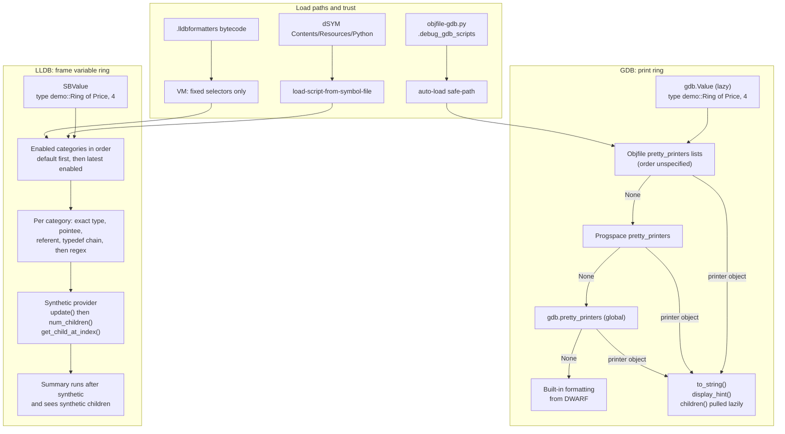

# C++ Debugger Scripting and Pretty-Printers

> [!summary] Claim:
> GDB and LLDB each embed a CPython interpreter and expose the inferior as lazy proxy objects (`gdb.Value`, `lldb.SBValue`), so a few dozen lines of Python can turn raw storage into the abstraction the programmer meant.
> A GDB pretty-printer is a lookup function that returns an object with `to_string`, `children`, and `display_hint`; GDB searches objfile lists, then the program space, then the global list, and the first non-`None` answer wins.
> An LLDB formatter is a summary or a synthetic children provider (`update`, `num_children`, `get_child_at_index`) stored in a category, and categories are searched in enable order with exact matches before regexes.
> Because these scripts are code that runs when a binary is opened, both debuggers gate auto-loading behind trust policies (`auto-load safe-path`, `target.load-script-from-symbol-file`), and LLDB adds a sandboxed formatter bytecode for formatters shipped inside binaries.



## The Mechanism

[[Cpp-GDB-and-LLDB-Expert-Guide]] owns the interactive commands; this note owns the programmatic layer under them.
GDB facts below come from the GDB manual's Python API nodes and `gdb/NEWS`; the current online manual is the development snapshot GDB 19.0.50.20261108, and the newest release is GDB 18.1 (released 2026-09-25).
LLDB facts come from lldb.llvm.org (main, updated 2026-11-08) and the llvm-project source at `llvmorg-23.1.5`, the newest release (as of 2026-11).
Behavior marked "observed" is recorded by the two labs under `code/03-Debugging/` (GDB 15.1 on linux-aarch64, Apple lldb-2103.0.34.407 on darwin-arm64, both run on 2026-11-08) and re-checked by `make verify`.

### 1. The embedding model: lazy proxies over inferior memory

Both debuggers link CPython into the debugger process, not into the inferior.
Your script never touches the program's address space directly: every read goes through the debugger's target layer, which uses ptrace, Mach, a core file, or a remote stub as [[How-Debuggers-Work-ptrace-Mach-and-Breakpoints]] describes.
That is why the same printer works on a live process, a core file from [[Core-Dumps-Minidumps-and-Crash-Reporting]], and a remote target from [[Remote-Debugging-gdbserver-lldb-server-and-RSP]], as long as it only reads memory.

A `gdb.Value` is lazy: `gdb.parse_and_eval('somevar')` does not fetch bytes until they are needed or `Value.fetch_lazy()` is called, and `Value.is_lazy` reports the state.
Indexing with `val['field']` or `val[i]`, `dereference()`, `cast()`, `referenced_value()`, and `dynamic_type` (which uses RTTI) all return new values without copying the whole object.
`Value.is_optimized_out` and `Value.is_unavailable` distinguish "the compiler removed it" from "it exists but this target cannot read it", which matters for the optimized builds that [[Cpp-Debugging-Optimized-Code]] covers.
`Value.string()` copies a C string into Python, while `Value.lazy_string()` returns a `gdb.LazyString` that GDB reads and encodes only when printing, respecting `set print elements`.
On the LLDB side an `SBValue` plays the same role: `GetChildMemberWithName()`, `GetChildAtIndex()`, `GetValueAsUnsigned()`, `GetData()`, `Dereference()`, and `Clone()` navigate and read lazily.

The interpreter is whatever Python the debugger was built against, not the one on `PATH`.
Observed (as of 2026-11): GDB 15.1 on Ubuntu 24.04 embeds Python 3.12.3, and Apple lldb-2103.0.34.407 embeds Python 3.9.6, so a formatter that uses a `match` statement (Python 3.10) fails to import in Apple's LLDB.
GDB removed Python 2 support in GDB 13 and dropped Python older than 3.4 in GDB 17; LLDB 21 requires Python 3.8 or later to build.

### 2. GDB pretty-printers: protocol and lookup

A GDB pretty-printer has two parts: a lookup callable that receives a `gdb.Value` and returns a printer object or `None`, and the printer object itself.
The printer protocol has three "basic" optional methods:

- `to_string()`: a Python string is printed verbatim; a `gdb.Value` or a convertible scalar is printed as a value, which can recurse into another printer; `None` prints nothing.
- `children()`: an iterator of `(name, value)` pairs, which "should lazily compute its results" so GDB reads only what `set print elements` and `-var-list-children` ask for.
- `display_hint()`: `'array'` (respect array print settings), `'map'` (children alternate key and value), `'string'` (format `to_string` as a quoted string), or `None`.

GDB 14 added the `gdb.ValuePrinter` base class.
It has no behavior; it is a tag that tells GDB the printer may implement the non-basic methods `num_children()` and `child(n)`, and in exchange GDB reserves every attribute that starts with a lower-case letter, which is why the manual's examples keep state in `self.__val`.

Lookup order, from "Selecting Pretty-Printers":

1. Each `gdb.Objfile.pretty_printers` list in the current program space, in an unspecified order across objfiles.
2. The current `gdb.Progspace.pretty_printers` list.
3. The global `gdb.pretty_printers` list.

Within one list GDB calls functions from the head, and the first printer object returned ends the search.
A callable whose `enabled` attribute is `False` is skipped, which is how `disable pretty-printer` works.
The manual's rule is to register in the smallest scope possible: objfile first, then program space, and global only as a last resort.

`gdb.printing.register_pretty_printer(obj, printer, replace=False)` in GDB 18.1 raises `RuntimeError` when a printer of the same name exists unless `replace=True`, then calls `obj.pretty_printers.insert(0, printer)`, so the most recent registration is tried first; `obj=None` means global.
`RegexpCollectionPrettyPrinter.__call__` computes `gdb.types.get_basic_type(val.type).tag`, which strips references, typedefs, and `const`/`volatile`, then walks its subprinters in order and calls `compiled_re.search(typename)`.
`search` is unanchored, so a pattern must carry its own `^` and `$`.

libstdc++ shows the production pattern (GCC 16.2.0 `printers.py`):

- `printer_base = gdb.ValuePrinter` when GDB provides it, else `object`, so one file supports old and new GDB.
- Its `Printer` class keys subprinters by template base name in a dictionary (`self._lookup[name]`), so lookup is one regex match on the type name plus one dictionary probe instead of a linear scan of every pattern.
- `add_version()` registers each name twice, once as `std::` and once with the versioned namespace `std::__8::`, except names whose base already contains `__cxx11`.
- `StdVectorPrinter` implements `to_string`, `children`, `num_children`, and `display_hint` returning `'array'`, and clamps a negative computed length to zero with the comment "Probably uninitialized".
- The package path is versioned (`libstdcxx.v6`), as the manual recommends, so two library versions can have printers loaded at once.

### 3. Getting printers loaded: auto-load and trust

GDB looks for scripts every time it reads a new objfile, including each shared library loaded at run time.
Two mechanisms exist:

- `objfile-gdb.py`: GDB takes the objfile's absolute, symlink-resolved path, appends `-gdb.py`, and loads that file if it exists; otherwise it looks for the same relative path under each `auto-load scripts-directory` entry (default `$debugdir:$datadir/auto-load`).
- The `.debug_gdb_scripts` section (ELF and COFF): a list of NUL-terminated entries whose first byte is the kind: `1` Python file, `3` Guile file, `4` inline Python text, `6` inline Guile text.
  File entries are searched in the current directory and then the source search path, never `$cdir`; inline text entries carry a unique script name on their first line, and GDB executes each name once.

On Ubuntu 24.04 the libstdc++ hook is `/usr/share/gdb/auto-load/usr/lib/aarch64-linux-gnu/libstdc++.so.6.0.33-gdb.py` (observed), which recomputes the path to `/usr/share/gcc/python` relative to the objfile and calls `register_libstdcxx_printers(gdb.current_objfile())`; the GDB lab prints the path and those lines.
`gdb.current_objfile()` is set only while an auto-loaded script runs; a script loaded with `source` sees `None` and therefore registers globally.

The manual's guidance on choosing:

| Concern | `objfile-gdb.py` | `.debug_gdb_scripts` |
| :--- | :--- | :--- |
| File formats without extra sections | Works | Needs ELF or COFF |
| Installed public libraries such as libstdc++ | Natural: install under `$datadir/auto-load` | Awkward: no source directory to search |
| Static linking | Only the executable is an objfile, so every library's script must hang off it | Works: each library's entry lands in the executable |
| Header-only or fully inlined classes | No library objfile to attach to | Works |
| Source changes | None | A macro in a header |

The section uses the `"MS"` flags with entity size 1, so the linker merges duplicate strings and a header included by 500 translation units yields one entry.
Every auto-load path is subject to `auto-load safe-path`, whose default is the configure-time value, typically `$debugdir:$datadir/auto-load` (observed on GDB 15.1); a file outside it produces the "auto-loading has been declined" warning and is not executed.
Setting the safe path to `/` disables the protection, and the manual says the variable "is supposed to be set to the system directories writable by the system superuser only".
`info auto-load python-scripts` lists what loaded and what was declined.

### 4. Frame filters and frame decorators (GDB 7.7)

A frame filter changes how `backtrace` and the MI stack commands present frames without altering the frames themselves.
Filters live in dictionaries: `gdb.frame_filters` (global), `Progspace.frame_filters`, and each `Objfile.frame_filters`.
For a backtrace GDB merges all of them, drops filters whose `enabled` is `False`, sorts by `priority` (higher runs first; the manual's examples all use 100), wraps every frame in a `FrameDecorator`, and chains the filters so each one's output iterator is the next one's input.
A filter's mandatory `filter(iterator)` method must return an iterator of decorators, and the manual warns it should avoid walking the whole stack eagerly, because stacks can be tens of thousands of frames deep and GDB walks them again when printing.

A decorator subclasses `gdb.FrameDecorator.FrameDecorator` and overrides only what it changes: `function()`, `address()`, `filename()`, `line()`, `frame_args()`, `frame_locals()`, or `elided()`.
`elided()` returns frames to fold under the decorated one; the CLI indents them, MI puts them in a `children` field, and the filter itself must remove them from the main stream.
`backtrace -no-filters` bypasses all filters, which is the first move when a filter is suspected of hiding something.
[[Cpp-Playbook-Deadlocks-and-Livelocks]] is where a filter that hides runtime trampolines pays off, because every thread's stack becomes readable at once.

### 5. Python unwinders (GDB 7.10) and xmethods (GDB 7.8)

An unwinder computes the caller's frame when DWARF CFI and GDB's built-in unwinders cannot, for example in a JIT or an interpreter with its own frame layout.
It is a callable with `name` and `enabled` attributes; GDB passes a `gdb.PendingFrame`, and the unwinder returns `None` or a `gdb.UnwindInfo` built with `pending_frame.create_unwind_info(FrameId(sp, pc))` plus `add_saved_register()` for each caller register it can recover.
The frame ID's `sp` must stay constant for the frame's lifetime, which is why the manual recommends the stack pointer at function entry, the DWARF Call Frame Address, and its `pc` is the function's address, not the current instruction.
GDB calls objfile unwinders, then program-space unwinders, then global ones, then its built-ins; `gdb.unwinder.register_unwinder(locus, unwinder, replace=False)` prepends within a locus.
The manual warns that an unwinder "should do as little work as possible" and that an inferior call from one is "unadvisable" because it resets unwinding and can re-enter it.

A working AArch64 example, `unwind_gdb.py`, is in the Worked Lab Example: it claims the frames of one function, rebuilds the caller's `pc`, `sp`, and `x29` from the frame record, and reproduces the DWARF backtrace on GDB 15.1 (observed in the GDB lab).
The frame record layout is architecture specific, so the lab runs that step on AArch64 only.

An xmethod replaces a C++ method call in a GDB expression with Python.
An `XMethodMatcher.match(class_type, method_name)` returns a worker whose `__call__(*args)` receives `this` first and returns a `gdb.Value`, and `get_arg_types()`/`get_result_type()` describe its signature; matchers register with `gdb.xmethod.register_xmethod_matcher(locus, matcher, replace=False)`.
The payoff is that `print v.size()` or `print v[3]` works when the method was inlined away, was never instantiated, or cannot be called because the target is a core file.
libstdc++ ships `xmethods.py` and registers it next to its printers whenever `gdb.xmethod` imports.
Without an xmethod or a real `operator[]`, `print ring[0]` on the lab type fails with `No symbol "operator[]" in current context.` (observed, GDB 15.1).

### 6. GDB commands in Python

A command is a subclass of `gdb.Command` whose initializer registers it: `gdb.Command.__init__(name, command_class[, completer_class[, prefix]])`.
`invoke(argument, from_tty)` receives the argument string with whitespace stripped; an exception becomes a GDB error, and `gdb.GdbError` makes the command fail without displaying the Python stack.
`dont_repeat()` stops a blank line from re-running the command, `gdb.string_to_argv()` splits arguments exactly like GDB's own lexer, and a multi-word name requires its prefix command to exist.
Errors inside printers print in place of the value: with the default `set python print-stack message`, a printer that raises shows `Python Exception <class 'RuntimeError'>: ...`, and `set python print-stack full` shows the traceback (observed, GDB 15.1).

### 7. LLDB formatters: categories and the lookup algorithm

LLDB splits presentation into four formatter kinds, managed by `type format`, `type summary`, `type filter`, and `type synthetic`, with `add`, `delete`, `list`, and `clear` subcommands.
Every formatter lives in a category; `-w <name>` places it, an unknown category is created disabled, and `type category enable` activates it.
Categories are searched in enable order, and a newly enabled category becomes the second searched, after `default`, which always stays first; the built-in order starts `default`, `objc`, `CoreFoundation`, `AppKit`, `CoreServices`, `CoreGraphics`, `cplusplus`, `VectorTypes`, `system`.

Inside each category LLDB tries, in order:

1. A formatter for the exact type.
2. For a pointer, a formatter for the pointee that does not skip pointers.
3. For a reference, a formatter for the referent that does not skip references.
4. For Objective-C with dynamic types on, the dynamic type, then the declared type.
5. The typedef chain, using formatters that cascade (`-C no` stops cascading).
6. All of the above again, matching regexes (`-x`) instead of exact names.

The first hit ends the search across all categories.
Cascading through inheritance was removed "since it significantly degrades performance", so a formatter for a base class does not apply to derived classes.
`--recognizer-function` accepts a Python predicate over `SBType` for cases no name or regex can express, such as every class generated from one schema.

### 8. LLDB summaries and synthetic children

A Python summary is `def f(valobj, internal_dict[, options])` returning a string, registered with `type summary add -F module.f TYPE`.
A synthetic children provider is a class constructed as `Provider(valobj, internal_dict)` that implements:

| Method | Contract | Required or optional (from the docs) |
| :--- | :--- | :--- |
| `update()` | Called before any other method and recomputes state; return `False` to be called again at the next stop, `True` to cache the children forever | Optional; must return a `bool` since LLDB 3.1.0 |
| `num_children(max_children)` | Number of children; an expensive count may return `max_children` instead | Required; the `max_children` argument is optional since LLDB 3.8.0 |
| `get_child_at_index(index)` | A new `SBValue` for child `index` | Required |
| `get_child_index(name)` | Index for a name, `-1` if none; `[N]` subscripts are handled automatically | Required |
| `has_children()` | Cheap "might have children" answer | Optional since LLDB 3.2.0 |
| `get_value()` | An `SBValue` shown as this value's own value | Optional since LLDB 3.5.2 |

The documentation states three behaviors that shape every provider:

- Exceptions thrown by Python formatters "are caught silently by LLDB", which may then show no children or skip some, so a provider must handle its own errors.
- LLDB runs the synthetic provider before the summary, so a summary sees synthetic children, and the raw members are reachable only through `valobj.GetNonSyntheticValue()`.
- Synthetic children work in `frame variable` and the SB API but not in `expression`, which compiles real C++ and ignores them; the observed error on the lab type is `type 'const demo::Ring<demo::Price, 4>' does not provide a subscript operator`.

A child named `$$dereference$$` is used for `*` and `->` in `frame variable`, which is how smart-pointer providers forward to the pointee.
`SBValue.SetTypeSynthetic()` attaches a provider to one value without any registration, for values whose type alone cannot identify the right provider.
LLDB 23 adds `@lldb.summary` and `@lldb.synthetic` decorators that register when `command script import` loads the module (commit `14ac9dfdf3ac`, contained in `llvmorg-23.1.0`); Apple lldb-2103.0.34.407 does not have them (observed: `hasattr(lldb, "summary")` is `False`).

LLDB's own C++ formatters mix both implementations at `llvmorg-23.1.5`: the libc++ `std::vector` provider is C++ (`LibcxxStdVectorSyntheticFrontEndCreator`), while the libc++ `std::deque` provider and the libstdc++ `std::vector`, `std::map`, and `std::list` providers are Python classes in `lldb.formatters.cpp.libcxx` and `lldb.formatters.cpp.gnu_libstdcpp`.

### 9. LLDB commands, recognizers, and frame providers

A Python command is a function `f(debugger, command, exe_ctx, result, internal_dict)` added with `command script add -f module.f name`, or a class with `__init__(debugger, internal_dict)` and `__call__(debugger, command, exe_ctx, result)` added with `-c` (since LLDB 3.7).
Use `exe_ctx` rather than the "currently selected" frame: the documentation strongly discourages the older four-argument form because stop hooks and breakpoint callbacks may run against a thread that is not selected.
`result.SetError()` marks failure, `result.AppendMessage()` adds output, and `print(..., file=result)` also works.
`command script import` runs a module's `__lldb_init_module(debugger, internal_dict)`, which is where formatter and command registration belong; a plain Python `import` does not run it.
LLDB 19 added parsed commands (pull request #70734, commit `a69ecb2420f6`, contained in `llvmorg-19.1.0` and not in `llvmorg-18.1.0`), which derive from `lldb.ParsedCommand`, declare options in `setup_command_definition()`, and get generated help and completion.

LLDB has no frame-filter API with GDB's shape; two features cover the same ground:

- Frame recognizers (`frame recognizer add -l Class -n function -s module`) supply arguments for frames without debug info through `get_recognized_arguments(frame)`, and can provide a step-through plan for trampolines.
- `ScriptedFrameProvider` (in LLVM 22.1.0; commit `1e467e44851a`) rewrites a thread's frame list: `get_frame_at_index(index)` is called lazily per frame and returns an `int` to forward an input frame, a `ScriptedFrame` or a `dict` with `idx` and `pc` to inject an artificial frame, or `None` when no frame exists, and `target frame-provider register -C module.Class` attaches it; while a provider runs, expression evaluation is restricted to the current thread.

### 10. LLDB trust: scripts in dSYM bundles

On Darwin, when a module's symbols come from `X.dSYM/Contents/Resources/DWARF/X`, `PlatformDarwin::LocateExecutableScriptingResourcesFromDSYM()` looks for `X.dSYM/Contents/Resources/Python/<name>.py`, where `<name>` is the module's file name sanitized into a Python identifier, stripping one extension at a time until a file is found.
`target.load-script-from-symbol-file` decides whether that script runs; LLVM 23 changed the default from `warn` to `trusted`, which loads scripts from code-signed dSYM bundles automatically and warns for unsigned ones.
Observed on Apple lldb-2103.0.34.407: the default is `trusted`, an unsigned dSYM produces `'ring' contains an untrusted debug script`, and `settings set target.load-script-from-symbol-file true` before `target create` loads it.

### 11. LLDB formatter bytecode: formatters as data

Any Python formatter that ships inside a binary is arbitrary code, so trusting it is a security decision.
LLDB's answer is a small stack-based bytecode, "comparable with DWARF expressions", embedded in a `.lldbformatters` section (`__DATA_CONST,__lldbformatters` on Mach-O), which grew out of the `.lldbsummaries` section that Swift's `DebugDescription` macro emits.

- The VM has separate data and control stacks, "to make it easier to reason about the security aspects".
- At `llvmorg-23.1.5` the data types are String, Int (64-bit), UInt (64-bit), Object (an `SBValue`), Type (an `SBType`), and Selector; the documentation on `main` adds Integer (arbitrary precision, signed) and Dictionary and deprecates Int and UInt, which is unreleased (as of 2026-11).
- `call` (opcode `0x60`) dispatches only to a fixed selector table: `SBValue` accessors such as `get_child_with_name` (`0x12`), `get_value_as_unsigned` (`0x21`), `cast` (`0x17`), target memory reads (`0x40` to `0x46`), and string formatting (`fmt` `0x50`, `sprintf` `0x51`); none of the selectors runs inferior code or touches the host.
- A section is a list of records: a ULEB128 version, a ULEB128 size, the type name or a regex that starts with `^`, a ULEB128 `lldb::TypeOptions` flag field, then programs tagged with signatures `@summary` (`0x00`), `@init` (`0x01`), `@get_num_children` (`0x02`), `@get_child_index` (`0x03`), `@get_child_at_index` (`0x04`), `@get_value` (`0x05`), and `@update` (`0x06`).
- The program counter may never leave the program, and any error fails the whole expression.

The compiler and interpreter `formatter_bytecode.py` landed in `lldb/examples` in December 2024 (commit `0ee364d2a281`), and bytecode synthetic children landed in February 2026 (commit `52bcdc6ad130`) and ship in `llvmorg-23.1.0` using version 1 records.
Version 2 records, where the runtime owns a `self` Dictionary passed to every method except `@summary`, were added by Dave Lee in LLDB pull request #228589 (merged to `main` on 2026-10-06, commit `fd2f5ff2ea5f`), and pull request #229923 (2026-10-08) moved `formatter_bytecode.py` to version 2.
Neither commit is contained in `llvmorg-23.1.5`, so as of 2026-11 version 2 is unreleased on the development branch and can first ship in LLVM 24 unless backported, while LLVM 23 (`llvmorg-23.1.0` through `llvmorg-23.1.5`) supports version 1.

## Commands and Numbers to Know

| Item | Value | Platform and date | What it controls |
| :--- | :--- | :--- | :--- |
| `print/r EXPR`, `set print raw-values on` | Bypass printers | Linux, GDB (as of 2026-11) | First check when a printer may be lying; `raw-values` since GDB 9 |
| `info pretty-printer [obj-re [name-re]]` | Lists printers per locus | Linux, GDB (as of 2026-11) | `obj-re` is `re.match` against the full objfile path in GDB 18.1 |
| `disable pretty-printer obj-re name;sub` | Sets `enabled = False` | Linux, GDB (as of 2026-11) | Isolates one broken subprinter |
| `set print elements` | `200` | Linux, GDB 15.1 observed (as of 2026-11) | Children GDB pulls from `children()` |
| `set print max-depth` | `20` | Linux, GDB 15.1 observed (as of 2026-11) | Nesting depth before `{...}` |
| `set print frame-arguments` | `scalars` | Linux, GDB 15.1 observed (as of 2026-11) | Why non-scalar arguments show `{...}` in a backtrace |
| `set python print-stack` | `message` | Linux, GDB 15.1 observed (as of 2026-11) | `full` shows printer tracebacks |
| `auto-load safe-path` | `$debugdir:$datadir/auto-load` | Linux, GDB 15.1 observed (as of 2026-11) | Trusted locations for auto-loaded scripts |
| `auto-load scripts-directory` | `$debugdir:$datadir/auto-load` | Linux, GDB (as of 2026-11) | Where `objfile-gdb.py` is searched |
| `info auto-load python-scripts` | Loaded and declined scripts | Linux, GDB (as of 2026-11) | Debugs "my printers did not load" |
| `.debug_gdb_scripts` kinds | `1` py file, `3` scm file, `4` py text, `6` scm text | Linux (ELF) (as of 2026-11) | First byte of each entry |
| `backtrace -no-filters` | Bypass frame filters | Linux, GDB (as of 2026-11) | Shows the real stack |
| Frame filter priority | Higher first; manual examples use 100 | Linux, GDB (as of 2026-11) | Order of the filter chain |
| `frame variable --raw` | Bypass all formatters | Both (as of 2026-11) | LLDB equivalent of `print/r` |
| `target.max-children-count` | `24` | Both, `TargetProperties.td` at llvmorg-23.1.5 and observed on Apple lldb (as of 2026-11) | Children shown per level before `...` |
| `target.max-children-depth` | `5` | Both (as of 2026-11) | Nesting depth expanded |
| `target.max-string-summary-length` | `1024` | Both (as of 2026-11) | Characters for `%s` in summary strings |
| `target.load-script-from-symbol-file` | `trusted` (was `warn` before LLVM 23) | macOS (as of 2026-11) | Runs dSYM `Resources/Python` scripts |
| `type summary add -F f -x '^re$' -w cat -e` | Python summary, regex, category, expand | Both (as of 2026-11) | `-e` keeps children visible under the summary |
| `type synthetic add -l Class -x '^re$'` | Python provider | Both (as of 2026-11) | Replaces children |
| `type category enable NAME` | Activates a category | Both (as of 2026-11) | New categories start disabled |
| `command script add -o -f mod.f name` | Function command; `-o` overwrites | Both (as of 2026-11) | Idempotent re-import |
| Embedded Python | GDB 15.1: 3.12.3; Apple lldb-2103: 3.9.6 | Linux and macOS observed (as of 2026-11) | Language floor for shared formatter code |

## Multi-Language Comparison: C++ / Python / Rust

| Concern | C++ | Python (CPython) | Rust |
| :--- | :--- | :--- | :--- |
| Who ships printers | libstdc++ (`libstdcxx.v6` for GDB), libc++ (C++ and Python providers built into LLDB), LLDB's built-in libstdc++ Python providers | A CPython source build writes `python-gdb.py`, which adds `py-bt` and shows the type and value behind a `PyObject*` | `rust-gdb` adds the toolchain's GDB module directory to `directory` and `auto-load safe-path`; `rust-lldb` runs `command script import lldb_lookup.py` and sources `lldb_commands` (rust-lang/rust tag 1.91.0) |
| Load path | `$datadir/auto-load/<libdir>/libstdc++.so.N-gdb.py` | `python-gdb.py` next to the interpreter binary, or `source` | `#![debugger_visualizer(gdb_script_file = "...")]` embeds into `.debug_gdb_scripts` (stable since Rust 1.71.0) |
| Trust gate | `auto-load safe-path` | `auto-load safe-path` | The Rust Reference notes embedded printers are not loaded until the binary is added to the safe path |
| Windows analog | Natvis | Not applicable | `natvis_file` key, only on `-windows-msvc` targets |
| Owning note | This note | [[Python-Debugging-Hung-Processes-and-C-Extensions]] | [[Rust-GDB-LLDB-Panics-and-Backtraces]] |

## Worked Lab Example

Two labs back every transcript in this note, and `make verify` re-runs them and diffs the output against the recorded files, so a debugger upgrade that changes behavior fails there before it misleads a reader.

- `code/03-Debugging/cpp_gdb_printers/` (`# requires: linux`) is the GDB half, recorded on linux-aarch64 with GDB 15.1 (Ubuntu 24.04); on a non-Linux host the harness runs it in the pinned lab container.
- `code/03-Debugging/cpp_lldb_formatters/` (`# requires: macos`) is the LLDB half, recorded on darwin-arm64 with Apple lldb-2103.0.34.407 and Apple clang.

Run them from `18-Developer-Toolchain/code` with `make verify LAB=cpp_gdb_printers/` and `make verify LAB=cpp_lldb_formatters/`.
Every output block below is a contiguous piece of `expected/linux-aarch64.txt` or `expected/darwin-arm64.txt`, named at the block.
The harness replaces long hexadecimal addresses with `0xADDR`, and each `run.sh` replaces its temporary work directory with `/work` and strips trailing blanks.
The labs print debugger text only; the code listings below are the files under test.

### The type: storage order is not logical order

`demo::Ring<T, N>` keeps `N` slots, the slot index of the oldest element in `head`, and the live count in `size`.
After six pushes of prices 100.25 through 101.50 into four slots, the storage holds the two newest prices in slots 0 and 1, and `head` is 2.
Both labs compile this file (`ring.cpp`); the two comment lines at the top are why the breakpoint line is 38.

```cpp
// ring.cpp
// demo
#include <cstdint>
#include <cstdio>

#ifdef EMBED_GDB_SCRIPT
// ELF only: name a script for GDB to load from the source search path.
// Byte 1 is SECTION_SCRIPT_ID_PYTHON_FILE; "MS" lets the linker merge duplicates.
asm(".pushsection \".debug_gdb_scripts\", \"MS\",%progbits,1\n"
    ".byte 1\n"
    ".asciz \"ring_gdb.py\"\n"
    ".popsection\n");
#endif

namespace demo {

struct Price {
    std::int64_t ticks;  // 1 tick = 0.01 currency units
};

template <typename T, std::uint32_t N>
struct Ring {
    T slots[N];
    std::uint32_t head;  // slot index of the oldest element
    std::uint32_t size;  // number of live elements, at most N

    void push(T v) {
        slots[(head + size) % N] = v;
        if (size < N) {
            ++size;
        } else {
            head = (head + 1) % N;
        }
    }
};

__attribute__((noinline)) void on_tick(const Ring<Price, 4>& ring) {
    std::printf("size=%u\n", ring.size);  // breakpoint line
}

namespace detail {
__attribute__((noinline)) void invoke(const Ring<Price, 4>& ring) { on_tick(ring); }
__attribute__((noinline)) void dispatch(const Ring<Price, 4>& ring) { invoke(ring); }
}  // namespace detail

}  // namespace demo

int main() {
    demo::Ring<demo::Price, 4> ring{};
    for (std::int64_t i = 1; i <= 6; ++i) {
        ring.push(demo::Price{10000 + 25 * i});
    }
    demo::detail::dispatch(ring);
    return 0;
}
```

### Step 1: the GDB extension (`ring_gdb.py`, saved as `ring-gdb.py` next to the binary)

The printer validates `head` and `size` against the capacity it derives from the array type, so corrupt memory produces a labeled error instead of an out-of-bounds walk.
Registration goes through `gdb.current_objfile()`, so the same file registers per objfile when auto-loaded and globally when `source`d.

```python
import gdb
import gdb.printing
from gdb.FrameDecorator import FrameDecorator


def _format_ticks(ticks):
    sign = "-" if ticks < 0 else ""
    ticks = abs(ticks)
    return "%s%d.%02d" % (sign, ticks // 100, ticks % 100)


class PricePrinter(gdb.ValuePrinter):
    """Print demo::Price as a decimal amount."""

    def __init__(self, val):
        self.__val = val

    def to_string(self):
        return _format_ticks(int(self.__val["ticks"]))


def _ring_geometry(val):
    """Return (capacity, head, size, error) without trusting the inferior."""
    lo, hi = val["slots"].type.range()
    capacity = hi - lo + 1
    head = int(val["head"])
    size = int(val["size"])
    if head >= capacity or size > capacity:
        return capacity, head, size, "head %d size %d capacity %d" % (head, size, capacity)
    return capacity, head, size, None


class RingPrinter(gdb.ValuePrinter):
    """Print demo::Ring<T, N> in logical (oldest first) order."""

    def __init__(self, val):
        self.__val = val
        self.__cap, self.__head, self.__size, self.__err = _ring_geometry(val)

    def to_string(self):
        if self.__err:
            return "<invalid ring: %s>" % self.__err
        return "Ring of %d/%d" % (self.__size, self.__cap)

    def display_hint(self):
        return "array"

    def num_children(self):
        return 0 if self.__err else self.__size

    def child(self, n):
        slot = (self.__head + n) % self.__cap
        return ("[%d]" % n, self.__val["slots"][slot])

    def children(self):
        if self.__err:
            return iter(())
        return (self.child(n) for n in range(self.__size))


def build_pretty_printer():
    pp = gdb.printing.RegexpCollectionPrettyPrinter("demo-v1")
    pp.add_printer("Price", "^demo::Price$", PricePrinter)
    pp.add_printer("Ring", "^demo::Ring<.*>$", RingPrinter)
    return pp


class ElidedDetail(FrameDecorator):
    """Show one public frame and hide the demo::detail frames it called through."""

    def __init__(self, fobj, elided):
        super().__init__(fobj)
        self.__elided = elided

    def elided(self):
        return iter(self.__elided)


class HideDetailFrames:
    """Fold demo::detail:: frames under the next caller frame."""

    def __init__(self):
        self.name = "demo-hide-detail"
        self.priority = 100
        self.enabled = True

    def filter(self, frame_iter):
        pending = []
        for fd in frame_iter:
            name = fd.function()
            if isinstance(name, str) and name.startswith("demo::detail::"):
                pending.append(fd)
                continue
            if pending:
                yield ElidedDetail(fd, pending)
                pending = []
            else:
                yield fd
        yield from pending


class RingCheck(gdb.Command):
    """ring-check EXPR: verify the invariants of a demo::Ring value."""

    def __init__(self):
        super().__init__("ring-check", gdb.COMMAND_DATA, gdb.COMPLETE_EXPRESSION)

    def invoke(self, argument, from_tty):
        self.dont_repeat()
        val = gdb.parse_and_eval(argument)
        if val.type.code == gdb.TYPE_CODE_REF:
            val = val.referenced_value()
        cap, head, size, err = _ring_geometry(val)
        if err:
            raise gdb.GdbError("ring-check: FAIL %s" % err)
        gdb.write("ring-check: OK head=%d size=%d capacity=%d\n" % (head, size, cap))


def register(objfile):
    gdb.printing.register_pretty_printer(objfile, build_pretty_printer(), replace=True)
    target = objfile if objfile is not None else gdb
    target.frame_filters["demo-hide-detail"] = HideDetailFrames()


register(gdb.current_objfile())
RingCheck()
```

### Step 2: watch GDB refuse, then accept, the auto-load file

The lab builds the program, copies `ring_gdb.py` to `ring-gdb.py`, and runs two sessions: one that leaves `auto-load safe-path` alone (run A), and one that adds the work directory to it and drives `gdb_session.gdb` (run B).
The session file corrupts `head` through a `const_cast` in its last three commands and re-checks:

```text
set pagination off
set print address off
break ring.cpp:38
run
info auto-load python-scripts
info pretty-printer
print ring
print/r ring
print ring.slots[0]
backtrace
backtrace -no-filters
ring-check ring
set var ((demo::Ring<demo::Price, 4>&)ring).head = 9
print ring
ring-check ring
```

Recorded on linux-aarch64, GDB 15.1; the 9-line safe-path help that GDB prints after the warning is not part of the recording:

```text
== gdb
GNU gdb (Ubuntu 15.1-1ubuntu1~24.04.1) 15.1
(3, 12, 3)
== A: ring-gdb.py next to the binary, safe path not extended
warning: File "/work/ring-gdb.py" auto-loading has been declined by your `auto-load safe-path' set to "$debugdir:$datadir/auto-load".
global pretty-printers:
  builtin
    mpx_bound128
== B: same file, work directory added to auto-load safe-path
Breakpoint 1: file ring.cpp, line 38.

Breakpoint 1, demo::on_tick (ring=Ring of 4/4 = {...}) at ring.cpp:38
38	    std::printf("size=%u\n", ring.size);  // breakpoint line
Loaded  Script
Yes     /work/ring-gdb.py
global pretty-printers:
  builtin
    mpx_bound128
objfile /work/ring pretty-printers:
  demo-v1
    Price
    Ring
$1 = Ring of 4/4 = {100.75, 101.00, 101.25, 101.50}
$2 = (const demo::Ring<demo::Price, 4> &) {slots = {{ticks = 10125}, {ticks = 10150}, {ticks = 10075}, {ticks = 10100}}, head = 2, size = 4}
$3 = 101.25
#0  demo::on_tick (ring=Ring of 4/4 = {...}) at ring.cpp:38
#3  main () at ring.cpp:53
    #1  demo::detail::invoke (ring=Ring of 4/4 = {...}) at ring.cpp:42
    #2  demo::detail::dispatch (ring=Ring of 4/4 = {...}) at ring.cpp:43
#0  demo::on_tick (ring=Ring of 4/4 = {...}) at ring.cpp:38
#1  demo::detail::invoke (ring=Ring of 4/4 = {...}) at ring.cpp:42
#2  demo::detail::dispatch (ring=Ring of 4/4 = {...}) at ring.cpp:43
#3  main () at ring.cpp:53
ring-check: OK head=2 size=4 capacity=4
$4 = <invalid ring: head 9 size 4 capacity 4>
gdb_session.gdb:15: Error in sourced command file:
ring-check: FAIL head 9 size 4 capacity 4
```

Reading the result:

- Run A proves the trust gate: the file exists and is named correctly, yet only the built-in printer is registered, and the message shows the default safe path.
- In run B the printers are registered under `objfile /work/ring`, not globally, because the script ran with `gdb.current_objfile()` set.
- `$1` is the logical order (oldest 100.75 first) and `$2`, from `print/r`, is the storage order with `head = 2`; the printer is the only thing that knows the rotation.
- `$3` shows `PricePrinter` applied to a bare element, and the frame arguments show `{...}` because `print frame-arguments` defaults to `scalars`.
- The first backtrace folds frames #1 and #2 under `main`, indented; `backtrace -no-filters` shows the real order.
- After corruption the printer reports `<invalid ring: ...>` and prints no children, and `gdb.GdbError` turns the command's failure into a GDB error that stops the batch script.

### Step 3: print settings, lazy children, and a printer that raises

Run C adds `set print elements 2` to the real printer and prints the settings that shape printers.
Run D loads `probe_gdb.py`, a `gdb.ValuePrinter` registered ahead of the real one that records every protocol call GDB makes; `probe-report` prints and clears the record.
Run E loads `raise_gdb.py`, a printer whose `to_string()` raises `RuntimeError`.

Recorded on linux-aarch64, GDB 15.1:

```text
== C: set print elements 2 with the real printer, then settings that shape printers
Limit on string chars or array elements to print is 200.
$1 = Ring of 4/4 = {100.75, 101.00...}
No symbol "operator[]" in current context.
Limit on string chars or array elements to print is 2.
Printing of non-scalar frame arguments is "scalars".
Maximum print depth is 20.
The mode of Python stack printing on error is "message".
List of directories from which it is safe to auto-load files is $debugdir:$datadir/auto-load:/work.
List of directories from which to load auto-loaded scripts is $debugdir:$datadir/auto-load.
== D: which protocol calls the CLI makes (probe printer logs them)
$1 = probe = {0, 1...}
probe calls: children() yielded 0, children() yielded 1
$2 = probe = {0, 1, 2, 3}
probe calls: children() yielded 0, children() yielded 1, children() yielded 2, children() yielded 3
== E: a printer that raises, at the default and at full print-stack
$1 = Python Exception <class 'RuntimeError'>: boom
$2 = Traceback (most recent call last):
    raise RuntimeError("boom")
RuntimeError: boom
```

Reading the result:

- `$1 = Ring of 4/4 = {100.75, 101.00...}` shows the 2-element limit applied to the logical order, not to `slots[0]` and `slots[1]`, which hold 101.25 and 101.50.
- `print ring[0]` fails because the type has no `operator[]` and no xmethod supplies one.
- In run D the CLI pulled exactly as many items from `children()` as `print elements` allowed (2, then all 4), and the record contains no `num_children` or `child(n)` call.
- Run E shows the default `print-stack message` form on one line and the traceback form after `set python print-stack full`.

### Step 4: the same script through `.debug_gdb_scripts`

The `EMBED_GDB_SCRIPT` block in `ring.cpp` emits a section whose only entry is the byte `1` followed by the file name.
The lab removes `ring-gdb.py`, rebuilds with `-DEMBED_GDB_SCRIPT`, dumps the section with `readelf -p`, and starts GDB with `directory` pointing at the work directory.

Recorded on linux-aarch64, GDB 15.1:

```text
== F: the same script through .debug_gdb_scripts

String dump of section '.debug_gdb_scripts':
  [     1]  ring_gdb.py

.debug_gdb_scripts PROGBITS entsize=01 flags=MS
Loaded  Script
Yes     ring_gdb.py
	full name: /work/ring_gdb.py
objfile /work/ring_sec pretty-printers:
  demo-v1
    Price
    Ring
```

The string sits at offset 1 because byte 0 is the kind byte `1`, and the section is `MS` with entity size 1, which is what lets the linker merge duplicates.
`info pretty-printer ring_sec` printed nothing and `info pretty-printer /work/ring_sec` matched, because GDB 18.1's `pretty_printers.py` applies `object_re.match()` to the whole objfile path, anchored at its start.

### Step 5: a Python unwinder takes over one frame

`unwind_gdb.py` registers an unwinder that claims frames whose function is `demo::detail::invoke` and rebuilds the caller's `pc`, `sp`, and `x29` from the AArch64 frame record, instead of from DWARF call frame information.
The frame ID is the Call Frame Address and the function's start address, the two values the manual's skeleton asks for.
It reads AArch64 registers, so the lab runs this step on `aarch64` only and prints a skip line elsewhere.

```python
import gdb
import gdb.unwinder
from gdb.unwinder import Unwinder, FrameId

# AArch64 -O0 frame record: [x29] holds the caller's x29 and [x29 + 8] the return address.
# These functions keep the record at the bottom of their frame, so the caller's sp equals
# the caller's x29, and that value is also the callee's Call Frame Address.
TARGET_FUNCTION = "demo::detail::invoke"


def read_u64(addr):
    return int.from_bytes(bytes(gdb.selected_inferior().read_memory(addr, 8)), "little")


class FramePointerUnwinder(Unwinder):
    """Take over one function's frame from DWARF CFI, using only the frame record."""

    def __init__(self):
        super().__init__("demo-fp-unwinder")
        self.hits = 0

    def __call__(self, pending_frame):
        pc = int(pending_frame.read_register("pc"))
        block = gdb.block_for_pc(pc)
        if block is None or block.function is None:
            return None
        if not block.function.name.startswith(TARGET_FUNCTION + "("):
            return None
        self.hits += 1
        fp = int(pending_frame.read_register("x29"))
        caller_fp = read_u64(fp)
        caller_pc = read_u64(fp + 8)
        long_t = gdb.lookup_type("long")
        info = pending_frame.create_unwind_info(FrameId(caller_fp, block.start))
        info.add_saved_register("pc", gdb.Value(caller_pc).cast(long_t))
        info.add_saved_register("sp", gdb.Value(caller_fp).cast(long_t))
        info.add_saved_register("x29", gdb.Value(caller_fp).cast(long_t))
        return info


class UnwindReport(gdb.Command):
    """unwind-report: say whether the Python unwinder claimed a frame."""

    def __init__(self):
        super().__init__("unwind-report", gdb.COMMAND_DATA)

    def invoke(self, argument, from_tty):
        gdb.write("unwinder %s: enabled=%s claimed=%s\n" % (UNWINDER.name, UNWINDER.enabled, UNWINDER.hits > 0))


UNWINDER = FramePointerUnwinder()
gdb.unwinder.register_unwinder(gdb.lookup_objfile("ring"), UNWINDER, replace=True)
gdb.invalidate_cached_frames()
UnwindReport()
```

Recorded on linux-aarch64, GDB 15.1:

```text
== G: a Python unwinder takes over one frame
#0  demo::on_tick (ring=...) at ring.cpp:38
#1  demo::detail::invoke (ring=...) at ring.cpp:42
#2  demo::detail::dispatch (ring=...) at ring.cpp:43
#3  main () at ring.cpp:53
#0  demo::on_tick (ring=...) at ring.cpp:38
#1  demo::detail::invoke (ring=...) at ring.cpp:42
#2  demo::detail::dispatch (ring=...) at ring.cpp:43
#3  main () at ring.cpp:53
unwinder demo-fp-unwinder: enabled=True claimed=True
Objfile /work/ring:
  demo-fp-unwinder
```

The backtrace is the same before and after, which is the point: the unwinder reproduced what DWARF produced, and `claimed=True` proves the Python unwinder answered for at least one frame.

### Step 6: what the OS image ships for libstdc++

Recorded on linux-aarch64, Ubuntu 24.04:

```text
== H: the libstdc++ printer hook shipped by the OS image
/usr/share/gdb/auto-load/usr/lib/aarch64-linux-gnu/libstdc++.so.6.0.33-gdb.py
pythondir = '/usr/share/gcc/python'
libdir = '/usr/lib/aarch64-linux-gnu'
register_libstdcxx_printers(gdb.current_objfile())
```

The hook computes the relative path from `libdir` to `pythondir` and applies it to the directory of the objfile it is associated with, then registers the libstdc++ printers against `gdb.current_objfile()`.

### Step 7: the LLDB extension (`ring_lldb.py`)

```python
import lldb


def _format_ticks(ticks):
    sign = "-" if ticks < 0 else ""
    ticks = abs(ticks)
    return "%s%d.%02d" % (sign, ticks // 100, ticks % 100)


def price_summary(valobj, internal_dict):
    ticks = valobj.GetChildMemberWithName("ticks").GetValueAsSigned(0)
    return _format_ticks(ticks)


def _ring_geometry(raw):
    """Return (capacity, head, size, error) from a non-synthetic Ring SBValue."""
    capacity = raw.GetChildMemberWithName("slots").GetNumChildren()
    head = raw.GetChildMemberWithName("head").GetValueAsUnsigned(0)
    size = raw.GetChildMemberWithName("size").GetValueAsUnsigned(0)
    if head >= capacity or size > capacity:
        return capacity, head, size, "head %d size %d capacity %d" % (head, size, capacity)
    return capacity, head, size, None


class RingProvider:
    """Synthetic children: the live elements in logical (oldest first) order."""

    def __init__(self, valobj, internal_dict):
        self.valobj = valobj
        self.capacity = self.head = self.size = 0
        self.error = None

    def update(self):
        raw = self.valobj.GetNonSyntheticValue()
        self.capacity, self.head, self.size, self.error = _ring_geometry(raw)
        self.slots = raw.GetChildMemberWithName("slots")
        return False  # never cache: recompute on every stop

    def num_children(self, max_children):
        return 0 if self.error else min(self.size, max_children)

    def has_children(self):
        return True

    def get_child_index(self, name):
        try:
            return int(name.lstrip("[").rstrip("]"))
        except ValueError:
            return -1

    def get_child_at_index(self, index):
        if self.error or index < 0 or index >= self.size:
            return None
        slot = self.slots.GetChildAtIndex((self.head + index) % self.capacity)
        return slot.Clone("[%d]" % index)


def ring_summary(valobj, internal_dict):
    capacity, head, size, error = _ring_geometry(valobj.GetNonSyntheticValue())
    if error:
        return "<invalid ring: %s>" % error
    return "Ring of %d/%d" % (size, capacity)


def ring_check(debugger, command, exe_ctx, result, internal_dict):
    """ring-check EXPR: verify the invariants of a demo::Ring variable."""
    frame = exe_ctx.GetFrame()
    value = frame.GetValueForVariablePath(command.strip())
    if not value.IsValid():
        result.SetError("ring-check: no variable %r" % command.strip())
        return
    capacity, head, size, error = _ring_geometry(value.GetNonSyntheticValue())
    if error:
        result.SetError("ring-check: FAIL %s" % error)
        return
    result.AppendMessage("ring-check: OK head=%d size=%d capacity=%d" % (head, size, capacity))


def __lldb_init_module(debugger, internal_dict):
    run = debugger.HandleCommand
    run("type summary add -w demo -F %s.price_summary demo::Price" % __name__)
    run("type synthetic add -w demo -l %s.RingProvider -x '^demo::Ring<.+>$'" % __name__)
    run("type summary add -w demo -F %s.ring_summary -e -x '^demo::Ring<.+>$'" % __name__)
    run("type category enable demo")
    run("command script add -o -f %s.ring_check ring-check" % __name__)
```

The script sticks to Python 3.9 syntax so Apple's embedded interpreter can import it.
The session file `lldb_session.lldb`:

```text
command script import ./ring_lldb.py
breakpoint set -f ring.cpp -l 38
run
frame variable ring
frame variable --raw ring
frame variable ring[0]
type synthetic list -w demo
ring-check ring
expression (const_cast<demo::Ring<demo::Price, 4>&>(ring)).head = 9
frame variable ring
ring-check ring
kill
```

Driven with `lldb -b -s lldb_session.lldb ./ring` after `c++ -std=c++17 -O0 -g -o ring ring.cpp`; the lab drops the banner, the launch line, and the source listing, and batch mode stops at the final error, so `kill` never runs.
Recorded on darwin-arm64, Apple lldb-2103.0.34.407:

```text
== lldb
lldb-2103.0.34.407
== A: the session file
(lldb) frame variable ring
(const demo::Ring<demo::Price, 4> &) ring = 0xADDR Ring of 4/4: {
  [0] = 100.75
  [1] = 101.00
  [2] = 101.25
  [3] = 101.50
}
(lldb) frame variable --raw ring
(const demo::Ring<demo::Price, 4> &) ring = 0xADDR: {
  slots = {
    [0] = {
      ticks = 10125
    }
    [1] = {
      ticks = 10150
    }
    [2] = {
      ticks = 10075
    }
    [3] = {
      ticks = 10100
    }
  }
  head = 2
  size = 4
}
(lldb) frame variable ring[0]
(demo::Price) ring[0] = 100.75
(lldb) type synthetic list -w demo
-----------------------
Category: demo
-----------------------
^demo::Ring<.+>$:  Python class ring_lldb.RingProvider
(lldb) ring-check ring
ring-check: OK head=2 size=4 capacity=4
(lldb) expression (const_cast<demo::Ring<demo::Price, 4>&>(ring)).head = 9
(uint32_t) $0 = 9
(lldb) frame variable ring
(const demo::Ring<demo::Price, 4> &) ring = 0xADDR <invalid ring: head 9 size 4 capacity 4> {}
(lldb) ring-check ring
error: ring-check: FAIL head 9 size 4 capacity 4
```

Reading the result:

- `frame variable ring[0]` resolves through `get_child_index("[0]")` and returns the logical oldest element, not `slots[0]`.
- The summary reads raw members through `GetNonSyntheticValue()`, because once a provider is attached the real `head` and `size` children are hidden even from the SB API.
- `update()` returns `False`, so the corrupted `head` shows up immediately; the next step shows what `True` does.

### Step 8: settings, the expression gap, child limits, and `update()`

Recorded on darwin-arm64, Apple lldb-2103.0.34.407:

```text
== B: settings, embedded Python, decorators
(lldb) settings show target.load-script-from-symbol-file
target.load-script-from-symbol-file (enum) = trusted
(lldb) settings show target.max-children-count
target.max-children-count (unsigned) = 24
(lldb) settings show target.max-children-depth
target.max-children-depth (unsigned) = 5
(lldb) settings show target.max-string-summary-length
target.max-string-summary-length (unsigned) = 1024
(lldb) script import sys; print(sys.version_info[:3])
(3, 9, 6)
(lldb) script import lldb; print(hasattr(lldb, "summary"))
False
== C: expression cannot use synthetic children
(lldb) expression ring[0]
error: type 'const demo::Ring<demo::Price, 4>' does not provide a subscript operator
== D: target.max-children-count 2
(lldb) frame variable ring
(const demo::Ring<demo::Price, 4> &) ring = 0xADDR Ring of 4/4: {
  [0] = 100.75
  [1] = 101.00
  ...
}
*** Some of the displayed variables have more members than the debugger will show by default. To show all of them, you can either use the --show-all-children option to frame variable or raise the limit by changing the target.max-children-count setting.
```

```text
== E: update() returns False, head changed 2 -> 3 at the same stop
(lldb) frame variable ring
(const demo::Ring<demo::Price, 4> &) ring = 0xADDR Ring of 4/4: {
  [0] = 100.75
  [1] = 101.00
  [2] = 101.25
  [3] = 101.50
}
(lldb) expression (const_cast<demo::Ring<demo::Price, 4>&>(ring)).head = 3
(uint32_t) $0 = 3
(lldb) frame variable ring
(const demo::Ring<demo::Price, 4> &) ring = 0xADDR Ring of 4/4: {
  [0] = 101.00
  [1] = 101.25
  [2] = 101.50
  [3] = 100.75
}
== E: update() returns True, head changed 2 -> 3 at the same stop
(lldb) frame variable ring
(const demo::Ring<demo::Price, 4> &) ring = 0xADDR Ring of 4/4: {
  [0] = 100.75
  [1] = 101.00
  [2] = 101.25
  [3] = 101.50
}
(lldb) expression (const_cast<demo::Ring<demo::Price, 4>&>(ring)).head = 3
(uint32_t) $0 = 3
(lldb) frame variable ring
(const demo::Ring<demo::Price, 4> &) ring = 0xADDR Ring of 4/4: {
  [0] = 100.75
  [1] = 101.00
  [2] = 101.25
  [3] = 101.50
}
```

Reading the result:

- The defaults match `TargetProperties.td` at `llvmorg-23.1.5`, and the embedded interpreter is Python 3.9.6 without the `lldb.summary` decorator.
- `expression ring[0]` fails because `expression` compiles real C++ and ignores synthetic children.
- With `target.max-children-count 2` the same `frame variable` prints `[0]`, `[1]`, and `...`, followed by LLDB's notice about `--show-all-children`.
- With `update()` returning `False`, moving `head` from 2 to 3 at the same stop rotates the children at once (`[0]` becomes 101.00); with `True`, the children computed at the first print are served again and `[0]` stays 100.75 although the raw `head` is 3.

### Step 9: ship the LLDB script inside the dSYM

The lab builds `ringd` from an object file, runs `dsymutil`, copies `ring_lldb.py` to `ringd.dSYM/Contents/Resources/Python/ringd.py`, and lists the `demo` summaries twice: with the default setting, then with `target.load-script-from-symbol-file true`.

Recorded on darwin-arm64, Apple lldb-2103.0.34.407:

```text
== F: the script inside the dSYM, default trust and then trusted
-- default
(lldb) target create "./ringd"
warning: 'ringd' contains an untrusted debug script. To run this script in this debug session:

    command script import "/work/ringd.dSYM/Contents/Resources/Python/ringd.py"

To run all discovered debug scripts in this session:

    settings set target.load-script-from-symbol-file true

(lldb) type summary list -w demo
no matching results found.
-- target.load-script-from-symbol-file true
(lldb) settings set target.load-script-from-symbol-file true
(lldb) type summary list -w demo
-----------------------
Category: demo
-----------------------
demo::Price:  ptr-match-depth=1
      ringd.price_summary(valobj,internal_dict)
^demo::Ring<.+>$:  (show children) ptr-match-depth=1
      ringd.ring_summary(valobj,internal_dict)
```

The default run warns `'ringd' contains an untrusted debug script` and prints `no matching results found.`; the second run lists `ringd.price_summary` and `ringd.ring_summary` under `Category: demo`.

## Pitfalls

> [!warning] Pitfall: a printer that trusts the inferior
> A printer runs exactly when the program is broken: uninitialized locals, freed objects, and torn writes.
> A linked-list printer that follows `next` without a bound hangs the debugger on a cycle, and one that trusts `size` asks for four billion children.
> Validate against what the type system guarantees (array bounds, capacity), cap traversals, detect cycles, and print a labeled error; libstdc++'s vector printer clamps a negative length for the same reason.

> [!warning] Pitfall: registering globally by accident
> `gdb.current_objfile()` is `None` when a script is `source`d from `.gdbinit`, so `register_pretty_printer(gdb.current_objfile(), ...)` registers globally.
> A global printer for `^mylib::Buffer<.*>$` then applies to every inferior and every library version in the session.
> Auto-load per objfile and put the library version in the package name, as libstdc++ does with `libstdcxx.v6`.

> [!warning] Pitfall: unanchored regexes in RegexpCollectionPrettyPrinter
> GDB 18.1 matches subprinter patterns with `re.search()`, so `Ring` also matches `demo::RingIndex` and `std::vector<demo::Ring<int, 4>>`.
> Anchor every pattern with `^` and `$`, and remember that matching happens on the typedef-stripped tag, so a pattern written against a typedef name never matches.

> [!warning] Pitfall: calling inferior functions from a printer
> `gdb.Value` objects for functions are callable, and LLDB summaries can evaluate expressions, but an inferior call fails on a core file, resumes threads on a live process, and can deadlock if another thread holds the allocator lock.
> The GDB manual says inferior calls from unwinders are unadvisable; the same reasoning applies to printers, which run implicitly inside every `print` and `backtrace`.
> Read memory only, so the printer behaves the same on a live process and on a core.

> [!warning] Pitfall: LLDB swallowing formatter exceptions
> LLDB catches Python exceptions from formatters silently and may show a value with no children or with some children missing.
> A typo in a member name looks like an empty container, not an error.
> Test providers in a batch session with golden output, as in the worked example, and guard the code paths that read memory.

> [!warning] Pitfall: `update()` returning `True`
> Returning `True` tells LLDB to cache the children and never call `update()` again for that value, "effectively freezing the state of the value in subsequent stops".
> Return `True` only for values that cannot change, such as string literals; for containers return `False`.

> [!warning] Pitfall: `expression` versus `frame variable`
> LLDB synthetic children work in `frame variable` and the SB API, while `expression ring[0]` compiles C++ and fails with "does not provide a subscript operator".
> In GDB the equivalent gap is `print ring[0]` failing with `No symbol "operator[]"`; an xmethod closes it.

> [!warning] Pitfall: disabling the trust gate to make the warning go away
> `set auto-load safe-path /` or `settings set target.load-script-from-symbol-file true` in a shared init file makes every binary, core file directory, and downloaded build a code-execution vector on the engineer's machine.
> Add the specific build or install directory, and keep fleet defaults restrictive; [[Debugging-Expert-Defaults-gdbinit-and-lldbinit]] owns the init-file policy.

> [!warning] Pitfall: legacy GDB printers in an IDE
> GDB's DAP server (`gdb/python/lib/gdb/dap/varref.py` at gdb-18.1) uses `num_children()` only for `gdb.ValuePrinter` printers; for other printers it calls `list(self._printer.children())`, which "discards all laziness".
> A legacy printer for a ten-million-element container is fine in the CLI, where `set print elements 200` stops the iterator, and stalls the IDE's variables pane.

## At Scale

A single developer can keep printers in `~/.gdbinit` and `~/.lldbinit`.
At 1,000 to 50,000 engineers, printers are infrastructure: a broken printer shows a wrong value in every backtrace for every team, and a wrong value is worse than a raw one.

- Ship printers with the library that owns the type, in the same commit as layout changes, with a versioned package name and objfile-scoped registration, so mixed versions in one process each get the right printer.
- Prefer `.debug_gdb_scripts` file entries for statically linked or header-only libraries, and `objfile-gdb.py` under `$datadir/auto-load` for shared libraries installed by the OS image.
- Test printers in CI by running `gdb -batch` and `lldb -b` against a small program for every supported compiler and standard library, comparing output to golden files; this is the only way to catch a layout change, because the C++ compiler never sees the printer.
- Set the Python floor to the oldest embedded interpreter in the fleet, which on macOS (as of 2026-11) is Apple LLDB's Python 3.9.
- Keep the trust gate closed by default and distribute trust explicitly: a managed safe-path list for GDB, and signed dSYM bundles for LLDB, whose `trusted` default then loads them without prompts.
- For formatters embedded in binaries that customers or other teams run, use LLDB formatter bytecode or summary strings rather than Python, because the VM can only call a fixed selector table.
- Budget printer cost: a printer runs for every frame argument in every backtrace of every thread, so a dump of 2,000 threads multiplies any per-value cost by the argument count; keep `to_string` constant-time and children lazy.

Decision rules:

- If a type has an invariant that is hard to check by eye, write a printer and a `check` command that share one geometry function, as `ring-check` does.
- If the problem is presentation of frames, use a frame filter in GDB and a frame recognizer or `ScriptedFrameProvider` in LLDB; if the problem is that the caller cannot be found at all, write an unwinder.
- If engineers need to call methods in expressions on cores or inlined code, write xmethods for the hot accessors (`size`, `operator[]`, `get`).
- If a printer has ever shown a wrong value in an incident, add a raw-view step (`print/r`, `frame variable --raw`) to the runbook in [[Debug-a-Production-Crash-From-a-Core-Dump]].

## Practice Drill

> [!tip] Practice Drill:
> Extend `RingPrinter` with an xmethod so that `print ring[1]` returns the logical element in GDB, then confirm it works on a core file produced with `gcore`, where an inferior call would fail.
> Write an intrusive doubly linked list type, build a cycle in memory with `set var`, and make both the GDB printer and the LLDB provider print a bounded prefix plus `<cycle at element N>` instead of hanging; time both with `print` on a 100,000-node list.
> Change `RingProvider.update()` to return `True`, add a second breakpoint after one more `push`, and predict which values `frame variable ring` shows at the second stop before running it.
> As a stretch, compile `Ring`'s summary to LLDB formatter bytecode with `lldb/examples/python/formatter_bytecode.py`, embed it in the `.lldbformatters` section (`__DATA_CONST,__lldbformatters` on Mach-O), and delete the Python script to prove the binary formats itself.

## Interview Questions

> [!question] L5: What is the difference between an LLDB summary and a synthetic children provider, and what is the closest GDB equivalent of each?
>
> > [!success]- Answer
> > A summary produces the one-line string shown next to a value, while a synthetic provider replaces the value's children with a computed list.
> > In GDB both live in one printer object: `to_string()` is the summary and `children()` with `display_hint()` provides the children.
> > LLDB runs the synthetic provider first, so a summary sees synthetic children and must call `GetNonSyntheticValue()` to read the real members.
> > The split lets LLDB reuse one provider with several summaries, for example a compact one and a verbose one in different categories.

> [!question] L5: Predict the output: with the worked example's GDB printers loaded, at the breakpoint in `on_tick`, you run `set print elements 2` and then `print ring`.
>
> > [!success]- Answer
> > GDB prints `$1 = Ring of 4/4 = {100.75, 101.00...}` (observed, GDB 15.1).
> > `to_string()` gives the prefix, the `'array'` hint makes GDB apply `print elements` to the children, and `PricePrinter` formats each child.
> > The two elements are the oldest two in logical order, not `slots[0]` and `slots[1]`, which hold 101.25 and 101.50.
> > The GDB lab's probe printer shows that GDB 15.1's CLI pulled exactly as many items from `children()` as `print elements` allowed and never called `num_children()` or `child()`.

> [!question] L6: Debug this: a teammate's printers work on their laptop, but in CI `gdb -batch` prints raw structs for the same binary; what do you check, in order?
>
> > [!success]- Answer
> > First, run `info auto-load python-scripts`; a script listed as not loaded, or the "auto-loading has been declined by your `auto-load safe-path'" warning, means the laptop's `~/.gdbinit` adds a safe path that CI lacks, so add the build directory with `-iex 'add-auto-load-safe-path DIR'`.
> > Second, check that the script exists where GDB looks: `objfile-gdb.py` must match the realpath of the objfile, or the `.debug_gdb_scripts` file entry must be found in the current directory or the source path, so a CI build in another directory needs `-iex 'directory SRC'`.
> > Third, check `info pretty-printer` with the full objfile path, because the object regexp is matched from the start of the path, and check whether the printer is disabled.
> > Fourth, check that GDB was built with Python and that the script imports under CI's embedded Python version, using `set python print-stack full` to see the import error.
> > Fifth, if the binary is static and the script hangs off a shared library's `-gdb.py`, it will never load; move to `.debug_gdb_scripts`.

> [!question] L6: Three places register a printer for the same type: an objfile, the program space, and the global list; which one wins, and why is "register in the smallest scope" the rule?
>
> > [!success]- Answer
> > GDB tries every objfile's list first, then the program space, then the global list, and the first printer object returned wins, so the objfile printer wins.
> > The order across objfiles is unspecified, so two libraries claiming the same type is a conflict to avoid, not a tie to rely on.
> > Within one list, `register_pretty_printer` inserts at the head, so the latest registration is tried first, and it refuses a duplicate name unless `replace=True`.
> > Objfile scope ties the printer to the binary that defines the layout, which is what lets two versions of a library in one session each get the matching printer.

> [!question] L6: Why did GDB 14 add `gdb.ValuePrinter` when it has no methods?
>
> > [!success]- Answer
> > Printers were duck-typed objects, so GDB could not add a new protocol method without risking a collision with an attribute some existing printer already used for its own state.
> > Deriving from `gdb.ValuePrinter` is an opt-in: GDB reserves every lower-case attribute name on such printers and may call the newer methods `num_children()` and `child(n)`.
> > The manual's examples therefore store state in double-underscore attributes such as `self.__val`.
> > GDB's DAP server uses `num_children()` only for `ValuePrinter` subclasses and materializes `children()` otherwise, so the tag also decides whether IDE views stay lazy.

> [!question] L7: Your printers must work on core files from production, including corrupted ones; what design rules do you enforce?
>
> > [!success]- Answer
> > Read memory only: no inferior function calls, no expression evaluation that needs a running process, because a core has no process and a live process would be resumed.
> > Derive bounds from the type (array extents, template arguments) and treat every count and pointer from memory as untrusted; clamp, cap traversal length, detect cycles, and print a labeled error.
> > Keep `to_string()` constant-time and children lazy, because backtraces call printers for every frame argument of every thread.
> > Handle `is_optimized_out` and unavailable values, and catch read errors so one bad field degrades one value, not the whole backtrace.
> > Test against deliberately corrupted cores in CI, and keep a raw-view step in every runbook.

> [!question] L7: When would you write a GDB frame filter, a GDB unwinder, an LLDB frame recognizer, and an LLDB `ScriptedFrameProvider`?
>
> > [!success]- Answer
> > A frame filter changes how existing frames are presented: hide or fold runtime trampolines, rename coroutine frames, add synthetic arguments; it must not change the frames and should not walk the whole stack eagerly.
> > An unwinder is for when GDB cannot find the caller at all, for example JIT code without CFI; it computes a frame ID and saved registers and must be cheap and free of inferior calls.
> > An LLDB frame recognizer attaches recognized arguments to frames of specific functions, often without debug info, and can provide a step-through plan for trampolines.
> > A `ScriptedFrameProvider` (in LLVM 22.1.0 and later) rewrites a thread's whole frame list, which covers both filtering and synthesizing frames, for example async continuations.

> [!question] L7: How do GDB and LLDB stop a malicious binary from running code through its debug scripts, and where do the gates leak?
>
> > [!success]- Answer
> > GDB executes `objfile-gdb.py` and `.debug_gdb_scripts` entries only from directories in `auto-load safe-path`, by default `$debugdir:$datadir/auto-load`, which should be writable only by root.
> > LLDB on Darwin runs `X.dSYM/Contents/Resources/Python` scripts according to `target.load-script-from-symbol-file`, which since LLVM 23 defaults to `trusted`: code-signed bundles load, unsigned ones warn.
> > The gates leak when users widen them globally, for example `set auto-load safe-path /` in a shared init file or adding a downloads directory, and when `.gdbinit` files in project directories are trusted wholesale.
> > LLDB's formatter bytecode removes the problem for formatters by design: the VM can only call a fixed list of `SBValue` accessors and formatting functions.

> [!question] L8+: You own debugging experience for a 20,000-engineer C++ monorepo with in-house containers; design the printer program.
>
> > [!success]- Answer
> > Ownership: the team that owns a container owns its GDB printer and LLDB provider in the same directory, changed in the same review as layout changes, with a shared geometry module so printers and `check` commands cannot drift.
> > Distribution: `.debug_gdb_scripts` file entries emitted from the container's header (the "MS" merge keeps one entry per binary), plus a managed safe-path and source-path entry in the fleet GDB config; for macOS, signed dSYMs carrying the LLDB module, or bytecode for formatters that leave the company.
> > Verification: a CI job per toolchain that runs `gdb -batch` and `lldb -b` on a fixture program and diffs golden output, including corrupted-state fixtures, and that imports every formatter under the oldest embedded Python in the fleet.
> > Operations: a kill switch (`disable pretty-printer`, category disable) documented in incident runbooks, metrics on printer exceptions from batch triage jobs, and a rule that crash-triage automation records both raw and pretty views.
> > The cost is maintenance in two APIs, which is why the geometry logic is shared and the per-debugger code stays thin.

> [!question] L8+: Why did LLDB design a formatter bytecode instead of sandboxing Python, and what does it give up?
>
> > [!success]- Answer
> > Sandboxing CPython inside a debugger is not a realistic security boundary, while a purpose-built VM can be small enough to reason about: separate data and control stacks, a program counter that cannot leave the program, unrecoverable errors, and calls restricted to a fixed selector table.
> > That makes formatters safe to embed in binaries (`.lldbformatters`) and to load automatically, and it gives language features such as Swift's `DebugDescription` a compilation target.
> > It gives up generality: there are no loops over arbitrary structures except through the provided calls, no host access, and the assembler is explicitly not meant to be written by humans.
> > It also ties formatters to a record version and calling convention, which the documentation versions so that new opcodes are detectable but convention changes are not silent.

## Further Reading

- GDB manual, Python API nodes (Pretty Printing API, Selecting Pretty-Printers, Writing a Pretty-Printer, Frame Filter API, Frame Decorator API, Unwinding Frames in Python, Xmethod API, CLI Commands In Python): the normative protocol for every GDB extension in this note.
- GDB manual, Auto-loading extensions and Auto-loading safe path: the exact search rules, `.debug_gdb_scripts` entry kinds, and the trust model.
- `gdb/NEWS`: the version in which each API appeared, from Python scripting in 7.0 to `gdb.ValuePrinter` in 14.
- `gdb/python/lib/gdb/printing.py` and `gdb/python/lib/gdb/dap/varref.py` at gdb-18.1: how registration, regex lookup, and IDE child counts really work.
- `libstdc++-v3/python/libstdcxx/v6/printers.py` at GCC 16.2.0: the largest production printer set, with versioned namespaces and defensive bounds.
- LLDB "Variable Formatting": categories, the lookup algorithm, summaries, synthetic children, and the provider method contracts.
- LLDB "Formatter Bytecode": the VM, the selector table, the `.lldbformatters` record format, and calling conventions.
- LLDB "Writing Custom Commands" and "Detecting Patterns With Recognizers": command signatures, `__lldb_init_module`, parsed commands, and recognizers.
- `PlatformDarwin.cpp` at llvmorg-23.1.5: where LLDB looks for dSYM-embedded Python and how it names the module.
- The Rust Reference, `debugger_visualizer`: the same `.debug_gdb_scripts` mechanism used from another language.

## Related

- Prerequisites: [[Cpp-GDB-and-LLDB-Expert-Guide]]
- Next: [[Cpp-Debugging-Optimized-Code]]
- See also: [[Debugging-Expert-Defaults-gdbinit-and-lldbinit]], [[How-Debuggers-Work-ptrace-Mach-and-Breakpoints]], [[Core-Dumps-Minidumps-and-Crash-Reporting]], [[Remote-Debugging-gdbserver-lldb-server-and-RSP]], [[Debug-a-Production-Crash-From-a-Core-Dump]], [[Cpp-Playbook-Deadlocks-and-Livelocks]], [[Python-Debugging-Hung-Processes-and-C-Extensions]], [[Rust-GDB-LLDB-Panics-and-Backtraces]]
- Lab: `code/03-Debugging/cpp_gdb_printers/` (requires: linux), `code/03-Debugging/cpp_lldb_formatters/` (requires: macos)
