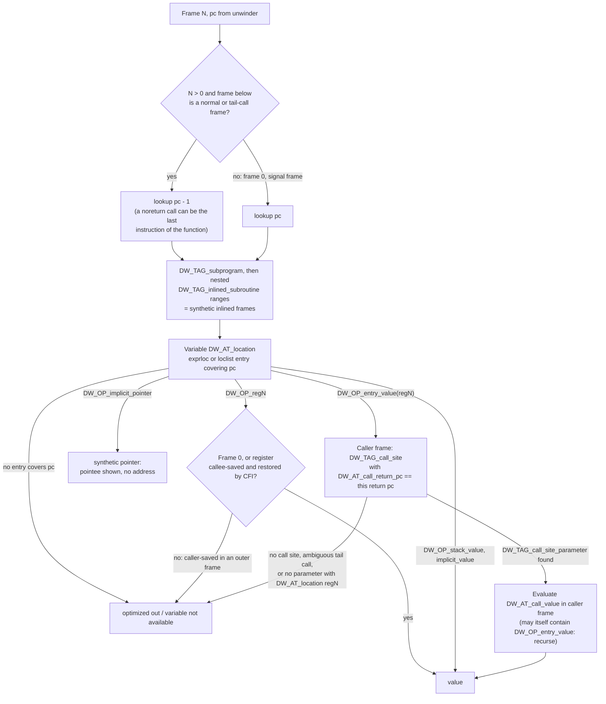

# C++ Debugging Optimized Code

> [!summary] Claim:
> In an optimized binary a variable has no address, only a DWARF location list: a set of PC ranges, each saying "in this register", "this computed value", or nothing, and any PC outside every range means `<optimized out>`.
> A debugger looks up a caller frame at return address minus one and builds inlined and tail-call frames that the hardware stack never had from `DW_TAG_inlined_subroutine` and `DW_TAG_call_site` entries; a register in a caller frame is evidence only if it is callee-saved and recovered by CFI.
> `DW_OP_entry_value(reg)` says "the value this register held on entry"; the debugger recovers it only by finding the caller's `DW_TAG_call_site` for this return address and evaluating that call site's `DW_AT_call_value`, which DWARF 5 says a producer should provide only when it can avoid registers the call may clobber.
> When the debug information runs out, the value is reconstructed by hand: disassemble, classify each register by the ABI, find spills and stack-passed arguments, derive from values that survived, or rerun and stop on the call instruction while the value is still live.



## The Mechanism

This note owns what a debugger does with an optimized binary and how an engineer recovers values the debugger gives up on.
[[Compiler-Pipeline-and-Debuggability]] owns which optimization passes destroy locations and why, and [[DWARF-Debug-Information-and-Symbol-Bundles]] owns the DWARF format in general.
Two sentences of that background are enough here: optimizers keep a variable in whatever register is convenient for as long as it is live and then reuse the register, and they delete frames by inlining, tail calls, and shrink-wrapping.
DWARF answers with per-PC descriptions instead of one address per variable.

Every DWARF fact below is from the DWARF 5 specification (February 13, 2017) unless another source is named.
Every output block is a slice of a lab's recorded output (see the Worked Lab Example), captured on 2026-11-08.

### 1. Location lists: a variable is a function of the PC

A location description is either a single expression, valid for the whole scope, or a location list, used "whenever the object whose location is being described can change location during its lifetime" (Section 2.6.2).
Each bounded entry covers a half-open range `[start, end)`, ranges may overlap when a value lives in two places at once, and "if all of the address ranges in a given location list do not collectively cover the entire range over which the object in question is defined, and there is no following default location description, it is assumed that the object is not available for the portion of the range that is not covered."
That sentence is the definition of `<optimized out>`.

The location kinds a debugger meets in optimized code (Sections 2.6.1.1 and 2.6.1.2, with entry values from Section 2.5.1.7):

| Kind | DWARF form | Debugger shows |
| :--- | :--- | :--- |
| Empty | expression with no operations | `<optimized out>` |
| Memory | `DW_OP_fbreg -24`, `DW_OP_breg31 0` | value read from memory; the address is real |
| Register | `DW_OP_reg3 (x3)` | register contents, if the register is valid in this frame |
| Implicit value | `DW_OP_lit0; DW_OP_stack_value`, `DW_OP_implicit_value` | a computed value with no location; `&x` fails |
| Implicit pointer | `DW_OP_implicit_pointer <DIE> <offset>` | GDB: `<synthetic pointer>`; the pointee is shown, the pointer is not |
| Entry value | `DW_OP_entry_value(DW_OP_reg0); DW_OP_stack_value` | value from the caller's call site, or `<optimized out>` |
| Composite | `DW_OP_reg0 DW_OP_piece 4 DW_OP_reg1 DW_OP_piece 4` | pieces assembled from several places |

GCC 13.3 at `-O2` described the loop counter `i` of the lab's `process()` on AArch64 with this location list (printed by the lab's `dwarfq.py` from `readelf --debug-dump=info,loc`; the ranges are offsets in the position-independent executable):

```text
process: i
  0xa90-0xaa8  DW_OP_lit0; DW_OP_stack_value
  0xaa8-0xac0  DW_OP_breg3 (x3): 0; DW_OP_entry_value: (DW_OP_reg0 (x0)); DW_OP_minus; DW_OP_convert <0x2a>; DW_OP_lit24; DW_OP_convert <0x2a>; DW_OP_div; DW_OP_convert <0>; DW_OP_stack_value
  0xac0-0xac4  DW_OP_breg3 (x3): 0; DW_OP_entry_value: (DW_OP_reg0 (x0)); DW_OP_minus; DW_OP_lit24; DW_OP_minus; DW_OP_convert <0x2a>; DW_OP_lit24; DW_OP_convert <0x2a>; DW_OP_div; DW_OP_convert <0>; DW_OP_stack_value
  0xad0-0xad8  DW_OP_lit0; DW_OP_stack_value
  0xad8-0xae7  DW_OP_breg3 (x3): 0; DW_OP_entry_value: (DW_OP_reg0 (x0)); DW_OP_minus; DW_OP_convert <0x2a>; DW_OP_lit24; DW_OP_convert <0x2a>; DW_OP_div; DW_OP_convert <0>; DW_OP_stack_value
```

The optimizer deleted `i` and walks a pointer `x3` through the 24-byte `Order` array instead (strength reduction), so GCC describes `i` as `(x3 - orders_at_entry) / 24`.
Between `0xac0` and `0xac4` the pointer has already advanced and `i` has not, so GCC emits a second expression that subtracts 24 first.
The list ends at `0xae7`, one byte before the return address `0xae8` of the call to `reject()`, because `x3` is caller-saved and the call may destroy it.
In the Apple clang 21 build of the same program LLDB reports `i = <variable not available>` in frame 5 (macOS lab, Step 5); this is a measured difference between these two compiler versions on this program, not a general ranking.

### 2. The return-address-minus-one rule and noreturn calls

In frame 0 the PC is the next instruction to execute.
In every caller frame the unwound PC is a return address: the instruction after the call.
GDB's `get_frame_address_in_block()` (`gdb/frame.c`) subtracts one from it for normal and tail-call frames, and its comment names the reason: "when calling a function which the compiler knows will never return (for instance abort), the call may be the very last instruction in the calling function.
The resume address will point after the call and may be at the beginning of a different function entirely."
LLDB does the same in `StackFrame::GetFrameCodeAddressForSymbolication()`, which slides the address by -1 unless the frame "behaves like" frame 0.

Commands that take the raw PC skip that adjustment.
In the lab, `reject()` ends with `bl abort`, and `process()` begins at the very next address, so in frame 3 GDB prints `$pc` as `<process(Order const*, int, long)>` while `bt` correctly shows `reject`.
On macOS, `process()` ends with `bl reject`, so `image lookup -a $pc` in the inlined `check_limit` frame reports `main at orders.cpp:31`.
Always look up `$pc - 1` by hand in a caller frame, and expect a location-list range that ends exactly at a return address to exclude it.

### 3. Which registers are valid in a caller frame

The unwinder restores only what CFI describes: the CFA, the return address, and the callee-saved registers the callee actually saved.
[[Stack-Unwinding-CFI-and-Exception-ABI]] owns that machinery and [[Calling-Conventions-System-V-AMD64-and-AAPCS64]] owns the conventions; the consequence for this note is one rule.

- AAPCS64 (release 2026Q3, General-purpose Registers, Table 2): x0-x7 are parameter and result registers, x8-x18 are caller-saved (x18 is the platform register where a platform reserves it), and "registers r19-r29 and SP are callee-saved".
- SysV AMD64 psABI (Figure 3.4): rbx, rbp, r12-r15, and rsp are preserved across calls; rdi, rsi, rdx, rcx, r8, r9, rax, r10, and r11 are not, and neither are the APX registers r16-r31 that the current psABI master adds.
- A caller-saved register in frame N > 0 holds whatever the callee left in it, which is unrelated to the value it had in that frame.

The two debuggers handle this differently, and both behaviors are in the labs' output:

| Situation in frame 5 of the lab | GDB 15.1 (Linux aarch64) | LLDB 2103 (macOS arm64) |
| :--- | :--- | :--- |
| A variable whose DWARF range covers pc - 1 with a caller-saved register | The producer (GCC) ended the range before the return address, so GDB prints `<optimized out>` | The producer (Clang) extended the range to the return address; LLDB refuses: `<register x2 is not available>` (frame 5, `limit`) |
| Raw register read of a caller-saved register | `$x3` can be read, and the lab's check that it points into `orders[]` prints `false`, so it is stale | `register read x2` prints `x2 = error: unavailable` |
| Raw register read of a callee-saved register | Exact only if every frame below preserved it or saved it in CFI-described slots, which callee-saved status guarantees; the lab does not exercise this row | Same rule; not exercised by the lab |

Never use a caller-saved register value from `info registers` in an outer GDB frame as evidence.

### 4. Inlined frames are synthesized from DWARF scopes

An inlined call leaves no call instruction, no return address, and no stack frame.
DWARF records it as a `DW_TAG_inlined_subroutine` (tag 0x1d) inside the caller's scope, with `DW_AT_abstract_origin` pointing at the shared abstract instance, `DW_AT_low_pc`/`DW_AT_high_pc` or `DW_AT_ranges` for its scattered instructions, an optional `DW_AT_entry_pc`, and `DW_AT_call_file`, `DW_AT_call_line`, and `DW_AT_call_column` for the call expression (Section 3.3.8.2).
The abstract instance (`DW_AT_inline`, Table 3.4) holds what all copies share, such as names and types, and must not hold "attributes which describe aspects of the subroutine which vary between distinct inlined expansions", such as locations.

Debuggers turn the nesting of these ranges at a PC into a chain of virtual frames.
GDB marks one with `inlined into frame 5` in `info frame`; in `bt` the inlined frame carries the PC and the outer frame that contains it prints no address; LLDB appends `[inlined]`.
The GDB manual lists the limits: stepping "pretends" the call site and the first line of the callee are different instructions even though no instruction separates them, a breakpoint on the call-site line "may not work, because the call site does not contain any code", and `finish` cannot show the return value of an inlined call.
GDB can set breakpoints on inlined functions by name since GDB 7.5 (gdb/NEWS), and the breakpoint gets one location per inlined copy GDB finds; for a `static inline` helper called from three places at `-O2`, GDB 15.1 reported `(2 locations)`, so do not assume the location count equals the call count.

LTO does not change the mechanism, it widens it: code from another translation unit can now be inlined.
In the lab's LTO build, `check_limit()` from `risk.cpp` appears as an inlined frame of `main()` from `main.cpp` in both GDB and LLDB.
[[Linkers-LTO-PGO-AutoFDO-and-BOLT]] owns LTO itself.

### 5. Entry values and call sites

#### The producer side

`DW_OP_entry_value` (opcode 0xa3) "pushes the value that the described location held upon entering the current subprogram", with a ULEB128 length and a block that is either a DWARF expression or, in the compact form, a register location such as `DW_OP_reg1` (Section 2.5.1.7).
It started as the GNU extension `DW_OP_GNU_entry_value` (0xf3), with the companion `DW_TAG_GNU_call_site` (0x4109) and `DW_TAG_GNU_call_site_parameter` (0x410a), specified in DWARF issues 100909.1 and 100909.2 (`include/dwarf2.def`), and DWARF 5 standardized them.
GDB 7.4 added the `@entry` notation, and its NEWS entry says "Entry values are available only since gcc version 4.7".

GCC uses entry values when a parameter's register has been reused: after `mov x3, x0` and the call setup in the lab's `reject()`, `id` is described as `x0`, then `x3`, then `DW_OP_entry_value: (DW_OP_reg0 (x0)); DW_OP_stack_value` until the end of the function.
LLVM's `DW_OP_LLVM_entry_value` is currently limited to "the value a single register had on entry"; the LiveDebugValues pass applies it to "function parameters that are unmodified throughout the function" (LLVM Source Level Debugging).

An entry value is useless unless the caller says what it passed.
That is the job of the call site entries (Section 3.4):

- `DW_TAG_call_site` (0x48) describes one call, owned by the innermost caller scope, with `DW_AT_call_return_pc` (the return address the callee's CFI computes), `DW_AT_call_origin` (the callee), and `DW_AT_call_tail_call` for a tail call.
- Each `DW_TAG_call_site_parameter` (0x49) has a `DW_AT_location` saying where the argument was passed, such as `DW_OP_reg0`, and may have a `DW_AT_call_value` (0x7e): an expression that yields the argument's value at the time of the call.
- `DW_AT_call_all_calls` on a subprogram promises that every non-inlined call in it has a call site entry, which lets a consumer reason about tail calls.

The specification rules out the easy answer: "If it is not possible to avoid registers or memory locations that might be clobbered by the call in the expression, then the DW_AT_call_value attribute should not be provided", because the consumer may evaluate it "in the midst of the callee", after those registers have changed.
So a call value should use only constants, the stack pointer, memory the call cannot clobber, callee-saved registers, and the caller's own entry values.

#### The consumer side

LLDB's `Evaluate_DW_OP_entry_value()` documents the algorithm in three steps, and GDB's `gdb/dwarf2/loc.c` implements the same idea:

1. Find the first non-inlined caller frame, remembering the return address; inlined frames are skipped because they "have no call site parameters".
2. Find the call edge in that caller whose return address matches; if the current activation may come from an ambiguous tail call, refuse.
3. Find the `DW_TAG_call_site_parameter` whose `DW_AT_location` names the same register as the entry value, and evaluate its `DW_AT_call_value` in the caller's frame.

Step 3 can recurse, because a call value may itself use `DW_OP_entry_value` of the caller's own parameters.
In the lab's tail-call program (Step 7), GCC described the argument `handle()` passes to `validate()` as `DW_OP_entry_value: (DW_OP_reg0 (x0)); DW_OP_lit1; DW_OP_shl`, which is "my own entry x0, times two".

The lab shows all three outcomes in one backtrace (Step 1, `-O2`):

| Frame | Parameter | What GCC emitted | GDB 15.1 shows |
| :--- | :--- | :--- | :--- |
| `process` | `orders` | Entry value of x0; `main`'s call site passes `DW_OP_breg31 (sp): 0` | `orders=orders@entry=0xADDR` |
| `process` | `count` | Entry value of x1; `main`'s call site passes `DW_OP_lit4` | `count=count@entry=4` |
| `reject` | `id`, `notional` | Entry values of x0 and x1; the call site in `process` has no parameters, because both arguments were in caller-saved registers | `id=<optimized out>`, `notional=<optimized out>` |

With `set debug entry-values 1` GDB explains the failure: `Cannot find matching parameter at DW_TAG_call_site 0xADDR`.
LLDB reports the same failure on the Clang build as `<could not evaluate DW_OP_entry_value: no matching call site param found>`.

GDB's `set print entry-values` chooses how to show the two values; the default prints the current value and adds `param@entry=` only when the entry value is known, collapsing to `param=param@entry=VALUE` when they are equal.
`bt -entry-values both` shows both for every parameter without changing the setting.
The setting takes the values `no`, `only`, `preferred`, `if-needed`, `both`, `compact`, and `default`.

### 6. Tail-call frames

A tail call replaces `call; ret` with a jump, so the stack never records the middle function (GDB manual, Section 11.2).
When every call in the program is described by call site entries, the debugger can sometimes prove which function must have jumped: if `handle` has exactly one call site whose callee, followed through tail-call call sites, reaches `fail`, then `validate` must sit between them.
GDB then creates a "fictitious call frame" and `info frame` says `tail call frame`; LLDB marks it `[artificial]`.
When two paths are possible, GDB shows only the unambiguous part, and `set debug entry-values 1` prints its `tailcall: initial:`, `compare:`, and `reduced:` analysis.

Two observations from the lab:

- Both compilers emitted `bl` rather than a tail-branch `b` when the callee was `abort()` or a function that calls `abort()` unconditionally (Step 2 and Step 5), so `abort()` chains keep their frames; a callee that returns normally was reached with `b __Z4faili` (Clang) and `b 760 <_Z4faili>` (GCC), the last line of each `validate() ends with` in Step 7.
- GDB printed `validate (code=42)` for the virtual frame by evaluating `DW_OP_breg0 -1` on x0, which it took from the frame below; that is correct only because `fail()` never writes x0, which the lab checks by counting such instructions (0), and LLDB printed `code=<unavailable>` for the same frame.

### 7. Synthetic pointers

When scalar replacement of aggregates splits a structure into registers, a reference to it has no address to hold.
`DW_OP_implicit_pointer` (0xa0, formerly `DW_OP_GNU_implicit_pointer`, 0xf2) "specifies that the object is a pointer that cannot be represented as a real pointer, even though the value it would point to can be described" (Section 2.6.1.1.4).
In the lab's GCC LTO build, `check_limit(const Order& o, ...)` shows `o=<synthetic pointer>...`, `p o` prints `(const Order &) <synthetic pointer>: {id = <optimized out>, qty = <optimized out>, px_ticks = <optimized out>}`, and `p &o` fails with `Attempt to take address of value not located in memory.`
The reference is described, but the fields it would point at were not kept anywhere at that PC.

### 8. Compiler knobs that trade speed for debuggability

GCC (online manual, 2026-11):

- `-Og` "should be the optimization level of choice for the standard edit-compile-debug cycle"; it enables `-O1` except a listed set, including `-fdse`, `-fif-conversion`, `-finline-functions-called-once`, `-fmove-loop-invariants`, `-fssa-phiopt`, `-ftree-dse`, `-ftree-pta`, and `-ftree-sra`.
- `-fvar-tracking` computes "where variables are stored at each position in code" and is on by default when optimizing with `-g` if the format supports it; `-fvar-tracking-assignments` is on with it "except when selective scheduling is enabled".
- `-gstatement-frontiers` drives `is_stmt` markers from statement-start notes and is on by default when optimizing with normal-level DWARF.
- `-gvariable-location-views` adds view numbers so a debugger can distinguish several states at one address; it is on by default at the normal DWARF level "as long as there is assembler support, -fvar-tracking-assignments is enabled and -gstrict-dwarf is not".
- The default DWARF version is 5 "with the exception of VxWorks, TPF and Darwin / macOS, which default to version 2, and AIX, which defaults to version 4".
- `-foptimize-sibling-calls` (tail calls) and `-fipa-sra` (which removes unused parameters and turns by-reference parameters into by-value ones) are enabled at `-O2`, `-O3`, and `-Os`.

Clang:

- `-fextend-variable-liveness=<all|this|none>` documented as "Extend the liveness of user variables through optimizations to prevent stale or optimized-out variable values when debugging"; the bare flag means `all`.
- `-Og` passes `-fextend-variable-liveness=all` to the compiler: the macOS lab prints it from `clang++ -Og -g -### ` for Apple clang 21, and a manual run of Homebrew clang 23.1.5 gave the same (as of 2026-11, macOS); the change (PR 118026) landed on 2025-04-17 in commit a9dff35, was reverted on 2025-04-25 in commit 2dc6e98, and was reapplied on 2025-06-19 in commit 36af734 (llvm-project commit history).
- `__attribute__((optnone))` "suppresses essentially all optimizations on a function", the targeted alternative to rebuilding a whole service at `-O0`.

Measured on this lab's `orders.cpp` with Apple clang 21 on macOS arm64 using `llvm-dwarfdump --statistics` from Xcode's toolchain (`xcrun llvm-dwarfdump`, Apple LLVM 21.0.0; the last block of Step 7; one small file, so treat the ratios as an illustration of the trend, not as a benchmark):

| Build | Code bytes in functions | Variable scope bytes covered by a location | Covered by `DW_OP_entry_value` |
| :--- | :--- | :--- | :--- |
| `-O0 -g` | 628 | 2580 / 2580 (100%) | 0 |
| `-Og -g` | 388 | 1552 / 1876 (82.7%) | 56 |
| `-O2 -g` | 360 | 880 / 1724 (51.0%) | 68 |
| `-O3 -g` | 360 | 868 / 1712 (50.7%) | 68 |
| `-O2 -g -fextend-variable-liveness` | 400 | 1600 / 1936 (82.6%) | 56 |

On this program the flag bought back `orders`, `count`, `argc`, and `argv` in the backtrace for 40 more code bytes (11%), but not `i`, `limit`, or `total`.

### 9. Reconstructing a value the debugger cannot show

When the debugger prints `<optimized out>`, the value usually still existed at some PC; the job is to find a PC, a register, or a memory word where it did.
The procedure, in the order that is cheapest to try:

1. Name the frame and the lookup PC: `pc - 1` for a caller frame, and check `info frame` (GDB) or the `[inlined]` and `[artificial]` markers (LLDB) so that you know which frames are synthetic.
2. Read the variable's whole location list (`info address i` in GDB, `image lookup -v -a <pc - 1>` in LLDB, or `readelf --debug-dump=loc` / `llvm-dwarfdump --debug-info`) and find the last range before the current PC.
3. Disassemble with source (`disassemble /s` in GDB, `disassemble -m` in LLDB) and locate the instruction where the register in that range was last written and the instruction that overwrote it.
4. Classify that register by the ABI: if it is callee-saved and the frame below saved it, it is still exact in this frame; if it is caller-saved, it is valid only in frame 0.
5. Look for copies in memory: spill slots, structure fields reachable from a pointer that did survive, and stack-passed arguments; on Apple arm64 variadic arguments are always assigned "to the appropriate number of 8-byte stack slots", so in the lab `memory read -s8 -fd -c2 $sp` in `reject()` recovered `103` and `7500` after LLDB had given up.
6. Derive the value from survivors and program invariants: in the lab `orders`, `count`, and `limit` survived as entry values, and the loop stops at the first order whose notional exceeds the limit, so `i == 2` and `id == 103` follow from `p *orders@count`.
7. If the bug reproduces, rerun and stop on the call instruction itself, where every argument is still live: `break *'process(Order const*, int, long)'+84` on the `bl reject` showed `n = 7500`, the reference `o` with `id = 103`, and `i = 2`.

## Commands and Numbers to Know

| Item | Value or effect | Platform and date | Why it matters |
| :--- | :--- | :--- | :--- |
| `DW_OP_entry_value` | opcode `0xa3`; GNU form `DW_OP_GNU_entry_value` `0xf3` | Both (as of 2026-11) | Value of a register or expression at function entry |
| `DW_TAG_call_site`, `DW_TAG_call_site_parameter` | `0x48`, `0x49`; GNU forms `0x4109`, `0x410a` | Both (as of 2026-11) | Caller-side description that entry values need |
| `DW_AT_call_value` | `0x7e`, exprloc | Both (as of 2026-11) | Should not use registers or memory the call may clobber |
| `DW_TAG_inlined_subroutine` | `0x1d` | Both (as of 2026-11) | Source of every synthetic inlined frame |
| `DW_OP_implicit_pointer` | `0xa0`; GNU form `0xf2` | Both (as of 2026-11) | GDB prints `<synthetic pointer>` |
| `DW_OP_stack_value` | `0x9f` | Both (as of 2026-11) | Value known, no location; `&x` fails |
| GDB `set print entry-values` | default `default`; also `no`, `only`, `preferred`, `if-needed`, `both`, `compact` | Both (as of 2026-11) | Shows `x=x@entry=5` and `x=<optimized out>, x@entry=5` |
| GDB `bt -entry-values both` | per-command override | Both (as of 2026-11) | Every parameter's current and entry value |
| GDB `set debug entry-values 1` | an integer (`add_setshow_zuinteger_cmd` in `loc.c`); `on` is rejected in GDB 15.1 | Linux (as of 2026-11) | Prints why an entry value or tail-call frame failed |
| GDB `info frame` | `inlined into frame N`, `tail call frame` | Both (as of 2026-11) | Tells synthetic frames from real ones |
| GDB `info address VAR` | prints the whole location list with ranges | Both (as of 2026-11) | Find the last range where the value lived |
| LLDB frame markers | `[opt]`, `[inlined]`, `[artificial]` from the default `frame-format` | macOS (as of 2026-11) | `[artificial]` is a tail-call frame |
| LLDB `target.process.optimization-warnings` | `true` | macOS (as of 2026-11) | Prints "was compiled with optimization - stepping may behave oddly; variables may not be available." |
| LLDB `image lookup -v -a ADDR` | inlined block chain plus each variable's location at ADDR | macOS (as of 2026-11) | Pass `pc - 1` for caller frames |
| GCC `-Og` | `-O1` minus the passes that "greatly interfere with debugging" | Linux (as of 2026-11) | The GCC debug-friendly optimized level |
| GCC default `-gdwarf` version | 5; Darwin, VxWorks, TPF use 2, AIX uses 4 | Both (as of 2026-11) | DWARF 2 has no standard call site tags |
| GCC `-foptimize-sibling-calls`, `-fipa-sra` | on at `-O2`, `-O3`, `-Os` | Linux (as of 2026-11) | Missing frames and removed parameters |
| Clang `-Og` | `-O1` plus `-fextend-variable-liveness=all` (driver output) | macOS, clang 21 and 23.1.5 (as of 2026-11) | Keeps more variables live, costs code size |
| Clang debugger tuning | `-debugger-tuning=lldb` on Darwin, `gdb` for `--target=x86_64-linux-gnu` (clang 23.1.5 driver output) | Both (as of 2026-11) | Tuning changes which DWARF extensions are emitted |
| `llvm-dwarfdump --statistics` | JSON with scope bytes covered by locations and by entry values | Both (as of 2026-11) | Measures debug-info quality per build |
| macOS LTO link | `-Wl,-object_path_lto,DIR` (a directory for ThinLTO) | macOS (as of 2026-11) | Without it `dsymutil` cannot find the LTO object |

## Multi-Language Comparison: C++ / Python / Rust

| Concern | C++ (GCC 13.3, Clang 21) | Python (CPython) | Rust (rustc 1.99.0) |
| :--- | :--- | :--- | :--- |
| What gets optimized | Your code, at `-O2`/`-O3`, plus LTO | The interpreter, a C program built with optimization; Python frames live in interpreter data structures | Your code and every generic from `std` it instantiates |
| Release default | Build system's choice; nothing implies `-g` | A release interpreter is built with optimization; `--with-pydebug` uses `-Og` when the compiler supports it, else `-O0`, except `-O3` on WASI (`configure.ac`, 3.14 branch) | `[profile.release]` has `opt-level = 3`, `debug = false` (Cargo Book) |
| Getting variables in an optimized build | `-O2 -g`; Clang `-fextend-variable-liveness`; per-function `optnone` | Use a debug build, or rely on `py-bt`, which the docs warn may fail to read frame information "depending on the optimization level with which CPython was compiled" | `debug = "full"` (or `2`) in the release profile; `"line-tables-only"` keeps only file and line for backtraces |
| Entry values and call sites | GCC and Clang both emit them; Clang marks the subprogram `DIFlagAllCallsDescribed` | Same as C, for the interpreter's own C frames | `rustc -C opt-level=2 -C debuginfo=2` on macOS arm64 emitted 13 uses of `DW_OP_entry_value` but 0 `DW_TAG_call_site` and 0 call site parameters for a Rust port of the lab program (a one-off manual run on 2026-11-08 that the labs do not cover), so those entry values had nothing to resolve against, and LLDB showed `r::reject(id=<unavailable>, notional=<unavailable>)` (as of 2026-11) |
| Inlined frames | `DW_TAG_inlined_subroutine`; `[inlined]` in LLDB | The same DWARF rules apply to the interpreter's C frames; `py-bt` finds Python frames by looking for C frames "executing the default frame evaluation function" | Very many: the dSYM of the same small Rust program carried 16,397 `DW_TAG_inlined_subroutine` entries, most of them in `std` code |
| Debugger | GDB, LLDB | GDB with `python-gdb.py` (`py-bt`, `py-up`, `py-locals`) | `rust-gdb`, `rust-lldb`; see [[Rust-GDB-LLDB-Panics-and-Backtraces]] |

## Worked Lab Example

Two labs back this note, and `make verify` re-runs both and diffs their output against `expected/<platform>.txt`.
Every output block below is a verbatim slice of one of those files, captured on 2026-11-08; the harness scrubs stack and load addresses to `0xADDR`.

- `code/03-Debugging/optimized_code_entry_values/` (`# requires: linux`): GCC, GDB, objdump, and readelf, recorded on linux-aarch64 in the pinned lab image (`code/_harness/linux-labs.Dockerfile`, Ubuntu 24.04).
- `code/03-Debugging/optimized_code_lldb/` (`# requires: macos`): Apple clang, LLDB, otool, and `llvm-dwarfdump`, recorded on darwin-arm64.

```bash
cd 18-Developer-Toolchain/code
make verify LAB=03-Debugging/optimized_code_entry_values/
make verify LAB=03-Debugging/optimized_code_lldb/
```

A host with another platform key, such as linux-amd64, has no recording yet and `make verify` reports it as unrecorded until `make record` writes one; no amd64 output is claimed here.
The Rust figures in the comparison table come from a one-off manual run, not from a lab.

Toolchains, as the labs print them (Linux, then macOS):

```text
g++ (Ubuntu 13.3.0-6ubuntu2~24.04.1) 13.3.0
GNU gdb (Ubuntu 15.1-1ubuntu1~24.04.1) 15.1
```

```text
Apple clang version 21.0.0 (clang-2100.4.1.1)
lldb-2103.0.34.407
Apple LLVM version 21.0.0
```

### The program

Both labs build the same `orders.cpp`.

```cpp
#include <cstdio>
#include <cstdlib>

struct Order {
  long id;
  int qty;
  long px_ticks;
};

[[gnu::noinline]] void reject(long id, long notional) {
  std::fprintf(stderr, "reject id=%ld notional=%ld\n", id, notional);
  std::abort();
}

static inline long notional_of(const Order& o) { return o.qty * o.px_ticks; }

static inline void check_limit(const Order& o, long limit) {
  long n = notional_of(o);
  if (n > limit) reject(o.id, n);
}

[[gnu::noinline]] long process(const Order* orders, int count, long limit) {
  long total = 0;
  for (int i = 0; i < count; ++i) {
    check_limit(orders[i], limit);
    total += orders[i].qty;
  }
  return total;
}

int main(int argc, char** argv) {
  int scale = argc > 1 ? std::atoi(argv[1]) : 1;
  Order book[4] = {{101, 10, 250}, {102, 20, 250}, {103, 30 * scale, 250}, {104, 5, 250}};
  long t = process(book, 4, 5000);
  std::printf("total=%ld\n", t);
  return 0;
}
```

Order 103 has a notional of 30 x 250 = 7500, above the limit of 5000, so the process aborts inside `reject()`.
The lab also builds `tail.cpp` (a chain `handle` to `validate` to `fail`, each `[[gnu::noinline]]`, with `validate` ending in a tail call), `multi.cpp` (a `static inline` function called from three places), and a two-file LTO program under `lto/`.

### Step 1: the same crash at -O0 and -O2 (GCC, GDB, linux-aarch64)

```bash
g++ -O0 -g -o o0 orders.cpp && gdb -q -batch -ex 'set disable-randomization off' -ex run -ex bt ./o0
g++ -O2 -g -o o2 orders.cpp && gdb -q -batch -ex 'set disable-randomization off' -ex run -ex bt ./o2
```

The lab keeps frames 3 and up; frames 0 to 2 are libc's `raise` and `abort`.

```text
#3  0xADDR in reject (id=103, notional=7500) at orders.cpp:12
#4  0xADDR in check_limit (o=..., limit=5000) at orders.cpp:19
#5  0xADDR in process (orders=0xADDR, count=4, limit=5000) at orders.cpp:25
#6  0xADDR in main (argc=1, argv=0xADDR) at orders.cpp:34
```

```text
#3  0xADDR in reject (id=<optimized out>, notional=<optimized out>) at orders.cpp:12
#4  0xADDR in check_limit (limit=5000, o=...) at orders.cpp:19
#5  process (orders=orders@entry=0xADDR, count=count@entry=4, limit=limit@entry=5000) at orders.cpp:25
#6  0xADDR in main (argc=<optimized out>, argv=<optimized out>) at orders.cpp:34
```

Frames 4 and 5 share one machine frame because `check_limit` is inlined: the inlined frame 4 carries the PC, and its outer frame 5 prints no address.
Every parameter of `process` is shown through an entry value, and the arguments of `reject` are lost.

`bt -entry-values both` shows the current and the entry value of every parameter without changing the setting:

```text
#3  0xADDR in reject (id=<optimized out>, id@entry=<optimized out>, notional=<optimized out>, notional@entry=<optimized out>) at orders.cpp:12
#4  0xADDR in check_limit (limit=5000, limit@entry=<optimized out>, o=..., o@entry=...) at orders.cpp:19
#5  process (orders=0xADDR, orders@entry=0xADDR, count=4, count@entry=4, limit=5000, limit@entry=5000) at orders.cpp:25
#6  0xADDR in main (argc=<optimized out>, argc@entry=<optimized out>, argv=<optimized out>, argv@entry=<optimized out>) at orders.cpp:34
```

At `-Og` GCC did not inline `check_limit` (frames 4 and 5 each carry their own address), still lost the arguments of `reject`, and kept `limit@entry`:

```text
#3  0xADDR in reject (id=<optimized out>, notional=<optimized out>) at orders.cpp:12
#4  0xADDR in check_limit (o=..., limit=limit@entry=5000) at orders.cpp:19
#5  0xADDR in process (orders=orders@entry=0xADDR, count=count@entry=4, limit=limit@entry=5000) at orders.cpp:25
#6  0xADDR in main (argc=<optimized out>, argv=<optimized out>) at orders.cpp:34
```

### Step 2: why the arguments of reject are lost

Excerpt of `objdump -d --no-show-raw-insn o2` as the lab prints it, whitespace normalized:

```text
0000000000000a60 <_Z6rejectll>:
 a68: stp x29, x30, [sp, #-16]!
 a6c: mov x3, x0
 a78: mov x4, x1
 a88: bl 800 <__fprintf_chk@plt>
 a8c: bl 7e0 <abort@plt>
0000000000000a90 <_Z7processPK5Orderil>:
 a98: mov x3, x0
 ad8: stp x29, x30, [sp, #-16]!
 ae0: ldr x0, [x3]
 ae4: bl a60 <_Z6rejectll>
```

The lab reads the DWARF with `dwarfq.py`, a small parser over `readelf --debug-dump=info,loc`.
GCC described `id` as `x0`, then `x3` after `mov x3, x0`, then `DW_OP_entry_value(x0)` until the end of the function:

```text
reject: id
  0xa60-0xa78  DW_OP_reg0 (x0)
  0xa78-0xa8b  DW_OP_reg3 (x3)
  0xa8b-0xa90  DW_OP_entry_value: (DW_OP_reg0 (x0)); DW_OP_stack_value
```

The call site in `process` with return address `0xae8` has `call_site_parameters=0`, because both arguments came from caller-saved registers, while the call sites of `main` carry constants and a stack address:

```text
main -> strtol return_pc=0x87c tail_call=0 call_site_parameters=2
    DW_OP_reg1 (x1) = DW_OP_lit0
    DW_OP_reg2 (x2) = DW_OP_lit10
main -> __printf_chk return_pc=0x910 tail_call=0 call_site_parameters=2
    DW_OP_reg0 (x0) = DW_OP_lit2
    DW_OP_reg1 (x1) = DW_OP_addr: b28
main -> process return_pc=0x8fc tail_call=0 call_site_parameters=3
    DW_OP_reg0 (x0) = DW_OP_breg31 (sp): 0
    DW_OP_reg1 (x1) = DW_OP_lit4
    DW_OP_reg2 (x2) = DW_OP_const2u: 5000
main -> __stack_chk_fail return_pc=0x940 tail_call=0 call_site_parameters=0
process -> reject return_pc=0xae8 tail_call=0 call_site_parameters=0
reject -> __fprintf_chk return_pc=0xa8c tail_call=0 call_site_parameters=4
    DW_OP_reg1 (x1) = DW_OP_lit2
    DW_OP_reg2 (x2) = DW_OP_addr: b08
    DW_OP_reg3 (x3) = DW_OP_entry_value: (DW_OP_reg0 (x0))
    DW_OP_reg4 (x4) = DW_OP_entry_value: (DW_OP_reg1 (x1))
reject -> abort return_pc=0xa90 tail_call=0 call_site_parameters=0
```

The call `bl abort` is the last instruction of `reject`, so its return address `0xa90` is the first instruction of `process`: `p $pc` in frame 3 prints `<process(Order const*, int, long)>`, while `bt` uses `pc - 1` and gets it right.

### Step 3: what survives, and what does not

The lab's GDB command file (`crash.gdb`) runs `frame 4`, `info frame`, `frame 5`, `info locals`, `p i`, a check that stale `x3` points into the array, `p *orders@count`, `frame 3`, `p $pc`, `info symbol $pc`, `x/2i $pc - 8`, `p id`, `set debug entry-values 1`, and `p id` again, with a label printed before each group:

```text
[frame 4: info frame]
19   if (n > limit) reject(o.id, n);
 inlined into frame 5, caller of frame at 0xADDR
[frame 5: locals, loop counter, stale x3 inside the array, the array]
25     check_limit(orders[i], limit);
i = <optimized out>
total = <optimized out>
$1 = <optimized out>
$2 = false
$3 = {{id = 101, qty = 10, px_ticks = 250}, {id = 102, qty = 20, px_ticks = 250}, {id = 103, qty = 30, px_ticks = 250}, {id = 104, qty = 5, px_ticks = 250}}
[frame 3: raw pc, symbol, tail of reject]
12   std::abort();
$4 = (void (*)(void)) 0xADDR <process(Order const*, int, long)>
process(Order const*, int, long) in section .text of /TMP
   0xADDR <_Z6rejectll+40>: bl 0xADDR <__fprintf_chk@plt>
   0xADDR <_Z6rejectll+44>: bl 0xADDR <abort@plt>
[frame 3: id with and without debug entry-values]
$5 = <optimized out>
Cannot find matching parameter at DW_TAG_call_site 0xADDR at _fini
$6 = <optimized out>
```

The location list of `i` (Mechanism section 1) ends one byte before the return address `0xae8`, so at the lookup PC it is out of range.
The check `$x3 >= (long)orders && $x3 < (long)(orders + count)` prints `false`: the raw `x3` is a stale value left by the libc frames below, not a pointer into `orders`.
`info symbol $pc` and `x/2i $pc - 8` confirm the noreturn effect: the raw PC is in `process`, and the two instructions before it are the end of `reject`.
`orders` and `count` survived as entry values, and the loop exits at the first order over the limit, so `i == 2` and `id == 103` follow by reading the array.
The trailing `at _fini` is printed by GDB 15.1 as part of the message; the call site itself is at `0xae8` in `process`.
`set debug entry-values on` is rejected and `set debug entry-values 1` is accepted:

```text
No symbol "on" in current context.
Entry values and tail call frames debugging is 1.
```

### Step 4: stop on the call while the values are live

The lab computes the offset of the `bl reject` instruction from the disassembly, sets `break *('process(Order const*, int, long)' + 84)`, runs, and prints `n`, `o`, then `up`, `i`, `total`, and `($x3 - (long)orders) / sizeof(Order)`:

```text
bl reject is at process+84
Breakpoint 1, 0xADDR in check_limit (limit=5000, o=...) at orders.cpp:19
$1 = 7500
$2 = (const Order &) @0xADDR: {id = 103, qty = 30, px_ticks = 250}
#1  process (orders=orders@entry=0xADDR, count=count@entry=4, limit=limit@entry=5000) at orders.cpp:25
$3 = 2
$4 = <optimized out>
$5 = 2
```

At `0xae4` the debugger evaluates GCC's `(x3 - entry(x0)) / 24` for `i` and gets 2, and the hand computation from the live `x3` agrees, one instruction before both become unusable.
`total` is gone even here: it lived in x0 until `ldr x0, [x3]` at `0xae0` loaded the argument.

### Step 5: the same crash under Clang and LLDB (darwin-arm64)

```bash
clang++ -O2 -g -std=c++17 orders.cpp -o mac_O2
lldb -b -o run -k bt -k 'frame select 3' -k 'frame variable' -k 'memory read -s8 -fd -c2 $sp' mac_O2
```

The lab runs this with more `-k` steps and keeps only the lines below.
Backtrace, frames 3 to 6:

```text
frame #3: 0xADDR mac_O2`reject(id=<unavailable>, notional=<unavailable>) at orders.cpp:12:3 [opt]
frame #4: 0xADDR mac_O2`check_limit(o=<unavailable>, limit=<unavailable>) at orders.cpp:19:18 [opt] [inlined]
frame #5: 0xADDR mac_O2`process(orders=<unavailable>, count=<unavailable>, limit=<unavailable>) at orders.cpp:25:5 [opt]
frame #6: 0xADDR mac_O2`main(argc=<unavailable>, argv=<unavailable>) at orders.cpp:34:12 [opt]
```

Frame 3, then `memory read -s8 -fd -c2 $sp`:

```text
(long) id = <could not evaluate DW_OP_entry_value: no matching call site param found>
(long) notional = <could not evaluate DW_OP_entry_value: no matching call site param found>
0xADDR: 103
0xADDR: 7500
```

Frame 4 (the inlined `check_limit`) and `image lookup -a $pc`, then frame 5 and `register read x2`:

```text
(const Order &) o = <register x8 is not available>
(long) limit = <register x2 is not available>
(long) n = <register x1 is not available>
      Summary: mac_O2`main at orders.cpp:31
```

```text
(const Order *) orders = <variable not available>
(int) count = <variable not available>
(long) limit = <register x2 is not available>
(long) total = <variable not available>
(int) i = <variable not available>
x2           = error: unavailable
```

Clang emitted call site parameters for `main`'s call to `process`, whose call values are:

```text
 DW_AT_call_value (DW_OP_constu 0x1388)
 DW_AT_call_value (DW_OP_lit4)
 DW_AT_call_value (DW_OP_breg31 WSP+8)
```

The location lists of `orders` and `count` do not cover `pc - 1` in frame 5, which is why LLDB prints `<variable not available>` for them and never consults an entry value there.
`reject()` stored both variadic arguments for `fprintf` at `[sp]` (`stp x0, x1, [sp]`), as the Apple arm64 variadic rule requires, and they are still there after `abort()`:

```text
bl __Z6rejectll
stp x0, x1, [sp]
bl 0xADDR ; symbol stub for: _fprintf
bl 0xADDR ; symbol stub for: _abort
```

Rebuilding with `-fextend-variable-liveness` turned frame 5 into `process(orders=0xADDR, count=4, limit=<unavailable>)` and frame 6 into `main(argc=1, argv=0xADDR)`, and `-Og` gave the same parameters:

```text
frame #5: 0xADDR mac_O2x`process(orders=0xADDR, count=4, limit=<unavailable>) at orders.cpp:25:5 [opt]
frame #6: 0xADDR mac_O2x`main(argc=1, argv=0xADDR) at orders.cpp:34:12 [opt]
(const Order *) orders = 0xADDR
(int) count = 4
(long) limit = <register x2 is not available>
(long) total = <register x8 is not available>
(int) i = <variable not available>
```

```text
frame #5: 0xADDR mac_Og`process(orders=0xADDR, count=4, limit=<unavailable>) at orders.cpp:25:5 [opt]
frame #6: 0xADDR mac_Og`main(argc=1, argv=0xADDR) at orders.cpp:34:12 [opt]
(const Order *) orders = 0xADDR
(int) count = 4
(long) limit = <register x2 is not available>
(long) total = <register x8 is not available>
(int) i = <variable not available>
```

### Step 6: LTO and the macOS debug map

The block below is the last section of the macOS lab; `file` reports the ThinLTO objects as LLVM bitcode.

```text
objects: LLVM bitcode
-- without -object_path_lto
warning: unable to open object file
warning: no debug symbols in executable (-arch arm64)
frame #3: 0xADDR app_lto`main + 48
-- with -object_path_lto
0.arm64.thinlto.o
1.arm64.thinlto.o
frame #3: 0xADDR app_lto`check_limit(o=<unavailable>, limit=<unavailable>) at risk.cpp:5:31 [opt] [inlined]
frame #4: 0xADDR app_lto`main(argc=<unavailable>, argv=<unavailable>) at main.cpp:6:3 [opt]
```

On macOS the executable does not contain DWARF; `dsymutil` follows the debug map to the object files, and with LTO the real object is a temporary file that no longer exists when `dsymutil` runs unless `-object_path_lto` keeps it.
For ThinLTO the lab passed a directory, and the linker wrote one `N.arm64.thinlto.o` per module into it.
With them, `check_limit()` from `risk.cpp` is an inlined frame of `main()`, the cross-translation-unit inlining that LTO exists to do.
The same two files under GCC 13.3 `-flto` on Linux, built with `-fdebug-prefix-map` so the paths are relative, gave:

```text
#3  0xADDR in check_limit (o=<synthetic pointer>..., limit=5000) at risk.cpp:5
#4  main (argc=<optimized out>, argv=<optimized out>) at main.cpp:6
#3  0xADDR in check_limit (o=<synthetic pointer>..., limit=5000) at risk.cpp:5
 inlined into frame 4, caller of frame at 0xADDR
$1 = (const Order &) <synthetic pointer>: {id = <optimized out>, qty = <optimized out>, px_ticks = <optimized out>}
Attempt to take address of value not located in memory.
```

### Step 7: tail calls, inlined breakpoints, and the call site flag matrix

The Linux lab runs `tail.cpp` to a segfault in `fail`, prints the backtrace, `frame 1`, and `info frame`, then the call sites of `main`, `handle`, and `validate`, then checks that `fail()` writes neither `x0` nor `w0`:

```text
#0  0xADDR in fail (code=code@entry=43) at tail.cpp:3
#1  0xADDR in validate (code=42) at tail.cpp:4
#2  0xADDR in handle (code=<optimized out>) at tail.cpp:5
#3  0xADDR in main (argc=<optimized out>) at tail.cpp:6
#1  0xADDR in validate (code=42) at tail.cpp:4
 tail call frame, caller of frame at 0xADDR
main -> handle return_pc=0x610 tail_call=0 call_site_parameters=1
    DW_OP_reg0 (x0) = DW_OP_entry_value: (DW_OP_reg0 (x0)); DW_OP_plus_uconst: 20
handle -> validate return_pc=0x7a4 tail_call=0 call_site_parameters=1
    DW_OP_reg0 (x0) = DW_OP_entry_value: (DW_OP_reg0 (x0)); DW_OP_lit1; DW_OP_shl
validate -> fail return_pc=0x794 tail_call=1 call_site_parameters=1
    DW_OP_reg0 (x0) = DW_OP_breg0 (x0): 0
validate() ends with: b 760 <_Z4faili>
instructions in fail() that write x0 or w0: 0
```

The macOS lab runs the same file under LLDB:

```text
frame #0: 0xADDR tail_mac`fail(code=43) at tail.cpp:3:62 [opt]
frame #1: 0xADDR tail_mac`validate(code=<unavailable>) at tail.cpp:4:55 [opt] [artificial]
frame #2: 0xADDR tail_mac`handle(code=<unavailable>) at tail.cpp:5:43 [opt]
frame #3: 0xADDR tail_mac`main(argc=<unavailable>, (null)=<unavailable>) at tail.cpp:6:30 [opt]
(int) code = 43
validate() ends with: b __Z4faili
```

`break sq` on `multi.cpp`, where `sq` is inlined into three places:

```text
Breakpoint 1 at ADDR: sq. (2 locations)
```

Call site entries by DWARF flag, counted in the object file (GCC, then Clang):

```text
-g                         call_site=7 GNU_call_site=0 call_site_parameter=11 entry_value=15
-g1                        call_site=0 GNU_call_site=0 call_site_parameter=0 entry_value=0
-gdwarf-4                  call_site=0 GNU_call_site=7 call_site_parameter=11 entry_value=15
-gdwarf-4 -gstrict-dwarf   call_site=0 GNU_call_site=0 call_site_parameter=0 entry_value=0
```

```text
-g                   call_site=6 call_site_parameter=3 entry_value=7
-gline-tables-only   call_site=6 call_site_parameter=0 entry_value=0
```

Debug-info coverage of the five Clang builds, which Mechanism section 8 tabulates:

```text
mac_O0                              code=628 covered=2580/2580 (100.0%) entry_value=0
mac_Og                              code=388 covered=1552/1876 (82.7%) entry_value=56
mac_O2                              code=360 covered=880/1724 (51.0%) entry_value=68
mac_O3                              code=360 covered=868/1712 (50.7%) entry_value=68
mac_O2x                             code=400 covered=1600/1936 (82.6%) entry_value=56
```

## Pitfalls

> [!warning] Pitfall: reading `$pc` of a caller frame literally
> A return address after a noreturn call belongs to the next function, so `info symbol $pc`, `x/i $pc`, and `image lookup -a $pc` name the wrong function.
> Use `$pc - 1` in caller frames, which is what `bt` and frame selection already do internally.

> [!warning] Pitfall: trusting caller-saved registers in outer frames
> GDB 15.1 lets you read `$x3` in frame 5 of the lab, and the value is not a pointer into `orders[]` (the lab's check prints `false`); LLDB prints `error: unavailable` for the same class of register.
> Only callee-saved registers restored through CFI, the stack pointer, and memory are evidence in frame N > 0.

> [!warning] Pitfall: assuming `@entry` means "current value"
> `x@entry=5` is the value at function entry, recovered from the caller; the parameter may have been modified since.
> GDB's `default` mode prints `val=6, val@entry=5` when both are known and differ; read both before concluding anything.

> [!warning] Pitfall: setting a breakpoint on the source line of an inlined call
> The call-site line may contain no instruction, and GDB "may incorrectly move the breakpoint to the next line of the enclosing function".
> Break inside the inlined function by name, or on the call instruction by address, as in Step 4 of the lab.

> [!warning] Pitfall: expecting `finish` to print an inlined function's return value
> There is no return register convention for an inlined call, so neither debugger can show it; step to the next line and print the variable that received it.

> [!warning] Pitfall: believing a tail-call frame's arguments
> A virtual frame's registers come from the frame below it, and GDB printed `validate (code=42)` from `x0 - 1` only because `fail()` never wrote x0.
> Check the callee's disassembly before trusting any argument of a `tail call frame` or `[artificial]` frame.

> [!warning] Pitfall: rebuilding at -O0 to find an optimization-sensitive bug
> Undefined behavior, uninitialized reads, and data races often change or disappear at `-O0`, so a clean `-O0` run proves little; the GDB manual's suggestion to recompile with `-g` alone is a check on the debugger, not on the bug.
> Prefer `-Og`, `-fextend-variable-liveness`, or `optnone` on one suspect function, and keep the failing optimized binary for comparison.
> [[Cpp-UndefinedBehaviorSanitizer-and-UB-Field-Guide]] owns finding the UB itself.

> [!warning] Pitfall: building LTO on macOS without keeping the LTO object
> A separate ThinLTO link without `-Wl,-object_path_lto,DIR` leaves `dsymutil` with "unable to open object file" and a binary whose backtraces read `main + 48`.
> The same failure is silent in CI unless `dsymutil` warnings fail the build.

> [!warning] Pitfall: reading `set debug entry-values on` from the manual
> The manual says "when set to on", but GDB 15.1 defines the setting as an unsigned integer and rejects `on` with `No symbol "on" in current context.`; use `set debug entry-values 1`.

## At Scale

For one developer, optimized-code debugging is an occasional cost paid at the debugger prompt.
For a fleet, it is a policy choice paid in CPU, binary size, and incident time, and the deciding question is what the crash pipeline can recover from production artifacts alone.

- Ship every production binary with full DWARF split out (debuginfod on Linux, dSYMs on macOS) and keep it for as long as cores and crash reports are retained; [[Symbol-Servers-and-debuginfod]] owns the storage and lookup.
  Without it nothing in this note applies.
- Keep call site information on, and check it after every flag change, because entry values fail for every frame without it.
  On the lab file, GCC 13.3 at `-O2` emitted 7 call sites, 11 call site parameters, and 15 uses of `DW_OP_entry_value` (in location lists and call values) with `-g`, the GNU forms (`DW_TAG_GNU_call_site`) with `-gdwarf-4`, and none at all with `-g1` or with `-gdwarf-4 -gstrict-dwarf`; Apple clang 21 with `-gline-tables-only` kept its call site tags but emitted 0 parameters and 0 uses of `DW_OP_entry_value` (as of 2026-11, Linux aarch64 and macOS arm64).
- Measure debug-info quality like any other build output: run `llvm-dwarfdump --statistics` or `llvm-locstats` per release and alert on a drop in location coverage, because a compiler upgrade can change it without any code change.
- Give latency-insensitive services and the debug configuration of every service `-Og` (GCC) or `-Og` / `-fextend-variable-liveness` (Clang), and keep `-O2`/`-O3` with LTO for the services where profiles show the difference matters; the lab's 11% code-size cost is one data point, so measure each service with [[Benchmark-Methodology-Noise-and-Environment-Control]] before choosing.
- In crash triage at thousands of crashes per day, cluster by the symbolized stack including inlined frames; two builds that inline differently produce different frame lists for the same bug, so normalize on the innermost source location as well as the function names.
  [[Core-Dumps-Minidumps-and-Crash-Reporting]] owns the pipeline.
- When an incident hinges on a value the core cannot show, reproducing under [[Record-and-Replay-rr-UDB-and-Pernosco]] is cheaper than reasoning from registers: a reverse-continue to the call instruction is Step 4 of the lab without rebuilding.
- For the C++ ABI choices that decide what survives (frame pointers, compact unwind, CFI), decide once for the fleet in [[Stack-Unwinding-CFI-and-Exception-ABI]] terms and record it as a [[Debugging-Decision-Records]] entry.

Decision rules:

- A crash in a release binary with full DWARF: start with `bt -entry-values both`, then the procedure in Mechanism section 9; do not ask for a debug rebuild first.
- A variable lost in a hot loop that reproduces locally: break on the instruction where it is last live, or add `optnone` to that one function; do not rebuild the whole service at `-O0`.
- A team that debugs optimized builds weekly: adopt `-Og` (or Clang's liveness flag) for its debug configuration and keep production at its measured level.
- A fleet where cores routinely show `<optimized out>` for the arguments that matter: log those values at the call boundary, because no debug information can describe a value the program never kept.

## Practice Drill

> [!tip] Practice Drill:
> Build the lab program from the Worked Lab Example with `g++ -O2 -g` (Linux) and `clang++ -O2 -g` (macOS), and before running anything predict which parameters in the backtrace will print as `@entry`, which as `<optimized out>`, and why, using only `objdump -d` and the `.debug_loclists` dump.
> Then change `reject(long id, long notional)` to also take a third parameter that `process` passes as a constant, such as `reject(o.id, n, 7)`, and predict whether that third parameter survives at the crash; check your answer against the `DW_TAG_call_site_parameter` list.
> Next, remove `[[gnu::noinline]]` from `reject` and predict the new frame list and whether `p $pc` in the innermost user frame still names the wrong function.
> Finally, recover `id` and `notional` without the debugger's help in three different ways: from the array and the loop invariant, from stack memory on macOS, and by a breakpoint on the `bl reject` instruction; write down which of the three would work on a core file from production.

```bash
g++ -O2 -g -o o2 orders.cpp
objdump -d --no-show-raw-insn o2 | awk '/<_Z6rejectll>:/,/^$/'
readelf --debug-dump=info o2 | grep -A3 'DW_TAG_call_site'
readelf --debug-dump=loc o2 | grep -n 'entry_value'
gdb -q -batch -ex run -ex 'bt -entry-values both' -ex 'frame 5' -ex 'info address i' ./o2
```

## Interview Questions

> [!question] L5: GDB prints `process (orders=orders@entry=0xADDR, count=count@entry=4, ...)` but `reject (id=<optimized out>, ...)`; what does `@entry` mean and why does it work for one frame and not the other?
>
> > [!success]- Answer
> > `@entry` is the parameter's value at function entry, computed from `DW_OP_entry_value` in the callee and the caller's `DW_TAG_call_site_parameter` with a `DW_AT_call_value`.
> > `main` passes constants and a stack address to `process`, so its call site can describe them with `DW_OP_lit4` and `DW_OP_breg31 (sp): 0`, which stay valid after the call.
> > `process` passes `reject` values from caller-saved x3 and x1, and DWARF 5 says a call value should not be provided when it would need registers the call may clobber, so GCC emitted no parameters and GDB has nothing to evaluate.
> > `set debug entry-values 1` confirms it with "Cannot find matching parameter at DW_TAG_call_site".

> [!question] L5: Why can `bt` show four source-level frames for the lab's code when the stack only has three machine frames for it?
>
> > [!success]- Answer
> > Inlined calls leave no frame, so the debugger reconstructs them from nested `DW_TAG_inlined_subroutine` ranges that contain the PC, using `DW_AT_call_file` and `DW_AT_call_line` for the caller's line.
> > Tail calls leave no frame either, and GDB or LLDB may synthesize one from `DW_TAG_call_site` entries with `DW_AT_call_tail_call` when the path is unambiguous.
> > `info frame` in GDB says `inlined into frame N` or `tail call frame`; LLDB marks them `[inlined]` and `[artificial]`.
> > In GDB's `bt` the inlined frame carries the PC, and the outer function that contains the inlined call prints no address, because the two share one machine frame.

> [!question] L6 (predict the output): in frame 3 (`reject`) of the -O2 lab crash, `bt` says `reject (...) at orders.cpp:12`; what does `p $pc` print, and why?
>
> > [!success]- Answer
> > It prints `(void (*)(void)) 0x<address> <process(Order const*, int, long)>`, where the lab shows `0xADDR` for the address.
> > `reject` ends with `bl abort`, and `abort` never returns, so the compiler put nothing after the call and the return address is the first byte of the next function, `process`.
> > `bt` and frame selection look up `pc - 1` for caller frames (`get_frame_address_in_block()` in GDB, `GetFrameCodeAddressForSymbolication()` in LLDB), which lands on the call instruction inside `reject`.
> > `p $pc`, `x/i $pc`, and LLDB's `image lookup -a $pc` use the raw value, so they misattribute it.

> [!question] L6: A teammate reads `info registers rbx r12 rdi` in frame 4 of a core from an x86-64 service and uses `rdi` as the first argument of that frame's function; what is right and wrong with that?
>
> > [!success]- Answer
> > `rbx` and `r12` are callee-saved in the SysV AMD64 psABI, so if the inner frames saved them, the unwinder restores them through CFI and their frame 4 values are exact.
> > `rdi` is caller-saved and is the first argument register only at the moment of the call; in frame 4 GDB shows whatever the inner frames left in it, which is unrelated.
> > The argument is recoverable only from DWARF (an entry value plus the caller's call site value), from a copy the function made into a callee-saved register or the stack, or by reasoning from other surviving values.
> > LLDB shows such registers as unavailable in outer frames, which is the safer behavior.

> [!question] L6 (debug this): after a compiler upgrade, crash reports for your release builds show `<optimized out>` for nearly every parameter, where they used to show `x=x@entry=...`; how do you find the cause?
>
> > [!success]- Answer
> > First check whether the call site information disappeared: count `DW_TAG_call_site_parameter` in the old and new binaries with `llvm-dwarfdump --debug-info` or `readelf --debug-dump=info`, and compare `llvm-dwarfdump --statistics` coverage, including the bytes covered by `DW_OP_entry_value`.
> > If they vanished, look for a debug-level or format change in the build: GCC's `-g1` and `-gdwarf-4 -gstrict-dwarf` emit no call sites at all, and Clang's `-gline-tables-only` keeps call site tags but drops every parameter and entry value.
> > If they are present, check the consumer: GCC writes `DW_TAG_GNU_call_site` (0x4109) for DWARF 4 and `DW_TAG_call_site` (0x48) for DWARF 5, so a default move to DWARF 5 breaks an older debugger or crash processor that knows only the GNU forms.
> > Prove the fix on one crash, then add the statistics check to CI so the next upgrade fails the build instead of the on-call engineer.

> [!question] L7: Explain how a debugger evaluates `DW_OP_entry_value(DW_OP_reg0)` end to end, including the cases where it must refuse.
>
> > [!success]- Answer
> > It walks outward from the current frame past inlined frames, which have no call sites, to the first real caller, and keeps the return address of the frame it came from.
> > It finds that caller's `DW_TAG_call_site` whose `DW_AT_call_return_pc` equals the return address, then the `DW_TAG_call_site_parameter` whose `DW_AT_location` is `DW_OP_reg0`, and evaluates its `DW_AT_call_value` with the caller frame's registers, recursing if that value uses the caller's own entry values.
> > It must refuse when there is no matching call site or parameter, when the producer omitted `DW_AT_call_value` because the value would need a clobbered register, and when the frame could have been reached through ambiguous tail calls, including a function that can call itself through tail calls, where GDB prints `<optimized out>` deliberately.
> > The DWARF 5 non-normative text also allows recording register values at entry by stopping there, which is what a record-and-replay debugger effectively does.

> [!question] L7: GCC described a loop index as `DW_OP_breg3 0; DW_OP_entry_value(DW_OP_reg0); DW_OP_minus; ...; DW_OP_lit24; ...; DW_OP_div; DW_OP_stack_value`; what transformation is this, and what are its limits?
>
> > [!success]- Answer
> > Strength reduction replaced the counter `i` with a pointer `x3` that advances by `sizeof(Order)`, 24 bytes, so GCC describes `i` as `(x3 - orders_at_entry) / 24`, an implicit value with no location.
> > It depends on two things staying recoverable: `x3`, which is caller-saved and therefore valid only up to the next call, and the entry value of x0, which needs the caller's call site.
> > That is why the range ends one byte before the return address of the call to `reject`, and why `i` reads 2 when stopped on the `bl` and `<optimized out>` one instruction later.
> > Apple clang 21 did not emit an equivalent expression for the same loop, so LLDB showed `i` as unavailable throughout; coverage like this varies by compiler version and is worth measuring.

> [!question] L7: When would you choose `-Og`, `-fextend-variable-liveness`, `optnone`, or `-O0` while chasing a bug in a latency-sensitive C++ service?
>
> > [!success]- Answer
> > `-O0` changes code generation the most, so it is the worst choice for bugs that depend on optimization, such as undefined behavior or races; use it only for logic bugs that reproduce everywhere.
> > `-Og` keeps most `-O1` optimizations while disabling passes that destroy debug information (GCC) or extending variable liveness (Clang), so it is the default for a debug configuration that still resembles production.
> > `-fextend-variable-liveness` on an `-O2` build keeps the production pipeline and pays only for extra liveness, about 11% code size on the lab file with Clang 21 (400 bytes against 360), and on that file it recovered parameters but not loop-local state.
> > `optnone` on one suspect function keeps the rest of the service at production speed and makes that function fully debuggable, which is often the best trade during an incident.

> [!question] L8+: Your crash-reporting system clusters crashes by function-name stack, and a toolchain upgrade split one top crash into dozens of clusters; what happened and how do you redesign the clustering?
>
> > [!success]- Answer
> > The new compiler inlined and tail-called differently, so the same fault now produces different synthetic frame lists: inlined frames appear or vanish, tail-call frames are synthesized only when the path is unambiguous, and LTO can inline across translation units.
> > Cluster on symbolized frames that include inlined frames, keyed by function plus source file and line of the innermost user frame, and drop or mark synthetic tail-call frames, which are inferred rather than observed.
> > Keep the build ID and compiler version in the signature metadata so a toolchain change is visible as a clustering change rather than as a new bug.
> > Regression-test the clusterer against stored crashes from the old and new toolchains before each upgrade, and record the policy in a debugging decision record.

> [!question] L8+: An organization wants to ship all C++ services at `-O3` with LTO and strip debug information to save disk; write the policy you would accept instead.
>
> > [!success]- Answer
> > Optimize as measured, but never strip without archiving: produce full DWARF, split it into separate debug files or dSYMs, serve it by build ID through debuginfod or a symbol server, and keep it as long as cores and crash reports are kept.
> > Keep call site information and entry values (emitted by default at `-O2 -g` by GCC 13 and Apple clang 21 in this note's measurements), because they recover most parameters in production cores at no runtime cost.
> > Require a debug-friendly configuration (`-Og` or Clang's liveness flag) for development and a per-function `optnone` escape hatch, and on macOS require `-object_path_lto` so dSYMs exist for LTO builds.
> > Track `llvm-dwarfdump --statistics` coverage per release as a quality metric, and have services log critical values at module boundaries, since no debug information can recover a value the optimizer discarded.

## Further Reading

- DWARF 5, Section 2.5.1.7 (`DW_OP_entry_value`), Section 2.6 (location descriptions and lists), Section 3.3.8 (inlined subroutines), Section 3.4 (call sites), and Appendix D.1.3 (entry value examples): the normative definitions every debugger implements.
- GDB manual, Chapter 11 "Debugging Optimized Code" and `set print entry-values`: the consumer behavior, including the tail-call ambiguity examples and the inline-function limits.
- `gdb/dwarf2/loc.c` and `gdb/frame.c` (`get_frame_address_in_block`) at the gdb-15 branch: the entry-value resolver and the noreturn `pc - 1` rationale in source.
- `lldb/source/Expression/DWARFExpression.cpp` (`Evaluate_DW_OP_entry_value`): a three-step description of entry-value evaluation in comments.
- GCC manual, Debugging Options and Optimize Options: the exact meaning of `-Og`, variable tracking, statement frontiers, and location views.
- LLVM "Source Level Debugging", `DW_OP_LLVM_entry_value`: how LLVM introduces entry values and why it is limited to registers.
- Clang PRs 110000 and 118026: the design and history of `-fextend-variable-liveness` and its use at `-Og`.
- AAPCS64 Section 6.1.1 and the SysV AMD64 psABI Figure 3.4: which registers can be trusted in caller frames.
- Apple, "Writing ARM64 code for Apple platforms": the variadic stack-slot rule that preserved the lab's arguments, and the frame-record rule for `x29`.

## Related

- Prerequisites: [[Cpp-GDB-and-LLDB-Expert-Guide]]
- Next: [[Cpp-AddressSanitizer-and-LeakSanitizer-Internals]]
- See also: [[02-Programming-Languages/C++/CPP_Zero_to_Godhood/Volume_08_Advanced_Systems/Chapter_102_Linking_Loading_ABI/Chapter_102_Linking_Loading_ABI_and_WPO|Chapter_102_Linking_Loading_ABI_and_WPO]], [[02-Programming-Languages/C++/CPP_Zero_to_Godhood/Volume_08_Advanced_Systems/Chapter_104_Undefined_Behaviour_and_the_Optimiser/Chapter_104_Undefined_Behaviour_and_the_Optimiser|Chapter_104_Undefined_Behaviour_and_the_Optimiser]]
- Lab: `code/03-Debugging/optimized_code_entry_values/` (requires: linux), `code/03-Debugging/optimized_code_lldb/` (requires: macos)
- Toolchain notes: [[Compiler-Pipeline-and-Debuggability]], [[DWARF-Debug-Information-and-Symbol-Bundles]], [[Stack-Unwinding-CFI-and-Exception-ABI]], [[Calling-Conventions-System-V-AMD64-and-AAPCS64]], [[Linkers-LTO-PGO-AutoFDO-and-BOLT]], [[Reading-Assembly-and-Optimization-Remarks]], [[Debug-a-Production-Crash-From-a-Core-Dump]], [[Core-Dumps-Minidumps-and-Crash-Reporting]], [[Record-and-Replay-rr-UDB-and-Pernosco]], [[Symbol-Servers-and-debuginfod]], [[How-Debuggers-Work-ptrace-Mach-and-Breakpoints]], [[Cpp-Debugger-Scripting-and-Pretty-Printers]]
