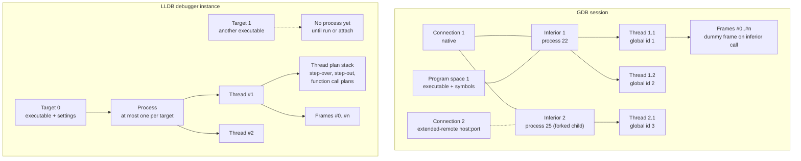
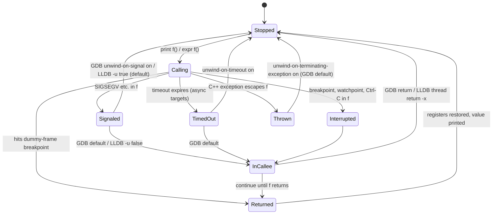

# C++ GDB and LLDB Expert Guide

> [!summary] Claim:
> GDB and LLDB control the same kernel primitives but expose different object models: GDB manages numbered inferiors (processes) bound to connections inside one session, while LLDB manages targets that each hold at most one process and drive every step through a stack of thread plans.
> Both default to all-stop, so a stop freezes every thread, but they differ in who runs while you step or call a function: GDB's `scheduler-locking` defaults to `replay` (no locking during live execution), and LLDB runs only the current thread while it single-steps a line and resumes all threads when that line contains a call.
> An inferior function call (`print f()`, `expr f()`) pushes a dummy frame and resumes the real process, so it can fault, throw, deadlock on a lock another thread holds, or let other threads mutate the state you are inspecting; GDB stops in the faulting frame by default, LLDB unwinds by default.
> Fork, exec, catchpoints, and watchpoints are policy settings over that one mechanism, and an expert sets them before the event happens, because `detach-on-fork`, `non-stop`, and hardware watchpoint slots cannot be fixed after the fact.

The kernel side of all of this (ptrace, Mach exception ports, software breakpoint traps, and debug registers) is owned by [[How-Debuggers-Work-ptrace-Mach-and-Breakpoints]].
Init files and safe defaults are owned by [[Debugging-Expert-Defaults-gdbinit-and-lldbinit]], and Python extensions, pretty-printers, and frame filters by [[Cpp-Debugger-Scripting-and-Pretty-Printers]].
This note owns the interactive command model: multi-process and multi-thread control, catchpoints and watchpoints as a user sees them, inferior calls, state inspection, checkpoints, tracepoints, and the GDB-to-LLDB command map.



## The Mechanism

Every GDB fact below is from the online GDB manual, which tracks the development tree after the GDB 18.1 release of 2026-09-25, cross-checked against `gdb/NEWS` at the `gdb-18.1-release` tag for the version that introduced each feature.
Every LLDB fact is from lldb.llvm.org and from the LLVM source at tag `llvmorg-23.1.5` (released 2026-11-03), and the defaults were also read back from Apple's `lldb-2103.0.34.407` on macOS 27.2 arm64.
Behavior marked "observed" was reproduced by hand with the probe program in the Worked Example: GDB 15.1 (Ubuntu 24.04, linux-aarch64, in a container) and Apple LLDB (darwin-arm64).

### 1. Two object models

GDB represents each execution as an **inferior**: usually a process, but an inferior exists before `run` and survives process exit, so its breakpoints and settings persist across reruns.
Each inferior lives in a **program space** (an executable and its symbols) and is bound to a **target connection** (`native`, `core`, `remote`, `extended-remote`); `info inferiors` lists all three columns and `info connections` lists the connections.
Threads get two identifiers: a per-inferior number used as the qualified ID `inferior.thread` (`2.1`), and a global ID that is unique across all inferiors (`info threads -gid`).
GDB hides the inferior prefix until a second inferior exists, which is why thread IDs suddenly become `1.1` and breakpoints become `1.1` and `1.2` locations after a fork with `detach-on-fork off` (observed).
`add-inferior [-copies n] [-exec file] [-no-connection]` and `clone-inferior` add inferiors by hand, `remove-inferiors` deletes stopped ones, and `detach inferiors` and `kill inferiors` act on inferiors other than the current one.
GDB 18 changed `add-inferior` and `clone-inferior` to warn and create the new inferior without a connection when the current connection cannot be shared, such as a core file or a `target remote` connection, because sharing them "would usually lead to GDB crashing" (NEWS for GDB 18).
The convenience variables `$_inferior`, `$_thread`, `$_gthread`, and (since GDB 13) `$_inferior_thread_count` let breakpoint conditions and scripts branch on these identities.

LLDB's top-level object is the **debugger**, which holds a list of **targets** (`target create`, `target list`, `target select`).
A target is an executable plus its settings and breakpoints, and it owns at most one **process** at a time.
So LLDB has no "hold both sides of a fork" mode: `ProcessGDBRemote::DidFork` in LLVM 23.1.5 picks the side to follow from `target.process.follow-fork-mode` (default `parent`), disables software breakpoints and hardware traps in the other side, and detaches it.
During an expression evaluation the same function forces follow-parent even when `follow-fork-mode` is `child`, because following the child would make the expression's thread vanish.
LLDB learns about forks only from a server that advertises `fork-events+` and `vfork-events+` in `qSupported`, which `lldb-server` implements for Linux and FreeBSD (`NativeProcessLinux::MonitorClone`, `NativeProcessFreeBSD::MonitorClone`).
On macOS the probe set `follow-fork-mode child` with a breakpoint in the child, and LLDB never stopped in the child (observed); the child never printed its marker line, which matches the GDB manual's description of an untraced child that executes an inherited breakpoint trap and dies of `SIGTRAP`, though the probe could not read the child's exit status (see the `EINTR` pitfall).

Each LLDB thread executes a **thread plan stack**: `next` pushes a step-over plan, and if a breakpoint inside a called function interrupts it, new commands push on top and a later `continue` resumes the original step-over (LLDB tutorial).
Hand-called expressions are plans on the same stack, which is why `thread plan list` and `thread plan discard` exist and why an interrupted expression can be finished with `continue` or abandoned with `thread return -x`.

### 2. Who runs while you look: stop modes and scheduling

In GDB's default **all-stop** mode, any stop freezes every thread of the current inferior, and any resume (including `step`) lets every thread run.
The manual is explicit that GDB "cannot single-step all threads in lockstep": other threads can execute many statements while the current one completes one step, and a step can end in another thread that hit a breakpoint first, announced as `[Switching to Thread n]`.
`set scheduler-locking` narrows that:

- `off`: any thread may run at any time.
- `on`: only the current thread runs on resume; since GDB 13, new threads it creates are held stopped at their entry point.
- `step`: like `on` while stepping, like `off` for `continue`, `until`, and `finish`.
- `replay`: like `on` while replaying a recording, like `off` otherwise; this is the default (observed: `Mode for locking scheduler during execution is "replay"`).

`set schedule-multiple` (default `off`) decides whether a resume also runs threads of other inferiors; by default only the current inferior's threads run, which is what lets you hold a forked parent while you debug the child.

**Non-stop mode** (`set non-stop on`, available since GDB 7.0) stops only the thread that reported an event; the others keep running, and `continue` and `interrupt` act on the current thread unless given `-a`.
It is read only when GDB starts or connects to the target, so it must be set before `run` or `attach`, and a target that cannot do non-stop silently falls back to all-stop.
In non-stop mode a stopped thread does not become current automatically, and commands that need registers fail on running threads (observed: `bt` on a running thread prints `Selected thread is running.`).
Background execution (`continue&`, `step&`, `run&`, `attach&`) returns the prompt immediately and pairs naturally with non-stop.
**Observer mode** (`set observer on`) turns off `may-write-registers`, `may-write-memory`, `may-insert-breakpoints`, `may-insert-tracepoints`, and `may-interrupt` and enables non-stop, so GDB can look without changing the process.

LLDB has no non-stop mode; its tutorial lists "thread centric debugging", where only threads at breakpoints stop, as a future mode.
What LLDB does have is a per-step run mode, `thread step-in|step-over|until --run-mode this-thread|all-threads|while-stepping`:

- The default is `while-stepping` (`eOnlyDuringStepping` in `CommandObjectThread.cpp`), unless `target.process.run-all-threads` (default `false`) forces `all-threads`.
- `ThreadPlanStepRange::StopOthers()` returns `!m_found_calls` for that mode: other threads are held while LLDB steps through a line, and released when the line contains a call, because the source comment notes "a call can execute arbitrary code which might for instance take a lock that's held by another thread".
- `target.process.thread.single-thread-plan-timeout` (default 1000 ms) resumes all threads if a single-thread plan makes no progress, "to resolve any potential deadlock".
- `target.process.always-run-thread-names` lists threads, such as a watchdog, that always run during single-thread steps.

### 3. Fork and exec policy

GDB's two fork settings combine into four behaviors (section 4.11):

| `follow-fork-mode` | `detach-on-fork` | Debugged | The other process |
| :--- | :--- | :--- | :--- |
| `parent` (default) | `on` (default) | Parent | Child detached, runs freely |
| `child` | `on` | Child | Parent detached, runs freely |
| `parent` | `off` | Parent | Child held suspended as a second inferior |
| `child` | `off` | Child | Parent held suspended as a second inferior |

`detach-on-fork off` is supported on Linux, and on Linux the fork commands work natively and against `gdbserver`.
A held process is really held: in the probe the parent called `waitpid()` on a child that GDB kept suspended, and the session hung until the child was switched to with `inferior 2` and continued (observed).
`catch fork` and `catch vfork` stop at the event; at that stop the child is not yet an inferior, and `[New inferior 2 (process N)]` appears only on the next resume (observed).
For `vfork`, parent and child share one program space until the child calls `exec`, and on some systems neither can be debugged until that `exec` completes.
`set follow-exec-mode` is `same` by default (the process keeps its inferior and the new image replaces the old one) or `new` (GDB binds the process to a new inferior so the pre-exec program can be rerun); `catch exec` stops at the event.
LLDB stops on exec by default (`target.process.stop-on-exec`, default `true`).

### 4. Catchpoints: stopping on events, not addresses

`catch` stops on runtime events (section 5.1.3), and `tcatch` sets a one-shot catchpoint:

- `throw [regexp]`, `rethrow [regexp]`, `catch [regexp]`: the C++ exception lifecycle, for the `gnu-v3` C++ ABI only.
  The type filter and the `$_exception` convenience variable rely on SDT probes in libstdc++, first shipped in GCC 4.8 and present only if that libstdc++ was built with them; `$_exception` is valid only at the catchpoint's own instruction.
  The stop lands in the runtime (observed: `__cxa_throw () from libstdc++.so.6`), so `up` reaches the throwing frame.
- `syscall [name | number | group:name]`: entry to and return from system calls, with names from GDB's per-architecture XML database; a number works when that database lags the kernel.
- `fork`, `vfork`, `exec`, and `load [regexp]` and `unload [regexp]` for shared libraries.
- `signal [signal... | all]`: with no argument it catches every signal except `SIGTRAP` and `SIGINT`, which GDB uses itself; unlike `handle`, a catchpoint can carry a condition and commands.

Catchpoints on exceptions are disabled inside interactive calls, so they cannot catch an exception thrown by `print f()`.
LLDB expresses the same events as breakpoints and settings:

- `breakpoint set -E c++` breaks on throw (observed: two locations, stop at `libc++abi.dylib\`__cxa_throw`), and `-h true` adds the catch side.
- `target.process.stop-on-sharedlibrary-events` stops on library load and unload.
- `process handle SIGNAL -s <bool> -p <bool> -n <bool>` sets stop, pass, and notify, like GDB's `handle`.
- Syscall catchpoints have no LLDB equivalent (observed: `apropos syscall` finds no command in `lldb-2103.0.34.407`); trace syscalls with `strace` or `dtruss` instead.

### 5. Watchpoints: data breakpoints

A watchpoint stops when an expression's value changes (`watch`), is read (`rwatch`), or is accessed (`awatch`).
GDB uses a hardware watchpoint when it can, which reports the exact instruction, and falls back to a software watchpoint, which single-steps the program and is "hundreds of times slower than normal execution" (section 5.1.2).
Rules from the manual that bite in practice:

- `rwatch` and `awatch` are hardware-only, because a read that does not change the value is invisible to software watching.
- `watch expr` respects scope and is deleted when execution leaves the block of any local it mentions; `watch -l expr` (`-location`) evaluates `expr` once and watches that address with the result's size, so it survives scope exit and is the right tool for a heap field or `*this` member.
- `watch ... thread N` works only with hardware watchpoints, and software watchpoints may miss writes from threads other than the current one; hardware watchpoints see writes from every thread.
- Wide expressions consume several debug registers, and too many watchpoints fail only at resume time with `Could not insert watchpoint`.
- Watchpoints are inactive while an inferior call runs.
- `set can-use-hw-watchpoints 0` forces software watchpoints for watchpoints created afterwards.

LLDB's `watchpoint set variable` defaults to type `modify` and the variable's size, and `watchpoint set expression -- <addr>` defaults to the pointer size unless `-s` is given; `-w read|write|modify|read_write` selects the access type, and `watchpoint modify -c` adds a condition.
On the Apple M-series machine used for the probe, `watchpoint list` reported `Number of supported hardware watchpoints: 4` (observed, darwin-arm64).
How those slots map to x86 debug registers or Arm watchpoint registers belongs to [[How-Debuggers-Work-ptrace-Mach-and-Breakpoints]].

### 6. Inferior function calls: the dummy frame

`print f(x)`, `call f(x)`, a breakpoint condition that calls a function, and LLDB's `expression` all run code in the real process.
GDB pushes a **dummy frame**: it saves the registers, builds a call per the platform ABI with a return address that lands on a breakpoint GDB owns, resumes the inferior, and restores everything when that breakpoint is hit.
Anything that stops the inferior before that breakpoint leaves the dummy frame on the stack, shown as `<function called from gdb>` (observed).



GDB's controls (section 17.5):

- `set unwind-on-signal` (default `off`): on a signal, `off` leaves you in the faulting frame, which is good for debugging `f` and bad if you forget the call is still on the stack; the old name `unwindonsignal` is an alias since GDB 15.
- `set unwind-on-terminating-exception` (default `on`): an exception that would escape the dummy frame is caught by GDB, because the unwinder cannot search for handlers outside that frame.
- `set unwind-on-timeout` (default `off`, GDB 15) and `set direct-call-timeout` (default `unlimited`) and `set indirect-call-timeout` (default 30 seconds, for calls made from breakpoint and watchpoint conditions), all honored only on targets with asynchronous execution.
- `set may-call-functions off` (GDB 9) makes any call an error, which is the switch for a production attach (observed: `Cannot call functions in the program: may-call-functions is off.`).
- A function without debug info has no known return type, and GDB refuses to call it until you cast the call (observed: `'getpid' has unknown return type; cast the call to its declared return type`).

In the probe, `print deref(0)` with the default settings stopped in `deref` with the dummy frame at `#1`, and a single `return` in the faulting frame popped both `deref` and the dummy frame, landing back in `checkpoint_here` (observed, GDB 15.1).

LLDB's controls are per-command options with target-wide defaults:

- `-u` / `--unwind-on-error`, default from `target.process.unwind-on-error-in-expressions` (`true`): a crash unwinds back to the pre-call state.
  With `-u false` LLDB stops in the callee and prints `use "thread return -x" to return to the state before expression evaluation` (observed).
- `-i` / `--ignore-breakpoints`, default from `target.process.ignore-breakpoints-in-expressions` (`true`): breakpoints inside the callee are ignored unless you pass `-i false`, and then `continue` finishes the call; the help text notes that, unlike GDB, breakpoints are controlled separately from `-u`.
- `-a` / `--all-threads` (default `true`) and `-t` / `--timeout` (microseconds): the `expression` command first runs only the current thread for a short timeout and then, if the call has not returned, interrupts it and resumes it with all threads running.
  `GetOneThreadExpressionTimeout()` in `Process.cpp` sets that first phase to 250 ms, or to the smaller of 250 ms and half of `-t` when a timeout is given.
  The `expression` command passes no overall timeout when `-t` is absent (`CommandObjectExpression.cpp`), so a call blocked on a lock waits indefinitely with every thread running; SB API callers that never set a timeout get `EvaluateExpressionOptions::default_timeout`, 500 ms (`Target.h`).
- `p` is an alias for `dwim-print`, which tries a dot-only `frame variable` path first, then a persistent `$` variable, and only then evaluates an expression (`CommandObjectDWIMPrint.cpp`); it suppresses persistent results by default, so `p x` does not create `$0` while `expression x` does (observed).
- `frame variable` and `target variable` never run code, which makes them the safe default on a live production process.

The hazards that follow from running code inside a stopped process:

- **Debugger-made deadlock.** With `scheduler-locking on`, a call that needs a lock held by another thread can never finish (observed: `locked_read()` blocked in `pthread_mutex_lock` until the 2 s `direct-call-timeout`).
  The same call in LLDB's default mode waited for the holder thread to release the lock, which in the probe took more than 20 s of wall time with every thread running (observed).
- **State drift.** Any mode that lets other threads run during a call lets them change the very data you are about to print.
- **Re-entrancy.** Calling `malloc`, `printf`, or a logging function while the stopped thread is inside the allocator or holds the stdio lock can deadlock or corrupt state, for the same reason those functions are not async-signal-safe; pretty-printers that call methods inherit the hazard, which [[Cpp-Debugger-Scripting-and-Pretty-Printers]] addresses.
- **Nested calls.** A call left on the stack by `unwind-on-signal off` stays there, and the next call is pushed above it.

### 7. Examining state at scale: frames, threads, and history

- `thread apply all|LIST [-c|-s|-q] CMD` runs a command per thread; `-c` continues past errors, `-s` silently drops errors and empty output, `-q` drops the thread header, and `thread apply all -ascending` reverses the default descending order.
- `frame apply all|N|-N|level L... CMD`, `faas CMD` (`frame apply all -s`), `taas CMD` (`thread apply all -s`), and `tfaas CMD` (all frames of all threads) find a variable without knowing which frame holds it (observed: `tfaas -q p guard` printed the `lock_guard` in the holder thread only).
- `info threads -stopped` and `-running` (GDB 17) filter large thread lists, and `thread find REGEXP` matches thread names or the LWP number.
- The **value history** numbers every printed value `$1`, `$2`, ...; `$` is the last, `$$n` counts back, and the history stores values, not expressions (observed: `$3` stayed 100 after `set var g_balance = 7`); the history is discarded when the symbol table is reread.
- `$_siginfo` exposes the `siginfo_t` of the last signal (observed: `$_siginfo.si_signo` was 11 inside the faulting call), and `$_exitcode` holds the exit status.
- LLDB substitutes any scalar expression into any command argument with backticks, as in ``memory read -c `len` `argv[0]` ``, and `target stop-hook add -o "CMD"` (optionally `--name FUNC` or `--classname CLASS`) runs commands on every stop, which replaces GDB's `display`.

### 8. Checkpoints: fork as a cheap time machine

GDB's `checkpoint` (GNU/Linux only) forks the inferior and keeps the copy stopped; `restart ID` switches to it, restoring memory, registers, and file offsets, but not file contents, and each checkpoint has a different PID (section 4.12).
Because the copy is a fork, its addresses match the original even under ASLR, which the manual calls "a non-obvious benefit".
A fork copies only the calling thread, and GDB 15.1 refuses a multi-threaded inferior (observed: `checkpoint: can't checkpoint multiple threads.`), so for threaded C++ the real answer is [[Record-and-Replay-rr-UDB-and-Pernosco]].

### 9. Tracepoints and dynamic printf: observing without stopping for you

Tracepoints (chapter 13) collect data at a location and let the program continue, and you browse the samples afterwards with `tfind`.
The workflow is `trace LOCATION [if COND]`, `actions` with `collect EXPRS` and `while-stepping N`, `tstart`, run, `tstop`, then `tfind start`, `tfind`, and `tfind end`.
They work only on remote targets whose stub implements trace collection; the manual still says no stub shipped with GDB supports them, but NEWS records that GDBserver gained tracepoints and fast tracepoints in GDB 7.2, so treat that manual sentence as stale.
`ftrace` sets a fast tracepoint that patches a jump instead of a trap where the instruction is long enough (on 32-bit x86 the manual cites 5 bytes, or 4 with low memory available for trampolines).
GDB 17 removed UST static tracepoint support from GDBserver, and GDB 18 removed Common Trace Format output, so `tsave` now writes only GDB's own `tfile` format.

`dprintf LOCATION,"format",ARGS...` is a breakpoint that prints and continues, so it adds a log line without recompiling.
`set dprintf-style gdb` (default) formats in GDB, `call` calls `dprintf-function` (default `printf`) in the program, with an optional `dprintf-channel` first argument such as a `FILE *`, and `agent` hands the work to a remote agent.
In the probe, a `dprintf` placed on `debit` while already stopped there printed only the second call (`debit amount=5 balance=90`), because resuming from a breakpoint location does not re-trigger it (observed).
LLDB's equivalent is `breakpoint set ... -C "CMD" -G true`, a breakpoint with a command that auto-continues.

### 10. C++-specific behavior

- Overloaded functions produce a breakpoint menu or multiple locations; spell one out as `b func(int)`, and use `rbreak REGEX` or LLDB `breakpoint set -r REGEX` for families.
- GDB ignores template parameter lists when matching, so `b Foo<int>::bar` and `b Foo::bar` both work, and `-qualified` forces an exact match; ABI tags such as `[abi:cxx11]` can be omitted.
- `set print object` defaults to `off`, so GDB prints the declared type unless told to read the vtable; LLDB's `target.prefer-dynamic-value` defaults to `no-run-target` and shows the dynamic type whenever that needs no code execution.
- `info vtbl EXPR` dumps the virtual tables of an object, and `set overload-resolution` (default `on`) applies C++ conversion rules in expressions.
- LLDB's `target.process.thread.step-avoid-regexp` defaults to `^std::`, so `step` does not stop inside the standard library; GDB needs `skip -gfi '/usr/include/c++/*'` or `skip -rfu '^std::'`, and `thread step-in -t NAME` (`sif NAME`) steps into one named callee.

## Commands and Numbers to Know

### Defaults and limits

| Item | Value | Platform and date | What it controls |
| :--- | :--- | :--- | :--- |
| Current GDB release | 18.1, 2026-09-25 | Both (as of 2026-11) | Probes here ran GDB 15.1, the Ubuntu 24.04 package |
| Current LLVM release | 23.1.5, 2026-11-03 | Both (as of 2026-11) | Apple ships its own LLDB build, here `lldb-2103.0.34.407` |
| GDB `scheduler-locking` | `replay` | Both (as of 2026-11) | Behaves like `off` during live execution |
| GDB `schedule-multiple` | `off` | Both (as of 2026-11) | Resume runs only the current inferior's threads |
| GDB `non-stop` | `off`, read only at start or connect | Both (as of 2026-11) | Per-thread stops; set before `run` or `attach` |
| GDB `follow-fork-mode` | `parent` | Linux (as of 2026-11) | Which side of a fork is debugged |
| GDB `detach-on-fork` | `on` | Linux (as of 2026-11) | `off` keeps both sides as inferiors |
| GDB `follow-exec-mode` | `same` | Linux (as of 2026-11) | `new` creates a new inferior on exec |
| GDB `unwind-on-signal` | `off` | Both (as of 2026-11) | Stay in the faulting callee |
| GDB `unwind-on-terminating-exception` | `on` | Both (as of 2026-11) | Unwind when a C++ exception escapes a call |
| GDB `unwind-on-timeout` | `off` | Both (as of 2026-11) | Stay in the callee when a call times out |
| GDB `direct-call-timeout` | `unlimited` | Both, async targets (as of 2026-11) | `print f()` and `call f()` |
| GDB `indirect-call-timeout` | 30 seconds | Both, async targets (as of 2026-11) | Calls made by breakpoint conditions |
| GDB `may-call-functions` | `on` | Both (as of 2026-11) | `off` forbids every inferior call |
| GDB `print object` | `off` | Both (as of 2026-11) | Dynamic type via vtable when `on` |
| GDB `can-use-hw-watchpoints` | `1` (observed in GDB 15.1) | Both (as of 2026-11) | `0` forces software watchpoints |
| GDB `catch signal` with no argument | all except `SIGTRAP`, `SIGINT` | Both (as of 2026-11) | `all` includes GDB's own signals |
| LLDB `target.process.follow-fork-mode` | `parent` | Linux, FreeBSD (as of 2026-11) | No way to keep both sides attached |
| LLDB `target.process.stop-on-exec` | `true` | Both (as of 2026-11) | Stop when the inferior execs |
| LLDB `target.process.run-all-threads` | `false` | Both (as of 2026-11) | `true` makes every step `all-threads` |
| LLDB step `--run-mode` default | `while-stepping` | Both (as of 2026-11) | Others held unless the line contains a call |
| LLDB `target.process.thread.single-thread-plan-timeout` | 1000 ms | Both (as of 2026-11) | Then all threads resume to avoid deadlock |
| LLDB `expression` one-thread phase | 250 ms, or min(250 ms, `-t`/2) | Both (as of 2026-11) | Then retried with all threads if `-a true` |
| LLDB `expression` overall timeout | none unless `-t` | Both (as of 2026-11) | SB API default is 500 ms |
| LLDB `target.process.unwind-on-error-in-expressions` | `true` | Both (as of 2026-11) | Default for `expression -u` |
| LLDB `target.process.ignore-breakpoints-in-expressions` | `true` | Both (as of 2026-11) | Default for `expression -i` |
| LLDB `target.process.utility-expression-timeout` | 15 s (60 s in sanitized builds) | Both (as of 2026-11) | LLDB-internal helper expressions |
| LLDB `target.process.interrupt-timeout` | 20 s (60 s in sanitized builds) | Both (as of 2026-11) | Wait for `process interrupt` |
| LLDB `target.prefer-dynamic-value` | `no-run-target` | Both (as of 2026-11) | Dynamic C++ type without running code |
| LLDB `target.max-children-count` | 24 | Both (as of 2026-11) | Children printed per aggregate |
| LLDB `target.process.thread.step-avoid-regexp` | `^std::` | Both (as of 2026-11) | Functions `step` will not stop in |
| Hardware watchpoints reported by LLDB | 4 | macOS, Apple M-series (as of 2026-11) | Observed with `watchpoint list` |

### Command translation map

Every LLDB command below is from the LLDB command map or was checked with `help` in `lldb-2103.0.34.407`.

| Task | GDB | LLDB |
| :--- | :--- | :--- |
| Launch with arguments | `gdb --args ./a.out 1 2`, `run` | `lldb -- ./a.out 1 2`, `run` |
| Stop at `main` and run | `start` | `process launch -m` (`--stop-at-user-entry`); `-s` stops at the earlier program entry point |
| Attach by PID or wait for a name | `attach 123` | `process attach -p 123`, `process attach -n a.out --waitfor` |
| Detach, leave stopped | `detach` | `process detach --keep-stopped true` |
| Step into, over, out | `step`, `next`, `finish` | `thread step-in`, `thread step-over`, `thread step-out` (`s`, `n`, `finish`) |
| Step one thread only | `set scheduler-locking step` | `thread step-over -m this-thread` |
| Instruction step | `stepi`, `nexti` | `thread step-inst`, `thread step-inst-over` (`si`, `ni`) |
| Run to line | `until 12`, `advance 12` | `thread until 12` |
| Return early | `return EXPR` | `thread return EXPR` |
| Conditional breakpoint | `break foo if x > 3` | `breakpoint set -n foo -c 'x > 3'` |
| Thread-specific breakpoint | `break foo thread 2` | `breakpoint set -n foo -x 2` (index) or `-t TID` |
| Regex breakpoint | `rbreak ^Order::` | `breakpoint set -r '^Order::'` |
| Breakpoint commands | `commands 1 ... end` | `breakpoint command add -o 'CMD' 1` |
| Logging breakpoint | `dprintf foo,"x=%d\n",x` | `breakpoint set -n foo -C 'p x' -G true` |
| One-shot breakpoint | `tbreak foo` | `breakpoint set -n foo -o true`, or `tbreak foo` (`_regexp-tbreak`) |
| Write watchpoint | `watch g`, `watch -l p->field` | `watchpoint set variable g`, `watchpoint set expression -- &p->field` |
| Read or access watchpoint | `rwatch g`, `awatch g` | `watchpoint set variable -w read g`, `-w read_write` |
| C++ throw and catch | `catch throw`, `catch catch` | `breakpoint set -E c++`, add `-h true` for catch |
| Syscall stop | `catch syscall openat` | none; use `strace` or `dtruss` |
| Signal policy | `handle SIGUSR1 nostop noprint pass` | `process handle SIGUSR1 -s false -n false -p true` |
| Fork policy | `set follow-fork-mode child`, `set detach-on-fork off` | `settings set target.process.follow-fork-mode child`; no detach-on-fork |
| Multiple programs | `add-inferior -exec ./b`, `inferior 2` | `target create ./b`, `target select 1` |
| Threads | `info threads`, `thread 2` | `thread list`, `thread select 2` |
| All backtraces | `thread apply all bt` | `thread backtrace all` (`bt all`); `bt unique` groups identical stacks |
| Locals without running code | `info locals`, `info args` | `frame variable` (`fr v`) |
| Globals | `print g` | `target variable g` |
| Evaluate, may run code | `print f(x)`, `call f(x)` | `expression -- f(x)` |
| Stop inside a called function | `set unwind-on-signal off` (default) | `expression -u false -- f(x)` |
| Hit breakpoints in a call | default | `expression -i false -- f(x)` |
| Abandon a stuck call | `return` in the callee frame | `thread return -x` |
| Dynamic type | `set print object on` | default `no-run-target`; `frame variable -d run-target` |
| Array view | `print *p@10` | `parray 10 p` |
| Memory | `x/4xw ADDR` | `memory read -s4 -fx -c4 ADDR` (also `x/4xw`) |
| Registers | `info registers`, `p $pc` | `register read`, `register read pc` |
| Mappings | `info proc mappings` | `memory region --all` |
| Symbol for address | `info symbol ADDR`, `info line *ADDR` | `image lookup -a ADDR`, `image lookup -v -a ADDR` |
| Shared libraries | `info sharedlibrary` | `image list` |
| Type layout | `ptype Order` | `image lookup -t Order` |
| Display on every stop | `display x` | `target stop-hook add -o 'frame variable x'` |
| Write a core | `gcore FILE` | `process save-core FILE` |
| Source path remap | `set substitute-path OLD NEW` | `settings set target.source-map OLD NEW` |

## Multi-Language Comparison: C++ / Python / Rust

Both engines are native debuggers; Python and Rust support is layered on top of the same commands.

| Concern | C++ (this note) | Python (CPython) | Rust |
| :--- | :--- | :--- | :--- |
| Engine | GDB or LLDB directly | GDB with `python-gdb.py` from the CPython build | GDB or LLDB through the `rust-gdb` and `rust-lldb` wrappers |
| Language-level stack | `bt`, `thread backtrace` | `py-bt`, `py-list`, `py-up`, `py-down` | `bt` with demangled `v0` or legacy symbols |
| Pretty-printing | libstdc++ and libc++ printers | CPython object printers in `python-gdb.py` | Printers under `rustc --print=sysroot` `lib/rustlib/etc`, loaded by the wrapper |
| Inferior call hazard | Dummy frame, locks held by other threads | Calling into the interpreter needs the GIL or thread state the stopped thread may hold | Same as C++, plus panics that unwind into the dummy frame |
| Owning note | [[Cpp-Debugger-Scripting-and-Pretty-Printers]] | [[Python-Debugging-Hung-Processes-and-C-Extensions]] | [[Rust-GDB-LLDB-Panics-and-Backtraces]] |

The `rust-gdb` script adds the printer directory with `--directory` and `add-auto-load-safe-path`, and maps `/rustc/<commit-hash>` to the local `rust-src` with `set substitute-path`, so a Rust user is running plain GDB with three extra flags.

## Worked Example

This note has no harness lab, so the transcripts below are hand-run probes, captured while drafting and not regression-checked by `make verify`.
Addresses are replaced with `ADDR`, and PIDs vary between runs.
GDB ran as GDB 15.1 with g++ 13.3.0 in the Ubuntu 24.04 harness image on linux-aarch64, started with `--cap-add=SYS_PTRACE --security-opt seccomp=unconfined`; LLDB ran as `lldb-2103.0.34.407` with Apple clang 21.0.0 on macOS 27.2 arm64.
A small Python driver fed each command to `gdb.execute()` and printed errors instead of aborting the batch session, so error lines appear as `ERROR: ...`.

The probe holds a mutex in a second thread for 30 seconds, writes a global twice, throws and catches an exception, and forks:

```cpp
// probe.cpp: build with g++ -g -O0 -pthread (Linux) or clang++ -std=c++17 -g -O0 (macOS)
#include <chrono>
#include <cerrno>
#include <cstdio>
#include <mutex>
#include <stdexcept>
#include <thread>
#include <sys/wait.h>
#include <unistd.h>

int g_balance = 100;
std::mutex g_lock;

__attribute__((noinline)) void debit(int amount) { g_balance -= amount; }

__attribute__((noinline)) int deref(const int* p) { return *p; }

__attribute__((noinline)) int locked_read() {
    std::lock_guard<std::mutex> guard(g_lock);
    return g_balance;
}

__attribute__((noinline)) void checkpoint_here(int stage) {
    std::printf("stage %d\n", stage);
    std::fflush(stdout);
}

__attribute__((noinline)) void validate(int amount) {
    if (amount < 0) throw std::runtime_error("negative amount");
}

int main() {
    std::thread holder([] {
        std::lock_guard<std::mutex> guard(g_lock);
        checkpoint_here(1);
        std::this_thread::sleep_for(std::chrono::seconds(30));
    });
    std::this_thread::sleep_for(std::chrono::milliseconds(200));
    checkpoint_here(2);
    debit(10);
    debit(5);
    try {
        validate(-1);
    } catch (const std::exception& e) {
        std::printf("caught: %s\n", e.what());
        std::fflush(stdout);
    }
    pid_t pid = fork();
    if (pid == 0) {
        checkpoint_here(3);
        _exit(7);
    }
    int status = 0;
    pid_t w = waitpid(pid, &status, 0);
    int werr = errno;
    std::printf("waitpid ok=%d errno=%d\n", w == pid, w == pid ? 0 : werr);
    if (w == pid) std::printf("child exit %d\n", WEXITSTATUS(status));
    holder.detach();
    return 0;
}
```

### Step 1: watch a location and catch a throw (GDB, linux-aarch64)

```text
(gdb) break checkpoint_here if stage == 2
(gdb) run
Thread 1 "probe" hit Breakpoint 1, checkpoint_here (stage=2) at /w/probe.cpp:25
(gdb) watch -l g_balance
Hardware watchpoint 2: -location g_balance
(gdb) continue
Thread 1 "probe" hit Hardware watchpoint 2: -location g_balance

Old value = 100
New value = 90
debit (amount=10) at /w/probe.cpp:15
(gdb) delete
(gdb) catch throw
Catchpoint 3 (throw)
(gdb) continue
Thread 1 "probe" hit Catchpoint 3 (exception thrown), ADDR in __cxa_throw () from /lib/aarch64-linux-gnu/libstdc++.so.6
(gdb) bt 3
#0  ADDR in __cxa_throw () from /lib/aarch64-linux-gnu/libstdc++.so.6
#1  ADDR in validate (amount=-1) at /w/probe.cpp:30
#2  ADDR in main () at /w/probe.cpp:44
```

The watchpoint fires on the instruction that wrote the value and reports both values; the catchpoint stops in the runtime, one frame below the `throw`.

### Step 2: the inferior-call hazards (GDB, linux-aarch64)

```text
(gdb) set may-call-functions off
(gdb) print locked_read()
ERROR: Cannot call functions in the program: may-call-functions is off.
(gdb) set may-call-functions on
(gdb) print deref(0)

Thread 1 "probe" received signal SIGSEGV, Segmentation fault.
ADDR in deref (p=0x0) at /w/probe.cpp:17
ERROR: The program being debugged was signaled while in a function called from GDB.
GDB remains in the frame where the signal was received.
(gdb) bt 3
#0  ADDR in deref (p=0x0) at /w/probe.cpp:17
#1  <function called from gdb>
#2  checkpoint_here (stage=2) at /w/probe.cpp:25
(gdb) return
(gdb) bt 2
#0  checkpoint_here (stage=2) at /w/probe.cpp:25
#1  ADDR in main () at /w/probe.cpp:40
(gdb) set scheduler-locking on
(gdb) set direct-call-timeout 2
(gdb) set unwind-on-timeout on
(gdb) print locked_read()
ERROR: The program being debugged timed out while in a function called from GDB.
GDB has restored the context to what it was before the call.
(gdb) print getpid()
ERROR: 'getpid' has unknown return type; cast the call to its declared return type
```

`locked_read()` needs `g_lock`, the holder thread owns it, and `scheduler-locking on` keeps the holder stopped, so the call can only time out.
Without `direct-call-timeout`, whose default is `unlimited`, the same command would hang the session.

### Step 3: hold both sides of a fork (GDB, linux-aarch64)

```text
(gdb) set detach-on-fork off
(gdb) break probe.cpp:54
(gdb) run
[New inferior 2 (process 25)]
Thread 1.1 "probe" hit Breakpoint 1.1, main () at /w/probe.cpp:54
(gdb) info inferiors
  Num  Description       Connection           Executable
* 1    process 22        1 (native)           /tmp/probe
  2    process 25        1 (native)           /tmp/probe
(gdb) inferior 2
[Switching to thread 2.1 (Thread 0xfffff7fefb00 (LWP 25))]
#0  ADDR in _Fork () from /lib/aarch64-linux-gnu/libc.so.6
(gdb) continue
stage 3
[Inferior 2 (process 25) exited with code 07]
(gdb) inferior 1
(gdb) continue
waitpid ok=1 errno=0
child exit 7
[Inferior 1 (process 22) exited normally]
(gdb) print g_balance
$1 = 100
```

The breakpoint became location `1.1` once inferior 2 existed, and the child waited at `_Fork` until it was selected and continued.
The last line is a trap: after the process exits, `print g_balance` reads the initialized value from the executable file, 100, not the 85 the process held when it exited.
An earlier variant of this script, with `catch fork` and no breakpoint after the fork, hung after `[New inferior 2 (process N)]` until the container was killed: the parent blocked in `waitpid()` on a child that GDB held suspended.

### Step 4: the same hazards in LLDB (darwin-arm64)

```text
(lldb) expression -- deref(0)
error: Expression execution was interrupted: EXC_BAD_ACCESS (code=1, address=0x0).
The process has been returned to the state before expression evaluation.
(lldb) expression -u false -- deref(0)
error: Expression execution was interrupted: EXC_BAD_ACCESS (code=1, address=0x0).
The process has been left at the point where it was interrupted, use "thread return -x" to return to the state before expression evaluation.
(lldb) thread return -x
frame #0: ADDR probe_mac`checkpoint_here(stage=2) at probe.cpp:25:31
(lldb) expression -a false -t 2000000 -- locked_read()
error: Expression execution was interrupted: breakpoint 1.1.
The process has been returned to the state before expression evaluation.
(lldb) expression -- locked_read()
(int) $0 = 100
```

LLDB's defaults are the opposite of GDB's for a faulting call: it unwinds unless told `-u false`.
The `-a false -t 2000000` call ran only the current thread and was abandoned after 2 s, but the error text named the thread's earlier stop reason (`breakpoint 1.1`, a breakpoint already deleted) rather than a timeout, so read the outcome from the "returned to the state before" line, not from the reason (observed on `lldb-2103.0.34.407`).
The default `expression -- locked_read()` returned the right value only after more than 20 s, because after the 250 ms single-thread phase LLDB resumed every thread and waited for the holder to finish its sleep and release the lock.

### Step 5: what a debugger does to `waitpid` (darwin-arm64)

With only a breakpoint on `debit`, deleted before `continue`, the program's own check printed `waitpid ok=0 errno=4` under LLDB, and `waitpid ok=1 errno=0` without a debugger.
Errno 4 is `EINTR` on macOS: the debugger's handling of the fork interrupted the parent's blocking call, which is exactly the GDB manual's warning in "Interrupted System Calls", and it applies to LLDB as well.

## Pitfalls

> [!warning] Pitfall: setting `non-stop` or fork policy after the event
> `set non-stop on` is read only at `run`, `attach`, or connect, so typing it at a breakpoint does nothing for the current session.
> `detach-on-fork` and `follow-fork-mode` apply at the next fork, so set them in the init file or before `run`, and put `catch fork` in place before the fork if you need to inspect it.

> [!warning] Pitfall: a held child deadlocks its parent
> With `detach-on-fork off`, GDB suspends the side it is not following, and `schedule-multiple off` resumes only the current inferior.
> A parent that calls `waitpid()`, reads a pipe, or waits on a socket from that child then hangs; switch with `inferior N` and continue the child, or `set schedule-multiple on`.

> [!warning] Pitfall: `print f()` on a live production process
> An inferior call can fault, throw, deadlock on a lock another thread holds, or let other threads run and change the state you are inspecting.
> Use `info locals` and `frame variable` first, put `set may-call-functions off` in the production init file, and in LLDB pass `-t` so a stuck call is abandoned instead of waiting forever with every thread running.

> [!warning] Pitfall: forgetting the dummy frame
> After a call faults with GDB's default `unwind-on-signal off`, `bt` shows `<function called from gdb>` and every later command runs in the callee's context.
> Leave it with `return` in the callee frame, or set `unwind-on-signal on` while exploring; in LLDB, `thread return -x` removes the expression frames.

> [!warning] Pitfall: trusting `step` to freeze other threads
> In GDB's default all-stop mode, `step` and `next` let every thread run, and the step can finish in a different thread that hit a breakpoint.
> Use `set scheduler-locking step` to step one thread, and remember that LLDB's default `while-stepping` mode releases all threads whenever the line contains a call.

> [!warning] Pitfall: `watch` on a local that goes out of scope
> `watch obj.field` on a local is deleted when the frame returns, so a corruption that happens later is never seen.
> Use `watch -l` to watch the address itself, and check that the watchpoint is a hardware one (`Hardware watchpoint N` in GDB), because a software watchpoint is hundreds of times slower and can miss other threads' writes.

> [!warning] Pitfall: reading globals after exit
> Once the process has exited, GDB still answers `print g_balance`, but from the executable file's initialized data, not from the dead process's memory.
> The probe printed 100 for a variable that ended at 85; check `info inferiors` before trusting any value.

> [!warning] Pitfall: blocking calls that return early under a debugger
> Breakpoints, thread events, and fork handling deliver signals or interrupts that can make `sleep`, `waitpid`, `read`, and `pthread_cond_wait` return early.
> Code that ignores `EINTR` or the remaining time behaves differently under GDB or LLDB, as the probe's `waitpid ok=0 errno=4` showed, so loop on `EINTR` and on the return value of `sleep`.

> [!warning] Pitfall: `p` in modern LLDB is not `expression`
> `p` is `dwim-print`: it prints dot-only variable paths without running code and does not create `$0` results, while `->`, `[]`, `*`, and function calls go through `expression`.
> If a script relied on `p` creating `$0`, use `expression` explicitly.

> [!warning] Pitfall: checkpoints on threaded programs
> GDB's `checkpoint` is a fork of the inferior and refuses a multi-threaded process.
> For threaded C++ use rr instead, as [[Record-and-Replay-rr-UDB-and-Pernosco]] describes.

## At Scale

A single engineer can afford to learn both engines by feel; an organization cannot, because the defaults above decide whether an on-call attach to a production process is harmless or causes an outage.

- One developer: use whichever engine the platform ships (GDB on Linux, LLDB on macOS), keep a personal init file, and learn the translation map once.
- A team of tens: commit a project init file with source maps, skip rules, and printer loading, so every engineer sees the same `bt`; [[Debugging-Expert-Defaults-gdbinit-and-lldbinit]] owns its contents.
- From about 1,000 to 50,000 engineers: production attach is a privileged, audited operation, and the paved road is read-only by default.

Decision rules:

- On a production process, attach with `may-call-functions off` (GDB) or use only `frame variable`, `target variable`, and `memory read` (LLDB), and prefer `gcore` or `process save-core` plus offline analysis, which [[Debug-a-Production-Crash-From-a-Core-Dump]] covers.
- When a service has real-time threads (feed handlers, heartbeats), use GDB non-stop or observer mode, or LLDB `always-run-thread-names`, so a breakpoint in one thread does not trip watchdogs in the others.
- When a bug needs both sides of a fork, use GDB with `detach-on-fork off`; LLDB cannot hold both sides.
- When the bug is timing-sensitive or rare, stop stepping and record it with rr; interactive stepping changes timing and, through `EINTR`, behavior.
- Treat breakpoint conditions that call functions as production risk: they run on every hit, use the 30-second `indirect-call-timeout`, and inherit every inferior-call hazard.
- Standardize the editor front end on DAP (GDB's built-in Debugger Adapter Protocol support, initial in GDB 14, or `lldb-dap`) so that IDE debugging and CLI debugging share the same engine and init files, rather than maintaining per-IDE plugins.

## Practice Drill

> [!tip] Practice Drill:
> Build the probe from the Worked Example and, before running each step, write down what you expect.
> In GDB, set `detach-on-fork off`, run without any breakpoint, and explain the hang from `info inferiors` and `thread apply all bt` in both inferiors after pressing Ctrl-C.
> Then call `locked_read()` three ways at the stage 2 breakpoint (`scheduler-locking replay`, `scheduler-locking on` with `direct-call-timeout 2`, and with `may-call-functions off`) and predict which returns, which times out, and which errors.
> In LLDB, repeat the call with `expression -- locked_read()` and with `expression -a false -t 1000000 -- locked_read()`, and measure the wall time of each.
> Finally, set `watch g_balance` versus `watch -l g_balance` from inside `debit` and explain why one of them disappears when `debit` returns while the other survives.

## Interview Questions

> [!question] L5: What is the difference between `watch x` and `watch -l x` in GDB, and when does it matter?
>
> > [!success]- Answer
> > `watch x` watches the expression in its scope: GDB re-evaluates it and deletes the watchpoint when execution leaves the block of any local the expression uses.
> > `watch -l x` evaluates `x` once, takes the address of the result, and watches that memory with the result's size, so it survives scope exit.
> > It matters for corruption of a heap object or a member reached through a local pointer or reference: the scoped form vanishes when the function returns, exactly before the corrupting write happens.
> > In LLDB, `watchpoint set variable` is the scoped form and `watchpoint set expression -- &obj.field` watches the address.

> [!question] L5: You `print compute()` at a breakpoint and GDB reports a SIGSEGV inside `compute`; what state are you in, and how do you get back?
>
> > [!success]- Answer
> > With the default `unwind-on-signal off`, GDB stays in the frame where the signal arrived, and `bt` shows `<function called from gdb>` between the callee and your original frame.
> > The original stop is still underneath, but every command now runs in `compute`'s context, and a second call would nest another dummy frame above the first.
> > You can debug `compute` there, then use `return` from the callee frame to pop it and the dummy frame, or `set unwind-on-signal on` so later faults restore the pre-call state automatically.
> > LLDB's default is the opposite: `expression` unwinds on a crash unless you pass `-u false`, and `thread return -x` leaves a stopped expression.

> [!question] L6: Predict the output: GDB 15.1, `set detach-on-fork off`, no breakpoints, and the parent calls `waitpid()` on the child right after `fork()`; what do you see after `run`?
>
> > [!success]- Answer
> > GDB prints `[New inferior 2 (process N)]` and then nothing: the session hangs, and the parent never prints its `waitpid` result.
> > With `detach-on-fork off`, GDB follows the parent (`follow-fork-mode parent`) and holds the child suspended as inferior 2, and `schedule-multiple off` means `continue` resumes only the parent's threads.
> > The parent blocks in `waitpid()` on a child that cannot run, so this is a deadlock created by debugger policy.
> > Press Ctrl-C, run `inferior 2` and `continue` to let the child exit, or set `schedule-multiple on` before running.

> [!question] L6: Why can `step` in GDB end in a different thread, and how do you prevent it in GDB and in LLDB?
>
> > [!success]- Answer
> > In all-stop mode, resuming for a step resumes every thread, because `scheduler-locking` defaults to `replay`, which behaves like `off` outside replay.
> > If another thread hits a breakpoint or receives a signal before the step completes, GDB stops there and switches to it with `[Switching to Thread n]`.
> > `set scheduler-locking step` holds the other threads while stepping and releases them for `continue`, `until`, and `finish`; `on` holds them for every resume, which risks deadlock if the current thread needs a lock another one holds.
> > LLDB's default `while-stepping` mode already holds other threads while it steps through a line, but releases them when the line contains a call; `thread step-over -m this-thread` holds them throughout, bounded by `single-thread-plan-timeout`, 1000 ms by default.

> [!question] L6: Debug this: a colleague's GDB breakpoint `break on_order if validate(order)` makes a latency-sensitive test time out, although the condition is almost always false.
>
> > [!success]- Answer
> > The condition calls `validate()` in the inferior on every hit, so each hit costs a stop, a dummy-frame call, and a resume, even when the breakpoint never stops for the user.
> > If `validate()` takes a lock or allocates, it can also block on other threads or perturb the allocator, and calls from conditions are capped only by `indirect-call-timeout`, 30 seconds by default.
> > Rewrite the condition to read fields directly (`order->qty > 1000`), which GDB evaluates without running code, or move the check into a `dprintf` or a tracepoint if the goal is logging.
> > If a call is unavoidable, lower `indirect-call-timeout` and confirm with `set may-call-functions off` that nothing else in the session runs code.

> [!question] L6: LLDB's `expression` for a function that waits on a lock returned the right value, but only after 30 seconds; what happened?
>
> > [!success]- Answer
> > The `expression` command runs the call on the current thread alone for 250 ms (`GetOneThreadExpressionTimeout()` in `Process.cpp`), then interrupts it and resumes it with all threads running, because `--all-threads` defaults to true.
> > With no `-t`, the command sets no overall timeout, so it waits until the lock holder releases the lock, here when its sleep ended.
> > Meanwhile every other thread was running, so any state you inspected before the call may have changed.
> > Pass `-a false -t <microseconds>` to keep it single-threaded and bounded, and prefer `frame variable` when no code needs to run.

> [!question] L7: Compare GDB's inferior model with LLDB's target model, and explain which one you need to debug a pre-fork server that crashes in a worker.
>
> > [!success]- Answer
> > GDB manages many inferiors in one session, each bound to a program space and a connection, with qualified thread IDs and global thread IDs, so it can hold the master and several workers at once with `detach-on-fork off`.
> > LLDB holds at most one process per target; on a fork, `ProcessGDBRemote::DidFork` follows one side per `follow-fork-mode` and detaches the other, and fork events require a server that reports them, which `lldb-server` does on Linux and FreeBSD.
> > For a pre-fork server, use GDB with `follow-fork-mode child` to land in the first worker, or `detach-on-fork off` to keep all of them, and `set schedule-multiple on` if the master must keep accepting while you inspect a worker.
> > Alternatively, attach a separate debugger to each worker PID, or capture a core from the crashing worker and debug it offline.

> [!question] L7: When would you use GDB non-stop mode, and what are its sharp edges?
>
> > [!success]- Answer
> > Non-stop stops only the thread that hit an event and lets the rest run, which keeps heartbeat, feed, and watchdog threads alive while you inspect one worker.
> > It must be enabled before `run` or `attach`, because GDB reads it only when it starts or connects, and an unsupported target falls back to all-stop.
> > Execution commands act on the current thread unless given `-a`, stopped threads do not become current automatically, and register or stack commands fail on running threads with `Selected thread is running.`
> > Combine it with background commands such as `continue&` and `interrupt`, and with observer mode when you must not modify the process at all.

> [!question] L8+: You own debugging policy for 20,000 engineers; what do you allow on a production host, and how do you enforce it?
>
> > [!success]- Answer
> > The default is capture, not interaction: `gcore` or `process save-core`, or a crash-triggered core, analyzed offline against archived symbols, because an inferior call or a long stop on a live host can deadlock or time out real traffic.
> > Live attach is a break-glass action with audit logging, and the managed init file sets `may-call-functions off` and `pagination off`, and in GDB, non-stop or observer mode for services with real-time threads.
> > The paved road provides a read-only command set (`thread apply all bt`, `info locals`, `frame variable`, `memory read`) and documents why `print f()`, conditions that call functions, and `checkpoint` are banned there.
> > Enforce it through the attach wrapper that injects the init file, through ptrace scope or entitlements on the host, and by measuring stop durations in attach logs, then revisit the policy when GDB or LLDB defaults change, such as GDB 15's call timeouts.

> [!question] L8+: An engineer argues the company should standardize on one debugger engine; what is your decision?
>
> > [!success]- Answer
> > Standardize the interface, not the engine: GDB is the stronger tool for Linux multi-process work (inferiors, `detach-on-fork off`, catch syscall, checkpoints, tracepoints), and LLDB is the platform debugger on Apple systems and integrates with Clang's expression parser.
> > A shared DAP front end lets IDEs drive either engine, a maintained translation map and per-engine init files keep CLI habits portable, and pretty-printers must exist for both engines for every core type.
> > The cost of two engines is duplicated printer and init-file maintenance; the cost of one is either losing fork and syscall control on Linux or fighting the toolchain on macOS.
> > Revisit the decision when an engine closes a gap, for example if LLDB gains a non-stop mode or a way to keep both sides of a fork.

## Further Reading

- Debugging with GDB, sections 4.9 to 4.12 (inferiors, threads, forks, checkpoints): the authoritative model of multi-process debugging.
- Debugging with GDB, section 5.5 (all-stop, non-stop, background execution, observer mode): the scheduling rules behind every "why did it stop over there" question.
- Debugging with GDB, section 17.5 (Calling Program Functions): every inferior-call setting with its default.
- `gdb/NEWS` at `gdb-18.1-release`: which release introduced each setting, including the GDB 15 call timeouts and the GDB 18 connection-sharing change.
- LLDB, "GDB to LLDB command map": the official translation table, including the expression options that replace GDB settings.
- LLDB tutorial: the thread plan stack and the command syntax that differs from GDB.
- `Process.cpp` (`GetOneThreadExpressionTimeout`), `ThreadPlanStepRange.cpp` (`StopOthers`), and `ProcessGDBRemote.cpp` (`DidFork`) at `llvmorg-23.1.5`: the exact policies LLDB applies to calls, steps, and forks.
- LLDB GDB Remote Protocol Extensions: the `fork-events` and `vfork-events` features a server must report for fork following.

## Related

- Prerequisites: [[Debugging-Expert-Defaults-gdbinit-and-lldbinit]]
- Next: [[Cpp-Debugger-Scripting-and-Pretty-Printers]]
- See also: [[02-Programming-Languages/C++/CPP_Zero_to_Godhood/manuscript/09-part-design/36_advanced_debugging|36_advanced_debugging]], [[19-Shell-and-Unix-Engineering/05-Bash-Internals/Debugging-Bash-with-lldb|Debugging Bash with lldb]]
- See also in this book: [[How-Debuggers-Work-ptrace-Mach-and-Breakpoints]], [[Remote-Debugging-gdbserver-lldb-server-and-RSP]], [[Record-and-Replay-rr-UDB-and-Pernosco]], [[Cpp-Debugging-Optimized-Code]], [[Cpp-Playbook-Deadlocks-and-Livelocks]], [[Debug-a-Production-Crash-From-a-Core-Dump]]
