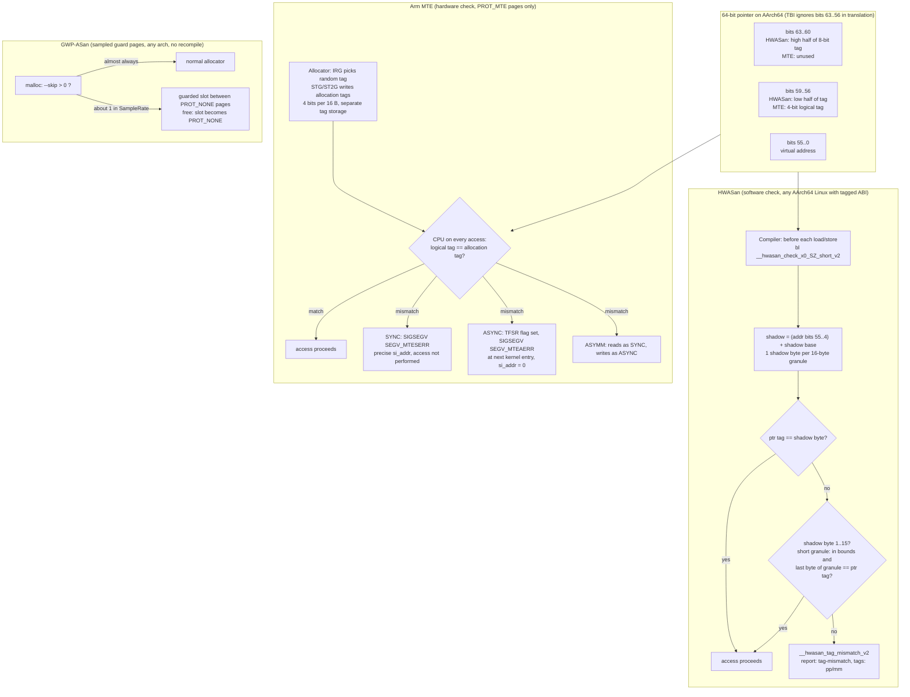

# C++ HWASan and Hardware Memory Tagging

> [!summary] Claim:
> Memory tagging gives every 16-byte granule a small tag and copies the same tag into the unused top bits of every pointer to it; a load or store whose pointer tag differs from the granule's tag is a bug.
> HWASan does the check in software: Clang instruments each access to compare the pointer's top byte (free on AArch64 thanks to Top-Byte Ignore) with an 8-bit tag in a 1:16 shadow, so it costs about 2x CPU like ASan but only 10-35% extra RAM, with no redzones and no quarantine.
> Arm MTE does the same check in hardware with 4-bit tags stored beside physical memory, and the fault mode decides the cost and the evidence: synchronous traps on the faulting instruction, asynchronous reports at the next kernel entry with no address, and asymmetric is synchronous for reads and asynchronous for writes.
> Both are probabilistic (about 1 in 256 misses for HWASan, 1 in 15 or 16 for MTE), and GWP-ASan complements them in production by guarding a tiny random sample of heap allocations with guard pages at near-zero cost.



## The Mechanism

[[Cpp-AddressSanitizer-and-LeakSanitizer-Internals]] owns classic ASan: a 1:8 shadow, redzones around every object to catch overflows, and a quarantine that delays reuse of freed memory to catch use-after-free.
The HWASan design document names those three, "the redzones, the quarantine, and, to a lesser extent, the shadow", as the sources of ASan's memory overhead.
Memory tagging removes the first two by changing the question from "is this byte addressable?" to "does this pointer belong to this memory?".

### 1. The tagging algorithm

The HWASan design document states the scheme in four steps, parameterised by a tagging granularity TG and a tag size TS:

1. Every heap, stack, and global object is aligned to TG bytes (16 in every shipping implementation).
2. Each object gets a random TS-bit tag T.
3. The pointer to the object carries T in its top bits, and the object's memory is tagged with T in a TG-to-1 shadow or tag store.
4. Every load and store compares the pointer tag with the memory tag and raises an exception on mismatch.

An overflow that walks into a neighbour, or a dangling pointer into memory that has been retagged, fails the comparison unless the two tags collide.
The design document gives the miss probability as roughly 1/2^TS: 6.25% for 4-bit tags and 0.39% for 8-bit tags.
The idea is older than either tool: the document cites SPARC ADI as a hardware precedent, and Serebryany et al. (2018) evaluate SPARC ADI and the AArch64 software tool side by side.

### 2. Top-Byte Ignore and the kernel's tagged address ABI

AArch64 has had Top-Byte Ignore since Armv8.0: the kernel's `tagged-pointers.rst` says Linux configures translations through TTBR0 (userspace) so that bits 63:56 are ignored by the translation hardware.
A load through `0x2c00ffffc30ac650` therefore reaches the same byte as a load through `0x0000ffffc30ac650`, so a tag in the top byte costs nothing on the access itself.

The kernel is the complication.
By default, the kernel assumes a tag of `0x00` on every user pointer passed to a system call, so `read(fd, tagged_buf, n)` misbehaves.
`tagged-address-abi.rst` defines the opt-in: `prctl(PR_SET_TAGGED_ADDR_CTRL, PR_TAGGED_ADDR_ENABLE, 0, 0, 0)` makes syscalls accept tagged pointers to memory obtained from anonymous or regular-file `mmap()`, `brk()`, and the initial stack and data.
The setting is per thread, inherited across `clone()` and `fork()`, cleared on `exec()`, and refused with `-EINVAL` when `sysctl abi.tagged_addr_disabled=1`.
`brk()`, `mmap()`, and the `new_address` of `mremap()` still reject tagged addresses (since Linux 5.6), as do the `UFFDIO_*` address fields (since 5.14).

The HWASan runtime calls exactly this `prctl` in `InitializeOsSupport()` (`hwasan_linux.cpp` at llvmorg-23.1.5) and dies with "HWAddressSanitizer failed to enable tagged address syscall ABI" when it fails, unless `fail_without_syscall_abi=0`.
Signal handlers see `si_addr` without the tag unless the handler was installed with `SA_EXPOSE_TAGBITS`.

### 3. HWASan: the shadow and the check

`hwasan_mapping.h` sets `kShadowScale = 4`, so one shadow byte describes 16 bytes and `MemToShadow(p) = (untagged_p >> 4) + shadow_base`.
`hwasan.h` puts an 8-bit tag at bit 56 on AArch64 (`kAddressTagShift = 56`, `kTagBits = 8`), a 6-bit tag at bit 57 on x86-64 with Intel LAM, and an 8-bit tag at bit 56 on RISC-V pointer masking.

Clang does not inline the whole check on Android; it calls an outlined, register-specialised routine with a custom calling convention.
For `int foo(int *a) { return *a; }`, Homebrew Clang 23.1.5 targeting `aarch64-linux-android30` at `-O2` emits the following; the lab `code/03-Debugging/hwasan_codegen/` produces it (darwin-arm64, compile only, nothing executed, comments and assembler directives dropped, as of 2026-11):

```text
== outlined check routine, instruction by instruction
foo:
	stp	x30, x20, [sp, #-16]!
	adrp	x20, :got:__hwasan_shadow
	ldr	x20, [x20, :got_lo12:__hwasan_shadow]
	bl	__hwasan_check_x0_2_short_v2
	ldr	w0, [x0]
	ldp	x30, x20, [sp], #16
	ret

__hwasan_check_x0_2_short_v2:
	sbfx	x16, x0, #4, #52
	ldrb	w16, [x20, x16]
	cmp	x16, x0, lsr #56
	b.ne	.Ltmp0
.Ltmp1:
	ret
.Ltmp0:
	cmp	w16, #15
	b.hi	.Ltmp2
	and	x17, x0, #0xf
	add	x17, x17, #3
	cmp	w16, w17
	b.ls	.Ltmp2
	orr	x16, x0, #0xf
	ldrb	w16, [x16]
	cmp	x16, x0, lsr #56
	b.eq	.Ltmp1
.Ltmp2:
	stp	x0, x1, [sp, #-256]!
	stp	x29, x30, [sp, #232]
	mov	x1, #2
	adrp	x16, :got:__hwasan_tag_mismatch_v2
	ldr	x16, [x16, :got_lo12:__hwasan_tag_mismatch_v2]
	br	x16
```

In the check routine, `sbfx` drops the tag byte and divides the address by 16 to index the shadow, `ldrb` loads the shadow byte, and `cmp ... lsr #56` compares it with the pointer tag.
On a mismatch, a shadow byte of 1 to 15 means a short granule: the routine compares the offset of the last byte loaded (`(p & 0xf) + 3` for a 4-byte load) with the valid size, and if the access fits it compares the real tag stored in the granule's last byte (`orr x16, x0, #0xf`).
Any other mismatch saves registers and tail-calls `__hwasan_tag_mismatch_v2` with the access code in `x1`.
The instructions match the listing in the Clang design document.
The number in the routine name encodes the access as `0xXY` (`GetAccessInfo()` in `hwasan_linux.cpp`): `X & 1` (mask `0x10`) set for a store, `X & 2` (mask `0x20`) for recoverable, and Y = log2 of the size, so `_2` is a 4-byte load and an 8-byte store becomes `__hwasan_check_x0_19_short_v2` (`0x13`).
With `-mllvm -hwasan-inline-all-checks=1` the mismatch path becomes `brk #0x902` (lab output in Step 2), and the runtime's `SIGTRAP` handler decodes the same `0x900 + 0xXY` immediate.
For `aarch64-linux-gnu` the compiler instead inlines the fast path, loads the shadow base from the `__hwasan_tls` thread-local, and calls the outlined routine only on a first-compare mismatch.
For `x86_64-linux-gnu` it emits a plain call such as `callq __hwasan_load4@PLT` before the load.

### 4. Short granules

A 20-byte object occupies two granules, but only 4 bytes of the second one belong to it.
ASan would mark the remaining 12 bytes as a partial redzone; HWASan instead stores the valid size (1 to 15) in the shadow byte and moves the object's real tag into the granule's last byte.
`HwasanAllocate()` in `hwasan_allocator.cpp` does exactly that: it tags the full granules with T, writes `size % 16` into the short granule's shadow, and stores T at `short_granule[15]`.
The check above therefore accepts a short-granule access only if the last byte touched is below the stored size and the granule's last byte equals the pointer tag.

The cost of the trick is ambiguity: a shadow value of 1 to 15 is either a short-granule size or an ordinary tag, because the runtime draws tags from 1 to 255.
The design document says reports near such tags print both the shadow byte and the granule's last byte ("Tags for short granules around the buggy address") and leaves disambiguation to the reader.
The bytes between the object's end and the granule's last byte are filled with a per-process random `tail_magic`, and `free()` checks them (`free_checks_tail_magic=1`), reporting `allocation-tail-overwritten` when something wrote into the slack without going through an instrumented check, for example uninstrumented code.

### 5. Tag choice, free, and use-after-free

`Thread::GenerateRandomTag()` in `hwasan_thread.cpp` draws bits from a per-thread xorshift state and loops until the tag is non-zero, so heap tags are 1 to 255 (`random_tags=1`, the default).
On `free()`, `HwasanDeallocate()` retags the whole chunk with a fresh 8-bit tag drawn until it is both different from the freed pointer's tag and at least 16, so a freed granule is never mistaken for a short granule ("Always store full 8-bit tags on free to maximize UAF detection").
A use-after-free before the chunk is reused is therefore always caught; after reuse, it is missed only when the new allocation's random tag happens to equal the stale pointer's tag, about 1 in 255.
That is why HWASan needs no quarantine: detection does not depend on keeping freed memory out of circulation.
Each thread keeps a ring buffer of recent allocations (`heap_history_size=1023`) so the report can name the allocation and free stacks for the address.

### 6. Stack and globals

The compiler aligns every non-promotable `alloca` to 16 bytes and tags it in the prologue and epilogue.
To avoid one live tagged pointer per local, it generates one random base tag per frame and derives local M's tag as `ReTag(BaseTag, M)`, for example an exclusive-or with M.
The epilogue retags the frame, so a pointer into a dead frame no longer matches, which is how HWASan catches stack-use-after-return, which the Android NDK guide lists as a bug class HWASan adds over ASan.
Globals get a static tag: the first global in a translation unit takes a pseudorandom tag from a hash of the file path and later ones increment it; the tag is folded into the symbol's address, and an `NT_LLVM_HWASAN_GLOBALS` ELF note (type 3, owner `LLVM`) points at a `hwasan_globals` section the runtime walks to tag memory when the binary loads.

### 7. Arm MTE: the same algorithm in silicon

The kernel's MTE document describes the hardware: Armv8.5 adds a 4-bit allocation tag for each 16-byte granule of physical memory mapped Normal-Tagged, and the logical tag is bits 59:56 of the virtual address.
The ID register field tells user space which level is present: `HWCAP2_MTE` for `ID_AA64PFR1_EL1.MTE == 0b0010` and `HWCAP2_MTE3` (asymmetric mode) for `0b0011`, with newer `HWCAP3_MTE_FAR` (Armv8.9 `FEAT_MTE_TAGGED_FAR`: per `tagged-pointers.rst`, bits 63:60 of the fault address are preserved for synchronous tag check faults) and `HWCAP3_MTE_STORE_ONLY` bits (as of Linux 7.4-rc1).
Software uses a handful of instructions: `IRG` inserts a random tag from the set not excluded by `GCR_EL1.Exclude`, `ADDG`/`SUBG` adjust tags, and `STG`/`ST2G` write the allocation tag for one or two granules.

User space opts in at two levels:

- Memory: only pages mapped or `mprotect()`-ed with `PROT_MTE` (`0x20`) have tags; it is allowed only on anonymous and RAM-backed file mappings (tmpfs, memfd), cannot be removed by `mprotect()`, and new pages start with tag 0.
- Thread: `prctl(PR_SET_TAGGED_ADDR_CTRL, flags)` sets the fault mode in `PR_MTE_TCF_MASK` (bits 1-2) and an include mask of generated tags in `PR_MTE_TAG_MASK` (bits 3-18); Linux excludes every tag but 0 by default.

The three fault modes behave differently enough that they are three products:

| Mode | Hardware behaviour | Signal | Evidence | Kernel accesses to user memory |
| :--- | :--- | :--- | :--- | :--- |
| Sync | Access not performed; precise exception | `SIGSEGV`, `si_code = SEGV_MTESERR`, `si_addr` = fault address | Faulting PC and address | Best-effort checked |
| Async | Mismatch recorded; execution continues until the next kernel entry | `SIGSEGV`, `si_code = SEGV_MTEAERR`, `si_addr = 0` | Thread only | Not checked |
| Asymm (Armv8.7, `HWCAP2_MTE3`) | Loads as sync, stores as async | Either code | Precise for reads only | Not specified in the kernel document |

A program may request several modes at once; the kernel then picks the CPU's preferred mode from `/sys/devices/system/cpu/cpu<N>/mte_tcf_preferred` (default `async`) if it is in the set, otherwise the first available of async, asymmetric, sync.
Requesting sync and async together may yield asymmetric, and there is no way to request multiple modes while excluding it.
`PSTATE.TCO` disables checks for a thread temporarily, signal handlers always start with it clear, and there is no match-all tag for user space.
Core dumps carry tags as `PT_AARCH64_MEMTAG_MTE` segments packed two tags per byte, 128 bytes per 4 KiB page, and `PTRACE_PEEKMTETAGS` reads them from a live tracee, which matters to [[Core-Dumps-Minidumps-and-Crash-Reporting]].

Who sets the tags decides what MTE protects:

- Heap: the allocator; Android's Scudo, or glibc with `glibc.mem.tagging` (bit 0 tags allocations, bit 1 requests precise faults, bit 2 takes the system preference; default 0).
- Stack: the compiler, with `-fsanitize=memtag-stack` (Clang and GCC 16.2), which requires `+memtag` in `-march` and runs only on MTE hardware.
- Kernel heap: `CONFIG_KASAN_HW_TAGS`, which the kernel documents as "intended to be used as an in-field memory bug detector or as a security mitigation".

Scudo shows how an allocator turns a probabilistic check into deterministic ones (`combined.h` at llvmorg-23.1.5).
On free, `retagBlock()` excludes the chunk's previous tag, so an immediate use-after-free is "detected 100% of the time".
With the `M_MEMTAG_TUNING_BUFFER_OVERFLOW` tuning it enables odd/even tags, so neighbouring blocks always differ in tag parity and a linear overflow into the next block always traps, at the price of halving the tag space for use-after-free.

### 8. Where the tags live, and what they cost

| Scheme | Metadata | Fraction of memory | Other memory cost |
| :--- | :--- | :--- | :--- |
| ASan | 1 shadow byte per 8 bytes | 1/8 = 12.5% | Redzones and quarantine, usually the larger part |
| HWASan | 1 shadow byte per 16 bytes | 1/16 = 6.25% | 16-byte alignment of every object |
| MTE (Arm reference design) | 4 bits per 16 bytes, reserved physical RAM | 1/32 = 3.125% | Reserved up front, used or not |
| MTE (AmpereOne) | Tags in ECC bits, 66-byte cache lines | Stored in ECC bits, not in a reserved region | Possible ECC reliability trade-off |

The MTE rows are from Noh et al. (2026), which reports the Arm reference design reserving "roughly 3%" of physical RAM and AmpereOne storing tags in ECC bits.
The Android NDK guide summarises HWASan against ASan as similar CPU overhead (about 2x), similar code size growth (40-50%), and much smaller RAM overhead (10-35%).

MTE's CPU cost depends on the core, the mode, and the workload, which is the point of Noh et al., the first broad measurement on shipping silicon.
Their SPEC CPU2006 INT geomeans for heap tagging through glibc on a Pixel 8 (Android 14, Clang 18, static glibc 2.36, cores pinned at 80% of maximum frequency) are:

| Pixel 8 core | Async | Sync | Asymm |
| :--- | :--- | :--- | :--- |
| Performance (Cortex-X3) | 1.08x | 1.56x | 1.10x |
| Big (A715) | 1.18x | 1.23x | 1.17x |
| Little (A510) | 1.08x | 1.14x | 1.08x |

On the same suite AmpereOne, which supports only sync, measured 1.10x; on SPEC CPU2017 speed, AmpereOne measured 1.03x and an Apple M5 1.02x, both sync.
The outliers matter more than the means: 456.hmmer ran 6.64x slower in sync on the Pixel Performance core, which the authors attribute to sync mode serialising stores on that core, and 403.gcc ran 1.82x slower on the Big core even in async, which they attribute to limits on in-flight tag checks.
Server workloads (RocksDB, Nginx, PostgreSQL) were usually under 1.18x, and a Memcached regression of up to 1.40x on AmpereOne fell to about 1.05x after a Linux kernel patch.
So "sync costs the most" holds for these geomeans, but async is not free, and a production decision needs a measurement on the target core.

### 9. GWP-ASan: sampling instead of checking

GWP-ASan, described by Serebryany et al. (2024) as adding "an 'if' statement to a 36-year-old idea", is Electric Fence applied to a random sample.
A pool of N page-sized slots separated by N + 1 `PROT_NONE` guard pages is reserved at start-up; a thread-local skip counter, reset to a random value in `[1, 2 * sample_rate]`, is decremented on each `malloc()`, and only when it reaches zero is the allocation served from a slot.
The slot's object is randomly left- or right-aligned so both underflows and overflows touch a guard page, and `free()` makes the slot `PROT_NONE` so a use-after-free faults until the slot is reused.
The fast path is one thread-local decrement and branch; TCMalloc's implementation adds no instruction at all by reusing its heap-profiling sampler.

The LLVM implementation defaults are `SampleRate=5000`, `MaxSimultaneousAllocations=16`, and about 40 KiB of fixed memory per process (as of 2026-11).
Android enables it for 1% of system processes and app launches, with about 70 KiB per sampled process, and since Android 14 apps default to Recoverable GWP-ASan, which writes the tombstone, disables itself, and lets the process continue.
The payoff is scale: Google's server fleet fixed 300+ GWP-ASan bugs in 2019 and 550+ in 2023, about 80% heap-use-after-free, and Apple's variant (Probabilistic Guard Malloc) reports a 99% fix rate because the report carries allocation and free stacks.
[[Cpp-Sanitizers-and-Memory-Debugging-on-macOS]] owns Apple's allocator tooling.

### 10. Platform status (as of 2026-11)

- AArch64 Linux and Android: HWASan works on any 64-bit Arm core, because TBI is in Armv8.0; Android supports it from NDK r21 and Android 10, and from Android 14 a debuggable app can run under HWASan on any device with a `wrap.sh` that sets `LD_HWASAN=1`.
- MTE devices: the NDK guide lists Pixel 8 through Pixel 10 models, and Android does not enable MTE for apps unless `android:memtagMode` or a developer option says so.
- Apple: Memory Integrity Enforcement (September 2025) runs EMTE in synchronous mode, always on, for the kernel and over 70 userland processes on iPhone 17 and iPhone Air, and Apple states it "would not implement" asynchronous mode because it leaves "a race window open for attackers"; Xcode's Enhanced Security setting exposes EMTE to third-party apps.
- macOS: Homebrew Clang 23.1.5 rejects `-fsanitize=hwaddress` for the host target (`arm64-apple-darwin27.2.0`) with "unsupported option", checked by the `hwasan_codegen` lab.
- x86-64: HWASan uses LAM when the kernel provides it and otherwise a page-aliasing mode that tags only the heap and shares heap memory across `fork()`; mainline Linux (7.4-rc1) still builds `ADDRESS_MASKING` only with `COMPILE_TEST || !CPU_MITIGATIONS`, commented "wait for LASS", after LAM was disabled in most configurations in 2024 because of the SLAM transient-execution weakness (CVE-2024-50112).
- GCC: GCC 16.2 supports `-fsanitize=hwaddress` on AArch64 and on x86-64 only with `-mlam=u48` or `-mlam=u57`, plus `-fsanitize=kernel-hwaddress` and `-fsanitize=memtag-stack`.

### 11. Security, not just debugging

HWASan is a test tool: its design document says the runtime "was not developed with security-sensitive constraints in mind" and must not be linked into production executables.
MTE in sync mode is a mitigation, and its probabilistic nature is less important than it looks, because a failed exploit attempt crashes and leaves a report.
Its weak point is tag secrecy: TikTag (2024) found speculative gadgets that leak MTE tags with over 95% success in under 4 seconds on real systems, bypassing MTE in Chrome and the Linux kernel, whereas Project Zero's 2023 implementation testing (published August 2023, before TikTag) had not identified an additional speculative side channel for leaking tag-check results.
Apple's MIE post says its silicon was designed "from the start" so that tag values cannot influence speculative execution, cites StickyTags and TikTag as showing that Pixel's MTE is vulnerable to such attacks, and has EMTE require knowing a region's tag to access non-tagged memory from tagged memory.
[[Hardware-Security-ABIs-PAC-BTI-CET-and-RELRO]] owns pointer authentication, the other half of Arm's pointer-metadata story.

## Commands and Numbers to Know

| Item | Value | Platform and date | What it controls |
| :--- | :--- | :--- | :--- |
| `-fsanitize=hwaddress` | Clang and GCC; link with the same flag | Linux (AArch64, x86-64), Android (as of 2026-11) | Compiler instrumentation plus HWASan runtime |
| `-fsanitize=memtag-stack`, `memtag-heap` | Need `-march=...+memtag` | Linux, Android AArch64 (as of 2026-11) | MTE stack tagging; heap tagging request in the ELF note |
| `-fsanitize-memtag-mode=` | `sync` (default) or `async` | Linux, Android (as of 2026-11) | Mode written to `.note.android.memtag` |
| `HWASAN_OPTIONS` | Colon-separated `name=value` | Linux, Android (as of 2026-11) | Runtime flags below |
| `halt_on_error` | `1` | Linux, Android (as of 2026-11) | Stop at the first report |
| `heap_history_size` | `1023` per thread | Linux, Android (as of 2026-11) | Report quality, not detection |
| `stack_history_size` | `1024` frames per thread | Linux, Android (as of 2026-11) | Stack report quality |
| `random_tags` | `1` | Linux, Android (as of 2026-11) | `0` gives sequential tags, useful for reproducible reports |
| `tag_bits` | `0` (all 8) | Linux, Android (as of 2026-11) | Restrict tag width, for example to mimic MTE's 4 bits |
| `free_checks_tail_magic` | `1` | Linux, Android (as of 2026-11) | `allocation-tail-overwritten` check on free |
| `fail_without_syscall_abi` | `1` | Linux (as of 2026-11) | Die if the tagged-address `prctl` fails |
| HWASan shadow scale | `kShadowScale = 4` (1:16) | Linux, Android (llvmorg-23.1.5) | Shadow size is 1/16 of the address range |
| HWASan tag | 8 bits at 56 (AArch64), 6 bits at 57 (x86 LAM), 3 bits at 39 (x86 aliasing) | Linux (llvmorg-23.1.5) | Miss probability per check |
| `PR_SET_TAGGED_ADDR_CTRL` | `55`; `PR_TAGGED_ADDR_ENABLE` = bit 0 | Linux (as of 2026-11) | Syscall acceptance of tagged pointers |
| `PR_MTE_TCF_SYNC`, `PR_MTE_TCF_ASYNC` | `1 << 1`, `2 << 1` | Linux (as of 2026-11) | MTE fault mode per thread |
| `PR_MTE_TAG_MASK` | `0xffff << 3`, an include mask | Linux (as of 2026-11) | Tags `IRG` may generate |
| `PROT_MTE` | `0x20` | Linux (as of 2026-11) | Enables allocation tags for a mapping |
| `SEGV_MTESERR`, `SEGV_MTEAERR` | `si_code` 9 (sync), 8 (async) | Linux, Android (as of 2026-11) | Distinguishes precise and deferred faults |
| `mte_tcf_preferred` | `async` default; `sync`, `asymm` | Linux (as of 2026-11) | Mode chosen when a thread requests several |
| `abi.tagged_addr_disabled` | `0` | Linux (as of 2026-11) | `1` makes the tagged ABI `prctl` fail |
| `glibc.mem.tagging` | `0`; bit 0 tag heap, bit 1 precise, bit 2 system preference | Linux AArch64, glibc 2.44 (as of 2026-11) | MTE in glibc malloc via `GLIBC_TUNABLES` |
| `arm64.memtag.process.<name>` | `off`, `sync`, `async` | Android (as of 2026-11) | Per-executable MTE override, read at start-up |
| `MEMTAG_OPTIONS` | `off`, `sync`, `async` | Android native executables (as of 2026-11) | Overrides the property |
| `android:memtagMode` | `off`, `default`, `sync`, `async` | Android apps (as of 2026-11) | App or process MTE mode |
| `android:gwpAsanMode` | `never`, `default`, `always` | Android apps (as of 2026-11) | `default` is Recoverable GWP-ASan from Android 14 |
| GWP-ASan `SampleRate` | `5000` | Both (LLVM implementation, as of 2026-11) | Mean allocations between samples |
| GWP-ASan `MaxSimultaneousAllocations` | `16` | Both (as of 2026-11) | Guarded slots in use at once |
| Tag storage | 128 B per 4 KiB page in core files; about 3% of RAM in Arm's reference design | Linux (as of 2026-11) | Core size and reserved RAM |

## Multi-Language Comparison: C++ / Python / Rust

| Concern | C++ (Clang 23.1.5, GCC 16.2) | Python (CPython 3.x) | Rust (nightly) |
| :--- | :--- | :--- | :--- |
| HWASan | `-fsanitize=hwaddress` on compile and link | Covers only native code built with it; the interpreter itself must be built with it to see its own bugs | `-Zsanitizer=hwaddress` on `aarch64-linux-android` and `aarch64-unknown-linux-gnu` (unstable) |
| MTE stack tagging | `-fsanitize=memtag-stack -march=armv8.5-a+memtag` | Not applicable to Python frames | `-Zsanitizer=memtag` with `-C target-feature=+mte` (unstable) |
| MTE heap tagging | Allocator setting: Scudo on Android, `glibc.mem.tagging` on glibc | glibc tags only what reaches `malloc()`; pymalloc serves requests up to 512 bytes (`SMALL_REQUEST_THRESHOLD`) from its own `mmap()`-backed arenas (`Objects/obmalloc.c`), which glibc never tags, so set `PYTHONMALLOC=malloc` | The global allocator decides; the default `System` allocator inherits libc tagging, because on Unix it calls `libc::malloc` (`library/std/src/sys/alloc/unix.rs`) |
| GWP-ASan | Inside the allocator; no rebuild | Same, for allocations that reach libc `malloc()` | Same, through the system allocator |
| What tagging misses | Intra-object overflows, overflows that land in a granule with a matching tag | Bugs inside pymalloc arenas unless `PYTHONMALLOC=malloc` | Safe Rust does not need it; it guards `unsafe` and FFI |

[[Rust-Miri-Sanitizers-Loom-and-Cargo-Fuzz]] owns Rust's sanitizer flags and [[Python-Debugging-Hung-Processes-and-C-Extensions]] owns native extension debugging.

## Worked Lab Example

The lab is `code/03-Debugging/hwasan_codegen/`, run with `make verify LAB=03-Debugging/hwasan_codegen/`; it requires macOS and an LLVM toolchain with the AArch64 backend and LLD (Homebrew `llvm`, 23.1.5 when recorded; set `LLVM_BIN` for another directory).
HWASan and MTE need an AArch64 Linux or Android host to run, and MTE needs MTE hardware, so the lab only compiles and links: it inspects the code Clang generates and the ELF note LLD writes, and executes none of it.
Steps 2 and 3 print excerpts of `expected/darwin-arm64.txt` byte for byte; the lab fails if any section changes, so a compiler upgrade shows up as a diff instead of a stale note.
Step 1 is pen-and-paper reasoning over the runtime's own rules, derived by hand from the source and not run on AArch64 or MTE hardware.

### Step 1: predict which accesses trap on a 20-byte allocation

Take `char *p = (char *)malloc(20);` under HWASan, with pointer tag `0x2c`.
`HwasanAllocate()` rounds the chunk to 32 bytes and produces this state:

| Granule | Bytes | Shadow byte | Granule's last byte |
| :--- | :--- | :--- | :--- |
| 0 | `p[0..15]` | `0x2c` | ordinary data |
| 1 | `p[16..19]` valid, `p[20..30]` tail magic | `0x04` (short, 4 valid bytes) | `p[31] = 0x2c` |

Apply `__hwasan_check_x0_2_short_v2` (4-byte load) by hand:

| Access | Shadow vs tag | Short-granule test | Result |
| :--- | :--- | :--- | :--- |
| `*(int *)(p + 12)` | `0x2c == 0x2c` | not reached | OK |
| `*(int *)(p + 16)` | `0x04 != 0x2c` | `4 > (0 + 3)` and `p[31] == 0x2c` | OK |
| `*(int *)(p + 17)` | `0x04 != 0x2c` | `4 > (1 + 3)` is false | tag-mismatch, 1 byte past the end |
| `p[20]` (1-byte load, `_0_`) | `0x04 != 0x2c` | `4 > (4 + 0)` is false | tag-mismatch |
| `p[32]` | next chunk's tag, equal to `0x2c` with probability about 1/255 | n/a | usually tag-mismatch |

Under MTE with Scudo there are no short granules: granule 1 is tagged as a whole, so `p[20..31]` are silently accessible, and only `p[32]` onward can trap.
HWASan finds sub-granule overflows that MTE cannot.

### Step 2: decode the access code in a check routine name

```bash
cd code && make verify LAB=03-Debugging/hwasan_codegen/
```

The lab compiles `int foo(int *a) { return *a; }` and `void st(long *a) { *a = 1; }` with `--target=aarch64-linux-android30 -O2 -fsanitize=hwaddress`, then recompiles the load with `-mllvm -hwasan-inline-all-checks=1`.
Its output, recorded on darwin-arm64 with Homebrew Clang 23.1.5 (as of 2026-11):

```text
== check routine for a 4-byte load (0x02)
__hwasan_check_x0_2_short_v2
== check routine for an 8-byte store (0x13)
__hwasan_check_x0_19_short_v2
== inline checks trap with brk #0x900 + code
	brk	#0x902
```

`2` is `0x02`, a 4-byte load; `19` is `0x13`, an 8-byte store; and `0x902` is `0x900 + 0x02`, the same code in the trap immediate.
The same lab shows the other targets: `aarch64-linux-gnu` references `__hwasan_tls` for the inline fast path, and `x86_64-linux-gnu` emits `callq __hwasan_load4@PLT`.

### Step 3: see MTE stack tagging and the heap-tagging ELF note

The lab compiles `void f(void) { char buf[24]; use(buf); }` for `aarch64-linux-android34` with `-march=armv8.5-a+memtag -fsanitize=memtag-stack`, then links an empty `_start` with `-fsanitize=memtag-heap -fuse-ld=lld` and reads the result with `llvm-readelf -n`.
Its output (darwin-arm64, Homebrew Clang 23.1.5 and LLD 23.1.5, as of 2026-11):

```text
== MTE stack tagging instructions
irg x0, sp
st2g x0, [x0]
st2g sp, [sp]
== memtag-stack without +memtag
'-fsanitize=memtag-stack' requires hardware support (+memtag)
== memtag-heap ELF note, default mode
NT_ANDROID_TYPE_MEMTAG
Tagging Mode: SYNC
Heap: Enabled
Stack: Disabled
== memtag-heap ELF note, async mode
NT_ANDROID_TYPE_MEMTAG
Tagging Mode: ASYNC
Heap: Enabled
Stack: Disabled
```

The body of `f` contains `irg x0, sp` (random tag for the frame's object), `st2g x0, [x0]` (tag two granules, because 24 bytes round up to 32), the call, and `st2g sp, [sp]` (retag with the stack pointer's tag on the way out).
The linked binary carries a `.note.android.memtag` note of type `NT_ANDROID_TYPE_MEMTAG`; the default is `SYNC`, and `-fsanitize-memtag-mode=async` flips it to `ASYNC`.
Without `+memtag` the compiler refuses with the quoted error, so the same lab proves that stack tagging is a hardware feature gate and not just a flag.

### Step 4: read an MTE tombstone header

The Android NDK MTE guide's example tombstone starts:

```text
tagged_addr_ctrl: 000000000007fff3
signal 11 (SIGSEGV), code 9 (SEGV_MTESERR), fault addr 0x800007ae92853a0
Cause: [MTE]: Use After Free, 0 bytes into a 32-byte allocation at 0x7ae92853a0
```

Decode `0x7fff3` with the kernel's constants: bit 0 is `PR_TAGGED_ADDR_ENABLE`, bits 1-2 are `01` (`PR_MTE_TCF_SYNC`), and bits 3-18 are `0xfffe`, an include mask of tags 1 to 15 with tag 0 excluded.
The fault address carries tag `0x8` in bits 59:56, so the dangling pointer's logical tag was 8, and Scudo's retag-on-free excludes the previous tag, so the freed granule's tag was not 8.

## Pitfalls

> [!warning] Pitfall: treating a clean HWASan or MTE run as proof
> Both are probabilistic per check: about 1 in 255 for HWASan's heap tags and 1 in 15 for MTE with tag 0 excluded.
> A clean run proves only that no mismatch was observed; run the test suite repeatedly, with `random_tags=1`, and keep fuzzing.

> [!warning] Pitfall: expecting MTE to catch an overflow inside the last granule
> MTE tags whole 16-byte granules, so an allocation of 20 bytes leaves 12 accessible bytes in its second granule.
> HWASan's short granules catch those; MTE does not, and neither catches intra-object overflows between fields of one struct.

> [!warning] Pitfall: debugging from an async MTE crash
> `SEGV_MTEAERR` has `si_addr = 0` and the PC is wherever the next kernel entry happened, possibly far from the bad access.
> Rerun the failing process in sync mode (`arm64.memtag.process.<name>=sync`, `android:memtagMode="sync"`, or `MEMTAG_OPTIONS=sync`) to get the faulting instruction and Scudo's allocation and free stacks.

> [!warning] Pitfall: assuming async mode is free
> Noh et al. measured 403.gcc at 1.82x on a Pixel 8 Big core in async mode, against a 1.18x geomean.
> Benchmark the target core with the target allocator before shipping.

> [!warning] Pitfall: code that already uses the top byte
> HWASan, MTE, and pointer authentication all claim the high bits; code that stores flags in bits 63:56, compares pointers with tags, or hashes raw pointer values breaks, and the kernel's `tagged-pointers.rst` warns that C compilers are unlikely to "hazard two virtual addresses differing only in the upper byte".
> Strip tags before arithmetic that leaves the object, and never put tagged values in the stack pointer or frame records.

> [!warning] Pitfall: tagged pointers into the kernel
> A tagged pointer passed to `write()` without the tagged address ABI enabled may fail or kill the process; with it enabled, `mmap()`, `brk()`, and `mremap()` destinations must still be untagged.
> Custom allocators that `mmap()` memory and later `munmap()` a tagged pointer need to strip the tag first.

> [!warning] Pitfall: static C++ runtime under HWASan on Android
> The NDK guide requires a shared-library STL (`c++_shared`, or `system` or `none`, never `c++_static`), because the STL's `new` and `delete` are usually built without frame pointers and HWASan's own implementation cannot be used when the STL is linked statically.
> A `c++_static` build gives allocation stacks without frame pointers and misses the runtime's operators.

> [!warning] Pitfall: mixing memtag defaults
> Clang's `-fsanitize-memtag-mode` defaults to `sync`, while an Android.bp `memtag_heap: true` without `diag` means async.
> Read the ELF note with `llvm-readelf -n` instead of guessing which mode a binary requests.

> [!warning] Pitfall: shipping the HWASan runtime
> The HWASan runtime is a debugging aid whose design document says it may "compromise the security of the resulting executable".
> In production use MTE through the allocator, or GWP-ASan.

> [!warning] Pitfall: x86-64 HWASan in a forking service
> Without LAM, x86-64 HWASan uses page aliasing over shared memory, so heap memory is shared with children after `fork()`; the design document calls it "really only safe for applications that do not fork".

## At Scale

A single developer uses HWASan as a faster-memory ASan on an AArch64 box and never thinks about MTE.
The trade-offs change once a fleet ships native code to devices or runs Arm servers.

The four tools sit at different points on the cost and certainty curve:

| Tool | CPU | RAM | Rebuild | Detection per bad access | Where it runs |
| :--- | :--- | :--- | :--- | :--- | :--- |
| ASan | About 2x | High (shadow, redzones, quarantine) | Yes | Deterministic within redzones and quarantine | CI, any arch |
| HWASan | About 2x | 10-35% | Yes | About 254 in 255, plus sub-granule precision | CI and dogfood on AArch64 |
| MTE sync | 1.02x to 1.56x geomean, outliers to 6.64x | About 3% reserved | No for heap, yes for stack | About 14 in 15 with tag 0 excluded, precise report | MTE devices and servers |
| MTE async | 1.08x to 1.18x geomean, outliers to 1.82x | Same | Same | About 14 in 15, imprecise report | Same |
| GWP-ASan | Near zero | About 40-70 KiB per process | No | About 1 in SampleRate allocations covered | Every production process |

Decision rules:

- Up to a few hundred engineers: run ASan in CI on x86-64 and add an HWASan job on an AArch64 Linux runner if any shipping target is 64-bit Arm; it catches stack-use-after-return and short-granule overflows ASan misses, with less RAM, which lets larger integration tests fit.
- From about 1,000 engineers shipping Android or Arm server code: make HWASan the default sanitizer build for AArch64 integration and fuzzing, keep ASan for x86-only code, and gate the dogfood fleet on MTE sync builds on MTE hardware.
- At 10,000 to 50,000 engineers with millions of devices or hosts: turn on GWP-ASan everywhere it is not already on, because its value is proportional to fleet size and it needs no rebuild; route its reports, with allocation and free stacks, into the crash pipeline owned by [[Core-Dumps-Minidumps-and-Crash-Reporting]] and dedupe by stack.
- Use MTE async or asymmetric as a fleet mitigation only after measuring the target cores, and keep a switch to sync per process for reproduction; Android's per-process property and Apple's per-app Enhanced Security setting are the models.
- Where the threat is targeted exploitation rather than stability, prefer sync on the exposed processes, as Apple did for its kernel and over 70 userland processes, and pair it with a type-segregating allocator, because tags alone are probabilistic and leakable.
- Treat every MTE or GWP-ASan report as a real memory corruption on a user's machine; [[Cpp-Playbook-Heap-Corruption]] owns the response runbook and [[Debugging-Decision-Records]] owns the sanitizer-tier policy.

## Practice Drill

> [!tip] Practice Drill:
> On an AArch64 Linux host or VM whose kernel supports the tagged address ABI, with Clang 23, build a program with a heap overflow at `p[16]` on `malloc(16)`, a heap overflow at `p[20]` on `malloc(20)`, a use-after-free, and a stack-use-after-return, each selected by `argv[1]`, with `-fsanitize=hwaddress -fno-omit-frame-pointer -g`.
> Before running, predict the `Cause:` line and the `tags: pp/mm (ptr/mem)` pair for each case, using the rules in this note: the free tag is at least 16 and differs from the pointer tag, and a short granule's shadow byte is its valid size.
> Run each case 20 times with `HWASAN_OPTIONS=random_tags=1` and confirm every run reports; then rerun the overflow at `p[16]` with `HWASAN_OPTIONS=tag_bits=4` 200 times and count misses, which should be at most about 1 in 15 (when the neighbouring chunk is live with a random 4-bit tag) and zero when the neighbour is free, because `HwasanDeallocate()` always writes a full 8-bit free tag of at least 16, which no 4-bit pointer tag can match.
> If you have an MTE device, run the same binary built without HWASan under `GLIBC_TUNABLES=glibc.mem.tagging=3` (sync) and `=1` with async requested, and compare the `si_code` and `si_addr` your `SIGSEGV` handler prints when installed with `SA_EXPOSE_TAGBITS`.
> As a stretch, decode the `tagged_addr_ctrl` value from your own tombstone or `/proc/<pid>/status` and explain every bit.

## Interview Questions

> [!question] L5: Why does HWASan need neither redzones nor a quarantine, while ASan needs both?
>
> > [!success]- Answer
> > ASan answers "is this byte addressable?", so it must surround objects with poisoned redzones to make overflows land on something unaddressable, and keep freed memory poisoned in a quarantine so a dangling pointer still points at poison.
> > HWASan answers "does this pointer's tag match this memory's tag?", so the neighbour object, with a different random tag, is the redzone, and retagging on free invalidates every old pointer at once.
> > After the memory is reused the old pointer still fails unless the new random tag collides, about 1 in 255, so no quarantine is needed.
> > The costs are 16-byte alignment, a 1:16 shadow, and probabilistic rather than deterministic detection.

> [!question] L5: What does Top-Byte Ignore do, and why does the kernel still need to be told about tagged pointers?
>
> > [!success]- Answer
> > TBI makes the translation hardware ignore bits 63:56 of a user virtual address, so loads and stores through a tagged pointer work with no extra instruction.
> > The kernel, however, interprets user addresses in syscalls, signal delivery, and stack unwinding, and by default assumes tag `0x00`.
> > `prctl(PR_SET_TAGGED_ADDR_CTRL, PR_TAGGED_ADDR_ENABLE, 0, 0, 0)` opts the thread into the tagged address ABI so syscalls accept tagged pointers to normal user memory.
> > Even then `mmap()`, `brk()`, and `mremap()` destinations must be untagged, and `si_addr` loses its tag unless the handler uses `SA_EXPOSE_TAGBITS`.

> [!question] L5: Compare MTE's sync, async, and asymmetric modes in one sentence each, and say when you would use each.
>
> > [!success]- Answer
> > Sync stops the faulting access and raises `SIGSEGV` with `SEGV_MTESERR` and the fault address; use it in testing, for reproduction, and on high-risk attack surfaces.
> > Async records the mismatch and raises `SEGV_MTEAERR` with `si_addr = 0` at the next kernel entry; use it as a low-overhead detector on well-tested code where bug density is low.
> > Asymmetric (Armv8.7, `HWCAP2_MTE3`) checks reads synchronously and writes asynchronously; Android recommends it over async where available.
> > The security caveat is that corrupting writes are exactly the asynchronous half, which is why Apple ships only synchronous EMTE.

> [!question] L6: Predict the output.
> Under HWASan, `char *p = malloc(20);` then the program does a 4-byte read at `p + 16`, then a 4-byte read at `p + 17`.
> What happens at each?
>
> > [!success]- Answer
> > The read at `p + 16` succeeds.
> > The shadow byte of the second granule holds 4, a short-granule size, so the check verifies that the last byte read (offset 0 + 3 within the granule) is below 4 and that the granule's last byte holds the pointer tag, and both are true.
> > The read at `p + 17` reports `ERROR: HWAddressSanitizer: tag-mismatch` with `READ of size 4`, because its last byte is at offset 4 in the granule, which is not below the stored size 4; the report describes the address as just past a 20-byte region and prints the short-granule tags.
> > Under MTE with a 16-byte-granule allocator, neither read would trap, because the whole second granule carries the allocation's tag.

> [!question] L6: Debug this.
> A production Android service crashes about once a day with `signal 11 (SIGSEGV), code 8 (SEGV_MTEAERR)` and no usable fault address, always inside a `write()` call in a logging library, with a different caller stack each time.
> What is going on and what do you do?
>
> > [!success]- Answer
> > `SEGV_MTEAERR` is an asynchronous MTE fault: the tag mismatch happened earlier, the CPU kept running, and the kernel delivered the signal at the next kernel entry, which here is the logger's `write()` syscall, so the stack is where the report surfaced, not where the bug is.
> > The fault address is unknown by design: the kernel sets `si_addr = 0` for asynchronous faults.
> > Switch that process to sync, with `adb shell setprop arm64.memtag.process.<basename> sync` or `android:memtagMode="sync"` for an app, so the next occurrence stops on the faulting load or store and Scudo adds allocation and free stacks with a `Cause:` line.
> > In parallel, run the service's tests and fuzzers under HWASan on any AArch64 device or host, and correlate with any GWP-ASan reports from the fleet that name the same allocation sites.
> > The codes are from `include/uapi/asm-generic/siginfo.h`: `SEGV_MTEAERR` is 8 and `SEGV_MTESERR` is 9.

> [!question] L6: Why does the HWASan runtime insist that the tag it writes on `free()` is at least 16 and differs from the pointer tag?
>
> > [!success]- Answer
> > Shadow values 1 to 15 mean "short granule of this many valid bytes", so a free tag in that range would make the check treat freed memory as a short granule and read the granule's last byte, which `hwasan_allocator.cpp` calls out: it "would make us attempt to read the memory on a UaF".
> > Differing from the pointer tag guarantees that every pointer to the freed chunk mismatches until the chunk is reused, so immediate use-after-free is deterministic.
> > Scudo applies the same idea to MTE by excluding the previous tag on retag, so immediate use-after-free is detected 100% of the time there too.

> [!question] L7: Your team wants to replace its ASan CI with HWASan to save memory.
> What do you gain, what do you lose, and what do you keep?
>
> > [!success]- Answer
> > You gain RAM (10-35% instead of ASan's much larger overhead), so larger integration tests and more parallel shards fit, plus stack-use-after-return and sub-granule overflow detection by default.
> > You lose determinism (about 1 in 255 misses per bad access), x86-64 coverage unless LAM is available, which mainline Linux still gates behind `!CPU_MITIGATIONS` as of 7.4-rc1, and macOS coverage, where Clang rejects the flag.
> > CPU cost stays about 2x, so CI time does not improve.
> > Keep ASan for x86-only components and for leak checking on Android, where the HWASan runtime forces `detect_leaks` off (`hwasan.cpp` at llvmorg-23.1.5 allows it only on non-Android Linux and Fuchsia), run HWASan on AArch64 runners, and run both on code that ships to both architectures.

> [!question] L7: How would you explain to a security reviewer that a 4-bit, probabilistic, leakable tag is still worth deploying?
>
> > [!success]- Answer
> > A memory-corruption exploit usually needs several steps that each touch memory with a stale or out-of-bounds pointer, and in sync mode each step that mismatches crashes the process, so the success probability compounds and every failure leaves a report naming the bug.
> > Allocator policy removes the luck from the common cases: Scudo excludes the old tag on free and can force neighbour parity, so immediate use-after-free and linear overflow into the neighbour are deterministic.
> > The weaknesses are real: TikTag leaked tags speculatively with over 95% success in under 4 seconds, async leaves a window, and untagged memory such as globals was unprotected in the original MTE.
> > That is why Apple pairs synchronous EMTE with typed allocators and tag-confidentiality work, and why the honest claim is "makes exploits unreliable and noisy", not "memory safe".

> [!question] L8+: You run 30,000 Arm servers and 50 million Android installs of a C++ SDK. Design the memory-tagging and sampling strategy.
>
> > [!success]- Answer
> > Pre-production: HWASan builds for every AArch64 test and fuzzing job, ASan for x86 code, and an MTE sync dogfood ring on MTE-capable devices and servers.
> > Production devices: rely on GWP-ASan, which Android already enables by default in recoverable form, and offer an MTE-sync build or manifest setting for at-risk users and high-risk processes; measure async and asymmetric on the actual SoC cores before enabling them broadly, because Noh et al. found per-core outliers up to 1.82x in async and 6.64x in sync.
> > Production servers: GWP-ASan in the allocator everywhere, and MTE only on cores that expose it after a canary measurement, with a per-service kill switch and a sync override for reproduction.
> > Pipeline: symbolise and dedupe reports by allocation and access stacks, file them as security-priority bugs, and track time to fix, because GWP-ASan data shows about half of bugs are seen only once.
> > Policy: write the tiers into a decision record, and treat tag secrecy and speculative leaks as part of the threat model.

> [!question] L8+: Apple chose synchronous-only EMTE; Android exposes async and asymmetric.
> Argue both sides and say what you would do on a platform you control.
>
> > [!success]- Answer
> > Apple's argument is that async leaves "a race window open for attackers", and that owning the silicon let it design tag checks cheap enough to run synchronously across the kernel and over 70 processes, with typed allocators separating type buckets at page granularity and EMTE closing the gap between smaller allocations inside the same bucket.
> > Android's argument is that it ships on reference Arm cores it does not design, where sync can cost far more on some workloads, so async and asymmetric make tagging deployable at all, and sync remains available for diagnosis and for at-risk users.
> > On a platform I control I would follow Apple's shape: sync on exposed attack surfaces, typed allocation so tags only need to separate same-type objects, and silicon or allocator work to keep the cost bounded.
> > On a platform I do not control I would measure per core and per mode, use asymmetric or async where sync is unaffordable, and lean on GWP-ASan and pre-production HWASan for detection.

## Further Reading

- Clang, "Hardware-assisted AddressSanitizer Design Documentation": the algorithm, short granules, the check sequence, stack and global tagging, and the security warning about the runtime.
- `compiler-rt/lib/hwasan` at llvmorg-23.1.5 (`hwasan.h`, `hwasan_mapping.h`, `hwasan_allocator.cpp`, `hwasan_linux.cpp`, `hwasan_flags.inc`): the tag widths, shadow scale, free-tag rule, tagged-ABI setup, and every runtime flag.
- Linux `memory-tagging-extension.rst`, `tagged-address-abi.rst`, and `tagged-pointers.rst`: the normative user-space contract for `PROT_MTE`, fault modes, preferred modes, ptrace, core dumps, and syscall tagging.
- Android NDK guides for HWASan, MTE, and GWP-ASan, and the AOSP MTE page: deployment switches, device list, and real tombstones.
- Serebryany et al., "Memory Tagging and how it improves C/C++ memory safety" (2018): the original case for tagging, comparing SPARC ADI with the AArch64 software tool.
- Serebryany et al., "GWP-ASan: Sampling-Based Detection of Memory-Safety Bugs in Production" (2024): the algorithm and multi-year results from Google servers, Chrome, Android, Apple, Meta, Firefox, and KFENCE.
- Noh et al., "ARM MTE Performance in Practice" (2026): the first broad MTE measurement on Pixel, AmpereOne, and Apple M5 cores, with microarchitectural explanations of the outliers.
- Apple SEAR, "Memory Integrity Enforcement" (2025): why a vendor with its own silicon chose synchronous EMTE plus typed allocators.
- Kim et al., "TikTag" (2024), and Mark Brand, "MTE As Implemented" (Project Zero, 2023): the speculative tag-leak debate.
- Partap and Boneh, "Memory Tagging: A Memory Efficient Design" (2022): a survey of how glibc, Android, Chrome, Linux, and LLVM use MTE, and proposals for longer tags.

## Related

- Prerequisites: [[Cpp-AddressSanitizer-and-LeakSanitizer-Internals]]
- Next: [[Cpp-Sanitizers-and-Memory-Debugging-on-macOS]]
- See also: [[Hardware-Security-ABIs-PAC-BTI-CET-and-RELRO]], [[Core-Dumps-Minidumps-and-Crash-Reporting]], [[Cpp-Playbook-Heap-Corruption]], [[Rust-Miri-Sanitizers-Loom-and-Cargo-Fuzz]]
