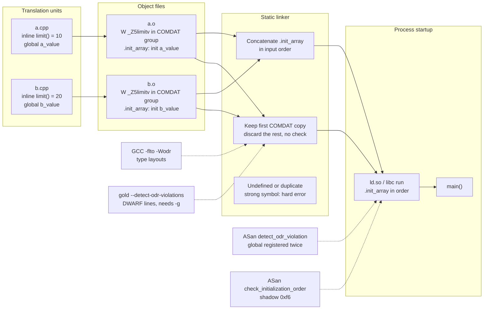

# C++ ODR Violations, Static Init, and Linker Template Errors

> [!summary] Claim:
> The One Definition Rule lets inline functions, templates, and classes be defined in many translation units only if every definition is token-identical, and the standard requires no diagnostic when they are not, so the toolchain keeps one COMDAT copy chosen by link order and silently discards the rest.
> Three detectors cover different slices: GCC `-Wodr` compares type layouts during LTO, gold `--detect-odr-violations` compares DWARF line info for weak `_Z` symbols whose size or type differs, and ASan's `detect_odr_violation` catches a global registered twice across shared objects at startup.
> Dynamic initialization of globals in different translation units is indeterminately sequenced, and on ELF the observed order is the order of `.init_array` entries, which follows the link line; ASan's `check_initialization_order` turns a read of a not-yet-initialized global into a report by poisoning it with shadow byte `0xf6`.
> Template link errors are the same machinery seen from the other side: a missing instantiation, a missing key function, or a non-inline header definition is an undefined or duplicate strong symbol, and `nm -C`, `c++filt`, `--trace-symbol`, and C++20 concepts move the diagnosis from the linker back to the call site.



## The Mechanism

This note owns three failure families that a source-level debugger cannot see, because the wrong behavior is decided by the compiler, the static linker, or the startup code before `main` runs.
Symbol binding and relocation are owned by [[Symbols-Relocations-and-Static-Linking]], `_start` through `__libc_start_main` and `.init_array` execution by [[Program-Startup-C-Runtime-Init-and-Auxiliary-Vectors]], and symbol preemption between shared objects by [[Dynamic-Linking-PLT-GOT-and-Loaders]].
Every output block in this note is copied from the recorded output of two labs that `make verify` re-runs.
`code/03-Debugging/odr_static_init_linker/` records `expected/linux-aarch64.txt` in the pinned lab image (Ubuntu 24.04, GCC 13.3.0, GNU ld 2.42, gold 1.16), and `code/03-Debugging/odr_static_init_macho/` records `expected/darwin-arm64.txt` on macOS 27.2 with Apple clang 21.0.0 and Apple ld-27106.1.
Both labs print each command as a `$` line, strip the build directory from paths, replace the sanitizer PID with `==PID==` and every address or offset with `0xADDR`, and print `[exit N]` after a command whose status is not 0 (`pipefail` is on, so a failing program at the head of a pipeline counts).
Statements about Clang 18 on Linux, lld, mold, Python, and Rust are marked as one-off runs, because the image this recording used holds only GCC and binutils.

### 1. What the One Definition Rule actually says

The rule lives in [basic.def.odr] of the working draft (fetched 2026-11).

- Paragraph 2: no translation unit may contain more than one definition of any definable item.
- Paragraph 12: every program must contain at least one definition of every odr-used function or variable; no diagnostic is required.
- Paragraph 16.1: a non-inline, non-templated function or variable may not be defined in more than one translation unit.
- Paragraph 16.2 and the requirements listed after it: anything else defined in several translation units (classes, enumerations, inline functions and variables, templated entities, default arguments) must have definitions that consist of the same sequence of tokens and whose names look up to the same entities.
- When 16.1 or 16.2 is broken, "the program is ill-formed; a diagnostic is required only if the definable item is attached to a named module and a prior definition is reachable at the point where a later definition occurs."

The last sentence is the whole problem.
Outside named modules, an ODR violation is ill-formed, no diagnostic required (IFNDR): the compiler sees one translation unit at a time and cannot compare it with another, and the linker sees symbols, not tokens.
The current draft tags each such rule with an `[ifndr:...]` label, for example `[ifndr:basic.def.odr.definition.matches]`.

The two halves fail differently:

- Breaking 16.1 with ordinary strong symbols (a non-inline function defined in a header) is usually diagnosed anyway, because the linker refuses two strong definitions of one symbol.
- Breaking 16.2 is silent, because the entities it covers are emitted with vague linkage, which exists precisely so that duplicates are legal.

### 2. Vague linkage: why the linker cannot see the violation

Section 5.2 of the Itanium C++ ABI, which GCC and Clang follow on Linux and macOS, says objects that the ODR requires to have a single definition but that "are not clearly part of a single object file" are emitted in every object that needs them, each in a COMDAT group named by the mangled symbol, and the linker keeps one group and discards the others.

- 5.2.1: an out-of-line copy of an inline function is emitted wherever it is referenced, in a COMDAT group named by the function's mangled name.
- 5.2.2: function-local statics of inline functions and their guard variables are COMDAT too, and the guard "must be weak".
- 5.2.3: virtual tables of a class with a non-inline key function are emitted once, in the translation unit that defines the key function; otherwise they are COMDAT in every user.
- 5.2.6: every implicit instantiation of a function template, a member function, or a static data member is emitted in a COMDAT group in every object that references it.

On ELF the copies show up as weak symbols in `SHT_GROUP` sections (linux-aarch64 lab):

```text
$ nm -C a.o | grep limit
0000000000000000 W limit()
$ readelf -gW a.o

COMDAT group section [    1] `.group' [_Z5limitv] contains 1 sections:
   [Index]    Name
   [    6]   .text._Z5limitv
```

The linker deduplicates by group name and keeps one copy; in the two labs GNU ld and Apple ld both kept the copy from the first input on the command line.
It does not compare the bytes of the copies, so when two translation units disagree, the program silently runs whichever copy the link order selected.

Inlining adds a second, independent source of nondeterminism.
At `-O2` each translation unit inlines its own body and never calls the out-of-line copy, so the same source can produce link-order-dependent results at `-O0` and translation-unit-dependent results at `-O2`.
The predict-the-output interview question walks through exactly this case.

Common ways a real codebase gets two different definitions of one inline entity:

- Two libraries each define a helper with the same qualified name, for example `util::hash()` or `struct Config`, in a header that is not shared.
- One header compiled with different macros in different translation units (`-DNDEBUG`, a feature flag, `#pragma pack`), so a class gains or loses a member.
- A vendored copy of a library at a different version linked next to the real one.
- A template specialization declared in one translation unit and not visible in another, so one unit uses the primary template and the other the specialization.

### 3. Detector 1: GCC `-Wodr` during LTO

GCC documents `-Wodr` as "Warn about One Definition Rule violations during link-time optimization. Enabled by default."
It only fires under `-flto`, because only then does one compiler process see the types of every translation unit.
It compares type definitions, not function bodies (linux-aarch64 lab):

```text
$ g++ -std=c++20 -O2 -flto a.cpp b.cpp -o lto
a.cpp:1:8: warning: type 'struct Config' violates the C++ One Definition Rule [-Wodr]
    1 | struct Config { int threads; };
      |        ^
b.cpp:2:8: note: a different type is defined in another translation unit
    2 | struct Config { int threads; long budget; };
      |        ^
b.cpp:2:35: note: the first difference of corresponding definitions is field 'budget'
    2 | struct Config { int threads; long budget; };
      |                                   ^
b.cpp:2:8: note: a type with different number of fields is defined in another translation unit
    2 | struct Config { int threads; long budget; };
      |        ^
```

The same two files linked without `-flto` produced no diagnostic and printed `8`, so the mismatched layout was invisible to the non-LTO build.
`-Wodr` is a warning, and the link still succeeded with exit status 0.
With `-Werror=odr` the lab's same link printed `error: type 'struct Config' violates the C++ One Definition Rule [-Werror=odr]` and exited 1, which is the form to use when the build should stop.

### 4. Detector 2: gold `--detect-odr-violations`

gold declares the option in `gold/options.h` as "Look for violations of the C++ One Definition Rule", default false.
The candidate filter is in `Symbol_table::resolve()` in `gold/resolve.cc` (binutils 2.42 branch); a symbol becomes a candidate only when all of these hold:

- One of the two definitions is `STB_WEAK`, so in practice it is vague-linkage C++ code.
- Both are defined in ordinary sections and both have nonzero size.
- Their ELF symbol type or their size differs.
- The name starts with `_Z`, because "C does not have a concept of ODR".

`Symbol_table::detect_odr_violations()` in `gold/symtab.cc` then asks the DWARF line table for the source location of the first instruction of each copy and warns only when the two sets of locations do not intersect.
It compares only the base file name and line, so the same header reached through two include paths is not a false positive, and it compares every definition against the first one only, which the source admits "may cause false negatives that appear or disappear depending on the link order, but it won't cause false positives."

The lab runs the check three times on linux-aarch64 (gold prints absolute source paths; the lab strips the build directory):

```text
$ g++ -fuse-ld=gold -Wl,--detect-odr-violations main.o a.o b.o -o g1
/usr/bin/ld.gold: warning: while linking g1: symbol 'limit()' defined in multiple places (possible ODR violation):
  a.cpp:1 from a.o
  b.cpp:1 from b.o
$ for f in a b main; do g++ -std=c++20 -O0 -c $f.cpp -o $f.nog.o; done
$ g++ -fuse-ld=gold -Wl,--detect-odr-violations main.nog.o a.nog.o b.nog.o -o g2
$ g++ -std=c++20 -O0 -g -c b_same_size.cpp
$ readelf -sW a.o b_same_size.o | grep 'FUNC.*_Z5limitv'
    20: 0000000000000000     8 FUNC    WEAK   DEFAULT    6 _Z5limitv
    20: 0000000000000000     8 FUNC    WEAK   DEFAULT    6 _Z5limitv
$ g++ -fuse-ld=gold -Wl,--detect-odr-violations main.o a.o b_same_size.o -o g3 && ./g3
from_a=10 from_b=10
```

Two consequences follow from the source, and the second and third links show them:

- Without `-g` there is no line table, and the same link printed nothing.
- Two different bodies that compile to the same size and type are never candidates; the copies that gold reported were 8 and 24 bytes, and with a second body of 8 bytes (`return 20;`) the link was silent while the program printed `from_a=10 from_b=10`.

gold itself is on its way out.
The GNU Binutils 2.44 release announcement (Nick Clifton, 2 February 2025) says the main tarball no longer contains gold, that gold "is now deprecated and will eventually be removed unless volunteers step forward", that only even-numbered releases will also ship `binutils-with-gold` tarballs, and that "eventually this will stop and gold will be dropped altogether."
GNU ld (bfd), lld 23.1.5, and mold 3.0.0 have no ODR option in their `--help` output (as of 2026-11, checked locally).

### 5. Detector 3: AddressSanitizer at startup

ASan sees ODR violations from a different angle: it registers every instrumented global at load time, and a global that is registered twice is a duplicate definition across modules.
The flag is defined in `compiler-rt/lib/asan/asan_flags.inc`:

```c
ASAN_FLAG(int, detect_odr_violation, 2,
          "If >=2, detect violation of One-Definition-Rule (ODR); "
          "If ==1, detect ODR-violation only if the two variables "
          "have different sizes")
```

The default is 2 in compiler-rt main (as of 2026-11), and GCC 13.3's libsanitizer reported an equal-size duplicate with no options set, while the google/sanitizers wiki page still says the check "requires a special run-time switch"; trust the source.

`RegisterGlobal()` in `asan_globals.cpp` uses one of two methods:

- ODR indicator (`CheckODRViolationViaIndicator`): LLVM's instrumentation pass (`AddressSanitizer.cpp`) emits a one-byte symbol `__odr_asan_gen_<name>` with the global's own linkage and visibility, so symbol preemption makes every module share one indicator byte; the first registration sets it to `REGISTERED`, and a second registration that finds it already set reports when `detect_odr_violation >= 2` or the sizes differ.
- Poisoning (`CheckODRViolationViaPoisoning`): without an indicator, a second registration finds the global's memory already poisoned by the first, and reports under the same size rule; the source warns this "may not be enough".

GCC emits an indicator too, under a different name: `nm` on the GCC 13.3 ASan object that defines `long table[4]` listed `B __odr_asan.table` next to `D table`.

Clang's driver turns indicators on for every non-Windows target since commit 1ada819 (November 2022, first released in LLVM 16.0.0: the `llvmorg-16.0.0` tag contains the commit and `llvmorg-15.0.7` does not), and `-fno-sanitize-address-use-odr-indicator` turns them off; the Clang reference says indicators exist "to avoid false ODR violation reports in partially sanitized programs".
Apple's toolchain differs from upstream here: the Apple clang 21 driver passes `-fno-sanitize-address-use-odr-indicator` to the compiler by default, which `-v` shows in the darwin-arm64 lab.

A static link never needs this, because two strong definitions of one global already fail.
The case ASan catches is an executable and a shared library that both define the same global, which ELF links without complaint because the executable's definition preempts the library's (linux-aarch64 lab, GCC 13.3):

```text
$ g++ -g -fsanitize=address -fPIC -shared lib.cpp -o libt.so
$ g++ -g -fsanitize=address main.cpp -L. -lt -Wl,-rpath,'$ORIGIN' -o mg
$ ./mg 2>&1 | grep -E 'ERROR|size=|HINT|SUMMARY|lib_sum'
==PID==ERROR: AddressSanitizer: odr-violation (0xADDR):
  [1] size=32 'table' main.cpp:2:6 in mg
  [2] size=16 'table' lib.cpp:1:5 in libt.so
==PID==HINT: if you don't care about these errors you may set ASAN_OPTIONS=detect_odr_violation=0
SUMMARY: AddressSanitizer: odr-violation: global 'table' at main.cpp:2:6 in mg
[exit 1]
$ ASAN_OPTIONS=detect_odr_violation=0 ./mg
lib_sum=30
```

The run is GCC 13.3 with its own libsanitizer in the linux-aarch64 lab; that image has no Clang, so LLVM's `__odr_asan_gen_` path is described here from source and exercised only on Mach-O, by the macOS lab.
The executable defines `long table[4] = {10, 20, 30, 40}` and the library defines `int table[4] = {1, 2, 3, 4}` and sums it.
Built without ASan the same pair linked silently and printed `lib_sum=30`, and `readelf -rW` showed one `GLOB_DAT` relocation against `table` in the library, the GOT slot through which the executable's definition preempts the library's.
With `detect_odr_violation=0` the sanitized program printed the same `lib_sum=30`: the library's reference went through preemption to the executable's 32-byte array and read its first 16 bytes as the ints 10, 0, 20, 0.
With equal sizes (`int table[4]` in both), level 2 still reported `size=16` against `size=16`, while level 1 stayed silent and printed `lib_sum=100`, the executable's values.

macOS behaved differently in the same experiment, built as a dylib and an executable with Apple clang 21 (darwin-arm64 lab):

```text
$ c++ -std=c++20 -dynamiclib lib.cpp -o libt.dylib && c++ -std=c++20 main.cpp -L. -lt -o m && ./m
lib_sum=10
$ nm -m libt.dylib m | grep _table
0000000000004000 (__DATA,__data) external _table
0000000100008000 (__DATA,__data) external _table
$ dyld_info -fixups libt.dylib
libt.dylib [arm64]:
    -fixups:
        segment         section          address             type   target
```

Each image holds its own external `_table`, and `dyld_info -fixups` lists no fixup at all for the dylib.
Apple ld resolved the dylib's reference to the dylib's own definition at static link time, so dyld has nothing to bind and the executable's definition cannot replace it.
Apple's `ld` manual describes the same rule for functions: unless a symbol is made interposable (`-interposable`, `-interposable_list`), calls from inside the image that defines it "would be direct calls" that a run-time interposer misses.
Built with ASan the pair still printed `lib_sum=10` and reported nothing, both with the driver's default and with `-fsanitize-address-use-odr-indicator` forced on, where each image got its own `___odr_asan_gen_table` and no fixup naming it.
The lab's contrast case marks the dylib's definition `__attribute__((weak))` (darwin-arm64 lab):

```text
$ c++ -std=c++20 -dynamiclib lib_weak.cpp -o libw.dylib && c++ -std=c++20 main.cpp -L. -lw -o mw && ./mw
lib_sum=30
$ nm -m libw.dylib | grep _table
0000000000008000 (__DATA,__data) weak external _table
$ dyld_info -fixups libw.dylib
libw.dylib [arm64]:
    -fixups:
        segment         section          address             type   target
        __DATA_CONST    __got            0xADDR           bind  <weak-def-coalesce>/_table
```

Now the dylib reaches `_table` through a `__got` slot that dyld binds by weak-definition coalescing, the dylib reads the executable's `long` array, and the result is the ELF one, `lib_sum=30`; the ASan build of that pair printed `lib_sum=30` and no report either.
The ODR violation was real in every variant, and on macOS neither the linker nor ASan reported it.

### 6. Static initialization: the phases and the fiasco

[basic.start.static] defines static initialization as zero-initialization plus constant initialization, and paragraph 2 says all of it "strongly happens before" any dynamic initialization.
Paragraph 3 lets an implementation turn a dynamic initializer into a static one when that cannot change any other object's value.
[basic.start.dynamic] then classifies dynamic initialization:

- Paragraph 1: unordered for implicitly or explicitly instantiated template variable specializations (including template static data members), partially ordered for inline variables, and ordered otherwise.
- Paragraph 3.1: within one translation unit, ordered variables initialize in order of definition.
- Paragraph 3.3: across translation units, without extra threads, initializations are indeterminately sequenced; no order is promised.
- Paragraph 5: whether a non-block non-inline variable is initialized before the first statement of `main` or deferred is implementation-defined.

The static initialization order fiasco is a dynamic initializer in one translation unit that reads a global from another translation unit before that global's own dynamic initializer has run; the reader sees the zero-initialized value.

On ELF with GCC, each translation unit with dynamic initializers gets one function, `_GLOBAL__sub_I_<first-symbol>`, and a pointer to it in that object's `.init_array` section.
GNU ld 2.42's default linker script (`ld --verbose`) first places `.init_array.*` sections sorted by `SORT_BY_INIT_PRIORITY`, then plain `.init_array` sections in input order, and the startup code runs the array forwards, so for unprioritized initializers link order becomes initialization order (linux-aarch64 lab):

```text
$ g++ -std=c++20 -O0 main.cpp a.cpp b.cpp -o ab && ./ab
a_value=1
$ g++ -std=c++20 -O0 main.cpp b.cpp a.cpp -o ba && ./ba
a_value=43
```

Here `a.cpp` holds `int a_value = b_value + 1;` and `b.cpp` holds `int b_value = compute();` with `compute()` returning 42.
In the first order `a_value`'s initializer runs while `b_value` is still zero.
GCC 13.3 at `-O2` gave the same `a_value=1` and `a_value=43`: it folds `compute()` to 42 but still stores the value at run time from `_GLOBAL__sub_I__Z7computev`, and the object keeps `b_value` in `.bss` (`B`) and one `.init_array` section (linux-aarch64 lab):

```text
$ g++ -std=c++20 -O2 main.cpp a.cpp b.cpp -o ab2 && ./ab2
a_value=1
$ g++ -std=c++20 -O2 main.cpp b.cpp a.cpp -o ba2 && ./ba2
a_value=43
$ g++ -std=c++20 -O2 -c b.cpp -o b.O2.o && nm b.O2.o
0000000000000000 t _GLOBAL__sub_I__Z7computev
0000000000000000 T _Z7computev
0000000000000000 B b_value
$ readelf -SW b.O2.o | grep -c ' \.init_array '
1
```

Apple clang 21 with Apple ld printed the same `1` and `43` at `-O0` but `43` in both orders at `-O2`, because it used the [basic.start.static] paragraph 3 permission and initialized `b_value` statically (darwin-arm64 lab):

```text
$ c++ -std=c++20 -O0 main.cpp a.cpp b.cpp -o ab && ./ab
a_value=1
$ c++ -std=c++20 -O0 main.cpp b.cpp a.cpp -o ba && ./ba
a_value=43
$ c++ -std=c++20 -O2 main.cpp a.cpp b.cpp -o ab2 && ./ab2
a_value=43
$ c++ -std=c++20 -O2 main.cpp b.cpp a.cpp -o ba2 && ./ba2
a_value=43
$ c++ -std=c++20 -O0 -c b.cpp -o b.O0.o && nm -m b.O0.o | grep -E '_b_value|__mod_init_func'
00000000000000a0 (__DATA,__common) external _b_value
0000000000000038 (__DATA,__mod_init_func) non-external ltmp3
$ c++ -std=c++20 -O2 -c b.cpp -o b.O2.o && nm -m b.O2.o | grep -E '_b_value|__mod_init_func'
0000000000000008 (__DATA,__data) external _b_value
```

At `-O0` the object holds `_b_value` in `__common` with a `__mod_init_func` entry beside it; at `-O2` `_b_value` is initialized data in `__data` and the initializer section is gone.
Clang 18.1.3 on linux-aarch64 behaved like Apple clang in a one-off run outside the lab: `43` in both orders at `-O2`, `D b_value`, and no `.init_array` section.
A refactor that only reorders a `CMakeLists.txt` source list or splits a library can therefore change program behavior, and so can a change of compiler or optimization level.

Termination mirrors the problem: [basic.start.term] paragraph 4 destroys static objects in reverse order of construction, and paragraph 5 makes it undefined behavior to pass through the definition of an already-destroyed block-scope static during that phase, which is the static destruction order fiasco.

### 7. ASan initialization-order checking

The pass in `AddressSanitizer.cpp` marks each global with dynamic initialization (`IsDynInit`) in its metadata and brackets every translation unit's initializers with calls to `__asan_before_dynamic_init(module_name)` and `__asan_after_dynamic_init()`.
In `asan_globals.cpp`, `__asan_before_dynamic_init` returns immediately unless `check_initialization_order` is set; otherwise it poisons every not-yet-initialized dynamically initialized global of the other modules with `kAsanInitializationOrderMagic`, which `asan_internal.h` defines as `0xf6`, and unpoisons the current module's.
Any instrumented read of a poisoned global then fails like an out-of-bounds read (linux-aarch64 lab, GCC 13.3; `asan_ab` links `a.cpp` before `b.cpp`, `asan_ba` the reverse):

```text
$ g++ -std=c++20 -g -fsanitize=address main.cpp a.cpp b.cpp -o asan_ab
$ g++ -std=c++20 -g -fsanitize=address main.cpp b.cpp a.cpp -o asan_ba
$ ./asan_ab
a_value=1
$ ASAN_OPTIONS=check_initialization_order=1 ./asan_ab 2>&1 | grep -E 'ERROR|READ|/a\.cpp:2|is located|=>'
==PID==ERROR: AddressSanitizer: initialization-order-fiasco on address 0xADDR at pc 0xADDR bp 0xADDR sp 0xADDR
READ of size 4 at 0xADDR thread T0
    #0 0xADDR in __static_initialization_and_destruction_0 a.cpp:2
    #1 0xADDR in _GLOBAL__sub_I_a_value a.cpp:2
0xADDR is located 0 bytes inside of global variable 'b_value' defined in 'b.cpp:2:5' (0xADDR) of size 4
SUMMARY: AddressSanitizer: initialization-order-fiasco a.cpp:2 in __static_initialization_and_destruction_0
=>0xADDR:[f6]f6 f6 f6 f6 f6 f6 f6 00 00 00 00 00 00 00 00
[exit 1]
$ ASAN_OPTIONS=check_initialization_order=1 ./asan_ba
a_value=43
$ ASAN_OPTIONS=check_initialization_order=1:strict_init_order=1 ./asan_ba 2>&1 | grep -E 'ERROR|SUMMARY|a_value'
==PID==ERROR: AddressSanitizer: initialization-order-fiasco on address 0xADDR at pc 0xADDR bp 0xADDR sp 0xADDR
    #1 0xADDR in _GLOBAL__sub_I_a_value a.cpp:2
SUMMARY: AddressSanitizer: initialization-order-fiasco a.cpp:2 in __static_initialization_and_destruction_0
[exit 1]
```

The flags have different reach:

- `check_initialization_order=1` (loose, default false) reports only an access that actually happened too early in this run, so `asan_ba` stayed silent and printed `a_value=43`.
- Adding `strict_init_order=1` (default false) keeps other modules' globals poisoned even after they are initialized, so it reported the same bug in `asan_ba`, the order that happened to work.
- Without either flag `asan_ab` printed `a_value=1` and no report: init-order checking is off by default.
- The marked shadow byte in the dump is `f6`, the init-order magic, not the `f9` of a global redzone.

The google/sanitizers wiki notes that strict mode can report intended cross-module accesses, that both modes cost O(NM) startup time for N dynamically initialized globals and M translation units, and that `-fsanitize-ignorelist` entries such as `global:bad_variable=init` or `src:path/to/bad/files/*=init` suppress known cases.
The upstream Clang AddressSanitizer page says this option "is not supported on macOS", yet Apple clang 21.0.0 on macOS 27.2 arm64 reported the same `initialization-order-fiasco` at `a.cpp:2` in loose mode and in strict mode (darwin-arm64 lab); treat macOS support as vendor-specific and verify it on your toolchain.

### 8. Fixing initialization order

Ranked from strongest to weakest:

1. Make the initializer constant.
   `constexpr` requires constant initialization and constant destruction and makes the object const; C++20 `constinit` (feature macro `__cpp_constinit` = `201907L`) requires only static initialization, so the object stays mutable.
   Both turn the bug into a compile error, which is the point (linux-aarch64 lab, where `g++ -std=c++20` also reports `__cpp_constinit` as `201907L`):

   ```text
   $ g++ -std=c++20 -c b_constinit.cpp
   b_constinit.cpp:2:15: error: 'constinit' variable 'b_value' does not have a constant initializer
       2 | constinit int b_value = compute();
         |               ^~~~~~~
   b_constinit.cpp:2:32: error: call to non-'constexpr' function 'int compute()'
   ```

2. Construct on first use: replace the global with a function returning a reference to a block-scope static.
   [stmt.dcl] paragraph 3 initializes it the first time control passes through the declaration, makes concurrent callers wait, and makes recursive re-entry undefined.
   With `int& b_value() { static int v = compute(); return v; }` both link orders printed `a_value=43` under strict init-order checking.
   The price is a guard check on every call; GCC emitted the guard variable `_ZGVZ7b_valuevE1v` and calls to `__cxa_guard_acquire` and `__cxa_guard_release`, the Itanium ABI section 3.3.3 one-time construction API whose first guard byte is 0 until initialization completes (section 2.8).
   Never-destroyed variants (`static T& t = *new T;`, Chromium's `base::NoDestructor`) also sidestep the destruction order fiasco.
3. The nifty counter (Schwarz counter): a header-level static object whose constructor increments a counter and initializes the shared object on the first increment.
   `std::ios_base::Init` in `<iostream>` is the classic instance, but libstdc++ 13's `<iostream>` defines the per-TU `static ios_base::Init __ioinit;` only when the `init_priority` attribute is unusable, and otherwise initializes the streams once inside the library (`src/c++98/globals_io.cc`), which is fix 4 applied by a runtime.
4. GCC `__attribute__((init_priority(N)))` on namespace-scope objects, valid for 101 to 65535 (0 to 100 are reserved for the implementation), smaller numbers first.
   The GCC manual presents it as the GNU extension for controlling order across translation units, where standard C++ gives no guarantee, and notes that "a few targets do not support" it and reject it with an error rather than ignoring it.
   It hard-codes a global ordering that every future contributor must respect, so use it only inside runtimes.

### 9. Linker errors from templates and classes

Templates turn ODR rules into link errors in four recurring shapes.

#### Shape 1: template defined in a `.cpp` file

`twice.h` declares `template <class T> T twice(T x);`, `twice.cpp` defines it, and `use.cpp` calls `twice(21)`.
`twice.cpp` instantiates nothing, so `nm twice.o` printed zero symbols, and `use.o` holds an undefined reference (linux-aarch64 lab):

```text
$ g++ -std=c++20 -c use.cpp twice.cpp twice_explicit.cpp
$ nm twice.o | wc -l
0
$ nm use.o | grep twice
                 U _Z5twiceIiET_S0_
$ echo _Z5twiceIiET_S0_ | c++filt
int twice<int>(int)
$ g++ use.o twice.o -o t
/usr/bin/ld: use.o: in function `main':
use.cpp:(.text+0xADDR): undefined reference to `int twice<int>(int)'
collect2: error: ld returned 1 exit status
[exit 1]
```

Clang can flag this at compile time with `-Wundefined-func-template` (off by default; its sibling `-Wundefined-var-template` is on by default).
Apple clang 21 warned with the flag and stayed silent without it (darwin-arm64 lab):

```text
$ c++ -std=c++20 -Wundefined-func-template -fsyntax-only use.cpp 2>&1 | grep 'warning:'
use.cpp:3:34: warning: instantiation of function 'twice<int>' required here, but no definition is available [-Wundefined-func-template]
$ c++ -std=c++20 -fsyntax-only use.cpp
```

There are two fixes.
Move the definition into the header so each user instantiates it implicitly as a COMDAT copy, or keep it in the `.cpp` and add an explicit instantiation definition `template int twice<int>(int);`, which made the object export `W int twice<int>(int)` and the program print `42`.
Pair the second fix with an explicit instantiation declaration `extern template int twice<int>(int);` in the header: by [temp.inst] paragraph 1 a reachable explicit instantiation declaration suppresses implicit instantiation, except for inline functions, entities whose type is deduced from an initializer or return value, potentially-constant variables, and class template specializations.
With the definition visible in the header plus that `extern template`, GCC 13.3 left `U int twice<int>(int)` in the user's object at both `-O0` and `-O2`, so the body was compiled once.
[temp.explicit] paragraph 12 makes it IFNDR to declare `extern template` and never provide the matching explicit instantiation definition, which shows up as exactly this undefined reference.

#### Shape 2: missing vtable

`Widget` declares `virtual int draw();` and never defines it.
By Itanium ABI section 5.2.3 the key function is "the first non-pure virtual function that is not inline at the point of class definition", and the vtable is emitted only in the translation unit that defines it, so every constructor's and destructor's reference to the vtable fails (linux-aarch64 lab):

```text
$ g++ widget_main.o -o w
/usr/bin/ld: widget_main.o: in function `main':
widget_main.cpp:(.text+0xADDR): undefined reference to `vtable for Widget'
/usr/bin/ld: widget_main.cpp:(.text+0xADDR): undefined reference to `vtable for Widget'
/usr/bin/ld: widget_main.cpp:(.text+0xADDR): undefined reference to `Widget::draw()'
/usr/bin/ld: widget_main.o: in function `Widget::~Widget()':
widget_main.cpp:(.text._ZN6WidgetD2Ev[_ZN6WidgetD5Ev]+0xADDR): undefined reference to `vtable for Widget'
/usr/bin/ld: widget_main.cpp:(.text._ZN6WidgetD2Ev[_ZN6WidgetD5Ev]+0xADDR): undefined reference to `vtable for Widget'
collect2: error: ld returned 1 exit status
[exit 1]
```

Apple ld names the cause directly (darwin-arm64 lab):

```text
$ c++ widget_main.o -o w
Undefined symbols for architecture arm64:
  "Widget::draw()", referenced from:
      _main in widget_main.o
  "vtable for Widget", referenced from:
      Widget::Widget() in widget_main.o
   NOTE: a missing vtable usually means the first non-inline virtual member function has no definition.
ld: symbol(s) not found for architecture arm64
clang++: error: linker command failed with exit code 1 (use -v to see invocation)
[exit 1]
```

The fix is to define the key function, usually a virtual destructor or the first virtual method, in exactly one `.cpp`, or the source file containing it was left out of the link.
[[Cpp-Itanium-ABI-Object-Model-Vtables-and-RTTI]] owns vtable layout.

#### Shape 3: non-inline definition in a header

`helper.h` defines `int helper() { return 7; }` without `inline` and two translation units include it, which breaks [basic.def.odr] paragraph 16.1 in the one way the linker can see (linux-aarch64 lab, GNU ld and then gold):

```text
$ g++ h1.o h2.o -o h
/usr/bin/ld: h2.o: in function `helper()':
h2.cpp:(.text+0xADDR): multiple definition of `helper()'; h1.o:h1.cpp:(.text+0xADDR): first defined here
collect2: error: ld returned 1 exit status
[exit 1]
$ g++ -fuse-ld=gold h1.o h2.o -o h
/usr/bin/ld.gold: error: h2.o: multiple definition of 'helper()'
/usr/bin/ld.gold: h1.o: previous definition here
collect2: error: ld returned 1 exit status
[exit 1]
```

Apple ld says `duplicate symbol 'helper()' in:` followed by both objects, in an order that changed between runs, and `ld: 1 duplicate symbols` (darwin-arm64 lab).
Add `inline` (or `constexpr`, which implies it), or move the body to one `.cpp`.

#### Shape 4: following a symbol through the link

GNU ld, lld, and mold accept `-y SYMBOL` / `--trace-symbol=SYMBOL`, which prints every input that defines or references the mangled name (linux-aarch64 lab, GNU ld 2.42):

```text
$ g++ use.o twice.o -Wl,--trace-symbol=_Z5twiceIiET_S0_ -o t 2>&1 | grep _Z5twiceIiET_S0_
/usr/bin/ld: use.o: reference to _Z5twiceIiET_S0_
[exit 1]
$ g++ use.o twice_explicit.o -Wl,--trace-symbol=_Z5twiceIiET_S0_ -o t && ./t
/usr/bin/ld: use.o: reference to _Z5twiceIiET_S0_
/usr/bin/ld: twice_explicit.o: definition of _Z5twiceIiET_S0_
42
```

A trace with a `reference to` line and no `definition of` line says no input defines the symbol, as opposed to a definition that exists but sits in an archive member that was never extracted.
In one-off runs on the same ELF objects, lld 23.1.5 printed the same `reference to` and `definition of` lines with the mangled name, and mold 3.0.0 printed them demangled behind a `trace-symbol:` prefix, plus an `unresolved symbol` line for the failing link.
lld also has `--why-extract=<file>` for archive member extraction and `--warn-backrefs` for GNU-ld-incompatible archive ordering; archive extraction itself is owned by [[Symbols-Relocations-and-Static-Linking]].

### 10. Concepts: moving template errors to the call site

Before C++20 a template accepted any type and failed wherever its body first misused it.
Calling an unconstrained `sort_all(C& c) { std::sort(c.begin(), c.end()); }` with a `std::list<int>` failed inside the standard library (linux-aarch64 lab, GCC 13.3 with libstdc++):

```text
$ g++ -std=c++20 -fsyntax-only plain.cpp 2>&1 | grep -E 'error:|required from here'
plain.cpp:4:49:   required from here
/usr/include/c++/13/bits/stl_algo.h:1948:50: error: no match for 'operator-' (operand types are 'std::_List_iterator<int>' and 'std::_List_iterator<int>')
[exit 1]
```

Constraining the parameter as `template <std::ranges::random_access_range C>` made GCC 13.3 reject the call itself and print the chain of unsatisfied concepts down to the root cause (linux-aarch64 lab):

```text
$ g++ -std=c++20 -fsyntax-only concept.cpp 2>&1 | grep -E 'error:|constraints not satisfied|required for the satisfaction|is not a base of'
concept.cpp:5:49: error: no matching function for call to 'sort_all(std::__cxx11::list<int>&)'
concept.cpp:4:52: note: constraints not satisfied
/usr/include/c++/13/concepts:67:13:   required for the satisfaction of 'derived_from<typename std::__detail::__iter_concept_impl<_Iter>::type, std::random_access_iterator_tag>' [with _Iter = std::_List_iterator<int>]
/usr/include/c++/13/bits/iterator_concepts.h:682:13:   required for the satisfaction of 'random_access_iterator<decltype (std::ranges::__cust_access::__begin(declval<_Container&>()))>' [with _Tp = std::__cxx11::list<int, std::allocator<int> >]
/usr/include/c++/13/bits/ranges_base.h:604:13:   required for the satisfaction of 'random_access_range<C>' [with C = std::__cxx11::list<int, std::allocator<int> >]
/usr/include/c++/13/concepts:67:28: note:   'std::random_access_iterator_tag' is not a base of 'std::bidirectional_iterator_tag'
[exit 1]
```

Apple clang 21 with libc++ printed `note: because 'std::list<int>' does not satisfy 'random_access_range'` for the same file (darwin-arm64 lab).
The gain is always location and cause, and only sometimes length: GCC 13.3 with libstdc++ printed 25 lines for the unconstrained file and 22 for the constrained one, with 1 error each, while Apple clang 21 with libc++ printed 150 lines with 4 errors, all of them inside libc++ headers, against 19 lines with 1 error at `concept.cpp:5:41`.
GCC's `-fconcepts-diagnostics-depth=N` (default 1) controls how deep it replays a nested satisfaction failure.
Compile-time cost of templates is owned by [[Cpp-Compile-Time-Profiling-ftime-trace-and-ClangBuildAnalyzer]].

### 11. Where the standard does require a diagnostic: named modules

The only diagnosable ODR violations are those on entities attached to a named module with a prior reachable definition, because a module interface is compiled once and imported as a binary artifact the compiler can compare against.
Itanium ABI section 5.2.3 likewise emits a module-attached class's vtables uniquely in its module unit.
Modules therefore reduce, but do not remove, the problem: headers included in the global module fragment, mixed header and module builds, and shared-library boundaries keep the old rules.
[[Cpp-Modules-in-Build-Systems]] owns the build mechanics.

## Commands and Numbers to Know

| Item | Value | Platform and date | What it controls |
| :--- | :--- | :--- | :--- |
| `ASAN_OPTIONS=detect_odr_violation` | `2`; `1` = only size mismatches; `0` = off | Both (as of 2026-11) | Duplicate-global reports at registration |
| `-fsanitize-address-use-odr-indicator` | upstream Clang: on for non-Windows since commit 1ada819 (Nov 2022, LLVM 16.0.0); Apple clang 21: driver passes the `-fno-` form by default | Linux from source; macOS observed (as of 2026-11) | `__odr_asan_gen_<name>` indicator symbols |
| `ASAN_OPTIONS=check_initialization_order` | `false` | Linux documented; macOS observed with Apple clang 21 (as of 2026-11) | Poison other modules' dynamic globals during init |
| `ASAN_OPTIONS=strict_init_order` | `false` | Both (as of 2026-11) | Keep them poisoned even after initialization |
| Init-order shadow byte | `0xf6` (`kAsanInitializationOrderMagic`) | Both (as of 2026-11) | Shadow value in the report's dump |
| Global redzone shadow byte | `0xf9` | Both (as of 2026-11) | Distinguishes overflow from init order |
| `-Wodr` (GCC) | enabled by default, acts only with `-flto` | Linux, tested with GCC 13.3 (as of 2026-11) | Type layout mismatch across TUs |
| `-Wl,--detect-odr-violations` (gold) | off; needs `-g`; weak `_Z` symbols with different size or type | Linux (as of 2026-11) | DWARF line comparison at link |
| gold availability | removed from main binutils tarball in 2.44 (Feb 2025) | Linux (as of 2026-11) | Plan a replacement for the gold check |
| `init_priority(N)` / `constructor(N)` | 101 to 65535, smaller first, 0 to 100 reserved | Linux, GCC, "most targets" per the manual (as of 2026-11) | Cross-TU init order by priority |
| `constinit` | C++20, `__cpp_constinit` = `201907L` | Both (as of 2026-11) | Compile error unless statically initialized |
| `-fno-threadsafe-statics` (GCC) | off, so local statics are thread-safe | Both (as of 2026-11) | Drops `__cxa_guard_*` calls for local statics |
| `-Wglobal-constructors`, `-Wexit-time-destructors` (Clang) | off by default | Both (as of 2026-11) | Flag declarations that need a global ctor or exit-time dtor |
| `-Wundefined-func-template` (Clang) | off by default | Both (as of 2026-11) | Use of a template with no visible definition |
| `-Wundefined-var-template` (Clang) | on by default | Both (as of 2026-11) | Same for variable templates and static members |
| `-fconcepts-diagnostics-depth=N` (GCC) | `1` | Both (as of 2026-11) | Depth of nested constraint failure replay |
| `-Wl,--trace-symbol=SYM` / `-y SYM` | GNU ld 2.42, lld 23.1.5, mold 3.0.0 | Linux (as of 2026-11) | Every definition and reference of `SYM` |
| `-Wl,--why-extract=FILE` | lld 23.1.5 has it; GNU ld 2.42 and mold 3.0.0 `--help` do not list it | Both (as of 2026-11) | Why each archive member was pulled in |
| `nm -C`, `c++filt` | `W` = weak, `U` = undefined, `T` = text | Both (as of 2026-11) | Demangled symbol states |
| `readelf -gW file.o` | lists `COMDAT group section [...] [<mangled>]` | Linux (as of 2026-11) | Which entities have vague linkage |
| `#pragma detect_mismatch("name", "value")` (MSVC) | link error LNK2038 on mismatch | Windows (as of 2026-11) | Cheap link-time configuration check |

## Multi-Language Comparison: C++ / Python / Rust

| Concern | C++ | Python (3.15.2) | Rust (rustc 1.99.0) |
| :--- | :--- | :--- | :--- |
| Two definitions of one name | Allowed for inline entities and templates if identical; mismatch is IFNDR and the linker keeps one copy silently | Not a link concept; the last binding of a module attribute wins at run time | Items are named by crate path; the v0 mangling adds a crate disambiguator, so two crates with one name stay distinct symbols |
| Two versions of one library | Classic silent ODR violation, or a duplicate-symbol error if strong | Only one module per name in `sys.modules` | Cargo builds both semver-incompatible versions, and their types are distinct to the compiler |
| Global init order | Indeterminate across TUs; link order decides on ELF | Module body runs on first import, in import order | `static` must be constant-initialized, so there is no code before `main` |
| Reading an uninitialized global | Reads zero silently | `ImportError: cannot import name 'A_VALUE' from partially initialized module 'a' (most likely due to a circular import)` | ``error[E0015]: cannot call non-const function `compute` in statics`` at compile time |
| Lazy init primitive | Block-scope static, guarded by `__cxa_guard_acquire` | Module-level code, or `functools.cache` on an accessor | `std::sync::LazyLock` (stable since 1.80.0) |
| Generic misuse diagnosed at | Template body unless constrained by concepts | Run time | Definition and call site, through trait bounds |

The Python error comes from the import system adding a module to `sys.modules` before running its body (Language Reference section 5.4), so a circular import sees a partially initialized module.
Python 3.15.2 printed that message when the two modules were found through `PYTHONPATH` or lived in a package; with both files in the script directory it printed `cannot import name 'A_VALUE' from 'a' (consider renaming ... if it has the same name as a library you intended to import)` for the same failure (one-off runs).
The Rust row was checked in a one-off run with rustc 1.99.0 by compiling a `static B: i32 = compute();` and a pair of `LazyLock` statics, which printed `A=43` regardless of declaration order.
[[Rust-FFI-Boundary-Debugging-Across-Cpp-and-Python]] covers what happens when these models meet in one process.

## Worked Lab Example

Two labs back this note; `make verify` re-runs both and diffs their output against the recorded files.

- `code/03-Debugging/odr_static_init_linker/` (`# requires: linux`): GCC 13.3, GNU ld, gold, and GCC's ASan runtime; on macOS the harness runs it in the pinned lab container.
- `code/03-Debugging/odr_static_init_macho/` (`# requires: macos`): the same sources with Apple clang 21 and Apple ld, plus the dylib experiments.

From `code/`, run one with `make verify LAB=03-Debugging/odr_static_init_linker/`.
Each `run.sh` asserts the key fact after every command, so `make record` cannot accept a run in which the mechanism did not happen.

### Step 1: an inline ODR violation that changes with link order

```cpp
// a.cpp
inline int limit() { return 10; }
int from_a() { return limit(); }

// b.cpp
inline int limit() { volatile int x = 20; return x; }
int from_b() { return limit(); }

// main.cpp
#include <cstdio>
int from_a();
int from_b();
int main() { std::printf("from_a=%d from_b=%d\n", from_a(), from_b()); }
```

Section 1 of the Linux lab builds the three files at `-O0` and links them in both orders, then repeats at `-O2` (linux-aarch64):

```text
$ g++ -std=c++20 -O0 -g -c a.cpp b.cpp main.cpp
$ g++ main.o a.o b.o -o ab && ./ab
from_a=10 from_b=10
$ g++ main.o b.o a.o -o ba && ./ba
from_a=20 from_b=20
```

The symbol sizes and the `-O2` rebuild follow in the same section (linux-aarch64):

```text
$ readelf -sW a.o b.o | grep 'FUNC.*_Z5limitv'
    20: 0000000000000000     8 FUNC    WEAK   DEFAULT    6 _Z5limitv
    20: 0000000000000000    24 FUNC    WEAK   DEFAULT    6 _Z5limitv
$ for f in a b main; do g++ -std=c++20 -O2 -c $f.cpp -o $f.O2.o; done
$ g++ main.O2.o a.O2.o b.O2.o -o ab2 && ./ab2
from_a=10 from_b=20
$ g++ main.O2.o b.O2.o a.O2.o -o ba2 && ./ba2
from_a=10 from_b=20
```

The `-O0` lines show the first COMDAT copy winning for both callers, the symbol table shows the 8 and 24 byte copies that made gold consider the pair at all, and the `-O2` lines show each translation unit inlining its own body, in either link order.
Apple clang 21 with Apple ld printed the same four result lines, and `nm -m a.o` listed `weak external __Z5limitv` (darwin-arm64 lab).

### Step 2: the fiasco, then the detector, then the fix

Sections 5 and 6 of the Linux lab produce the `a_value=1` and `a_value=43` pair and the ASan reports shown in The Mechanism.
Section 7 then makes the dependency explicit, first with `constinit int b_value = 42;` in `b_constant.cpp` and then with the accessor `int& b_value()` holding a block-scope static, and runs both link orders under strict checking (linux-aarch64):

```text
$ g++ -std=c++20 -g -fsanitize=address main.cpp a.cpp b_constant.cpp -o const_ab && ASAN_OPTIONS=check_initialization_order=1:strict_init_order=1 ./const_ab
a_value=43
$ g++ -std=c++20 -g -fsanitize=address main.cpp b_constant.cpp a.cpp -o const_ba && ASAN_OPTIONS=check_initialization_order=1:strict_init_order=1 ./const_ba
a_value=43
$ g++ -std=c++20 -g -fsanitize=address main.cpp a.cpp b.cpp -o first_ab && ASAN_OPTIONS=check_initialization_order=1:strict_init_order=1 ./first_ab
a_value=43
$ g++ -std=c++20 -g -fsanitize=address main.cpp b.cpp a.cpp -o first_ba && ASAN_OPTIONS=check_initialization_order=1:strict_init_order=1 ./first_ba
a_value=43
$ g++ -std=c++20 -O0 -c b.cpp && nm b.o | grep -E 'guard|ZGV'
0000000000000008 b _ZGVZ7b_valuevE1v
                 U __cxa_guard_acquire
                 U __cxa_guard_release
```

All four runs print `a_value=43` with no report, and the last command shows the price of the second fix: a guard variable and the `__cxa_guard_*` calls.
Run the strict check in CI rather than the loose one, because the loose one only finds the bug in the link order that is already broken.

### Step 3: read a template link error

Section 8 of the Linux lab builds `use.cpp` against a `twice.cpp` that only defines the template, reads the failure with `nm`, `c++filt`, and `-Wl,--trace-symbol=`, and then fixes it twice (linux-aarch64):

```text
$ nm -C twice_explicit.o | grep twice
0000000000000000 W int twice<int>(int)
$ g++ -std=c++20 -O0 -c ext_use.cpp ext_def.cpp && nm -C ext_use.o ext_def.o | grep twice
                 U int twice<int>(int)
0000000000000000 W int twice<int>(int)
$ g++ -std=c++20 -O2 -c ext_use.cpp -o ext_use.O2.o && nm -C ext_use.O2.o | grep twice
                 U int twice<int>(int)
```

The first command is the explicit instantiation definition in `twice_explicit.cpp`; the other two are the `extern template` header, which leaves `U int twice<int>(int)` in the user's object at `-O0` and at `-O2` and one `W` definition in `ext_def.o`.

## Pitfalls

> [!warning] Pitfall: trusting a clean link as proof of no ODR violation
> The linker checks only strong duplicates.
> Inline functions, templates, vtables, and class layouts are vague linkage, and GNU ld, lld, mold, and Apple ld keep one copy without comparing them.

> [!warning] Pitfall: running gold's check without debug info or expecting it to catch same-size bodies
> `--detect-odr-violations` reads the DWARF line table, so without `-g` it is silent.
> It considers only weak `_Z` symbols whose size or type differs, so two different bodies of identical size pass.

> [!warning] Pitfall: testing at only one optimization level
> At `-O0` the linker's chosen copy wins for every caller; at `-O2` each translation unit inlines its own body.
> A test suite run only in debug mode can pass while the release binary uses both definitions.
> Initialization order has the same trap: Clang at `-O2` turned `int b_value = compute();` into a static initializer and hid the fiasco that GCC at `-O2` and both compilers at `-O0` still showed.

> [!warning] Pitfall: loose init-order checking in the lucky link order
> `check_initialization_order=1` reports only an early read that happens in this run.
> Use `strict_init_order=1`, and suppress intended cross-module reads with `=init` ignorelist entries instead of turning the check off.

> [!warning] Pitfall: setting `detect_odr_violation=0` to make a report go away
> The report means two images define the same global.
> On Linux one image is reading the other's object, possibly with a different size, as `lib_sum=30` showed; fix the duplicate, or give the library's copy hidden visibility so that it cannot preempt or be preempted.

> [!warning] Pitfall: assuming macOS shows the same ODR behavior as Linux
> In the dylib experiment each Mach-O image kept its own `table`, a weak definition was coalesced as on ELF, and nothing reported the duplicate in either case.
> Apple clang 21 also turns ODR indicators off by default, and it implements the init-order checking that the upstream Clang page calls unsupported on macOS; check each toolchain rather than generalizing.

> [!warning] Pitfall: `extern template` without the matching explicit instantiation
> [temp.explicit] paragraph 12 makes this IFNDR.
> It surfaces as an undefined reference in whichever binary does not link the instantiating object, often only in a shared-library build.

> [!warning] Pitfall: function-local statics that are destroyed at exit
> Construct on first use fixes initialization order but not destruction order.
> A logger with a block-scope static destroyed before another static's destructor calls it is undefined behavior by [basic.start.term] paragraph 5; leak it intentionally or make it trivially destructible.

## At Scale

A single developer meets these bugs as a mysterious crash before `main` or a value that changes when a file moves.
At 1,000 to 50,000 engineers they become a property of the dependency graph, because no one engineer owns both definitions.

- Duplicate definitions multiply with vendored copies, header-only libraries, and per-target macros, and they surface as heisenbugs when a build-system change reorders the link line.
- Static initializers cost startup latency and make startup order part of the API of every library, which is why Chromium bans them: it stores an expected count per platform (`//testing/scripts/check_static_initializers.py`, `//chrome/android/static_initializers.gni`) and finds offenders with `tools/linux/dump-static-initializers.py` or `llvm-readelf --hex-dump=.init_array`.
- The Google C++ Style Guide forbids objects with static storage duration "unless they are trivially destructible", which removes the destruction order fiasco by construction.

Decision rules:

- Below about 50 engineers, enforce `inline` for header definitions in review, compile with `-Wglobal-constructors` on new code, and keep one ASan build with `detect_odr_violation=2` (the default) and `check_initialization_order=1:strict_init_order=1`.
- From about 50 to 1,000 engineers, add a CI job that links with `-flto -Werror=odr` on GCC, because it is the only detector that compares class layouts, and make the init-order ASan job required.
- Use gold's `--detect-odr-violations` only while gold is still packaged for your distribution; budget a replacement, since binutils 2.44 already removed it from the main tarball.
- From about 1,000 engineers up, treat global constructors as a budget: count `.init_array` entries per binary in CI, require an approval to raise the count, and prefer `constinit` and `constexpr` globals.
- Enforce one version per library in the monorepo or package manager, because two versions of one C++ library in one process are an ODR violation that no tool reliably reports; where two must coexist, isolate them in shared objects with hidden visibility, as [[Cpp-ABI-Stability-Symbol-Visibility-and-SONAME]] describes.
- On Windows, put `#pragma detect_mismatch` for every ABI-relevant macro (debug level, feature flags) in each library's public header, so mismatched objects fail with LNK2038 instead of running.
- When migrating to C++20 named modules, move the most widely shared types first, since module attachment is the only place the standard requires an ODR diagnostic.

## Practice Drill

> [!tip] Practice Drill:
> Copy `code/03-Debugging/odr_static_init_linker/` to a scratch directory in the toolchain lab container (the lab itself stays unchanged), and predict the four result lines of Step 1 before running `bash run.sh`, including the `-O2` lines.
> Explain from `gold/resolve.cc` why the link of `b_same_size.cpp` is silent, then make the two bodies differ in size again without `volatile` and confirm that the warning returns.
> In section 6, confirm that loose checking is silent in one link order and strict checking reports in both, then break each fix of section 7 on purpose and watch the strict run report again.
> Finally, predict the `size=` values of the `table` report and `lib_sum` with `detect_odr_violation=0` on Linux, then predict `lib_sum` on macOS with and without `__attribute__((weak))` on the dylib's definition and check against `code/03-Debugging/odr_static_init_macho/`.

## Interview Questions

> [!question] L5 (predict the output): `a.cpp` defines `inline int limit() { return 10; }` and `from_a()`, `b.cpp` defines `inline int limit() { volatile int x = 20; return x; }` and `from_b()`, and `main` prints both; what do `main.o a.o b.o` and `main.o b.o a.o` print at `-O0` and at `-O2` with GCC?
>
> > [!success]- Answer
> > At `-O0` both callers call the out-of-line `limit()`, which is a weak symbol in a COMDAT group in each object, and the linker keeps the first group it sees.
> > So `a.o` first prints `from_a=10 from_b=10`, and `b.o` first prints `from_a=20 from_b=20`.
> > At `-O2` each translation unit inlines its own body, so both orders print `from_a=10 from_b=20`.
> > The program is ill-formed, no diagnostic required, by [basic.def.odr] paragraph 16, so none of these outputs is guaranteed; the point is that the linker never compared the bodies.

> [!question] L5: The link fails with `undefined reference to 'vtable for Widget'`; what is missing?
>
> > [!success]- Answer
> > Under the Itanium ABI the vtable is emitted only in the translation unit that defines the key function, the first non-pure virtual function not inline at the point of class definition.
> > That function, often a virtual destructor or the first virtual method, has no definition anywhere in the link, or its source file was left out.
> > Every constructor and destructor stores the vtable pointer, so the error appears in them, or in the caller they were inlined into, rather than at the missing function.
> > Apple ld prints this explanation as a NOTE; GNU ld also lists the missing method itself if it is called directly.

> [!question] L6: Why does the linker reject two definitions of a non-inline function but accept two different definitions of an inline one, and which tools can catch the second case?
>
> > [!success]- Answer
> > A non-inline function is a strong global symbol, and two strong definitions are a hard link error.
> > An inline function, a template instantiation, or a vtable without a key function is emitted with vague linkage, a weak symbol in a COMDAT group, precisely so that duplicates are legal, and the linker discards all but one without comparing them.
> > GCC `-flto` with `-Wodr` catches mismatched type layouts, gold `--detect-odr-violations` with `-g` catches weak `_Z` symbols whose size or type differ and whose DWARF locations are disjoint, and ASan's `detect_odr_violation` catches a global defined in two loaded modules.
> > None of them catches two different function bodies of identical size, which is why review rules and one-version-per-library policies still matter.

> [!question] L6 (debug this): After someone sorted the source list in `CMakeLists.txt`, a service started using a default config value of 0 in release builds only, and nothing crashes; how do you find and fix it?
>
> > [!success]- Answer
> > A changed link order that changes behavior points to dynamic initialization across translation units, which [basic.start.dynamic] leaves indeterminately sequenced and which ELF runs in `.init_array` order, that is, link order.
> > Build with `-fsanitize=address` and run with `ASAN_OPTIONS=check_initialization_order=1:strict_init_order=1`; strict mode reports the cross-TU read in either order, naming the reading initializer and the global, for example `initialization-order-fiasco ... a.cpp:2` and `global variable 'b_value' defined in 'b.cpp:2:5'`.
> > Fix it by making the dependency constant (`constexpr` or `constinit`, which turns any regression into a compile error) or by replacing the global with an accessor that returns a block-scope static.
> > If debug builds look fine, check whether they use a different link line or source order before blaming the optimizer, then keep the strict ASan run in CI so the next reorder fails a test.

> [!question] L6: ASan aborts with `odr-violation` naming `size=32 'table'` in the executable and `size=16 'table'` in `libt.so`; what is happening, and why might the same build be silent on macOS?
>
> > [!success]- Answer
> > Both images define a global `table`; ELF lets the executable's definition preempt the library's, so the library's code reads the executable's 32-byte object.
> > ASan registers every instrumented global at load; with ODR indicators both modules share one indicator byte through preemption (`__odr_asan_gen_table` from Clang, `__odr_asan.table` from GCC 13.3), so the second registration finds it already set and reports because the sizes differ (or always, at the default level 2).
> > On Linux without ASan the library read the first 16 bytes of the executable's `long` array as the ints 10, 0, 20, 0 and returned 30.
> > On macOS Apple ld bound the dylib's reference to the dylib's own definition at static link time, so `dyld_info -fixups` shows no fixup for it and each image used its own `table`.
> > Apple clang 21 also passes `-fno-sanitize-address-use-odr-indicator` by default, so nothing was shared and nothing was reported, even though the program still contains two definitions.
> > Fix it by renaming, by moving the definition into one library, or by giving the library's symbol hidden visibility.

> [!question] L7: A library defines its templates in `.cpp` files and users hit `undefined reference to 'int twice<int>(int)'`; compare the fixes and their build-time costs.
>
> > [!success]- Answer
> > Putting the definition in the header lets every user implicitly instantiate it; it always links, but every translation unit compiles the body and the linker discards duplicate COMDAT copies.
> > Keeping it in the `.cpp` with explicit instantiation definitions (`template int twice<int>(int);`) compiles each body once, but only for the listed types; any other type is again an undefined reference.
> > The hybrid is a definition in the header plus `extern template` declarations for the common types, which by [temp.inst] suppresses implicit instantiation of non-inline entities, and explicit instantiation definitions in one `.cpp`; GCC then left `U int twice<int>(int)` in the users' objects even at `-O2`.
> > The risk of the hybrid is IFNDR by [temp.explicit] paragraph 12 if the explicit instantiation definition is missing, and losing inlining across the boundary, so measure with `-ftime-trace` before adopting it.

> [!question] L7: Compare `constexpr`, `constinit`, construct on first use, and `init_priority` as fixes for initialization order.
>
> > [!success]- Answer
> > `constexpr` requires constant initialization and constant destruction and makes the object const, so there is no runtime initialization at all.
> > `constinit` requires only static initialization, so the object can be mutable and have a non-trivial destructor; a non-constant initializer becomes a compile error, and on a `thread_local` it removes the guard check.
> > Construct on first use handles truly dynamic values and is thread-safe by [stmt.dcl], but every access pays a guard check through `__cxa_guard_acquire` on first use, and destruction order is still a hazard unless the object is leaked.
> > `init_priority` (101 to 65535, smaller first, a GNU extension that a few targets reject) orders initializers across translation units but makes the order a global contract that is not portable, so it belongs in runtimes, not application code.

> [!question] L8+: You own the C++ platform for 10,000 engineers; design the policy and tooling that keeps ODR and init-order bugs out of production.
>
> > [!success]- Answer
> > Prevention first: one version per third-party library in the build graph, `inline` or `constexpr` for every header definition, a style rule that allows only trivially destructible statics, and `-Wglobal-constructors` on new code with a ratcheting `.init_array` count per binary, as Chromium does.
> > Detection in CI: a GCC `-flto -Werror=odr` link for layout mismatches, an ASan job with the default `detect_odr_violation=2` plus `check_initialization_order=1:strict_init_order=1`, and gold's ODR check only while the distribution still ships gold.
> > Boundaries: shared libraries built with hidden visibility by default so internal symbols cannot preempt each other, and `#pragma detect_mismatch` on Windows for ABI macros.
> > Migration: move widely shared types to named modules, where the standard requires the diagnostic.
> > Measure each gate's cost and false-positive rate, and own an ignorelist with expiry dates instead of disabling checks.

> [!question] L8+: gold is being removed and your CI depends on `--detect-odr-violations`; what replaces it?
>
> > [!success]- Answer
> > First establish what the check actually caught: it flags only weak `_Z` symbols whose size or type differ and whose DWARF line locations do not intersect, so audit the past findings before assuming the replacement must match it exactly.
> > GNU ld, lld, and mold offer no equivalent option as of 2026-11, so the replacement is a combination: GCC `-flto -Wodr` for type layouts, ASan ODR detection for globals across shared objects, and a custom post-link or pre-link check.
> > A custom check can list weak `_Z` symbols per object with `readelf -sW` or `nm`, group by name, and flag groups whose sizes differ, then resolve source locations with `llvm-symbolizer` or `addr2line`, which reproduces gold's candidate filter.
> > Keep pinning a distribution package that still ships gold until the replacement has run in parallel long enough to compare results.

## Further Reading

- [basic.def.odr], [basic.start.static], [basic.start.dynamic], [basic.start.term], [stmt.dcl], [temp.inst], and [temp.explicit] in the C++ working draft: the normative rules, including which violations are IFNDR.
- Itanium C++ ABI sections 2.8, 3.3.3, and 5.2: guard variables, the one-time construction API, COMDAT emission, and the key function rule.
- `gold/resolve.cc` and `gold/symtab.cc` (binutils 2.42 branch): the exact candidate filter and DWARF comparison behind `--detect-odr-violations`.
- `compiler-rt/lib/asan/asan_globals.cpp` and `asan_flags.inc`: ODR indicator and poisoning checks, and the init-order poisoning logic.
- LLVM commit 1ada819 by Fangrui Song: why ODR indicators became the default on non-Windows targets.
- google/sanitizers wiki pages on ODR violation and initialization order fiasco: modes, ignorelist syntax, and cost.
- GCC manual, Warning Options and Common Attributes: `-Wodr`, `constructor` and `init_priority` priorities.
- Chromium `docs/static_initializers.md`: a working fleet policy with the scripts that enforce it.
- GNU Binutils 2.44 release announcement: the gold deprecation and tarball split.

## Related

- Prerequisites: [[Cpp-AddressSanitizer-and-LeakSanitizer-Internals]]
- Next: [[Cpp-Clang-Tidy-Static-Analyzer-and-Fuzzing-libFuzzer-AFLPlusPlus]]
- See also: [[02-Programming-Languages/C++/CPP_Zero_to_Godhood/Volume_08_Advanced_Systems/Chapter_102_Linking_Loading_ABI/Chapter_102_Linking_Loading_ABI_and_WPO|Chapter_102_Linking_Loading_ABI_and_WPO]], [[02-Programming-Languages/C++/CPP_Zero_to_Godhood/Volume_08_Advanced_Systems/Chapter_104_Undefined_Behaviour_and_the_Optimiser/Chapter_104_Undefined_Behaviour_and_the_Optimiser|Chapter_104_Undefined_Behaviour_and_the_Optimiser]], [[Symbols-Relocations-and-Static-Linking]], [[Program-Startup-C-Runtime-Init-and-Auxiliary-Vectors]], [[Dynamic-Linking-PLT-GOT-and-Loaders]], [[Linkers-LTO-PGO-AutoFDO-and-BOLT]], [[Cpp-Itanium-ABI-Object-Model-Vtables-and-RTTI]], [[Cpp-ABI-Stability-Symbol-Visibility-and-SONAME]], [[Cpp-Modules-in-Build-Systems]], [[Cpp-Compile-Time-Profiling-ftime-trace-and-ClangBuildAnalyzer]], [[Cpp-UndefinedBehaviorSanitizer-and-UB-Field-Guide]], [[Drill-Packaging-Cpp-Silent-ABI-Break-Across-Shared-Libraries]]
- Lab: `code/03-Debugging/odr_static_init_linker/` (requires: linux)
- Lab: `code/03-Debugging/odr_static_init_macho/` (requires: macos)
