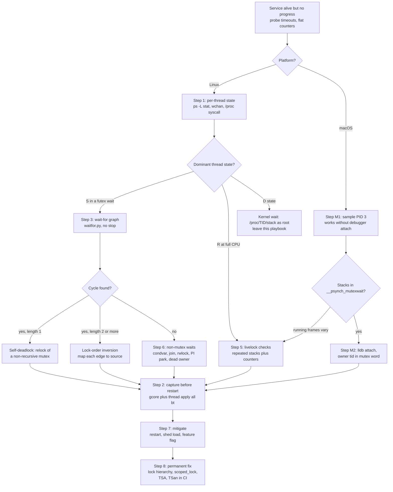
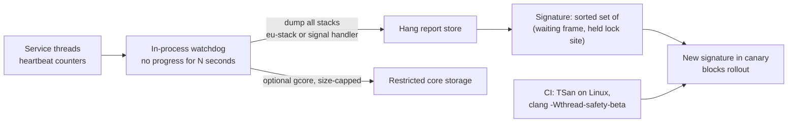

# C++ Playbook: Deadlocks and Livelocks

> [!summary] Claim:
> A hung multi-threaded C++ process is a graph problem before it is a code problem: every blocked thread waits for a resource, and every glibc mutex records which thread holds it.
> On Linux, `/proc/PID/task/TID/syscall` names the futex address each thread sleeps on and `pthread_mutex_t.__data.__owner` names the holder, so the wait-for graph and its cycle can be read without stopping the process.
> A deadlock is a cycle of sleeping threads; a livelock is a set of runnable threads whose stacks change while a progress counter does not.
> Capture the evidence first, restart second, and fix the lock order third, because the restart destroys the only proof of which acquisitions formed the cycle.

How ThreadSanitizer builds its lock graph is owned by [[Cpp-ThreadSanitizer-and-MemorySanitizer-Internals]].
Helgrind and DRD lock-order checking are owned by [[Cpp-Valgrind-Memcheck-Helgrind-and-DRD]].
Debugger command syntax is owned by [[Cpp-GDB-and-LLDB-Expert-Guide]], and the general theory of concurrency bugs without a debugger by [[Debugging-Without-a-Debugger-and-Concurrency-Bugs]].
Async runtime deadlocks are drilled in [[Drill-Debugging-Asyncio-and-Tokio-Deadlock]], and hung CPython processes in [[Python-Debugging-Hung-Processes-and-C-Extensions]].
This playbook owns the incident procedure for native C++ threads.

## Trigger and Symptoms

Activate this playbook when a C++ service stops making progress but has not crashed.

- Health checks time out, request latency goes to the client timeout, or a queue depth grows without bound while the process is still alive.
- A watchdog or orchestrator reports a liveness probe failure, and the process exits only when it is killed.
- `ps -L -o tid,stat,wchan:32,comm -p PID` shows the worker threads in state `S` (interruptible sleep; `ps` prints `Sl`, where `l` marks a multi-threaded process) with a `futex_*` symbol in `wchan`: a deadlock suspect.
  The symbol is a kernel function on the sleeping thread's stack, so it changes with the kernel version and build: `futex_wait` on the 7.2 test kernel, while the kernel source names the function that calls the scheduler `futex_wait_queue_me` in v5.10, `futex_wait_queue` in v6.6, and `futex_do_wait` on master.
- `top -H -p PID` shows two or more threads in state `R` at or near 100% CPU each while application progress counters are flat: a livelock suspect.
- Threads in state `D` (uninterruptible sleep) are waiting inside the kernel, usually for I/O, and belong to an I/O or storage playbook rather than this one.
- On macOS, the same symptoms with `sample` (Step M1) showing worker threads parked in `__psynch_mutexwait` or spinning in the same few frames.

The three states mean different things, and the decision tree branches on them first:

| Observation | Classification | Typical cause |
| :--- | :--- | :--- |
| Threads asleep in a lock wait, a cycle in the wait-for graph | Deadlock | Lock-order inversion (ABBA), self-relock of a non-recursive mutex, lock held across a callback |
| Threads asleep, no cycle, nobody will ever wake them | Hang without a cycle (lost wakeup) | Condition variable notified before the wait and waited without a predicate, owner thread exited holding a lock, join on a blocked thread |
| Threads runnable, stacks change, progress counter flat | Livelock | Symmetric try-lock and back-off, retry loops on a shared CAS, "after you" protocols |
| Some threads progress, one never does | Starvation | Unfair lock handoff, priority inversion under `SCHED_FIFO` without priority inheritance |

## Decision Tree



## Prerequisites

Run the read-only steps on the affected host and the analysis on a triage host, and decide up front who may pause the process: a debugger attach stops every thread.

### Linux

```bash
command -v gdb gcore eu-stack python3 ps top
cat /proc/sys/kernel/yama/ptrace_scope
```

On Ubuntu 24.04 these come from `gdb` (which ships `gcore`), `elfutils` (`eu-stack`), `python3`, and `procps` (as of 2026-11, Linux).
`gstack` was not present in the Ubuntu 24.04 `gdb` package used for this playbook; `gdb -batch -ex 'thread apply all bt'` does the same job.

Permissions:
- `/proc/PID/task/TID/syscall` and `/proc/PID/mem` need a ptrace access mode `PTRACE_MODE_ATTACH_FSCREDS` check, per proc_pid_syscall(5); `wchan` needs only `PTRACE_MODE_READ_FSCREDS`, per proc_pid_wchan(5).
- `/proc/PID/task/TID/stack` is root only: proc_pid_stack(5) names the same ptrace check, but `proc_pid_stack` in the kernel's `fs/proc/base.c` returns `EACCES` unless the opener has `CAP_SYS_ADMIN` in the initial user namespace ("this interface is restricted to root").
- With Yama `ptrace_scope` 1 an unprivileged user can attach only to descendants, so run as the service user with `CAP_SYS_PTRACE` or as root; in a container add `--cap-add SYS_PTRACE` or use `nsenter` from the host.
  In the lab container (`ptrace_scope` 0, no added capabilities) the unprivileged `lab` user could read `syscall` and `mem` of, and attach `gdb` to, its own processes.
- `/proc/PID/task/TID/syscall` exists only when the kernel has `CONFIG_HAVE_ARCH_TRACEHOOK`, and `/proc/PID/task/TID/stack` only with `CONFIG_STACKTRACE`.

**Verification:**

```bash
PID="$(pidof order_router)"
head -c 80 "/proc/${PID}/task/${PID}/syscall"; echo
```

A number or `running` is printed; `Permission denied` means the access check failed and the Step 3 live method will not work.

### macOS

```bash
command -v sample lldb spindump
```

`sample`, `spindump`, and `lldb` ship with macOS and the Command Line Tools (as of 2026-11, macOS 27.2).
On the macOS 27.2 test host, `lldb -p` attached to an ad-hoc signed test binary, but refused a copy signed with `codesign -s - -o runtime` (hardened runtime) with `error: attach failed: ... Not allowed to attach to process.`; `sample` captured the stacks of that same hardened process.
A third copy signed with the hardened runtime plus the `com.apple.security.get-task-allow` entitlement attached again.
Distribution builds are commonly signed with the hardened runtime and without that entitlement, so plan on `sample` first and on lldb only for debuggable builds.
`spindump` refuses to run unprivileged: it printed `spindump must be run as root when sampling the live system`.

**Verification:** `sample PID 1` prints `Analysis of sampling` followed by a `Call graph:` with one `Thread_NNN` entry per thread.

## Commands and Numbers to Know

| Item | Platform | Value (as of 2026-11) | Why it matters |
| :--- | :--- | :--- | :--- |
| `futex` syscall number | Linux | 202 on x86-64 (`syscall_64.tbl`), 98 on arm64 (`asm-generic/unistd.h`) | First field of `/proc/TID/syscall` for a thread sleeping in a lock. |
| `FUTEX_WAIT`, `FUTEX_LOCK_PI`, `FUTEX_WAIT_BITSET` | Linux | 0, 6, 9 (`linux/futex.h`) | Low 7 bits of the op argument after masking. |
| `FUTEX_PRIVATE_FLAG`, `FUTEX_CLOCK_REALTIME` | Linux | 128 (0x80), 256 (0x100) | An op of `0x80` is a private `FUTEX_WAIT` and `0x86` a private `FUTEX_LOCK_PI`; `0x109` is `FUTEX_WAIT_BITSET` with `FUTEX_CLOCK_REALTIME` and no private flag (what `pthread_join` used, since glibc passes `LLL_SHARED` there); `0x189` is the private form, seen for a condition-variable wait (`val` 0), a `std::shared_mutex` writer blocked behind a reader (`val` 2), and glibc's PI park (`val` 0). |
| glibc contended-lock futex value | Linux | `__lock` is 0 unlocked, 1 locked, 2 locked with waiters | `__lll_lock_wait` sleeps with `val` 2, the signature of a mutex wait. |
| `pthread_mutex_t` size | Linux | 40 bytes on x86-64, 48 on arm64 | Bounds what to dump with `x/12wx`. |
| `__data.__owner` offset | Linux | Byte offset 8 of the mutex (`int __lock; unsigned int __count; int __owner`), on x86-64 and arm64 | Owner TID of a locked normal, recursive, errorcheck, or adaptive mutex. |
| `__data.__kind` | Linux | 0 timed (default), 1 recursive, 2 errorcheck, 3 adaptive; 32 is `PTHREAD_MUTEX_PRIO_INHERIT_NP` (`sysdeps/nptl/pthreadP.h`), observed for a priority-inheritance mutex | Decides whether relock blocks, counts, or returns `EDEADLK`. |
| PI futex word | Linux | Owner TID in bits 0-29 (`FUTEX_TID_MASK` 0x3fffffff), `FUTEX_WAITERS` 0x80000000, `FUTEX_OWNER_DIED` 0x40000000 | For PI mutexes the owner is in `__lock` itself. |
| Thread states in `ps` and `/proc/PID/stat` | Linux | `R` running, `S` interruptible sleep, `D` uninterruptible, `T` stopped, `t` tracing stop | `S` with a `futex_*` `wchan` is some futex wait (mutex, condition variable, rwlock, or join), and the op and `val` in `syscall` tell them apart; `t` after triage means a debugger left the thread stopped. |
| TSan `detect_deadlocks` | Both | Upstream default true (`sanitizer_flags.inc`); Homebrew LLVM 23.1.5 reported `true` and the Apple clang 21 runtime `false` | Lock-order reports need it; see the macOS pitfall. |
| TSan `ignore_noninstrumented_modules`, `ignore_interceptors_accesses` | Both | false on Linux, true on Apple platforms (`SANITIZER_APPLE ? true : false` in `tsan_flags.inc`) | While both are true every interceptor runs with reports suppressed, which hides lock-order reports on macOS. |
| TSan `exitcode`, `abort_on_error` | Both | `exitcode` 66 on both; `abort_on_error` reported `true` on macOS, so a report there ended the process with `SIGABRT` (shell status 134) until `abort_on_error=0` was set | A CI job fails on a lock-order report without parsing stderr. |
| Helgrind `--track-lockorders` | Linux | `yes` | Lock-order checking is on by default under Helgrind. |
| macOS mutex owner | macOS | 64-bit thread ID at byte offset 24 of `pthread_mutex_t` on the macOS 27.2 arm64 test host | Internal libpthread layout (`m_tid`), not an API; it can move between releases. |
| `sample` defaults | macOS | 10 second duration, 1 ms interval | Pass a short duration such as `3` during an incident. |

## Step-by-Step Execution (Linux)

Each step ends with a check.
Do not continue past a failed check; go to Failure Modes of the Procedure.
Shell variables set in one step are reused in later ones.

### Step 1: Classify the hang without stopping the process

```bash
PID="$(pidof order_router)"
ps -L -o tid,stat,pcpu,wchan:32,comm -p "$PID"
for t in /proc/"$PID"/task/*; do
  printf '%s %s %s\n' "${t##*/}" "$(awk '/^State:/{print $2}' "$t/status")" "$(cut -d' ' -f1-4 "$t/syscall")"
done
```

Everything here reads `/proc`; no thread is stopped.
Read each line of the loop as `TID STATE SYSCALL_NR ARG0 ARG1 ARG2`, which on a futex wait is `uaddr op val`.
The state comes from the `State:` line of `status`, not from field 3 of `stat`: a thread named `io worker` made `cut -d' ' -f3 stat` print `worker)`, because the name sits unescaped in field 2.

**Verification:** you can sort every thread into one of four buckets: futex lock wait (`S`, syscall `202` or `98`, masked op 0 with `val` 2, or op 6), other sleep (`S` in another syscall or futex form), runnable (`R`, `running`), or kernel wait (`D`).
In the ABBA reproduction from the Worked Example, run in an Ubuntu 24.04 arm64 container on 2026-11-11, these commands printed:

```text
    TID STAT %CPU WCHAN                            COMMAND
     20 Sl    0.0 futex_wait                       abba
     22 Sl    0.0 futex_wait                       abba
     23 Sl    0.0 futex_wait                       abba
20 S 98 0xffffbccdf230 0x109 0x16
22 S 98 0xaaaad02b0048 0x80 0x2
23 S 98 0xaaaad02b0078 0x80 0x2
```

Threads 22 and 23 are in private `FUTEX_WAIT` with `val` 2, and their first arguments are the addresses of the two mutexes (the program printed `accounts_mu 0xaaaad02b0078 audit_mu 0xaaaad02b0048`).
Thread 20 is in a non-private `FUTEX_WAIT_BITSET` with `val` `0x16`, which is `pthread_join` waiting for TID 22 to exit.
That reading of a join holds for glibc 2.39, which waits on the target's `tid` field (`__pthread_clockjoin_ex`; the same code is in the glibc-2.40 to glibc-2.42 tags); glibc master waits on a separate `joinstate` word, so on a newer glibc take the join target from the thread's stack instead.
Two "other sleep" forms from the same container, for comparison: three idle workers in `std::condition_variable::wait` each printed `S 98 0x... 0x189 0x0`, and a `std::shared_mutex` writer blocked behind a reader printed `S 98 0x... 0x189 0x2`.
Both are `FUTEX_WAIT_BITSET`, not `FUTEX_WAIT`, so neither is a mutex lock wait, and `waitfor.py` in Step 3 printed `blocked on a mutex: 0 threads` for both programs.

### Step 2: Capture the evidence before anyone restarts it

Take the cheap capture first, then the complete one.

```bash
eu-stack -p "$PID" > "/var/tmp/hang.${PID}.eu-stack.txt"
gdb -q -nx -batch -p "$PID" \
    -ex 'info threads' \
    -ex 'thread apply all bt' > "/var/tmp/hang.${PID}.bt.txt" 2>&1
gcore -o "/var/tmp/hang" "$PID"
chmod 600 /var/tmp/hang.*
```

`eu-stack` and `gdb -p` both use ptrace and pause the threads while they unwind (`eu-stack` made one `PTRACE_ATTACH` and one `PTRACE_DETACH` call per thread of the reproduction); `gcore` pauses the whole process for as long as it takes to write its memory, which grows with the resident set.
`gcore -o PREFIX` writes `PREFIX.PID` and detaches, so the process keeps running in its hung state; the reproduction printed `Saved corefile /tmp/hang.20`.
For a process you are about to kill anyway, `kill -ABRT` produces a kernel core through `core_pattern` instead; [[Debug-a-Production-Crash-From-a-Core-Dump]] owns that capture chain.

**Verification:** the backtrace file has one `Thread N (Thread 0x... (LWP TID) ...)` header per TID from Step 1, `ls -l /var/tmp/hang.$PID` shows a non-empty core, and `awk '/^State:/{print $2}' /proc/$PID/status` is not `t` or `T` (a debugger that died mid-attach can leave threads stopped; `kill -CONT "$PID"` resumes them).

The first eight frames of one blocked thread in the reproduction's gdb output, with libc frames resolved because the container had `libc6-dbg` installed:

```text
Thread 3 (Thread 0xffffbccdf160 (LWP 22) "abba"):
#0  futex_wait (private=0, expected=2, futex_word=0xaaaad02b0048 <audit_mu>) at ../sysdeps/nptl/futex-internal.h:146
#1  __GI___lll_lock_wait (futex=futex@entry=0xaaaad02b0048 <audit_mu>, private=private@entry=0) at ./nptl/lowlevellock.c:49
#2  0x0000ffffbce18b44 in lll_mutex_lock_optimized (mutex=0xaaaad02b0048 <audit_mu>) at ./nptl/pthread_mutex_lock.c:48
#3  ___pthread_mutex_lock (mutex=0xaaaad02b0048 <audit_mu>) at ./nptl/pthread_mutex_lock.c:93
#4  0x0000aaaad0291494 in __gthread_mutex_lock (__mutex=0xaaaad02b0048 <audit_mu>) at /usr/include/aarch64-linux-gnu/c++/13/bits/gthr-default.h:749
#5  std::mutex::lock (this=0xaaaad02b0048 <audit_mu>) at /usr/include/c++/13/bits/std_mutex.h:113
#6  std::lock_guard<std::mutex>::lock_guard (__m=..., this=<synthetic pointer>) at /usr/include/c++/13/bits/std_mutex.h:249
#7  transfer () at /w/abba.cpp:16
```

Without libc debug info (`-iex 'set debug-file-directory /nonexistent' -iex 'set debuginfod enabled off'`) frames 0 and 1 became `?? () from /lib/aarch64-linux-gnu/libc.so.6` and `pthread_mutex_lock ()`, but the inlined `__gthread_mutex_lock (__mutex=0x... <accounts_mu>)` frame from the application's own DWARF still named the mutex.

### Step 3: Build the wait-for graph

On a live process, read the graph from `/proc` without a debugger:

```python
#!/usr/bin/env python3
"""Build a mutex wait-for graph of a live Linux process without stopping it.

For every thread blocked in a futex lock wait, read the futex address from
/proc/PID/task/TID/syscall and find the owner TID:
- futex(FUTEX_WAIT, val=2) is glibc __lll_lock_wait on a contended normal
  mutex; the owner is pthread_mutex_t.__data.__owner, 8 bytes after the word.
- futex(FUTEX_LOCK_PI) is a priority-inheritance mutex; the futex word itself
  holds the owner TID in its low 30 bits.
Glibc-internal locks (malloc arenas, stdio) also wait with val=2 but are not
pthread_mutex_t, so confirm each edge against the thread's stack.
Needs ptrace access to the target (same uid and Yama scope, or CAP_SYS_PTRACE).
"""
import os
import struct
import sys

FUTEX_NR = {"x86_64": 202, "aarch64": 98}[os.uname().machine]
FUTEX_CMD_MASK = 0x7F  # strips FUTEX_PRIVATE_FLAG and FUTEX_CLOCK_REALTIME
FUTEX_WAIT = 0
FUTEX_LOCK_PI = 6
FUTEX_TID_MASK = 0x3FFFFFFF
OWNER_OFFSET = 8  # int __lock; unsigned __count; int __owner


def blocked_on_mutex(pid):
    """Yield (tid, futex_address, owner_offset) for threads in a lock wait."""
    for tid in sorted(os.listdir(f"/proc/{pid}/task"), key=int):
        with open(f"/proc/{pid}/task/{tid}/syscall") as f:
            fields = f.read().split()
        if not fields or fields[0] in ("running", "-1"):
            continue
        nr, args = int(fields[0]), [int(x, 16) for x in fields[1:7]]
        if nr != FUTEX_NR:
            continue
        cmd = args[1] & FUTEX_CMD_MASK
        if cmd == FUTEX_WAIT and args[2] == 2:
            yield int(tid), args[0], OWNER_OFFSET
        elif cmd == FUTEX_LOCK_PI:
            yield int(tid), args[0], 0


def main(pid):
    edges = {}
    with open(f"/proc/{pid}/mem", "rb", buffering=0) as mem:
        for tid, addr, offset in blocked_on_mutex(pid):
            mem.seek(addr + offset)
            (word,) = struct.unpack("<I", mem.read(4))
            owner = word & FUTEX_TID_MASK
            edges[tid] = (owner, addr)
            print(f"thread {tid} waits for mutex {addr:#x} held by thread {owner}")
    print(f"blocked on a mutex: {len(edges)} threads")
    seen = set()
    for start in edges:
        path, node = [], start
        while node in edges and node not in path:
            path.append(node)
            node = edges[node][0]
        if node in path:
            cycle = path[path.index(node):]
            key = frozenset(cycle)
            if key not in seen:
                seen.add(key)
                print("cycle: " + " -> ".join(map(str, cycle + [node])))
    if not seen:
        print("cycle: none")


if __name__ == "__main__":
    main(int(sys.argv[1]))
```

```bash
sudo python3 waitfor.py "$PID"
```

The mechanism, from glibc's `nptl/pthread_mutex_lock.c` and `nptl/lowlevellock.c`: a normal mutex takes its fast path with an atomic compare-and-exchange of `__lock` from 0 to 1 (`__lll_lock` in `sysdeps/nptl/lowlevellock.h`); on contention `__lll_lock_wait` exchanges in 2 and calls `futex_wait(futex, 2, private)`, so the kernel holds the thread with `uaddr` equal to `&mutex->__data.__lock`, which is the address of the mutex.
After acquiring, `___pthread_mutex_lock` executes `mutex->__data.__owner = id;` for the timed, recursive, adaptive, and errorcheck kinds, so a locked mutex names its holder by kernel TID.
Reading `/proc/PID/mem` does not stop the target, unlike a ptrace attach.

For a core file, or when you want symbol names, run the same algorithm inside GDB by reading the mutex argument from the lock frames:

```python
# GDB script: wait-for graph from a live process or a core file.
# Usage: gdb -q -batch -p PID -x waitfor_gdb.py   (or: gdb -batch PROG CORE -x waitfor_gdb.py)
# For each thread, find the innermost frame that names the mutex being
# acquired, read pthread_mutex_t.__data.__owner, and print cycles.
import gdb

LOCK_FRAMES = {
    "___pthread_mutex_lock": "mutex",
    "__pthread_mutex_lock": "mutex",
    "pthread_mutex_lock": "mutex",
    "__gthread_mutex_lock": "__mutex",
    "std::mutex::lock": "this",
}


def mutex_address(thread):
    thread.switch()
    frame = gdb.newest_frame()
    while frame is not None:
        name = frame.name() or ""
        arg = LOCK_FRAMES.get(name)
        if arg is not None:
            try:
                return int(frame.read_var(arg))
            except (gdb.error, ValueError):
                pass
        frame = frame.older()
    return None


edges = {}
for thread in gdb.selected_inferior().threads():
    lwp = thread.ptid[1]
    addr = mutex_address(thread)
    if addr is None:
        continue
    owner = int(gdb.parse_and_eval(f"((pthread_mutex_t *) {addr})->__data.__owner"))
    edges[lwp] = owner
    sym = gdb.execute(f"info symbol {addr}", to_string=True).split(" in section")[0]
    print(f"LWP {lwp} waits for {sym} held by LWP {owner}")

seen = set()
for start in sorted(edges):
    path, node = [], start
    while node in edges and node not in path:
        path.append(node)
        node = edges[node]
    if node in path:
        cycle = path[path.index(node):]
        if frozenset(cycle) not in seen:
            seen.add(frozenset(cycle))
            print("cycle: " + " -> ".join(f"LWP {n}" for n in cycle + [node]))
if not seen:
    print("cycle: none")
```

```bash
gdb -q -nx -batch /usr/local/bin/order_router "/var/tmp/hang.${PID}" -x waitfor_gdb.py
```

`thread.ptid[1]` is the LWP, which is the kernel TID that `__owner` stores, so no mapping table is needed; `thread find (LWP TID)` maps a TID to GDB's thread number by hand when you want to `thread N` into it.
The cast to `pthread_mutex_t` needs that type in some loaded debug info; the reproduction's own DWARF supplied it through its `std::mutex` objects, so the script still worked with libc debug info removed.

**Verification:** the graph has one edge per thread in the "futex lock wait" bucket from Step 1, and every owner TID in an edge appears in `ls /proc/$PID/task`.
On the ABBA reproduction the live script, the GDB script on the live process, and the GDB script on the `gcore` file all printed the same graph:

```text
thread 22 waits for mutex 0xaaaad02b0048 held by thread 23
thread 23 waits for mutex 0xaaaad02b0078 held by thread 22
blocked on a mutex: 2 threads
cycle: 22 -> 23 -> 22
```

```text
LWP 22 waits for audit_mu held by LWP 23
LWP 23 waits for accounts_mu held by LWP 22
cycle: LWP 22 -> LWP 23 -> LWP 22
```

An owner TID that is not in the task list means either that the holder exited while holding the lock or that the futex word is not inside a `pthread_mutex_t`; go to Step 6.

### Step 4: Map each edge to the acquisition sites

The graph says which threads and mutexes; the fix needs the two source lines per edge: where the waiter took the lock it holds, and where it is trying to take the next one.

```gdb
(gdb) thread find (LWP 22)
(gdb) thread 3
(gdb) bt
(gdb) frame 7
(gdb) info locals
(gdb) print accounts_mu._M_mutex.__data
(gdb) print audit_mu._M_mutex.__data
```

`thread find (LWP 22)` printed `Thread 3 has target id 'Thread 0xffffbccdf160 (LWP 22)'`, which gives the GDB thread number for `thread 3`.
Keep the `(LWP ...)` wrapper: `thread find` matches a regular expression against the whole target id, so a bare number can also match the hexadecimal pthread address (`thread find f1` matched both worker threads here).
The parentheses are literal characters in that expression, which makes the match exact: in a process with LWPs 64 to 76, `thread find (LWP 6)` printed `No threads match '(LWP 6)'`, while `thread find LWP 6` matched the six threads with LWPs 64 to 69.
The blocked frame gives the second acquisition directly (`transfer () at /w/abba.cpp:16` in the reproduction).
The first acquisition is not on the stack, because a `lock_guard` constructor has returned; find it from the RAII objects in the frame's locals, or by reading the function source upward from the blocked line.
For `std::mutex` on libstdc++ the pthread object is `_M_mutex`; the reproduction printed, for `info locals` and the two `print` commands (value-history prefixes removed):

```text
a = {_M_device = @0xaaaad02b0078}
b = {_M_device = @0xaaaad02b0048}
{__lock = 2, __count = 0, __owner = 22, __nusers = 1, __kind = 0, __spins = 0, __list = {__prev = 0x0, __next = 0x0}}
{__lock = 2, __count = 0, __owner = 23, __nusers = 1, __kind = 0, __spins = 0, __list = {__prev = 0x0, __next = 0x0}}
```

The guard `a` refers to `0xaaaad02b0078`, which is `accounts_mu`, the lock this thread already holds; `b` refers to `audit_mu`, the one it waits for.
`__lock = 2` is "locked with waiters", `__owner = 22` names thread 22 as the holder of `accounts_mu`, and `__kind = 0` is the default timed mutex, which never checks for relock.

**Verification:** you can write one sentence per edge of the form "thread T holds M1 since `file:line` and waits for M2 at `file:line`", and the set of sentences closes into the cycle from Step 3.

### Step 5: Confirm or rule out a livelock

A livelock has no blocked threads, so Step 3 prints `blocked on a mutex: 0 threads` and `cycle: none`.
Prove it from three observations taken a few seconds apart:

```bash
top -H -b -n 1 -p "$PID" | head -n 20
for i in 1 2 3; do
  gdb -q -nx -batch -p "$PID" -ex 'thread apply all bt 3' 2>/dev/null | grep '^#0'
  sleep 2
done
```

Then read the application's own progress metric (completed requests, sequence numbers, committed transactions); "no metric exists" is itself a finding for Step 8.

**Verification:** the threads are `R` with high CPU, their frame 0 varies between snapshots inside a bounded set of functions, and the progress metric did not advance.
The lockstep livelock reproduction showed both workers in `top -H` as `R` at 99.9% CPU, the Step 1 loop printed `R running` for both, Step 3 printed `blocked on a mutex: 0 threads`, frame 0 moved between `rendezvous`, `std::__atomic_base<int>::load`, and `__aarch64_swp4_rel` in `libc.so.6` (the release exchange in glibc's unlock path; its caller was `lll_mutex_unlock_optimized`), and its own counters printed `attempts>0: yes completed: 0` at each of three one-second checks.
`perf top -t TID` on Linux or `sample` on macOS shows where the CPU goes; the cure is breaking the symmetry, not adding threads.
Each `gdb -p` snapshot stops every thread for a moment, which changes the timing; a livelock that depends on precise timing can resolve itself while you watch, so record the counters before the first attach.

### Step 6: Hangs with no cycle

When threads sleep but Step 3 finds no cycle, classify each sleeping thread from its stack:

1. **Condition variable lost wakeup:** frames in `pthread_cond_wait` or `std::condition_variable::wait` with no lock edge.
   Look for a `wait(lock)` without a predicate, or a predicate variable written without holding the mutex; `notify_one` before the wait starts is lost forever.
2. **Join or future on a blocked thread:** `pthread_join` or `std::future::get`; on glibc 2.39 the futex `val` of a join is the TID it waits for (`0x16` in Step 1), so follow that edge to the real culprit.
3. **Owner exited holding the lock:** the owner TID is not in `/proc/PID/task`.
   For the default `PTHREAD_MUTEX_STALLED` robustness every later lock blocks indefinitely, per pthread_mutexattr_setrobust(3); a robust mutex instead returns `EOWNERDEAD` to the next locker, which must call `pthread_mutex_consistent` or the mutex becomes `ENOTRECOVERABLE`.
   In a reproduction where a thread returned from its start function while holding a default mutex, the task list was `135 137 138`, `waitfor.py` printed `thread 137 waits for mutex 0x... held by thread 136` and the same for thread 138 with `cycle: none`, and the mutex still read `__lock = 2, __owner = 136`.
4. **Priority-inheritance mutex cycle:** the kernel detects PI chain deadlocks and `FUTEX_LOCK_PI` returns `EDEADLK`.
   The check is in `rt_mutex_adjust_prio_chain` in `kernel/locking/rtmutex.c` ("If the lock is the same as the original lock which caused us to walk the lock chain or if the current lock is owned by the task which initiated the chain walk, we detected a deadlock."); FUTEX_LOCK_PI(2const) documents `EDEADLK` only for a futex "already locked by the caller".
   For a non-errorcheck PI mutex, glibc's `__pthread_mutex_lock_full` then executes its "Delay the thread indefinitely." loop, a `__futex_abstimed_wait64` on a stack temporary with value 0.
   In the PI reproduction one thread sat in `__futex_lock_pi64 (futex_word=... <a>)` and the other in `__futex_abstimed_wait_common64 (... expected=0, futex_word=0xffff93a7e864)` called from `__pthread_mutex_lock_full (mutex=... <b>)`, so `waitfor.py` found only one edge while `waitfor_gdb.py`, reading the `mutex` argument from the stack, printed the full cycle.
   Mutex `a` showed `__kind = 32` and `__lock = -2147483634`, which is `FUTEX_WAITERS | 14`, the owner TID in the word itself; `b` showed `-2147483633`, `FUTEX_WAITERS | 15`.
5. **Reader-writer locks:** `pthread_rwlock_*` and `std::shared_mutex` frames; neither script models them, and re-acquiring a `std::shared_mutex` in shared mode on the same thread violates the `lock_shared` precondition "The calling thread has no ownership of the mutex." ([thread.sharedmutex.requirements.general] paragraph 4), so treat any recursive shared acquisition as a bug.
   A `std::shared_mutex` writer blocked behind a reader slept in `__pthread_rwlock_wrlock_full64` with op `0x189` and `val` 2 on a word inside the rwlock, and both scripts printed `cycle: none`.
6. **Glibc-internal or custom locks:** malloc arena and stdio locks also sleep with `FUTEX_WAIT` and `val` 2 (in `__lll_lock_wait_private`), but they are not `pthread_mutex_t`.
   In glibc 2.39 the arena lock is a bare `int` (`__libc_lock_define (, mutex);` in `struct malloc_state`), and stdio's `_IO_lock_t` is `{ int lock; int cnt; void *owner; }`, whose `owner` at offset 8 is a pointer to the holder's thread descriptor, not a TID.
   With one thread holding a `FILE` lock through `flockfile` and another blocked in `fputs`, `waitfor.py` printed `held by thread 120844704`: the low 30 bits of the holder's `pthread_t`, `0xffff8733f1a0`, which GDB listed as `Thread 0xffff8733f1a0 (LWP 169)`.
   An "owner" larger than `/proc/sys/kernel/pid_max` (4194304 in the test container) is therefore part of a pointer, not a thread.
   Spin locks and custom futex locks have their own layouts; confirm every edge from `waitfor.py` against the stack before trusting it.

**Verification:** every sleeping thread has a named reason, and the reason's wake-up source (a notifier, an exiting thread, an unlocker) is identified as absent or itself blocked.

### Step 7: Mitigate

Mitigation restores service; it does not fix the bug, and it must come after Step 2.

1. Restart the process, or fail it out of the load balancer first if a restart drops in-flight work.
2. Reduce the trigger rate when the cycle needs concurrency to form: lower the worker count, disable the feature flag behind the second acquisition, or route the triggering request type elsewhere.
3. Do not "fix" the hang in production by changing a mutex to recursive or by adding a timed lock that silently proceeds; both convert a visible hang into silent data corruption.
   A `std::timed_mutex::try_lock_for` that logs the stack and aborts on timeout is acceptable as a temporary detector, because it fails loudly.

**Verification:** health checks pass, the progress metric advances, and the captured artifacts from Step 2 are listed in the incident ticket.

### Step 8: Fix the order permanently

1. **Define a lock hierarchy.** Give each mutex a level and acquire only in increasing level; document it next to the mutex declarations.
2. **Acquire peers together.** Use `std::scoped_lock lk(a, b);` (C++17) or `std::lock(a, b)` when two locks of the same level are needed; per [thread.lock.algorithm] the sequence of calls "does not result in deadlock, but is otherwise unspecified".
   libstdc++ 13.3 implements it by locking one mutex, `try_lock`ing the rest, and on failure unlocking what it holds and starting again with a blocking `lock` on the mutex that failed.
   When every argument has the same type, as with two `std::mutex` objects in C++17 or later, that loop does not yield; the `__gthread_yield()` call is only in `__detail::__lock_impl`, the path for mixed mutex types and for builds before C++17.
   Argument order then does not matter: two threads calling `std::scoped_lock` on the same pair in opposite orders completed 200000 critical sections under GCC 13 TSan with no report.
3. **Make the order checkable at compile time.** Clang Thread Safety Analysis checks `acquired_after` and `acquired_before`, but which flag enables the check depends on the compiler (as of 2026-11, macOS).
   With Apple clang 21 the order warning `mutex 'accounts_mu' must be acquired before 'audit_mu'` appeared only with `-Wthread-safety -Wthread-safety-beta`, while `-Wthread-safety` alone reported only the `guarded_by` violation.
   With Homebrew LLVM 23.1.5 `-Wthread-safety` alone printed both warnings, and `ThreadSafety.cpp` on llvm-project main calls `checkBeforeAfter` without testing the beta flag.
   Pass both flags so the check is on with either compiler.
4. **Make the order checkable at test time.** Run concurrency tests under TSan, where a lock-order inversion is reported even when the test never hangs; add Helgrind for code TSan cannot instrument.
   On Linux the report is on by default; on macOS it needs `TSAN_OPTIONS=detect_deadlocks=1:ignore_noninstrumented_modules=0` (see the macOS pitfall).
5. **Remove the structural causes.** Never call user callbacks, virtual hooks, logging sinks, or RPCs while holding a lock; copy the data, release, then call.
   Prefer one owner thread plus a queue over two locks when an object pair is always touched together.
6. **Add a progress signal.** A per-worker heartbeat or "last completed sequence" counter turns the next livelock from a guess into a metric.

**Verification:** the reproduction or the regression test from the incident passes under TSan with no `lock-order-inversion` report, and the lock-order rule is enforced by a compiler flag or a test, not only by a comment.

## Step-by-Step Execution (macOS)

### Step M1: Sample all threads

```bash
sample "$PID" 3 -mayDie -file "/tmp/hang.${PID}.sample.txt"
grep -nE 'Thread_|psynch_mutexwait|ulock_wait' "/tmp/hang.${PID}.sample.txt" | head -n 40
```

`sample` suspends the process at each sampling interval, records every thread's stack, and resumes it, per sample(1).
Thread names are `Thread_<decimal thread ID>`; the ABBA reproduction on the macOS 27.2 test host showed `Thread_40002010` with `transfer()  (in abba) + 48 ... abba.cpp:16` above `__psynch_mutexwait`.

**Verification:** each worker thread's leaf frame is one of `__psynch_mutexwait` (blocked on a pthread mutex, including `std::mutex` from libc++), `__psynch_cvwait` (condition variable), `__ulock_wait` (join and other ulock waits; the main thread's `_pthread_join` was here), or varying frames with high sample counts (running).

### Step M2: Read the owner from the mutex

On a debuggable build:

```bash
lldb --batch -p "$PID" \
  -o 'thread list' \
  -o 'thread backtrace all' \
  -o 'memory read -s8 -fx -c8 &accounts_mu' \
  -o 'memory read -s8 -fx -c8 &audit_mu' \
  -o 'detach'
```

The test host printed the waiters as `tid = 0x26261da` and `tid = 0x26261db`, with frames `__psynch_mutexwait`, `_pthread_mutex_firstfit_lock_wait`, `_pthread_mutex_firstfit_lock_slow`, then `std::__1::mutex::lock()`.
At byte offset 24 of each mutex (the fourth 8-byte word of the dump) was the thread ID of its holder: `accounts_mu` held `0x26261da` (the thread blocked in `transfer`) and `audit_mu` held `0x26261db`, which closes the cycle.
`0x26261da` is 40002010 in decimal, the same number `sample` prints as `Thread_40002010`.
The offset follows `struct pthread_mutex_s` in Apple's `libpthread/src/types_internal.h` (`long sig; _pthread_lock lock; ... uint32_t m_tid[2]; // thread id of thread that has mutex locked`), and the same header warns that a misaligned mutex shifts `m_tid` into the `m_mis` words; treat it as an internal layout to re-check on each macOS release.

**Verification:** every waiting thread ID appears as the owner value of exactly one other mutex in the cycle, and `detach` printed `Process PID detached`.

### Step M3: Capture for later

`sudo spindump PID 5 -o /tmp/hang.spindump.txt` records user and kernel stacks for every process with the target sorted first; the usage text on the test host gives the form `spindump [<pid/partial name> [duration [interval]]] <options>` with a default 10 second duration and 10 ms interval, and `-onlyBlocked` narrows the report to blocked threads.
It needs root on macOS 27.2: without `sudo` it printed `spindump must be run as root when sampling the live system` and wrote no file.
UNVERIFIED: what a `spindump` report shows for the reproduction; it was not run as root here, so the description rests on the usage text alone.
For a Mach-O core of a debuggable process use LLDB's `process save-core`, whose prerequisites [[Debug-a-Production-Crash-From-a-Core-Dump]] covers.

## Worked Example: ABBA, Self-Relock, and Lockstep Livelock

No lab backs this playbook, so `make verify` does not re-run these outputs.
They were observed on 2026-11-08 and re-run on 2026-11-11 in the `ubuntu:24.04` arm64 image from `code/_harness/linux-labs.Dockerfile` (GCC 13.3.0, glibc 2.39, GDB 15.1, kernel 7.2 under OrbStack, `ptrace_scope` 0) and on macOS 27.2 arm64 with Apple clang 21.0.0 and Homebrew LLVM 23.1.5.
Thread IDs and addresses differ between runs: Steps 1 to 4 quote one run (TIDs 20, 22, 23), and the other examples quote the runs they came from.

The ABBA program takes two locks in opposite orders, with a barrier that makes the deadlock certain instead of probable:

```cpp
#include <barrier>
#include <cstdio>
#include <mutex>
#include <thread>
#include <unistd.h>

std::mutex accounts_mu;
std::mutex audit_mu;
std::barrier sync_point(2);

void transfer() {
  std::lock_guard<std::mutex> a(accounts_mu);
  sync_point.arrive_and_wait();
  std::lock_guard<std::mutex> b(audit_mu);
}

void audit() {
  std::lock_guard<std::mutex> b(audit_mu);
  sync_point.arrive_and_wait();
  std::lock_guard<std::mutex> a(accounts_mu);
}

int main() {
  std::printf("pid %d accounts_mu %p audit_mu %p\n", getpid(),
              static_cast<void*>(&accounts_mu), static_cast<void*>(&audit_mu));
  std::fflush(stdout);
  std::thread t1(transfer);
  std::thread t2(audit);
  t1.join();
  t2.join();
}
```

Build with `g++ -std=c++20 -O2 -g -pthread abba.cpp -o abba` and run `./abba &`; Steps 1 to 4 then produce the outputs quoted in those steps.

The same two functions without the barrier, run one after the other with `std::thread(transfer).join(); std::thread(audit).join();`, never hang, yet `g++ -fsanitize=thread` on Linux reported the inversion and exited with status 66:

```text
WARNING: ThreadSanitizer: lock-order-inversion (potential deadlock) (pid=PID)
  Cycle in lock order graph: M0 (0xADDR) => M1 (0xADDR) => M0

  Mutex M1 acquired here while holding mutex M0 in thread T1:
    #0 pthread_mutex_lock ../../../../src/libsanitizer/tsan/tsan_interceptors_posix.cpp:1341 (libtsan.so.2+0xADDR)
    #1 __gthread_mutex_lock /usr/include/aarch64-linux-gnu/c++/13/bits/gthr-default.h:749 (abba_tsan+0xADDR)
    #2 std::mutex::lock() /usr/include/c++/13/bits/std_mutex.h:113 (abba_tsan+0xADDR)
    #3 std::lock_guard<std::mutex>::lock_guard(std::mutex&) /usr/include/c++/13/bits/std_mutex.h:249 (abba_tsan+0xADDR)
    #4 transfer() /w/abba_seq.cpp:11 (abba_tsan+0xADDR)
```

The addresses and PID were scrubbed and the `BuildId` suffixes and later frames removed; the report continued with the mirror-image stack for `audit()` and the hint `use TSAN_OPTIONS=second_deadlock_stack=1`.

A self-relock is a cycle of length one:

```cpp
#include <mutex>
std::mutex config_mu;
void reload() { std::lock_guard<std::mutex> g(config_mu); }
void apply() { std::lock_guard<std::mutex> g(config_mu); reload(); }  // relocks
int main() { apply(); }
```

`waitfor.py` printed `thread 13 waits for mutex 0xaaaadd920020 held by thread 13` and `cycle: 13 -> 13`.
For `std::mutex` this is a precondition violation ("the calling thread does not own the mutex", [thread.mutex.requirements.mutex.general] paragraph 6), and glibc's default mutex simply blocks; a `PTHREAD_MUTEX_ERRORCHECK` mutex instead returned `EDEADLK`, printed by `strerror` as `Resource deadlock avoided`.

The lockstep livelock has each thread lock its first mutex, `try_lock` the second, back off, and retry, with a spin rendezvous that keeps the two threads in step so that every `try_lock` fails; its outputs are quoted in Step 5.

What these runs prove and what they do not:
- They prove the glibc 2.39 mechanism on arm64: futex address equals mutex address, `__owner` at offset 8, and `val` 2 for contended waits.
- They do not prove the x86-64 numbers; those come from `syscall_64.tbl` and `sysdeps/x86/nptl/bits/struct_mutex.h`, where `__owner` is also the third 32-bit field.
- They cover reader-writer locks only through one blocked-writer run, and do not cover robust mutexes or custom spin locks; Step 6 handles those by reading stacks.

## Rollback Procedure

The procedure changes nothing in the application, but it creates sensitive artifacts and can leave a process stopped.

1. **Resume stopped threads.** If a debugger or `gcore` was interrupted, check the `State:` line of `/proc/$PID/status` and of every `/proc/$PID/task/*/status`; for `T` run `kill -CONT "$PID"`, and for `t` find and end the tracer named by `grep TracerPid /proc/$PID/status`.
   **Check:** no thread is in `t` or `T`, and `TracerPid` is 0.
2. **Revert temporary privileges.** Remove `--cap-add SYS_PTRACE`, a lowered `kernel.yama.ptrace_scope`, or a debug sidecar added for the incident; save the old value first with `sysctl -n kernel.yama.ptrace_scope > /var/tmp/ptrace_scope.saved` (`-n` prints the bare value, `0` in the lab container, where the plain form prints `kernel.yama.ptrace_scope = 0`).
   **Check:** `cat /proc/sys/kernel/yama/ptrace_scope` matches the saved value.
3. **Destroy or vault the core.** A `gcore` file holds the whole address space, including keys and customer data; keep one copy under incident access control with an expiry and delete the rest.
   **Check:** `ls /var/tmp/hang.*` shows only the files the ticket says are retained.
4. **Revert mitigations.** Restore worker counts and feature flags once the fix ships, and remove any temporary `try_lock_for` detector.
   **Check:** the configuration diff against the pre-incident baseline is empty except for the fix.

## Failure Modes of the Procedure

| Failure | How it shows up | Recovery |
| :--- | :--- | :--- |
| ptrace access denied | `Permission denied` on `/proc/TID/syscall` or `ptrace: Operation not permitted` from gdb | Run as the service user or root with `CAP_SYS_PTRACE`; check Yama `ptrace_scope`; in containers use the host namespace. |
| Debugger attach trips a watchdog | The service is killed during `gdb -p` or `gcore`, losing the hang | Use the `/proc` method and `eu-stack` first; extend the watchdog timeout before a full capture. |
| No libc debug info | Frames `?? () from libc.so.6`; `futex_word` not shown | Use `waitfor.py`, or read the mutex from the inlined `std::mutex::lock` or `__gthread_mutex_lock` frame in your own DWARF; install `libc6-dbg` or use debuginfod. |
| `this` optimized out in the lock frame | `waitfor_gdb.py` skips a thread | Read the futex address from `/proc/TID/syscall` on a live process, or the argument register at the `futex` call in frame 0 of a core. |
| False edge | `waitfor.py` names an owner TID that never touches that object, or a number that is no thread at all (`120844704` for a stdio lock) | The address is a glibc-internal lock (malloc, stdio) or a custom lock, so offset 8 is not `__owner`; `info symbol ADDR` and the stack settle it (Step 6, item 6). |
| Only one edge of a PI cycle | One thread parked on a stack temporary in `__pthread_mutex_lock_full` | That is glibc's response to `EDEADLK` from `FUTEX_LOCK_PI`; read the mutex from the stack (Step 6, item 4). |
| Owner TID missing | Owner not in `/proc/PID/task` | The holder exited or was cancelled while holding the lock; find why it exited, and consider robust mutexes for shared memory. |
| Snapshot looks like a deadlock but is slow progress | Threads in `futex_wait` on different mutexes each time | Take two graphs a few seconds apart; a real deadlock is identical in both. |
| macOS attach refused | `Not allowed to attach to process` | Use `sample`; lldb attached only to the copy without the hardened runtime and to the hardened copy that carried the `com.apple.security.get-task-allow` entitlement. |
| Thread state column is garbage | `cut -d' ' -f3 /proc/TID/stat` prints part of a thread name such as `worker)` | The name in field 2 contains a space; read `State:` from `/proc/TID/status` or use `ps -L -o tid,stat`. |
| `thread find` matches the wrong threads | Several `Thread N has target id` lines for one TID | The pattern matched the hexadecimal pthread address; search for `(LWP TID)` instead. |

## Pitfalls

> [!warning] Restarting first destroys the root cause
> A deadlock leaves the full proof in memory: who holds what and where each thread waits.
> A restart replaces that with a single "it hung" data point, and an ABBA cycle may need weeks to form again.
> Spend the minute on Step 2 before Step 7.

> [!warning] Assuming the hung thread is the culprit
> The thread on the request path is usually a victim waiting on a lock; the culprit is the owner, which may be a background flusher or a logging thread.
> Always follow the edge to the owner's stack.

> [!warning] Fixing a deadlock with a recursive mutex
> A recursive mutex removes a self-deadlock symptom but lets a function re-enter code whose invariants are half-updated by its own caller.
> Split the function into a locked public entry and an unlocked private helper that `REQUIRES` the lock instead.

> [!warning] Lock-order detection on macOS is off until you ask for it
> On the macOS 27.2 test host (as of 2026-11), neither Apple clang 21 nor Homebrew LLVM 23.1.5 printed a lock-order report by default for the sequential ABBA test, for a plain C `pthread_mutex_t` version, or for upstream's own regression test `compiler-rt/test/tsan/mutex_cycle2.c`; each run exited 0.
> The same C++ test under GCC 13 TSan on Linux reported it.
> Two things hide the report.
> First, `tsan_flags.inc` sets `ignore_interceptors_accesses` and `ignore_noninstrumented_modules` to true on Apple platforms, so `ScopedInterceptor` raises `thr->suppress_reports` around every intercepted call, and `ReportDeadlock`, which runs inside the `pthread_mutex_lock` interceptor, gives up when `ShouldReport` sees that counter.
> Second, the Apple clang 21 runtime reported `detect_deadlocks` as `Current Value: false` in `TSAN_OPTIONS=help=1`, where Homebrew LLVM reported `true`.
> `TSAN_OPTIONS=detect_deadlocks=1:ignore_noninstrumented_modules=0` produced the report with both toolchains and for both `std::mutex` and `pthread_mutex_t`; `detect_deadlocks=1` alone did not.
> With detection on, `ignore_interceptors_accesses=0` was enough only for the C version, because `std::mutex::lock` calls `pthread_mutex_lock` from the uninstrumented `libc++.1.dylib`.
> The process then died with `SIGABRT` (shell status 134), since `abort_on_error` is true on macOS; adding `abort_on_error=0` gave exit status 66.
> With `ignore_noninstrumented_modules=0` the interceptors also report when they are called from uninstrumented modules, which include the system libraries, so keep that setting to the lock-order job, or run the check in Linux CI where the defaults already work.

> [!warning] Callbacks and logging under a lock
> The most common real-world ABBA is not two named mutexes in one file but a lock held across a callback, observer notification, allocator hook, or logger that takes its own lock.
> Lock-order tools see it only if a test exercises both paths; code review should flag any call through an interface while a lock is held.

> [!warning] Livelock from polite back-off
> `try_lock`, release, and retry with an identical delay on every thread is a livelock generator.
> Prefer `std::scoped_lock`, or add randomized exponential back-off; glibc's adaptive mutex does exactly that in its spin loop (`exp_backoff + (jitter & (exp_backoff - 1))`) before falling back to the futex.

> [!warning] Reading a snapshot as a trend
> One stack dump of a busy process looks like a deadlock on a hot lock.
> Two identical wait-for graphs taken seconds apart are the minimum evidence for a deadlock, and two different frame-0 sets plus a flat progress counter are the minimum for a livelock.

## At Scale

At 1,000 to 50,000 services nobody attaches a debugger in time, so hangs need the same pipeline as crashes: detect, capture automatically, sign, and prevent.



### Detection

- Liveness probes detect "no response", not "deadlocked"; export per-worker progress counters and alert on "counter flat while queue non-empty", which separates deadlock and livelock from idle.
- An in-process watchdog thread that itself takes no application locks can dump stacks of all threads (or trigger an external collector) when progress stops, before the orchestrator kills the process.

### Capture

- Make the default capture `/proc`-based (thread states, futex addresses, owners) plus `eu-stack`, because it needs no symbols at capture time and stops the process only briefly.
- Reserve `gcore` for an opt-in tier: it pauses the process for the duration of the write and produces an artifact as sensitive as a crash core.

### Prevention

- The Linux kernel's lockdep validates ordering per lock class ("a group of locks that are logically the same with respect to locking rules"), so one observed ordering of each pair proves the rule for every instance; userspace tools that track individual mutex instances need tests that hit each pair.
- Abseil's `absl::Mutex` keeps an acquired-before graph in debug builds, with `SetMutexDeadlockDetectionMode(OnDeadlockCycle::kIgnore|kReport|kAbort)`; its guide warns that the detection "introduces significant overhead" and "should not be enabled in production binaries".
- Thread Safety Analysis is free at run time and catches order violations at compile time once annotated; it needs a capability-annotated mutex wrapper, and Apple clang 21 also needed `-Wthread-safety-beta` for the ordering check.

### Decision rules

- Every long-running service exports a progress counter per worker; a service without one cannot distinguish livelock from idle.
- Lock-order checking (TSan on Linux, TSan on macOS with the options from the macOS pitfall, or Abseil's detector in debug builds) is a required CI tier for any library with more than one mutex.
- Any new code that holds two locks at once must either use `std::scoped_lock` or declare its order with `acquired_after`.
- A production hang is closed only with a wait-for graph in the ticket; "restarted, recovered" is not a root cause.

## Practice Drill

> [!tip] Practice Drill: Build the graph three ways
> In a Linux container with `gdb`, `elfutils`, and `g++` (the lab image from `code/_harness/linux-labs.Dockerfile` works), compile the ABBA program from the Worked Example and start it in the background.
> 1. Run Step 1 and predict, before looking, which two threads show `val` 2 and which shows the TID of another thread.
> 2. Run `waitfor.py`, then `waitfor_gdb.py` on the live process, then `gcore` it and run `waitfor_gdb.py` on the core; all three graphs must agree.
> 3. Repeat with `-iex 'set debug-file-directory /nonexistent'` and explain which frame still names the mutex.
> 4. Delete the barrier, replace both `std::lock_guard` pairs with `std::scoped_lock`, keep the arguments in opposite orders (`lk(accounts_mu, audit_mu)` in one function, `lk(audit_mu, accounts_mu)` in the other), loop each 100000 times under `-fsanitize=thread`, and show that it finishes with no report; a run in the lab image printed `transfers 200000` and exited 0.
> 5. Build the self-relock example with a `PTHREAD_MUTEX_ERRORCHECK` mutex and predict the return value of the second lock.
> 6. Stretch: make both mutexes `PTHREAD_PRIO_INHERIT`, observe that `waitfor.py` sees one edge, and explain glibc's "Delay the thread indefinitely." loop.
> Target time: under 25 minutes, then continue with [[Drill-Debugging-Asyncio-and-Tokio-Deadlock]] for the async version of the same graph.

## Interview Questions

> [!question] L5
> `top -H` shows a service's eight worker threads at 0% CPU, and requests time out.
> What do you run first, and what output separates a deadlock from an idle pool waiting for work?
>
> > [!success]- Answer
> > First the non-intrusive view: `ps -L -o tid,stat,wchan:32` and `/proc/PID/task/*/syscall`.
> > Idle workers usually wait on a condition variable or queue futex, which shows as a futex wait whose form is not a mutex lock wait (idle `std::condition_variable` waiters on glibc 2.39 showed op `0x189`, a private `FUTEX_WAIT_BITSET`, with `val` 0), while deadlocked workers sit in `FUTEX_WAIT` with `val` 2 on a mutex address.
> > Then read `__owner` of those mutexes; if the owners are themselves waiting and the chain closes, it is a deadlock.
> > The queue depth decides the rest: an idle pool has an empty queue, a deadlocked pool has a growing one.

> [!question] L5
> Predict the output.
>
> ```c
> #define _GNU_SOURCE
> #include <pthread.h>
> #include <stdio.h>
> #include <string.h>
> int main(void) {
>   pthread_mutexattr_t a;
>   pthread_mutexattr_init(&a);
>   pthread_mutexattr_settype(&a, PTHREAD_MUTEX_ERRORCHECK);
>   pthread_mutex_t m;
>   pthread_mutex_init(&m, &a);
>   pthread_mutex_lock(&m);
>   int r = pthread_mutex_lock(&m);
>   printf("relock errorcheck: %s\n", strerror(r));
> }
> ```
>
> What changes if the `settype` line is removed?
>
> > [!success]- Answer
> > On glibc 2.39 it prints `relock errorcheck: Resource deadlock avoided`, which is `strerror(EDEADLK)`.
> > The errorcheck path in `___pthread_mutex_lock` compares `mutex->__data.__owner` with the caller's TID and returns `EDEADLK` before touching the futex.
> > Without `settype` the mutex is the default timed kind, which takes the fast path straight to `__lll_lock_wait`, so the program hangs forever with the thread waiting on its own TID, a cycle of length one.

> [!question] L5
> Why does the same ABBA program not hang every time without a barrier, and why is that worse than hanging every time?
>
> > [!success]- Answer
> > The cycle forms only if each thread acquires its first lock before the other acquires its second; usually one thread finishes both acquisitions first.
> > That makes the bug rare, timing dependent, and likely to appear only under production load, which is why the playbook relies on lock-order detection (TSan reports the inversion from a run that did not hang) rather than on reproduction.

> [!question] L6
> Debug this.
> A cache calls listeners when an entry is evicted, and the service hangs about once a week.
>
> ```cpp
> class Cache {
>  public:
>   void put(Key k, Value v) {
>     std::lock_guard<std::mutex> g(mu_);
>     if (map_.size() == cap_) {
>       auto victim = map_.begin();
>       for (auto& l : listeners_) l->on_evict(victim->first);
>       map_.erase(victim);
>     }
>     map_.emplace(k, v);
>   }
>   std::optional<Value> get(Key k);  // also locks mu_
>  private:
>   std::mutex mu_;
>   std::vector<Listener*> listeners_;
>   std::map<Key, Value> map_;
>   size_t cap_;
> };
> ```
>
> > [!success]- Answer
> > `put` calls `on_evict` while holding `mu_`.
> > If a listener takes its own lock L, `put` creates the order `mu_` then L; if any thread that holds L calls `Cache::get` (for example a metrics thread that refreshes from the cache under its own lock), it creates L then `mu_`, which is an ABBA cycle.
> > If a listener calls back into `get` or `put` on the same thread, it is a self-relock and hangs every time eviction happens.
> > The wait-for graph would show the request thread waiting for L inside `on_evict`, with the owner of L waiting for `mu_` inside `Cache::get`.
> > Fix: collect the victim keys under the lock, erase, release, then notify listeners outside the lock; annotate `mu_` and the listener lock with an order and enable `-Wthread-safety -Wthread-safety-beta`.

> [!question] L6
> Explain why the first argument in `/proc/TID/syscall` is the address of the `std::mutex`, and name three cases where `waitfor.py` gives a wrong or incomplete graph.
>
> > [!success]- Answer
> > libstdc++'s `std::mutex` wraps a `pthread_mutex_t` whose first field is `__lock`; contended glibc locking calls `futex_wait(&__lock, 2, private)`, and `/proc/TID/syscall` exposes the syscall number and argument registers of the blocked call, so argument 0 is `&__lock`, the mutex address.
> > Wrong or incomplete cases: glibc-internal locks (malloc arenas, stdio) also wait with `val` 2 but are not `pthread_mutex_t`, so offset 8 holds something else (for a stdio lock, half of a thread-descriptor pointer), giving a false owner; reader-writer locks and condition variables use other futex words and protocols, so they appear as no edge; PI mutexes after a kernel `EDEADLK` park one thread on a stack temporary, so one edge of the cycle is missing; and custom spin or futex locks have arbitrary layouts.
> > Every edge must be confirmed against the stack.

> [!question] L6
> TSan reports `lock-order-inversion (potential deadlock)` in CI, but the service has never hung in production.
> A teammate wants to suppress it.
> What do you say?
>
> > [!success]- Answer
> > The report means TSan observed acquisitions M0 then M1 in one thread and M1 then M0 in another, which is a cycle in its lock-order graph even though the threads did not overlap in that run.
> > The hang needs only the right interleaving, which load and new hardware make more likely over time, so the report is a real latent deadlock unless the two paths can provably never run concurrently, for example one runs only before threads start.
> > Fix the order or acquire both with `std::scoped_lock`; if a suppression is truly justified, it needs a written proof next to it, and `second_deadlock_stack=1` helps show both acquisition sites.

> [!question] L6
> Two threads are stuck, but `__owner` of the mutex they wait on is a TID that is not in `/proc/PID/task`.
> What happened, and what are the design options?
>
> > [!success]- Answer
> > The owner exited, was cancelled, or (for a process-shared mutex) its process died while holding the lock, and the default `PTHREAD_MUTEX_STALLED` robustness means every later lock blocks indefinitely.
> > Find why the thread exited holding the lock: an exception path that skipped an unlock outside RAII, `pthread_exit` inside a critical section, or a crashed peer process.
> > For in-process locks, RAII and no thread cancellation fix it; for shared memory, use `PTHREAD_MUTEX_ROBUST`, handle `EOWNERDEAD` by repairing the protected state and calling `pthread_mutex_consistent`, and treat `ENOTRECOVERABLE` as fatal.

> [!question] L7
> Design lock-order enforcement for a 3-million-line C++ codebase with hundreds of mutexes.
>
> > [!success]- Answer
> > Assign every mutex a rank in a capability-annotated wrapper type, and encode cross-component orders with `acquired_after` so Thread Safety Analysis enforces them at compile time with `-Wthread-safety -Wthread-safety-beta` as errors.
> > In debug and test builds the same wrapper checks ranks at run time (the lockdep idea of lock classes keyed by declaration rather than instance), which catches dynamic orders the static analysis cannot see.
> > Run the integration suites under TSan on Linux, where lock-order inversions are reported without needing a hang, and make its exit status 66 fail the job.
> > Ban calls through interfaces while a lock is held via review rules and a clang-tidy check where possible, because callbacks are where static order rules lose track.
> > In production keep the cost zero: no runtime detector, but progress counters and an automatic stack capture on stall so that whatever escapes is diagnosed from the first occurrence.

> [!question] L7
> Your service is a latency-critical order router; a hang is costing money every second.
> How do you sequence capture and mitigation, and what do you refuse to do?
>
> > [!success]- Answer
> > First, `waitfor.py` and the `/proc` thread states, which read memory and `/proc` files without stopping the process; then `eu-stack`; then, if the business accepts the pause, `gcore` to a local disk; only then restart or fail over.
> > Pre-agree this in the runbook so the on-call engineer does not have to argue during the incident, and make the watchdog do the capture automatically next time.
> > Refuse to make the mutex recursive, to wrap the lock in a `try_lock_for` that proceeds without the lock, or to raise thread counts, because each either corrupts state silently or makes the cycle more likely.

> [!question] L8+
> Can `std::scoped_lock` or `std::lock` livelock?
> Compare their guarantee with lockdep and Thread Safety Analysis as prevention strategies.
>
> > [!success]- Answer
> > The standard guarantees only that the call sequence "does not result in deadlock, but is otherwise unspecified", with try-and-back-off as a permitted algorithm, so it does not promise bounded time.
> > libstdc++ 13 blocks on the mutex that failed the previous attempt rather than spinning on `try_lock`, which avoids the symmetric-retry pattern that livelocks, but sustained contention can still cause many retries.
> > `std::lock` solves only the locks it is given at one call site; it cannot order a lock taken later in a callee.
> > Lockdep proves an order rule per lock class from one observed occurrence of each dependency, so it scales to code paths tests hit rarely, but it costs run time and needs class annotations.
> > Thread Safety Analysis is free at run time and checks every path the compiler sees, but only for annotated capabilities and only within its intra-procedural model.
> > Large systems combine them: static annotations for the declared hierarchy, a runtime rank checker or TSan in testing for what annotations miss, and `std::scoped_lock` for peer locks.

> [!question] L8+
> Why do glibc and macOS record a mutex owner at all, when a futex or ulock could implement mutual exclusion without it, and what does that design buy an incident responder?
>
> > [!success]- Answer
> > The owner field exists for semantics: errorcheck mutexes return `EDEADLK` on relock, recursive mutexes need to know whether to bump a count, and PI and robust mutexes need the kernel to know whom to boost or which locks a dying thread held.
> > glibc writes `__owner` for every kind on acquisition, and PI futexes put the owner TID in the futex word itself, which the kernel uses for priority inheritance and for `FUTEX_OWNER_DIED`.
> > macOS libpthread stores the owner thread ID in `m_tid` for its psynch-based mutexes, the `_pthread_mutex_firstfit` path that `std::mutex` took on the test host; its ulock variant uses a different union member that this playbook did not inspect.
> > For a responder this turns "find the culprit" from guesswork into a memory read: the wait-for graph is recoverable from a core or live memory without instrumentation, which is why the playbook can build it in seconds.

## Further Reading

- glibc `nptl/pthread_mutex_lock.c`, https://github.com/bminor/glibc/blob/master/nptl/pthread_mutex_lock.c.
  The per-kind lock paths, the `__owner` write, the `EDEADLK` check, and the PI "Delay the thread indefinitely." loop.
- glibc `nptl/lowlevellock.c`, https://github.com/bminor/glibc/blob/master/nptl/lowlevellock.c.
  `__lll_lock_wait` and why a contended wait sleeps with value 2.
- glibc `sysdeps/nptl/bits/struct_mutex.h`, https://github.com/bminor/glibc/blob/master/sysdeps/nptl/bits/struct_mutex.h.
  The `pthread_mutex_t` field layout the scripts depend on.
- futex(2), https://man7.org/linux/man-pages/man2/futex.2.html.
  Futex wait semantics and the PI futex word format with `FUTEX_WAITERS` and `FUTEX_OWNER_DIED`.
- proc_pid_syscall(5), https://man7.org/linux/man-pages/man5/proc_pid_syscall.5.html.
  What a blocked thread's `syscall` file shows, its access check, and its kernel config dependency.
- pthread_mutexattr_setrobust(3), https://man7.org/linux/man-pages/man3/pthread_mutexattr_setrobust.3.html.
  Stalled versus robust mutexes when an owner dies.
- Debugging with GDB, Threads, https://sourceware.org/gdb/current/onlinedocs/gdb.html/Threads.html.
  `thread apply`, `taas`, `tfaas`, and `thread find` for LWP lookup.
- C++ working draft [thread.lock.algorithm], https://eel.is/c++draft/thread.lock.algorithm.
  The exact guarantee of `std::lock` and what it leaves unspecified.
- Clang Thread Safety Analysis, https://clang.llvm.org/docs/ThreadSafetyAnalysis.html.
  Capability attributes, `ACQUIRED_BEFORE` and `ACQUIRED_AFTER`, and the warning flag families.
- Helgrind manual section 7.3, https://valgrind.org/docs/manual/hg-manual.html.
  Lock-order graph checking without recompilation.
- Linux lockdep design, https://docs.kernel.org/locking/lockdep-design.html.
  Lock classes and why one observed ordering suffices to prove a rule.
- Abseil `mutex.h`, https://github.com/abseil/abseil-cpp/blob/master/absl/synchronization/mutex.h.
  A production userspace deadlock detector and its modes.
- Apple libpthread `types_internal.h`, https://github.com/apple-oss-distributions/libpthread/blob/main/src/types_internal.h.
  Where the macOS mutex keeps its owner thread ID.
- compiler-rt `tsan_flags.inc`, https://github.com/llvm/llvm-project/blob/main/compiler-rt/lib/tsan/rtl/tsan_flags.inc.
  The Apple-only defaults that suppress lock-order reports on macOS.
- Linux `kernel/locking/rtmutex.c`, https://github.com/torvalds/linux/blob/master/kernel/locking/rtmutex.c.
  The chain walk that returns `EDEADLK` for a priority-inheritance cycle.

## Related

- Prerequisites: [[Cpp-ThreadSanitizer-and-MemorySanitizer-Internals]], [[Cpp-GDB-and-LLDB-Expert-Guide]]
- See also: [[Cpp-Valgrind-Memcheck-Helgrind-and-DRD]], [[Debugging-Without-a-Debugger-and-Concurrency-Bugs]], [[Debug-a-Production-Crash-From-a-Core-Dump]], [[Drill-Debugging-Asyncio-and-Tokio-Deadlock]], [[Cpp-Debugger-Scripting-and-Pretty-Printers]], [[Record-and-Replay-rr-UDB-and-Pernosco]]
