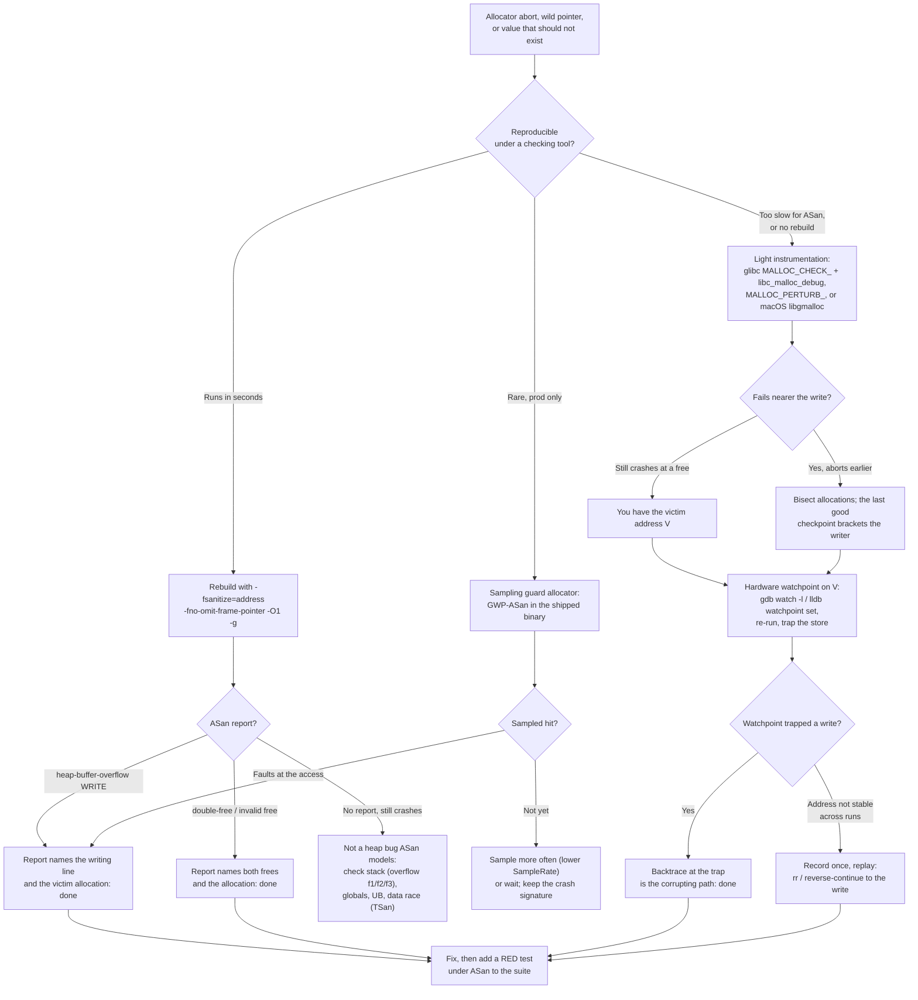

# C++ Playbook: Heap Corruption

> [!summary] Claim:
> Heap corruption is a write that lands outside the object it was aimed at, so the symptom is separated from the bug in both space and time.
> The corrupting store usually succeeds silently; the crash happens later, in a different function, on a different thread, inside the allocator freeing an unrelated chunk.
> The whole job is to collapse that separation: make the bad write fault at the instruction that does it, with the culprit still on the stack.
> Two levers do almost all of the work: a checking allocator that fails loudly near the write (AddressSanitizer, Guard Malloc, glibc detectors), and a hardware watchpoint that traps the exact store into a known-corrupted address.
> A detector that fires at a free is reporting the victim, not the writer, so this playbook never stops at the first abort.

The ASan shadow-memory and redzone mechanism is owned by [[Cpp-AddressSanitizer-and-LeakSanitizer-Internals]].
Core capture, build-ID matching, and reading a backtrace from a stripped binary are owned by [[Debug-a-Production-Crash-From-a-Core-Dump]].
This playbook owns the decision procedure that chooses among those tools and drives them to the writing instruction.

Every output block below is a slice of the expected output of one of two labs, and names which one.
`code/03-Debugging/heap_corruption_glibc/` records `expected/linux-aarch64.txt` and `code/03-Debugging/heap_corruption_macos/` records `expected/darwin-arm64.txt`.
Both labs replace addresses with `0xADDR` and process IDs with `PID`.

## Trigger and Symptoms

Activate this procedure when a native process dies or misbehaves in a way that points at the allocator rather than at your own logic.

- The process aborts inside `free`, `malloc`, or `operator delete` with a glibc diagnostic on stderr: `free(): double free detected in tcache 2`, `double free or corruption (fasttop)`, `double free or corruption (out)`, `malloc(): corrupted top size`, or `munmap_chunk(): invalid pointer`.
  glibc prints the message, then calls `abort`, so the shell reports exit status 134 (128 + `SIGABRT`).
- A crash backtrace bottoms out in `malloc_printerr`, `_int_free`, `malloc_consolidate`, `tcache_*`, or `_platform_memmove`/`__memcpy` with a destination that is a heap pointer.
- The fault address or a corrupted field holds a repeating byte pattern: `0x5a5a5a5a5a5a5a5a` (an all-`Z` overflow, or the glibc `MALLOC_PERTURB_=165` allocation fill), `0xaaaaaaaaaaaaaaaa` (macOS `MallocScribble` allocation fill, so an uninitialized read), `0x5555555555555555` (`MallocScribble` free fill, so a use-after-free), or `0xdeadbeef`-style sentinels from a custom allocator.
- A field reads back as a plausible value that is wrong: an `Order::qty` of 7 becomes `6510615555426900570`, a size becomes enormous, a vtable pointer points into the middle of a string.
- The crash is non-deterministic: it moves with allocation order, thread timing, `malloc` arena choice, or ASLR, and vanishes under `-O0`, under a debugger, or with extra logging (a Heisenbug; see [[Scientific-Debugging-Delta-Debugging-and-Heisenbugs]]).
- On macOS, a crash report shows `EXC_BAD_ACCESS (SIGSEGV)` inside `libsystem_malloc.dylib` (`xzm_*`, `nanov2_*`, `tiny_*`, `small_*`, `mfm_free`) or `EXC_BREAKPOINT` from an allocator consistency trap (a double free of a 24-byte block traps in a cold path of `mfm_free` and the shell reports status 133, 128 + `SIGTRAP`).

Heap corruption and use-after-free overlap: a use-after-free that writes through a dangling pointer corrupts whatever now owns that memory.
The read-side use-after-free drill is owned by [[Drill-Debugging-Use-After-Free-Core-Dump]]; this playbook covers the write side and the metadata damage it causes.

## Decision Tree



## Prerequisites

You need a build you can instrument and a way to re-run the failure.
Corruption bugs are reproduction problems first and analysis problems second.

### Linux

```bash
command -v gcc g++ gdb
gcc -v 2>&1 | grep -i 'gcc version'
ldd --version | head -1
ls /usr/lib/*/libc_malloc_debug.so.0
```

The Linux outputs were recorded by the `heap_corruption_glibc` lab in the repository's pinned `ubuntu:24.04` container on `aarch64` with gcc 13.3.0, gdb 15.1, and glibc 2.39 (as of 2026-11, Linux).
On Ubuntu 24.04 the library `libc_malloc_debug.so.0` ships in `libc6` and only the unversioned `libc_malloc_debug.so` symlink ships in `libc6-dev` (`dpkg -S`), so a production host without the `-dev` package still has it.
Preloading it is required for `MALLOC_CHECK_` to do anything on glibc 2.34 and later (glibc 2.34 NEWS), which is a change many engineers miss (see Failure Modes).
The pinned container has no libc debug symbols, and the lab's GDB commands add `-iex 'set debug-file-directory /nonexistent'` so the output is the same on a host that has them.
glibc's internal functions therefore print as `??`, which is also what a production host without `libc6-dbg` or a debuginfod server shows ([[Symbol-Servers-and-debuginfod]]).

**Verification:** GDB is willing to use hardware watchpoints (Linux, `expected/linux-aarch64.txt`), and the host has free debug registers: four on x86-64 (`DR0`-`DR3`), and an implementation-defined 1 to 16 on arm64 (`ID_AA64DFR0_EL1.WRPs` plus one), which is four in the recorded container.

```text
$ gdb -q -nx -batch -ex 'show can-use-hw-watchpoints'
Debugger's willingness to use watchpoint hardware is 1.
```

### macOS

```bash
command -v clang clang++ lldb
xcrun --show-sdk-version
ls /usr/lib/libgmalloc.dylib
```

The macOS outputs were recorded by the `heap_corruption_macos` lab on macOS 27.2 `arm64` with Apple clang 21.0.0 and lldb-2103 (as of 2026-11, macOS).
`libgmalloc` (Guard Malloc) ships with the OS as `/usr/lib/libgmalloc.dylib`, and the `Malloc*` environment knobs are built into the system `libmalloc`; no extra install is needed.
A release binary signed with the hardened runtime ignores `DYLD_INSERT_LIBRARIES` unless it carries the `com.apple.security.cs.allow-dyld-environment-variables` entitlement (Apple Developer Documentation), so Guard Malloc only attaches to a binary you built or re-signed locally (see Failure Modes).

**Verification:** `watchpoint list` in an LLDB session that has a live process prints `Number of supported hardware watchpoints: 4` on the recorded host; the attach session in Step 6 runs it.
The count needs a live process; without one LLDB prints only this (macOS, `expected/darwin-arm64.txt`):

```text
$ lldb -b -o 'watchpoint list' ./wild
No watchpoints currently set.
```

## Commands and Numbers to Know

| Item | Platform | Value `(as of 2026-11)` | Why it matters |
| :--- | :--- | :--- | :--- |
| `-fsanitize=address` slowdown | Both | About 2x time (Clang documentation); 3.4x memory on average in the 2012 ASan paper (project-dependent, measure yours) | Fast enough for tests and staging, usually too slow for a hot production path. |
| ASan redzone around each heap block | Both | Poisoned `fa` shadow bytes before and after the user region | A one-byte overflow lands in the redzone and faults at the write. |
| Hardware data watchpoints | Both | 4 on x86-64 (`DR0`-`DR3`); 1 to 16 on arm64 (implementation-defined; 4 on the recorded hosts) | You watch only a handful of addresses; GDB accepts a fifth `watch` and then fails at resume with `Could not insert hardware watchpoint N.`. |
| `MALLOC_CHECK_` | Linux | 0 off; 1, 2, or 3 turn the checking allocator on, and any detected corruption terminates the process (glibc 2.39 printed and aborted identically for all three); needs `libc_malloc_debug.so` preloaded | A less-efficient tolerant allocator that catches double-free and single-byte overflow. |
| `glibc.malloc.check` tunable | Linux | Supersedes `MALLOC_CHECK_`, same features, off by default, disabled for SUID/SGID | Set via `GLIBC_TUNABLES=glibc.malloc.check=3`, still needs the debug library. |
| `MALLOC_PERTURB_` / `glibc.malloc.perturb` | Linux | Byte `b`: allocations filled with `b XOR 0xff`, frees filled with `b` | Turns "works by luck on zeroed memory" bugs into deterministic failures. |
| glibc tcache forward-pointer protection | Linux | Safe-linking: stored `next` is `(slot_addr >> 12) XOR ptr`, where `slot_addr` is the address of the `next` field itself (`PROTECT_PTR`, malloc.c) | A corrupted freelist pointer no longer points where the attacker wrote; raw bytes in a core look scrambled. |
| glibc tcache double-free key | Linux | One process-wide random `tcache_key` (a `static uintptr_t` filled once from `getrandom`) stored in each freed chunk; re-free is detected | Source of `free(): double free detected in tcache 2`. |
| `MallocScribble` | macOS | `0xaa` on allocation, `0x55` on free; zero-on-free can replace the `0x55` with zeroes, so pair it with `MallocZeroOnFree=0` | Reading `0x55` back means use-after-free; `0xaa` means use-before-init. |
| `libgmalloc` / `MallocGuardEdges` | macOS | `libgmalloc`: each allocation on its own page or pages, buffer end at the page end (16-byte alignment leaves up to 15 bytes of slack, 8 for the lab's 24-byte block), next page unmapped; `MallocGuardEdges`: guard pages around large blocks only | `SIGSEGV` at the store, not an abort later. |
| `MallocCheckHeap*` / `MallocErrorAbort` | macOS | `MallocCheckHeapStart`/`MallocCheckHeapEach`: periodic heap scan that sleeps 100 s on corruption unless `MallocCheckHeapAbort=1`; `MallocErrorAbort`: abort on an allocator error such as a double free | Cheaper than Guard Malloc, coarser (finds damage between checks, not at the write). |
| GWP-ASan | Linux | Sampling guard allocator in the shipped binary; about 40 KiB per process at default settings; `SampleRate` sets 1-in-N sampling (default 5000); the compiler-rt CMake build enables its GWP-ASan runtime and standalone Scudo only when the target OS is Linux (`config-ix.cmake`), so on macOS it exists only inside allocators that carry their own copy, such as Chromium's, which is on by default on Windows and macOS | Catches a tiny fraction of overflows and use-after-frees in production at near-zero cost. |
| Exit status 134 / 139 / 135 or 138 | Both | 128 + `SIGABRT` (6) / `SIGSEGV` (11) / `SIGBUS` (7 on Linux, 10 on macOS) | 134 is a detector firing; 139 is the hardware faulting on a wild address. |

## Multi-Language Comparison

The same corruption class is caught by different default guardrails per language.

| Concern | C++ | Python | Rust |
| :--- | :--- | :--- | :--- |
| Can user code corrupt the heap? | Yes, any wild pointer or overflow | Only via C extensions / `ctypes` / buffer protocol | Only in `unsafe` or via FFI; safe code cannot |
| First-line detector | AddressSanitizer, Guard Malloc, glibc detectors | `faulthandler` plus the C library's own ASan build | ASan through `RUSTFLAGS=-Zsanitizer=address` (unstable, nightly only), or Miri for UB in `unsafe` |
| Double-free | `free(): double free...` or ASan `double-free` | Refcount handles it; a buggy extension can still double-free | Ownership forbids it in safe code; `Box` frees once |
| Typical triage entry | This playbook | [[Python-Debugging-Hung-Processes-and-C-Extensions]], [[Drill-Debugging-Mixed-Python-Rust-FFI-Segfault]] | [[Rust-Miri-Sanitizers-Loom-and-Cargo-Fuzz]] |

## Step-by-Step Execution

The toy programs below reproduce the whole class and are the sources of the two labs.
Every command in these steps is a line of a lab's `run.sh`, and every output block is a slice of that lab's expected file.
Keep the sources ASCII and compile them exactly as shown; optimization level and frame pointers change what the tools can recover.

`wild.cpp` (a wild write into a neighbor object; the file is identical in both labs, and the line numbers match the quoted tool output):

```cpp
// A wild write corrupts an unrelated object; the crash happens later, elsewhere.
#include <cstdio>
#include <cstdlib>
#include <cstring>

struct Order { long id; long qty; char sym[8]; };

static Order *g_order;

__attribute__((noinline)) void parse_tag(char *buf, const char *src, size_t n) {
    std::memcpy(buf, src, n);  // bug: n is not clamped to the buffer size
}

__attribute__((noinline)) long settle(const Order *o) { return o->qty * 100; }

int main(int argc, char **argv) {
    char *tag = static_cast<char *>(std::malloc(24));
    g_order = new Order{42, 7, "ABC"};
    std::printf("gap: %ld\n", (long)((char *)g_order - tag));
    char src[64];
    std::memset(src, 'Z', sizeof src);
    size_t n = argc > 1 ? (size_t)std::atoi(argv[1]) : 24;
    parse_tag(tag, src, n);
    std::printf("qty: %ld\n", settle(g_order));
    delete g_order;
    std::free(tag);
    return 0;
}
```

`heap_bugs.c` (glibc metadata damage and double free; lines 8 to 42 of the `heap_corruption_glibc` lab file, whose `main` runs one function per invocation, chosen by name):

```c
static void double_free(void) {
    char *p = malloc(24);   /* allocation site */
    free(p);                /* first free */
    free(p);                /* second free: the bug */
}

/* An 8-byte overflow rewrites the size field of the next chunk; free(b) then fails its checks. */
static void overflow_then_free(void) {
    char *a = malloc(24);
    char *b = malloc(24);
    memset(a, 'A', 24 + 8);
    free(b);
    free(a);
}

/* The chunk borders the top chunk, so the same overflow rewrites the top chunk's size field. */
static void corrupt_top(void) {
    char *a = malloc(24);
    memset(a + 24, 0xff, 8);
    char *b = malloc(4096);           /* carved from the top chunk: the size check fires here */
    printf("b: %p\n", (void *)b);
}

/* The overflow writes 0x41 over the next chunk's size field; the corruption is silent. */
static void silent_overlap(void) {
    char *a = malloc(24), *b = malloc(24), *c = malloc(24);
    strcpy(c, "victim-data");
    size_t fake = 0x41;               /* 64-byte chunk with PREV_INUSE */
    memcpy(a + 24, &fake, sizeof fake);
    free(b);                          /* enters the 0x40 tcache bin */
    char *d = malloc(56);             /* returns b, now overlapping c */
    memset(d, 'X', 56);
    printf("d == b: %s\n", d == b ? "yes" : "no");
    printf("c now: %.11s\n", c);
}
```

The same file has the `header`, `key`, and `obo` modes used in Steps 3 and 4.
`perturb.c` prints byte 32 of a fresh allocation and of the same block after `free`.
Built with `cc -O0 -g -o hb heap_bugs.c` and run against stock glibc, each mode ends in a different detector, or in none (Linux, `expected/linux-aarch64.txt`):

```text
$ ./hb double
free(): double free detected in tcache 2
exit status: 134
$ GLIBC_TUNABLES=glibc.malloc.tcache_count=0 ./hb double
double free or corruption (fasttop)
exit status: 134
$ ./hb overflow
double free or corruption (out)
exit status: 134
$ ./hb top
malloc(): corrupted top size
exit status: 134
$ ./hb overlap
d == b: yes
c now: XXXXXXXXXXX
exit status: 0
```

`./hb overlap` is the dangerous case: the allocator hands out two live blocks that share memory, and nothing aborts.

The macOS allocator has its own consistency trap.
The same double free of a 24-byte block (`double_free.c` in the macOS lab) stops on `EXC_BREAKPOINT` in a cold path of `mfm_free`, and the shell reports status 133 (macOS, `expected/darwin-arm64.txt`):

```text
$ ./df
exit status: 133
$ lldb -b -o 'run' -k 'thread backtrace -c 4' -k 'quit' ./df
* thread #1, queue = 'com.apple.main-thread', stop reason = EXC_BREAKPOINT (code=1, subcode=0xADDR)
   * frame #0: 0xADDR libsystem_malloc.dylib`mfm_free.cold
     frame #1: 0xADDR libsystem_malloc.dylib`mfm_free
     frame #2: 0xADDR df`double_free at double_free.c:7:5
     frame #3: 0xADDR df`main at double_free.c:11:5
```

### Step 1: Make the failure reproducible and bounded

Before any tool, pin down a command that fails more often than not.
Corruption bugs that reproduce once in a thousand runs are won or lost here.

```bash
c++ -O1 -g -fno-omit-frame-pointer -o wild wild.cpp   # cc fails to link: operator new/delete unresolved
for i in $(seq 1 20); do ./wild 48 >/dev/null 2>&1; echo "run $i status=$?"; done
```

If the failure is intermittent, remove entropy: pin the arena with `GLIBC_TUNABLES=glibc.malloc.arena_max=1`, disable ASLR under the debugger (`set disable-randomization on`), and fix any seed, thread count, and input order.
If it reproduces only in production, skip to Step 5 (sampling) rather than fighting the odds locally.

Recorded on Linux (`expected/linux-aarch64.txt`):

```text
$ ./wild 24
gap: 32
qty: 700
exit status: 0
$ ./wild 48
munmap_chunk(): invalid pointer
exit status: 134
$ script -qec './wild 48' /dev/null    # the same run with stdout on a terminal
gap: 32
qty: 5425512962855750440
munmap_chunk(): invalid pointer
./wild 48 exited 134 in 20 of 20 runs
```

Recorded on macOS (`expected/darwin-arm64.txt`):

```text
$ ./wild 48
gap: 32
qty: 5425512962855750440
exit status: 0
./wild 48 exited 0 with the corrupted qty in 20 of 20 runs
```

**Verification:** you can state a single command and the fraction of runs that fail.
On glibc the reference `./wild 48` aborts in 20 of 20 runs with `munmap_chunk(): invalid pointer`, exit 134, because the 48-byte copy into a 24-byte block overruns the neighbor's chunk header deterministically.
With stdout on a pipe the two `printf` lines die in the unflushed buffer; on a terminal they appear before the abort.
On macOS the same run exits 0 in 20 of 20 runs and prints a corrupted `qty`, which is the silent case this playbook exists for.

### Step 2: Rebuild under AddressSanitizer

ASan is the first tool to reach for because its report names both the writing line and the victim allocation.
Build with frame pointers so the fast unwinder gets a correct stack.

```bash
c++ -O1 -g -fno-omit-frame-pointer -fsanitize=address -o wild_asan wild.cpp
./wild_asan 48
```

Recorded on Linux (`expected/linux-aarch64.txt`).
The lab keeps the error line, each stack down to `main`, the region line, and the summary, and removes the build directory from paths:

```text
$ ./wild_asan 48
==PID==ERROR: AddressSanitizer: heap-buffer-overflow on address 0xADDR at pc 0xADDR bp 0xADDR sp 0xADDR
WRITE of size 48 at 0xADDR thread T0
    #0 0xADDR in memcpy ../../../../src/libsanitizer/sanitizer_common/sanitizer_common_interceptors_memintrinsics.inc:115
    #1 0xADDR in memcpy /usr/include/aarch64-linux-gnu/bits/string_fortified.h:29
    #2 0xADDR in parse_tag(char*, char const*, unsigned long) wild.cpp:11
    #3 0xADDR in main wild.cpp:23
0xADDR is located 0 bytes after 24-byte region [0xADDR,0xADDR)
allocated by thread T0 here:
    #0 0xADDR in malloc ../../../../src/libsanitizer/asan/asan_malloc_linux.cpp:69
    #1 0xADDR in main wild.cpp:17
SUMMARY: AddressSanitizer: heap-buffer-overflow ../../../../src/libsanitizer/sanitizer_common/sanitizer_common_interceptors_memintrinsics.inc:115 in memcpy
exit status: 1
$ ASAN_OPTIONS=abort_on_error=1 ./wild_asan 48
exit status: 134
```

Read it top to bottom: the `WRITE of size 48` stack is the writer (`parse_tag` at line 11), and the `allocated by` stack is the victim buffer (`main` at line 17, the 24-byte `malloc`).
`0 bytes after 24-byte region` says the first byte written out of bounds is immediately past the allocation, so this is an overflow, not a wild far pointer.
ASan reports and exits with status 1 by default on Linux; `ASAN_OPTIONS=abort_on_error=1` turns that into an abort (exit 134) and a core for offline analysis.

For a double-free, ASan prints all three stacks (Linux, `expected/linux-aarch64.txt`, `heap_bugs.c` built with `cc -O0 -g -fno-omit-frame-pointer -fsanitize=address`):

```text
$ ./hb_asan_O0 double
==PID==ERROR: AddressSanitizer: attempting double-free on 0xADDR in thread T0:
    #0 0xADDR in free ../../../../src/libsanitizer/asan/asan_malloc_linux.cpp:52
    #1 0xADDR in double_free heap_bugs.c:11
    #2 0xADDR in main heap_bugs.c:91
0xADDR is located 0 bytes inside of 24-byte region [0xADDR,0xADDR)
freed by thread T0 here:
    #0 0xADDR in free ../../../../src/libsanitizer/asan/asan_malloc_linux.cpp:52
    #1 0xADDR in double_free heap_bugs.c:10
    #2 0xADDR in main heap_bugs.c:91
previously allocated by thread T0 here:
    #0 0xADDR in malloc ../../../../src/libsanitizer/asan/asan_malloc_linux.cpp:69
    #1 0xADDR in double_free heap_bugs.c:9
    #2 0xADDR in main heap_bugs.c:91
SUMMARY: AddressSanitizer: double-free ../../../../src/libsanitizer/asan/asan_malloc_linux.cpp:52 in free
exit status: 1
```

The same source built at `-O1` reports nothing, because gcc 13.3 deletes this toy's dead `malloc`/`free`/`free` sequence before ASan can see it (Linux, `expected/linux-aarch64.txt`):

```text
$ ./hb_asan_O1 double
exit status: 0
```

On macOS `abort_on_error` already defaults to on, so the same report ends with `ABORTING` and status 134, and `ASAN_OPTIONS=abort_on_error=0` gives status 1 (macOS, `expected/darwin-arm64.txt`):

```text
$ ./wild_asan 48
gap: 48
==PID==ERROR: AddressSanitizer: heap-buffer-overflow on address 0xADDR at pc 0xADDR bp 0xADDR sp 0xADDR
WRITE of size 48 at 0xADDR thread T0
    #0 0xADDR in __asan_memcpy
    #1 0xADDR in parse_tag(char*, char const*, unsigned long) wild.cpp:11
    #2 0xADDR in main wild.cpp:23
0xADDR is located 0 bytes after 24-byte region [0xADDR,0xADDR)
allocated by thread T0 here:
    #0 0xADDR in malloc
    #1 0xADDR in main wild.cpp:17
SUMMARY: AddressSanitizer: heap-buffer-overflow wild.cpp:11 in parse_tag(char*, char const*, unsigned long)
==PID==ABORTING
exit status: 134
$ ASAN_OPTIONS=abort_on_error=0 ./wild_asan 48
exit status: 1
```

Under ASan the two blocks sit 48 bytes apart, not 32, because each gets its own redzone.

**Verification:** the report's `WRITE`/`freed by` stack points into your code, and the allocation site matches the object you expected.
If ASan stays silent but the program still crashes, the bug is not a heap overflow ASan models: look at the shadow legend for stack redzones (`f1`/`f2`/`f3`), global redzones (`f9`), or move to ThreadSanitizer for a data race ([[Cpp-ThreadSanitizer-and-MemorySanitizer-Internals]]).

### Step 3: When you cannot rebuild, instrument the stock allocator

In production or with a third-party binary you cannot recompile, use the allocator's own checks.
On glibc, `MALLOC_CHECK_` needs the debug library preloaded or it does nothing:

```bash
DBG=/usr/lib/$(uname -m)-linux-gnu/libc_malloc_debug.so.0
LD_PRELOAD=$DBG MALLOC_CHECK_=3 ./hb double     # catches the double free
LD_PRELOAD=$DBG MALLOC_CHECK_=3 ./hb obo        # catches a one-byte overflow
```

Recorded on Linux (`expected/linux-aarch64.txt`; `$DBG` is the path of `libc_malloc_debug.so.0`):

```text
$ MALLOC_CHECK_=3 ./hb obo
off-by-one survived free
exit status: 0
$ LD_PRELOAD=$DBG MALLOC_CHECK_=0 ./hb obo
off-by-one survived free
exit status: 0
$ LD_PRELOAD=$DBG MALLOC_CHECK_=1 ./hb obo
free(): invalid pointer
exit status: 134
$ LD_PRELOAD=$DBG MALLOC_CHECK_=2 ./hb obo
free(): invalid pointer
exit status: 134
$ LD_PRELOAD=$DBG MALLOC_CHECK_=3 ./hb obo
free(): invalid pointer
exit status: 134
$ LD_PRELOAD=$DBG MALLOC_CHECK_=3 ./hb double
free(): invalid pointer
exit status: 134
$ LD_PRELOAD=$DBG GLIBC_TUNABLES=glibc.malloc.check=3 ./hb obo
free(): invalid pointer
exit status: 134
```

Without the `LD_PRELOAD` the same `MALLOC_CHECK_=3` is silent and the off-by-one slips through, which is the single most common reason engineers think `MALLOC_CHECK_` is broken.
With the library preloaded, 0 leaves the checker off, and 1, 2, and 3 all abort with `free(): invalid pointer` and exit 134; the `glibc.malloc.check` tunable behaves the same.

Make "lucky" bugs deterministic with poison fills:

```bash
MALLOC_PERTURB_=165 ./pt 2000      # 165 = 0xa5; allocations get 0x5a, frees get 0xa5
```

Recorded on Linux (`expected/linux-aarch64.txt`):

```text
$ ./pt 2000
fresh byte 32: 0
freed byte 32: 0x11
exit status: 0
$ MALLOC_PERTURB_=165 ./pt 2000
fresh byte 32: 0x5a
freed byte 32: 0xa5
exit status: 0
$ GLIBC_TUNABLES=glibc.malloc.perturb=165 ./pt 2000
fresh byte 32: 0x5a
freed byte 32: 0xa5
exit status: 0
```

Code that silently depends on fresh memory being zero now reads `0x5a` and fails the same way every run.

On macOS the equivalents are environment knobs on the system allocator:

```bash
MallocScribble=1 MallocZeroOnFree=0 ./pt 2000   # 0xaa on alloc, 0x55 on free
DYLD_INSERT_LIBRARIES=/usr/lib/libgmalloc.dylib ./wild 48   # guard page: faults at the write
```

Recorded on macOS (`expected/darwin-arm64.txt`):

```text
$ ./pt 2000
fresh byte 32: 0
freed byte 32: 0
exit status: 0
$ MallocScribble=1 ./pt 2000
fresh byte 32: 0xaa
freed byte 32: 0
exit status: 0
$ MallocScribble=1 MallocZeroOnFree=0 ./pt 2000
fresh byte 32: 0xaa
freed byte 32: 0x55
exit status: 0
```

`MallocScribble=1` alone shows the `0xaa` allocation fill but reads 0 after `free`, because zero-on-free overwrites the `0x55` pattern until `MallocZeroOnFree=0` turns it off.

Guard Malloc, recorded on macOS (`expected/darwin-arm64.txt`):

```text
$ DYLD_INSERT_LIBRARIES=/usr/lib/libgmalloc.dylib ./wild 24
gap: 49152
qty: 700
GuardMalloc[wild-PID]: Allocations will be placed on 16 byte boundaries.
exit status: 0
$ DYLD_INSERT_LIBRARIES=/usr/lib/libgmalloc.dylib ./wild 48
GuardMalloc[wild-PID]: Allocations will be placed on 16 byte boundaries.
exit status: 139
$ lldb -b -o 'settings set target.env-vars DYLD_INSERT_LIBRARIES=/usr/lib/libgmalloc.dylib' -o 'breakpoint set -f wild.cpp -l 22' -o 'run 48' -o 'expression -- (unsigned long)tag % 16384' -o 'continue' -k 'thread backtrace -c 2' -k 'quit' ./wild
offset of tag in its 16384-byte page: 16352
fault address is the start of a page: yes
* thread #1, queue = 'com.apple.main-thread', stop reason = EXC_BAD_ACCESS (code=1, address=0xADDR)
   * frame #0: 0xADDR libsystem_platform.dylib`_platform_memmove
     frame #1: 0xADDR wild`main(argc=2, argv=0xADDR) at wild.cpp:23:5 [opt]
```

Guard Malloc places the 24-byte block at the end of a 16384-byte page with the next page unmapped.
`tag` sits at offset 16352, so the default 16-byte alignment leaves 8 bytes of slack before the page end.
`./wild 48` therefore dies with `SIGSEGV` (status 139) at the overrunning store itself: the fault address is the first byte of the next page, inside `_platform_memmove` called from `wild.cpp:23`.
The two allocations are now 49152 bytes apart, three pages, not 32 bytes.
Without Guard Malloc the same macOS run exits 0 with a silently corrupted `qty`.

Guard Malloc cannot attach to a binary signed with the hardened runtime.
`dyld` ignores `DYLD_INSERT_LIBRARIES` for it, the banner never prints, and the overflow is silent again (macOS, `expected/darwin-arm64.txt`):

```text
$ cp wild wild_hr && codesign -s - -o runtime -f wild_hr
$ codesign -dv wild_hr
flags=0x10002(adhoc,runtime)
$ DYLD_INSERT_LIBRARIES=/usr/lib/libgmalloc.dylib ./wild_hr 48
gap: 32
qty: 5425512962855750440
exit status: 0
```

**Verification:** the instrumented run fails earlier, nearer the write, than the uninstrumented one.
If it still only fails at a distant free, you have the victim address and move to the watchpoint in Step 6.

### Step 4: Read the metadata damage in a core

When the abort already happened, open the core and look at the bytes, not just the backtrace.
Core capture, build-ID matching, and sysroot setup are owned by [[Debug-a-Production-Crash-From-a-Core-Dump]]; here you only read memory.

```bash
ulimit -c unlimited
./wild 48            # writes ./core on a file core_pattern
gdb -q -nx -batch -ex 'bt' -ex 'print *g_order' \
    -ex 'x/16xb (char *)g_order - 16' -ex 'print $_siginfo.si_signo' ./wild core
```

Recorded on Linux (`expected/linux-aarch64.txt`):

```text
$ ulimit -c unlimited; ./wild 48
munmap_chunk(): invalid pointer
exit status: 134
$ gdb -q -nx -batch -iex 'set debug-file-directory /nonexistent' -ex 'bt' -ex 'print *g_order' -ex 'x/16xb (char *)g_order - 16' -ex 'print $_siginfo.si_signo' ./wild core
#0  0xADDR in ?? () from /lib/aarch64-linux-gnu/libc.so.6
#1  0xADDR in raise () from /lib/aarch64-linux-gnu/libc.so.6
#2  0xADDR in abort () from /lib/aarch64-linux-gnu/libc.so.6
#3  0xADDR in ?? () from /lib/aarch64-linux-gnu/libc.so.6
#4  0xADDR in ?? () from /lib/aarch64-linux-gnu/libc.so.6
#5  0xADDR in ?? () from /lib/aarch64-linux-gnu/libc.so.6
#6  0xADDR in free () from /lib/aarch64-linux-gnu/libc.so.6
#7  0xADDR in main (argc=<optimized out>, argv=0xADDR) at wild.cpp:25
$1 = {id = 6510615555426900570, qty = 6510615555426900570, sym = "ABC\000\000\000\000"}
0xADDR: 0x5a 0x5a 0x5a 0x5a 0x5a 0x5a 0x5a 0x5a
0xADDR: 0x5a 0x5a 0x5a 0x5a 0x5a 0x5a 0x5a 0x5a
$2 = 6
```

The backtrace bottoms out in the allocator, with `main` at `wild.cpp:25` (`delete g_order`) as the last frame in your code.
That frame is the victim, not the bug: something already corrupted the chunk before `delete` touched it.
Without libc debug symbols only the exported names resolve (`raise`, `abort`, `free`).
The three `??` frames between `abort` and `free` are glibc's internal `__libc_message_impl`, `malloc_printerr`, and `munmap_chunk`; GDB named them in a container image that has `libc6-dbg`, a run made outside the lab.
`print *g_order` shows `id` and `qty` both reading `6510615555426900570`, and the 16 bytes before the object, which are the tail of `tag` and the chunk's own size field, are all `0x5a`.
`$_siginfo.si_signo` is 6, `SIGABRT`: glibc's detector killed the process, the hardware did not.

For the glibc freelist specifically, raw bytes look scrambled because of safe-linking: the stored `next` pointer is `(slot_addr >> 12) XOR real_next`, where `slot_addr` is the address of the `next` field itself (the `PROTECT_PTR` macro in glibc 2.39 `malloc/malloc.c`).
The `header` and `key` modes of `heap_bugs.c` read those words from freed chunks (Linux, `expected/linux-aarch64.txt`):

```text
$ ./hb header
freed chunk size field: 0x21
a->next raw equals b: no
a->next revealed equals b: yes
exit status: 0
$ ./hb key
key is nonzero: yes
key stored by the main thread equals key stored by a second thread: yes
exit status: 0
```

A freed 24-byte chunk's size field reads `0x21` (`0x20` chunk size `OR` `PREV_INUSE`), and the mangled `next` word equals the real next pointer only after you apply `REVEAL_PTR`.
The second word of a freed tcache chunk is the double-free key, and it is the same value whichever thread freed the chunk.

**Verification:** you can point at the exact bytes that are wrong (a size field that is not a valid rounded chunk size, a fill pattern, a pointer that reveals to garbage) and name the object they belong to.
A repeating `0x5a` pattern in `Order::qty` (reading `6510615555426900570`) says the corruptor wrote `'Z'` bytes, which ties straight to the `memset(src, 'Z', ...)` and the unclamped copy.

### Step 5: Catch rare corruption in production with a sampling guard allocator

For a bug that only appears under real traffic, link a sampling guard allocator into the shipped binary.
GWP-ASan places a tiny random fraction of allocations on their own guarded pages (two inaccessible guard pages per slot) and maps a slot inaccessible after free, so a sampled overflow or use-after-free faults at the access with the culprit on the stack.

- GWP-ASan is not a standalone allocator: enable it through an allocator that embeds it (Scudo ships it by default; Chromium carries its own implementation).
  With Scudo, tune it through `SCUDO_OPTIONS=GWP_ASAN_SampleRate=<N>` or a `__gwp_asan_default_options` function; the defaults are `SampleRate=5000` and `MaxSimultaneousAllocations=16`, and the `GWP_ASAN_OPTIONS` variable in the LLVM example works only where the embedding allocator reads it.
- Default footprint is about 40 KiB per process, depending on average allocation size, so it is cheap enough to leave on fleet-wide.
- The trade-off is coverage: at `SampleRate=N` you inspect roughly one allocation in `N`, so you need volume and patience, not a single repro.

The ARMv8.5 Memory Tagging Extension (MTE) is the hardware version of the same idea and is owned by [[Cpp-HWASan-and-Hardware-Memory-Tagging]]; prefer it on MTE-capable hardware when you can afford the tag-check overhead.

**Verification:** a sampled hit produces a report that opens with `*** GWP-ASan detected a memory error ***` and names the access, the deallocation, and the allocation stacks; until then, keep the crash signature so you can confirm the fix removes it.

### Step 6: Trap the writer with a hardware watchpoint

When instrumentation narrows the damage to a specific address but not the instruction, set a hardware data watchpoint on that address and re-run.
The CPU traps the exact store, so the backtrace at the trap is the corrupting path.

Linux, GDB, breaking before the wild copy and watching the field that gets clobbered:

```bash
gdb -q -nx -batch -ex 'break parse_tag' -ex 'run 48' \
    -ex 'watch -l g_order->qty' -ex 'continue' -ex 'bt' ./wild
```

Recorded on Linux (`expected/linux-aarch64.txt`):

```text
$ gdb -q -nx -batch -iex 'set debug-file-directory /nonexistent' -ex 'break parse_tag' -ex 'run 48' -ex 'watch -l g_order->qty' -ex 'continue' -ex 'bt' ./wild
Hardware watchpoint 2: -location g_order->qty
Old value = 7
New value = 6510615555426900570
#0  0xADDR in ?? () from /lib/aarch64-linux-gnu/libc.so.6
#1  0xADDR in memcpy (__len=<optimized out>, __src=0xADDR, __dest=0xADDR) at /usr/include/aarch64-linux-gnu/bits/string_fortified.h:29
#2  parse_tag (buf=buf@entry=0xADDR 'Z' <repeats 48 times>, "ABC", src=src@entry=0xADDR 'Z' <repeats 64 times>, n=<optimized out>) at wild.cpp:11
#3  0xADDR in main (argc=2, argv=0xADDR) at wild.cpp:23
```

`Old value = 7, New value = 6510615555426900570` is `qty` going from 7 to `0x5a5a5a5a5a5a5a5a`, trapped inside the `memcpy` called from `parse_tag` at line 11: that is the writer, caught in the act.
Frame `#0` is the libc `memcpy` implementation, unnamed for the same reason as the allocator frames in Step 4.
Use `watch -l` (the `-l`/`-location` form) so GDB watches the memory address, not the C expression, and keeps watching after the frame that named it returns.

macOS, LLDB, needs two adjustments, and the lab makes both.
First, Apple clang at `-O1` optimizes the static `g_order` variable away (only `main` uses it), so the debug info has no variable of that name and the address has to come from the local `tag` (macOS, `expected/darwin-arm64.txt`):

```text
$ otool -tV wild    # every instruction of parse_tag
b symbol stub for: _memcpy
$ dwarfdump --name g_order wild.dSYM | grep -c DW_AT_name
0
$ dwarfdump --name tag wild.dSYM | grep -c DW_AT_name
1
```

`&g_order->qty` is `tag + 40` when the gap between the two blocks is 32.
Second, a process launched by LLDB is not guaranteed the heap layout of a bare run.
On the recorded host the gap under an LLDB launch changed with the length of the executable's path, and the bug disappeared with it; that observation was made outside the lab because it is not deterministic.
So start the process outside the debugger, stopped before `main` by a constructor in an inserted library, and attach:

```bash
cc -dynamiclib -o stop_at_start.dylib stop_at_start.c    # its constructor calls raise(SIGSTOP)
DYLD_INSERT_LIBRARIES=./stop_at_start.dylib ./wild 48 >wild_out.txt &
lldb -b -o "process attach -p $!" -o 'breakpoint set -f wild.cpp -l 22' -o 'continue' \
     -o 'watchpoint set expression -w write -s 8 -- (char *)tag + 40' -o 'watchpoint list -b' \
     -o 'continue' -o 'thread backtrace -c 2' -o 'watchpoint delete -f 1' -o 'continue'
```

Recorded on macOS (`expected/darwin-arm64.txt`; the lab prints the watched values in decimal):

```text
Number of supported hardware watchpoints: 4
Watchpoint 1 hit:
old value: 7
new value: 6510615555426900570
* thread #1, queue = 'com.apple.main-thread', stop reason = watchpoint 1
   * frame #0: 0xADDR libsystem_platform.dylib`_platform_memmove
     frame #1: 0xADDR wild`main(argc=2, argv=0xADDR) at wild.cpp:23:5 [opt]
$ cat wild_out.txt
gap: 32
qty: 5425512962855750440
exit status: 0
```

The watchpoint fires in `_platform_memmove`, reached from the `parse_tag` call at `wild.cpp:23`, with `qty` going from 7 to `6510615555426900570`: the store that corrupts `qty`.
`parse_tag` has no frame of its own because Apple clang at `-O1` compiles it to a single tail call, the `b` to the `memcpy` stub in the `otool` output, so the backtrace goes straight from `_platform_memmove` to `main`.
The process then runs to completion and prints `gap: 32` and the corrupted `qty`, which confirms that `tag + 40` was `qty` in this process.
The hardware-watchpoint mechanism (debug registers, `ptrace`, Mach thread state) is owned by [[How-Debuggers-Work-ptrace-Mach-and-Breakpoints]].

**Verification:** the watchpoint stopped on a write whose backtrace is in your code, and the new value matches the corruption you saw (the fill pattern, the wrong number).
You have four data watchpoints on the recorded hosts, so pick the single most-corrupted address.
GDB accepts a fifth `watch` and then refuses to resume (Linux, `expected/linux-aarch64.txt`, five `watch -l` commands on consecutive words followed by `continue`):

```text
Hardware watchpoint 2: -location *((long *)&g_order + 0)
Hardware watchpoint 3: -location *((long *)&g_order + 1)
Hardware watchpoint 4: -location *((long *)&g_order + 2)
Hardware watchpoint 5: -location *((long *)&g_order + 3)
Hardware watchpoint 6: -location *((long *)&g_order + 4)
Could not insert hardware watchpoint 6.
Could not insert hardware breakpoints:
You may have requested too many hardware breakpoints/watchpoints.
```

### Step 7: If the address is not stable, record once and replay

If ASLR or allocation order moves the victim address every run, a watchpoint set by address is useless.
Record the failing run once and replay it deterministically, then set the watchpoint (or `reverse-continue` from the crash to the write) in the replay where the address is fixed.
The rr and UDB workflow is owned by [[Record-and-Replay-rr-UDB-and-Pernosco]]; the key property is that the replay reproduces the exact same addresses and timing every time, which turns a Heisenbug into a repeatable observation.

**Verification:** the recorded trace reproduces the crash on replay, and reverse execution lands on a single store instruction that wrote the bad value.

## Verification

Each step above ends with its own check; the procedure as a whole has succeeded when all three of these hold:

- You can name the writing instruction and its backtrace, not just the frame that aborted.
- The value or pattern at the corruption matches the writer you named (the overflow source, the fill byte, the freed sentinel).
- A new test reproduces the bug under ASan and fails before the fix and passes after, added to the suite as a RED-gate regression test (the RED-gate discipline is in [[Cpp-AddressSanitizer-and-LeakSanitizer-Internals]] and the C++ testing skill).

If you can only name the victim (the thing that crashed) and not the writer, you are not done; go back to Step 6.

## Rollback Procedure

This procedure changes build flags, environment, and sometimes capture settings; undo each so you do not ship a debug configuration.

1. **Remove sanitizer builds from release artifacts.** Delete `*_asan` binaries and any `-fsanitize=address` that leaked into release flags; the ASan runtime is not meant to be linked into production executables (Clang documentation, Security Considerations) and must never ship.
   **Check:** on Linux `nm -D your_binary | grep -c -i asan` prints 0 (the lab prints 0 for `wild` and 8 for `wild_asan`), and the build log shows no `-fsanitize`.
2. **Unset debugging environment.** Clear `MALLOC_CHECK_`, `GLIBC_TUNABLES`, `MALLOC_PERTURB_`, `LD_PRELOAD`, and the macOS `Malloc*`/`DYLD_INSERT_LIBRARIES` from service unit files and shells.
   **Check:** `systemctl show -p Environment your.service` and the launch shell show none of them.
3. **Restore core capture settings** if you changed `ulimit -c` or `core_pattern` for Step 4; the rollback steps are owned by [[Debug-a-Production-Crash-From-a-Core-Dump]].
   **Check:** `cat /proc/sys/kernel/core_pattern` matches the saved value.
4. **Keep GWP-ASan on if you enabled it fleet-wide**, but restore `SampleRate` to the default 5000 if you lowered it to sample more often; dense sampling is for an investigation, not steady state.
   **Check:** the effective GWP-ASan options (`SCUDO_OPTIONS` or `__gwp_asan_default_options`) are the defaults, not the investigation values.
5. **Delete cores and traces** that contain heap memory (keys, tokens, customer data) once the fix is confirmed, and record where the one retained copy lives.

## Failure Modes

| Failure | How it shows up | Recovery |
| :--- | :--- | :--- |
| `MALLOC_CHECK_` does nothing | Set to 3 but the double-free or overflow still slips through | On glibc 2.34+ you must `LD_PRELOAD` `libc_malloc_debug.so`; without it the variable is ignored, and it is disabled for SUID/SGID binaries. |
| ASan silent, still crashes | No ASan report, same `SIGSEGV` | Not a heap overflow ASan models: check stack redzones (`f1`/`f2`/`f3`), globals (`f9`), uninitialized reads (MemorySanitizer), or a data race (ThreadSanitizer). |
| Detector blames the victim | Abort inside `free`/`munmap_chunk` on a chunk your code did not touch last | The corruptor ran earlier; use `MALLOC_PERTURB_` or ASan to fail nearer the write, or watchpoint the victim address. |
| Fifth watchpoint rejected | `Could not insert hardware watchpoint N.` when the program resumes | The debug registers are exhausted (four on x86-64 and on the recorded arm64 hosts); drop to the one most-corrupted address, or use `rwatch`/`awatch` sparingly. |
| Watchpoint address moves each run | Watchpoint never fires, or fires on the wrong object | ASLR or allocation order changed the address; record and replay (rr) to pin it, or watch a stable global that points at the object. |
| Guard Malloc never attaches | macOS binary ignores `DYLD_INSERT_LIBRARIES` | The hardened runtime ignores `DYLD_*` unless the binary has the `com.apple.security.cs.allow-dyld-environment-variables` entitlement; re-sign locally without the hardened runtime, or build the binary yourself. |
| Bug vanishes under LLDB on macOS | The run launched by LLDB prints a different `gap`, the field stays intact, exit 0 | The debugger launch changed the heap layout; start the process outside LLDB, stopped before `main`, and attach (Step 6), or use Guard Malloc or ASan, which do not depend on which neighbor is hit. |
| LLDB cannot name the global | The expression fails because the variable is undeclared | The optimizer removed it from the debug info (`dwarfdump --name` finds no entry); compute the address from a variable that survived, or rebuild that one file at `-O0`. |
| Allocator frames print as `??` | The backtrace shows `?? () from libc.so.6` between `abort` and `free` | The host has no libc debug symbols; install `libc6-dbg` or point GDB at a debuginfod server ([[Symbol-Servers-and-debuginfod]]). |
| Safe-linking confuses manual reading | A freed chunk's `next` word in a core looks like garbage | glibc mangles it as `(slot_addr >> 12) XOR ptr`; apply `REVEAL_PTR` before comparing, or do not read freelist internals by hand. |
| Bug vanishes under the tool | Fails in production, never under ASan or `-O0` | A Heisenbug: the tool changed layout or timing; see [[Scientific-Debugging-Delta-Debugging-and-Heisenbugs]] and prefer a sampling allocator that runs in the real build. |
| TOCTOU across threads | The corruptor and the crasher are different threads | Read `thread apply all bt`; a watchpoint still catches the writing thread because it traps on the store regardless of which thread runs it. |

## Pitfalls

> [!warning] The first abort names the victim, not the bug
> glibc, macOS `libmalloc`, and your own `delete` all detect corruption when they next walk the damaged structure, which is usually long after the bad write.
> Treat `free(): ...` and `munmap_chunk(): invalid pointer` as "something corrupted this chunk earlier", and work backward to the write, never forward from the abort.

> [!warning] MALLOC_CHECK_ without the debug library is a no-op
> On glibc 2.34 and later, `MALLOC_CHECK_` only works when `libc_malloc_debug.so` is preloaded.
> Engineers set `MALLOC_CHECK_=3`, see no change, and wrongly conclude the heap is fine.

> [!warning] ASan and production are mutually exclusive
> AddressSanitizer roughly doubles run time, multiplies memory use (3.4x on average in the 2012 paper), and its runtime is not meant to be linked into production executables, so it belongs in tests and staging, not the shipped hot path.
> For production coverage use a sampling guard allocator (GWP-ASan) or hardware tagging (MTE), which run in the real build at a fraction of the cost.

> [!warning] Watch the location, not the expression
> `watch g_order->qty` watches the C expression rather than a fixed address, and GDB deletes a watchpoint whose expression names a local variable once that variable goes out of scope.
> `watch -l g_order->qty` pins the resolved address, which is what you want for a wild write that happens elsewhere.

> [!warning] Reading freelist pointers by hand
> Safe-linking (glibc) and pointer mangling make raw `next` words in a core look like noise.
> Do not conclude the heap is fine because a freed chunk's forward pointer "looks wrong"; it is supposed to look wrong.

> [!warning] -O0 rebuilds hide corruption bugs
> Changing optimization to debug changes stack and heap layout, inlining, and timing, so an overflow that clobbered a specific neighbor at `-O2` may clobber dead padding at `-O0`.
> Debug the shipped optimization level with ASan or a watchpoint, and treat a bug that only appears at `-O2` as evidence of layout dependence, not a compiler bug.

## At Scale

For one developer, ASan plus a watchpoint solves nearly every heap-corruption bug in an afternoon.
Across 1,000 to 50,000 engineers and services, corruption becomes a fleet-reliability problem whose cost is paid at build time and in paved-road defaults.

- **Default-on checking in CI.** Every C and C++ test target runs under ASan and UBSan in CI, so corruption is caught at the commit that introduces it, not in production six weeks later.
  The marginal cost is CI minutes; the alternative is a production incident with a core that already lost the evidence.
- **Sampling in production.** Link GWP-ASan (or enable MTE where the hardware supports it) fleet-wide so a fraction of real allocations are guarded; aggregate the rare hits centrally by crash signature.
  This is the only way to catch bugs that need real traffic, data, and timing to appear.
- **Hardening the shipped allocator.** glibc safe-linking and tcache keys, and `_FORTIFY_SOURCE=3` for the `mem*`/`str*` family, turn many silent overflows into immediate aborts at low cost; `_GLIBCXX_ASSERTIONS` or libc++ hardening add bounds checks to standard containers.
  Decide these per service, because they trade a little latency for a loud failure.
- **Keep the evidence.** A corruption crash is only debuggable if the core (or minidump plus symbols) survives; wire capture and symbol archiving as described in [[Debug-a-Production-Crash-From-a-Core-Dump]] and [[Symbol-Servers-and-debuginfod]], and give cores the same retention and access policy as production databases.
- **Decision rule.** If the bug reproduces locally, use ASan; if it needs production, use sampling; if you have the address but not the writer, use a watchpoint; if the address is unstable, record and replay.
  Escalate down that list, not up.

## Practice Drill

> [!tip] Practice Drill: From abort to the writing instruction
> Take the sources from `code/03-Debugging/heap_corruption_glibc/` and `code/03-Debugging/heap_corruption_macos/`.
> Build `wild.cpp` with `c++ -O1 -g -fno-omit-frame-pointer` and confirm that on Linux `./wild 48` aborts with `munmap_chunk(): invalid pointer`.
> 1. Rebuild with `-fsanitize=address` and read the report: name the writing line and the victim allocation line without looking them up in the source.
> 2. Predict the output of `./wild 24` versus `./wild 48` and explain why 24 is safe (it exactly fills the 24-byte allocation) while 48 overruns the neighbor's chunk header.
> 3. Set `watch -l g_order->qty` after `break parse_tag` and confirm the trap fires inside `memcpy` with `New value = 6510615555426900570`; explain where `0x5a5a5a5a5a5a5a5a` comes from.
> 4. Compile `heap_bugs.c`, run `./hb overlap`, and explain why `d == b: yes` and `c now: XXXXXXXXXXX` prove a heap overlap with no crash at all, then catch it with ASan in a `-O0` build (at `-O1` gcc 13.3 optimizes the toy's overflow away and ASan reports only leaks).
> 5. On macOS, attach `libgmalloc` and show that `./wild 48` now faults at the store (`SIGSEGV`) instead of exiting 0 with a corrupted `qty`; explain the guard-page mechanism.
> Target: under 25 minutes.
> Then repeat on [[Drill-Debugging-Use-After-Free-Core-Dump]] for the read side.

## Interview Questions

> [!question] L5
> A service aborts with `free(): double free detected in tcache 2`.
> Where is the bug, and where is it not?
>
> > [!success]- Answer
> > The message means glibc found its process-wide random `tcache_key` already present in a chunk being freed and then found that chunk in the tcache bin, so this chunk was freed before.
> > The bug is wherever the first `free`/`delete` and the second one both run on the same pointer; the abort site is only where glibc happened to notice.
> > Rebuild under ASan, which prints both free stacks and the allocation stack, and fix the ownership so the object is freed exactly once.
> > Do not "fix" it by removing the `free` at the abort site; that is the detector, not the defect.

> [!question] L5
> `MALLOC_CHECK_=3` has no effect on your overflow.
> Why, and what else do you try?
>
> > [!success]- Answer
> > On glibc 2.34 and later, `MALLOC_CHECK_` only works when `libc_malloc_debug.so` is preloaded; without it the variable is ignored, and it is disabled for SUID/SGID binaries.
> > Run `LD_PRELOAD=/usr/lib/$(uname -m)-linux-gnu/libc_malloc_debug.so.0 MALLOC_CHECK_=3`.
> > Better, if you can rebuild, use AddressSanitizer, which names the writing line directly instead of just aborting at the next allocator operation.

> [!question] L6 (predict the output)
> `wild.cpp` prints `gap: 32` for `./wild 24`.
> Predict what `./wild 24` and `./wild 48` print and their exit statuses, and justify each.
>
> > [!success]- Answer
> > `./wild 24` copies 24 bytes into the 24-byte `tag`, which does not overrun, so it prints `gap: 32` and `qty: 700` and exits 0.
> > `./wild 48` on glibc copies 48 bytes starting at `tag`; `g_order` sits 32 bytes after `tag`, so bytes 24 to 31 overwrite the size field of the `g_order` chunk header and bytes 32 to 47 overwrite `g_order->id` and `g_order->qty` with `'Z'` (`0x5a`).
> > `qty` becomes `0x5a5a5a5a5a5a5a5a` = `6510615555426900570`, so `settle` returns the wrapped product (signed overflow, formally undefined) and the program prints `qty: 5425512962855750440`, then aborts at `delete g_order` with `munmap_chunk(): invalid pointer`, exit 134, because the smashed size field has the `IS_MMAPPED` bit set.
> > On a terminal all three lines appear; when stdout is a pipe or a file it is block-buffered, so the `gap:` and `qty:` lines sit unflushed in the buffer when `abort` fires and only the stderr abort line is visible.

> [!question] L6 (debug this)
> A core shows the crash inside `malloc_consolidate`, far from your code, and the chunk's forward pointer looks like random bytes.
> Walk through isolating the real writer.
>
> > [!success]- Answer
> > First, recognize that `malloc_consolidate` is the victim: it walked a freelist that someone else corrupted, and the "random" forward pointer is expected because glibc safe-linking mangles it as `(addr >> 12) XOR ptr`, so apply `REVEAL_PTR` before reading it.
> > The core cannot name the writer, so reproduce under ASan if the bug is reproducible, which prints the writing stack directly.
> > If it only reproduces in production, note the corrupted chunk's address, then on a reproduction set a hardware watchpoint (`watch -l`) on that address and re-run to trap the store.
> > If the address moves across runs because of ASLR or allocation order, record the failing run with rr and `reverse-continue` from the crash to the single instruction that wrote the bad value.
> > The deliverable is the writing instruction and its backtrace, with the written pattern matching the corruption seen in the core.

> [!question] L6
> You have four hardware watchpoints and three candidate addresses, but the bug still escapes.
> What are the limits of watchpoints here?
>
> > [!success]- Answer
> > Hardware watchpoints trap a write to a fixed address, so they only help once you know which address gets corrupted; a wild pointer that writes to a different address each run defeats them.
> > There are only a few debug registers (four on x86-64, an implementation-defined 1 to 16 on arm64, commonly four), each watching at most 8 bytes under Linux, so you cannot blanket a large buffer.
> > When the address is unstable or the region is large, switch to ASan (redzones around every block) or a sampling guard allocator, or record-and-replay so the address is fixed in the trace.
> > Watchpoints are a scalpel for a known address, not a net.

> [!question] L7
> Design heap-corruption defense for 20,000 C++ services where ASan is too slow for production.
> What runs where?
>
> > [!success]- Answer
> > In CI: every test target under ASan and UBSan, with a RED-gate test required for any corruption fix, so regressions are caught at the commit.
> > In the shipped build: a sampling guard allocator (GWP-ASan) linked fleet-wide at the default low sample rate, plus MTE on capable hardware, aggregated centrally by crash signature; this catches the bugs that need real traffic.
> > In the allocator and headers: `_FORTIFY_SOURCE=3`, `_GLIBCXX_ASSERTIONS` or libc++ hardening, and glibc's safe-linking and tcache keys, chosen per service for the latency-versus-loudness trade.
> > In the capture path: cores or minidumps plus build-ID-keyed symbols archived at build time, with cores treated as sensitive data.
> > The paved road makes the safe configuration the default and the unsafe one a deliberate opt-out, because at this scale the limiting factor is human attention, not tooling capability.

> [!question] L7
> Compare AddressSanitizer, Guard Malloc / Electric Fence, and sampling allocators (GWP-ASan) as points in a design space.
> When is each right?
>
> > [!success]- Answer
> > ASan uses shadow memory and redzones with a fast compiler-inserted check on every access: broad coverage (overflow, use-after-free, double-free), precise reports, about 2x cost, so it is the default for tests and staging but not production.
> > Guard-page allocators put each allocation on its own page with an adjacent unmapped page, so an overrun faults exactly at the store with no shadow memory, but the per-allocation page cost makes them far too heavy for whole programs; they are a targeted tool for a specific allocation class.
> > Sampling allocators guard a tiny random fraction of allocations with guard pages, trading coverage for near-zero average cost, which is the only one of the three cheap enough to leave on in production.
> > The axis is coverage-density versus overhead: ASan is dense and expensive, guard pages are precise and heavy, sampling is sparse and cheap; pick by where the bug lives and what you can afford to run there.

> [!question] L8+
> A low-latency matching engine corrupts its heap roughly once a week in production; every core has the allocator metadata already destroyed, and ASan changes the timing enough that the bug never appears.
> How do you catch the writer without perturbing the hot path?
>
> > [!success]- Answer
> > The goal is to make the bad write fault at the write, in the real build, at acceptable cost.
> > Enable GWP-ASan in the shipped binary: it guards a random fraction of allocations with inaccessible guard pages and maps a freed slot inaccessible, so a sampled overflow or use-after-free faults immediately with the culprit on the stack, at about 40 KiB per process and a tunable sample rate; sample more often (a lower `SampleRate`) on a canary tier to converge faster.
> > On ARMv8.5 hardware, MTE tags 16-byte granules and pointers and raises `SIGSEGV` (`SEGV_MTESERR` synchronous, `SEGV_MTEAERR` asynchronous) on a mismatched access; measure the tag-check overhead on your workload before claiming it is free (owned by [[Cpp-HWASan-and-Hardware-Memory-Tagging]]).
> > If the victim address is stable enough, a hardware watchpoint through `perf_event_open` with `PERF_TYPE_BREAKPOINT` traps the writer with negligible steady-state cost, limited to the few debug registers.
> > When the trigger can be reproduced in staging, record-and-replay (rr, Pernosco) lets you reverse-execute from the crash to the store without touching production timing ([[Record-and-Replay-rr-UDB-and-Pernosco]]).
> > Hardening the allocator (safe-linking, tcache keys, `_FORTIFY_SOURCE=3`) reduces the silent window so future corruption aborts sooner, closer to the write.

## Further Reading

- AddressSanitizer, Clang documentation, https://clang.llvm.org/docs/AddressSanitizer.html.
  The redzone and shadow-memory model and the exact report format this playbook reads.
- GWP-ASan, LLVM documentation, https://llvm.org/docs/GwpAsan.html.
  The guarded-pool sampling allocator, its guard-page mechanism, footprint, and `SampleRate` option.
- The GNU C Library: Heap Consistency Checking and Memory Allocation Tunables, https://www.gnu.org/software/libc/manual/html_node/Heap-Consistency-Checking.html.
  `MALLOC_CHECK_`, the `glibc.malloc.*` tunables, the `libc_malloc_debug.so` requirement, and `MALLOC_PERTURB_`.
- glibc `malloc/malloc.c` (release/2.39/master), https://sourceware.org/git/?p=glibc.git;a=blob;f=malloc/malloc.c;hb=refs/heads/release/2.39/master.
  `PROTECT_PTR`/`REVEAL_PTR` safe-linking, the `tcache_key` double-free check, and the detector call sites (`double free detected in tcache 2`, `double free or corruption (out)`, `munmap_chunk(): invalid pointer`).
- Debugging with GDB: Setting Watchpoints, https://sourceware.org/gdb/current/onlinedocs/gdb.html/Set-Watchpoints.html.
  `watch`/`rwatch`/`awatch`, the `-l`/`-location` form, and hardware-watchpoint limits.
- LLDB GDB-to-LLDB command map, https://lldb.llvm.org/use/map.html.
  `watchpoint set expression`/`watchpoint set variable` and `watchpoint list` on macOS.
- Apple libgmalloc(3) and malloc(3) manual pages, macOS 27.2.
  Guard Malloc's per-allocation guard page and the `MallocScribble`/`MallocCheckHeap*`/`MallocErrorAbort` knobs.
- Allow DYLD environment variables entitlement, Apple Developer Documentation, https://developer.apple.com/documentation/bundleresources/entitlements/com.apple.security.cs.allow-dyld-environment-variables.
  Why a hardened-runtime binary ignores `DYLD_INSERT_LIBRARIES`, and the entitlement that changes it.
- GWP-ASan, Chromium documentation, https://chromium.googlesource.com/chromium/src/+/HEAD/docs/gwp_asan.md.
  The implementation that runs on macOS and Windows, and how its sampling parameters are set.
- Valgrind User Manual: Memcheck, https://valgrind.org/docs/manual/mc-manual.html.
  The slower, no-rebuild alternative that tracks addressability and validity bits for every byte.

## Related

- Prerequisites: [[Cpp-AddressSanitizer-and-LeakSanitizer-Internals]], [[Debug-a-Production-Crash-From-a-Core-Dump]]
- Next: [[Cpp-Playbook-Deadlocks-and-Livelocks]]
- See also: [[Cpp-Valgrind-Memcheck-Helgrind-and-DRD]], [[Cpp-HWASan-and-Hardware-Memory-Tagging]], [[Cpp-Sanitizers-and-Memory-Debugging-on-macOS]], [[Record-and-Replay-rr-UDB-and-Pernosco]], [[How-Debuggers-Work-ptrace-Mach-and-Breakpoints]], [[Drill-Debugging-Use-After-Free-Core-Dump]]
- Lab: `code/03-Debugging/heap_corruption_glibc/` (requires: linux), `code/03-Debugging/heap_corruption_macos/` (requires: macos)
