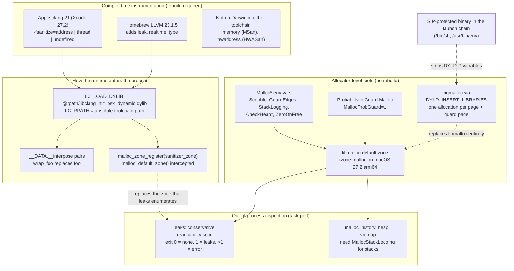

# C++ Sanitizers and Memory Debugging on macOS

> [!summary] Claim:
> On macOS, Apple clang ships three sanitizer runtimes for the host (`asan`, `tsan`, `ubsan`), each a dylib that the binary loads through `@rpath`, and none of them can find leaks: Apple's ASan dies on `detect_leaks=1` and the driver rejects `-fsanitize=leak`, while upstream LLVM from Homebrew supports both on Apple Silicon.
> MemorySanitizer and HWASan do not exist for Darwin in either toolchain, and Valgrind's platform list has no arm64 Darwin entry, so uninitialized reads are found with allocator tricks and leaks with Apple's out-of-process `leaks` tool.
> The allocator itself is a debugging tool: libmalloc reads `Malloc*` environment variables at process start, `libgmalloc` replaces it with one guard page per allocation, and Probabilistic Guard Malloc samples allocations into guarded slots.
> Every one of these tools is an environment variable or a dyld insertion, so System Integrity Protection, a `#!/bin/sh` wrapper, or a second malloc replacement can silently switch it off.



## The Mechanism

This note owns what is different on macOS.
How shadow memory, redzones, and quarantine work is owned by [[Cpp-AddressSanitizer-and-LeakSanitizer-Internals]]; vector clocks and MSan's bit-exact shadow are owned by [[Cpp-ThreadSanitizer-and-MemorySanitizer-Internals]]; tag-based detection is owned by [[Cpp-HWASan-and-Hardware-Memory-Tagging]].
Every "observed" statement below comes from commands run on macOS 27.2 (build 26B123), arm64, with Xcode 27.2 (Apple clang 21.0.0, `clang-2100.4.1.1`) and Homebrew LLVM 23.1.5 on 2026-11-08; this note has no recorded lab, so addresses and PIDs in excerpts are elided and anything observed should be re-run before it is relied on.

### 1. Two toolchains, two runtime inventories

A Mac usually has two Clangs: Apple clang from Xcode or the Command Line Tools, and an upstream LLVM from Homebrew or a source build.
They share a front end but ship different compiler-rt runtime sets, and the runtime set, not the compiler, decides which sanitizers exist.
Listing `$(clang -print-resource-dir)/lib/darwin/` for each shows the difference (observed, as of 2026-11, macOS):

| Runtime dylib for macOS (`*_osx_dynamic.dylib`) | Apple clang 21.0.0 | Homebrew LLVM 23.1.5 |
| :--- | :--- | :--- |
| `asan` (AddressSanitizer) | yes | yes |
| `tsan` (ThreadSanitizer) | yes | yes |
| `ubsan` (UndefinedBehaviorSanitizer) | yes | yes, plus `ubsan_minimal` |
| `lsan` (standalone LeakSanitizer) | no | yes |
| `rtsan` (RealtimeSanitizer) | no | yes |
| `tysan` (TypeSanitizer) | no | yes |
| `msan`, `hwasan`, `dfsan`, `safestack` | no | no |

For other Apple targets, Apple clang 21 ships `tsan` for macOS, the iOS, tvOS, watchOS, and visionOS simulators, and `xros`, but not for iOS, tvOS, or watchOS devices; Apple's documentation is stricter and says Thread Sanitizer cannot diagnose apps running on an iOS, iPadOS, tvOS, visionOS, or watchOS device, so the `xros` device runtime is `UNVERIFIED: present on disk, but Apple does not document device support for it`.
The driver checks the target before linking, so the missing ones fail early (observed with `clang++ -fsanitize=<name> t.cpp`, as of 2026-11, macOS):

```text
Apple clang:    -fsanitize=leak       error: unsupported option '-fsanitize=leak' for target 'arm64-apple-darwin27.2.0'
Apple clang:    -fsanitize=memory     error: unsupported option '-fsanitize=memory' for target 'arm64-apple-darwin27.2.0'
Apple clang:    -fsanitize=hwaddress  error: unsupported option '-fsanitize=hwaddress' for target 'arm64-apple-darwin27.2.0'
Apple clang:    -fsanitize=type       ld: file cannot be open()ed ... libclang_rt.tysan_osx_dynamic.dylib
Homebrew 23.1.5: -fsanitize=memory    error: unsupported option '-fsanitize=memory' for target 'arm64-apple-darwin27.2.0'
Homebrew 23.1.5: -fsanitize=hwaddress error: unsupported option '-fsanitize=hwaddress' for target 'arm64-apple-darwin27.2.0'
Both:           -fsanitize=address,thread  error: ... '-fsanitize=address' not allowed with '-fsanitize=thread'
```

`-fsanitize=type` is the odd one: Apple's driver accepts it and the link fails because the runtime file is absent.
`address,undefined` and `thread,undefined` both link with Apple clang (observed).

### 2. How a sanitizer runtime enters a Mach-O process

On Linux the sanitizer runtime is usually linked statically into the executable.
On Darwin it is always a dylib (`libclang_rt.asan_osx_dynamic.dylib`), and the driver records two load commands in the executable (observed with `otool -L` and `otool -l`):

```text
LC_LOAD_DYLIB  @rpath/libclang_rt.asan_osx_dynamic.dylib
LC_RPATH       @executable_path
LC_RPATH       /Applications/Xcode.app/Contents/Developer/Toolchains/XcodeDefault.xctoolchain/usr/lib/clang/21/lib/darwin
```

The absolute `LC_RPATH` means the binary runs only where that Xcode is installed at that path, and an Xcode upgrade that changes the Clang major version (the `21` in the path) breaks every old instrumented binary.
The Homebrew build records an absolute path to `/opt/homebrew/opt/llvm/lib/clang/23/lib/darwin/` directly in `LC_LOAD_DYLIB` (observed).
[[Dynamic-Linking-PLT-GOT-and-Loaders]] and [[macOS-vs-Linux-Toolchain-Mechanics]] own `@rpath` resolution.

Interception differs from Linux too.
`interception.h` at llvmorg-23.1.5 explains that on Darwin the runtime is a dylib with a `__DATA,__interpose` section of `{ wrap_foo, foo }` pointer pairs, so dyld routes every call made through a stub to the wrapper, and `INTERCEPT_FUNCTION()` "is effectively a no-op on this system".
The heap is replaced at the malloc-zone level rather than by symbol: `sanitizer_malloc_mac.inc` builds a `malloc_zone_t` whose callbacks are `__sanitizer_mz_malloc`, `__sanitizer_mz_free`, and the rest, calls `malloc_zone_register(&sanitizer_zone)` in `ReplaceSystemMalloc()`, and intercepts `malloc_default_zone()` and `malloc_create_zone()` so that code which asks libmalloc for a zone gets the sanitizer's.

Shadow placement is also platform-specific.
`asan_mapping.h` gives `SANITIZER_APPLE && defined(__aarch64__)` a dynamic shadow offset (`ASAN_SHADOW_OFFSET_DYNAMIC`) instead of the fixed `0x0000001000000000` used on Linux AArch64, and `tsan_platform.h` has a dedicated `MappingAppleAarch64` with the application heap at `0x0200000000` to `0x0300000000` and shadow at `0x0400000000` to `0x0800000000`.

### 3. The leak-detection boundary

Upstream compiler-rt can find leaks on Apple Silicon, and the Clang LeakSanitizer documentation lists macOS among its supported platforms.
`lsan_common.h` at llvmorg-23.1.5 defines `CAN_SANITIZE_LEAKS 1` when `(SANITIZER_LINUX || SANITIZER_APPLE) && (SANITIZER_WORDSIZE == 64)` and the CPU is one of `__x86_64__`, `__mips64`, `__aarch64__`, `__powerpc64__`, `__s390x__`.
`sanitizer_flags.inc` sets the default as `COMMON_FLAG(bool, detect_leaks, !SANITIZER_APPLE, ...)`, so leak checking is off by default on every Apple platform, and the Clang ASan documentation says it "can be enabled using `ASAN_OPTIONS=detect_leaks=1` on macOS".

Apple's runtime is built without it.
`asan_flags.cpp` validates the flag with `if (!CAN_SANITIZE_LEAKS && common_flags()->detect_leaks)`, prints `detect_leaks is not supported on this platform.`, and calls `Die()`.
Observed with the same leaking program (as of 2026-11, macOS arm64):

| Build | `ASAN_OPTIONS` | Result | Exit status |
| :--- | :--- | :--- | :--- |
| Apple clang `-fsanitize=address` | unset | no report | 0 |
| Apple clang `-fsanitize=address` | `detect_leaks=1` | `==PID==AddressSanitizer: detect_leaks is not supported on this platform.` | 134 (abort) |
| Homebrew `-fsanitize=address` | unset | no report | 0 |
| Homebrew `-fsanitize=address` | `detect_leaks=1` | `ERROR: LeakSanitizer: detected memory leaks`, direct leak with allocation stack | 1 |
| Homebrew `-fsanitize=leak` | n/a | standalone `libclang_rt.lsan_osx_dynamic.dylib`, same report | nonzero |

Apple documents the gap from its side: "Address Sanitizer doesn't detect memory leaks, attempts to access uninitialized memory, or integer overflow errors."
The supported Apple path to leaks is the `leaks` tool in section 7.
Rust inherits a different boundary: the Unstable Book lists LeakSanitizer for `x86_64-apple-darwin` but not `aarch64-apple-darwin` (as of 2026-11).

### 4. MSan, HWASan, and hardware tagging

MemorySanitizer is documented for Linux, NetBSD, and FreeBSD only, and it "requires that all program code is instrumented", including libc, which on macOS is `libSystem` and cannot be rebuilt.
The HWASan design document targets AArch64 Top Byte Ignore on Linux and Android, with a heap-only page-aliasing mode on x86_64, and does not mention Darwin.
Arm64 macOS does use the top pointer bits, for pointer authentication on `arm64e` code, which [[Hardware-Security-ABIs-PAC-BTI-CET-and-RELRO]] covers.

Apple's hardware tagging route is Memory Integrity Enforcement, announced on 2025-09-09: secure allocators plus EMTE in synchronous mode and Tag Confidentiality Enforcement, shipping on A19 and A19 Pro iPhones, with EMTE exposed to developers through Xcode's Enhanced Security feature.
The announcement does not mention Macs, so whether any Mac exposes EMTE to third-party processes is `UNVERIFIED: no Apple primary source found for macOS hardware support as of 2026-11`.
[[Cpp-HWASan-and-Hardware-Memory-Tagging]] owns the tag-checking mechanism.

For uninitialized reads on macOS, the practical options are allocation-time scribbling (section 5, `0xaa`), libgmalloc's `MALLOC_FILL_SPACE` (`0x55`), UBSan's `-fsanitize=bool,enum` checks for invalid values, or a Linux MSan build of the same code in a container.

### 5. libmalloc as a debugger: the `Malloc*` environment variables

libmalloc reads its configuration from the environment at the first allocation.
`MallocHelp=1` prints the list the running library honors (observed: `MallocLogFile`, `MallocGuardEdges`, `MallocDoNotProtectPrelude`, `MallocDoNotProtectPostlude`, `MallocStackLogging`, `MallocStackLoggingNoCompact`, `MallocStackLoggingDirectory`, `MallocScribble`, `MallocCheckHeapStart`, `MallocCheckHeapEach`, `MallocCheckHeapSleep`, `MallocCheckHeapAbort`, `MallocCorruptionAbort`, `MallocErrorAbort`, `MallocTracing`, `MallocZeroOnFree`, `MallocCheckZeroOnFreeCorruption`, `MallocHelp`).
The macOS 27.2 SDK's `malloc(3)` documents the semantics:

- `MallocScribble` fills newly allocated memory with `0xaa` and freed memory with `0x55`, and warns that "the 0x55 pattern may not appear in some parts of a deallocated memory block".
- `MallocGuardEdges` adds a guard page before and after each large block; the two `DoNotProtect` variables remove one side.
- `MallocStackLogging=1` means `lite`: stacks for live allocations only, kept in memory for `leaks` and `malloc_history`; `full` logs allocation and free events to disk under `MallocStackLoggingDirectory` (default `/tmp`); `vm` and `malloc` restrict what is recorded; `MallocStackLoggingNoCompact` implies `full` without eliding adjacent events.
- `MallocCheckHeapStart <s>` and `MallocCheckHeapEach <n>` run a heap consistency check every `n` operations after `s` (default repetition 1000), sleeping `MallocCheckHeapSleep` seconds (default 100) for a debugger, or aborting with `MallocCheckHeapAbort`.
- `MallocCorruptionAbort` "is always set on 64-bit processes", so a detected double free already aborts; `MallocErrorAbort` also aborts on out-of-memory.
- `MallocZeroOnFree`: "Starting in macOS 13, iOS 16.1 and aligned releases, free(3) fully zeroes many blocks immediately", so a read-after-free may see zeroes; the variable can force zeroing on or off for diagnosis and "should not be used by shipping software".

The allocator behind those variables has changed.
`MallocReportConfig=1` prints `Enable Xzone Malloc: 1` and `Xzone Enablement Reason: default` on this machine (observed), and `src/malloc.c` in libmalloc-812.100.31 creates the default zone with `xzm_main_malloc_zone_create()` when xzone is enabled.
The same file skips the nano allocator when `MALLOC_DO_SCRIBBLE` is set, with the comment "MallocScribble is enabled, which nanov2 does not implement".
libmalloc's own `malloc_scribble_check` test checks only the `0xaa` fill on allocation; its comment says checking `0x55` on free is something "we can't rely on ... always working in an integration test".

Observed with a program that fills a block with `0x11`, frees it, and reads it back (default allocator, as of 2026-11, macOS 27.2 arm64; reading freed memory is undefined behavior and is done here only to observe the allocator):

| Block size | No variables | `MallocScribble=1` | `MallocZeroOnFree=0` |
| :--- | :--- | :--- | :--- |
| 64 B | zero except allocator metadata in the first 16 bytes | same as no variables | stale `0x11` beyond the first 16 bytes |
| 2,000 B | all zero | all zero | stale `0x11` |
| 40,000 B | stale `0x11` | `0x55` | stale `0x11` |
| 300,000 B | stale `0x11` | `0x55` | stale `0x11` |

The lesson is not the table, which will change with libmalloc releases, but the rule it supports: on current macOS, "no `0x55` in the crash address" does not rule out use-after-free, and "the freed memory read as zero" is the expected signature of zero-on-free.

### 6. Probabilistic Guard Malloc

`src/pgm_malloc.c` in libmalloc-812.100.31 implements a sampling guarded allocator, the same idea as GWP-ASan.
A sampled allocation goes into a slot with its own guard pages, and the slot metadata keeps allocating and freeing thread IDs, timestamps, and a compressed stack trace buffer of 216 bytes ("~62 frames").
`should_activate()` turns it on by default only for platform binaries, for about 1 in 1,000 processes (1 in 250 on internal builds), unless the main image has a `__DATA,__pgm_opt_out` section.
`MallocProbGuard=1` forces it on for any process, and `MallocProbGuardSampleRate`, `MallocProbGuardAllocations`, `MallocProbGuardMemoryBudgetInKB`, and related variables tune it; the default sample rate is a random value from 500 to 5,000.
Observed: with `MallocProbGuard=1 MallocProbGuardSampleRate=1`, a one-byte read after `free()` of a 32-byte block terminated with `SIGBUS` (exit status 138), while the default run printed a stale value and exited 0.
These variables are absent from `malloc(3)` and `MallocHelp`, so treat them as an internal interface that can change without notice.

### 7. libgmalloc (Guard Malloc)

`/usr/lib/libgmalloc.dylib` is a replacement allocator that "uses the virtual memory system to identify memory access bugs" (`libgmalloc(3)`).
Each allocation gets its own page or pages, ending at the end of the last page with the next page unmapped, so the first byte past the end faults; freeing deallocates the pages, so any later access faults.
Allocations stay 16-byte aligned by default, so "up to 15 bytes at the end of an allocated block may be excess at the end of the page" and overruns into that slack go unnoticed.
Observed: a 13-byte block survived writes at `p[13]` and `p[15]` and crashed at `p[16]`; `MALLOC_PROTECT_BEFORE=1` moved the guard to the front, after which `p[-1]` crashed.

You enable it by setting `DYLD_INSERT_LIBRARIES=/usr/lib/libgmalloc.dylib` (Xcode's "Enable Guard Malloc" scheme option sets the same variable).
Its own variables are `MALLOC_PROTECT_BEFORE`, `MALLOC_FILL_SPACE` (fill new buffers with `0x55`), `MALLOC_ALLOW_READS`, `MALLOC_VECTOR_SIZE` (the default 16-byte alignment), `MALLOC_POINTER_SIZE` (8-byte alignment on 64-bit), `MALLOC_ALLOW_LARGE_REQUESTS` (disables the 100 MB trap), `MALLOC_MAXIMUM_VM`, `MALLOC_CHECK_HEADER`, and `MALLOC_LOG_FILE`; `MallocStackLogging` still works with it, so `malloc_history` can show allocation and free stacks.
The cost is at least two pages of virtual memory per allocation, which on arm64 macOS, with 16 KiB pages, makes it unsuitable for allocation-heavy programs.

The `dyld(1)` page warns that if System Integrity Protection is enabled, the `DYLD_*` variables "are ignored when executing binaries protected by System Integrity Protection".
That includes every shell and tool in `/bin` and `/usr/bin`.
The variable does not survive the protected process either: `DYLD_INSERT_LIBRARIES=/usr/lib/libgmalloc.dylib /bin/sh -c 'echo ${DYLD_INSERT_LIBRARIES:-unset}'` prints `unset` (observed), so a script started as `#!/bin/sh` passes nothing to its children.

### 8. `leaks`, `heap`, `malloc_history`, and `vmmap`

`leaks(1)` attaches to a process through its task port and does a conservative mark phase: any malloc block reachable from a pointer in writable global memory (`__DATA`), a register, or a stack is in use, and so is anything reachable from a reachable block.
Unreachable blocks are leaks, and `leaks` groups them into "root leaks" (no other block references them) and "root cycles".
`leaks -atExit -- ./prog` launches the program, runs the scan when it exits, and sets `MallocStackLogging=lite` automatically so each root leak has its allocation stack; the exit status is 0 for no leaks, 1 for leaks, and greater than 1 for an error, which makes it a CI gate.
`leaks pid -outputGraph f.memgraph` saves a memory graph that `leaks`, `heap`, `malloc_history`, `vmmap`, and the Xcode Memory Graph Debugger can open later.

Two observed details matter in practice:

- For a 4,096-byte `malloc()` the report said `1 leak for 5120 total leaked bytes`: `leaks` reports the size of the block the allocator handed out, not the size requested.
- For an ad-hoc signed binary, `leaks` warns `Process ... is not debuggable. Due to security restrictions, leaks can only show or save contents of readonly memory of restricted processes.`; detection still worked, but leaked-block contents are withheld.

`leaks` needs the zone introspection that libmalloc provides, so it does not work on an ASan build, whose zone is the sanitizer's.
Observed: `leaks -atExit -- ./asan_binary` fails with `unable to inspect heap ranges of target process; it may be using a malloc replacement library without the required support`.
`malloc_history pid address` lists every allocation and free event touching an address with stacks, and needs `full` stack logging for history of freed blocks.

### 9. Symbolization: `atos` and dSYMs

`sanitizer_symbolizer_posix_libcdep.cpp` on Apple tries `atos` first when no symbolizer path is set and falls back to `llvm-symbolizer`; `ASAN_SYMBOLIZER_PATH` overrides both.
`atos` reads DWARF from a dSYM bundle or from the object files named in the executable's debug map.
When Clang compiles and links in one command with `-g` it runs `dsymutil` and leaves `prog.dSYM` next to the binary; when the build compiles and links separately, no dSYM is made, and deleting the `.o` files removes the line information.
Observed: after `clang++ -c` then a separate link and `rm uaf.o`, the ASan frame degraded from `in main uaf.cpp:2` to `in main+0x98 (uaf2:arm64+0x1000008d8)`.
The ASan documentation says "on macOS you may need to run `dsymutil` on your binary"; [[DWARF-Debug-Information-and-Symbol-Bundles]] owns the debug map and dSYM format.

## Commands and Numbers to Know

| Item | Value | Platform and date | What it controls |
| :--- | :--- | :--- | :--- |
| `-fsanitize=address` | `libclang_rt.asan_osx_dynamic.dylib` via `@rpath` | macOS (as of 2026-11) | ASan; documented typical slowdown 2x (Clang), "2x to 5x" and 2 to 3 times memory (Apple) |
| `-fsanitize=thread` | `libclang_rt.tsan_osx_dynamic.dylib` | macOS (as of 2026-11) | TSan on Darwin arm64 and x86_64; Clang documents 5x-15x slowdown and 5x-10x memory |
| `-fsanitize=undefined` | `libclang_rt.ubsan_osx_dynamic.dylib` | macOS (as of 2026-11) | Combines with `address` or `thread`; Apple documents about 20% CPU in debug builds |
| `-fsanitize=leak` | rejected by Apple clang 21; works with Homebrew LLVM 23.1.5 | macOS (as of 2026-11) | Standalone LSan |
| `-fsanitize=memory`, `hwaddress` | rejected by both | macOS (as of 2026-11) | No MSan or HWASan for Darwin |
| `ASAN_OPTIONS=detect_leaks=1` | Apple runtime: abort, exit 134; upstream runtime: leak report, exit 1 | macOS (as of 2026-11) | `detect_leaks` default is `!SANITIZER_APPLE`, so off |
| `ASAN_SYMBOLIZER_PATH` | unset: `atos`, then `llvm-symbolizer` | macOS (as of 2026-11) | Symbolizer selection |
| `dsymutil prog` | writes `prog.dSYM` | macOS (as of 2026-11) | Keeps file:line after `.o` files are gone |
| `leaks -atExit -- cmd` | exit 0 none, 1 leaks, >1 error | macOS (as of 2026-11) | Sets `MallocStackLogging=lite` for `cmd` |
| `leaks pid -outputGraph f.memgraph` | memory graph file | macOS (as of 2026-11) | Offline analysis with `leaks`, `heap`, `malloc_history`, `vmmap` |
| `MallocStackLogging` | `1` = `lite`; also `full`, `vm`, `malloc` | macOS (as of 2026-11) | Allocation stacks for `leaks` and `malloc_history` |
| `MallocStackLoggingDirectory` | default `/tmp` | macOS (as of 2026-11) | Where `full` logs go |
| `MallocScribble` | `0xaa` on allocate, `0x55` on free (not guaranteed on free) | macOS (as of 2026-11) | Exposes uninitialized and stale reads |
| `MallocZeroOnFree` | `0` or `1`; zeroing on by default since macOS 13 | macOS (as of 2026-11) | Diagnosis only, never ship it |
| `MallocGuardEdges` | guard page before and after large blocks | macOS (as of 2026-11) | Catches large-block overruns |
| `MallocCheckHeapStart`, `MallocCheckHeapEach` | Start is required; Each defaults to 1000 | macOS (as of 2026-11) | Periodic heap consistency checks |
| `MallocCheckHeapSleep` | default 100 s | macOS (as of 2026-11) | Time to attach a debugger on corruption |
| `MallocCorruptionAbort` | always set on 64-bit | macOS (as of 2026-11) | Double free and corruption abort |
| `MallocReportConfig=1` | prints xzone enablement | macOS (as of 2026-11) | Not in `malloc(3)`; read from libmalloc source |
| `MallocProbGuard=1` | forces Probabilistic Guard Malloc | macOS (as of 2026-11) | Not in `malloc(3)`; default sample rate 500 to 5,000 |
| `DYLD_INSERT_LIBRARIES=/usr/lib/libgmalloc.dylib` | page per allocation, 16-byte slack | macOS (as of 2026-11) | Stripped by SIP-protected binaries |
| `MALLOC_PROTECT_BEFORE` | guard page before the block | macOS (as of 2026-11) | Underrun detection under libgmalloc |
| `MALLOC_FILL_SPACE` | fill with `0x55` on allocation | macOS (as of 2026-11) | Uninitialized-read exposure under libgmalloc |

## Multi-Language Comparison: C++ / Python / Rust on macOS

| Concern | C++ (Apple clang 21) | Python (CPython 3.15) | Rust (nightly `-Zsanitizer`) |
| :--- | :--- | :--- | :--- |
| ASan | `-fsanitize=address` | `./configure --with-address-sanitizer` (since 3.6), ideally with `--without-pymalloc` | `aarch64-apple-darwin`, `x86_64-apple-darwin` listed |
| TSan | `-fsanitize=thread` | `--with-thread-sanitizer` (since 3.13) | both Apple targets listed |
| LSan | not in Apple clang; Homebrew LLVM works | depends on the Clang used to build CPython | only `x86_64-apple-darwin` listed |
| MSan, HWASan | unavailable | `--with-memory-sanitizer` exists but MSan has no Darwin runtime | no Apple targets listed |
| Small-object allocator hides heap bugs | not applicable | `PYTHONMALLOC=malloc` routes every domain to `malloc()`, so `leaks`, libgmalloc, and `Malloc*` see each object | default global allocator is the system `malloc` |
| Leak finding without a rebuild | `leaks -atExit` | `leaks` on the interpreter plus `tracemalloc` for Python-level owners | `leaks -atExit` on the test binary |

The Python cell for `PYTHONMALLOC` is an inference from its documented meaning; the documentation does not mention `leaks` or libgmalloc.
[[Python-tracemalloc-gc-and-Memory-Leaks]] and [[Rust-Miri-Sanitizers-Loom-and-Cargo-Fuzz]] own the language-side tools.

## Worked Lab Example

This note has no recorded lab.
The session below is copy-pasteable and was run on the platform named in the Mechanism section; the excerpts are trimmed and have addresses and PIDs elided, and they are not golden output, so re-run them before relying on them.

```bash
WORK=$(mktemp -d) && cd "$WORK"

cat > leak.cpp <<'EOF'
#include <cstdio>
#include <cstdlib>
void *g;
int main() { void *p = std::malloc(4096); p = nullptr; g = std::malloc(16); std::puts("done"); }
EOF

cat > uaf.cpp <<'EOF'
#include <cstdio>
int main() { int *p = new int[8]; delete[] p; std::printf("%d\n", p[2]); }
EOF

# 1. ASan finds the use-after-free; one-step build also writes uaf.dSYM.
xcrun clang++ -g -O0 -fsanitize=address uaf.cpp -o uaf && ./uaf 2>&1 | sed -n '2,4p'

# 2. Apple's ASan cannot find the leak, and dies if asked to.
xcrun clang++ -g -O0 -fsanitize=address leak.cpp -o leak_asan
ASAN_OPTIONS=detect_leaks=1 ./leak_asan; echo "exit=$?"

# 3. The Apple-supported path: an uninstrumented build under leaks.
xcrun clang++ -g -O0 leak.cpp -o leak_plain
leaks -quiet -atExit -- ./leak_plain > leaks.txt 2>&1; echo "exit=$?"
grep -E 'leak for|ROOT LEAK|main' leaks.txt

# 4. Upstream LLVM, when it is installed, restores LSan on Apple Silicon.
if [ -x /opt/homebrew/opt/llvm/bin/clang++ ]; then
  /opt/homebrew/opt/llvm/bin/clang++ -g -fsanitize=address leak.cpp -o leak_up
  ASAN_OPTIONS=detect_leaks=1 ./leak_up 2>&1 | grep -E 'Direct leak|SUMMARY'
fi

cd / && rm -rf "$WORK"
```

Excerpts observed on macOS 27.2 arm64 (Apple clang 21.0.0, Homebrew LLVM 23.1.5), not a recorded lab:

```text
# step 1
READ of size 4 at <addr> thread T0
    #0 <pc> in main uaf.cpp:2
# step 2
==<pid>==AddressSanitizer: detect_leaks is not supported on this platform.
exit=134
# step 3
exit=1
Process <pid>: 1 leak for 5120 total leaked bytes.
STACK OF 1 INSTANCE OF 'ROOT LEAK: <malloc in main>':
1   leak_plain   <pc> main + <offset>  leak.cpp:4
# step 4
Direct leak of 4096 byte(s) in 1 object(s) allocated from:
SUMMARY: AddressSanitizer: 4096 byte(s) leaked in 1 allocation(s).
```

Reading it:

- Only the 4,096-byte block leaks; `g` is a global in `__DATA`, so both `leaks` and LSan treat its block as reachable.
- `leaks` reports 5,120 bytes for the same block because it reports the allocator's block size, and LSan reports 4,096 because it reports the requested size.
- Step 3 needed no rebuild, which is why `leaks -atExit` is the default leak gate for macOS test jobs.

## Pitfalls

> [!warning] Pitfall: copying `ASAN_OPTIONS=detect_leaks=1` from Linux CI
> On Linux it turns on what is already the default; on Apple clang it aborts every test at startup with exit status 134 before `main` runs.
> Split the options by platform, and gate leaks on macOS with `leaks -atExit` or an upstream-LLVM job instead.

> [!warning] Pitfall: assuming "no report" means "no leaks"
> Apple's ASan never reports leaks, and upstream ASan on macOS reports them only when `detect_leaks=1` is set.
> A green macOS ASan job says nothing about leaks.

> [!warning] Pitfall: losing `DYLD_INSERT_LIBRARIES` through a shell
> `make`, `ctest`, `xcodebuild`, and test runners often start children through `/bin/sh`, a SIP-protected binary, which drops every `DYLD_*` variable.
> libgmalloc then silently does nothing; check for the `GuardMalloc[...]` banner on stderr, or set the variable as close to the target executable as possible.

> [!warning] Pitfall: stacking allocator replacements
> ASan, libgmalloc, and Probabilistic Guard Malloc all replace the heap, and `leaks` and the `Malloc*` variables need libmalloc's own zone.
> Use one at a time: under ASan, `leaks` fails with "unable to inspect heap ranges", and `MallocScribble` changes nothing that ASan's heap does.

> [!warning] Pitfall: expecting `0x55` after free
> On current macOS, zero-on-free and xzone malloc mean freed small blocks usually read as zero, with or without `MallocScribble`.
> Treat `0x5555555555555555` in a register as strong evidence of use-after-free, but treat its absence as no evidence at all.

> [!warning] Pitfall: shipping or archiving an instrumented binary
> The absolute `LC_RPATH` points into the Xcode that built it, so the binary fails to launch on a machine without that toolchain, or after an Xcode upgrade that changes the Clang major version.
> Keep sanitizer builds as CI artifacts tied to the toolchain that produced them.

> [!warning] Pitfall: trusting libgmalloc on small overruns
> With the default 16-byte alignment, an overrun that stays inside the slack after the block's end is invisible.
> Rerun with `MALLOC_PROTECT_BEFORE` for underruns and remember that ASan's redzones, not page guards, are the byte-exact tool.

> [!warning] Pitfall: losing line numbers in a split build
> A build that compiles and links in separate steps does not create a dSYM, and cleaning the `.o` files leaves ASan and `leaks` with `main+0x98` instead of `file:line`.
> Run `dsymutil` as a post-link step for any binary whose reports must outlive its object files.

## At Scale

For one developer, the Xcode scheme's Diagnostics tab and `leaks -atExit` cover most needs.
At 1,000 to 50,000 engineers, macOS is usually one CI platform among several, and the cost questions are which bugs only macOS can find and which macOS jobs are redundant with Linux.

- macOS-only bug classes are the reason to run sanitizers on macOS at all: Objective-C++ and framework interop, Mach and libdispatch threading, `@rpath` and two-level-namespace loading, and code behind `#ifdef __APPLE__`.
  Portable code that already runs under Linux ASan, LSan, and MSan gains little from the same job on macOS.
- Keep the full sanitizer matrix on Linux, where LSan is on by default and MSan exists, and on macOS run ASan plus UBSan and TSan plus UBSan on the Apple-specific targets, with `leaks -atExit` over the uninstrumented test binaries as the leak gate.
- Pin the Xcode version per CI image, because the runtime dylib path, the set of shipped runtimes, and the driver's accepted options all move with it.
- If leaks must be found under ASan on macOS, add an upstream-LLVM job and accept that its runtime and Apple's differ, so a pass on one is not a pass on the other.
- Treat Probabilistic Guard Malloc and zero-on-free as production mitigations Apple already runs on its own binaries, not as a test strategy: their reports arrive as crash logs, which [[Core-Dumps-Minidumps-and-Crash-Reporting]] and [[Symbol-Servers-and-debuginfod]] turn into stacks.
- Record each of these choices as a decision record, as [[Debugging-Decision-Records]] describes, so the next Xcode upgrade is checked against an explicit list.

## Practice Drill

> [!tip] Practice Drill:
> Write a program with four bugs: a heap overflow by one byte of a 13-byte block, a use-after-free read of a 64-byte block, a double free, and a 4 KiB leak.
> Before running anything, predict which of these tools reports each bug, and how: Apple ASan, Apple TSan, `MallocScribble=1`, `MallocGuardEdges=1`, libgmalloc with and without `MALLOC_PROTECT_BEFORE`, `MallocProbGuard=1 MallocProbGuardSampleRate=1`, and `leaks -atExit`.
> Then run each, record the exit status, and explain every prediction that failed, using the mechanisms in this note.
> As a stretch, start the libgmalloc run through a `#!/bin/sh` wrapper and show that the `GuardMalloc` banner disappears, then fix it without disabling SIP.
> [[Drill-Debugging-Use-After-Free-Core-Dump]] continues the use-after-free case from a core dump, and [[Cpp-Playbook-Heap-Corruption]] is the runbook for the double free.

## Interview Questions

> [!question] L5: You turn on Address Sanitizer in an Xcode scheme and a leaking unit test passes; why, and how do you catch the leak on the same Mac?
>
> > [!success]- Answer
> > Apple's ASan runtime has no leak checker: Apple's documentation says Address Sanitizer does not detect memory leaks, and setting `ASAN_OPTIONS=detect_leaks=1` makes the runtime print "detect_leaks is not supported on this platform." and abort.
> > On the same Mac, run the uninstrumented test binary under `leaks -atExit -- ./tests`, which scans the heap at exit, prints root leaks with allocation stacks because it sets `MallocStackLogging=lite`, and exits 1 when it finds any.
> > Alternatively, build with Homebrew's upstream LLVM, whose runtime supports LSan on Apple Silicon, and set `detect_leaks=1`, because the upstream default on Apple platforms is off.

> [!question] L5: Which sanitizers can you not use on macOS at all, and what do you do instead?
>
> > [!success]- Answer
> > MemorySanitizer and HWASan: both Apple clang and upstream Clang reject `-fsanitize=memory` and `-fsanitize=hwaddress` for `arm64-apple-darwin`, because MSan is documented for Linux, NetBSD, and FreeBSD and HWASan targets Linux and Android.
> > Valgrind does not help either: its supported-platforms page lists Darwin only for X86 (10.8 to 10.14) and AMD64 (10.8 to 13.0), not ARM64.
> > For uninitialized reads, use `MallocScribble` (new memory is `0xaa`) or libgmalloc's `MALLOC_FILL_SPACE` to make them fail loudly, UBSan's `bool` and `enum` checks for invalid values, or an MSan build of the same code in a Linux container.
> > For tag-style detection, Apple's equivalent is EMTE through Memory Integrity Enforcement on supported hardware, not HWASan.

> [!question] L6: Predict the output: a program fills a 64-byte block with `0x11`, frees it, and prints byte 40 of the freed block; it runs with `MallocScribble=1` on macOS 27.2 arm64.
>
> > [!success]- Answer
> > The textbook answer is `0x55`, and it is wrong on this platform.
> > Observed output is `0x00`: xzone malloc is the default zone, small blocks are zeroed on free (the documented macOS 13+ zero-on-free behavior), and the free-time scribble did not show through.
> > The same program with a 40,000-byte block printed `0x55`, and `malloc(3)` itself warns that the `0x55` pattern may not appear in parts of a freed block.
> > The broader point is that the allocator's debugging behavior is per size class and per release, so a use-after-free on macOS can read zero, a stale value, or `0x55`.

> [!question] L6: Debug this: a CI job sets `DYLD_INSERT_LIBRARIES=/usr/lib/libgmalloc.dylib` and runs `make test`, the tests pass, and an overrun the team knows about is never caught.
>
> > [!success]- Answer
> > First check whether libgmalloc loaded at all: it prints `GuardMalloc[...]` banner lines on stderr, and they are missing.
> > `make` runs each recipe through `/bin/sh`, which is protected by System Integrity Protection, and dyld ignores and strips `DYLD_*` variables for protected binaries, so the test binary started with the normal allocator.
> > Fix it by setting the variable in the recipe on the test command itself (`env DYLD_INSERT_LIBRARIES=... ./test`), or by launching the test binary directly from the CI step, then confirm the banner appears.
> > Also check the overrun size: with the default 16-byte alignment, an overrun that stays inside the slack after the block is still invisible, so a byte-exact overrun needs ASan.

> [!question] L6: Why does `leaks -atExit` fail on an ASan build, and why does `leaks` sometimes report more bytes than the code allocated?
>
> > [!success]- Answer
> > `leaks` enumerates the target's malloc zones through libmalloc's introspection interface; the ASan runtime registers its own zone with `malloc_zone_register()` and intercepts `malloc_default_zone()`, so the heap `leaks` must scan belongs to the sanitizer's allocator, and `leaks` reports "unable to inspect heap ranges".
> > The size difference comes from reporting the allocator's block size, not the requested size, so a 4,096-byte request was reported as a 5,120-byte leak in an observed run.
> > LSan, by contrast, reports the requested size from its own chunk headers.

> [!question] L7: A macOS-only crash in a C++ service looks like heap corruption and does not reproduce under ASan; walk through the tools you would try, in order, and why.
>
> > [!success]- Answer
> > ASan changes allocation layout and timing, so a bug that depends on adjacency or on a specific allocator can disappear; the next tools keep or change the allocator deliberately.
> > Start with the cheapest no-rebuild checks on libmalloc: `MallocStackLogging=full` so `malloc_history` can show who allocated and freed the crashing address, and `MallocCheckHeapStart` and `MallocCheckHeapEach` to move detection closer to the corrupting write, with `MallocCheckHeapSleep` to attach LLDB.
> > Then try `MallocGuardEdges` for large-block overruns and libgmalloc for small blocks, which turns the first out-of-bounds or freed access into an immediate fault, at the cost of two pages per allocation.
> > For a rare bug in a long run, `MallocProbGuard=1` samples allocations into guarded slots and keeps allocation and free stacks, which is the GWP-ASan trade-off: cheap enough to leave on, but probabilistic.
> > If the bug is a race, use TSan, which is fully supported on Darwin arm64, and if all else fails reproduce on Linux, where MSan and rr exist.

> [!question] L7: Explain how the ASan runtime gets into a Mach-O executable and takes over `malloc`, and what that implies for distributing instrumented builds.
>
> > [!success]- Answer
> > The driver links against `libclang_rt.asan_osx_dynamic.dylib` with an `@rpath` install name and adds an absolute `LC_RPATH` to the toolchain's `lib/clang/<major>/lib/darwin` directory, so dyld loads the runtime at launch.
> > Interposition uses the runtime's `__DATA,__interpose` section of replacement and original pointer pairs, which dyld applies to calls made through stubs; there is no runtime patching.
> > The heap is replaced at the zone level: the runtime registers a sanitizer `malloc_zone_t` and intercepts `malloc_default_zone()` and `malloc_create_zone()`.
> > The implications: instrumented binaries depend on the exact toolchain path and Clang major version, cannot be mixed with another malloc replacement, and break the libmalloc-based tools (`leaks`, `Malloc*`), so they belong in CI, not in an artifact store.

> [!question] L7+: Your organization runs 20,000 engineers' C++ on Linux and macOS CI; design the macOS memory-safety tier and justify what you leave out.
>
> > [!success]- Answer
> > Run the full sanitizer matrix on Linux, where LSan is on by default and MSan exists, because portable code gains nothing from running the same matrix on macOS.
> > On macOS, run ASan plus UBSan and TSan plus UBSan only on targets with Apple-specific code (Objective-C++, frameworks, libdispatch, `#ifdef __APPLE__`), plus `leaks -atExit` over uninstrumented test binaries as the leak gate, using its exit status 1.
> > Pin Xcode per CI image and treat an Xcode bump as a toolchain change with its own validation, because runtime paths, shipped runtimes, and accepted flags move with it.
> > Leave out MSan and HWASan (unavailable), Valgrind (its platform list stops at AMD64/Darwin 13.0), and libgmalloc in CI (too much memory per allocation), keeping libgmalloc and `MallocProbGuard` as on-demand investigation tools.
> > Write the matrix down as a decision record with the reasons, so the next platform change is evaluated against it rather than rediscovered.

> [!question] L8+: Apple ships zero-on-free, xzone malloc, Probabilistic Guard Malloc, and Memory Integrity Enforcement as production defenses; how should that change how your team debugs memory bugs on Apple platforms?
>
> > [!success]- Answer
> > The allocator is now both a mitigation and a moving target: freed small blocks read as zero, so many use-after-free bugs show up as null-pointer crashes rather than garbage, and debugging patterns tuned to `0x55` or stale data stop matching.
> > Crash reports from the field may come from sampled guard-page faults or synchronous tag-check faults, which point at the exact faulting access instead of a later corruption symptom, so symbolication and crash clustering become more valuable than local reproduction.
> > Locally, use `MallocZeroOnFree=0` to restore the old behavior when you need to see stale contents, and `MallocProbGuard=1` with a sample rate of 1 to make sampled detection deterministic in a test run.
> > Because none of the internal variables are a public contract, wrap their use in scripts that verify they took effect (for example `MallocReportConfig=1` output or the `GuardMalloc` banner) and revalidate those scripts on each macOS release.

## Further Reading

- Clang AddressSanitizer documentation: the supported-platform list and the statement that leak detection is opt-in on macOS.
- Clang ThreadSanitizer and MemorySanitizer documentation: Darwin arm64 TSan support, documented overheads, and MSan's platform list and whole-program requirement.
- compiler-rt at llvmorg-23.1.5, `lsan_common.h`, `sanitizer_flags.inc`, `asan_flags.cpp`: where the macOS leak-detection boundary is decided, and the abort that Apple's runtime hits.
- compiler-rt `interception.h` and `sanitizer_malloc_mac.inc`: Darwin interposition and malloc zone replacement in source.
- Apple, "Diagnosing memory, thread, and crash issues early": what each Xcode sanitizer covers, its documented overhead, and the device restriction on TSan.
- `malloc(3)` in the macOS 27.2 SDK and `MallocHelp=1`: the authoritative list of `Malloc*` variables for the libmalloc you are actually running.
- libmalloc-812.100.31 `src/malloc.c`, `src/pgm_malloc.c`, and `tests/scribble_tests.c`: xzone selection, Probabilistic Guard Malloc, and why free-time scribbling is not guaranteed.
- `libgmalloc(3)`, `leaks(1)`, `malloc_history(1)`, and `dyld(1)`: Guard Malloc semantics, leak scanning and exit codes, allocation history, and the SIP rule for `DYLD_*` variables.
- Apple Security Research, "Memory Integrity Enforcement" (2025): Apple's hardware memory tagging direction and what Xcode exposes to developers.

## Related

- Prerequisites: [[Cpp-AddressSanitizer-and-LeakSanitizer-Internals]]
- Next: [[Cpp-Valgrind-Memcheck-Helgrind-and-DRD]]
- See also: [[Cpp-ThreadSanitizer-and-MemorySanitizer-Internals]], [[Cpp-HWASan-and-Hardware-Memory-Tagging]], [[Cpp-UndefinedBehaviorSanitizer-and-UB-Field-Guide]], [[Cpp-Playbook-Heap-Corruption]], [[macOS-vs-Linux-Toolchain-Mechanics]], [[macOS-Instruments-xctrace-and-DTrace]]
