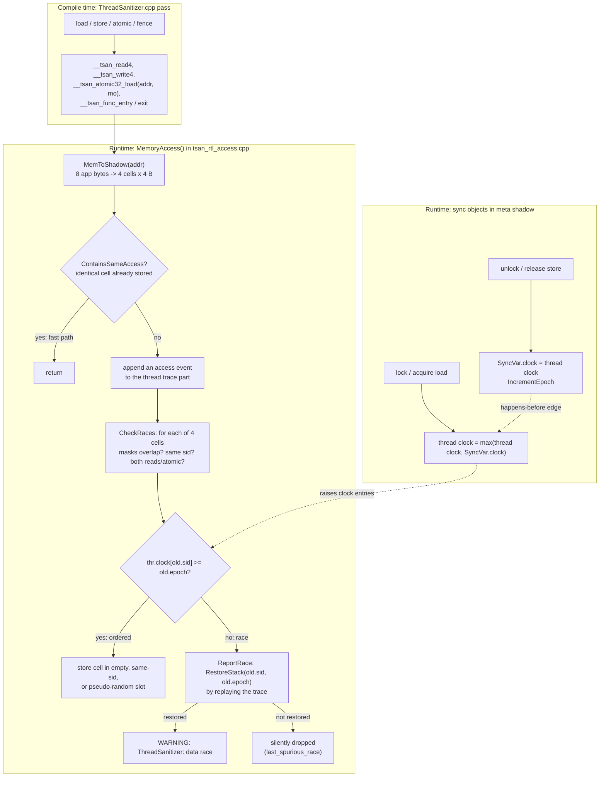

# C++ ThreadSanitizer and MemorySanitizer Internals

> [!summary] Claim:
> ThreadSanitizer (TSan) v3 maps every 8 bytes of application memory to four 4-byte shadow cells, each recording which bytes were touched, by which of 255 usable thread slots, at which 14-bit epoch, and whether the access was a read or an atomic.
> A new access races with a stored one when their byte masks overlap, the slots differ, they are not both reads or both atomic, and the current thread's vector clock entry for the old slot is below the old epoch: so TSan reports missing happens-before edges, not observed overlap in time.
> Only synchronization the runtime models moves clocks (mutexes, thread create and join, acquire and release atomics, and intercepted barriers, `pthread_once`, file descriptor IO, signals, and annotations); relaxed atomics, sleeps, and `std::atomic_thread_fence` do not, which is why a sleep-ordered access is reported and fence-based publication is a false positive.
> MemorySanitizer (MSan) keeps one shadow bit per application bit, copies and propagates it through loads, stores, and arithmetic, and reports only when poisoned bits decide a branch, a pointer, a syscall argument, or (since Clang 16) a `noundef` parameter or return value.
> Because any uninstrumented code writes memory without clearing its shadow, MSan needs the whole process instrumented, including the C++ standard library, and Clang does not offer it on Darwin at all.



## The Mechanism

[[Cpp-AddressSanitizer-and-LeakSanitizer-Internals]] owns the shared sanitizer machinery: compile-time instrumentation, direct shadow mappings, interceptors, the symbolizer, and `*_OPTIONS` parsing.
This note owns what TSan and MSan put in their shadow and how their runtimes decide to report.
Every source fact below is from `llvm-project` at tag `llvmorg-23.1.5` (the Homebrew clang on the recording Mac is 23.1.5) unless another source is named.

### 1. What TSan is trying to find

The C++ standard (`[intro.races]`) defines a data race as two potentially concurrent conflicting actions, at least one of them not atomic, where neither happens before the other; a program with one has undefined behavior.
"Conflicting" means the two actions touch the same memory location and at least one modifies it.
"Happens before" is built from sequenced-before inside a thread plus synchronizes-with edges between threads, which come from mutex unlock and lock, thread create and join, and release and acquire operations on atomics.

A detector can approximate this two ways:

- **Lockset** (Eraser-style): warn when a shared location is not consistently protected by a common lock.
  It finds races that did not happen in this run, but it reports every lock-free or condition-variable protocol it does not understand.
- **Happens-before**: track the partial order with vector clocks and warn only when two conflicting accesses are unordered.
  It reports no false positives for protocols built from the primitives it models, but it can miss a race that the observed schedule happened to order.

TSan has used three runtimes:

| Version | Shipped as | Algorithm and shadow | Source |
| :--- | :--- | :--- | :--- |
| v1 | A Valgrind tool (binary instrumentation) | Hybrid of happens-before and locksets | Serebryany and Iskhodzhanov, WBIA 2009 |
| v2 | LLVM compiler pass plus compiler-rt runtime | Happens-before with vector clocks; shadow 4x application memory, as implied by the v3 commit's "2x smaller" | RV 2011 for the move to LLVM instrumentation; v3 commit message for the shadow size |
| v3 | Same pass, new runtime | Pure happens-before; 4-byte cells, 2x shadow, 256-slot fixed vector clocks of 512 bytes, vectorized checks | Commit `b332134921`, 2021-12-13 |

The v3 commit message says "2x smaller shadow memory (2x of app memory)", "small fixed-size vector clocks (512b)", and "unlimited number of alive threads/goroutimes".
The commit message "tsan: new runtime (v3)" was committed six times between 2021-11-12 and 2021-12-13 and the first five were each reverted (`ac95b8d954`, `1784fe0532`, `ebd47b0fb7`, `66d4ce7e26`, `5a33e41281`); `b332134921` on 2021-12-13 is the landing that stayed, and `9fb8058a80` ("tsan: enable the new runtime", D115624) made it the default the same day.
Both commits are ancestors of `llvmorg-14.0.0` and neither is an ancestor of `llvmorg-13.0.1`, and `llvmorg-14.0.0` branched from `main` at a commit dated 2022-02-02 (GitHub compare API, checked 2026-11-08), so v3 first shipped in LLVM 14.
The runtime prints `***** Running under ThreadSanitizer v3 (pid N) *****` at `verbosity=1`, which the lab machine showed with Apple clang 21.0.0.
GCC's `-fsanitize=thread` links `libtsan` from GCC's `libsanitizer`, whose `README.gcc` says the run-time sources are hosted in `compiler-rt` and merged back into GCC, so the algorithm below applies to both compilers; an ad hoc g++ 13 run of the lab in an Ubuntu 24.04 container printed the same stage 2 verdicts, lines, and exit codes, except that `racy_counter` reported the current access as `Read of size 4` instead of `Write of size 4`, because the read-before-write folding in Section 2 is a rule of Clang's pass and g++ instrumented the load of `++counter` separately.

### 2. Compile-time instrumentation

`ThreadSanitizer.cpp` rewrites each function:

- Every non-atomic load and store becomes a call to `__tsan_readN` or `__tsan_writeN` for N in 1, 2, 4, 8, 16 (`kNumberOfAccessSizes = 5`), or the `__tsan_unaligned_*` variants, before the access executes.
- `volatile` accesses get their own `__tsan_volatile_*` entry points only with `-tsan-distinguish-volatile` (default off).
- Atomic operations are replaced by calls such as `__tsan_atomic32_load(addr, mo)` and `__tsan_atomic32_store(addr, v, mo)` that perform the operation inside the runtime and carry the memory order.
- `std::atomic_thread_fence` becomes `__tsan_atomic_thread_fence(mo)`.
- `memcpy`, `memmove`, and `memset` intrinsics become `__tsan_memcpy` and friends.
- Each function that has instrumented accesses or makes calls gets `__tsan_func_entry(return_address)` and `__tsan_func_exit()`, which maintain a per-thread shadow call stack, so reports can show the current stack without unwinding; with `-tsan-handle-cxx-exceptions` (default on), an extra `__tsan_func_exit` is emitted on the exception cleanup path.

`chooseInstructionsToInstrument()` removes calls that cannot matter:

- A load from an address that is later stored to, within the same call-free run of instructions in a basic block, is folded into the store (`-tsan-instrument-read-before-write`, default off, disables this), so `++x` emits a single `__tsan_write4`.
- A load from constant data (`addrPointsToConstantData()`) cannot race and is skipped.
- An access to a stack slot whose address is never captured (`-tsan-omit-by-pointer-capturing`, default on) cannot be seen by another thread and is skipped.

Stage 1 of the lab shows each of these rules in the assembly of `instr.cpp`.

### 3. Shadow memory: four cells per 8 bytes

`tsan_defs.h` fixes the geometry:

- `kShadowCell = 8`: application bytes per shadow cell group.
- `kShadowCnt = 4`: shadow values per group.
- `kShadowSize = 4`: bytes per shadow value (`RawShadow` is a `u32`).
- `kShadowMultiplier = kShadowSize * kShadowCnt / kShadowCell = 2`: shadow is twice the size of the application memory it covers.

This note calls each 4-byte shadow value a cell; `tsan_defs.h` uses "shadow cell" for the group of four values that covers 8 bytes.
Each 4-byte shadow value (`class Shadow` in `tsan_shadow.h`, little-endian layout) holds:

| Bits | Field | Meaning |
| :--- | :--- | :--- |
| 0..7 | `access_` | Byte mask within the 8-byte group: a 4-byte access at offset 4 is `0xf0` |
| 8..15 | `sid_` | Thread slot ID, 0 to 254; 255 is `kFreeSid` |
| 16..29 | `epoch_` | 14-bit epoch of that slot at the time of the access |
| 30 | `is_read_` | Read (1) or write (0) |
| 31 | `is_atomic_` | Access was through the atomic interface |

An all-zero value is an empty cell.
Two special encodings exist: `MemoryRangeFreed()` marks the first 1 KiB of a freed block with `FreedMarker()` (sid `kFreeSid`, epoch `kEpochLast`, which no clock ever covers) plus the freeing thread's sid and epoch, so any later access there is reported as a heap use-after-free until reallocation resets the shadow, and `kRodata` (only the read bit set) marks read-only memory and also marks a word that has already produced a race report, so it does not trap again.

The application-to-shadow mapping is a mask, xor, multiply, and add (`MemToShadowImpl`):

```text
shadow = ((addr & ~(kShadowMsk | 7)) ^ kShadowXor) * 2 + kShadowAdd
```

On Linux x86_64 (`Mapping48AddressSpace`) `kShadowMsk` is `0x700000000000`, `kShadowXor` is 0, and `kShadowAdd` is `0x100000000000`, so shadow occupies `0x100000000000` to `0x300000000000` (32 TB of address space, mapped with `MAP_NORESERVE` and backed only where touched).
A separate meta shadow (`0x300000000000` to `0x380000000000` on the same platform) holds one 4-byte index per 8 application bytes (`kMetaShadowCell = 8`, `kMetaShadowSize = 4`), pointing at heap block descriptors (`MBlock`, 16 bytes) and at `SyncVar` objects, which are created for mutexes, release stores, and non-relaxed read-modify-writes; an acquire load only looks one up (`GetSyncIfExists()`) and never creates it.
This is why the Clang documentation says TSan "maps (but does not reserve) a lot of virtual address space" and that disabling ASLR on Linux can break the shadow allocation.

### 4. Slots, epochs, and vector clocks

TSan v3 does not give each thread its own clock component.
Vector clocks have `kThreadSlotCount = 256` entries, but `Context::slots` holds `kThreadSlotCount - 1` slots, so sids 0 to 254 are usable and 255 is `kFreeSid`; a running thread is attached to one slot, and the slot ID (`sid`) is what a shadow cell stores.
Each slot carries a 14-bit epoch (`kEpochBits = 14`, so `kEpochLast = 16383`).

`VectorClock` (`tsan_vector_clock.h`) is a fixed array of 256 `u16` epochs, 512 bytes, used for threads and sync objects alike:

- `Acquire(src)`: element-wise `max(this, src)`.
- `Release(dst)`: `dst = max(dst, this)`, used for read-unlock, release-only read-modify-writes, and `Release` annotations.
- `ReleaseStore(dst)`: `dst = this`, used by mutex unlock and by a release store.
- `ReleaseAcquire(dst)`: both directions at once, used by an acq_rel read-modify-write.

With `TSAN_VECTORIZE` (defined as `__SSE4_2__`), each of these is 32 iterations of a 16-byte SSE operation such as `_mm_max_epu16`; on arm64 the same functions are scalar loops over 256 entries.
Every release is followed by `IncrementEpoch()`, which bumps the thread's own epoch and its clock entry for its own slot, so accesses after the release are not covered by the clock just published.

Thread creation is a release and thread start is an acquire: `ThreadCreate()` does `thr->clock.ReleaseStore(&arg.sync)` and `IncrementEpoch(thr)` in the parent, and `ThreadStart()` acquires that clock in the child.

When a thread cannot find a slot whose epoch is below `kEpochLast`, `FindSlotAndLock()` calls `DoReset()`, which increments `ctx->global_epoch`, resets every slot epoch to zero, remaps the entire shadow range (discarding all access history), and resets the clocks of every sync object.
Two accesses that straddle a reset are never compared, so a reset is a bounded false-negative window, and a long-running process with high synchronization rates goes through many of them.
`FindSlotAndLock()` takes the next slot from a FIFO queue and preempts its current owner if it has one, even when other slots are idle; the slot `journal` records which thread owned the slot at which epoch so reports can still name the right thread.

### 5. The race check

`MemoryAccess()` builds the current value from the thread's `FastState` (sid and epoch) plus the access mask and type, then:

1. `ContainsSameAccess()`: if an identical value is already stored (a read also matches a stored write by the same thread at the same epoch), return; this is the common fast path for loops.
2. `TryTraceMemoryAccess()`: append an access event to the thread's trace (Section 7).
3. `CheckRaces()`: walk the four cells.

`CheckRaces()` (non-vectorized version, which states the logic most plainly):

```c
for (idx = 0; idx < kShadowCnt; idx++) {
  old = shadow_mem[idx];
  if (old == kEmpty) { if (!stored) store(cur); return false; }
  if (!(cur.access() & old.access())) continue;     // different bytes
  if (cur.sid() == old.sid()) {                     // same thread
    if (same bytes and old IsRWWeakerOrEqual) { store(cur); stored = true; }
    continue;
  }
  if (old.IsBothReadsOrAtomic(typ)) continue;       // read-read, atomic-atomic
  if (thr->clock.Get(old.sid()) >= old.epoch()) continue;  // happens-before
  DoReportRace(...); return true;
}
if (!stored) shadow_mem[trace_pos / sizeof(Event) % kShadowCnt] = cur;
```

Three consequences follow directly from this code:

- **Only four accesses per 8-byte word are remembered.**
  When all four cells are occupied by other threads' accesses and none conflicts, the new access replaces a pseudo-randomly chosen cell, so a conflicting older access can be evicted before the access that would have raced with it arrives.
- **The check is about clocks, not time.**
  Two accesses one second apart race if no synchronization edge connects them, and two accesses a nanosecond apart do not race if one does.
- **The check and the store are separate steps.**
  `CheckRaces()` compares against a snapshot of the four cells and only then calls `StoreShadow()`, with nothing making the pair atomic, so two threads that make their first access to a word within nanoseconds of each other can each see empty cells and each store, and neither reports.
  A scratch program on the lab Mac (darwin-arm64, Apple clang 21.0.0, 2026-11-08) released two threads from a spin barrier to write one global once each: 50 of 300 runs printed no report, against 1 of 300 when the main thread's write was delayed by 2 microseconds and 0 of 300 at 200 microseconds.
  The lab's `racy_counter` therefore waits on a relaxed flag so the two writes cannot overlap.
- **Mixed atomic and plain accesses race.**
  An atomic access races with a plain one to the same bytes unless they are ordered; `report_atomic_races=0` turns those reports off.

### 6. What creates happens-before edges

`tsan_rtl_mutex.cpp` and `tsan_interface_atomic.cpp` implement the edges, each on a `SyncVar` found through the meta shadow:

| Operation | Runtime action |
| :--- | :--- |
| `pthread_mutex_lock`, `std::mutex::lock` | `thr->clock.Acquire(s->clock)` and `Acquire(s->read_clock)` |
| Unlock of a write lock | `thr->clock.ReleaseStore(&s->clock)`, then `IncrementEpoch` |
| Read unlock | `thr->clock.Release(&s->read_clock)`, then `IncrementEpoch` |
| Atomic load, relaxed | Shadow access marked atomic; no clock change |
| Atomic load, consume, acquire, or seq_cst | `Acquire(s->clock)` if a `SyncVar` exists for the address |
| Atomic store, relaxed | Shadow access marked atomic; no clock change |
| Atomic store, release or seq_cst | `ReleaseStore(&s->clock)`, then `IncrementEpoch` |
| Atomic RMW or CAS, relaxed | Shadow access marked atomic; no clock change |
| Atomic RMW or CAS, release | `Release(&s->clock)` (a join), then `IncrementEpoch` |
| Atomic RMW or CAS, consume or acquire | `Acquire(s->clock)` |
| Atomic RMW or CAS, acq_rel or seq_cst | `ReleaseAcquire(&s->clock)`, then `IncrementEpoch` |
| `std::atomic_thread_fence` | `__sync_synchronize()` only; the source says `// FIXME(dvyukov): not implemented.` |
| `sleep`, `usleep`, `nanosleep` | `AfterSleep()` snapshots slot epochs for the report note; no clock change |
| `pthread_create` and `pthread_join` | Release in the parent and acquire in the child; the reverse at join |
| Intercepted barriers, `pthread_once`, file descriptor IO, signals | Release and acquire inside the interceptors in `tsan_interceptors_posix.cpp`; IO strength set by `io_sync` |
| `__tsan_release(addr)`, `__tsan_acquire(addr)` | Explicit annotations from `<sanitizer/tsan_interface.h>` |

Two entries are traps:

- A release store overwrites the sync object's clock (`ReleaseStore`), which matches a new release sequence, and a release read-modify-write joins it, which matches continuing one; but a relaxed store leaves the clock in place although `OpStore::Atomic` itself comments that "even relaxed store cuts off release sequence, so must reset the clock", so a later acquire of a relaxed-overwritten value can inherit a stale edge and hide a race.
- Fence-to-fence synchronization, which is correct C++, is invisible, so TSan reports a race on data published through `atomic_thread_fence(release)` plus a relaxed store; GCC documents `-Wno-tsan` to silence its warning that "ThreadSanitizer does not support `std::atomic_thread_fence` and can report false positives".

The `force_seq_cst_atomics=1` flag turns every atomic into seq_cst (`convert_morder()`), so relaxed operations gain release and acquire edges: it can only remove reports, including real races published through relaxed flags, and is useful only as a diagnostic, since a report that disappears under it points at a memory-order problem.

### 7. Traces, stack restoration, and dropped reports

TSan cannot afford to save a stack per memory access, so each thread writes a compressed trace and reports reconstruct the earlier stack by replaying it.

- `TracePart::kByteSize` is 256 KiB for C and C++ (128 KiB for Go), holding events of 8 bytes (`EventAccess`, `EventFunc`, `EventUnlock`, `EventTime`) or 16 bytes (`EventAccessExt` for PC deltas over 15 bits, `EventAccessRange`, `EventLock`).
- `EventAccess` packs `is_read`, `is_atomic`, `size_log`, a 15-bit PC delta from the previous access, and a 44-bit compressed address (`kCompressedAddrBits = 44`); function entry and exit, mutex lock and unlock, and epoch changes are also events.
- A thread keeps at most `Trace::kMinParts + history_size` parts, which is 3 parts by default (`history_size` defaults to 0 in v3); raising `history_size` keeps more history per thread at 256 KiB per part.

`ReportRace()` calls `RestoreStack(sid, epoch, ...)`, which finds the thread that owned the slot at that epoch through the slot journal, then replays that thread's trace parts to rebuild the stack and mutex set at the old access.
When the old access is no longer in the kept parts, `RestoreStack()` fails, `ReportRace()` records the shadow value in `ctx->last_spurious_race` and returns without printing anything.
Before that, `DoReportRace()` has already replaced the cell group with the `kRodata` marker, so the same word will not trap again.
A race whose first access is old is therefore lost silently.

The sleep heuristic uses the same machinery: `AfterSleep()` saves the current epochs of all slots, and if the racing previous access is at or below the saved epoch for its slot, the report adds `As if synchronized via sleep:` with the sleep's stack, pointing at a sleep that is being used as synchronization.

Reports are deduplicated by stack (`suppress_equal_stacks`, default true) and filtered by suppressions (`race:`, `race_top:`, `mutex:`, `thread:`, `signal:`, `deadlock:`, `called_from_lib:`).
At exit the main thread sleeps `atexit_sleep_ms` (default 1000) to catch races with threads still running, then `Finalize()` returns `common_flags()->exitcode` when any report was printed.
TSan overrides the common default exit code of 1 with 66 (`tsan_flags.cpp`), and `Die()` (`sanitizer_termination.cpp`) calls `abort()` instead of `_exit()` when `abort_on_error` is set, which is the default on Apple and Android (`sanitizer_flags.inc`); so a racy test exits 66 on Linux and dies with `SIGABRT` on macOS, which stage 3 of the lab shows.

### 8. MemorySanitizer: bit-exact shadow and propagation

MSan answers a different question: was this value ever written?
The `MemorySanitizer.cpp` header describes the design as Memcheck's algorithm done with compiler instrumentation: shadow bits are poisoned at `malloc` and `alloca`, loaded on every load, propagated through arithmetic including moves, stored on every store, and checked only at instructions whose behavior depends on the value.

- **Shadow encoding:** 8 shadow bits per application byte, a direct mapping, and 0 means initialized.
  The source contrasts this with Memcheck's 2 bits per byte plus a slow path, and notes the direct 1:1 layout avoids races on shadow updates in multithreaded programs.
- **Mapping:** Linux x86_64 uses `shadow = addr ^ 0x500000000000` and `origin = shadow + 0x100000000000` (`msan.h`; the pass mirrors these in `Linux_X86_64_MemoryMapParams`); Linux aarch64 uses xor `0xB00000000000` and origin offset `0x200000000000`.
  The documentation says MSan maps, but does not reserve, 64 TB of virtual address space.
- **Propagation:** for most binary operations the result shadow is the OR of the operand shadows, with exact rules for cases such as AND with a known zero, shifts, and comparisons (`-msan-handle-icmp`, `-msan-handle-icmp-exact`, both default on).
  Copying an uninitialized `struct` field, adding to it, or storing it is silent; only use is reported.
- **Check points:** conditional branches and switches, the address of a load or store (`-msan-check-access-address`, default on), arguments passed to intercepted libc functions and syscalls, and, with eager checks, call arguments and return values.
- **Parameter passing:** shadow for arguments and return values travels in thread-local arrays `__msan_param_tls` and `__msan_retval_tls`, 800 bytes each (`kParamTLSSize`, `kRetvalTLSSize`), because the values themselves move in registers.
- **Eager checks:** `-fsanitize-memory-param-retval` has been on by default since Clang 16 (Clang 16.0.0 release notes); it reports an uninitialized value at the call or return of a `noundef` parameter or return, instead of propagating it through the TLS arrays to a later branch.
  `-fno-sanitize-memory-param-retval` restores the old behavior.
- **Atomics:** an atomic store always stores clean shadow, and shadow is stored before the application store and loaded after the application load, so a location accessed atomically can only go from uninitialized to initialized.
- **Heap and object lifetime:** `poison_in_malloc`, `poison_in_free`, and `poison_in_dtor` default to true, so freed memory and destroyed objects read as uninitialized (use-after-destroy detection, disabled with `-fno-sanitize-memory-use-after-dtor` or `poison_in_dtor=0`).

The documented costs are a typical 3x slowdown and 2x real memory, 3x with origin tracking; the CGO 2015 paper measured 2.5x time and 2x memory on its benchmarks.

### 9. MSan origins

Knowing that a branch used an uninitialized value is rarely enough; the question is where it came from.
With `-fsanitize-memory-track-origins` the pass keeps a second shadow of one 4-byte origin ID per 4 aligned application bytes (`kMinOriginAlignment = 4`), and propagation selects the origin of whichever operand is poisoned.
Because the granularity is 4 bytes, "the last store wins" when two allocations' uninitialized bytes share a word, and a clean store does not overwrite the origin.

`msan_origin.h` defines three kinds of 32-bit origin IDs; the bit patterns below follow the code (`isHeapOrigin()`, `isStackOrigin()`, `CreateChainedOrigin()`), because the file's header comment shows the heap and non-heap top bit the other way round:

| Top bits | Kind | Payload |
| :--- | :--- | :--- |
| `0xxx` | Heap origin | A 31-bit `StackDepot` ID of the allocation stack |
| `1000` | Stack origin | Index into a table of local variable descriptions and PCs, with no stack trace |
| `1zzz` (zzz not 0) | Chained origin | `ChainedOriginDepot` ID mapping (stack of this store, previous origin) to a new ID; `zzz` is the chain depth |

`-fsanitize-memory-track-origins=1` records only the allocation; `=2` (the default when the flag is given without a value) also records a chained origin each time an uninitialized value is stored to memory, which prints `Uninitialized value was stored to memory at` sections.
The depth field has 3 bits, so `origin_history_size` defaults to 7 (`Origin::kMaxDepth`) and accepts 0 (unlimited) or 1 to 7, and `origin_history_per_stack_limit` (default 20000) stops a hot store site from flooding the depot.
The documentation gives origin tracking an extra 1.5x to 2x slowdown on top of MSan.

### 10. Why MSan needs an instrumented world, and why macOS has none

TSan tolerates uninstrumented code by missing some races; MSan cannot, because uninstrumented code writes memory without clearing its shadow.
A buffer filled by an uninstrumented `libstdc++` routine still has poisoned shadow from `operator new`, and the first branch on it is a false positive; a value returned from uninstrumented code leaves stale bits in `__msan_retval_tls`.
The runtime intercepts common libc functions and syscalls and unpoisons what they write, but the documentation states that MSan "requires that all program code is instrumented", including libraries the program depends on.
For C++ that means linking an MSan-instrumented libc++ (and libc++abi) instead of the system C++ library: build the LLVM runtimes with `-DLLVM_ENABLE_RUNTIMES="libcxx;libcxxabi;libunwind"` and `-DLLVM_USE_SANITIZER=MemoryWithOrigins` (or `Memory`), which `HandleLLVMOptions.cmake` turns into `-fsanitize=memory -fsanitize-memory-track-origins`, then compile with `-stdlib=libc++` and that build's include and lib paths plus an rpath.
The `MemorySanitizerLibcxxHowTo` wiki page shows the same recipe with the older `LLVM_ENABLE_PROJECTS` spelling and marks itself as severely outdated.
Static linking is not supported, for either sanitizer.

On Darwin, `Darwin::getSupportedSanitizers()` adds `Address`, `Leak`, `Thread` (x86_64 and arm64, macOS and simulators), `Type`, and others, but never `Memory`; `Linux::getSupportedSanitizers()` adds `Memory` for every non-Android Linux target.
So `clang++ -fsanitize=memory` fails in the driver with `unsupported option '-fsanitize=memory' for target 'arm64-apple-darwin...'`, with both Apple clang 21.0.0 and Homebrew clang 23.1.5 on the recording Mac.
The MSan documentation lists Linux, NetBSD, and FreeBSD as supported.
Upstream does not document a rationale; the structural obstacle is the instrumented-world requirement, since a macOS process always loads the system's uninstrumented `libSystem` and system frameworks, which MSan would have to intercept completely.
[[Cpp-Sanitizers-and-Memory-Debugging-on-macOS]] owns the macOS alternatives (`MallocScribble`, `MallocPreScribble`, `libgmalloc`, Instruments); on Linux, Valgrind Memcheck finds uninitialized reads without recompilation at a much higher cost, as [[Cpp-Valgrind-Memcheck-Helgrind-and-DRD]] explains.

## Commands and Numbers to Know

| Item | Value | Platform and date | What it controls |
| :--- | :--- | :--- | :--- |
| `-fsanitize=thread` | Compile and link flag; `-O1 -g` recommended | Both (as of 2026-11) | TSan instrumentation and runtime; the docs say non-PIE executables are unsupported |
| `-fsanitize=memory` | Linux, NetBSD, FreeBSD only | Linux (as of 2026-11) | MSan; rejected by the driver on Darwin |
| `-fsanitize-memory-track-origins[=1\|2]` | Off; bare flag means 2 | Linux (as of 2026-11) | Origin shadow; 2 adds store chains |
| `-fsanitize-memory-param-retval` | On since Clang 16 | Linux (as of 2026-11) | Eager checks on `noundef` arguments and returns |
| `-fsanitize-memory-use-after-dtor` | On | Linux (as of 2026-11) | Poison objects in destructors |
| `-fsanitize-recover=memory` | Off | Linux (as of 2026-11) | Without it MSan calls the noreturn warning and runtime `halt_on_error=0` cannot continue |
| TSan shadow | 4 cells x 4 B per 8 B, 2x app memory | Both (as of 2026-11) | `kShadowCnt`, `kShadowSize`, `kShadowCell` |
| TSan thread slots | 255 usable (sid 255 is `kFreeSid`) | Both (as of 2026-11) | `kThreadSlotCount`; vector clock is 256 x u16 = 512 B |
| TSan epoch | 14 bits, last epoch 16383 | Both (as of 2026-11) | Exhausted slots trigger a global shadow reset |
| TSan trace part | 256 KiB of 8- and 16-byte events | Both (as of 2026-11) | Per-thread history; kept parts = 3 + `history_size` |
| `TSAN_OPTIONS=history_size` | `0` | Both (as of 2026-11) | Extra trace parts per thread |
| `TSAN_OPTIONS=halt_on_error` | `0` | Both (as of 2026-11) | Exit after the first report |
| `TSAN_OPTIONS=atexit_sleep_ms` | `1000` | Both (as of 2026-11) | Main-thread sleep before exit; the lab sets 0 |
| `TSAN_OPTIONS=exitcode` | `66` | Both (as of 2026-11) | Exit status when any report was printed |
| `abort_on_error` | `1` on Apple and Android, else `0` | Both (as of 2026-11) | `abort()` instead of `_exit(exitcode)`: SIGABRT on macOS |
| `TSAN_OPTIONS=report_atomic_races` | `1` | Both (as of 2026-11) | Races between atomic and plain accesses |
| `TSAN_OPTIONS=force_seq_cst_atomics` | `0` | Both (as of 2026-11) | Treat every atomic as seq_cst |
| `TSAN_OPTIONS=io_sync` | `1` | Both (as of 2026-11) | 0 none, 1 write-to-read, 2 global sync for IO calls |
| `TSAN_OPTIONS=ignore_noninstrumented_modules` | `1` on Apple, else `0` | Both (as of 2026-11) | Interceptors detect races only from instrumented modules |
| `TSAN_OPTIONS=enable_adaptive_delay` | `0`; present in 23.1.5, absent in 22.1.0 | Both (as of 2026-11) | Injects delays at sync points to expose races |
| `TSAN_OPTIONS=suppressions` | empty | Both (as of 2026-11) | File of `race:`, `race_top:`, `mutex:`, `thread:`, `signal:`, `deadlock:`, `called_from_lib:` lines |
| `MSAN_OPTIONS=origin_history_size` | `7` (maximum) | Linux (as of 2026-11) | Chained origin depth |
| `MSAN_OPTIONS=origin_history_per_stack_limit` | `20000` | Linux (as of 2026-11) | Chained origins per store stack |
| MSan exit status | `1` (common default) | Linux (as of 2026-11) | Set with `MSAN_OPTIONS=exitcode=N` |
| MSan shadow and origin | 1:1 shadow; 4 B origin per 4 B | Linux (as of 2026-11) | x86_64: `addr ^ 0x500000000000`, `+ 0x100000000000` |
| `__msan_param_tls`, `__msan_retval_tls` | 800 B each | Linux (as of 2026-11) | Shadow of arguments and return values |
| Documented overhead | TSan 5x-15x time, 5x-10x memory; MSan 3x time, 2x memory (3x with origins) | Both (as of 2026-11) | Clang documentation figures, not measured here |
| `__has_feature(thread_sanitizer)`, `__has_feature(memory_sanitizer)` | Preprocessor tests | Both (as of 2026-11) | Compile sanitizer-specific code |
| `__attribute__((no_sanitize("thread")))` | Skips plain loads, stores, and mem intrinsics | Both (as of 2026-11) | Still instruments atomics, and entry/exit when the function makes calls; ignorelist `fun:` skips everything |

## Multi-Language Comparison: C++ / Python / Rust

| Concern | C++ (Clang, GCC) | Python (CPython 3.15 docs) | Rust (Unstable Book) |
| :--- | :--- | :--- | :--- |
| Enable TSan | `-fsanitize=thread` at compile and link | Build the interpreter with `./configure --with-thread-sanitizer` (added in 3.13) | `RUSTFLAGS=-Zsanitizer=thread`, nightly only, with `cargo run -Zbuild-std --target ...` |
| Enable MSan | `-fsanitize=memory`, Linux and BSD | `./configure --with-memory-sanitizer` (added in 3.6) | `-Zsanitizer=memory -Zsanitizer-memory-track-origins` |
| Standard library | MSan needs an instrumented libc++; TSan works with the system C++ library but misses races inside uninstrumented code | Extension modules and their C libraries must be MSan-built, or the docs warn of false positives | `-Zbuild-std` is "strictly necessary" for MSan and strongly recommended for TSan |
| TSan targets | Driver accepts Linux x86_64, aarch64, mips64, ppc64, s390x, loongarch64, riscv64, and macOS x86_64 and arm64; the docs list Linux aarch64, x86_64, powerpc64, powerpc64le | Wherever the C compiler supports it | `aarch64-apple-darwin`, `aarch64-unknown-linux-gnu`, `x86_64-apple-darwin`, `x86_64-unknown-freebsd`, `x86_64-unknown-linux-gnu` |
| MSan targets | Non-Android Linux (driver), NetBSD, FreeBSD | Same as the C compiler | `aarch64-unknown-linux-gnu`, `x86_64-unknown-freebsd`, `x86_64-unknown-linux-gnu` |
| What TSan sees | Every instrumented plain and atomic access | Accesses in the interpreter's and extensions' C code, so a Python-level race shows up only where the C implementation races | Races in `unsafe` code and across FFI; safe Rust cannot express a data race |

[[Rust-Miri-Sanitizers-Loom-and-Cargo-Fuzz]] owns the Rust workflow, and [[Python-Concurrency-Asyncio-Multiprocessing-and-Free-Threading-Bugs]] owns free-threaded Python races.

## Worked Lab Example

The lab is `code/03-Debugging/tsan_race_vector/`; it needs a C++17 compiler with `-fsanitize=thread` (Apple clang, clang, or g++ with libtsan) and `python3`, and it runs on macOS as is.

```bash
cd code/03-Debugging/tsan_race_vector
bash run.sh
```

`run.sh` builds three things into a temporary directory:

1. `instr.cpp` compiled with `-O1 -fsanitize=thread -S`, so `driver.py` can list the `__tsan_*` calls in each function's assembly.
2. `races.cpp` compiled with `-O1 -g -fsanitize=thread`, with six scenarios selected by `argv[1]`, each run in its own process.
3. A probe compile with `-fsanitize=memory`; if the compiler accepts it, two builds of `msan_demo.cpp` with origins, one with eager checks (the default) and one with `-fno-sanitize-memory-param-retval`.

`driver.py` reduces every report to access kinds, sizes, source lines, report counts, and exit statuses, so the output carries no addresses, PIDs, or thread IDs.
`racy_counter` and `sleep_ordered` order their accesses in wall-clock time with a relaxed flag, which moves no vector clock, so the verdict stays a race while the run stays deterministic.
An earlier version of the lab started both writers at once, and on the recording Mac about 2 of every 60 freshly linked binaries printed no report for `racy_counter`; the cause is the unsynchronized check-then-store window described in Section 5, and a discarded warm-up run only hid it.
With the flag in place, the lab's `racy_counter` printed its report in 80 of 80 freshly linked binaries and 1000 of 1000 runs of one binary on the same Mac.
Every report check can fail: a missing happens-before edge in `mutex_counter` or `acqrel_publish` would print a warning, a modeled fence would remove the `fence_publish` warning, and removing the sleep from `sleep_ordered` would remove its note.
The recorded lab was mutation-checked: 17 deliberate breaks (a non-const table, `-fsanitize=thread` dropped from, or `-O0` in place of `-O1` in, the assembly step, a removed fence, a plain load in place of an atomic one, an unescaped local, an unlocked `mutex_counter`, relaxed in place of release or acquire in `acqrel_publish`, release and acquire in place of relaxed in `relaxed_publish` and `fence_publish`, no sleep, `join` before the second write, a changed `exitcode`, a removed `report_bugs=0`, a changed default-abort case, and a changed MSan probe) each made `python3 -m _harness.verify` fail.

### Verified output

Recorded by `python3 -m _harness.verify --record` on darwin-arm64 (macOS 27.2, Apple clang 21.0.0) on 2026-11-08 and re-checked by `python3 -m _harness.verify`; the file is `code/03-Debugging/tsan_race_vector/expected/darwin-arm64.txt`.

```text
== Stage 1: calls the TSan pass inserted (instr.cpp, -O1, from the assembly) ==
  plain_write      __tsan_func_entry __tsan_write4 __tsan_func_exit
  plain_increment  __tsan_func_entry __tsan_write4 __tsan_func_exit
  const_read       (no runtime calls)
  escaped_local    __tsan_func_entry __tsan_write4 __tsan_read4 __tsan_func_exit __tsan_func_exit
  release_store    __tsan_func_entry __tsan_atomic32_store __tsan_func_exit
  acquire_load     __tsan_func_entry __tsan_atomic32_load __tsan_func_exit
  release_fence    __tsan_func_entry __tsan_atomic_thread_fence __tsan_func_exit

== Stage 2: race reports (races.cpp, TSAN_OPTIONS=atexit_sleep_ms=0:abort_on_error=0) ==
  racy_counter: warnings=1 exit=66
    report: data race
    Write of size 4 at races.cpp:15
    Previous write of size 4 at races.cpp:15
    location: global 'counter'
    summary: data race at races.cpp:15
    threads involved: T1, main
  mutex_counter: warnings=0 exit=0
  relaxed_publish: warnings=1 exit=66
    report: data race
    Read of size 4 at races.cpp:51
    Previous write of size 4 at races.cpp:46
    location: global 'payload'
    summary: data race at races.cpp:51
    threads involved: T1, main
  acqrel_publish: warnings=0 exit=0
  fence_publish: warnings=1 exit=66
    report: data race
    Read of size 4 at races.cpp:79
    Previous write of size 4 at races.cpp:72
    location: global 'payload'
    summary: data race at races.cpp:79
    threads involved: T1, main
  sleep_ordered: warnings=1 exit=66
    report: data race
    Read of size 4 at races.cpp:94
    Previous write of size 4 at races.cpp:88
    note: as if synchronized via sleep
    location: global 'payload'
    summary: data race at races.cpp:94
    threads involved: T1, main

== Stage 3: exit status of a racy run under different TSAN_OPTIONS ==
  TSAN_OPTIONS=atexit_sleep_ms=0: signal 6, warnings=1
  TSAN_OPTIONS=atexit_sleep_ms=0:abort_on_error=0: exit 66, warnings=1
  TSAN_OPTIONS=atexit_sleep_ms=0:abort_on_error=0:exitcode=3: exit 3, warnings=1
  TSAN_OPTIONS=atexit_sleep_ms=0:report_bugs=0: exit 0, warnings=0

== Stage 4: MemorySanitizer ==
  -fsanitize=memory rejected by this compiler: unsupported option '-fsanitize=memory' for target 'arm64-apple-darwin'
  MSan stage skipped; the MSan report shape is described in the note.
```

### Reading the result

- Stage 1 shows the pass rules from Section 2: `++shared_word` emits only `__tsan_write4` (the read is folded into the write), the load from `const int table[4]` emits nothing, the local whose address escapes to `opaque()` is instrumented, atomics become `__tsan_atomic32_*` calls, and the fence becomes `__tsan_atomic_thread_fence`.
  The second `__tsan_func_exit` in `escaped_local` sits on the exception cleanup path just before `_Unwind_Resume`, because `opaque()` may throw.
- `racy_counter` is the textbook race: both writes are on line 15 (`++counter`), and no edge orders them; `mutex_counter` runs the same code under `std::mutex` and is silent.
- `relaxed_publish` and `acqrel_publish` differ only in memory order, and the reader in both really runs after the writer, spinning on the flag; the relaxed flag publishes no clock, so the read on line 51 races with the write on line 46, while the release and acquire pair joins the writer's clock into the reader's.
- `fence_publish` is correct C++, because a release fence before a relaxed store synchronizes with an acquire fence after a relaxed load that reads it, but TSan's fence is a hardware barrier only, so it reports the read on line 79 against the write on line 72: a documented false positive.
- `sleep_ordered` waits for the writer's flag and then sleeps 300 ms before reading, and TSan still reports the race, adding the `As if synchronized via sleep` note from `AfterSleep()`; the note appears because the sleep clock `AfterSleep()` stored covers the writer's epoch, which the flag wait guarantees on any host load.
- Stage 3 shows the exit-status path: with defaults on macOS the process dies with signal 6 because `abort_on_error=1` on Apple; with `abort_on_error=0` it exits 66; `exitcode=3` overrides that; `report_bugs=0` disables reporting entirely.
- Stage 4 shows the Darwin driver refusing MSan.
  On a Linux host with clang and its sanitizer runtime the same stage builds and runs both MSan binaries; in an ad hoc Ubuntu 24.04 container with clang 18.1.3 (not a recorded platform), the eager build reported in `pick()` at its `return` (line 6), the `-fno-sanitize-memory-param-retval` build reported at the branch in `main()` (line 13), and both named the `malloc` on line 9 as the heap origin and exited 1.

## Pitfalls

> [!warning] Pitfall: treating a clean TSan run as proof of race freedom
> TSan checks only the interleaving that ran, remembers four accesses per 8-byte word, forgets history at each global reset, and drops a race whose earlier stack it cannot restore.
> A clean run means no unordered conflicting pair was observed in this schedule, so drive concurrency hard in the test, use `history_size` for long gaps, and combine TSan with model checking where the protocol matters.

> [!warning] Pitfall: hand-rolled synchronization with fences or inline assembly
> `std::atomic_thread_fence` is a hardware barrier only in the TSan runtime, and inline assembly is invisible to it.
> Code that publishes through a fence plus relaxed atomics gets false positives; rewrite the publication with release and acquire operations on the atomic, or annotate it with `__tsan_acquire` and `__tsan_release` from `<sanitizer/tsan_interface.h>`.

> [!warning] Pitfall: suppressing instead of fixing a "benign" race
> A plain `bool stop` flag or a racy statistics counter is undefined behavior in C++, and the optimizer may hoist the load out of the loop.
> Make it `std::atomic` with `memory_order_relaxed` when no data is published through it; TSan does not report atomic-atomic pairs, and a relaxed load of an aligned `int` compiles to an ordinary load on x86-64 and arm64.

> [!warning] Pitfall: mixing instrumented and uninstrumented code
> A library built without `-fsanitize=thread` neither reports its own accesses nor publishes its own synchronization unless it goes through intercepted functions, so TSan can miss races and report false ones.
> On Apple the defaults `ignore_interceptors_accesses=1` and `ignore_noninstrumented_modules=1` hide reports from system frameworks, which also hides races in your callbacks run from them.

> [!warning] Pitfall: running MSan against the system C++ library
> Every `std::string`, `std::vector`, and stream operation in an uninstrumented `libstdc++` or system `libc++` leaves shadow poisoned, so the first branch on its output is a false positive.
> Build an MSan-instrumented libc++ with `LLVM_USE_SANITIZER=MemoryWithOrigins` and link everything, including third-party libraries, against it.

> [!warning] Pitfall: expecting MSan on macOS or in a static binary
> The Darwin driver rejects `-fsanitize=memory`, and neither sanitizer supports static linking of libc and the C++ library.
> Run MSan in a Linux container or CI job, and keep a separate `-fsanitize=thread` job for macOS where Apple-only code must be covered.

> [!warning] Pitfall: reading the MSan report location as the bug
> MSan reports where an uninitialized value was used, which is often far from where it should have been written.
> Build with `-fsanitize-memory-track-origins=2` and read the `created by` and `stored to memory at` sections; with eager checks on (the Clang 16+ default), the report moves to the first call or return that passes the value, which is usually closer to the bug.

> [!warning] Pitfall: combining sanitizers in one build
> TSan, MSan, and ASan each claim the same address space for different shadows, and the Clang driver rejects `-fsanitize=thread,memory` and `-fsanitize=address,thread` as incompatible (`IncompatibleGroups` in `SanitizerArgs.cpp`; on Darwin `-fsanitize=memory` is refused first as unsupported).
> Run them as separate builds: ASan plus UBSan, TSan, and MSan on Linux.

> [!warning] Pitfall: CI scripts that test for exit code 66
> On macOS a TSan report ends in `SIGABRT` (status 134 from a shell) because `abort_on_error` defaults to 1 on Apple.
> Set `TSAN_OPTIONS=abort_on_error=0` in CI, or treat any non-zero status plus a `WARNING: ThreadSanitizer:` line as the failure signal.

## At Scale

One developer runs TSan on a failing test; a large organization runs it on every change and has to manage cost, noise, and coverage.

- **Cost:** the Clang documentation's 5x to 15x slowdown and 5x to 10x memory, plus 1 MB per thread, mean a TSan test tier needs its own timeouts, machine sizes, and shards; MSan's documented 3x slowdown is cheaper per test but needs a fully instrumented dependency tree, which is the real cost.
- **Noise:** every suppression is a known bug or a known modeling gap, so suppressions files need owners, a bug link per line, and an expiry review; `race_top:` is narrower than `race:` and should be the default.
- **Coverage:** TSan only sees schedules that run, so the tier is only as good as its concurrency tests; stress loops, many iterations per test, and `enable_adaptive_delay` (new in the LLVM 23 runtime) widen the explored schedules.

Decision rules:

- From 1 to about 50 engineers: add a TSan CI job for every target with threads, set `halt_on_error=1` and `abort_on_error=0`, and fail the build on any report.
- From 50 to 1,000 engineers: run TSan and MSan as separate nightly or presubmit tiers on Linux, build third-party code from source in those configurations, and keep a single reviewed suppressions file per tier.
- From 1,000 to 50,000 engineers: ship instrumented toolchains and an MSan libc++ as a paved road (the way large monorepos build every dependency from source), dedupe reports by top frames into a bug tracker, and treat a growing suppression count as a platform-team metric.
- When a code path uses fences, custom lock-free structures, or assembly, require either TSan annotations or a model-checking test before it lands, because TSan's verdict on it is not trustworthy.
- When MSan is impossible (macOS-only code, closed-source dependencies), use Valgrind Memcheck on Linux for the parts that run there, and `-ftrivial-auto-var-init=pattern` or `zero` as mitigation, not detection.

[[Debugging-Decision-Records]] owns how such tier policies are written down, and [[Cpp-Clang-Tidy-Static-Analyzer-and-Fuzzing-libFuzzer-AFLPlusPlus]] owns fuzzing, which pairs naturally with MSan because fuzzers produce the partially initialized inputs MSan catches.

## Practice Drill

> [!tip] Practice Drill:
> Copy the lab and predict each change before running it.
> First, change `fence_publish` to `ready.store(1, std::memory_order_release)` and `ready.load(std::memory_order_acquire)` while keeping the fences, and predict whether the report disappears (it should, because the edge now comes from the atomics).
> Second, replace the fences with `__tsan_release(&ready)` after the store and `__tsan_acquire(&ready)` after the load from `<sanitizer/tsan_interface.h>`, and confirm the report goes away while the relaxed atomics stay.
> Third, in `racy_counter`, make five threads write `counter` once each before any of them joins (keep the writes apart in time as the lab does, since near-simultaneous first writes can miss each other), and compare the number of reports with a version where each thread writes a different byte of an 8-byte `char[8]`; explain the result from the byte mask in the shadow cell.
> Fourth, on a Linux machine with clang, run the MSan stage, then add a `struct` copy through a `noinline` function and confirm a `stored to memory at` section appears with `-fsanitize-memory-track-origins=2` and disappears with `=1`.

## Interview Questions

> [!question] L5: What is a data race in C++, and why does ThreadSanitizer report the race in the lab's `sleep_ordered` scenario even though the read happens 300 ms after the write?
>
> > [!success]- Answer
> > A data race is two potentially concurrent conflicting accesses to the same location, at least one a write and at least one not atomic, with no happens-before order between them; it is undefined behavior.
> > TSan is a happens-before detector: it compares the reader's vector clock entry for the writer's slot with the epoch stored in the shadow cell, not timestamps.
> > A sleep creates no synchronizes-with edge, so the reader's clock never learns the writer's epoch and the check fails.
> > TSan even adds `As if synchronized via sleep` to the report, because `AfterSleep()` noticed the write happened before the sleep ended.

> [!question] L5: Predict the output: the reader spins on `ready.load(std::memory_order_relaxed)` until it sees 1, then reads `payload`, and the writer stores `payload = 42` then `ready.store(1, std::memory_order_relaxed)`; what does TSan print, and what changes with release and acquire?
>
> > [!success]- Answer
> > TSan prints one data race: a read of size 4 in the reader against a previous write of size 4 in the writer, on the global `payload`, and the process exits 66 on Linux (SIGABRT on macOS by default).
> > The relaxed store and load are atomic accesses, so they do not race with each other, but they move no clock, so the plain accesses to `payload` stay unordered.
> > With `memory_order_release` on the store and `memory_order_acquire` on the load, the store does `ReleaseStore` into the flag's sync object and the load acquires it, so the read is ordered after the write and TSan is silent.
> > The lab's `relaxed_publish` and `acqrel_publish` scenarios show exactly this pair.

> [!question] L6: Describe a TSan v3 shadow cell and explain why the shadow is 2x application memory.
>
> > [!success]- Answer
> > Each 8-byte group of application memory has four 4-byte shadow values.
> > Each value holds an 8-bit byte mask of which of the 8 bytes were accessed, an 8-bit thread slot ID, a 14-bit epoch, a read bit, and an atomic bit.
> > Four values of four bytes is 16 bytes of shadow per 8 bytes of memory, so the multiplier is 2; v2 used 8-byte values, which is why v3 halved the shadow.
> > The cost of keeping only four is that a conflicting access can be evicted by a pseudo-randomly chosen replacement when four other accesses fill the cells.

> [!question] L6: Why can a lock-free queue that uses `std::atomic_thread_fence` correctly still produce TSan reports, and what are the fixes?
>
> > [!success]- Answer
> > The TSan runtime implements `__tsan_atomic_thread_fence` as a plain `__sync_synchronize()`, with a `FIXME: not implemented` comment, so a fence never moves a vector clock.
> > Fence-to-fence synchronization through relaxed atomics is therefore invisible, and the accesses it orders look unordered.
> > Fixes, in order of preference: move the ordering onto the atomic operations themselves (release store, acquire load), which usually compiles to the same or better code on arm64; annotate with `__tsan_release` and `__tsan_acquire`; or, as a last resort, suppress with a narrow `race_top:` entry tied to a bug.
> > GCC warns about this case and documents `-Wno-tsan` to silence the warning.

> [!question] L6: How does MSan decide when to report, and why does copying uninitialized memory not trigger a report?
>
> > [!success]- Answer
> > MSan keeps one shadow bit per application bit, poisons new heap and stack memory, and propagates shadow through loads, stores, and arithmetic, mostly as the OR of the operand shadows.
> > It reports only when poisoned bits can change behavior: a conditional branch or switch, a pointer used for a memory access, an argument to an intercepted libc call or syscall, or, with the Clang 16+ default eager checks, a `noundef` argument or return value.
> > Copying padding bytes in a `struct` assignment or `memcpy` is legal and common, so reporting copies would bury real bugs in noise.
> > The price is that the report points at the use, which is why origin tracking exists.

> [!question] L7: Debug this: an MSan build of a service reports `use-of-uninitialized-value` inside `std::basic_string` comparison in a code path that clearly initializes the string, but only when built against the distribution's compiler packages; what is happening, and what do you change?
>
> > [!success]- Answer
> > The C++ standard library in use is not MSan-instrumented, so the bytes it writes into the string buffer keep the poisoned shadow that `operator new` gave them, and the comparison's branch reads poisoned shadow: a false positive.
> > MSan requires the whole program, including the C++ library, to be instrumented, unlike TSan which mostly degrades to missed races.
> > Build libc++ and libc++abi through the LLVM runtimes build with `LLVM_USE_SANITIZER=MemoryWithOrigins`, compile with `-stdlib=libc++` plus that build's include and library paths and an rpath, and rebuild every third-party dependency with `-fsanitize=memory`.
> > Confirm by checking that the binary loads the instrumented `libc++.so` (`ldd`), and that the report disappears or moves to code you own.

> [!question] L7: Explain how TSan restores the stack of the earlier access in a race report, and the failure mode when it cannot.
>
> > [!success]- Answer
> > Each thread writes 8- or 16-byte events (accesses with PC deltas and compressed addresses, function entry and exit, mutex events, epoch changes) into 256 KiB trace parts, keeping 3 plus `history_size` parts.
> > The shadow cell gives only the slot and epoch of the old access, so `RestoreStack()` uses the slot journal to find which thread owned that slot at that epoch, then replays that thread's trace to rebuild its call stack and held mutexes at that point.
> > If the access is older than the kept trace, `RestoreStack()` fails and `ReportRace()` records the shadow as a spurious race and prints nothing, after `DoReportRace()` has already marked the word so it will not trap again.
> > So long-lived races between a rare early write and a late read can be lost silently; raise `history_size` and make the test hit the race quickly.

> [!question] L7: What does TSan v3 do when it runs out of epochs, and what does that mean for long-running tests?
>
> > [!success]- Answer
> > Epochs are 14 bits per slot and every release increments the releasing thread's epoch, so a slot is exhausted once its epoch reaches 16383.
> > The thread moves to another slot whose epoch is not exhausted; when none is left, `DoReset()` increments the global epoch, resets every slot epoch, remaps the entire shadow, resets every sync object's clock, and trims the traces.
> > Any race whose two accesses fall on different sides of a reset is never detected, so very sync-heavy long tests have periodic blind spots.
> > This trades completeness for fixed-size 512-byte vector clocks and no limit on live threads, which is the v3 design point.

> [!question] L8+: You own sanitizer policy for a 5,000-engineer C++ monorepo with Linux servers and a macOS desktop client; design the TSan and MSan tiers.
>
> > [!success]- Answer
> > Separate builds per sanitizer, because TSan, MSan, and ASan conflict: ASan plus UBSan on presubmit for everything, TSan on presubmit for targets that link threading code, and MSan on Linux only.
> > MSan needs the hermetic toolchain to provide an instrumented libc++ and to build every third-party dependency from source in an MSan configuration; anything that cannot be built is excluded from the MSan tier explicitly, not silently.
> > The macOS client gets a TSan tier on macOS runners for Apple-only code, with `abort_on_error=0` so CI reads exit 66, and runs its portable logic under MSan in Linux CI.
> > Suppressions live in one reviewed file per tier, each line with an owner and bug, and fence or lock-free code requires annotations or a model-checking test because TSan cannot judge it.
> > Track report counts, suppression counts, and tier runtime as platform metrics, and use reports deduplicated by top frames as bug-tracker input.

> [!question] L8+: A team argues that TSan's lack of false positives makes lockset-based tools obsolete; evaluate that claim.
>
> > [!success]- Answer
> > Pure happens-before detection has no false positives only for synchronization it models; fences, custom assembly, and uninstrumented code still produce false reports.
> > Its real limitation is false negatives: it judges only the observed schedule, so a race that this run happened to order through an unrelated lock is missed, while a lockset tool would flag the inconsistent locking.
> > TSan v1 was a hybrid for exactly this reason, and v2 and v3 chose pure happens-before for precision and speed at compiler-instrumentation scale.
> > The practical answer is layering: TSan in CI for precise, actionable reports, schedule perturbation to widen coverage, Clang thread-safety annotations (`-Wthread-safety`) for static lock discipline, and model checkers for small, critical lock-free protocols.

## Further Reading

- Clang `ThreadSanitizer` documentation: supported platforms, attributes, ignorelists, suppressions, and limitations.
- Clang `MemorySanitizer` documentation: origins, use-after-dtor, param-retval, the instrumented-code requirement, and limitations.
- `compiler-rt/lib/tsan/rtl` at `llvmorg-23.1.5`, especially `tsan_shadow.h`, `tsan_rtl_access.cpp` (`CheckRaces`), `tsan_rtl_mutex.cpp`, `tsan_interface_atomic.cpp`, and `tsan_rtl_report.cpp`: the authoritative description of the algorithm.
- `llvm/lib/Transforms/Instrumentation/MemorySanitizer.cpp` at `llvmorg-23.1.5`: the header comment is the best short design document for MSan, including origins and atomics.
- Dmitry Vyukov, "tsan: new runtime (v3)" (commit `b332134921`, 2021): the design goals of the current runtime in one message.
- Serebryany and Iskhodzhanov, "ThreadSanitizer: data race detection in practice" (WBIA 2009): the original hybrid algorithm and why Google needed it.
- Serebryany, Potapenko, Iskhodzhanov, and Vyukov, "Dynamic Race Detection with LLVM Compiler" (RV 2011): the move from binary to compiler instrumentation.
- Stepanov and Serebryany, "MemorySanitizer: fast detector of uninitialized memory use in C++" (CGO 2015): bit-exact shadow, propagation rules, and measured overhead.
- The Rust Unstable Book, `sanitizer` chapter: target lists and the `-Zbuild-std` requirement.

## Related

- Prerequisites: [[Cpp-AddressSanitizer-and-LeakSanitizer-Internals]]
- Next: [[Cpp-UndefinedBehaviorSanitizer-and-UB-Field-Guide]]
- See also: [[02-Programming-Languages/C++/CPP_Zero_to_Godhood/Volume_08_Advanced_Systems/Chapter_105_Sanitizers_Fuzzing_Testing_Concurrency/Chapter_105_Sanitizers_Fuzzing_and_Testing_Concurrent_Code|Chapter_105_Sanitizers_Fuzzing_and_Testing_Concurrent_Code]], [[Cpp-Sanitizers-and-Memory-Debugging-on-macOS]], [[Cpp-Valgrind-Memcheck-Helgrind-and-DRD]], [[Cpp-HWASan-and-Hardware-Memory-Tagging]], [[Cpp-Playbook-Deadlocks-and-Livelocks]], [[Debugging-Without-a-Debugger-and-Concurrency-Bugs]], [[Record-and-Replay-rr-UDB-and-Pernosco]], [[Rust-Miri-Sanitizers-Loom-and-Cargo-Fuzz]]
- Lab: `code/03-Debugging/tsan_race_vector/`
