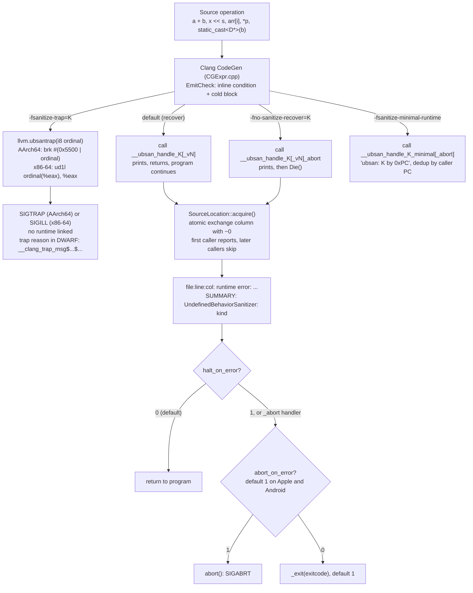

# C++ UndefinedBehaviorSanitizer and UB Field Guide

> [!summary] Claim:
> UndefinedBehaviorSanitizer (UBSan) is pure compile-time instrumentation: before each operation that the standard leaves undefined, Clang emits an inline test and a cold branch, with no shadow memory and no ABI change.
> The cold branch does one of three things: calls a recoverable runtime handler that prints and returns, calls an `_abort` handler that prints and dies, or executes a trap instruction whose immediate encodes the check kind (`brk #0x55NN` on AArch64).
> The full runtime reports each static check site at most once per process, by atomically poisoning that site's column number, so a loop that overflows a million times prints one line.
> The `vptr` check is the only one that needs C++ RTTI and runtime type walking; it is outside `-fsanitize=undefined` since Clang 21, cannot trap, and cannot use the minimal runtime.
> What counts as UB depends on the language mode: C++20 made `-1 << 1` and `3 << 31` defined, so the same binary flags them under `-std=c++17` and not under `-std=c++20`.



## The Mechanism

Undefined behavior means the C++ standard places no requirement on the program once the operation executes ([defns.undefined] in the working draft).
An optimizer is entitled to assume such operations never happen, which is how `x + 1 > x` becomes `return true`; [[02-Programming-Languages/C++/CPP_Zero_to_Godhood/Volume_08_Advanced_Systems/Chapter_104_Undefined_Behaviour_and_the_Optimiser/Chapter_104_Undefined_Behaviour_and_the_Optimiser|Chapter 104]] owns that optimizer story.
UBSan turns a subset of those silent assumptions into observable events.
Every source and line reference below is to llvm-project tag `llvmorg-23.1.5` unless another version is named, and every lab result is from Apple clang 21.0.0 (clang-2100.4.1.1) on darwin-arm64 (as of 2026-11).
Apple clang version numbers do not map one-to-one onto upstream LLVM releases, so the lab probes features rather than assuming them from the version.

### 1. What the compiler emits

For each enabled check, `CodeGenFunction::EmitCheck` in `clang/lib/CodeGen/CGExpr.cpp` emits a condition, a branch weighted as likely to pass, and a cold block.
The cold block either traps or calls a handler whose name `emitCheckHandlerCall()` builds as:

```text
__ubsan_handle_ + <name> [+ _v<version>] [+ _minimal] [+ _abort] [+ _preserve]
```

- `<name>` and `<version>` come from the `LIST_SANITIZER_CHECKS` table in `clang/lib/CodeGen/SanitizerHandler.h`; only `type_mismatch`, `nonnull_return`, and `nullability_return` carry version 1, so the handlers are `__ubsan_handle_type_mismatch_v1` and so on.
- The version suffix is dropped for the minimal runtime, which gets `_minimal`.
- `_abort` is added when the check is fatal and recoverable in principle, which is what `-fno-sanitize-recover=` selects.
- The full-runtime handler receives a pointer to static data (a `SourceLocation` of file, line, column, plus type descriptors) and the dynamic operands as `ValueHandle`s, which is why a report can print `2147483647 + 1` and the type name `'int'`; for the minimal runtime `EmitCheck` clears both argument lists, so those handlers get no arguments at all.

For signed addition the condition is the hardware overflow flag.
The lab disassembles `int add(int a, int b)` at `-O2` (`code/03-Debugging/ubsan_checks/`, darwin-arm64): it is 2 instructions uninstrumented (`add`, `ret`), 4 in trap mode (`adds`, `b.vs`, `ret`, `brk #0x5500`), and 19 with the runtime handler, because the call needs a frame and the operands are marshalled into argument registers.
The fast path in both instrumented forms is one extra flag-setting add and one not-taken branch.

`getRecoverableKind()` in `CGExpr.cpp` puts every check into one of three classes:

| Class | Checks | Handler behavior |
| :--- | :--- | :--- |
| `Recoverable` | Almost all | Recover build calls the returning handler; `-fno-sanitize-recover` calls `_abort` |
| `Unrecoverable` | `return`, `unreachable` | Always the noreturn handler, because there is no valid code to continue into |
| `AlwaysRecoverable` | `vptr` | Always a returning call; the `_abort` variant calls `Die()` only if the runtime actually printed a report |

The `vptr` class exists because a cache miss is not an error: the runtime must be called to find out, and most calls return silently.

### 2. The runtime: reporting, deduplication, and termination

The handlers live in `compiler-rt/lib/ubsan/ubsan_handlers.cpp`.
Before printing, each handler calls `SourceLocation::acquire()` (`ubsan_value.h`); the vptr handler first runs its type check and vptr suppression check, and only a real mismatch reaches `acquire()`.
`acquire()` does a relaxed `atomic_exchange` of the location's column field with `~0u` and returns the old copy.
Exactly one caller sees the original column; every later caller, on any thread, sees a disabled location and `ignoreReport()` skips the report.
That is the deduplication rule: one report per static check site per process, whatever the operand values, and it is free on the fast path because the static data is only touched after the check fails.
`ignoreReport()` never skips in an unrecoverable handler, because the process is about to die and must say why.

After printing, `ScopedReport::~ScopedReport()` (`ubsan_diag.cpp`) prints an optional stack trace and the `SUMMARY:` line, and calls `Die()` if `halt_on_error` is set.
`Die()` (`sanitizer_common/sanitizer_termination.cpp`) calls `abort()` when `abort_on_error` is set, otherwise `_exit(exitcode)`.
`abort_on_error` defaults to `SANITIZER_ANDROID || SANITIZER_APPLE` and `exitcode` defaults to 1 (`sanitizer_flags.inc`), so a fatal UBSan report ends in `SIGABRT` on macOS and Android but in exit status 1 on Linux.
The lab shows all three outcomes on darwin-arm64: `SIGABRT` by default, `1` with `abort_on_error=0`, and `42` with `exitcode=42`.
The Linux half is not in the lab; a one-off run in the lab's Linux container (aarch64, GCC 13.3, whose `libubsan` is merged from compiler-rt) gave exit status 1 for a fatal `signed-integer-overflow` report and exit status 134 (`SIGABRT`) with `UBSAN_OPTIONS=abort_on_error=1` (as of 2026-11).

The summary line prints the generic kind `undefined-behavior` unless `report_error_type=1` is set, in which case it prints the specific name from `ubsan_checks.inc`, such as `signed-integer-overflow` or `invalid-shift-base`.
A suppressions file matches the other column: `kSuppressionTypes` in `ubsan_diag.cpp` is built from the `-fsanitize=` name in `ubsan_checks.inc`, so a suppression says `shift-base`, `bounds`, or `vptr`, not `invalid-shift-base`; for `signed-integer-overflow` the two names happen to coincide.

### 3. Trap mode

`-fsanitize-trap=K` makes `EmitTrapCheck()` call `llvm.ubsantrap` with the `SanitizerHandler` ordinal as an 8-bit immediate.
The backends lower that intrinsic differently:

- AArch64: `ubsan_trap_xform` in `AArch64InstrInfo.td` ORs the ordinal with `'U' << 8`, so the instruction is `brk #0x55NN`; plain `__builtin_trap()` is `brk #1` and `__builtin_debugtrap()` is `brk #0xf000`.
- x86-64: the `UBSAN_UD1` pseudo (`X86InstrSystem.td`) is lowered in `X86MCInstLower.cpp` to `ud1l <ordinal>(%eax), %eax`, so the ordinal is the displacement; cross-compiling the lab's `trap_kinds.cpp` with Homebrew clang 23.1.5 for `x86_64-linux-gnu` gave `ud1l (%eax)`, `0xc(%eax)`, `0x3(%eax)`, and `0x12(%eax)` for the same four functions, and a hand-built x86-64 ELF whose entry point is `ud1l (%eax), %eax` died with `SIGILL` (exit status 132) under `linux/amd64` emulation (not in the lab, as of 2026-11).

The lab decodes four traps on darwin-arm64 against the `SanitizerHandler` enum order: `brk #0x5500` is ordinal 0 (`add_overflow`), `#0x5503` is 3 (`divrem_overflow`), `#0x550c` is 12 (`mul_overflow`), and `#0x5512` is 18 (`out_of_bounds`).
The lab does not trust that enum order by itself: it builds the same functions with `-g -fsanitize-debug-trap-reasons=basic`, looks up each `brk` address with `dwarfdump --lookup`, prints the compiler's own reason string beside the decoded name, and fails if the reason is not the expected one, so ordinal 12 is shown to be a multiplication trap by this compiler's output, not only by the upstream header.
A crash report that shows only a PC and `EXC_BREAKPOINT` or `SIGTRAP` therefore still names the check class, without symbols.

When optimizing, `EmitTrapCheck()` keeps one trap block per check kind per function (`TrapBBs[CheckHandlerID]`) and branches every mergeable check of that kind to it, which saves code size and destroys the one-to-one mapping from trap PC to source line.
The merged trap gets a merged debug location (`applyMergedLocation`), which for checks on different lines carries no single line.
The lab's `three_adds()` has additions on lines 3, 4, and 5: at `-O2` the one shared trap is at line 0 in the line table and has no trap-reason frame, and with `-fno-sanitize-merge` each of the three traps is still at line 0 in the line table, because the row belongs to the artificial trap-reason frame, while that frame's `DW_AT_call_line` gives 3, 4, and 5.
Only with both merging and trap reasons off does the line table itself say 3, 4, and 5, so a symbolizer that ignores inlined frames needs `-fno-sanitize-debug-trap-reasons` as well.
Only `MergeDefault = Undefined | Vptr` (`SanitizerArgs.cpp`) is mergeable by default, so `integer` and `implicit-conversion` checks keep their own traps.
`-fsanitize-merge` (the default) and `-fno-sanitize-merge=<checks>` were added in Clang 20 to control this; at `-O0` or under `optnone`, nothing is merged.
In the lab, `two_adds_one_mul()` has three checks and gets 2 trap instructions at `-O2` (the two adds share one) and 3 with `-fno-sanitize-merge=signed-integer-overflow`.

Since upstream Clang 22, trapping UBSan also writes a trap reason into the debug info: an artificial function named `__clang_trap_msg$<category>$<message>` that claims to be inlined at the trap, the same encoding `__builtin_verbose_trap` uses, so LLDB can display it.
`-fsanitize-debug-trap-reasons=detailed` (the default) writes a per-site message, `=basic` writes one string per check kind, and `-fno-sanitize-debug-trap-reasons` writes none.
Apple clang 21.0.0 accepts these flags and emits these names (lab, darwin-arm64).
Merging shows up here too: in the `-O2` detailed build the `'x + c'` reason disappears because that check jumps to the `'a + b'` trap.

Trap mode links no runtime at all: the lab's trap binary has zero undefined `__ubsan_handle_*` symbols and no `libclang_rt.ubsan_osx_dynamic.dylib` load command, against 3 and one in the runtime build.
That is why trap mode works in kernels, firmware, and freestanding code, and why the docs recommend it or the minimal runtime when a binary ships.

### 4. The minimal runtime

`-fsanitize-minimal-runtime` swaps the diagnostic runtime for `compiler-rt/lib/ubsan_minimal`.
Its `report_error()` prints `ubsan: <kind> by 0x<caller-pc>`, deduplicates by caller PC in a fixed array of `kMaxCallerPcs = 20` entries, and prints `ubsan: too many errors` once that array is full.
On Android the `_abort` variants format the same message, hand it to `android_set_abort_message()` when that weak symbol exists, and call `abort()`; on other host platforms they just call `abort()`.
Android's IntSan documentation tells you to search tombstones for lines such as `Abort message: 'ubsan: sub-overflow'` (its example omits the ` by 0x<pc>` suffix that the 23.1.5 runtime appends).
`SanitizerArgs.cpp` forbids `vptr` with both trap mode (`NotAllowedWithTrap`) and the minimal runtime (`NotAllowedWithMinimalRuntime`).
Apple clang 21.0.0 does not ship the minimal runtime: the driver warns that it does not support the flag, still emits calls to `__ubsan_handle_*_minimal`, and the link fails on a missing `libclang_rt.ubsan_minimal_osx_dynamic.dylib` (lab, darwin-arm64); Homebrew LLVM 23.1.5 ships `libclang_rt.ubsan_minimal_osx.a` and its dylib (checked locally, as of 2026-11).

### 5. The vptr check

`-fsanitize=vptr` checks member calls, member accesses, and downcasts on polymorphic class types, which the working draft makes undefined when the object is not of the named type: [expr.static.cast] covers a downcast to a class the object is not actually a base subobject of, [class.cdtor] covers objects under construction or destruction, and [basic.life] covers objects outside their lifetime.
The inline part, emitted by `EmitTypeCheck()` in `CGExpr.cpp`, is a cache probe:

1. Hash the mangled RTTI name of the static type with `xxh3_64bits` at compile time.
2. At run time, load the object's vptr and mix it with that constant (`emitHashMix`).
3. Index the 128-entry `__ubsan_vptr_type_cache` with `hash & 127` and compare.
4. On a mismatch, call `__ubsan_handle_dynamic_type_cache_miss` with the pointer and the hash.

The handler's `checkDynamicType()` (`ubsan_type_hash_itanium.cpp`) first probes a 65,537-entry open-addressed hash set of known-good hashes, then reads the vtable prefix: an offset-to-top outside plus or minus `1 << 20` (`VptrMaxOffsetToTop`) is treated as a corrupt vptr, the RTTI pointer is `dynamic_cast` to `abi::__class_type_info`, and `isDerivedFromAtOffset()` walks the base classes looking for the static type at the right offset.
A success fills both caches, so a steady-state program pays one load, a mix, a load, and a compare per check.
A failure prints the report and a note naming the dynamic type from RTTI, which is why the check needs RTTI (`-fno-rtti` is incompatible) and must be linked by `clang++` so the C++ part of the runtime and the C++ ABI library are present.

Clang 21 removed `vptr` from `-fsanitize=undefined` (Clang 21.1.8 release notes), and the lab confirms Apple clang 21.0.0 follows: the bad downcast is silent under `-fsanitize=undefined` and reported twice, for the downcast and for the member call, under `-fsanitize=undefined,vptr`.
GCC 16.2 still lists `vptr` among the suboptions of `-fsanitize=undefined`, and silently drops it in trap mode.

### 6. The catalog

The checks below are the ones `ubsan_checks.inc` defines, grouped by the rule they enforce.
"In `undefined`" is the Clang 23.1.5 group definition in `Sanitizers.def` (`Alignment | Bool | Builtin | ArrayBounds | Enum | FloatCastOverflow | IntegerDivideByZero | NonnullAttribute | Null | ObjectSize | PointerOverflow | Return | ReturnsNonnullAttribute | Shift | SignedIntegerOverflow | Unreachable | VLABound | Function`).

| `-fsanitize=` | Runtime kind (`report_error_type=1`) | Rule it enforces | In `undefined` | Lab message (darwin-arm64) |
| :--- | :--- | :--- | :--- | :--- |
| `signed-integer-overflow` | `signed-integer-overflow` | [expr.pre]/4: result outside the type's range; includes `INT_MIN / -1` | Yes | `signed integer overflow: 2147483647 + 1 cannot be represented in type 'int'` |
| `integer-divide-by-zero` | `integer-divide-by-zero` | [expr.mul]/4 | Yes | `division by zero` |
| `shift-exponent` | `invalid-shift-exponent` | [expr.shift]/1: count negative or at least the promoted width | Yes | `shift exponent 32 is too large for 32-bit type 'int'` |
| `shift-base` | `invalid-shift-base` | C++17 and earlier only: negative or unrepresentable left operand | Yes | `left shift of negative value -1` |
| `array-bounds` (part of the `bounds` group) | `out-of-bounds-index` | Index outside a statically known array bound | Yes | `index 4 out of bounds for type 'int[4]'` |
| `local-bounds` | `local-out-of-bounds` | Access outside a local object the optimizer can size | No | - |
| `alignment` | `misaligned-pointer-use` | [basic.align]: access through a misaligned pointer; also `assume_aligned` | Yes | `load of misaligned address 0xADDR for type 'int', which requires 4 byte alignment` |
| `null` | `null-pointer-use` | Null dereference, null reference binding, member call on null | Yes | `reference binding to null pointer of type 'int'` |
| `pointer-overflow` | `nullptr-with-offset`, `nullptr-with-nonzero-offset`, `nullptr-after-nonzero-offset`, `pointer-overflow` | Pointer arithmetic that wraps or offsets null | Yes | `applying non-zero offset 16 to null pointer` |
| `bool` | `invalid-bool-load` | Load of a `bool` object representation other than 0 or 1 | Yes | `load of value 2, which is not a valid value for type 'bool'` |
| `enum` | `invalid-enum-load` | Load outside the enumeration's values ([dcl.enum]/8) | Yes | `load of value 4, which is not a valid value for type 'Color'` |
| `float-cast-overflow` | `float-cast-overflow` | [conv.fpint]/1: truncated value not representable | Yes | `1e+10 is outside the range of representable values of type 'int'` |
| `builtin` | `invalid-builtin-use` | Zero passed to `__builtin_ctz` or `__builtin_clz` | Yes | `passing zero to __builtin_ctz(), which is not a valid argument` |
| `nonnull-attribute` | `invalid-null-argument` | Null passed to a `nonnull` parameter | Yes | `null pointer passed as argument 1, which is declared to never be null` |
| `returns-nonnull-attribute` | `invalid-null-return` | Null returned from a `returns_nonnull` function | Yes | - |
| `return` | `missing-return` | Falling off the end of a value-returning function (unrecoverable) | Yes | `execution reached the end of a value-returning function without returning a value` |
| `unreachable` | `unreachable-call` | Reaching `__builtin_unreachable()` (unrecoverable) | Yes | - |
| `vla-bound` | `non-positive-vla-index` | Non-positive VLA bound (C, or the Clang extension in C++) | Yes | - |
| `object-size` | `insufficient-object-size` | Access past `__builtin_object_size`; the driver removes it at `-O0` (`SanitizerArgs.cpp`), so the lab's `-O0` catalog never enables it | Yes | - |
| `function` | `function-type-mismatch` | Indirect call through a pointer of the wrong function type | Yes upstream; Apple clang 21.0.0 drops it silently | - |
| `vptr` | `dynamic-type-mismatch` | Wrong dynamic type, or object outside its lifetime | No (since Clang 21) | `downcast of address 0xADDR which does not point to an object of type 'Dog'` |

Apple clang 21.0.0 accepts `-fsanitize=function` without a diagnostic but passes no `-fsanitize` option to the frontend, emits no `___ubsan_handle_function_type_mismatch` reference, and reports nothing for a `reinterpret_cast` of `int(*)(int)` to `int(*)(double)`; Homebrew LLVM 23.1.5 on the same machine references the handler and prints `call to function f(int) through pointer to incorrect function type 'int (*)(double)'` (probe, not in the lab, as of 2026-11).
No upstream driver code removes `function` on Darwin (`SanitizerArgs.cpp`, `ToolChain.cpp`, and `Darwin.cpp` at 23.1.5 only restrict it for `-mcmodel` other than `small` and for execute-only targets), so the removal is in Apple's fork, whose source this note does not cite.

Checks for behavior that is defined but usually a bug sit outside `undefined` and must be named: `unsigned-integer-overflow`, `unsigned-shift-base`, `implicit-conversion` (truncations, sign changes, bitfield conversions), `nullability-*`, `float-divide-by-zero`, and `objc-cast`; `float-divide-by-zero` is the odd one, because it is undefined in C++ ([expr.mul]/4) but Clang defines it as IEEE 754 does, producing an infinity or NaN.
`-fsanitize=integer` is defined in `Sanitizers.def` as `signed-integer-overflow`, `unsigned-integer-overflow`, `shift`, `unsigned-shift-base`, `integer-divide-by-zero`, and the implicit integer conversion checks; Apple clang 21.0.0 expands it (`-###`) without `implicit-integer-sign-change`, leaving the two truncation checks.
The lab shows `0u - 1u` and `unsigned char c = 300` silent under `undefined` and reported under `integer`.

Three catalog entries carry traps of their own:

- The enum rule is about the values of the enumeration, not its enumerators: `enum Color { Red, Green, Blue }` has no fixed underlying type, so its values are those of the smallest bit-field that holds 0 to 2, which is 0 to 3; the lab loads 3 silently and reports 4.
- `-fsanitize=enum` does not check enumerations with a fixed underlying type, such as every `enum class`, because all values of the underlying type are valid for them ([dcl.enum]/8); the lab stores 7 into an `enum class Side : int { Buy, Sell }` and gets no report.
- In the lab's `-std=c++20` build, `-1 << 1` and `3 << 31` are silent and only `1 << 32` is reported, because [expr.shift]/2 now defines `E1 << E2` as the value congruent to `E1 * 2^E2` modulo `2^N`; the left operand rules exist only in the `-std=c++17` build.

### 7. Integer overflow knobs

- `-fwrapv` defines signed overflow as wrapping, but Clang 19 and later still instrument signed arithmetic under `-fsanitize=signed-integer-overflow` (Clang 19 release notes); add `-fno-sanitize=signed-integer-overflow` if wrapping is intended.
- `-fsanitize-undefined-ignore-overflow-pattern=` (Clang 20) stops instrumenting four idioms: `negated-unsigned-const` (`-1UL`), `unsigned-post-decr-while` (`while (n--)`), and `add-signed-overflow-test` and `add-unsigned-overflow-test` (`a + b < a`).
  Suppressing the signed pattern removes only the check; the optimizer may still exploit the UB, so pair it with `-fwrapv`.
- `__attribute__((overflow_behavior(wrap)))` and `(trap)` on a type (Clang 23, experimental, enabled by the `-cc1` option `-fexperimental-overflow-behavior-types`, which the driver needs as `-Xclang -fexperimental-overflow-behavior-types`) change both the semantics and the instrumentation of arithmetic on that type.
- `UBSAN_OPTIONS=silence_unsigned_overflow=1` hides non-fatal unsigned overflow reports while keeping the handler calls, which the docs describe as fuzzing signal without log noise.

### 8. GCC's implementation

GCC has implemented `-fsanitize=undefined` since GCC 4.9 (Linux kernel UBSAN documentation) and links `libubsan`, which reuses the compiler-rt UBSan runtime, so reports share the `runtime error:` format.
The GCC 16.2 manual differs from Clang 23.1.5 in ways that change what a build checks:

- `vptr` is a suboption of GCC's `-fsanitize=undefined`; it is not in Clang's since Clang 21.
- GCC's `-fsanitize=undefined` does not enable `float-cast-overflow` or `float-divide-by-zero`; Clang's includes `float-cast-overflow`.
- GCC adds `-fsanitize=bounds-strict`, which also instruments flexible-array-member-like trailing arrays.
- GCC's `-fsanitize-trap=` emits `__builtin_trap()`, so every check kind traps with the same instruction; `-fsanitize-undefined-trap-on-error` is a deprecated spelling of `-fsanitize-trap=all`.
- `-fsanitize-recover` with no argument is deprecated in GCC, and `unreachable` and `return` are never recoverable.

## Commands and Numbers to Know

| Item | Value | Platform and date | What it controls |
| :--- | :--- | :--- | :--- |
| `-fsanitize=undefined` | 18 group members (`shift` counts as one) | Both (as of 2026-11), Clang 23.1.5; Apple clang 21.0.0 omits `function` | The default UB set; excludes `vptr` since Clang 21 |
| `-fsanitize=undefined,vptr` | adds dynamic type checks | Both (as of 2026-11) | Needs RTTI, `clang++` link, full runtime |
| `-fsanitize=integer` | adds unsigned and implicit conversion checks | Both (as of 2026-11) | Finds defined-but-suspicious integer behavior |
| `-fno-sanitize-recover=undefined` | first report is fatal | Both (as of 2026-11) | Use in CI so a report fails the test |
| `-fsanitize-trap=undefined` | trap, no runtime | Both (as of 2026-11) | Hardened production builds; `vptr` cannot trap |
| `-fsanitize-minimal-runtime` | `ubsan: <kind> by 0x<pc>` | Linux, Android; not shipped in Apple clang 21.0.0 (as of 2026-11) | Small-attack-surface production logging |
| `-fno-sanitize-merge=<checks>` | one trap or call per site | Both (as of 2026-11), Clang 20+ | Per-site traps in optimized code; the line is in the trap-reason frame's call line |
| `-fsanitize-debug-trap-reasons=detailed\|basic` | `detailed` | Both (as of 2026-11), Clang 22+ and Apple clang 21.0.0 | Trap reason as an inlined frame name in DWARF |
| `-fsanitize-undefined-strip-path-components=N` | `0` | Both (as of 2026-11) | Trims embedded source paths in static check data |
| AArch64 trap encoding | `brk #(0x5500 \| ordinal)` | Both (as of 2026-11), Clang 23.1.5 | Ordinal from `SanitizerHandler.h` names the check |
| x86-64 trap encoding | `ud1l ordinal(%eax), %eax` | Both (as of 2026-11), Clang 23.1.5 | Same ordinal as the displacement |
| `UBSAN_OPTIONS=halt_on_error` | `0` | Both (as of 2026-11) | `1` makes every report fatal at run time |
| `UBSAN_OPTIONS=abort_on_error` | `1` on macOS and Android, `0` elsewhere | Both (as of 2026-11) | Fatal report ends in `SIGABRT` instead of `_exit` |
| `UBSAN_OPTIONS=exitcode` | `1` | Both (as of 2026-11) | Exit status of a fatal report when not aborting |
| `UBSAN_OPTIONS=print_stacktrace` | `0` | Both (as of 2026-11) | `1` prints a stack; build with `-g -fno-sanitize-merge -fno-omit-frame-pointer` |
| `UBSAN_OPTIONS=report_error_type` | `0` | Both (as of 2026-11) | `1` prints the specific kind in `SUMMARY:` |
| `UBSAN_OPTIONS=suppressions` | empty | Both (as of 2026-11) | `<kind>:<file, function, or module>` lines; recoverable checks only |
| `UBSAN_OPTIONS=log_path` | stderr | Both (as of 2026-11) | Writes `log_path.<pid>` |
| `UBSAN_OPTIONS=silence_unsigned_overflow` | `0` | Both (as of 2026-11) | Hides non-fatal unsigned overflow reports |
| vptr inline cache | 128 entries | Both (as of 2026-11), Clang 23.1.5 | `__ubsan_vptr_type_cache`; misses call the runtime |
| vptr runtime hash set | 65,537 entries | Both (as of 2026-11), compiler-rt 23.1.5 | Second-level cache of known-good type hashes |
| Minimal runtime dedup | 20 caller PCs | Both (as of 2026-11), compiler-rt 23.1.5 | Then prints `ubsan: too many errors` |

## Multi-Language Comparison: C++ / Python / Rust

| Concern | C++ with UBSan | Python | Rust |
| :--- | :--- | :--- | :--- |
| Signed overflow | UB; `signed-integer-overflow` reports or traps | `int` is arbitrary precision, so no overflow | Defined: panics when `overflow-checks` is on (`dev` profile default), wraps when off (`release` default); `wrapping_*`, `checked_*` |
| `INT_MIN / -1` | UB; reported under `signed-integer-overflow` | No fixed width | Panics even with overflow checks off, per the Reference |
| Shift by at least the width | UB; `shift-exponent` | Shifts are on unbounded ints | Panics with overflow checks on |
| Null or misaligned access | UB; `null`, `alignment` | Not expressible in Python code; possible in C extensions | Only through raw pointers in `unsafe`; Miri detects it |
| Wrong dynamic type | UB; `vptr` | `TypeError` or `AttributeError` at run time | Not expressible in safe code; trait objects carry their vtable |
| Tool for native code | `-fsanitize=undefined` (Clang, GCC) | CPython `./configure --with-undefined-behavior-sanitizer` adds `-fsanitize=undefined` to `BASECFLAGS` and `LDFLAGS` | Miri for UB in `unsafe` code; rustc has no UBSan equivalent |

[[Rust-Miri-Sanitizers-Loom-and-Cargo-Fuzz]] owns Miri, and [[Python-Debugging-Hung-Processes-and-C-Extensions]] owns debugging native extensions under CPython.

## Worked Lab Example

The lab is `code/03-Debugging/ubsan_checks/`; it needs only the default `c++` and the Xcode command-line tools (`nm`, `otool`, `objdump`, `dwarfdump`), and declares `# requires: macos` because it reads Mach-O.

- `ub_catalog.cpp` has one UB operation per `noinline` function, each on its own line so each has its own check site, with values passed through a `volatile` helper so the compiler cannot fold them.
- `optimizer.cpp` holds `plus_one_is_greater(int x) { return x + 1 > x; }`.
- `trap_kinds.cpp` and `trap_main.cpp` are the trap mode subjects, `merge_lines.cpp` has three additions on three lines for the trap line-table check, and `inline_dedup.cpp` inlines one overflowing helper into three callers.
- `run.sh` also cross-checks the trap ordinals against the compiler's own DWARF trap reasons and exits non-zero when they disagree.
- `run.sh` builds the catalog four ways (`-std=c++17`, `-std=c++20`, `+vptr`, `integer`), runs every case, and prints only the `runtime error:` lines, the `SUMMARY:` kind, the program's stdout, and the exit status or signal.

```bash
cd code/03-Debugging/ubsan_checks
bash run.sh
```

### Verified output

Recorded with `python3 -m _harness.verify --record 03-Debugging/ubsan_checks/` on darwin-arm64 (Apple clang 21.0.0) on 2026-11-08 and re-checked with `python3 -m _harness.verify`; the file is `code/03-Debugging/ubsan_checks/expected/darwin-arm64.txt`.
The excerpts below are copied from it; `0xADDR` is the lab's own scrub of heap and stack addresses.

```text
== 1. Catalog: -std=c++17 -O0 -fsanitize=undefined, report_error_type=1
[signed-add]
  report:  ub_catalog.cpp:20:14: runtime error: signed integer overflow: 2147483647 + 1 cannot be represented in type 'int'
  summary: signed-integer-overflow
  stdout:  signed-add returned -2147483648
  stdout:  main reached the end
  exit:    0
[div-zero]
  report:  ub_catalog.cpp:28:22: runtime error: division by zero
  summary: integer-divide-by-zero
  stdout:  div-zero returned 0
  stdout:  main reached the end
  exit:    0
[enum-in-range]
  report:  (none)
  stdout:  enum-in-range returned 3
  stdout:  main reached the end
  exit:    0
[enum-out-of-range]
  report:  ub_catalog.cpp:80:30: runtime error: load of value 4, which is not a valid value for type 'Color'
  summary: invalid-enum-load
  stdout:  enum-out-of-range returned 4
  stdout:  main reached the end
  exit:    0
[enum-class-unlisted]
  report:  (none)
  stdout:  enum-class-unlisted returned 7
  stdout:  main reached the end
  exit:    0
```

```text
== 2. Not in -fsanitize=undefined: vptr and the integer group
[bad-downcast, -fsanitize=undefined]
  report:  (none)
  stdout:  bad-downcast returned 1
  stdout:  main reached the end
  exit:    0
[bad-downcast, -fsanitize=undefined,vptr]
  report:  ub_catalog.cpp:137:14: runtime error: downcast of address 0xADDR which does not point to an object of type 'Dog'
  report:  0xADDR: note: object is of type '(anonymous namespace)::Cat'
  report:  ub_catalog.cpp:137:36: runtime error: member call on address 0xADDR which does not point to an object of type '(anonymous namespace)::Dog'
  report:  0xADDR: note: object is of type '(anonymous namespace)::Cat'
  summary: dynamic-type-mismatch
  summary: dynamic-type-mismatch
  stdout:  bad-downcast returned 1
  stdout:  main reached the end
  exit:    0
[unsigned-wrap, -fsanitize=undefined]
  report:  (none)
  stdout:  unsigned-wrap returned 4294967295
  stdout:  main reached the end
  exit:    0
[implicit-truncation, -fsanitize=undefined]
  report:  (none)
  stdout:  implicit-truncation returned 44
  stdout:  main reached the end
  exit:    0
[unsigned-wrap, -fsanitize=integer]
  report:  ub_catalog.cpp:114:14: runtime error: unsigned integer overflow: 0 - 1 cannot be represented in type 'unsigned int'
  summary: unsigned-integer-overflow
  stdout:  unsigned-wrap returned 4294967295
  stdout:  main reached the end
  exit:    0
[implicit-truncation, -fsanitize=integer]
  report:  ub_catalog.cpp:119:23: runtime error: implicit conversion from type 'int' of value 300 (32-bit, signed) to type 'unsigned char' changed the value to 44 (8-bit, unsigned)
  summary: implicit-signed-integer-truncation
  stdout:  implicit-truncation returned 44
  stdout:  main reached the end
  exit:    0
```

```text
== 3. The language mode changes what is UB: shifts under -std=c++20
[shift-negative-base, c++20]
  report:  (none)
  stdout:  shift-negative-base returned -2
  stdout:  main reached the end
  exit:    0
[shift-overflow-base, c++20]
  report:  (none)
  stdout:  shift-overflow-base returned -2147483648
  stdout:  main reached the end
  exit:    0
[shift-exponent, c++20]
  report:  ub_catalog.cpp:32:14: runtime error: shift exponent 32 is too large for 32-bit type 'int'
  summary: invalid-shift-exponent
  stdout:  shift-exponent returned 1
  stdout:  main reached the end
  exit:    0

== 4. One report per source location
same-site-loop: same-site-loop returned -6442450944; 3 overflows at one location, reports printed: 1
three cases at three locations, reports printed: 3
always_inline helper overflowing in 3 callers, -O0: reports printed: 1
always_inline helper overflowing in 3 callers, -O2: reports printed: 1
```

```text
== 5. Recovery: what happens after the first report
[recover (default build)]
  report:  ub_catalog.cpp:20:14: runtime error: signed integer overflow: 2147483647 + 1 cannot be represented in type 'int'
  report:  ub_catalog.cpp:32:14: runtime error: shift exponent 32 is too large for 32-bit type 'int'
  summary: undefined-behavior
  summary: undefined-behavior
  stdout:  signed-add returned -2147483648
  stdout:  shift-exponent returned 1
  stdout:  main reached the end
  exit:    0
[-fno-sanitize-recover=undefined]
  report:  ub_catalog.cpp:20:14: runtime error: signed integer overflow: 2147483647 + 1 cannot be represented in type 'int'
  summary: undefined-behavior
  exit:    signal SIGABRT
[halt_on_error=1]
  report:  ub_catalog.cpp:20:14: runtime error: signed integer overflow: 2147483647 + 1 cannot be represented in type 'int'
  summary: undefined-behavior
  exit:    signal SIGABRT
[halt_on_error=1:abort_on_error=0]
  report:  ub_catalog.cpp:20:14: runtime error: signed integer overflow: 2147483647 + 1 cannot be represented in type 'int'
  summary: undefined-behavior
  exit:    1
[halt_on_error=1:abort_on_error=0:exitcode=42]
  report:  ub_catalog.cpp:20:14: runtime error: signed integer overflow: 2147483647 + 1 cannot be represented in type 'int'
  summary: undefined-behavior
  exit:    42
[missing-return (unrecoverable even in a recover build)]
  report:  ub_catalog.cpp:144:31: runtime error: execution reached the end of a value-returning function without returning a value
  summary: undefined-behavior
  exit:    signal SIGABRT

== 6. Runtime suppressions (recoverable checks only)
[suppress signed-integer-overflow]
  report:  ub_catalog.cpp:32:14: runtime error: shift exponent 32 is too large for 32-bit type 'int'
  summary: undefined-behavior
  stdout:  signed-add returned -2147483648
  stdout:  shift-exponent returned 1
  stdout:  main reached the end
  exit:    0
```

```text
== 7. Trap mode: no runtime, one trap instruction per check kind
rt_main: undefined __ubsan_handle_* symbols: 3; UBSan dylib: libclang_rt.ubsan_osx_dynamic.dylib
trap_main: undefined __ubsan_handle_* symbols: 0; UBSan dylib: none
[runtime build]
  report:  trap_kinds.cpp:2:45: runtime error: signed integer overflow: 2147483647 + 1 cannot be represented in type 'int'
  summary: undefined-behavior
  stdout:  before the overflow
  stdout:  after the overflow: -2147483648
  exit:    0
[trap build]
  report:  (none)
  stdout:  before the overflow
  exit:    signal SIGTRAP
add     brk #0x5500  high byte 0x55 (U)  ordinal  0 -> add_overflow; compiler reason: Integer addition overflowed
mul     brk #0x550c  high byte 0x55 (U)  ordinal 12 -> mul_overflow; compiler reason: Integer multiplication overflowed
sdiv    brk #0x5503  high byte 0x55 (U)  ordinal  3 -> divrem_overflow; compiler reason: Integer divide or remainder overflowed
index4  brk #0x5512  high byte 0x55 (U)  ordinal 18 -> out_of_bounds; compiler reason: Array index out of bounds
add -O2 instrumentation none: 2 instructions
add -O2 instrumentation trap: 4 instructions
add -O2 instrumentation runtime: 19 instructions
two_adds_one_mul -O2 (merge on): trap instructions: 2
two_adds_one_mul -O2 -fno-sanitize-merge=signed-integer-overflow: trap instructions: 3
three_adds -O2 (defaults):
  trap: line table line 0; trap-reason frame call line none
three_adds -O2 -fno-sanitize-merge=signed-integer-overflow:
  trap: line table line 0; trap-reason frame call line 3
  trap: line table line 0; trap-reason frame call line 4
  trap: line table line 0; trap-reason frame call line 5
three_adds -O2 -fno-sanitize-debug-trap-reasons:
  trap: line table line 0; trap-reason frame call line none
three_adds -O2 -fno-sanitize-merge=signed-integer-overflow -fno-sanitize-debug-trap-reasons:
  trap: line table line 3; trap-reason frame call line none
  trap: line table line 4; trap-reason frame call line none
  trap: line table line 5; trap-reason frame call line none

== 8. Trap reasons recorded in DWARF (fake inlined frame names)
-O0:
  __clang_trap_msg$Undefined Behavior Sanitizer$Integer divide or remainder overflowed
  __clang_trap_msg$Undefined Behavior Sanitizer$signed integer addition overflow in 'a + b'
  __clang_trap_msg$Undefined Behavior Sanitizer$signed integer addition overflow in 'x + c'
  __clang_trap_msg$Undefined Behavior Sanitizer$signed integer multiplication overflow in 'a * b'
  __clang_trap_msg$Undefined Behavior Sanitizer$signed integer multiplication overflow in 'x * y'
-O2:
  __clang_trap_msg$Undefined Behavior Sanitizer$Integer divide or remainder overflowed
  __clang_trap_msg$Undefined Behavior Sanitizer$signed integer addition overflow in 'a + b'
  __clang_trap_msg$Undefined Behavior Sanitizer$signed integer multiplication overflow in 'a * b'
  __clang_trap_msg$Undefined Behavior Sanitizer$signed integer multiplication overflow in 'x * y'
-O2 -fsanitize-debug-trap-reasons=basic:
  __clang_trap_msg$Undefined Behavior Sanitizer$Integer addition overflowed
  __clang_trap_msg$Undefined Behavior Sanitizer$Integer divide or remainder overflowed
  __clang_trap_msg$Undefined Behavior Sanitizer$Integer multiplication overflowed
-O2 -fno-sanitize-debug-trap-reasons:
  (no trap reasons)
```

```text
== 9. The optimizer assumes no signed overflow: x + 1 > x at INT_MAX
[-O2]
  report:  (none)
  stdout:  plus_one_is_greater(2147483647) = 1
  exit:    0
[-O2 -fwrapv]
  report:  (none)
  stdout:  plus_one_is_greater(2147483647) = 0
  exit:    0
[-O2 -fsanitize=signed-integer-overflow]
  report:  optimizer.cpp:8:14: runtime error: signed integer overflow: 2147483647 + 1 cannot be represented in type 'int'
  summary: undefined-behavior
  stdout:  plus_one_is_greater(2147483647) = 0
  exit:    0
-O2 body of plus_one_is_greater: mov w0, #0x1; ret; 

== 10. Minimal runtime availability in this toolchain
-fsanitize-minimal-runtime: link failed; missing libclang_rt.ubsan_minimal_osx_dynamic.dylib; driver warnings: 5
```

### Reading the result

- Section 1: the recover build keeps running after every report, and the returned values show what this AArch64 host did, not anything C++ promises: `7 / 0` returned 0 instead of faulting, so on this hardware the bug would have been a silent wrong value without the sanitizer.
- Section 2: the same downcast is invisible to `-fsanitize=undefined` and caught twice with `vptr`, once for `TCK_DowncastPointer` and once for `TCK_MemberCall`, and the note names the real dynamic type from RTTI.
- Section 3: under `-std=c++20` only the exponent rule is left, which is the [expr.shift] change in action.
- Section 4: three overflows at one site print one report, while three sites print three, and an `always_inline` helper inlined into three callers is still one site; `SourceLocation::acquire()` on the shared static data is the reason, and the loop's returned `-6442450944` (three wrapped `INT_MIN` values) shows all three overflows really ran.
- Section 5: the runtime decides how to die, so the same `-fno-sanitize-recover` build is `SIGABRT` on macOS and exit 1 on Linux unless `abort_on_error` is set, and `missing-return` kills even the recover build.
- Section 6: the suppression silences only the matching kind; the shift report still prints.
- Section 7: the trap build prints nothing after "before the overflow" and dies by `SIGTRAP`, with no handler symbols and no runtime dylib; the `brk` immediates decode to the `SanitizerHandler` ordinals, and the compiler's own DWARF trap reason for each one agrees, and only an unmerged trap keeps a real source line, in the trap-reason frame's call line or, with reasons off, in the line table.
- Section 8: merging at `-O2` erases the `'x + c'` reason, the same effect that makes a merged trap PC point at the wrong line.
- Section 9: without the sanitizer, `-O2` compiles `x + 1 > x` to `mov w0, #0x1; ret`, so `INT_MAX` gets "true"; with `-fwrapv` the answer is "false"; with the sanitizer the check stops the fold and the program prints "false" after the report, which is a reminder that a sanitized build is a different program from the one you ship.

## Pitfalls

> [!warning] Pitfall: assuming one report means one bug
> Deduplication is per static check site, not per value or per call path.
> Inlining does not multiply sites: the copies share one static `SourceLocation`, so the lab's `always_inline` helper that overflows in three callers prints one report at both `-O0` and `-O2`, and a hot loop with a million distinct overflowing values also prints one.
> Fix the first report, rebuild, and rerun before trusting the absence of later ones.

> [!warning] Pitfall: a recover build in CI
> The default is to print and continue, so a test binary with UB can exit 0 and pass.
> CI builds want `-fno-sanitize-recover=undefined` (or `halt_on_error=1`) and a test runner that treats `SIGABRT` and exit 1 as failures.

> [!warning] Pitfall: expecting `-fsanitize=undefined` to include `vptr`
> Since Clang 21 it does not, and Apple clang 21.0.0 follows; a GCC build does include it, so two CI jobs with the same flag check different things.
> Name `vptr` explicitly, keep RTTI on, and link with `clang++`.

> [!warning] Pitfall: reading a merged trap PC as a source line
> At `-O2` every mergeable check of one kind in a function shares a trap with a merged debug location; in the lab it is line 0 with no trap-reason frame.
> Decode the `brk` or `ud1` immediate for the check kind, then rebuild with `-fno-sanitize-merge=<kind>` and read the trap-reason frame's call line, or add `-fno-sanitize-debug-trap-reasons` if your symbolizer reads only the line table.

> [!warning] Pitfall: concluding from a sanitized build what the shipped build does
> The instrumentation changes optimization: the lab's `x + 1 > x` returns 0 under UBSan and 1 without it.
> UBSan proves that UB happens on a path; it does not predict the release binary's symptom.

> [!warning] Pitfall: suppressing what cannot be suppressed
> Runtime suppressions apply only to recoverable checks, only to fine-grained kinds (never `undefined`), and need symbols or debug info to match files and functions.
> `return` and `unreachable` cannot be suppressed at all; fix them or exclude the function with `__attribute__((no_sanitize("...")))` or an ignorelist.

> [!warning] Pitfall: `-fsanitize=enum` on `enum class`
> Enumerations with a fixed underlying type accept every value of that type, so the check never fires on them, and on an unfixed enumeration it accepts every value in the bit-field range, not just the enumerators.
> Validate untrusted enum inputs explicitly; the sanitizer will not.

> [!warning] Pitfall: shipping the full runtime
> The documentation warns that the diagnostic runtime may compromise the security of a production executable.
> Ship trap mode or the minimal runtime, and keep the diagnostic runtime for test and fuzzing builds.

## At Scale

A single developer runs `-fsanitize=address,undefined` locally and reads the reports.
At 1,000 to 50,000 engineers the questions become which build configurations exist, who owns the suppressions, and whether anything ships instrumented.

- Every C and C++ test target in CI gets one ASan plus UBSan configuration with `-fno-sanitize-recover=undefined`, `vptr` named explicitly where RTTI is on, `-g`, and `-fno-omit-frame-pointer`; [[Cpp-AddressSanitizer-and-LeakSanitizer-Internals]] owns the ASan half of that build.
- Fuzzers run in recover mode with `UBSAN_OPTIONS=halt_on_error=0:silence_unsigned_overflow=1` so a known benign site does not stop the campaign, and the crash triage pipeline groups by the `SUMMARY:` site rather than by stack, which [[Cpp-Clang-Tidy-Static-Analyzer-and-Fuzzing-libFuzzer-AFLPlusPlus]] covers for the fuzzing side.
- Suppressions and `no_sanitize` attributes are code-reviewed like waivers: each one names a kind and a site, carries an owner, and a periodic job counts them, because a suppression file that only grows is a list of unfixed UB.
- Production hardening uses aborting checks on a narrow, chosen set, the model Android documents: Android 7.0 hardened the media framework with the signed and unsigned integer overflow sanitizers in abort mode, Android 9 extended them to more components, and its `default-ub` set, chosen for minimal compiler performance impact, is `bool`, `integer-divide-by-zero`, `return`, `returns-nonnull-attribute`, `shift-exponent`, `unreachable`, and `vla-bound`.
- Crash reporting decodes trap immediates and DWARF trap reasons on the server, so a minidump with a `SIGTRAP` at a `brk #0x55NN` is bucketed as "UBSan `<kind>`" without a repro; [[Core-Dumps-Minidumps-and-Crash-Reporting]] owns that pipeline.
- Release binaries that keep checks set `-fsanitize-undefined-strip-path-components=` or use trap mode or the minimal runtime, because the full diagnostic runtime embeds source paths in its static check data, while the minimal runtime passes no static data (`EmitCheck` in `CGExpr.cpp` clears `StaticArgs`).

Decision rules:

- Correctness build in CI: full runtime, fatal reports, all of `undefined` plus `vptr`; add `integer` only for components that opt in, because unsigned wrap is often intended.
- Fuzzing: full runtime, recover mode, deduplicated by site.
- Shipping with checks: trap mode by default; the minimal runtime where the platform ships it (it is not in Apple clang 21.0.0) and a log line beats a bare crash.
- Never ship `vptr` or the full diagnostic runtime.
- When a hardened build's crash rate rises after a compiler upgrade, diff the enabled check set first: the Clang 21 `vptr` change and the Clang 19 `-fwrapv` change both altered what the same flags check.

## Practice Drill

> [!tip] Practice Drill:
> Run the lab, then predict before re-running: what does section 4 print if `same_site_loop()` is marked `__attribute__((always_inline))` and called from two different functions?
> Copy `trap_kinds.cpp`, add `extern "C" int shl(int a, int s) { return a << s; }`, build it with `-O2 -fsanitize=signed-integer-overflow,shift -fsanitize-trap=all`, disassemble it, and decode every `brk` immediate by hand against `SanitizerHandler.h`; the shift trap must decode to ordinal 20 (`shift_out_of_bounds`).
> Write a function with three signed additions, crash it in trap mode under `lldb`, and compare the line LLDB reports at `-O2`, at `-O2 -fno-sanitize-merge=signed-integer-overflow`, and at `-O0`.
> As a stretch, install Homebrew LLVM, rebuild `trap_main.cpp trap_kinds.cpp` with `$(brew --prefix llvm)/bin/clang++ -fsanitize=signed-integer-overflow -fsanitize-minimal-runtime`, and confirm the `ubsan: add-overflow by 0x...` line, then make the same overflow happen 25 times at 25 different call sites and find the `too many errors` cutoff.

## Interview Questions

> [!question] L5: What does UBSan add to a binary, and why does it not change the ABI the way ASan changes memory layout?
>
> > [!success]- Answer
> > It adds an inline check before each instrumented operation and a cold block that either calls a `__ubsan_handle_*` function with static source and type data or executes a trap instruction.
> > It uses no shadow memory, no redzones, and no allocator replacement, so object layout, calling conventions, and the address space are unchanged, which the Clang documentation states directly.
> > That is why instrumented and uninstrumented objects link together, why `-fsanitize=address,undefined` is a single build (verified locally with Apple clang 21.0.0), and why its cost is mostly code size and a few branches rather than memory.

> [!question] L5: Predict the output: a loop evaluates `k + j` with `k = INT_MAX - i` and `j = 1 + i` for `i = 0, 1, 2`, so every iteration overflows, in a default `-fsanitize=undefined` build; how many reports print, and what is the exit status?
>
> > [!success]- Answer
> > One report and exit status 0.
> > The build is in recover mode, so each failing check calls a handler that returns.
> > The first handler call atomically swaps the site's column with `~0` in `SourceLocation::acquire()`, and the second and third calls see a disabled location and skip the report; the lab's section 4 prints `reports printed: 1`.

> [!question] L6: The same `-fno-sanitize-recover=undefined` test fails with exit status 1 on the Linux CI runners and with `SIGABRT` on developers' Macs; is something broken?
>
> > [!success]- Answer
> > No, the runtime's `Die()` behaves per platform.
> > It calls `abort()` when `abort_on_error` is set and `_exit(exitcode)` otherwise, and `sanitizer_flags.inc` defaults `abort_on_error` to true only on Apple and Android, with `exitcode` 1.
> > Setting `UBSAN_OPTIONS=abort_on_error=0` on macOS (or `=1` on Linux) makes them agree; the lab shows `SIGABRT`, then `1`, then `42` with `exitcode=42`.

> [!question] L6: Debug this: a hardened service built with `-O2 -fsanitize=undefined -fsanitize-trap=undefined` dies with `SIGTRAP` at `brk #0x550c`, and the symbolized line is an addition that cannot overflow; what happened?
>
> > [!success]- Answer
> > The immediate is `0x5500 | 12`, and ordinal 12 in `SanitizerHandler.h` is `mul_overflow`, so a multiplication overflowed, not the addition.
> > At `-O2`, `EmitTrapCheck()` keeps one trap block per check kind per function, so all multiplications in that function, including inlined ones, share one `brk`, and `applyMergedLocation` gives it a merged debug location, which the lab shows as line 0 with no trap-reason frame.
> > Rebuild with `-fno-sanitize-merge=signed-integer-overflow` to give each check its own trap and read the line from the `__clang_trap_msg$` frame's call site (the line table row itself is line 0 for that frame), or reproduce with the diagnostic runtime to get operand values.

> [!question] L6: Why is `vptr` the only check that cannot trap and cannot use the minimal runtime?
>
> > [!success]- Answer
> > The inline code cannot decide the answer: it only compares a hash of (static type, vptr) against a 128-entry cache, and a miss means "unknown", not "wrong".
> > The runtime handler `__ubsan_handle_dynamic_type_cache_miss` must read the vtable's offset-to-top and RTTI, `dynamic_cast` it to `__class_type_info`, and walk the base classes before it knows whether to report, and most calls return silently and fill the caches.
> > A trap would kill the process on every cache miss, and the minimal runtime has no C++ ABI support, so `SanitizerArgs.cpp` rejects both combinations; Clang also classifies `vptr` as `AlwaysRecoverable` for the same reason.

> [!question] L7: A team moves from `-std=c++17` to `-std=c++20` and the UBSan report count drops by 40 on the same test suite; did they fix bugs?
>
> > [!success]- Answer
> > Probably not; the language changed what is undefined.
> > C++20 defines `E1 << E2` as the value congruent to `E1 * 2^E2` modulo `2^N`, so negative left operands and shifts into or past the sign bit are no longer UB, and Clang stops emitting `shift-base` checks for them; only a negative or too-large shift count remains UB.
> > The lab shows `-1 << 1` and `3 << 31` reported under `-std=c++17` and silent under `-std=c++20`.
> > The code still computes the same values, so if those shifts were bugs in the program's own logic, they need tests or explicit range checks; no UBSan check covers a signed shift that C++20 defines (`unsigned-shift-base` covers only unsigned left operands).

> [!question] L7: Why can a signed overflow that UBSan reports in a test build turn into a missing bounds check, not just a wrong number, in the release build?
>
> > [!success]- Answer
> > The optimizer may assume signed arithmetic never overflows, so it can fold `x + 1 > x` to true, widen a loop induction variable, or delete a later comparison whose only failing case requires the overflow.
> > The lab's `-O2` build compiles `x + 1 > x` to `mov w0, #0x1; ret`, while the `-fwrapv` build returns 0 and the UBSan build reports and returns 0, because the instrumentation keeps the computed value alive.
> > So the release symptom is whatever code the optimizer derived from the assumption, often a removed check, which is why the fix is to remove the UB, not to reason about the wrapped value.

> [!question] L8+: Design the UBSan policy for a 5,000-engineer C++ monorepo that ships latency-sensitive services and mobile clients.
>
> > [!success]- Answer
> > CI: one ASan plus UBSan configuration per test target with `undefined,vptr`, fatal reports, `-g` and frame pointers, and a runner that fails on any report; `integer` only for opted-in components.
> > Fuzzing: recover mode, `silence_unsigned_overflow=1`, triage keyed by the `SUMMARY:` site.
> > Shipping: no diagnostic runtime and no `vptr`; aborting checks (trap mode, or the minimal runtime where the platform ships it) on a small set chosen by measured cost on the latency-critical paths, the model Android documents for IntSan and its `default-ub` set.
> > Operations: server-side decoding of trap immediates and DWARF trap reasons into crash buckets, an owner and expiry on every suppression and `no_sanitize`, and a compiler-upgrade checklist that diffs the effective check set, because Clang 19 and Clang 21 both changed what existing flags check.
> > The trade-offs to state are code size and branch pressure in shipped traps, the loss of exact lines from trap merging, and the build matrix cost of separate sanitizer configurations.

> [!question] L8+: Your compiler team proposes replacing the hardened build's `-fsanitize-trap=signed-integer-overflow` with `-fwrapv` to "remove UB at zero cost"; evaluate the proposal.
>
> > [!success]- Answer
> > `-fwrapv` makes overflow defined as wrapping, so the optimizer can no longer delete code based on it, which closes the class of miscompilation that turns overflow into a removed check.
> > It does not detect anything: a length computation that wraps to a small value now silently passes a bounds check, where trap mode would have stopped the process at the overflow.
> > It also costs some optimization, because loops can no longer assume a signed induction variable does not wrap, which matters on hot paths and should be measured.
> > A defensible policy is both: `-fwrapv` to remove optimizer surprises, and trap checks on the arithmetic that feeds sizes, offsets, and allocations, noting that Clang 19 and later still instrument signed overflow under `-fwrapv`, so the two compose without extra flags.

## Further Reading

- Clang UndefinedBehaviorSanitizer documentation (23.1.5): the check list, groups, trap and recover semantics, minimal runtime, suppressions, and security warning.
- `compiler-rt/lib/ubsan/ubsan_checks.inc` and `ubsan_flags.inc` (23.1.5): the runtime kind names that suppressions and `report_error_type` use, and the UBSan-specific flags with defaults.
- `clang/lib/CodeGen/CGExpr.cpp` (23.1.5): `EmitCheck`, `emitCheckHandlerCall`, `EmitTrapCheck`, and the vptr cache probe in `EmitTypeCheck`.
- `compiler-rt/lib/ubsan/ubsan_type_hash_itanium.cpp` (23.1.5): how the runtime proves a dynamic type from the Itanium C++ ABI vtable and RTTI.
- Clang 19, 20, 21, and 22 release notes, Sanitizers sections: `-fwrapv` instrumentation, `-fsanitize-merge`, overflow patterns, `vptr` leaving `undefined`, and trap reasons.
- GCC 16.2 manual, Program Instrumentation Options: GCC's `-fsanitize=undefined` suboptions, `bounds-strict`, and trap and recover rules.
- C++ working draft, [expr.pre], [expr.shift], [expr.mul], [conv.fpint], [dcl.enum], [basic.align]: the rules the checks enforce, now cross-referenced to the draft's UB annex labels such as `[ub:expr.shift.neg.and.width]`.
- Android IntSan documentation: a production deployment of aborting integer sanitizers, including how to triage the resulting tombstones.
- John Regehr, "A Guide to Undefined Behavior in C and C++": why UB exists and how compilers exploit it.
- Chris Lattner, "What Every C Programmer Should Know About Undefined Behavior": the optimizer's view, from an LLVM author.

## See Also

- [[Cpp-AddressSanitizer-and-LeakSanitizer-Internals]]: the memory error sanitizer usually built alongside UBSan.
- [[Cpp-ThreadSanitizer-and-MemorySanitizer-Internals]]: data races and uninitialized reads, which UBSan does not detect.
- [[Cpp-Sanitizers-and-Memory-Debugging-on-macOS]]: what Apple's toolchain ships and omits, including the missing minimal runtime.
- [[Cpp-Debugging-Optimized-Code]]: reading line tables and inlined frames, which trap merging and trap reasons depend on.
- [[Cpp-Clang-Tidy-Static-Analyzer-and-Fuzzing-libFuzzer-AFLPlusPlus]]: static checks that find some UB before run time, and the fuzzers that drive UBSan.
- [[Rust-Miri-Sanitizers-Loom-and-Cargo-Fuzz]]: the Rust side of UB detection.

## Related

- Prerequisites: none
- Next: [[Cpp-HWASan-and-Hardware-Memory-Tagging]]
- See also: [[02-Programming-Languages/C++/CPP_Zero_to_Godhood/Volume_08_Advanced_Systems/Chapter_104_Undefined_Behaviour_and_the_Optimiser/Chapter_104_Undefined_Behaviour_and_the_Optimiser|Chapter_104_Undefined_Behaviour_and_the_Optimiser]], [[02-Programming-Languages/C++/CPP_Zero_to_Godhood/Volume_08_Advanced_Systems/Chapter_105_Sanitizers_Fuzzing_Testing_Concurrency/Chapter_105_Sanitizers_Fuzzing_and_Testing_Concurrent_Code|Chapter_105_Sanitizers_Fuzzing_and_Testing_Concurrent_Code]]
- Lab: `code/03-Debugging/ubsan_checks/` (requires: macos)
