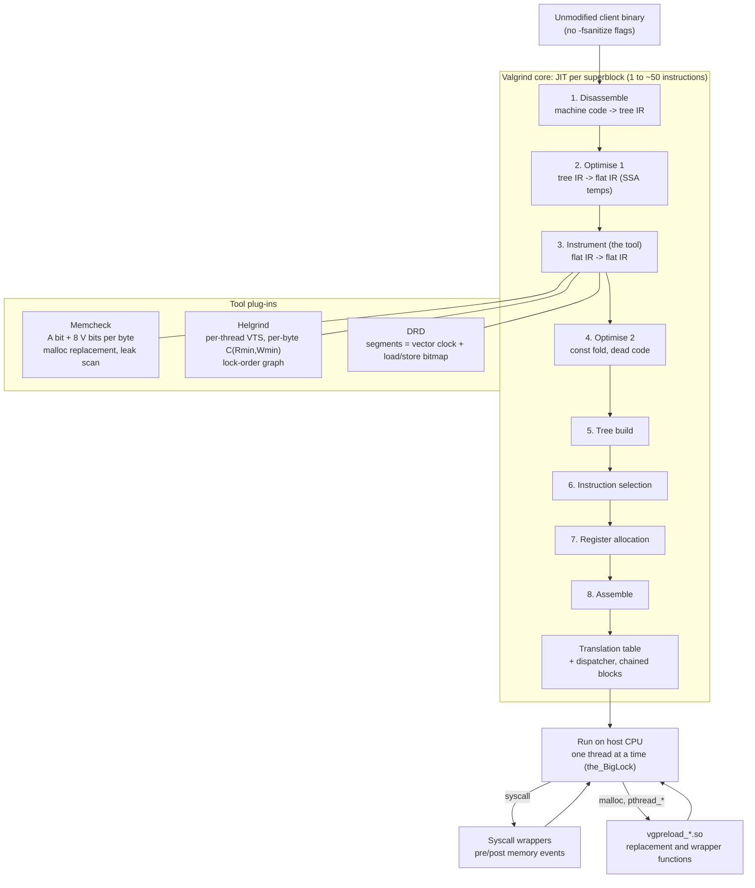

# C++ Valgrind Memcheck, Helgrind, and DRD

> [!summary] Claim:
> Valgrind runs an unmodified binary on a synthetic CPU: its core translates each superblock of guest machine code into the architecture-neutral VEX IR, hands the flattened IR to a tool for instrumentation, and compiles the result back to host code, so no recompilation or sanitizer flag is needed.
> Memcheck shadows every byte with one addressability (A) bit and eight validity (V) bits, propagates V bits through every operation with bit precision, and reports only when an undefined value steers a branch, forms an address, or reaches a system call.
> Helgrind and DRD both detect data races by happens-before over vector clocks built from intercepted pthread calls: Helgrind keeps a per-location constraint pair and also checks lock order, while DRD compares load and store bitmaps of unordered segments and adds lock-hold-time checks.
> The price is a 10-50x Memcheck slowdown, all client threads serialized behind one lock, and no understanding of C++ atomics or custom synchronization unless annotated; upstream Valgrind has no arm64 macOS port (as of 2026-11).



## The Mechanism

[[Cpp-AddressSanitizer-and-LeakSanitizer-Internals]] and [[Cpp-ThreadSanitizer-and-MemorySanitizer-Internals]] own compile-time instrumentation: the compiler inserts shadow checks, so only recompiled code is checked.
This note owns the other design point, dynamic binary instrumentation, in which the checks are inserted into machine code at run time.
Facts about current behavior come from the Valgrind 3.28.0 manual and NEWS (released 23 Oct 2026) and from the 3.27.1 source as packaged by Debian; the lab runs Valgrind 3.22.0, the version Ubuntu 24.04 ships.

### 1. The core: disassemble, instrument, resynthesize

Valgrind loads the client into its own process and "runs it on a synthetic CPU provided by the Valgrind core" (manual section 2.2).
No original client instruction ever executes; every instruction executed is one Valgrind generated.

Nethercote and Seward's PLDI 2007 paper names the design choice that matters most: disassemble-and-resynthesize (D&R) instead of copy-and-annotate (C&A).
A C&A framework such as Pin or DynamoRIO copies the original instructions through and calls analysis code beside them.
A D&R framework lifts each instruction into an IR, lets the tool rewrite the IR, and generates fresh machine code from it.
D&R costs more for lightweight tools, but for heavyweight shadow-value tools it means the analysis code is expressed in the same IR as the client code and goes through the same optimiser and register allocator, so shadow operations are cheap to write and get optimised with the client code.

The unit of translation is the superblock (`IRSB`): single entry, multiple exit, "typically ... from 1 to perhaps 50 instructions" (`VEX/pub/libvex_ir.h`).
Each IRSB holds a type environment for its temporaries, a list of statements, and a final jump.
Statements (`IRStmt`) have side effects; their tags are `Ist_NoOp`, `Ist_IMark`, `Ist_AbiHint`, `Ist_Put`, `Ist_PutI`, `Ist_WrTmp`, `Ist_Store`, `Ist_LoadG`, `Ist_StoreG`, `Ist_CAS`, `Ist_LLSC`, `Ist_Dirty`, `Ist_MBE`, and `Ist_Exit`.
Expressions (`IRExpr`) have none: loads, arithmetic, constants, and reads of temporaries.
Guest registers live in a guest state block (the paper calls it the ThreadState) and are read with `GET` and written with `PUT` at fixed byte offsets.
The header's own example, `addl %eax, %ebx` on x86, becomes:

```text
------ IMark(0x24F275, 7, 0) ------
t3 = GET:I32(0)             # get %eax, a 32-bit integer
t2 = GET:I32(12)            # get %ebx, a 32-bit integer
t1 = Add32(t3,t2)           # addl
PUT(0) = t1                 # put %eax
```

The IR "is guaranteed to be flattened at instrumentation-time", meaning every operand is a constant or a temporary, which is what makes a tool's job mechanical: for each `t = Op(a, b)` it emits a shadow `t' = ShadowOp(a', b')`.
Shadow registers live in the same guest state block as guest registers; in the paper's x86 example the shadow of `%eax` sits at offset 320 next to `%eax` at offset 0.

The paper describes eight phases, all in the core except instrumentation: disassembly, optimisation to flat IR, instrumentation, a second optimisation, tree building, instruction selection, register allocation, and assembly.
In its Figure 2, Memcheck adds 11 of the 18 statements in one instrumented `movl`, so the analysis code is larger than the client code.
A superblock ends at about 50 instructions, at a conditional branch, at a branch to an unknown target, or after more than three unconditional branches to known targets.
Finished translations go into a translation table, about 400,000 entries in Valgrind 3.2.1, evicted FIFO an eighth at a time when it passes 80% full.
The paper's Valgrind 3.2.1 did not chain translations; the current scheduler does (`VG_TRC_CHAIN_ME_TO_FAST_EP` and `VG_TRC_CHAIN_ME_TO_SLOW_EP` in `coregrind/m_scheduler/scheduler.c` at 3.27.1).

Three more core services matter for the tools:

- System calls run for real, but Valgrind cannot trace into the kernel, so every syscall has a hand-written wrapper that tells the tool which registers and memory the kernel reads and writes (`pre_mem_read`, `post_mem_write`, and the other events in the paper's Table 1).
  The paper counts almost 15,000 lines of wrapper code in 3.2.1, more than Memcheck itself.
- Function replacement and wrapping: each tool ships a preload library (`vgpreload_memcheck-arm64-linux.so` in the lab's output) that replaces `malloc`, `free`, `operator new`, and `operator delete`, or wraps the `pthread_*` functions so Helgrind and DRD see every lock and thread event.
- Client requests: macros from `valgrind/valgrind.h` and the tool headers expand to an inline instruction sequence that Valgrind recognises; the manual (section 3.1) gives the cost on the real CPU as "6 simple integer instructions" on x86, amd64, ppc32, ppc64, and ARM, and `-DNVALGRIND` removes them entirely.
  `RUNNING_ON_VALGRIND` returns 1 under Valgrind and 0 on the real CPU, which the lab prints.

### 2. Threads: one at a time

A load or store and its shadow load or store are two operations, so on a real multiprocessor they could be torn apart by another thread.
Valgrind sidesteps the problem: "Valgrind serialises execution so that only one (kernel) thread is running at a time" (manual section 2.8).
The scheduler source calls the lock "the_BigLock": a thread must hold it to run client code, releases it before a blocking syscall, and is forced to yield when its `--scheduling-quantum` of basic blocks (default 100000, `coregrind/m_options.c`) runs out.
The kernel still picks which runnable thread gets the lock next, unless `--fair-sched=yes` asks for round-robin (default `no`).
Asynchronous signals are delivered only between superblocks, so a signal can never land between a load and its shadow load.

The consequences:

- A program with N busy threads gets at most one CPU, so a parallel workload slows down by an extra factor of up to N on top of the tool's overhead.
- Many interleavings that happen natively never happen under Valgrind, so a test that fails only under a rare interleaving may never fail under Valgrind; Helgrind and DRD still report the race, because happens-before analysis does not depend on the interleaving that actually ran (each loop in the lab's race case is 1,000 iterations, far below one 100,000-block quantum, and the race is still reported).
- A program that spins waiting for another thread makes progress only when the quantum expires.

### 3. Memcheck: A bits, V bits, and when it complains

Memcheck keeps two kinds of shadow state (manual section 4.5):

- **A bits:** one per byte, saying whether the program may access it.
  `malloc` makes a block addressable, `free` and stack pops make it unaddressable, and every load and store checks the A bits of its address range.
- **V bits:** one per data bit, in registers and memory, saying whether the bit has a defined value.
  The encoding is inverted on purpose: 0 means defined, 1 means undefined, which makes several shadow operations single instructions (USENIX 2005 paper, section 2.3).

A V bit vector is computed for every value-producing operation, but checked in only a few places.
The manual: "Checks on definedness only occur in three places": when a value is used to generate a memory address, when a control-flow decision depends on it, and when it is passed to a system call.
The 2005 paper adds that loading undefined data into a floating-point or SIMD register was also a check point in its implementation, since those registers then had no shadow.
Copying undefined bytes is never reported, because compilers and programmers copy struct padding all the time; the lab copies a padded struct with `memcpy` silently and is reported only when `write()` hands the padding to the kernel.
After a check fails, Memcheck marks the checked value defined so the same root cause does not produce a cascade of reports, and data loaded from an unaddressable address is marked defined for the same reason (2005 paper, section 2.7).

#### Bit-precise propagation

The 2005 paper defines the shadow algebra, with `v` the V bits of operand `d`:

| Operation | Shadow rule | Why |
| :--- | :--- | :--- |
| `Xor`, `Not` | `UifU(v1, v2)` (bitwise OR of V bits) | Any undefined input bit makes that result bit undefined |
| `Add`, `Sub`, `Mul` | `Left(UifU(v1, v2))` | An undefined bit can carry into every higher bit; `Left` smears each undefined bit leftwards |
| `And` | `DifD(UifU(v1,v2), DifD(ImproveAND(d1,v1), ImproveAND(d2,v2)))` | A defined 0 forces the result bit to a defined 0 whatever the other operand |
| `Or` | Same shape with `ImproveOR` | A defined 1 forces the result bit to a defined 1 |
| Shifts and rotates | `UifU(PCast(v2), OP(v1, d2))` | Shift the V bits like the data; an undefined shift amount poisons everything |
| Widening | `ZWiden` or `SWiden` of the V bits | Zero-extension adds defined bits; sign-extension copies the top V bit |
| Comparisons, flags | `PCast` (all-or-nothing) | One undefined input bit makes the whole flag undefined |

`Left` costs two instructions (negate and OR), and the VEX-era instrumented IR in the PLDI 2007 paper's Figure 2 still shows it as `Or32(t19,Neg32(t19))`.
Bit precision is what makes bitfields and flag words work: the lab's `bit_precision` case reads an entirely undefined `unsigned`, ORs in bit 0, and branches twice.
`if (x & 1u)` depends only on a defined bit and is silent; `if (x & 2u)` depends on an undefined bit and is reported, exactly one error on line 44.
A byte-granular definedness tracker would have to flag both branches or neither.
`--expensive-definedness-checks` (default `auto`) enables more exact, slower instrumentation; the manual puts `yes` at up to 30% slower and `auto` at about 5% slower than `no`.

#### Shadow memory layout

The VEE 2007 paper describes the structure Memcheck still uses, and `memcheck/mc_main.c` at 3.27.1 confirms the constants:

- A two-level table like a page table: a primary map of pointers to secondary maps, each secondary map covering 64 KiB of address space.
- On 64-bit hosts the primary map has `N_PRIMARY_BITS 21`, so it covers the first 2^21 x 64 KiB = 128 GiB directly ("Just handle the first 128G fast and the rest via auxiliary primaries"); addresses above that go through a slower auxiliary map.
  The 2007 paper used 2^19 entries (32 GiB); the constant has grown since.
- Compressed state: two bits per byte (`VA_BITS2_NOACCESS 0x0`, `VA_BITS2_UNDEFINED 0x1`, `VA_BITS2_DEFINED 0x2`, `VA_BITS2_PARTDEFINED 0x3`), so a secondary map is `vabits8[16384]`, 16 KiB of shadow for 64 KiB of memory.
  Only partially defined bytes keep all eight V bits, in a sparse secondary V-bit table with 16-byte nodes (`BYTES_PER_SEC_VBIT_NODE 16`).
- Distinguished secondary maps: shared, read-only maps for all-NOACCESS, all-UNDEFINED, and all-DEFINED chunks, so untouched address space and large defined code segments cost no memory until written.

The paper measured that compressed V bits shrank mean shadow memory by 4.29x and that the four shadow-memory optimisations together sped Memcheck up by 8.9x on SPEC CPU2000 (Valgrind pre-3.2.0, 32-bit x86, 2007 hardware).
Shadow registers keep the full eight V bits per byte; only memory is compressed.

#### The heap: replacement allocator, redzones, and the freed-block queue

Memcheck replaces the allocator through its preload library.
Each block is surrounded by unaddressable redzones (`--redzone-size`, tool-dependent default), so a read just past the end hits an A bit of 0, as in the lab's "0 bytes after a block of size 40 alloc'd".
Freed blocks are not reused at once: they wait in a queue of up to `--freelist-vol` bytes (default 20,000,000), with blocks of at least `--freelist-big-blocks` (default 1,000,000) bytes recycled first, which is what turns a use-after-free into "8 bytes inside a block of size 16 free'd" instead of a silent read of a reused block.
Every allocation and free records a stack trace (`--keep-stacktraces=alloc-and-free`), which is why reports show both the alloc and the free site.
The allocator also checks pairing: `new[]` released with `delete` is reported as "Mismatched free() / delete / delete []", and Valgrind 3.22.0 additionally reports "Mismatched new/delete size value: 4", because C++14 sized deallocation passes `sizeof(int)` for a 12-byte block.

Memcheck cannot redzone what it does not allocate: "Memcheck doesn't do bounds checking on global or stack arrays" (FAQ 4.5).
An overrun from one stack array into the next local, or from one global into the next, lands on addressable, defined bytes and is invisible to it.
ASan, which pads stack and global objects at compile time, catches exactly those.

#### Leak detection

At exit, with `--leak-check=summary` (the default) or `full`, Memcheck runs a mark-and-sweep over the heap: the roots are the registers and accessible non-heap memory such as stacks and globals, and any word that points into a block marks that block reachable.
A pointer to the first byte is a start pointer; a pointer into the middle is an interior pointer.
The manual's nine-case table reduces to four kinds:

| Kind | Meaning | Counted as an error by default |
| :--- | :--- | :--- |
| Still reachable | A chain of start pointers from a root reaches it | No |
| Definitely lost | No pointer at all reaches it | Yes |
| Indirectly lost | Only pointers from lost blocks reach it, such as the child of a lost list head | No |
| Possibly lost | Only chains that include an interior pointer reach it | Yes |

`--show-leak-kinds` and `--errors-for-leak-kinds` both default to `definite,possible`.
Four `--leak-check-heuristics` (default `all`) accept specific interior pointers as reachable: `stdstring`, `length64`, `newarray`, and `multipleinheritance`; the lab fills its possibly-lost block with a pattern no heuristic matches.
Leaks become counted errors only with `--leak-check=full`; with the default `summary` the lab prints the same leak summary and an ERROR SUMMARY of 0.

#### Origin tracking

Knowing that a branch depends on an undefined value is not enough when the value travelled through ten functions first.
`--track-origins=yes` attaches a 32-bit origin tag to undefined values: an upper 30-bit field indexing a recorded stack trace (an ECU) and a lower 2-bit kind (`mc_main.c`, "Origin tags and ECUs").
Heap origins carry the exact `malloc` stack; stack origins name only the function whose frame created the bytes, because "it is simply too expensive to create a complete backtrace for each stack allocation."
The manual's price: "It halves Memcheck's speed and increases memory use by a minimum of 100MB."
The design descends from the OOPSLA 2007 paper by Bond, Nethercote, and coauthors, but the source notes that it uses separate origin tags rather than that paper's value piggybacking.

### 4. Helgrind: happens-before with per-location constraints

Helgrind reports three classes of error (manual chapter 7): POSIX pthreads API misuse, inconsistent lock ordering, and data races.

#### Races

Two accesses race when they come from different threads, touch the same location, at least one is a write, and no happens-before (HB) relation orders them (section 7.4.2).
Helgrind builds HB only from events it intercepts:

- Mutex unlock followed by lock of the same mutex, and reader-writer locks with the read/write distinction.
- Condition variable signal or broadcast to the waiters it releases.
- `sem_post` to the `sem_wait` that consumes it.
- Barriers: every pre-barrier access happens before every post-barrier access.
- `pthread_create` (parent before child) and `pthread_join` (child before joiner).

`helgrind/libhb_core.c` implements this with vector timestamps (VTS).
Each thread (`struct _Thr`) holds two, `viR` for reads and `viW` for writes, which differ only around reader-writer locks.
Each shadowed location holds an `SVal` that is either `SVal_NOACCESS` or a constraint pair `C(Rmin, Wmin)`: `Rmin` is the clock a reader must already have seen, and `Wmin` the clock a writer must already have seen.
`msmcread()` reports a race unless `Rmin <= viR`, then leaves `C(Rmin, join(Wmin, viW))`.
`msmcwrite()` reports a race unless `Wmin <= viW`, then leaves `C(viW, viW)`.
After a report, both functions store the state as if the access had been ordered, so each racing access pattern is reported once instead of on every loop iteration: the loop that DRD counts as 2,000 conflicting accesses produces 2 Helgrind errors.
The "Locks held:" lines in a report are locksets shown for diagnosis; the race verdict is HB, not lockset intersection.

To print the other side of a race, Helgrind keeps a history of earlier accesses; `--history-level=full` (default) keeps stack traces for up to `--conflict-cache-size` (default 1,000,000) accesses, and `approx` and `none` keep less history, trading report detail for speed.

#### Lock order

Helgrind maintains a directed graph of "lock A was held while lock B was acquired" edges and reports when a new edge closes a cycle (section 7.3).
The deadlock need not happen: the lab takes A then B in one thread, joins it, then takes B then A in another, and Helgrind reports `lock order ... violated` with both acquisition sites, while DRD, which has no lock-order checker, reports nothing.
For a cycle longer than two locks Helgrind shows only two of them.

#### What Helgrind cannot see

Any synchronization that does not go through an intercepted pthread call is invisible: hand-rolled spin locks, futex-based primitives, lock-free queues, and C++ `std::atomic` release/acquire.
The lab's `atomic_publish` case is correct C++ (a plain store, a `memory_order_release` flag store, an acquire load, then a plain load), and both Helgrind and DRD report races on the flag and on the payload.
ThreadSanitizer models the C++ memory model and would not report this program.
Atomic instructions get one fixed rule instead of a model.
`hg_instrument()` in `helgrind/hg_main.c` instruments an IR compare-and-swap as a load, under the comment "Just pretend it's a read", treats a load-linked as a normal load, and ignores the store-conditional.
`DRD_(instrument)()` in `drd/drd_load_store.c` does the same, and its comment spells out the result: no race is reported between two atomic operations or between an atomic operation and a plain read, but a plain write that conflicts with an atomic operation is still reported.
So two threads that only `fetch_add` one counter are silent under both tools, which the lab's `atomic_counter` case records as 0 errors, while a release store that compiles to a plain store instruction (`stlr` in the lab's AArch64 binary) is an ordinary write, which is why the flag in `atomic_publish` is reported.
The fixes are the `helgrind.h` and `drd.h` annotations, `ANNOTATE_HAPPENS_BEFORE(addr)` after the release and `ANNOTATE_HAPPENS_AFTER(addr)` after the acquire, or `VALGRIND_HG_CLEAN_MEMORY` for recycled pool memory; the manual's own advice is to avoid custom primitives built on futexes or atomics.

### 5. DRD: segments and bitmaps

DRD uses the same happens-before definition with a different data structure (manual section 8.1.4 and `drd/drd_segment.c`).
A segment is a run of one thread's loads, stores, and synchronization operations between two synchronization operations.
`sg_init()` gives each new segment a copy of the creator's vector clock, increments the thread's own component (`vc_increment`), and an empty bitmap of the addresses it loads and stores (`bm_init`).
Two segments can race only if their vector clocks are unordered (`DRD_(vc_ordered)()` in `drd_vc.c` is false), and a race exists where one segment's store bitmap intersects the other's load or store bitmap.
Comparing whole segments instead of tracking every access in a per-location shadow is a performance choice the manual names explicitly, and `--segment-merging` (default `yes`, every `--segment-merging-interval` 10 segments) bounds memory.

What DRD adds and lacks, as the lab shows:

- It counts every conflicting access: the same racy loop gives "2000 errors from 2 contexts", against Helgrind's 2 from 2, which matches one conflicting load and one conflicting store per iteration of one thread's 1,000-iteration loop.
- `--exclusive-threshold=<ms>` and `--shared-threshold=<ms>` report locks held too long, a contention bug Helgrind has no check for.
- No lock-order checking.
- `--check-stack-var` (default `no`) leaves stack variables out of race detection unless asked.
- The manual gives the resource cost as 1.1 to 3.6 times native memory and 20 to 50 times native single-threaded run time.
- For C++11 `std::thread`, the manual (section 8.2.6) says to define the libstdc++ hooks `_GLIBCXX_SYNCHRONIZATION_HAPPENS_BEFORE` and `_GLIBCXX_SYNCHRONIZATION_HAPPENS_AFTER` as the `ANNOTATE_HAPPENS_*` macros before including any C++ header.

### 6. Where Valgrind sits next to the sanitizers

| Property | Valgrind Memcheck | ASan | MSan | Helgrind / DRD | TSan |
| :--- | :--- | :--- | :--- | :--- | :--- |
| Instrumentation | Run time, on any binary | Compile time | Compile time, all code including libc++ | Run time | Compile time |
| Typical slowdown (vendor docs) | 10-50x | 2x | 3x | DRD 20-50x | 5-15x |
| Uninitialized reads | Yes, bit-precise | No | Yes, bit-precise | No | No |
| Stack and global overflows | No | Yes | No | No | No |
| Uninstrumented libraries | Fully checked | Interposed calls only | False reports | Fully checked | Not instrumented |
| C++ atomics as synchronization | Not applicable | Not applicable | Not applicable | No | Yes |
| Real parallelism during the run | No, serialized | Yes | Yes | No, serialized | Yes |

The slowdown figures are each project's own statements: the Valgrind core manual for Memcheck, the DRD manual, and the Clang pages for ASan ("2x"), MSan ("3x"), and TSan ("about 5x-15x").
The PLDI 2007 paper measured a geometric-mean Memcheck slowdown of 22.1x across 25 SPEC CPU2000 benchmarks (its table; its text says 22.2x) and 4.3x for Nulgrind, the tool that adds no instrumentation, on Valgrind 3.2.1 and a 2.4 GHz Core 2 Duo; no slowdown in this note was measured by the lab.
MSan "requires that all program code is instrumented", and failing that "may result in false reports"; Memcheck's niche is exactly the binary you cannot rebuild: a vendor library, a release build already in the field, a Python extension linked against a distribution's libraries.

Platform status (as of 2026-11): upstream Valgrind 3.28.0 supports Linux on x86, amd64, arm32, arm64, ppc32, ppc64be, ppc64le, s390x, mips32, mips64, and riscv64, plus Solaris, FreeBSD, Android, and "macOS ... up to version 13 Ventura (amd64 only)" and the 3.28.0 NEWS adds "macOS 10.14 Mojave (x86)".
There is no upstream arm64 Darwin port, so Valgrind does not run natively on Apple silicon macOS.
The third-party `LouisBrunner/valgrind-macos` fork lists arm64 support for several macOS releases and calls macOS 15 arm64 experimental; it is not upstream Valgrind.
On an Apple silicon Mac the practical route is an arm64 Linux container or VM, which is how the lab was recorded, and [[Cpp-Sanitizers-and-Memory-Debugging-on-macOS]] owns the native macOS tools.

## Commands and Numbers to Know

Option defaults are from the Valgrind 3.28.0 manual unless the source column names a file; the lab ran 3.22.0.

| Item | Value | Platform and date | What it controls |
| :--- | :--- | :--- | :--- |
| `--tool=` | `memcheck` | Linux (as of 2026-11) | `helgrind`, `drd`, `none` (Nulgrind), and others |
| `--leak-check` | `summary` | Linux (as of 2026-11) | `full` lists each leak and makes leaks count as errors |
| `--show-leak-kinds` | `definite,possible` | Linux (as of 2026-11) | Leak kinds listed individually; `all` adds indirect and reachable |
| `--errors-for-leak-kinds` | `definite,possible` | Linux (as of 2026-11) | Leak kinds that count toward the error total and exit code |
| `--leak-check-heuristics` | `all` | Linux (as of 2026-11) | `stdstring`, `length64`, `newarray`, `multipleinheritance` |
| `--track-origins` | `no` | Linux (as of 2026-11) | `yes` halves speed and adds at least 100 MB |
| `--expensive-definedness-checks` | `auto` | Linux (as of 2026-11) | `yes` up to 30% slower; `auto` about 5% slower than `no` |
| `--freelist-vol` | `20000000` bytes | Linux (as of 2026-11) | How long freed blocks stay unreusable |
| `--freelist-big-blocks` | `1000000` bytes | Linux (as of 2026-11) | Blocks this large leave the queue first |
| `--keep-stacktraces` | `alloc-and-free` | Linux (as of 2026-11) | Stacks recorded per heap block |
| `--error-exitcode` | `0` | Linux (as of 2026-11) | Nonzero makes errors fail the process; required for CI |
| `--num-callers` | `12` (minimum 2 since 3.27.0) | Linux (as of 2026-11) | Frames per stack trace |
| `--error-limit` | `yes`: stop after 1,000 distinct or 10,000,000 total errors | Linux (as of 2026-11) | `no` keeps collecting |
| `--gen-suppressions` | `no` | Linux (as of 2026-11) | `all` prints a suppression for every error |
| `--suppressions` | `$PREFIX/lib/valgrind/default.supp` plus up to 100 files | Linux (as of 2026-11) | Known errors to hide |
| `--vgdb`, `--vgdb-error` | `yes`, `999999999` | Linux (as of 2026-11) | `--vgdb-error=0` stops at startup for `target remote \| vgdb` |
| `--smc-check` | `all-non-file` on x86, amd64, s390x; `stack` elsewhere | Linux (as of 2026-11) | Self-modifying and JIT code detection |
| `--max-threads` | `500` | Linux (as of 2026-11) | Client thread limit |
| `--max-stackframe` | `2000000` (`m_main.c`) | Linux (as of 2026-11) | SP change treated as a stack switch |
| `--scheduling-quantum` | `100000` basic blocks (`m_options.c`) | Linux (as of 2026-11) | Timeslice before the_BigLock is offered to another thread |
| `--fair-sched` | `no` | Linux (as of 2026-11) | `yes` or `try` for round-robin thread scheduling |
| Helgrind `--track-lockorders` | `yes` | Linux (as of 2026-11) | Lock-order cycle detection |
| Helgrind `--history-level` | `full` | Linux (as of 2026-11) | `approx` or `none` trade conflict detail for speed |
| Helgrind `--conflict-cache-size` | `1000000` (10,000 to 30,000,000) | Linux (as of 2026-11) | Accesses remembered for the other side of a race |
| Helgrind `--free-is-write` | `no` | Linux (as of 2026-11) | Experimental since 3.7.0: treat `free` as a write to the freed block |
| DRD `--check-stack-var` | `no` | Linux (as of 2026-11) | Race-check stack variables |
| DRD `--exclusive-threshold`, `--shared-threshold` | off | Linux (as of 2026-11) | Report locks held longer than N ms |
| DRD `--segment-merging`, `--segment-merging-interval` | `yes`, `10` | Linux (as of 2026-11) | Memory bound on segment history |
| DRD `--first-race-only` | `no` | Linux (as of 2026-11) | Report only the first race per location |
| Memcheck slowdown | 10-50x; Nulgrind about 4x | Linux (as of 2026-11) | Manual section 2.2 |
| DRD cost | 20-50x time, 1.1-3.6x memory | Linux (as of 2026-11) | Manual section 8.2.12 |
| Client request cost on the real CPU | 6 integer instructions | Linux (as of 2026-11) | x86, amd64, ppc32, ppc64, ARM; `-DNVALGRIND` removes them |
| Secondary map | 64 KiB covered, 16 KiB of 2-bit state | Linux (as of 2026-11) | `SM_CHUNKS 16384` in `mc_main.c` 3.27.1 |
| Fast primary map on 64-bit | 2^21 entries, 128 GiB | Linux (as of 2026-11) | `N_PRIMARY_BITS 21` in `mc_main.c` 3.27.1 |
| Superblock size | 1 to about 50 instructions | Linux (as of 2026-11) | `libvex_ir.h` |
| Current release | 3.28.0, 23 Oct 2026 | Both (as of 2026-11) | Ubuntu 24.04 ships 3.22.0 |

## Multi-Language Comparison: C++ / Python / Rust

| Concern | C++ | Python (CPython) | Rust |
| :--- | :--- | :--- | :--- |
| Running under Memcheck | Works on any build; `-O0 -g` gives exact lines, optimized builds work with less precise frames | Works, but pymalloc's arena check reads memory it never initialized and floods Memcheck with expected errors | Works on any build, debug or release |
| Making it usable | Nothing beyond debug info | `Misc/README.valgrind`: build `--with-valgrind` or set `PYTHONMALLOC=malloc` (3.6+), and use `Misc/valgrind-python.supp` | Third-party `cargo valgrind` (crate `cargo-valgrind` 2.4.1) runs tests under Memcheck |
| Where it earns its keep | Prebuilt or closed libraries, uninitialized reads without MSan's rebuild | C extensions and their native dependencies, which CPython's own tooling cannot see into | `unsafe` and FFI code, especially into C or C++ libraries that Miri cannot execute |
| Race detection alternative | TSan, or Helgrind/DRD for unrebuilt binaries | Native races inside extensions are visible to Helgrind and TSan like races in any C code | Safe Rust rules out data races; Loom and Miri cover `unsafe` concurrency, see [[Rust-Miri-Sanitizers-Loom-and-Cargo-Fuzz]] |
| Atomics caveat | Helgrind and DRD ignore `std::atomic` ordering: a release/acquire publication is reported, a `fetch_add` counter is not | Same for extensions using C11 atomics | Same rule: a `Release`/`Acquire` publication and a `std::sync::mpsc` send and receive are reported, while `fetch_add` and `Arc` reference counts are not |
| Locks the tools can see | `pthread_mutex_t` and everything else that calls an intercepted pthread function | The same pthread calls made by an extension or its native libraries | Not `std::sync::Mutex`, `RwLock`, or `Condvar` on Linux: futex-based since Rust 1.62, they make no pthread call, so data they guard is reported as racing |

The Rust cells of the atomics and locks rows were checked on 2026-11-11 outside the lab, because the lab image has no Rust toolchain: a five-case program built with rustc 1.99.1 at `opt-level=0` ran under Helgrind and DRD from Valgrind 3.22.0 on linux-aarch64, and its output is not part of `make verify`.
Both tools reported the `Release`/`Acquire` publication, the counter guarded by a `std::sync::Mutex`, and the `std::sync::mpsc` send and receive; neither reported `fetch_add` on a shared `AtomicU64` or an `Arc` cloned into two threads.
The three cases that ran two spawned threads at once also drew reports from inside the standard library, in the `stack_overflow::thread_info` table that it guards with a spin lock and not a pthread mutex, so those runs were not clean even where the program's own accesses went unreported.
The Rust 1.62.0 announcement gives the reason for the lock row: `Mutex`, `Condvar`, and `RwLock` "were backed by the pthreads library on Linux" and are now "a raw futex-based implementation".
[[Python-Debugging-Hung-Processes-and-C-Extensions]] and [[Rust-FFI-Boundary-Debugging-Across-Cpp-and-Python]] own the language-specific workflows.

## Worked Lab Example

The lab is `code/03-Debugging/valgrind_memcheck/` and requires Linux; on a macOS host the harness runs it in the pinned Ubuntu 24.04 container, whose image must carry the `valgrind` package (3.22.0 there) in `linux-labs.Dockerfile`.
Without Valgrind, `run.sh` exits 1 with `valgrind not found on PATH`, which the harness reports as a failure and never as a skip.

- `memcheck_bugs.cpp` holds ten memory bugs, one per command-line case, and `thread_bugs.cpp` holds seven threading cases.
- `run.sh` builds both with `"${CXX:-c++}" -std=c++17 -O0 -g` and no sanitizer or Valgrind-specific flag, so every report comes from binary translation alone; only the `custom_pool` and `client_check` cases use client-request macros.
- It runs every case natively, then under Memcheck, Helgrind, or DRD with `--log-file`, and pipes each log through `digest.py`.
- `digest.py` keeps headings, detail lines, and frames in the lab's own sources, keeps only the innermost frame elsewhere, and scrubs every address to `ADDR`; for the race and contention cases it also replaces thread numbers with `T`, because which thread the kernel ran first varies.
- Every check can fail: each bug must produce its specific heading and line number, the fixed variants must produce zero errors, and the exit codes are asserted exactly.

```bash
cd code
python3 -m _harness.verify 03-Debugging/valgrind_memcheck/
```

### Verified output

Recorded by `python3 -m _harness.verify --record` on 2026-11-11 in the harness container on an Apple silicon host (platform `linux-aarch64`, Valgrind 3.22.0, GCC 13.2.0, glibc 2.39), then verified six times with identical output; the file is `code/03-Debugging/valgrind_memcheck/expected/linux-aarch64.txt`.
The blocks are excerpts of that file, each copied as contiguous lines.

Uninstrumented, only one of the ten bugs is visible; glibc's own double-free check aborts the process (exit 134 is 128 + SIGABRT):

```text
== Native runs (no Valgrind): exit status per case
  heap_overflow        exit=0
  use_after_free       exit=0
  uninit_branch        exit=0
  bit_precision        exit=0
  padding_to_syscall   exit=0
  mismatched_delete    exit=0
  double_free          exit=134
  custom_pool          exit=0
  client_check         exit=0
  leaks                exit=0
  probe: RUNNING_ON_VALGRIND=0
  probe under valgrind: RUNNING_ON_VALGRIND=1
```

Bit precision: of the two branches on lines 43 and 44, only the one that reads undefined bit 1 is reported, and origin tracking names the `malloc` on line 40:

```text
== Memcheck: bit_precision (--track-origins=yes)
  Conditional jump or move depends on uninitialised value(s)
  at bit_precision() (memcheck_bugs.cpp:44)
  by main (memcheck_bugs.cpp:123)
  Uninitialised value was created by a heap allocation
  at malloc (vgpreload_memcheck-arm64-linux.so)
  by bit_precision() (memcheck_bugs.cpp:40)
  by main (memcheck_bugs.cpp:123)

  HEAP SUMMARY:
  in use at exit: 0 bytes in 0 blocks

  ERROR SUMMARY: 1 errors from 1 contexts (suppressed: 0 from 0)
```

Lazy reporting: the `memcpy` of the padded struct on line 58 is silent, and the report fires at the `write()` on line 60, where the three padding bytes reach the kernel:

```text
== Memcheck: padding_to_syscall (--track-origins=yes)
  Syscall param write(buf) points to uninitialised byte(s)
  at write (write.c)
  by padding_to_syscall() (memcheck_bugs.cpp:60)
  by main (memcheck_bugs.cpp:124)
  Address ADDR is on thread 1's stack
  in frame #1, created by padding_to_syscall() (memcheck_bugs.cpp:53)
  Uninitialised value was created by a stack allocation
  at padding_to_syscall() (memcheck_bugs.cpp:53)
```

All four leak kinds, and which of them count as errors (two definitely lost records and one possibly lost record give 3 errors):

```text
== Memcheck: leaks (--leak-check=full --show-leak-kinds=all)
  HEAP SUMMARY:
  in use at exit: 192 bytes in 5 blocks

  16 bytes in 1 blocks are definitely lost in loss record 1 of 5
  at malloc (vgpreload_memcheck-arm64-linux.so)
  by make_leaks() (memcheck_bugs.cpp:83)
  by main (memcheck_bugs.cpp:127)

  32 bytes in 1 blocks are indirectly lost in loss record 2 of 5
  at operator new(unsigned long) (vgpreload_memcheck-arm64-linux.so)
  by make_leaks() (memcheck_bugs.cpp:85)
  by main (memcheck_bugs.cpp:127)

  48 bytes in 1 blocks are possibly lost in loss record 3 of 5
  at malloc (vgpreload_memcheck-arm64-linux.so)
  by make_leaks() (memcheck_bugs.cpp:87)
  by main (memcheck_bugs.cpp:127)

  64 bytes in 1 blocks are still reachable in loss record 4 of 5
  at malloc (vgpreload_memcheck-arm64-linux.so)
  by make_leaks() (memcheck_bugs.cpp:82)
  by main (memcheck_bugs.cpp:127)

  64 (32 direct, 32 indirect) bytes in 1 blocks are definitely lost in loss record 5 of 5
  at operator new(unsigned long) (vgpreload_memcheck-arm64-linux.so)
  by make_leaks() (memcheck_bugs.cpp:85)
  by main (memcheck_bugs.cpp:127)

  LEAK SUMMARY:
  definitely lost: 48 bytes in 2 blocks
  indirectly lost: 32 bytes in 1 blocks
  possibly lost: 48 bytes in 1 blocks
  still reachable: 64 bytes in 1 blocks
  suppressed: 0 bytes in 0 blocks

  ERROR SUMMARY: 3 errors from 3 contexts (suppressed: 0 from 0)
```

The CI gate and the suppression workflow:

```text
== Memcheck as a CI gate: exit status
  heap_overflow with --error-exitcode=99: exit=99
  heap_overflow with the default --error-exitcode=0: exit=0
  leaks with --error-exitcode=99 --leak-check=full: exit=99

== Memcheck: generate a suppression, then apply it
  {
     lab-uninit-branch
     Memcheck:Cond
     fun:_ZL13uninit_branchv
     fun:main
  }
  HEAP SUMMARY:
  in use at exit: 0 bytes in 0 blocks

  All heap blocks were freed -- no leaks are possible

  ERROR SUMMARY: 0 errors from 0 contexts (suppressed: 1 from 1)
```

The same race, seen by both thread tools: Helgrind reports each pattern once, DRD counts all 2,000 conflicting accesses of the second thread:

```text
== helgrind: race
  Possible data race during read of size 4 at ADDR by thread #T
  Locks held: none
  at racy_increment(void*) (thread_bugs.cpp:21)

  This conflicts with a previous write of size 4 by thread #T
  Locks held: none
  at racy_increment(void*) (thread_bugs.cpp:21)
  Address ADDR is 0 bytes inside data symbol "_ZL9g_counter"

  Possible data race during write of size 4 at ADDR by thread #T
  Locks held: none
  at racy_increment(void*) (thread_bugs.cpp:21)

  This conflicts with a previous write of size 4 by thread #T
  Locks held: none
  at racy_increment(void*) (thread_bugs.cpp:21)
  Address ADDR is 0 bytes inside data symbol "_ZL9g_counter"

  ERROR SUMMARY: 2 errors from 2 contexts (suppressed: 1 from 1)
```

```text
== drd: race
  Conflicting load by thread T at ADDR size 4
  at racy_increment(void*) (thread_bugs.cpp:21)
  Allocation context: BSS section of thread_bugs
  Other segment start (thread T)
  Other segment end (thread T)

  Conflicting store by thread T at ADDR size 4
  at racy_increment(void*) (thread_bugs.cpp:21)
  Allocation context: BSS section of thread_bugs
  Other segment start (thread T)
  Other segment end (thread T)

  ERROR SUMMARY: 2000 errors from 2 contexts (suppressed: 10 from 10)

== drd: locked
  ERROR SUMMARY: 0 errors from 0 contexts (suppressed: 9 from 9)

== drd: lock_order
  ERROR SUMMARY: 0 errors from 0 contexts (suppressed: 8 from 8)
```

The correct release/acquire publication that both tools misreport:

```text
== helgrind: atomic_publish
  Possible data race during read of size 4 at ADDR by thread #1
  Locks held: none
  at load (atomic_base.h)
  by main (thread_bugs.cpp:95)

  This conflicts with a previous write of size 4 by thread #2
  Locks held: none
  at store (atomic_base.h)
  by publish(void*) (thread_bugs.cpp:52)
  Address ADDR is 0 bytes inside data symbol "_ZL7g_ready"

  Possible data race during read of size 4 at ADDR by thread #1
  Locks held: none
  at main (thread_bugs.cpp:97)

  This conflicts with a previous write of size 4 by thread #2
  Locks held: none
  at publish(void*) (thread_bugs.cpp:51)
  Address ADDR is 0 bytes inside data symbol "_ZL9g_payload"

  ERROR SUMMARY: 2 errors from 2 contexts (suppressed: 0 from 0)
```

The same loop as the race case with the increment made one atomic `fetch_add`: no pthread call orders the two threads, and neither tool reports it, because both treat an atomic read-modify-write as a read:

```text
== helgrind: atomic_counter
  ERROR SUMMARY: 0 errors from 0 contexts (suppressed: 1 from 1)
```

```text
== drd: atomic_counter
  ERROR SUMMARY: 0 errors from 0 contexts (suppressed: 10 from 10)
```

DRD's lock-hold-time check, which Helgrind does not have:

```text
== drd: contention (--exclusive-threshold=10)
  Acquired at:
  at pthread_mutex_lock@* (vgpreload_drd-arm64-linux.so)
  by hold_lock(void*) (thread_bugs.cpp:57)
  Lock on mutex ADDR was held during N ms (threshold: 10 ms).
  at pthread_mutex_unlock@* (vgpreload_drd-arm64-linux.so)
  by hold_lock(void*) (thread_bugs.cpp:59)
  mutex ADDR was first observed at:
  at pthread_mutex_lock@* (vgpreload_drd-arm64-linux.so)
  by hold_lock(void*) (thread_bugs.cpp:57)

  ERROR SUMMARY: 2 errors from 1 contexts (suppressed: 9 from 9)
```

### Reading the result

- The heap overflow, use-after-free, and leak cases all exit 0 natively; only binary-level shadow state makes them visible, and the same binary needs no rebuild to be checked.
- `custom_pool` shows the limit of allocator replacement: Memcheck sees a toy bump allocator inside a global array only because the code calls `VALGRIND_MAKE_MEM_UNDEFINED` and `VALGRIND_MAKE_MEM_NOACCESS`, and the read after "free" is then reported as 16 bytes inside data symbol `_ZL7g_arena`.
- Leaks count as errors only with `--leak-check=full`; the default run in the full output file prints the same LEAK SUMMARY with `ERROR SUMMARY: 0 errors`, and `--error-exitcode` is 0 unless set, so a CI job that only runs `valgrind ./test` cannot fail.
- `mismatched_delete` produces two errors under 3.22.0: the size check fires first because sized `operator delete(void*, unsigned long)` receives 4 for a 12-byte `new[]` block.
- The `locked` and `lock_order` cases are clean under DRD, and `lock_order` produces exactly one Helgrind error, which isolates lock-order checking as a Helgrind-only feature.
- `race`, `atomic_counter`, and `atomic_publish` together draw the line for atomics: a plain `++` is reported, an atomic `fetch_add` is not, and a release store read by an acquire load is, so a clean run says nothing about whether the memory orders are right.
- The nonzero `suppressed:` counts in clean thread runs come from Valgrind's default suppression file hiding known reports inside glibc.

## Pitfalls

> [!warning] Pitfall: a CI step that can never fail
> `--error-exitcode` defaults to 0, so Valgrind returns the client's exit status even after reporting errors, and leaks are counted as errors only with `--leak-check=full`.
> Gate with `--error-exitcode=<n> --leak-check=full`, and decide explicitly whether `--errors-for-leak-kinds` should include `indirect` or `reachable`.

> [!warning] Pitfall: expecting stack or global overruns to be found
> Memcheck redzones only the blocks its allocator hands out, and the FAQ states it does no bounds checking on global or stack arrays.
> A local `char buf[16]` overflowing into the next local is invisible; run ASan for that class.

> [!warning] Pitfall: trusting Helgrind or DRD on lock-free code
> Release/acquire atomics, futex-based mutexes such as Rust's `std::sync::Mutex` on Linux, spin locks, and lock-free queues create no happens-before edge the tools can see, so correct code is reported as racy, as in the lab's `atomic_publish` case.
> The opposite error is silent: atomic read-modify-writes are treated as reads, so the lab's `atomic_counter` case is clean, and a clean run is no evidence that the memory orders are right.
> Annotate the primitive with `ANNOTATE_HAPPENS_BEFORE` and `ANNOTATE_HAPPENS_AFTER`, or check that code with TSan; never "fix" the report by adding a mutex the design does not need.

> [!warning] Pitfall: reading "no race report" as "no race in production"
> Valgrind serializes threads, and a timing-dependent bug may never manifest under it; the race tools still find unordered accesses, but only on code paths the run executed.
> A thread pool that never contends under Valgrind's scheduler exercises different paths from production.

> [!warning] Pitfall: blaming Memcheck for "uninitialised value" deep inside a library
> The report fires where the value is used, which can be far from where it was created.
> Rerun with `--track-origins=yes` before reading library code; for stack origins it names only the creating function, so then add `VALGRIND_CHECK_MEM_IS_DEFINED` calls upstream to bisect.

> [!warning] Pitfall: possibly lost blocks that are not leaks
> Data structures that keep only interior pointers, such as a block whose header precedes the pointer the program stores, are reported as possibly lost.
> Check whether one of the four `--leak-check-heuristics` covers the pattern before suppressing, and suppress by allocation stack, not by size.

> [!warning] Pitfall: custom allocators hide every heap bug
> A pool or arena that carves objects out of one big `malloc` looks like a single valid block to Memcheck, so overflows between objects and use-after-free inside the pool are silent.
> Describe the pool with `VALGRIND_CREATE_MEMPOOL`, `VALGRIND_MEMPOOL_ALLOC`, and `VALGRIND_MEMPOOL_FREE`, or the `VALGRIND_MAKE_MEM_*` requests, and tell Helgrind about recycled memory with `VALGRIND_HG_CLEAN_MEMORY`.

> [!warning] Pitfall: suppressions that hide new bugs
> A suppression generated with `--gen-suppressions=all` matches by error kind and call stack, and wildcards (`...`, `fun:*`) can widen it to swallow unrelated errors.
> Keep suppression files reviewed and named, match at least the allocating or failing function, and count suppressed errors in CI so growth is visible.

> [!warning] Pitfall: running the tools on Apple silicon macOS
> Upstream Valgrind has no arm64 Darwin port (as of 2026-11), and the third-party fork marks recent arm64 macOS as experimental.
> Use an arm64 Linux container or VM for Valgrind, and the Xcode sanitizers for native macOS work.

## At Scale

For one developer Valgrind is a no-setup bug finder: no rebuild, one command, readable reports.
The trade-offs change once it is a fleet-wide gate, because its slowdown is roughly ten times a sanitizer's and it removes all parallelism.

- A 50x slowdown turns a 2-minute test suite into more than 1.5 hours of CPU, and serialized threads remove the parallel speedup inside each test, so Valgrind tiers belong on nightly or pre-release pipelines, not every pull request.
- Results depend on the Valgrind version, the glibc version, and the default suppressions, so pin the image, as the lab's container does, and treat a Valgrind upgrade like a compiler upgrade.
- The suppression file becomes shared, long-lived code: it needs an owner, review, and a metric for its size.
- `--track-origins=yes` adds at least 100 MB per process on top of Memcheck's shadow memory, which matters on CI runners with fixed memory limits and parallel test shards.

Decision rules:

- Default memory-safety gate for code you build: ASan plus UBSan on every change, MSan or Memcheck for uninitialized reads; see [[Debugging-Decision-Records]] for recording the tier choice.
- Use Memcheck when you cannot rebuild: vendor libraries, prebuilt release binaries, CPython extensions linked against distribution libraries, or a crash that only reproduces in the shipped build.
- Use Memcheck instead of MSan when rebuilding the whole dependency graph, including the C++ standard library, is not practical.
- Use TSan as the default race detector; use Helgrind when you also need lock-order checking or cannot rebuild, and DRD when you need lock-hold-time reports or you want its segment-based memory bound.
- Run the thread tools only on code whose synchronization is pthreads-based or annotated; a codebase built on lock-free primitives needs annotations committed with the primitives before Valgrind's race results mean anything.
- From about 1,000 engineers upward, publish one blessed invocation per tool (flags, suppression files, exit code) as a script, so every team's results are comparable, and run it in the same pinned container everywhere.
- When a Valgrind report and a crash disagree, reproduce under [[Record-and-Replay-rr-UDB-and-Pernosco]] or attach a debugger through Valgrind's gdbserver (`--vgdb-error=0`, then `target remote | vgdb`), covered with [[Remote-Debugging-gdbserver-lldb-server-and-RSP]].

## Practice Drill

> [!tip] Practice Drill:
> Copy the lab and predict, before running anything, how each change alters the expected output, then confirm.
> First, change `x |= 1u` in `bit_precision` to `x &= 1u`: predict which of the two branches is reported now (the `ImproveAND` rule makes every bit except bit 0 a defined 0).
> Second, rerun the `leaks` case with `--leak-check-heuristics=none` and then with the block's first 8 bytes set to the value 40 and the interior pointer moved to offset 8: predict which leak kind the 48-byte block lands in under each heuristic setting.
> Third, add `ANNOTATE_HAPPENS_BEFORE(&g_ready)` after the release store and `ANNOTATE_HAPPENS_AFTER(&g_ready)` after the acquire loop in `thread_bugs.cpp` (include `valgrind/helgrind.h`), and predict which of the two Helgrind reports disappears.
> Fourth, rebuild `memcheck_bugs.cpp` with `-fsanitize=address` and run the cases natively: list which reports ASan gives that Memcheck did not, which Memcheck gave that ASan does not, and why `uninit_branch` and `bit_precision` print nothing.
> Stretch: put a 16-byte stack array next to an `int` local, overflow the array by one element, and confirm that Memcheck is silent and ASan reports `stack-buffer-overflow`.
> The playbooks [[Cpp-Playbook-Heap-Corruption]] and [[Cpp-Playbook-Deadlocks-and-Livelocks]] give the incident procedures in which these tools are steps.

## Interview Questions

> [!question] L5: Why does Memcheck stay silent when a program copies an uninitialized struct, yet report when the copy is written to a file?
>
> > [!success]- Answer
> > Memcheck propagates V bits on every copy but checks them only when an undefined value is used to form an address, to decide a branch, or is passed to a system call.
> > Copying padding is so common that reporting it would bury real bugs, which is why the 2005 Memcheck paper chose deferred reporting.
> > `write()` hands the bytes to the kernel, and the syscall wrapper checks the buffer with `pre_mem_read`, so the padding is reported there as "Syscall param write(buf) points to uninitialised byte(s)".

> [!question] L5 (predict the output): `unsigned *p = malloc(4); unsigned x = *p; x |= 1u; if (x & 1u) a(); if (x & 2u) b();` runs under Memcheck at `-O0`; how many errors does it report, and on which line?
>
> > [!success]- Answer
> > One "Conditional jump or move depends on uninitialised value(s)", on the `x & 2u` branch only.
> > The OR with a defined 1 makes bit 0 a defined 1 (`ImproveOR`), and the AND with the constant 1 makes every other result bit a defined 0 (`ImproveAND`), so the first condition is fully defined.
> > The AND with 2 keeps bit 1, which is still undefined, so the second branch depends on an undefined bit.
> > The lab's `bit_precision` case records exactly this: one error, at `memcheck_bugs.cpp:44`.

> [!question] L5: What are Memcheck's four leak kinds, and which count as errors by default?
>
> > [!success]- Answer
> > Still reachable: a chain of start pointers from a root reaches the block.
> > Definitely lost: nothing points to it.
> > Indirectly lost: only lost blocks point to it, such as the nodes behind a lost list head.
> > Possibly lost: only chains with an interior pointer reach it.
> > `--errors-for-leak-kinds` defaults to `definite,possible`, but leaks are counted as errors only when `--leak-check=full`; under the default `summary` the error count stays 0.

> [!question] L6 (debug this): A nightly job running `valgrind --leak-check=full ./tests` has been green for months, yet its log contains an invalid read; what is wrong, and how do you fix the gate?
>
> > [!success]- Answer
> > Valgrind's `--error-exitcode` defaults to 0, so the process exits with the test binary's own status no matter how many errors Memcheck reported.
> > Add `--error-exitcode=<nonzero>` so any error, including definite and possible leaks under `--leak-check=full`, fails the job; the lab shows exit 0 without it and 99 with it for the same heap overflow.
> > Then audit the suppression file, since a broad suppression is the second common way a gate goes blind, and track the suppressed count from the ERROR SUMMARY line.
> > If the tests fork or exec helpers, add `--trace-children=yes` (default `no`), or the children run uninstrumented.

> [!question] L6: Helgrind and DRD both use happens-before; how do their data structures differ, and what does each detect that the other does not?
>
> > [!success]- Answer
> > Helgrind's libhb keeps vector timestamps per thread and, per shadowed location, a constraint pair `C(Rmin, Wmin)`; a read races unless `Rmin <= viR`, a write unless `Wmin <= viW`, and after a report the state is updated as if ordered, so each pattern is reported once.
> > DRD splits each thread's execution into segments bounded by synchronization operations, each with a vector clock and a bitmap of loaded and stored addresses, and compares bitmaps of segments whose clocks are unordered; it counts every conflicting access, as the lab's 2,000 errors in 2 contexts show.
> > Helgrind alone checks lock order through an acquisition graph; DRD alone reports locks held longer than `--exclusive-threshold` or `--shared-threshold`.
> > DRD's manual puts its memory at 1.1 to 3.6 times native, and its segment merging bounds history, which bounds its memory on long runs.

> [!question] L6: Your lock-free queue passes TSan but Helgrind reports races on every push and pop; who is right, and what do you do?
>
> > [!success]- Answer
> > Probably TSan: it models C++ atomics and their memory orders, while Helgrind and DRD derive happens-before only from intercepted pthread calls, so a release store and an acquire load create no edge for them.
> > The lab reproduces this with a correct release/acquire publication that both Valgrind tools report.
> > Annotate the queue's publication points with `ANNOTATE_HAPPENS_BEFORE(addr)` on the producer side and `ANNOTATE_HAPPENS_AFTER(addr)` on the consumer side, so Helgrind checks the payload accesses against the edge you assert.
> > Keep the annotations next to the atomics in the primitive itself, so every user benefits and the assertion is reviewed with the code it describes.

> [!question] L7: Why does Valgrind run only one client thread at a time, and what does that cost and hide?
>
> > [!success]- Answer
> > Each instrumented load or store is two operations, the real one and the shadow one, and on a multiprocessor another thread could interleave between them and corrupt the shadow state; fine-grained locking around every shadow access would be slow.
> > The core instead serializes threads behind the_BigLock: a thread holds it to run client code, drops it in blocking syscalls, and yields after `--scheduling-quantum` blocks (default 100000).
> > The cost is no parallel speedup, so an N-thread compute-bound program loses up to another factor of N, and spin-waits progress only at quantum boundaries.
> > It also hides bugs that need specific interleavings to manifest; the race tools still find unordered accesses because their verdict comes from happens-before, not from the interleaving observed.

> [!question] L7: How does Memcheck keep shadow memory for a 64-bit process affordable, given eight V bits and one A bit per byte?
>
> > [!success]- Answer
> > It stores two bits per byte for the four common states (no access, undefined, defined, partially defined), so a 64 KiB secondary map needs 16 KiB of shadow, and only partially defined bytes keep full V bits in a sparse table with 16-byte nodes.
> > Shared distinguished secondary maps represent all-no-access, all-undefined, and all-defined 64 KiB chunks, so untouched address space and read-only code cost nothing until written.
> > A flat primary map of 2^21 entries indexes the first 128 GiB directly in 3.27.1, and an auxiliary map handles higher addresses more slowly.
> > The VEE 2007 paper measured the 2-bit compression alone shrinking mean shadow memory 4.29x; registers keep full V bits because they are few.

> [!question] L7: When do you choose Memcheck over ASan or MSan, and what does each miss?
>
> > [!success]- Answer
> > Choose ASan by default for code you build: about 2x slowdown, and it catches heap, stack, and global overflows and use-after-free, but not uninitialized reads.
> > MSan finds uninitialized reads with bit precision at about 3x, but only if every line of code, including the C++ standard library, is instrumented; otherwise it gives false reports.
> > Memcheck finds heap errors, uninitialized reads, leaks, and bad syscall arguments in any binary, rebuilt or not, at 10-50x, but misses stack and global array overruns.
> > So Memcheck wins for prebuilt or vendor code, for uninitialized-read hunting when an MSan rebuild of the whole dependency graph is impractical, and as a second opinion on a crash in a shipped build.

> [!question] L8+: Design the memory and thread checking tiers for a 5,000-engineer C++ monorepo with some vendor binaries and a lock-free messaging library.
>
> > [!success]- Answer
> > Pull request tier: ASan plus UBSan builds of all affected tests, and TSan for targets that declare threads, because they are fast enough to run on every change.
> > Nightly tier: MSan for the targets whose full dependency graph can be rebuilt, and Memcheck with `--error-exitcode`, `--leak-check=full`, and pinned suppression files for targets that link vendor binaries or cannot be rebuilt.
> > Thread checking with Helgrind only for pthreads-based components or after the messaging library ships `ANNOTATE_HAPPENS_*` annotations; without them its reports are noise that trains engineers to ignore the tool.
> > Operate it like a compiler: one pinned container with fixed Valgrind and glibc versions, one wrapper script per tool, owned suppression files with review, and dashboards for error and suppression counts.
> > Record the tiers and their exceptions as decision records so teams know which tool owns which bug class.

> [!question] L8+: What do you tell a team that wants to run Valgrind on Apple silicon developer laptops?
>
> > [!success]- Answer
> > Upstream Valgrind 3.28.0 supports macOS only on amd64 and only up to macOS 13, so it does not run natively on Apple silicon.
> > The third-party `valgrind-macos` fork has arm64 support for some releases and marks macOS 15 arm64 experimental, which is not a basis for a team standard.
> > Provide an arm64 Linux container or VM with a pinned Valgrind instead; upstream supports arm64 Linux, and the lab in this note was recorded exactly that way.
> > For native macOS debugging, use the Xcode ASan and TSan builds and Apple's malloc debugging tools.

## Further Reading

- Valgrind User Manual, chapters 2 and 3 (3.28.0): the core's execution model, thread serialization, option reference, client requests, and the gdbserver.
- Valgrind User Manual, chapter 4 (3.28.0): Memcheck's error messages, leak kinds and heuristics, client requests, and mempools.
- Valgrind User Manual, chapters 7 and 8 (3.28.0): Helgrind's happens-before and lock-order algorithms and DRD's segment model, with annotation guidance.
- Nethercote and Seward, "Valgrind: A Framework for Heavyweight Dynamic Binary Instrumentation" (PLDI 2007): D&R versus C&A, the eight translation phases, syscall wrappers, and thread serialization.
- Nethercote and Seward, "How to Shadow Every Byte of Memory Used by a Program" (VEE 2007): the two-level shadow map, distinguished secondary maps, and 2-bit compression, with measurements.
- Seward and Nethercote, "Using Valgrind to Detect Undefined Value Errors with Bit-Precision" (USENIX 2005): the V-bit algebra and why reporting is deferred.
- Bond et al., "Tracking Bad Apples" (OOPSLA 2007): the origin-tracking idea behind `--track-origins`.
- `VEX/pub/libvex_ir.h`, `memcheck/mc_main.c`, `helgrind/libhb_core.c`, and `drd/drd_segment.c` (3.27.1): the IR definition and each tool's shadow-state implementation, with long design comments.
- Valgrind NEWS (3.24.0 to 3.28.0): platform support changes, including the macOS and arm64 status.
- Clang AddressSanitizer, MemorySanitizer, and ThreadSanitizer documentation: the compile-time alternatives and their stated costs.

## Related

- Prerequisites: [[Cpp-AddressSanitizer-and-LeakSanitizer-Internals]], [[Cpp-ThreadSanitizer-and-MemorySanitizer-Internals]]
- Next: [[Cpp-ODR-Violations-Static-Init-and-Linker-Template-Errors]]
- See also: [[02-Programming-Languages/C++/CPP_Zero_to_Godhood/manuscript/09-part-design/36_advanced_debugging|36_advanced_debugging]], [[Cpp-Sanitizers-and-Memory-Debugging-on-macOS]], [[Cpp-Playbook-Heap-Corruption]], [[Cpp-Playbook-Deadlocks-and-Livelocks]], [[Record-and-Replay-rr-UDB-and-Pernosco]], [[Remote-Debugging-gdbserver-lldb-server-and-RSP]], [[Debugging-Decision-Records]]
- Lab: `code/03-Debugging/valgrind_memcheck/` (requires: linux)
