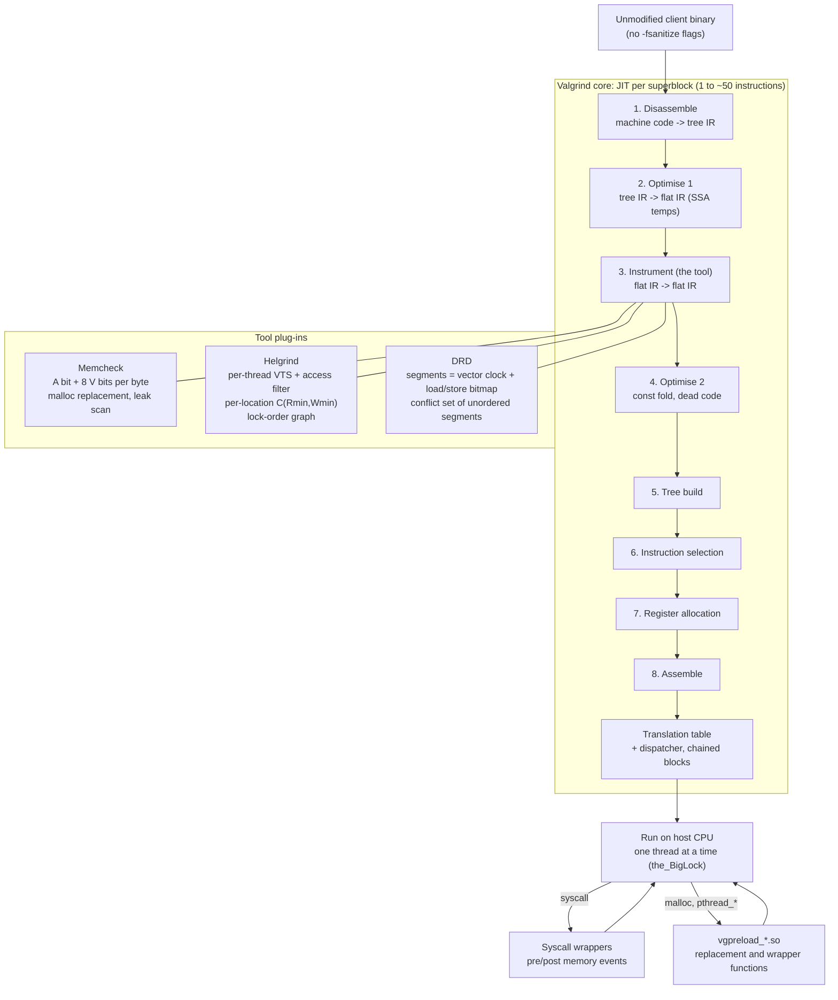

# C++ Valgrind Memcheck, Helgrind, and DRD

> [!summary] Claim:
> Valgrind runs an unmodified binary on a synthetic CPU: its core translates each superblock of guest machine code into the architecture-neutral VEX IR, hands the flattened IR to a tool for instrumentation, and compiles the result back to host code, so no recompilation or sanitizer flag is needed.
> Memcheck shadows every byte with one addressability (A) bit and eight validity (V) bits, propagates V bits through every operation with bit precision, and reports only when an undefined value steers a branch, forms an address, or reaches a system call.
> Helgrind and DRD both detect data races by happens-before over vector clocks built from intercepted pthread calls: Helgrind keeps a per-location constraint pair behind a per-thread access filter and also checks lock order, while DRD checks every access against a bitmap of all unordered segments and adds lock-hold-time checks.
> The price is a 10-50x Memcheck slowdown (Helgrind's own manual says 100:1 is not unusual), all client threads serialized behind one lock, and no understanding of C++ atomics or custom synchronization unless annotated; upstream Valgrind has no arm64 macOS port (as of 2026-11).



## The Mechanism

[[Cpp-AddressSanitizer-and-LeakSanitizer-Internals]] and [[Cpp-ThreadSanitizer-and-MemorySanitizer-Internals]] own compile-time instrumentation: the compiler inserts shadow checks, so only recompiled code is checked.
This note owns the other design point, dynamic binary instrumentation, in which the checks are inserted into machine code at run time.
Facts about current behavior come from the Valgrind 3.28.0 manual and NEWS (released 23 Oct 2026) and from the 3.27.1 source as packaged by Debian; the lab runs Valgrind 3.22.0, the version Ubuntu 24.04 ships.

### 1. The core: disassemble, instrument, resynthesize

Valgrind takes control of the client before it starts, reads its debug information, and then runs it "on a synthetic CPU provided by the Valgrind core" (manual section 2.2).
No original client instruction ever executes; every instruction executed is one Valgrind generated.
Because every instruction is simulated, the tool checks not only the application but every dynamically linked library it calls, including the C library.
The same fact explains why Valgrind cannot attach to a process that is already running: the FAQ (5.5) says the environment differs too much, memory layout included, so "Valgrind has to have full control from the very start."

Nethercote and Seward's PLDI 2007 paper names the design choice that matters most: disassemble-and-resynthesise (D&R) instead of copy-and-annotate (C&A).
A C&A framework such as Pin or DynamoRIO copies the original instructions through and calls analysis code beside them.
A D&R framework lifts each instruction into an IR, lets the tool rewrite the IR, and generates fresh machine code from it.
D&R costs more for lightweight tools, but for heavyweight shadow-value tools it means the analysis code is expressed in the same IR as the client code and goes through the same optimiser and register allocator, so shadow operations are cheap to write and get optimised with the client code.

The unit of translation is the superblock (`IRSB`): single entry, multiple exit, "typically ... from 1 to perhaps 50 instructions" (`VEX/pub/libvex_ir.h`), and able to cover up to three non-consecutive stretches of code because translation follows unconditional branches (`VexGuestExtents` in `VEX/pub/libvex.h` holds `base[3]` and `len[3]`).
Each IRSB holds a type environment for its temporaries, a list of statements, and a final jump.
Statements (`IRStmt`) have side effects; their tags are `Ist_NoOp`, `Ist_IMark`, `Ist_AbiHint`, `Ist_Put`, `Ist_PutI`, `Ist_WrTmp`, `Ist_Store`, `Ist_LoadG`, `Ist_StoreG`, `Ist_CAS`, `Ist_LLSC`, `Ist_Dirty`, `Ist_MBE`, and `Ist_Exit`.
Expressions (`IRExpr`) have none: loads, arithmetic, constants, and reads of temporaries.
Guest registers live in a guest state block (the paper calls it the ThreadState) and are read with `GET` and written with `PUT` at fixed byte offsets; `GetI` and `PutI` index rotating register files such as the x87 stack.
The header's own example, `addl %eax, %ebx` on x86, becomes:

```text
------ IMark(0x24F275, 7, 0) ------
t3 = GET:I32(0)             # get %eax, a 32-bit integer
t2 = GET:I32(12)            # get %ebx, a 32-bit integer
t1 = Add32(t3,t2)           # addl
PUT(0) = t1                 # put %eax
```

The IR "is guaranteed to be flattened at instrumentation-time", meaning every operand is a constant or a temporary, which is what makes a tool's job mechanical: for each `t = Op(a, b)` it emits a shadow `t' = ShadowOp(a', b')`.
Shadow registers live in the same guest state block as guest registers; in the paper's x86 example the shadow of `%eax` sits at offset 320 next to `%eax` at offset 0.

The paper describes eight phases, all in the core except instrumentation: disassembly, optimisation to flat IR, instrumentation, a second optimisation, tree building, instruction selection, register allocation, and assembly.
In its Figure 2, Memcheck adds 11 of the 18 statements in one instrumented `movl`, so the analysis code is larger than the client code.
A superblock ends at an instruction limit of about 50 (architecture dependent), at a conditional branch, at a branch to an unknown target, or after more than three unconditional branches to known targets.
Finished translations go into a translation table, about 400,000 entries in Valgrind 3.2.1, evicted an eighth at a time when it passes 80% full.
The paper's Valgrind 3.2.1 did not chain translations and measured Nulgrind at 4.3x even so; the current scheduler does chain (`VG_TRC_CHAIN_ME_TO_FAST_EP` and `VG_TRC_CHAIN_ME_TO_SLOW_EP` in `coregrind/m_scheduler/scheduler.c` at 3.27.1).

Core services every tool relies on:

- System calls run for real, but Valgrind cannot trace into the kernel, so every syscall has a hand-written wrapper that tells the tool which registers and memory the kernel reads and writes (`pre_mem_read`, `post_mem_write`, and the other events in the paper's Table 1).
  The paper counts almost 15,000 lines of wrapper code in 3.2.1, more than Memcheck itself, and NEWS for every recent release still lists new wrappers (3.26.0 added `futex_waitv`, `mseal`, `listmount`, and others), so an "unhandled syscall" warning on a new kernel is normal and means the tool's view of that call is wrong.
- Function replacement and wrapping: each tool ships a preload library (`vgpreload_memcheck-arm64-linux.so` in the lab's output) that replaces `malloc`, `free`, `operator new`, and `operator delete`, or wraps the `pthread_*` functions so Helgrind and DRD see every lock and thread event.
  Replacement is by soname, so a statically linked `malloc` is not replaced by default, and neither is tcmalloc or jemalloc; the FAQ (4.4) gives `--soname-synonyms=somalloc=NONE` for the static case and `somalloc=<soname>` for an alternative allocator.
  The telltale symptom is "All heap blocks were freed -- no leaks are possible" from a program you know calls `malloc`.
- Self-modifying code: a JIT that overwrites code it already ran would keep executing stale translations.
  `--smc-check` defaults to `all-non-file` on x86, amd64, and s390x, which checks every translation that does not come from a file-backed mapping, and to `stack` elsewhere, because those architectures require an explicit cache flush that Valgrind observes.
  `VALGRIND_DISCARD_TRANSLATIONS(addr, len)` is the cheaper, explicit alternative a JIT can call.
- Stack switches: if the stack pointer moves by more than `--max-stackframe` (default 2,000,000 bytes) Valgrind assumes a switch to a different stack; a function with a larger frame fools the heuristic and floods Memcheck with invalid stack accesses.
  `VALGRIND_STACK_REGISTER` exists for user-level thread packages, but the manual itself calls it "unreliable and best avoided".
- `clone` is supported only when everything is shared (a thread) or nothing is (a fork); partial sharing fails (manual section 2.8).
- Debug information can be fetched by build-id from debuginfod servers when `debuginfod-find` is installed and `DEBUGINFOD_URLS` is set (manual section 2.6, `--enable-debuginfod`, default `yes`); [[Symbol-Servers-and-debuginfod]] owns that protocol.
- Client requests: macros from `valgrind/valgrind.h` and the tool headers expand to an inline instruction sequence that Valgrind recognises; the manual (section 3.1) gives the cost on the real CPU as "6 simple integer instructions" on x86, amd64, ppc32, ppc64, and ARM, and `-DNVALGRIND` removes them entirely.
  The headers are under a BSD-style license so projects can vendor them.
  `RUNNING_ON_VALGRIND` returns 1 under Valgrind and 0 on the real CPU, which the lab prints; 3.27.0 added `VALGRIND_REPLACES_MALLOC` and `VALGRIND_GET_TOOLNAME`, and 3.28.0 added `VALGRIND_RUNNING_VERSION`, which returns 328 on 3.28.
- The gdbserver: `--vgdb-error=0` stops before the program runs so gdb can attach with `target remote | vgdb`; since 3.21.0, `target extended-remote | vgdb --multi` lets gdb start the program itself, and Valgrind ships gdb front-end commands (`memcheck`, `helgrind`) that evaluate address expressions for the monitor commands.

### 2. Threads: one at a time

A load or store and its shadow load or store are two operations, so on a real multiprocessor they could be torn apart by another thread.
Valgrind sidesteps the problem: "Valgrind serialises execution so that only one (kernel) thread is running at a time" (manual section 2.8).
The scheduler source calls the lock "the_BigLock": a thread must hold it to run client code or touch shared state, releases it before a blocking syscall, and is forced to yield when its `--scheduling-quantum` of basic blocks (default 100000) runs out.
The kernel still picks which runnable thread gets the lock next.
The default lock is pipe based (`--fair-sched=no`), and the manual warns that a thread that just released it often reacquires it immediately, so different runs can schedule very differently.
`--fair-sched=yes` or `try` switches to a futex-based lock that hands it to the thread that asked first, which gives more reproducible scheduling for Helgrind and DRD; 3.28.0 fixed a 3.27 regression in which `--fair-sched=yes` did not work (bug 519574).
The manual also warns that futex locking moves the running thread between cores more often, which can interact badly with CPU frequency scaling.
Asynchronous signals are delivered only between code blocks (PLDI 2007, section 3.15), so a signal can never land between a load and its shadow load.

The consequences:

- A program with N busy threads gets at most one CPU, so a parallel workload slows down by an extra factor of up to N on top of the tool's overhead.
- Many interleavings that happen natively never happen under Valgrind, so a test that fails only under a rare interleaving may never fail under Valgrind; FAQ 4.3 says data races "may not manifest under Valgrind."
  Helgrind and DRD still report the race, because happens-before analysis does not depend on the interleaving that actually ran: each loop in the lab's race case is 1,000 iterations, far below one 100,000-block quantum, and the race is still reported.
- A smaller `--scheduling-quantum` gives finer interleaving at more scheduling overhead; the manual suggests it to reproduce races.
- A program that spins waiting for another thread makes progress only when the quantum expires.

### 3. Memcheck: A bits, V bits, and when it complains

Memcheck keeps two kinds of shadow state (manual section 4.5):

- **A bits:** one per byte of memory, and none in the CPU, saying whether the program may access it.
  Global data is addressable at startup, `malloc` makes exactly the requested bytes addressable "and not a byte more", `free` makes them unaddressable, and the stack is addressable from the stack pointer up to the stack base, so locals become addressable on function entry and unaddressable on return.
  Successful `mmap` and other syscalls update A bits through their wrappers.
  Every load and store checks the A bits of its address range.
- **V bits:** one per data bit, in registers and memory, saying whether the bit has a defined value.
  The encoding is inverted on purpose: 0 means defined, 1 means undefined, which makes several shadow operations single instructions (USENIX 2005 paper, section 2.3).

A V bit vector is computed for every value-producing operation, but checked in only a few places.
The manual: "Checks on definedness only occur in three places": when a value is used to generate a memory address, when a control-flow decision depends on it, and when it is passed to a system call.
The 2005 paper adds that loading undefined data into a floating-point or SIMD register was also a check point in its implementation, since those registers then had no shadow; the current manual states that integer, floating-point, vector, and condition registers all have V bits.
Copying undefined bytes is never reported, because compilers copy struct padding all the time; the manual's canonical case is `struct S { int x; char c; }`, 8 bytes with 5 initialised, copied wholesale by `s2 = s1`.
The lab copies a padded struct with `memcpy` silently and is reported only when `write()` hands the padding to the kernel.
After a check fails, Memcheck marks the checked value defined so the same root cause does not produce a cascade of reports.
A load from an unaddressable address is reported as an invalid read, and the loaded V bits are forced to defined for the same reason (manual section 4.5.3).
Memcheck only reports an illegal access; it cannot stop it, so an access that would segfault natively still segfaults, just after the report.

`--partial-loads-ok=yes` (the default) governs a hazy case: a naturally aligned 32- to 256-bit load whose bytes are partly addressable produces no address error, and the bytes from the unaddressable part are marked undefined instead, which is what keeps vectorised `strlen` reading past the end of a string from drowning the log.
Shared memory is a known false-positive source: Memcheck tracks V bits per mapping, so a page initialised through one mapping and read through another looks undefined unless the program says otherwise with `VALGRIND_MAKE_MEM_DEFINED`.

#### Bit-precise propagation

The 2005 paper defines the shadow algebra, with `v` the V bits of operand `d`:

| Operation | Shadow rule | Why |
| :--- | :--- | :--- |
| `Xor` | `UifU(v1, v2)` (bitwise OR of V bits) | Any undefined input bit makes that result bit undefined |
| `Not` | `v` unchanged | Constant-folding the `Xor(0xFF..FF, d)` rule |
| `Add`, `Sub`, `Mul` | `Left(UifU(v1, v2))` | An undefined bit can carry into every higher bit; `Left` smears each undefined bit leftwards |
| `And` | `DifD(UifU(v1,v2), DifD(ImproveAND(d1,v1), ImproveAND(d2,v2)))` | A defined 0 forces the result bit to a defined 0 whatever the other operand |
| `Or` | Same shape with `ImproveOR` | A defined 1 forces the result bit to a defined 1 |
| Shifts and rotates | `UifU(PCast(v2), OP(v1, d2))` | Shift the V bits like the data; an undefined shift amount poisons everything |
| Widening | `ZWiden` or `SWiden` of the V bits | Zero-extension adds defined bits; sign-extension copies the top V bit |
| Comparisons, flags | `PCast` (all-or-nothing) | One undefined input bit makes the whole flag undefined |

`Left` costs two x86 instructions (negate and OR), and the VEX-era instrumented IR in the PLDI 2007 paper's Figure 2 still shows it as a `Neg32` feeding an `Or32`.
Bit precision is what makes bitfields and flag words work: the lab's `bit_precision` case reads an entirely undefined `unsigned`, ORs in bit 0, and branches twice.
`if (x & 1u)` depends only on a defined bit and is silent; `if (x & 2u)` depends on an undefined bit and is reported, exactly one error on line 44.
A byte-granular definedness tracker would have to flag both branches or neither.

The cheap rules are approximations, and the cost of exactness is a flag.
`--expensive-definedness-checks` (default `auto`) controls more exact instrumentation of integer adds, subtracts, equality comparisons, and unsigned less-than comparisons; the manual puts `yes` at up to 30% slower, `no` at "an unusably high false error rate", and `auto` at about 5% slower than `no` with the false-error rate of `yes`.
The approximations still leak: 3.27.0 fixed a false positive when reading a bitfield from clang 7 code (bug 406674), and 3.28.0 fixed another for unsigned compares of partially defined words, the "clang bitfield idiom" (bug 523434), so an old Valgrind on new clang output can report errors that are not there.

#### Shadow memory layout

The VEE 2007 paper describes the structure Memcheck still uses, and `memcheck/mc_main.c` at 3.27.1 confirms the constants:

- A two-level table like a page table: a primary map of pointers to secondary maps, each secondary map covering 64 KiB of address space.
- On 32-bit hosts the primary map has 2^16 entries and covers the whole 4 GiB.
  On 64-bit hosts it has `N_PRIMARY_BITS 21`, so it covers the first 2^21 x 64 KiB = 128 GiB directly ("Just handle the first 128G fast and the rest via auxiliary primaries"); addresses above that go through a slower, sparse auxiliary map.
  The 2007 paper used 2^19 entries (32 GiB), and the file's own overview comment still says 2^20 entries and 64 GB, so trust the `#define`, not the prose.
- Compressed state: two bits per byte (`VA_BITS2_NOACCESS 0x0`, `VA_BITS2_UNDEFINED 0x1`, `VA_BITS2_DEFINED 0x2`, `VA_BITS2_PARTDEFINED 0x3`), so a secondary map is `vabits8[16384]` (`SM_CHUNKS 16384`), 16 KiB of shadow for 64 KiB of memory.
  Only partially defined bytes keep all eight V bits, in a sparse secondary V-bit table with 16-byte nodes (`BYTES_PER_SEC_VBIT_NODE 16`).
  The source notes there is no read-only state: a fifth state would need more than two bits, so Memcheck cannot catch writes to memory that is mapped writable but logically constant.
- Distinguished secondary maps: three shared, read-only maps for all-NOACCESS, all-UNDEFINED, and all-DEFINED 64 KiB chunks; the source says "typically more than half of the addressable memory" is represented by the undefined or defined one, so untouched address space and large defined code segments cost no memory until written.

The paper measured that compressed V bits shrank mean shadow memory by 4.29x and that the shadow-memory optimisations together sped Memcheck up by 8.9x on SPEC CPU2000 (a pre-3.2.0 Memcheck, 32-bit x86, 2007 hardware).
The current manual summarises the net effect as an overhead "typically around 25%" (section 4.5.3).
Shadow registers keep the full eight V bits per byte; only memory is compressed.

#### The heap: replacement allocator, redzones, and the freed-block queue

Memcheck replaces the allocator through its preload library.
`malloc`, `new`, and `new[]` return memory that is addressable but undefined; `calloc` returns addressable, defined memory; a shrinking `realloc` makes the dropped tail unaddressable.
Each block is surrounded by unaddressable redzones; the manual says Memcheck "adds and protects a minimum of 16 bytes before and after each block", so it detects overruns and underruns of up to 16 bytes, and `--redzone-size` widens that at a memory cost.
A read just past the end hits an A bit of 0, as in the lab's "0 bytes after a block of size 40 alloc'd"; a read that jumps over the redzone into a neighbouring live block is not detected.
Freed blocks are not reused at once: they wait in a queue of up to `--freelist-vol` bytes (default 20,000,000), with blocks of at least `--freelist-big-blocks` (default 1,000,000) bytes recycled first, which is what turns a use-after-free into "8 bytes inside a block of size 16 free'd" instead of a silent read of a reused block.
Every allocation and free records a stack trace (`--keep-stacktraces=alloc-and-free`), which is why reports show both the alloc and the free site; `alloc`, `free`, `alloc-then-free`, and `none` trade that detail for memory and CPU.
`--malloc-fill` and `--free-fill` write a byte pattern into new or freed blocks to shake out corruption, without changing what Memcheck believes about them.

The error catalogue (manual section 4.2) beyond invalid reads, writes, and uninitialised uses:

- "Syscall param write(buf) points to uninitialised byte(s)": every syscall argument is checked for definedness, every buffer the kernel reads for addressability and definedness, and every buffer the kernel writes for addressability.
- "Invalid free()": a double free or a pointer that is not the start of a heap block.
- "Mismatched free() / delete / delete []": `malloc` family released with `delete`, `new` with `free` or `delete[]`, and so on.
  Since 3.22.0 Memcheck also checks C++14 sized delete and C++17 aligned new and delete, so a mismatched size or alignment is its own error; the lab's `new int[3]` released with scalar `delete` reports both "Mismatched new/delete size value: 4" and the classic mismatch.
- "Source and destination overlap in memcpy": `memcpy`, `strcpy`, `strncpy`, `strcat`, and `strncat` with overlapping blocks.
- "Argument 'size' of function malloc has a fishy (possibly negative) value": a size that looks like a negative number cast to `size_t`.
- "realloc() with size 0", added in 3.21.0 and controlled by `--show-realloc-size-zero` (default `yes`), because C17 makes it implementation-defined and C23 undefined.
- Alignment errors such as "Invalid alignment value: 3 (should be power of 2)"; since 3.26.0 a zero-size `memalign`, `aligned_alloc`, or `posix_memalign` reports "Unsafe allocation with size of zero is implementation-defined", and its suppression name changed from `BadSize` to `UnsafeZeroSize`.

Memcheck cannot redzone what it does not allocate: "Memcheck doesn't do bounds checking on global or stack arrays" (FAQ 4.5).
An overrun from one stack array into the next local, or from one global into the next, lands on addressable, defined bytes and is invisible to it.
ASan, which pads stack and global objects at compile time, catches exactly those.

#### Custom allocators and mempools

A pool that carves objects out of one big `malloc` looks like a single valid block, so overflows between objects and use-after-free inside the pool are silent.
The client-request API describes the pool instead (manual section 4.8): `VALGRIND_CREATE_MEMPOOL(pool, rzB, is_zeroed)` registers an anchor address with a redzone size and a zeroing flag, `VALGRIND_MEMPOOL_ALLOC(pool, addr, size)` marks a chunk addressable (defined if `is_zeroed`, else undefined) with `rzB` bytes of no-access redzone on each side, and `VALGRIND_MEMPOOL_FREE(pool, addr)` makes it no-access again.
The invariant the client must maintain is that the unallocated parts of the superblock are NOACCESS, which Memcheck cannot establish itself because it never learns about the superblock, only the chunks; the program marks it with `VALGRIND_MAKE_MEM_NOACCESS` first.
A two-level allocator that hands out `VALGRIND_MALLOCLIKE_BLOCK` objects from pool chunks needs `VALGRIND_CREATE_MEMPOOL_EXT` with `VALGRIND_MEMPOOL_METAPOOL`, otherwise Valgrind sees overlapping blocks and aborts during the leak search.
The lab's `custom_pool` case uses the lower-level `VALGRIND_MAKE_MEM_UNDEFINED` and `VALGRIND_MAKE_MEM_NOACCESS` on a global array, and the read after "free" is reported only because of those calls.

#### Leak detection

At exit, with `--leak-check=summary` (the default) or `full` (`yes` is a synonym), Memcheck runs a mark-and-sweep over the heap.
The manual defines the root set as "general purpose registers of all threads, and ... initialised, aligned, pointer-sized data words in accessible client memory, including stacks"; any such word that points into a block marks that block reachable, and reachable blocks are scanned in turn.
A pointer to the first byte is a start pointer; a pointer into the middle is an interior pointer.
The manual's nine-case table reduces to four kinds:

| Kind | Meaning | Counted as an error under `--leak-check=full` by default |
| :--- | :--- | :--- |
| Still reachable | A chain of start pointers from a root reaches it | No |
| Definitely lost | No pointer at all reaches it | Yes |
| Indirectly lost | Only pointers from lost blocks reach it, such as the children of a lost tree root | No |
| Possibly lost | Only chains that include an interior pointer reach it | Yes |

`--show-leak-kinds` and `--errors-for-leak-kinds` both default to `definite,possible`.
Leaks become counted errors only with `--leak-check=full`; with the default `summary` the lab prints the same leak summary and an ERROR SUMMARY of 0.
Blocks with the same leak kind and similar allocation stacks are merged into one loss record, and `--leak-resolution` (default `high`, all frames must match) sets "similar"; the loss record numbers carry no order but are the handle the gdbserver's `block_list` command takes.
Four `--leak-check-heuristics` (default `all`) accept specific interior pointers as reachable: `stdstring` (a pointer past a 3-word header), `length64` (a block whose first 8 bytes hold its size minus 8, as `sqlite3MemMalloc` does), `newarray` (a pointer past a `new[]` length cookie), and `multipleinheritance` (a pointer to a non-first base subobject).
The manual says these depend on C++ object layout and were tested with some GCC versions (4.4 and 4.7); the lab fills its possibly-lost block with a pattern no heuristic matches.
`VALGRIND_DO_LEAK_CHECK` runs a full leak search mid-run, and `VALGRIND_DO_ADDED_LEAK_CHECK`, `VALGRIND_DO_CHANGED_LEAK_CHECK`, and `VALGRIND_DO_NEW_LEAK_CHECK` (3.21.0) report only the delta since the previous search, which turns Memcheck into a leak-growth detector for long-running servers.

#### Origin tracking

Knowing that a branch depends on an undefined value is not enough when the value travelled through ten functions first.
`--track-origins=yes` attaches a 32-bit origin tag to undefined values: an upper 30-bit field indexing a recorded stack trace (an ECU) and a lower 2-bit kind (`mc_main.c`, "Origin tags and ECUs"), with zero reserved for "no origin".
Heap origins carry the exact `malloc` stack; stack origins use a depth-1 backtrace computed once at translation time, because "it is simply too expensive to create a complete backtrace for each stack allocation", and since compilers move the stack pointer once per function the reported origin is usually the function's opening brace.
Memory origins live in a two-level cache: a 2-way set-associative L1 with 32-byte lines, and an AVL-tree L2 that receives evicted nonzero lines so origins are lost only when memory runs out.
There is one tag per 4 bytes plus a 4-bit mask, so two different origins inside one aligned word cannot both be represented, a precision loss the source acknowledges.
The manual's price: "It halves Memcheck's speed and increases memory use by a minimum of 100MB."
The design "draws inspiration from" the OOPSLA 2007 paper by Bond, Nethercote, and coauthors, but the source says it "is implemented completely differently", with separate tags instead of that paper's value piggybacking.

#### Interactive inspection through the gdbserver

Memcheck's monitor commands (manual section 4.6) expose the shadow state to a debugger session.
`xb <addr> <len>` prints values and V bits side by side, with `__` for unaddressable bytes, and `get_vbits` prints only the V bits.
`make_memory` and `check_memory` change and test A and V state by hand.
`leak_check full possibleleak increased` runs a delta leak search, `block_list <n>` lists the blocks in loss record `n` with their indirectly lost children indented, and `who_points_at <addr>` lists every root and heap word that points at a block, which answers "why is this still reachable" and "what still holds a pointer to this freed block".
Shadow registers are visible as `$eaxs1`-style registers only with `--vgdb-shadow-registers=yes`.
Driving gdb itself is owned by [[Cpp-GDB-and-LLDB-Expert-Guide]] and [[Remote-Debugging-gdbserver-lldb-server-and-RSP]].

### 4. Helgrind: happens-before behind a filter

Helgrind reports three classes of error (manual chapter 7): POSIX pthreads API misuse, inconsistent lock ordering, and data races.

#### Races

Two accesses race when they come from different threads, touch the same location, at least one is a write, and no happens-before (HB) relation orders them (section 7.4.2).
Helgrind builds HB only from events it intercepts:

- Mutex unlock followed by lock of the same mutex, and reader-writer locks with the read/write distinction.
- Condition variable signal or broadcast to the waiters it releases; if no thread was waiting, there is no edge.
- `sem_post` to the `sem_wait` that consumes it.
- Barriers: every pre-barrier access happens before every post-barrier access.
- `pthread_create` (parent before child) and `pthread_join` (child before joiner).

`helgrind/libhb_core.c` implements this with vector timestamps (VTS).
Each thread (`struct _Thr`) holds two, `viR` for reads and `viW` for writes, which differ only around reader-writer locks.
Each shadowed location holds a 64-bit `SVal` that is either `SVal_NOACCESS` or a constraint pair `C(Rmin, Wmin)` of 30-bit VTS ids: `Rmin` is the clock a reader must already have seen, and `Wmin` the clock a writer must already have seen.
`msmcread()` reports a race unless `Rmin <= viR`, and in either case leaves `C(Rmin, join(Wmin, viW))`.
`msmcwrite()` reports a race unless `Wmin <= viW`; with no race it leaves `C(viW, viW)`, and after a race it leaves `C(join(Rmin, viW), join(Wmin, viW))`.
A scalar timestamp packs an 18-bit thread id and a 46-bit counter into 64 bits, so Helgrind supports at most 2^18 threads over a program's lifetime.

The state machine alone would report the lab's racy loop on every iteration, because the other thread's clock stays in `Rmin` and `Wmin`.
What keeps Helgrind to one report per pattern is a per-thread access filter in front of it: 1,024 direct-mapped lines of 32 bytes (`FI_NUM_LINES_LOG2 10`, `FI_LINE_SZB_LOG2 5`) with a read bit and a write bit per byte, which skips any access the thread already made in its current segment.
The whole filter is cleared only at synchronization: `libhb_so_send`, `libhb_so_recv`, thread creation, and thread resumption (`libhb_Thr_resumes`); memory events clear only the affected range (`Filter__clear_range` in `libhb_srange_new`, `libhb_srange_noaccess_AHAE`, `libhb_srange_untrack`, and `libhb_copy_shadow_state`), which the lab's static counter never triggers.
The lab's racing thread therefore reaches the state machine once for its first read and once for its first write, giving 2 Helgrind errors where DRD, which has no such filter, counts 2,000.
Duplicate reports are folded by the core's error manager (`m_errormgr.c`): `eq_Error()` first requires the same error kind and stack, then calls `HG_(eq_Error)`, which treats two races as the same when size and read/write kind match (and the address, with the debug option `--cmp-race-err-addrs=yes`, default `no`); a duplicate still increments the error total, which is why the filter, not the folding, keeps Helgrind's total at 2.
Races on GOT and PLT sections are dropped in `HG_(record_error_Race)`, because `ld.so` patches them lazily.
The "Locks held:" lines in a report are locksets shown for diagnosis; the race verdict is HB, not lockset intersection.

To print the other side of a race, Helgrind keeps a history of earlier accesses.
`--history-level=full` (default) stores stack traces of "old" accesses, truncated to `--history-backtrace-size` frames (default 8, configurable since 3.21.0), in an LRU conflict cache of `--conflict-cache-size` addresses (default 1,000,000, range 10,000 to 30,000,000, about 100 bytes per entry, so the maximum costs about 3 GB).
`approx` shows the earlier access only as a window between two stacks and runs almost as fast as `none`, which keeps no history.
`--delta-stacktrace=yes` (default on Linux x86 and amd64) derives each history stack from the previous one when no call or return intervened, which the manual says speeds `full` up by 25%.

#### Lock order

Helgrind maintains a directed graph of "lock A was held while lock B was acquired" edges and reports when a new edge closes a cycle (section 7.3).
The deadlock need not happen: the lab takes A then B in one thread, joins it, then takes B then A in another, and Helgrind reports `lock order ... violated` with both acquisition sites, while DRD, which has no lock-order checker, reports nothing.
For a longer cycle, such as the five-lock dining philosophers in `helgrind/tests/tc14_laog_dinphils.c`, Helgrind shows only two of the locks; printing the whole cycle is still on the manual's to-do list (section 7.9).
The same list says Helgrind should not update the graph for `pthread_mutex_trylock`, because a try-lock can fail and so adds no real ordering constraint, which implies that try-lock fallbacks can produce lock-order reports today.

#### API misuse

Helgrind intercepts the pthread functions and reports, among others, unlocking an unlocked or foreign mutex, destroying a locked one, recursively locking a non-recursive one, freeing memory that holds a locked mutex, a thread exiting while holding locks, waiting on a condition variable without its mutex, binding one condition variable to two mutexes, barrier misuse, and any intercepted call that returns an error code.
The lab unlocks a never-locked statically initialised mutex: Helgrind reports "unlocked an invalid lock", DRD "is not a mutex".
Signalling a condition variable while its mutex is unlocked is only "dubious"; since 3.25.0 that warning is off by default behind `--check-cond-signal-mutex=no`, because some C and C++ standard libraries do it.
3.27.0 added `--track-destroy=yes|all` for missing `pthread_mutex_destroy` and `pthread_rwlock_destroy` calls, and `--show-events` for tracing Helgrind's own event stream.

#### What Helgrind cannot see

Any synchronization that does not go through an intercepted pthread call is invisible: hand-rolled spin locks, futex-based primitives, lock-free queues, C++ `std::atomic` release/acquire, POSIX spinlocks (not supported), glibc's internal stdio locks (hidden by default suppressions), and the GNU OpenMP runtime unless GCC is rebuilt with `--disable-linux-futex`.
The manual's two critical rules are to use only POSIX primitives in the application and every library, and never to build primitives from futexes and atomic counters, because "Any violations of them will swamp you with huge numbers of false data-race errors."
On x86 and amd64 Helgrind "partially handles" implicit locking from the `LOCK` prefix, and on POWER and ARM from load-linked/store-conditional pairs, which in the source means one fixed rule instead of a memory model.
`hg_instrument()` in `helgrind/hg_main.c` instruments an IR compare-and-swap as a load, under the comment "Just pretend it's a read", treats a load-linked as a normal load, and ignores the store-conditional.
`DRD_(instrument)()` in `drd/drd_load_store.c` does the same, and its comment spells out the result: no race is reported between two atomic operations or between an atomic operation and a plain read, but a plain write that conflicts with an atomic operation is still reported.
So two threads that only `fetch_add` one counter are silent under both tools, which the lab's `atomic_counter` case records as 0 errors, while a release store that compiles to a plain store instruction (`stlr` in the lab's AArch64 binary) is an ordinary write, which is why the flag in the lab's correct `atomic_publish` case is reported.
ThreadSanitizer models the C++ memory model and would not report that program.

Condition variables have a subtler hole (section 7.5): Helgrind sees the edge only when the waiter calls `pthread_cond_wait` before the signal.
If the signaller arrives first, sets the predicate, and signals into the void, the waiter skips its `while` loop and proceeds, ordered only through the in-memory predicate, which Helgrind cannot see, so correct code draws a false race.
The manual's advice is to prefer semaphores, since Helgrind's handling of their edges "is believed to be exactly correct", and it calls a fix without source annotation "beyond the current state of the art".
Detached threads cause the same kind of false report, since without `pthread_join` Helgrind must assume the thread "lingers indefinitely".
Thread-local variables can draw false races through glibc's thread stack cache; `--sim-hints=deactivate-pthread-stack-cache-via-hack` works around that on Linux.

The fixes are annotations from `helgrind.h`: `ANNOTATE_HAPPENS_BEFORE(addr)` after the release and `ANNOTATE_HAPPENS_AFTER(addr)` after the acquire, `ANNOTATE_RWLOCK_*` for custom reader-writer locks, `ANNOTATE_NEW_MEMORY`, and `VALGRIND_HG_CLEAN_MEMORY` for recycled pool memory, which Helgrind otherwise cannot tell is logically fresh.
The manual's reference-count recipe marks only the release path: `ANNOTATE_HAPPENS_BEFORE(&rc)` when the count stays above zero, and `ANNOTATE_HAPPENS_AFTER(&rc)` plus `ANNOTATE_HAPPENS_BEFORE_FORGET_ALL(&rc)` before `delete this` on the one-to-zero transition.

### 5. DRD: segments, bitmaps, and a conflict set

DRD uses the same happens-before definition with a different data structure (manual section 8.1.4 and `drd/drd_segment.c`).
A segment is a run of one thread's loads, stores, and synchronization operations that starts and ends at a synchronization operation.
`sg_init()` gives each new segment a copy of the creator's vector clock, increments the thread's own component (`vc_increment`), and starts an empty bitmap (`bm_init`) of the addresses it loads and stores.
The bitmap is byte granular (`ADDR_IGNORED_BITS 0` in `drd_bitmap.h`), organised as second-level nodes covering 4,096 bytes (`ADDR_LSB_BITS 12`) with separate load and store bit arrays (`bm0_r`, `bm0_w`).
Two segments are ordered when one vector clock is less than or equal to the other (`DRD_(vc_ordered)()` in `drd_vc.c`).
For the running thread, `thread_compute_conflict_set()` in `drd_thread.c` builds one bitmap that is "the union of all memory accesses of all segments that are unordered to the current segment", and each access is checked against it by `DRD_(bm_has_conflict_with)()`: a load conflicts with any recorded store, a store with any recorded load or store.
Comparing against a precomputed union of whole segments, instead of tracking every access in a per-location shadow, is the performance choice the manual names; `--segment-merging` (default `yes`, every `--segment-merging-interval` of 10 new segments) bounds memory, at the cost of less exact "other segment" stacks.

What DRD adds and lacks, as the lab shows:

- It reports every conflicting access, because nothing filters repeated accesses: the same racy loop gives "2000 errors from 2 contexts", against Helgrind's 2 from 2, which matches one conflicting load and one conflicting store per iteration of one thread's 1,000-iteration loop.
  `--first-race-only=yes` reports only the first race per location.
- The other side of a race is shown only as the start and end stacks of the conflicting segment; the manual's reading rule is to match frames from the bottom and take the first differing frame pair as the source range of the other access.
- `--exclusive-threshold=<ms>` and `--shared-threshold=<ms>` report mutexes, writer locks, and reader locks held too long, a contention bug Helgrind has no check for; the lab's 100 ms hold is reported against a 10 ms threshold.
- No lock-order checking.
- `--check-stack-var` (default `no`) leaves stack variables out of race detection unless asked, where Helgrind's `--check-stack-refs` defaults to `yes`.
- `--join-list-vol` (default 10) keeps the access history of that many joined threads, so a race between the last statements of a joined thread and another thread is not missed.
- Its API-misuse list overlaps Helgrind's and adds, for example, destroying a condition variable that is being waited on, reinitialising a synchronization object, and missing synchronization between barrier wait and barrier destruction.
- Client requests in `drd.h` include `DRD_IGNORE_VAR(x)` and `ANNOTATE_BENIGN_RACE_SIZED` for intentional races, `DRD_TRACE_VAR(x)` and `--trace-addr` to log every access to one variable, `ANNOTATE_IGNORE_READS_BEGIN` and friends, and `ANNOTATE_THREAD_NAME`.
- DRD thread ids start at one and are never recycled, while Valgrind's core thread ids are recycled, which matters when reading traces of thread pools.

Its manual adds operational facts:

- The cost is 1.1 to 3.6 times native memory and 20 to 50 times native single-threaded run time, plus 1 to 2 KB of DRD data on each client thread's stack (section 8.2.12).
- For C++11 `std::thread` (section 8.2.6), define the libstdc++ hooks `_GLIBCXX_SYNCHRONIZATION_HAPPENS_BEFORE` and `_GLIBCXX_SYNCHRONIZATION_HAPPENS_AFTER` as the `ANNOTATE_HAPPENS_*` macros before including any C++ header, and also copy `execute_native_thread_routine()` and `std::thread::_M_start_thread()` from libstdc++'s `thread.cc` into a source file built with the same macros, because the compiled library was built without them.
- Custom allocators must be described with `VALGRIND_MALLOCLIKE_BLOCK` and `VALGRIND_FREELIKE_BLOCK` or disabled, because DRD uses allocation events to end the scope of variables; `GLIBCXX_FORCE_NEW` and `G_SLICE=always-malloc` disable the libstdc++ and GLib pools.
- OpenMP works only with a `libgomp` built with `--disable-linux-futex`, because the stock one synchronizes with raw futexes.
- The manual states that happens-before detectors "do not report any false positives", which is true only relative to the synchronization DRD can see: the lab's correct release/acquire publication is reported by DRD as well.

### 6. Where Valgrind sits next to the sanitizers

| Property | Valgrind Memcheck | ASan | MSan | Helgrind / DRD | TSan |
| :--- | :--- | :--- | :--- | :--- | :--- |
| Instrumentation | Run time, on any binary | Compile time | Compile time, all code including libc++ | Run time | Compile time |
| Typical slowdown (vendor docs) | 10-50x | 2x | 3x | Helgrind up to 100x; DRD 20-50x | 5-15x |
| Uninitialized reads | Yes, bit-precise | No | Yes, bit-precise | No | No |
| Stack and global overflows | No | Yes | No | No | No |
| Uninstrumented libraries | Fully checked | Interposed calls only | False reports | Fully checked | Not instrumented |
| C++ atomics as synchronization | Not applicable | Not applicable | Not applicable | No | Yes |
| Real parallelism during the run | No, serialized | Yes | Yes | No, serialized | Yes |

The slowdown figures are each project's own statements: the Valgrind core manual for Memcheck, the Helgrind manual's to-do list ("Slowdowns on the order of 100:1 are not unusual"), the DRD manual, and the Clang pages for ASan ("2x"), MSan ("3x"), and TSan ("about 5x-15x").
The PLDI 2007 paper measured a geometric-mean Memcheck slowdown of 22.1x across 25 SPEC CPU2000 benchmarks (its table; its text says 22.2x) and 4.3x for Nulgrind, the tool that adds no instrumentation, on Valgrind 3.2.1 and a 2.4 GHz Core 2 Duo; no slowdown in this note was measured by the lab.
MSan "requires that all program code is instrumented", and failing that "may result in false reports"; Memcheck's niche is exactly the binary you cannot rebuild: a vendor library, a release build already in the field, a Python extension linked against a distribution's libraries.
Memcheck and the thread tools also combine where sanitizers do not: Helgrind's manual recommends making a program Memcheck-clean first, because heap corruption confuses its shadow state, and admits the circularity that a racy destructor sequence can keep a program from becoming Memcheck-clean.

Platform status (as of 2026-11): upstream Valgrind 3.28.0 supports Linux on x86, amd64, arm32, arm64, ppc32, ppc64be, ppc64le, s390x, mips32, mips64, and riscv64 (RV64GC, added in 3.25.0), plus Solaris, FreeBSD (x86, amd64, arm64), and Android, with preliminary nanoMIPS; NEWS says "macOS is supported up to version 13 Ventura (amd64 only)", and 3.28.0 adds macOS 10.14 Mojave on 32-bit x86.
There is no upstream arm64 Darwin port, so Valgrind does not run natively on Apple silicon macOS.
The third-party `LouisBrunner/valgrind-macos` fork lists arm64 support for macOS 14 and 26 and calls macOS 15 arm64 experimental; it is not upstream Valgrind.
On an Apple silicon Mac the practical route is an arm64 Linux container or VM, which is how the lab was recorded, and [[Cpp-Sanitizers-and-Memory-Debugging-on-macOS]] owns the native macOS tools.

## Commands and Numbers to Know

Option defaults are from the Valgrind 3.28.0 manual unless the source column names a file; the lab ran 3.22.0.

| Item | Value | Platform and date | What it controls |
| :--- | :--- | :--- | :--- |
| `--tool=` | `memcheck` | Linux (as of 2026-11) | `helgrind`, `drd`, `none` (Nulgrind), and others |
| `--leak-check` | `summary` | Linux (as of 2026-11) | `full` or `yes` lists each leak and makes leaks count as errors |
| `--show-leak-kinds` | `definite,possible` | Linux (as of 2026-11) | Leak kinds listed individually; `all` adds indirect and reachable |
| `--errors-for-leak-kinds` | `definite,possible` | Linux (as of 2026-11) | Leak kinds that count toward the error total and exit code |
| `--leak-check-heuristics` | `all` | Linux (as of 2026-11) | `stdstring`, `length64`, `newarray`, `multipleinheritance` |
| `--leak-resolution` | `high` | Linux (as of 2026-11) | Stack frames that must match to merge loss records (`low` 2, `med` 4) |
| `--track-origins` | `no` | Linux (as of 2026-11) | `yes` halves speed and adds at least 100 MB |
| `--undef-value-errors` | `yes` | Linux (as of 2026-11) | `no` gives address checking only, the old AddrCheck |
| `--expensive-definedness-checks` | `auto` | Linux (as of 2026-11) | `yes` up to 30% slower; `auto` about 5% slower than `no` |
| `--partial-loads-ok` | `yes` | Linux (as of 2026-11) | Partly addressable aligned loads give undefined bytes, not an address error |
| `--redzone-size` | Tool-dependent; Memcheck at least 16 bytes | Linux (as of 2026-11) | Overrun distance detected around heap blocks |
| `--freelist-vol` | `20000000` bytes | Linux (as of 2026-11) | How long freed blocks stay unreusable |
| `--freelist-big-blocks` | `1000000` bytes | Linux (as of 2026-11) | Blocks this large leave the queue first |
| `--keep-stacktraces` | `alloc-and-free` | Linux (as of 2026-11) | Stacks recorded per heap block |
| `--show-mismatched-frees` | `yes` | Linux (as of 2026-11) | Allocator and deallocator pairing checks |
| `--error-exitcode` | `0` | Linux (as of 2026-11) | Nonzero makes errors fail the process; required for CI |
| `--exit-on-first-error` | `no` | Linux (as of 2026-11) | Needs a nonzero `--error-exitcode` |
| `--num-callers` | `12` (minimum 2 since 3.27.0) | Linux (as of 2026-11) | Frames per stack trace |
| `--error-limit` | `yes`: stop after 1,000 distinct or 10,000,000 total errors | Linux (as of 2026-11) | `no` keeps collecting |
| `--gen-suppressions` | `no` | Linux (as of 2026-11) | `all` prints a suppression for every error |
| `--suppressions` | `$PREFIX/lib/valgrind/default.supp` plus up to 100 files | Linux (as of 2026-11) | Known errors to hide |
| `--show-error-list` | `no` | Linux (as of 2026-11) | `all` (3.23.0) also lists suppressed errors |
| `--trace-children` | `no` | Linux (as of 2026-11) | Follow `exec`; without it children run uninstrumented |
| `--soname-synonyms` | none | Linux (as of 2026-11) | `somalloc=NONE` for static `malloc`, `somalloc=<soname>` for tcmalloc and others |
| `--vgdb`, `--vgdb-error` | `yes`, `999999999` | Linux (as of 2026-11) | `--vgdb-error=0` stops at startup for `target remote \| vgdb` |
| `--smc-check` | `all-non-file` on x86, amd64, s390x; `stack` elsewhere | Linux (as of 2026-11) | Self-modifying and JIT code detection |
| `--max-threads` | `500` | Linux (as of 2026-11) | Client thread limit |
| `--max-guard-pages` | `8000` (16 x `--max-threads`) | Linux (as of 2026-11) | glibc 2.42+ `MADV_GUARD_INSTALL` stack guards, since 3.27.0 |
| `--max-stackframe` | `2000000` | Linux (as of 2026-11) | SP change treated as a stack switch |
| `--scheduling-quantum` | `100000` basic blocks | Linux (as of 2026-11) | Timeslice before the_BigLock is offered to another thread |
| `--fair-sched` | `no` (pipe lock) | Linux (as of 2026-11) | `yes` or `try` for futex-based round-robin |
| `--enable-debuginfod` | `yes` | Linux (as of 2026-11) | Fetch debug info by build-id via `DEBUGINFOD_URLS` |
| Helgrind `--track-lockorders` | `yes` | Linux (as of 2026-11) | Lock-order cycle detection |
| Helgrind `--history-level` | `full` | Linux (as of 2026-11) | `approx` or `none` trade conflict detail for speed |
| Helgrind `--history-backtrace-size` | `8` | Linux (as of 2026-11) | Frames kept per old access, since 3.21.0 |
| Helgrind `--conflict-cache-size` | `1000000` (10,000 to 30,000,000) | Linux (as of 2026-11) | Addresses remembered, about 100 bytes each |
| Helgrind `--check-stack-refs` | `yes` | Linux (as of 2026-11) | `no` skips thread stacks |
| Helgrind `--check-cond-signal-mutex` | `no` (since 3.25.0) | Linux (as of 2026-11) | Warn on signal with the mutex unlocked |
| Helgrind `--free-is-write` | `no` | Linux (as of 2026-11) | Experimental since 3.7.0: treat `free` as a write to the freed block |
| Helgrind `--track-destroy` | `no` | Linux (as of 2026-11) | Missing mutex and rwlock destroy calls, since 3.27.0 |
| Helgrind thread lifetime limit | 2^18 threads | Linux (as of 2026-11) | `SCALARTS_N_THRBITS 18` in `libhb_core.c` 3.27.1 |
| Helgrind access filter | 1,024 lines x 32 bytes per thread | Linux (as of 2026-11) | `FI_NUM_LINES_LOG2 10`, `FI_LINE_SZB_LOG2 5` in `libhb_core.c` 3.27.1 |
| DRD `--check-stack-var` | `no` | Linux (as of 2026-11) | Race-check stack variables |
| DRD `--exclusive-threshold`, `--shared-threshold` | off | Linux (as of 2026-11) | Report locks held longer than N ms |
| DRD `--segment-merging`, `--segment-merging-interval` | `yes`, `10` | Linux (as of 2026-11) | Memory bound on segment history |
| DRD `--join-list-vol` | `10` | Linux (as of 2026-11) | Joined threads whose access history is kept |
| DRD `--first-race-only` | `no` | Linux (as of 2026-11) | Report only the first race per location |
| DRD bitmap node | 4,096 bytes, separate load and store bits | Linux (as of 2026-11) | `ADDR_LSB_BITS 12` in `drd_bitmap.h` 3.27.1 |
| Memcheck slowdown | 10-50x; Nulgrind about 4x | Linux (as of 2026-11) | Manual section 2.2 |
| Helgrind slowdown | "on the order of 100:1 are not unusual" | Linux (as of 2026-11) | Manual section 7.9 |
| DRD cost | 20-50x time, 1.1-3.6x memory | Linux (as of 2026-11) | Manual section 8.2.12 |
| Client request cost on the real CPU | 6 integer instructions | Linux (as of 2026-11) | x86, amd64, ppc32, ppc64, ARM; `-DNVALGRIND` removes them |
| Secondary map | 64 KiB covered, 16 KiB of 2-bit state | Linux (as of 2026-11) | `SM_CHUNKS 16384` in `mc_main.c` 3.27.1 |
| Fast primary map on 64-bit | 2^21 entries, 128 GiB | Linux (as of 2026-11) | `N_PRIMARY_BITS 21` in `mc_main.c` 3.27.1 |
| Superblock size | 1 to about 50 instructions | Linux (as of 2026-11) | `libvex_ir.h` |
| Current release | 3.28.0, 23 Oct 2026 | Both (as of 2026-11) | Ubuntu 24.04 ships 3.22.0 |

## Multi-Language Comparison: C++ / Python / Rust

| Concern | C++ | Python (CPython) | Rust |
| :--- | :--- | :--- | :--- |
| Running under Memcheck | Works on any build; `-O0 -g` gives exact lines, optimized builds work with less precise frames | Works, but pymalloc's arena check reads memory it never initialized and floods Memcheck with expected errors | Works on any build, debug or release |
| Making it usable | Nothing beyond debug info; avoid tcmalloc aliases and identical code folding (`--icf=all`), which the FAQ says cause false mismatched-free reports | `Misc/README.valgrind`: build `--with-valgrind` or set `PYTHONMALLOC=malloc` (3.6+), and use `Misc/valgrind-python.supp` | Third-party `cargo valgrind` (crate `cargo-valgrind` 2.4.1) runs tests under Memcheck |
| Where it earns its keep | Prebuilt or closed libraries, uninitialized reads without MSan's rebuild | C extensions and their native dependencies, which CPython's own tooling cannot see into | `unsafe` and FFI code, especially into C or C++ libraries that Miri cannot execute |
| Race detection alternative | TSan, or Helgrind/DRD for unrebuilt binaries | Native races inside extensions are visible to Helgrind and TSan like races in any C code | Safe Rust rules out data races; Loom and Miri cover `unsafe` concurrency, see [[Rust-Miri-Sanitizers-Loom-and-Cargo-Fuzz]] |
| Atomics caveat | Helgrind and DRD ignore `std::atomic` ordering: a release/acquire publication is reported, a `fetch_add` counter is not | Same for extensions using C11 atomics | Same rule: a `Release`/`Acquire` publication and a `std::sync::mpsc` send and receive are reported, while `fetch_add` and `Arc` reference counts are not |
| Locks the tools can see | `pthread_mutex_t` and everything else that calls an intercepted pthread function | The same pthread calls made by an extension or its native libraries | Not `std::sync::Mutex`, `RwLock`, or `Condvar` on Linux: futex-based since Rust 1.62, they make no pthread call, so data they guard is reported as racing |

The Rust cells of the atomics and locks rows are derived from source, not from a captured run: the lab image has no Rust toolchain, so no Rust output is part of `make verify` and none is shown here.
The derivation rests on `hg_main.c` and `drd_load_store.c`, which create happens-before edges only from intercepted pthread calls and from the client requests and atomic-instruction handling they implement, and on the Rust 1.62.0 announcement, which says `Mutex`, `Condvar`, and `RwLock` moved from pthreads to futexes on Linux.
On that basis a `Release`/`Acquire` publication, a counter guarded by a `std::sync::Mutex`, and a `std::sync::mpsc` send and receive are expected to be reported by both tools, while `fetch_add` on a shared `AtomicU64` and an `Arc` reference count are expected to stay silent, exactly as for `std::atomic` in the C++ lab.
Treat those expectations as a hypothesis to confirm on your own Rust build before relying on them.
Expect further noise from inside the standard library as well: `library/std/src/sys/pal/unix/stack_overflow/thread_info.rs` synchronizes its `thread_info` table with an inner spin lock under an outer futex-based `Mutex`, neither of them a pthread call, so a program that runs two spawned threads at once can draw reports from that table even when its own accesses are clean.
The Rust 1.62.0 announcement gives the reason for the lock row: `Mutex`, `Condvar`, and `RwLock` "were backed by the pthreads library on Linux" and are now "a raw futex-based implementation".
[[Python-Debugging-Hung-Processes-and-C-Extensions]], [[Python-tracemalloc-gc-and-Memory-Leaks]], and [[Rust-FFI-Boundary-Debugging-Across-Cpp-and-Python]] own the language-specific workflows.

## Worked Lab Example

The lab is `code/03-Debugging/valgrind_memcheck/` and requires Linux; on a macOS host the harness runs it in the pinned Ubuntu 24.04 container, whose image must carry the `valgrind` package (3.22.0 there) in `linux-labs.Dockerfile`.
Without Valgrind, `run.sh` exits 1 with `valgrind not found on PATH`, which the harness reports as a failure and never as a skip.

- `memcheck_bugs.cpp` holds ten memory bugs, one per command-line case, and `thread_bugs.cpp` holds seven threading cases.
- `run.sh` builds both with `"${CXX:-c++}" -std=c++17 -O0 -g` and no sanitizer or Valgrind-specific flag, so every report comes from binary translation alone; only the `custom_pool` and `client_check` cases use client-request macros.
- It runs every case natively, then under Memcheck, Helgrind, or DRD with `--log-file`, and pipes each log through `digest.py`.
- `digest.py` keeps headings, detail lines, and frames in the lab's own sources, keeps only the innermost frame elsewhere, and scrubs every address to `ADDR`; for the race and contention cases it also replaces thread numbers with `T`, because which thread the kernel ran first varies.
- Every check can fail: each bug must produce its specific heading and line number, the fixed variants must produce zero errors, and the exit codes are asserted exactly.

```bash
cd code
python3 -m _harness.verify 03-Debugging/valgrind_memcheck/
```

### Verified output

Recorded by `python3 -m _harness.verify --record` on 2026-11-11 in the harness container on an Apple silicon host (platform `linux-aarch64`, Valgrind 3.22.0, GCC 13.2.0, glibc 2.39), then verified six times with identical output; the file is `code/03-Debugging/valgrind_memcheck/expected/linux-aarch64.txt`.
The blocks are excerpts of that file, each copied as contiguous lines.
The lab was not rerun for this revision, because neither its sources nor its output changed.

Uninstrumented, only one of the ten bugs is visible; glibc's own double-free check aborts the process (exit 134 is 128 + SIGABRT):

```text
== Native runs (no Valgrind): exit status per case
  heap_overflow        exit=0
  use_after_free       exit=0
  uninit_branch        exit=0
  bit_precision        exit=0
  padding_to_syscall   exit=0
  mismatched_delete    exit=0
  double_free          exit=134
  custom_pool          exit=0
  client_check         exit=0
  leaks                exit=0
  probe: RUNNING_ON_VALGRIND=0
  probe under valgrind: RUNNING_ON_VALGRIND=1
```

Bit precision: of the two branches on lines 43 and 44, only the one that reads undefined bit 1 is reported, and origin tracking names the `malloc` on line 40:

```text
== Memcheck: bit_precision (--track-origins=yes)
  Conditional jump or move depends on uninitialised value(s)
  at bit_precision() (memcheck_bugs.cpp:44)
  by main (memcheck_bugs.cpp:123)
  Uninitialised value was created by a heap allocation
  at malloc (vgpreload_memcheck-arm64-linux.so)
  by bit_precision() (memcheck_bugs.cpp:40)
  by main (memcheck_bugs.cpp:123)

  HEAP SUMMARY:
  in use at exit: 0 bytes in 0 blocks

  ERROR SUMMARY: 1 errors from 1 contexts (suppressed: 0 from 0)
```

Lazy reporting: the `memcpy` of the padded struct on line 58 is silent, and the report fires at the `write()` on line 60, where the three padding bytes reach the kernel; the stack origin names only the function, at its opening line 53:

```text
== Memcheck: padding_to_syscall (--track-origins=yes)
  Syscall param write(buf) points to uninitialised byte(s)
  at write (write.c)
  by padding_to_syscall() (memcheck_bugs.cpp:60)
  by main (memcheck_bugs.cpp:124)
  Address ADDR is on thread 1's stack
  in frame #1, created by padding_to_syscall() (memcheck_bugs.cpp:53)
  Uninitialised value was created by a stack allocation
  at padding_to_syscall() (memcheck_bugs.cpp:53)
```

Sized deallocation checking from 3.22.0: `new int[3]` released with scalar `delete` gives two errors, the size check first, because sized `operator delete(void*, unsigned long)` receives `sizeof(int)` for a 12-byte block:

```text
== Memcheck: mismatched_delete (--track-origins=yes)
  Mismatched new/delete size value: 4
  at operator delete(void*, unsigned long) (vgpreload_memcheck-arm64-linux.so)
  by mismatched_delete() (memcheck_bugs.cpp:67)
  by main (memcheck_bugs.cpp:125)
  Address ADDR is 0 bytes inside a block of size 12 alloc'd
  at operator new[](unsigned long) (vgpreload_memcheck-arm64-linux.so)
  by mismatched_delete() (memcheck_bugs.cpp:66)
  by main (memcheck_bugs.cpp:125)

  Mismatched free() / delete / delete []
  at operator delete(void*, unsigned long) (vgpreload_memcheck-arm64-linux.so)
  by mismatched_delete() (memcheck_bugs.cpp:67)
  by main (memcheck_bugs.cpp:125)
  Address ADDR is 0 bytes inside a block of size 12 alloc'd
  at operator new[](unsigned long) (vgpreload_memcheck-arm64-linux.so)
  by mismatched_delete() (memcheck_bugs.cpp:66)
  by main (memcheck_bugs.cpp:125)

  HEAP SUMMARY:
  in use at exit: 0 bytes in 0 blocks

  ERROR SUMMARY: 2 errors from 2 contexts (suppressed: 0 from 0)
```

All four leak kinds, and which of them count as errors (two definitely lost records and one possibly lost record give 3 errors):

```text
== Memcheck: leaks (--leak-check=full --show-leak-kinds=all)
  HEAP SUMMARY:
  in use at exit: 192 bytes in 5 blocks

  16 bytes in 1 blocks are definitely lost in loss record 1 of 5
  at malloc (vgpreload_memcheck-arm64-linux.so)
  by make_leaks() (memcheck_bugs.cpp:83)
  by main (memcheck_bugs.cpp:127)

  32 bytes in 1 blocks are indirectly lost in loss record 2 of 5
  at operator new(unsigned long) (vgpreload_memcheck-arm64-linux.so)
  by make_leaks() (memcheck_bugs.cpp:85)
  by main (memcheck_bugs.cpp:127)

  48 bytes in 1 blocks are possibly lost in loss record 3 of 5
  at malloc (vgpreload_memcheck-arm64-linux.so)
  by make_leaks() (memcheck_bugs.cpp:87)
  by main (memcheck_bugs.cpp:127)

  64 bytes in 1 blocks are still reachable in loss record 4 of 5
  at malloc (vgpreload_memcheck-arm64-linux.so)
  by make_leaks() (memcheck_bugs.cpp:82)
  by main (memcheck_bugs.cpp:127)

  64 (32 direct, 32 indirect) bytes in 1 blocks are definitely lost in loss record 5 of 5
  at operator new(unsigned long) (vgpreload_memcheck-arm64-linux.so)
  by make_leaks() (memcheck_bugs.cpp:85)
  by main (memcheck_bugs.cpp:127)

  LEAK SUMMARY:
  definitely lost: 48 bytes in 2 blocks
  indirectly lost: 32 bytes in 1 blocks
  possibly lost: 48 bytes in 1 blocks
  still reachable: 64 bytes in 1 blocks
  suppressed: 0 bytes in 0 blocks

  ERROR SUMMARY: 3 errors from 3 contexts (suppressed: 0 from 0)
```

The CI gate and the suppression workflow:

```text
== Memcheck as a CI gate: exit status
  heap_overflow with --error-exitcode=99: exit=99
  heap_overflow with the default --error-exitcode=0: exit=0
  leaks with --error-exitcode=99 --leak-check=full: exit=99

== Memcheck: generate a suppression, then apply it
  {
     lab-uninit-branch
     Memcheck:Cond
     fun:_ZL13uninit_branchv
     fun:main
  }
  HEAP SUMMARY:
  in use at exit: 0 bytes in 0 blocks

  All heap blocks were freed -- no leaks are possible

  ERROR SUMMARY: 0 errors from 0 contexts (suppressed: 1 from 1)
```

The same race, seen by both thread tools: Helgrind's access filter lets each racing access pattern through once, while DRD checks all 2,000 conflicting accesses of the second thread against its conflict set:

```text
== helgrind: race
  Possible data race during read of size 4 at ADDR by thread #T
  Locks held: none
  at racy_increment(void*) (thread_bugs.cpp:21)

  This conflicts with a previous write of size 4 by thread #T
  Locks held: none
  at racy_increment(void*) (thread_bugs.cpp:21)
  Address ADDR is 0 bytes inside data symbol "_ZL9g_counter"

  Possible data race during write of size 4 at ADDR by thread #T
  Locks held: none
  at racy_increment(void*) (thread_bugs.cpp:21)

  This conflicts with a previous write of size 4 by thread #T
  Locks held: none
  at racy_increment(void*) (thread_bugs.cpp:21)
  Address ADDR is 0 bytes inside data symbol "_ZL9g_counter"

  ERROR SUMMARY: 2 errors from 2 contexts (suppressed: 1 from 1)
```

```text
== drd: race
  Conflicting load by thread T at ADDR size 4
  at racy_increment(void*) (thread_bugs.cpp:21)
  Allocation context: BSS section of thread_bugs
  Other segment start (thread T)
  Other segment end (thread T)

  Conflicting store by thread T at ADDR size 4
  at racy_increment(void*) (thread_bugs.cpp:21)
  Allocation context: BSS section of thread_bugs
  Other segment start (thread T)
  Other segment end (thread T)

  ERROR SUMMARY: 2000 errors from 2 contexts (suppressed: 10 from 10)

== drd: locked
  ERROR SUMMARY: 0 errors from 0 contexts (suppressed: 9 from 9)

== drd: lock_order
  ERROR SUMMARY: 0 errors from 0 contexts (suppressed: 8 from 8)
```

The correct release/acquire publication that both tools misreport:

```text
== helgrind: atomic_publish
  Possible data race during read of size 4 at ADDR by thread #1
  Locks held: none
  at load (atomic_base.h)
  by main (thread_bugs.cpp:95)

  This conflicts with a previous write of size 4 by thread #2
  Locks held: none
  at store (atomic_base.h)
  by publish(void*) (thread_bugs.cpp:52)
  Address ADDR is 0 bytes inside data symbol "_ZL7g_ready"

  Possible data race during read of size 4 at ADDR by thread #1
  Locks held: none
  at main (thread_bugs.cpp:97)

  This conflicts with a previous write of size 4 by thread #2
  Locks held: none
  at publish(void*) (thread_bugs.cpp:51)
  Address ADDR is 0 bytes inside data symbol "_ZL9g_payload"

  ERROR SUMMARY: 2 errors from 2 contexts (suppressed: 0 from 0)
```

Pthread API misuse, unlocking a statically initialised mutex that was never locked, worded differently by the two tools:

```text
== helgrind: unlock_unlocked
  Thread #1 unlocked an invalid lock at ADDR
  at ??? (vgpreload_helgrind-arm64-linux.so)
  by main (thread_bugs.cpp:102)

  ERROR SUMMARY: 1 errors from 1 contexts (suppressed: 0 from 0)
```

```text
== drd: unlock_unlocked
  The object at address ADDR is not a mutex.
  at pthread_mutex_unlock@* (vgpreload_drd-arm64-linux.so)
  by main (thread_bugs.cpp:102)

  ERROR SUMMARY: 1 errors from 1 contexts (suppressed: 0 from 0)
```

The same loop as the race case with the increment made one atomic `fetch_add`: no pthread call orders the two threads, and neither tool reports it, because both treat an atomic read-modify-write as a read:

```text
== helgrind: atomic_counter
  ERROR SUMMARY: 0 errors from 0 contexts (suppressed: 1 from 1)
```

```text
== drd: atomic_counter
  ERROR SUMMARY: 0 errors from 0 contexts (suppressed: 10 from 10)
```

DRD's lock-hold-time check, which Helgrind does not have:

```text
== drd: contention (--exclusive-threshold=10)
  Acquired at:
  at pthread_mutex_lock@* (vgpreload_drd-arm64-linux.so)
  by hold_lock(void*) (thread_bugs.cpp:57)
  Lock on mutex ADDR was held during N ms (threshold: 10 ms).
  at pthread_mutex_unlock@* (vgpreload_drd-arm64-linux.so)
  by hold_lock(void*) (thread_bugs.cpp:59)
  mutex ADDR was first observed at:
  at pthread_mutex_lock@* (vgpreload_drd-arm64-linux.so)
  by hold_lock(void*) (thread_bugs.cpp:57)

  ERROR SUMMARY: 2 errors from 1 contexts (suppressed: 9 from 9)
```

### Reading the result

- The heap overflow, use-after-free, and leak cases all exit 0 natively; only binary-level shadow state makes them visible, and the same binary needs no rebuild to be checked.
- `custom_pool` shows the limit of allocator replacement: Memcheck sees a toy bump allocator inside a global array only because the code calls `VALGRIND_MAKE_MEM_UNDEFINED` and `VALGRIND_MAKE_MEM_NOACCESS`, and the read after "free" is then reported as 16 bytes inside data symbol `_ZL7g_arena`.
- Leaks count as errors only with `--leak-check=full`; the default run in the full output file prints the same LEAK SUMMARY with `ERROR SUMMARY: 0 errors`, and `--error-exitcode` is 0 unless set, so a CI job that only runs `valgrind ./test` cannot fail.
- The `locked` and `lock_order` cases are clean under DRD, and `lock_order` produces exactly one Helgrind error, which isolates lock-order checking as a Helgrind-only feature.
- `race`, `atomic_counter`, and `atomic_publish` together draw the line for atomics: a plain `++` is reported, an atomic `fetch_add` is not, and a release store read by an acquire load is, so a clean run says nothing about whether the memory orders are right.
- The 2 versus 2,000 error counts for one race are the visible difference between Helgrind's filtered per-location state machine and DRD's unfiltered conflict-set check.
- The nonzero `suppressed:` counts in clean thread runs come from Valgrind's default suppression file hiding known reports inside glibc.

## Pitfalls

> [!warning] Pitfall: a CI step that can never fail
> `--error-exitcode` defaults to 0, so Valgrind returns the client's exit status even after reporting errors, and leaks are counted as errors only with `--leak-check=full`.
> Gate with `--error-exitcode=<n> --leak-check=full`, and decide explicitly whether `--errors-for-leak-kinds` should include `indirect` or `reachable`.
> Add `--trace-children=yes` when tests fork and exec helpers, or the children run uninstrumented (FAQ 4.4).

> [!warning] Pitfall: a silent heap because `malloc` was never replaced
> A statically linked binary, or one using tcmalloc or jemalloc, keeps its own allocator, and Memcheck reports "All heap blocks were freed -- no leaks are possible" with no heap errors at all.
> Use `--soname-synonyms=somalloc=NONE` for static builds or `somalloc=<soname>` for the alternative library, or link the system allocator in Valgrind builds.
> The FAQ adds that gperftools tcmalloc 2.16 and 2.17 hang or crash under Valgrind, and that tcmalloc's aliased `free`/`delete` and linker identical code folding (`--icf=all`) produce false "Mismatched free()" reports.

> [!warning] Pitfall: expecting stack or global overruns to be found
> Memcheck redzones only the blocks its allocator hands out, at least 16 bytes on each side, and the FAQ states it does no bounds checking on global or stack arrays.
> A local `char buf[16]` overflowing into the next local is invisible, and so is a heap index that jumps past the redzone into a live neighbour; run ASan for that class.

> [!warning] Pitfall: trusting Helgrind or DRD on lock-free code
> Release/acquire atomics, futex-based mutexes such as Rust's `std::sync::Mutex` on Linux, spin locks, and lock-free queues create no happens-before edge the tools can see, so correct code is reported as racy, as in the lab's `atomic_publish` case.
> The opposite error is silent: atomic read-modify-writes are treated as reads, so the lab's `atomic_counter` case is clean, and a clean run is no evidence that the memory orders are right.
> Annotate the primitive with `ANNOTATE_HAPPENS_BEFORE` and `ANNOTATE_HAPPENS_AFTER`, or check that code with TSan; never "fix" the report by adding a mutex the design does not need.

> [!warning] Pitfall: condition-variable races that are not races
> Helgrind sees a signal-to-wait edge only when the waiter is already waiting, so a correct predicate loop draws a false race whenever the signaller wins, and only on some runs.
> Prefer semaphores where the design allows, join threads instead of detaching them, and suppress by stack only after confirming the predicate is mutex-protected.

> [!warning] Pitfall: reading "no race report" as "no race in production"
> Valgrind serializes threads, and a timing-dependent bug may never manifest under it; the race tools still find unordered accesses, but only on code paths the run executed.
> A thread pool that never contends under Valgrind's scheduler exercises different paths from production.

> [!warning] Pitfall: blaming Memcheck for "uninitialised value" deep inside a library
> The report fires where the value is used, which can be far from where it was created.
> Rerun with `--track-origins=yes` before reading library code; for stack origins it names only the creating function, so then add `VALGRIND_CHECK_MEM_IS_DEFINED` calls upstream to bisect.
> On clang-built bitfield code, check the Valgrind version first: 3.27.0 and 3.28.0 both fixed false positives in that pattern.

> [!warning] Pitfall: possibly lost blocks that are not leaks
> Data structures that keep only interior pointers, such as a block whose header precedes the pointer the program stores, are reported as possibly lost.
> Check whether one of the four `--leak-check-heuristics` covers the pattern before suppressing, and suppress by allocation stack, not by size.

> [!warning] Pitfall: custom allocators hide every heap bug
> A pool or arena that carves objects out of one big `malloc` looks like a single valid block to Memcheck, so overflows between objects and use-after-free inside the pool are silent.
> Describe the pool with `VALGRIND_CREATE_MEMPOOL`, `VALGRIND_MEMPOOL_ALLOC`, and `VALGRIND_MEMPOOL_FREE`, or the `VALGRIND_MAKE_MEM_*` requests, and tell Helgrind about recycled memory with `VALGRIND_HG_CLEAN_MEMORY`.

> [!warning] Pitfall: suppressions that hide new bugs, or miss the ones you meant
> A suppression generated with `--gen-suppressions=all` matches by error kind and call stack, and wildcards (`...`, `fun:*`) can widen it to swallow unrelated errors.
> Generated leak suppressions carry a `match-leak-kinds:` line, so they may match fewer leaks than expected; the manual suggests removing it when that is not intended.
> Keep suppression files reviewed and named, match at least the allocating or failing function, and run `--show-error-list=all` periodically to see which suppression hides which error.

> [!warning] Pitfall: running the tools on Apple silicon macOS
> Upstream Valgrind has no arm64 Darwin port (as of 2026-11), and the third-party fork marks macOS 15 arm64 as experimental.
> Use an arm64 Linux container or VM for Valgrind, and the Xcode sanitizers for native macOS work.

## At Scale

For one developer Valgrind is a no-setup bug finder: no rebuild, one command, readable reports.
The trade-offs change once it is a fleet-wide gate, because its slowdown is roughly ten times a sanitizer's and it removes all parallelism.

- A 50x slowdown turns a 2-minute test suite into more than 1.5 hours of CPU, and serialized threads remove the parallel speedup inside each test, so Valgrind tiers belong on nightly or pre-release pipelines, not every pull request.
- Results depend on the Valgrind version, the glibc version, and the default suppressions, so pin the image, as the lab's container does, and treat a Valgrind upgrade like a compiler upgrade: recent releases changed error texts and suppression names (`BadSize` became `UnsafeZeroSize` in 3.26.0), the minimum `--num-callers` (3.27.0), and the XML protocol (`--xml=yes` always uses protocol 6 since 3.26.0).
- New kernels and glibc releases outrun Valgrind: glibc 2.42 guard pages needed `--max-guard-pages` support in 3.27.0, and every release adds syscall wrappers, so a distribution's old Valgrind on a new kernel produces warnings that look like application bugs.
- The suppression file becomes shared, long-lived code: it needs an owner, review, and a metric for its size.
- `--track-origins=yes` adds at least 100 MB per process on top of Memcheck's shadow memory, and Helgrind's maximum conflict cache costs about 3 GB, which matter on CI runners with fixed memory limits and parallel test shards.
- For machine consumption use `--xml=yes` (which implies `--leak-check=full`) with `--xml-file`, not log scraping.

Decision rules:

- Default memory-safety gate for code you build: ASan plus UBSan on every change, MSan or Memcheck for uninitialized reads; see [[Debugging-Decision-Records]] for recording the tier choice.
- Use Memcheck when you cannot rebuild: vendor libraries, prebuilt release binaries, CPython extensions linked against distribution libraries, or a crash that only reproduces in the shipped build.
- Use Memcheck instead of MSan when rebuilding the whole dependency graph, including the C++ standard library, is not practical.
- Use TSan as the default race detector; use Helgrind when you also need lock-order checking or cannot rebuild, and DRD when you need lock-hold-time reports, OpenMP support, or its lower memory cost.
- Run the thread tools only on code whose synchronization is pthreads-based or annotated; a codebase built on lock-free primitives needs annotations committed with the primitives before Valgrind's race results mean anything.
- For long-running services, run Memcheck under the gdbserver and use delta leak searches (`monitor leak_check full possibleleak increased` or `VALGRIND_DO_ADDED_LEAK_CHECK`) between load phases instead of waiting for exit.
- From about 1,000 engineers upward, publish one blessed invocation per tool (flags, suppression files, exit code) as a script, so every team's results are comparable, and run it in the same pinned container everywhere.
- When a Valgrind report and a crash disagree, reproduce under [[Record-and-Replay-rr-UDB-and-Pernosco]] or attach a debugger through Valgrind's gdbserver (`--vgdb-error=0`, then `target remote | vgdb`), covered with [[Remote-Debugging-gdbserver-lldb-server-and-RSP]].

## Practice Drill

> [!tip] Practice Drill:
> Copy the lab and predict, before running anything, how each change alters the expected output, then confirm.
> First, change `x |= 1u` in `bit_precision` to `x &= 1u`: predict which of the two branches is reported now (the `ImproveAND` rule makes every bit except bit 0 a defined 0).
> Second, rerun the `leaks` case with `--leak-check-heuristics=none` and then with the block's first 8 bytes set to the value 40 and the interior pointer moved to offset 8: predict which leak kind the 48-byte block lands in under each heuristic setting.
> Third, add `ANNOTATE_HAPPENS_BEFORE(&g_ready)` after the release store and `ANNOTATE_HAPPENS_AFTER(&g_ready)` after the acquire loop in `thread_bugs.cpp` (include `valgrind/helgrind.h`), and predict which of the two Helgrind reports disappears.
> Fourth, put a `pthread_mutex_lock` and `unlock` pair on an unrelated mutex inside the racy loop of one thread only, and predict how the Helgrind and DRD error counts change now that every iteration starts a new segment and clears Helgrind's filter.
> Fifth, rebuild `memcheck_bugs.cpp` with `-fsanitize=address` and run the cases natively: list which reports ASan gives that Memcheck did not, which Memcheck gave that ASan does not, and why `uninit_branch` and `bit_precision` print nothing.
> Stretch: put a 16-byte stack array next to an `int` local, overflow the array by one element, and confirm that Memcheck is silent and ASan reports `stack-buffer-overflow`.
> The playbooks [[Cpp-Playbook-Heap-Corruption]] and [[Cpp-Playbook-Deadlocks-and-Livelocks]] give the incident procedures in which these tools are steps.

## Interview Questions

> [!question] L5: Why does Memcheck stay silent when a program copies an uninitialized struct, yet report when the copy is written to a file?
>
> > [!success]- Answer
> > Memcheck propagates V bits on every copy but checks them only when an undefined value is used to form an address, to decide a branch, or is passed to a system call.
> > Copying padding is so common that reporting it would bury real bugs: the manual's `struct { int x; char c; }` is 8 bytes with 5 initialised, and every structure assignment copies all 8.
> > `write()` hands the bytes to the kernel, and the syscall wrapper checks the buffer for definedness, so the padding is reported there as "Syscall param write(buf) points to uninitialised byte(s)".

> [!question] L5 (predict the output): `unsigned *p = malloc(4); unsigned x = *p; x |= 1u; if (x & 1u) a(); if (x & 2u) b();` runs under Memcheck at `-O0`; how many errors does it report, and on which line?
>
> > [!success]- Answer
> > One "Conditional jump or move depends on uninitialised value(s)", on the `x & 2u` branch only.
> > The OR with a defined 1 makes bit 0 a defined 1 (`ImproveOR`), and the AND with the constant 1 makes every other result bit a defined 0 (`ImproveAND`), so the first condition is fully defined.
> > The AND with 2 keeps bit 1, which is still undefined, so the second branch depends on an undefined bit.
> > The lab's `bit_precision` case records exactly this: one error, at `memcheck_bugs.cpp:44`.

> [!question] L5: What are Memcheck's four leak kinds, and which count as errors by default?
>
> > [!success]- Answer
> > Still reachable: a chain of start pointers from a root reaches the block.
> > Definitely lost: nothing points to it.
> > Indirectly lost: only lost blocks point to it, such as the nodes behind a lost list head.
> > Possibly lost: only chains with an interior pointer reach it.
> > `--errors-for-leak-kinds` defaults to `definite,possible`, but leaks are counted as errors only when `--leak-check=full`; under the default `summary` the error count stays 0.

> [!question] L6 (debug this): A nightly job running `valgrind --leak-check=full ./tests` has been green for months, yet its log contains an invalid read; what is wrong, and how do you fix the gate?
>
> > [!success]- Answer
> > Valgrind's `--error-exitcode` defaults to 0, so the process exits with the test binary's own status no matter how many errors Memcheck reported.
> > Add `--error-exitcode=<nonzero>` so any error, including definite and possible leaks under `--leak-check=full`, fails the job; the lab shows exit 0 without it and 99 with it for the same heap overflow.
> > Then audit the suppression file, since a broad suppression is the second common way a gate goes blind, and track the suppressed count from the ERROR SUMMARY line.
> > If the tests fork or exec helpers, add `--trace-children=yes` (default `no`), or the children run uninstrumented; if the test binary is static or links tcmalloc, check that `malloc` was replaced at all.

> [!question] L6 (predict the output): The same two-thread racy `++counter` loop, 1,000 iterations per thread, runs under Helgrind and under DRD; why does Helgrind print 2 errors and DRD 2,000?
>
> > [!success]- Answer
> > Both tools find the same race, because neither thread's accesses are ordered by any intercepted pthread call.
> > Helgrind checks accesses through a per-thread filter of 1,024 lines of 32 bytes that remembers what the thread already read or wrote in its current segment and is wholly cleared only at synchronization, so only the first read and the first write of the racing thread reach the state machine.
> > DRD has no filter: every load is checked against the store bits, and every store against the load and store bits, of a conflict-set bitmap built from all segments unordered with the current one, so each of the 1,000 iterations contributes one conflicting load and one conflicting store.
> > Both tools fold the duplicates into 2 contexts; only the totals differ, which is why DRD offers `--first-race-only`.

> [!question] L6: Helgrind and DRD both use happens-before; how do their data structures differ, and what does each detect that the other does not?
>
> > [!success]- Answer
> > Helgrind's libhb keeps vector timestamps per thread and, per shadowed location, a constraint pair `C(Rmin, Wmin)`; a read races unless `Rmin <= viR`, a write unless `Wmin <= viW`, and a per-thread access filter skips repeated accesses within a segment.
> > DRD splits each thread's execution into segments bounded by synchronization operations, each with a vector clock and a byte-granular bitmap of loaded and stored addresses, and checks each access against the union of all unordered segments' bitmaps.
> > Helgrind alone checks lock order through an acquisition graph; DRD alone reports locks held longer than `--exclusive-threshold` or `--shared-threshold`, and supports OpenMP with a rebuilt libgomp.
> > DRD's manual puts its memory at 1.1 to 3.6 times native, and segment merging bounds its history on long runs.

> [!question] L6: Your lock-free queue passes TSan but Helgrind reports races on every push and pop; who is right, and what do you do?
>
> > [!success]- Answer
> > Probably TSan: it models C++ atomics and their memory orders, while Helgrind and DRD derive happens-before only from intercepted pthread calls, so a release store and an acquire load create no edge for them.
> > The lab reproduces this with a correct release/acquire publication that both Valgrind tools report.
> > Annotate the queue's publication points with `ANNOTATE_HAPPENS_BEFORE(addr)` on the producer side and `ANNOTATE_HAPPENS_AFTER(addr)` on the consumer side, so Helgrind checks the payload accesses against the edge you assert.
> > Keep the annotations next to the atomics in the primitive itself, so every user benefits and the assertion is reviewed with the code it describes.

> [!question] L7: Why does Valgrind run only one client thread at a time, and what does that cost and hide?
>
> > [!success]- Answer
> > Each instrumented load or store is two operations, the real one and the shadow one, and on a multiprocessor another thread could interleave between them and corrupt the shadow state; fine-grained locking around every shadow access would be slow.
> > The core instead serializes threads behind the_BigLock: a thread holds it to run client code, drops it in blocking syscalls, and yields after `--scheduling-quantum` blocks (default 100000); the default pipe lock is unfair, and `--fair-sched=yes` makes it round-robin.
> > The cost is no parallel speedup, so an N-thread compute-bound program loses up to another factor of N, and spin-waits progress only at quantum boundaries.
> > It also hides bugs that need specific interleavings to manifest; the race tools still find unordered accesses because their verdict comes from happens-before, not from the interleaving observed.

> [!question] L7: How does Memcheck keep shadow memory for a 64-bit process affordable, given eight V bits and one A bit per byte?
>
> > [!success]- Answer
> > It stores two bits per byte for the four common states (no access, undefined, defined, partially defined), so a 64 KiB secondary map needs 16 KiB of shadow, and only partially defined bytes keep full V bits in a sparse table with 16-byte nodes.
> > Shared distinguished secondary maps represent all-no-access, all-undefined, and all-defined 64 KiB chunks, so untouched address space and read-only code cost nothing until written.
> > A flat primary map of 2^21 entries indexes the first 128 GiB directly in 3.27.1, and an auxiliary map handles higher addresses more slowly.
> > The VEE 2007 paper measured the 2-bit compression alone shrinking mean shadow memory 4.29x; registers keep full V bits because they are few, and the price of two bits is that there is no read-only state.

> [!question] L7: When do you choose Memcheck over ASan or MSan, and what does each miss?
>
> > [!success]- Answer
> > Choose ASan by default for code you build: about 2x slowdown, and it catches heap, stack, and global overflows and use-after-free, but not uninitialized reads.
> > MSan finds uninitialized reads with bit precision at about 3x, but only if every line of code, including the C++ standard library, is instrumented; otherwise it gives false reports.
> > Memcheck finds heap errors, uninitialized reads, leaks, and bad syscall arguments in any binary, rebuilt or not, at 10-50x, but misses stack and global array overruns and overruns that jump past its 16-byte redzones.
> > So Memcheck wins for prebuilt or vendor code, for uninitialized-read hunting when an MSan rebuild of the whole dependency graph is impractical, and as a second opinion on a crash in a shipped build.

> [!question] L8+: Design the memory and thread checking tiers for a 5,000-engineer C++ monorepo with some vendor binaries and a lock-free messaging library.
>
> > [!success]- Answer
> > Pull request tier: ASan plus UBSan builds of all affected tests, and TSan for targets that declare threads, because they are fast enough to run on every change.
> > Nightly tier: MSan for the targets whose full dependency graph can be rebuilt, and Memcheck with `--error-exitcode`, `--leak-check=full`, `--xml=yes`, and pinned suppression files for targets that link vendor binaries or cannot be rebuilt.
> > Thread checking with Helgrind only for pthreads-based components or after the messaging library ships `ANNOTATE_HAPPENS_*` annotations; without them its reports are noise that trains engineers to ignore the tool.
> > Operate it like a compiler: one pinned container with fixed Valgrind and glibc versions, one wrapper script per tool, owned suppression files with review, dashboards for error and suppression counts, and an upgrade checklist for changed error names and options.
> > Record the tiers and their exceptions as decision records so teams know which tool owns which bug class.

> [!question] L8+: What do you tell a team that wants to run Valgrind on Apple silicon developer laptops?
>
> > [!success]- Answer
> > Upstream Valgrind 3.28.0 supports macOS only up to macOS 13 and only on Intel, so it does not run natively on Apple silicon.
> > The third-party `valgrind-macos` fork has arm64 support for some releases and marks macOS 15 arm64 experimental, which is not a basis for a team standard.
> > Provide an arm64 Linux container or VM with a pinned Valgrind instead; upstream supports arm64 Linux, and the lab in this note was recorded exactly that way.
> > For native macOS debugging, use the Xcode ASan and TSan builds and Apple's malloc debugging tools.

## Further Reading

- Valgrind User Manual, chapters 2 and 3 (3.28.0): the core's execution model, thread serialization, option reference, client requests, and the gdbserver.
- Valgrind User Manual, chapter 4 (3.28.0): Memcheck's error messages, leak kinds and heuristics, monitor commands, client requests, and mempools.
- Valgrind User Manual, chapters 7 and 8 (3.28.0): Helgrind's happens-before and lock-order algorithms with its condition-variable caveat, and DRD's segment model with annotation guidance.
- Valgrind FAQ (3.28.0): static linking, alternative allocators, false mismatched frees, and why Valgrind cannot attach to a running process.
- Nethercote and Seward, "Valgrind: A Framework for Heavyweight Dynamic Binary Instrumentation" (PLDI 2007): D&R versus C&A, the eight translation phases, syscall wrappers, signals, and thread serialization.
- Nethercote and Seward, "How to Shadow Every Byte of Memory Used by a Program" (VEE 2007): the two-level shadow map, distinguished secondary maps, and 2-bit compression, with measurements.
- Seward and Nethercote, "Using Valgrind to Detect Undefined Value Errors with Bit-Precision" (USENIX 2005): the V-bit algebra and why reporting is deferred.
- Bond et al., "Tracking Bad Apples" (OOPSLA 2007): the origin-tracking idea that `--track-origins` reimplements with separate tags.
- `VEX/pub/libvex_ir.h`, `memcheck/mc_main.c`, `helgrind/libhb_core.c`, `drd/drd_thread.c`, and `drd/drd_bitmap.c` (3.27.1): the IR definition and each tool's shadow-state implementation, with long design comments.
- Valgrind NEWS (3.19.0 to 3.28.0): platform support changes, new checks, and renamed errors and options.
- Clang AddressSanitizer, MemorySanitizer, and ThreadSanitizer documentation: the compile-time alternatives and their stated costs.

## Related

- Prerequisites: [[Cpp-AddressSanitizer-and-LeakSanitizer-Internals]], [[Cpp-ThreadSanitizer-and-MemorySanitizer-Internals]]
- Next: [[Cpp-ODR-Violations-Static-Init-and-Linker-Template-Errors]]
- See also: [[02-Programming-Languages/C++/CPP_Zero_to_Godhood/manuscript/09-part-design/36_advanced_debugging|36_advanced_debugging]], [[Cpp-Sanitizers-and-Memory-Debugging-on-macOS]], [[Cpp-Playbook-Heap-Corruption]], [[Cpp-Playbook-Deadlocks-and-Livelocks]], [[Record-and-Replay-rr-UDB-and-Pernosco]], [[Remote-Debugging-gdbserver-lldb-server-and-RSP]], [[Symbol-Servers-and-debuginfod]], [[Cpp-GDB-and-LLDB-Expert-Guide]], [[Debugging-Decision-Records]]
- Lab: `code/03-Debugging/valgrind_memcheck/` (requires: linux)
