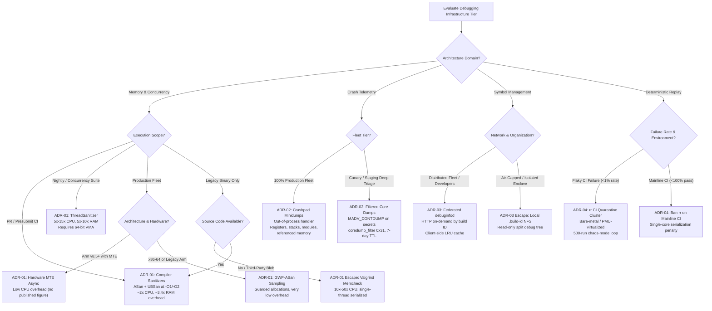
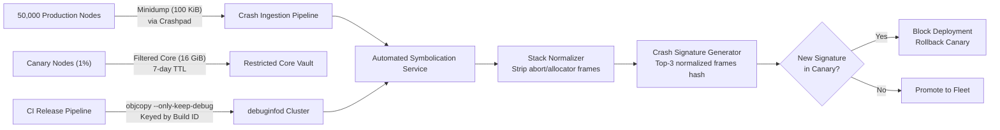

# Debugging Decision Records

> [!summary] Scope
> This playbook owns architectural decision records for debugging infrastructure at engineering organizational scale.
> It evaluates sanitizers versus Valgrind, full core dumps versus minidumps, debuginfod versus centralized symbol storage, and deterministic record-replay in CI.
> It provides default selections, flipping criteria, cost trade-offs, and migration paths across the entire debugging toolchain.

Memory and concurrency sanitizer internals are owned by [[Cpp-AddressSanitizer-and-LeakSanitizer-Internals]], [[Cpp-ThreadSanitizer-and-MemorySanitizer-Internals]], [[Cpp-UndefinedBehaviorSanitizer-and-UB-Field-Guide]], [[Cpp-HWASan-and-Hardware-Memory-Tagging]], and [[Rust-Miri-Sanitizers-Loom-and-Cargo-Fuzz]].
Dynamic binary translation mechanisms are owned by [[Cpp-Valgrind-Memcheck-Helgrind-and-DRD]].
Operating system crash capture mechanisms are owned by [[Core-Dumps-Minidumps-and-Crash-Reporting]], and manual crash triage is owned by [[Debug-a-Production-Crash-From-a-Core-Dump]].
Symbol indexing and client protocols are owned by [[Symbol-Servers-and-debuginfod]].
Deterministic execution recording engines are owned by [[Record-and-Replay-rr-UDB-and-Pernosco]].
This playbook owns the fleet-wide architectural standards, cost models, policy defaults, and operational migration paths across all four domains.

## Trigger and Symptoms

Activate this playbook when an engineering organization scales past fifty engineers, or when existing debugging workflows cause fleet-wide productivity and operational failures:

- Continuous Integration (CI) runtimes balloon because test suites execute under Valgrind, imposing 10x to 50x CPU slowdowns (Valgrind manual) and serializing thread execution across multi-core runners.
- Pull request (PR) merge queues stall because flaky concurrency bugs evade detection during local compilation and trigger non-deterministic test failures in CI.
- Production hosts crash during fatal signal events, triggering unthrottled 64 GiB ELF core dumps that fill root disks, trigger cascading cluster evictions, and saturate cross-datacenter network links.
- Production crashes cannot be triaged or symbolicated because stripped release binaries lack embedded GNU build IDs, or because separate debug files were purged from ad-hoc artifact servers.
- Security and compliance audits flag full core dump storage as a critical vulnerability because raw process memory dumps expose plaintext customer data, session tokens, and cryptographic keys.
- Engineering teams waste thousands of hours attempting to reproduce rare production Heisenbugs through manual log injection rather than deterministic execution traces.

## Decision Tree



## Prerequisites

Before executing the migration steps, verify build system tooling, kernel parameters, and network access:

### Compiler and Build System Requirements

```bash
clang --version || gcc --version
rustc --version
cmake --version
```

- Clang 16.0.0 or higher, GCC 13.1 or higher (GCC 13.0 was never released; 13.1 is the first 13.x release), or Rust 1.75.0 or higher (as of 2026-11); these floors are this playbook's policy, not tool requirements.
- Linker support for GNU build ID generation: GNU `ld` (binutils 2.38+) or LLVM `lld` (LLVM 16+).
- Stripping and splitting tools: `objcopy`, `strip`, and `eu-unstrip` (elfutils 0.188+).

### Kernel and Runtime Configuration

```bash
uname -r
cat /proc/sys/kernel/perf_event_paranoid
cat /proc/sys/kernel/core_pattern
```

- Linux kernel 5.15 or higher (x86-64 or AArch64).
- For deterministic replay nodes (rr): an Intel Nehalem (2010) or later CPU, certain AMD Zen or later CPUs (see the rr Zen wiki page), or certain AArch64 cores such as Arm Neoverse N1 or Apple M-series (rr README, as of 2026-11).
- On hypervisors hosting replay runners: hardware Performance Monitoring Unit (PMU) virtualization enabled; the rr README says some VMware, KVM, AWS, and GCP configurations are known to work.
- `kernel.perf_event_paranoid` set to 1, as the rr wiki recommends for recording; current rr source refuses to start only when the value is above 3 (the extra levels carried by Debian and Ubuntu kernels).

### Permissions and Network Egress

- Administrative (`sudo` or container root) access to set host sysctl values on triage and collection runners.
- Internal HTTP ingress to port 8002 (the `debuginfod` default) for `debuginfod` servers, which speak plain HTTP and need an HTTPS reverse proxy for TLS and authentication (debuginfod(8) Security section), and egress to upstream distribution symbol servers (`https://debuginfod.ubuntu.com`, `https://debuginfod.fedoraproject.org`).
- S3 or blob storage bucket provisioned for Crashpad minidump ingestion and split DWARF archive storage.

## Commands and Numbers to Know

| Decision Dimension | Tool / Technology | Platform | CPU Overhead `(as of 2026-11)` | Memory Overhead `(as of 2026-11)` | Artifact Size | Enterprise Default Selection |
| :--- | :--- | :--- | :--- | :--- | :--- | :--- |
| Memory Safety | [[Cpp-AddressSanitizer-and-LeakSanitizer-Internals\|AddressSanitizer (ASan)]] | Linux, macOS | Typical 2x (Clang docs); avg 1.73x, max 2.67x on SPEC CPU2006 (ATC 12 paper) | Avg 3.37x on SPEC CPU2006 (ATC 12 paper) | Binary 1.5x - 3.2x larger, avg 2.5x on SPEC CPU2006 (ATC 12 paper) | Standard for PR presubmit unit/integration gates |
| Memory Safety | [[Cpp-Valgrind-Memcheck-Helgrind-and-DRD\|Valgrind Memcheck]] | Linux (macOS only on Intel, up to 13.0; no Apple silicon) | 10x - 50x slowdown (Valgrind manual) | Per-byte validity state adds about 25% (Memcheck manual); `--track-origins=yes` adds at least 100 MB | 0% (no recompile) | Banned from automated CI; manual developer fallback only |
| Concurrency | [[Cpp-ThreadSanitizer-and-MemorySanitizer-Internals\|ThreadSanitizer (TSan v2)]] | Linux, macOS | 5x - 15x slowdown (Clang docs) | 5x - 10x bloat (Clang docs) | No vendor figure published | Dedicated nightly / quarantine concurrency suite |
| Memory Safety | [[Cpp-ThreadSanitizer-and-MemorySanitizer-Internals\|MemorySanitizer (MSan)]] | Linux | Typical 3x, plus 1.5x - 2x with origin tracking (Clang docs) | 2x real memory, 3x with origin tracking (Clang docs) | No vendor figure published | Opt-in for parsers; requires all code instrumented, including libc++ |
| Memory Safety | [[Cpp-HWASan-and-Hardware-Memory-Tagging\|GWP-ASan (LLVM Scudo)]] | Linux | Very low; LLVM docs publish no percentage | Fixed pool, ~40 KiB per process at defaults (LLVM docs) | No vendor figure published | Standard for 100% production fleet |
| Memory Safety | [[Cpp-HWASan-and-Hardware-Memory-Tagging\|Arm MTE (Async Mode)]] | Linux AArch64 | No numeric figure published (Linux kernel MTE docs, Arm ARM) | 4-bit tag per 16-byte granule (1/32 of tagged memory) in hardware tag storage | 0% | Standard for Arm v8.5+ production fleet |
| Crash Telemetry | [[Core-Dumps-Minidumps-and-Crash-Reporting\|Crashpad Minidump]] | Both | Out of process; Crashpad docs publish no latency figure | Negligible | Heuristic subset of state; Crashpad docs publish no size figure | Standard for 100% production fleet |
| Crash Telemetry | [[Core-Dumps-Minidumps-and-Crash-Reporting\|Full Kernel ELF Core]] | Linux | Grows with dumped memory; no fixed figure | Mapped memory selected by `coredump_filter` | Up to the size of the dumped mappings | Restricted canary and staging deep triage tier only |
| Symbol Delivery | [[Symbol-Servers-and-debuginfod\|Federated debuginfod]] | Linux | On-demand HTTP fetch | Client cache, files unused for `max_unused_age_s` (default 604800 s) removed | 0 MB in client repo | Standard across all developer and CI triage nodes |
| Symbol Delivery | Unindexed S3 Tarballs | Both | Manual unpack latency | Full archive unpack | Tens of gigabytes | Anti-pattern; deprecated across fleet |
| Determinism | [[Record-and-Replay-rr-UDB-and-Pernosco\|Mozilla rr]] | Linux x86-64, certain AArch64 | Recording slowdown under 2x on the paper's workloads excluding `make` (arXiv:1705.05937) | Negligible | Grows with recorded execution; no fixed figure (rr README publishes none) | Dedicated flaky quarantine runner queue only |

## Step-by-Step Execution

Each step executes an Architectural Decision Record (ADR) across the engineering toolchain.
Run each step, verify the concrete output, and do not proceed if verification fails.

### Step 1: Establish ADR-01 (Memory and Concurrency Safety Standard)

Enforce compiler-based instrumentation over dynamic binary translation across the CI build system.
Ban Valgrind from presubmit CI matrices and configure ASan, UBSan, and TSan build profiles in the central build definition.

#### 1.1 Configure Clang/GCC Sanitizer Flags

For CMake-based repositories, add standard sanitizer configurations to the root `CMakeLists.txt`:

```bash
cat << 'EOF' > cmake/Sanitizers.cmake
function(enable_sanitizers TARGET_NAME)
  if(ENABLE_ASAN)
    target_compile_options(${TARGET_NAME} PRIVATE
      -fsanitize=address,undefined
      -fno-omit-frame-pointer
      -fno-common
      -g
      -O1
    )
    target_link_options(${TARGET_NAME} PRIVATE
      -fsanitize=address,undefined
    )
  elseif(ENABLE_TSAN)
    target_compile_options(${TARGET_NAME} PRIVATE
      -fsanitize=thread
      -fno-omit-frame-pointer
      -g
      -O2
    )
    target_link_options(${TARGET_NAME} PRIVATE
      -fsanitize=thread
    )
  elseif(ENABLE_MSAN)
    target_compile_options(${TARGET_NAME} PRIVATE
      -fsanitize=memory
      -fsanitize-memory-track-origins=2
      -fno-omit-frame-pointer
      -g
      -O2
    )
    target_link_options(${TARGET_NAME} PRIVATE
      -fsanitize=memory
    )
  endif()
endfunction()
EOF
```

#### 1.2 Configure Standard Runtime Sanitizer Options

Export standard sanitizer runtime flags in the base CI runner environment:

```bash
export ASAN_OPTIONS="detect_leaks=1:abort_on_error=1:fast_unwind_on_malloc=0:quarantine_size_mb=256:symbolize=1"
export UBSAN_OPTIONS="halt_on_error=1:abort_on_error=1:print_stacktrace=1"
export TSAN_OPTIONS="halt_on_error=1:abort_on_error=1:second_deadlock_stack=1"
```

#### 1.3 Audit and Deprecate Valgrind in CI Configurations

Run a repository sweep to ensure no automated workflow invokes Valgrind:

```bash
grep -rn "valgrind" .github/ .gitlab-ci.yml Jenkinsfile Makefile 2>/dev/null || true
```

**Verification:**
Compile a validation test target with `ENABLE_ASAN=ON` and run it:

```bash
clang -x c -fsanitize=address,undefined -fno-omit-frame-pointer -g -O1 -o /tmp/asan_verify - << 'EOF'
#include <stdlib.h>
int main() {
    int *p = (int *)malloc(sizeof(int) * 10);
    free(p);
    return p[0]; // Heap use-after-free
}
EOF
/tmp/asan_verify 2>&1 | grep "AddressSanitizer: heap-use-after-free"
```

Without `-x c`, Clang rejects stdin input with `clang: error: -E or -x required when input is from standard input` (executed with Apple clang 21.0.0 on macOS arm64, as of 2026-11).
The `grep` matches both the report line and the summary line.

Expected output (executed with Apple clang 21.0.0 on macOS arm64, as of 2026-11):
```text
==12345==ERROR: AddressSanitizer: heap-use-after-free on address 0x... at pc 0x... bp 0x... sp 0x...
SUMMARY: AddressSanitizer: heap-use-after-free <stdin>:5 in main
```

### Step 2: Establish ADR-02 (Production Crash Telemetry Standard)

Deploy Crashpad out-of-process minidump reporting across production workloads.
Restrict full kernel core dumps to isolated canary tiers with explicit memory filtering.

#### 2.1 Integrate Crashpad Client Initialization

In native C++ services, initialize the `crashpad::CrashpadClient` handler early in `main()`:

```cpp
#include "client/crashpad_client.h"
#include <base/files/file_path.h>
#include <map>
#include <string>
#include <vector>

bool InitCrashReporter() {
    base::FilePath handler("/usr/local/bin/crashpad_handler");
    base::FilePath reports_dir("/var/log/crashes");
    base::FilePath metrics_dir("/var/log/crashes/metrics");
    std::string url = "https://crash-ingest.internal.net/api/v1/minidumps";

    std::map<std::string, std::string> annotations = {
        {"service", "order-matcher"},
        {"env", "production"},
        {"version", "2.14.0"}
    };

    // Disables the default throttle of one upload per hour (crashpad_handler(8)).
    std::vector<std::string> arguments = {
        "--no-rate-limit"
    };

    crashpad::CrashpadClient client;
    return client.StartHandler(
        handler,
        reports_dir,
        metrics_dir,
        url,
        annotations,
        arguments,
        /*restartable=*/true,  // ignored where unsupported
        /*asynchronous_start=*/false  // Windows only; must be false on Linux
    );
}
```

The argument order matches `CrashpadClient::StartHandler` in `client/crashpad_client.h`, and `crashpad_client_linux.cc` asserts `DCHECK(!asynchronous_start)`.

#### 2.2 Configure Sysctl and Systemd for Canary Deep-Triage Nodes

For canary hosts designated for full memory inspection, enforce bounded kernel pipe settings:

```bash
sudo sysctl -w kernel.core_pattern="|/usr/lib/systemd/systemd-coredump %P %u %g %s %t %c %h"
sudo sysctl -w kernel.core_pipe_limit=16
sudo sysctl -w fs.suid_dumpable=2
```

The pattern above is the upstream systemd form at v257 (its `sysctl.d/50-coredump.conf.in` carries `%c` in that slot from v239 through v257); v258 appends `%d %F` and main ships `%P %u %g %s %t %c %h %d %F %I`, as of 2026-11, so match the pattern in the installed `/usr/lib/sysctl.d/50-coredump.conf` rather than this listing.
Some distribution packages may ship a different literal in the `%c` slot; this note does not rely on one.

In `/etc/systemd/coredump.conf`, configure storage limits and disk quotas:

```ini
[Coredump]
Storage=external
Compress=yes
ProcessSizeMax=16G
ExternalSizeMax=16G
JournalSizeMax=767M
MaxUse=10%
KeepFree=15%
```

#### 2.3 Protect Customer Secrets via coredump_filter and madvise

Ensure sensitive applications configure memory filters to exclude shared and file-backed mappings:

```bash
# Kernel default is 0x33: private anonymous, shared anonymous, ELF headers, private huge pages.
# 0x31 drops shared anonymous mappings; file-backed mappings (bits 2 and 3) are already off.
# Set it in the launching shell: fork and execve inherit it (core(5)).
echo 0x31 > /proc/self/coredump_filter && exec /usr/local/bin/order-matcher
# For a running process, write to its own file instead:
echo 0x31 | sudo tee /proc/"${PID}"/coredump_filter
```

Writing to `/proc/self/coredump_filter` through `sudo tee` changes only the short-lived `tee` process, so it has no effect on the service.

In application memory pools storing authentication tokens or decryption keys, invoke `madvise`:

```c
#include <sys/mman.h>

void secure_buffer(void *addr, size_t length) {
    madvise(addr, length, MADV_DONTDUMP);
}
```

**Verification:**
Verify that Crashpad handler runs out-of-process and responds to signal dispatch:

```bash
ps aux | grep "[c]rashpad_handler"
cat /proc/sys/kernel/core_pattern
```

Expected output:
```text
root  4092  0.0  0.1  25480  8120 ?  Sl  10:00  0:00 /usr/local/bin/crashpad_handler ...
|/usr/lib/systemd/systemd-coredump %P %u %g %s %t %c %h
```

### Step 3: Establish ADR-03 (Enterprise Symbol Distribution via debuginfod)

Configure the CI artifact pipeline to generate split DWARF binaries indexed by GNU build ID, and stand up a central `debuginfod` federation service.

#### 3.1 Build with Unique Build IDs and Extract Split Debug Information

Update production linker flags to emit 160-bit SHA-1 build identifiers:

```bash
# Link with build ID
gcc -O2 -g -Wl,--build-id=sha1 -o order_matcher order_matcher.c

# Extract debug information to standalone debug file
objcopy --only-keep-debug order_matcher order_matcher.debug

# Remove debug sections only; .symtab and the build-id note stay
strip --strip-debug order_matcher

# Add debuglink back to stripped binary
objcopy --add-gnu-debuglink=order_matcher.debug order_matcher
```

#### 3.2 Index and Organize Debug Files by Build ID

Verify the build ID and install the debug artifact into the local symbol repository:

```bash
BUILD_ID=$(eu-readelf -n order_matcher | grep "Build ID" | awk '{print $3}')
echo "Generated Build ID: ${BUILD_ID}"

DEBUG_DIR="/var/symbols/debuginfo/.build-id/${BUILD_ID:0:2}"
mkdir -p "${DEBUG_DIR}"
cp order_matcher.debug "${DEBUG_DIR}/${BUILD_ID:2}.debug"
```

#### 3.3 Deploy Federated debuginfod Server Daemon

Run the `debuginfod` server, pointing to the local symbol directory and federating with upstream distro mirrors:

```bash
export DEBUGINFOD_URLS="https://debuginfod.ubuntu.com https://debuginfod.fedoraproject.org"

debuginfod \
    -F \
    -d /var/symbols/debuginfod.sqlite \
    -p 8002 \
    /var/symbols/debuginfo &
```

`-c NUM` is `--concurrency`, the number of scanner threads, not a cache setting.
`cache_clean_interval_s` (default 86400) and `max_unused_age_s` (default 604800) are client-side control files inside `$DEBUGINFOD_CACHE_PATH` (debuginfod-client-config(7)).
With `DEBUGINFOD_URLS` set in its environment, the server federates unresolved queries to those upstreams (debuginfod(8)).

#### 3.4 Configure Global Client Environment

Distribute `/etc/profile.d/debuginfod.sh` across all developer laptops, CI workers, and triage hosts:

```bash
cat << 'EOF' | sudo tee /etc/profile.d/debuginfod.sh
export DEBUGINFOD_URLS="https://debuginfod.internal.net https://debuginfod.ubuntu.com"
export DEBUGINFOD_TIMEOUT=60
export DEBUGINFOD_CACHE_PATH="${HOME}/.cache/debuginfod_client"
EOF
source /etc/profile.d/debuginfod.sh
```

The internal URL points at the HTTPS reverse proxy in front of the plain-HTTP server on port 8002.
`DEBUGINFOD_TIMEOUT` defaults to 90 seconds (debuginfod-client-config(7)).

GDB defaults `debuginfod enabled` to `ask` in interactive sessions and to `off` in non-interactive ones (GDB manual, Debuginfod Settings, as of 2026-11), so set it explicitly in `~/.gdbinit`:

```text
set debuginfod enabled on
```

**Verification:**
Query the standalone build ID using `debuginfod-find`:

```bash
debuginfod-find debuginfo "${BUILD_ID}"
```

Expected output:
```text
/home/runner/.cache/debuginfod_client/a73912f85f2bf7003f6d41b12c830c6c45e55c76/debuginfo
```

### Step 4: Establish ADR-04 (Deterministic Record-Replay CI Quarantine Pipeline)

Provision a dedicated, bare-metal CI execution pool for Mozilla `rr` deterministic replay, targeted strictly at flaky tests.

#### 4.1 Validate PMU Counter Capabilities on the Replay Host

Verify that the runner host supports retired conditional branch performance counters:

```bash
sudo sysctl -w kernel.perf_event_paranoid=1

# Verify perf counter access for retired conditional branches (Intel raw event 0x5101c4)
perf stat -e r5101c4 true 2>&1 | grep "r5101c4"
# AMD Zen equivalent from the rr wiki
perf stat -e ex_ret_cond true 2>&1 | grep "ex_ret_cond"
```

The count must be non-zero; a zero or `<not supported>` count means the PMU is not exposed (rr wiki, Will rr work on my system).

#### 4.2 Configure the Automated Flaky Test Replay Harness

In the CI pipeline runner, trigger `rr record` in a loop when a quarantined flaky test fails:

```bash
cat << 'EOF' > run_flaky_quarantine.sh
#!/usr/bin/env bash
set -euo pipefail

TEST_BINARY="$1"
MAX_ATTEMPTS=500
RUN_COUNT=0

echo "Starting flaky reproduction loop for ${TEST_BINARY} under rr..."

while [ ${RUN_COUNT} -lt ${MAX_ATTEMPTS} ]; do
    RUN_COUNT=$((RUN_COUNT + 1))
    
    # Run under rr recording; --chaos randomizes scheduling to surface races
    if ! rr record --chaos "${TEST_BINARY}" > /tmp/test_output.log 2>&1; then
        echo "Flaky bug reproduced on attempt ${RUN_COUNT}!"
        
        # Resolve the latest-trace symlink rr maintains in its trace directory
        LATEST_TRACE=$(readlink -f ~/.local/share/rr/latest-trace)
        
        # Pack the trace so it is portable across machines
        rr pack "${LATEST_TRACE}"
        
        # Compress and upload to trace vault
        tar -czf "/tmp/flaky_trace_${RUN_COUNT}.tar.gz" -C "$(dirname "${LATEST_TRACE}")" "$(basename "${LATEST_TRACE}")"
        echo "Trace packed and saved: /tmp/flaky_trace_${RUN_COUNT}.tar.gz"
        exit 0
    fi
done

echo "Test passed ${MAX_ATTEMPTS} times without reproducing."
exit 1
EOF
chmod +x run_flaky_quarantine.sh
```

rr always runs the tracee on one core; `--num-cores=N` only changes how many cores the tracee is told it has, while `-h`/`--chaos` randomizes scheduling decisions (rr `RecordCommand.cc`).
`readlink -f` matters because `tar` archives a symlink itself, not its target.
The trace directory is `~/.local/share/rr` unless `_RR_TRACE_DIR` or `XDG_DATA_HOME` overrides it.

**Verification:**
Record and replay a test crash with `rr`:

```bash
rr record /tmp/asan_verify || true
rr replay -- -batch -ex "continue" -ex "bt"
```

`rr replay` passes everything after `--` to the debugger (`rr replay [OPTION]... [<trace-dir>] [-- <debugger-options>]`), and the replay starts at exec, so `continue` must run before `bt`.
ASan reports through `abort()` when `abort_on_error=1` from Step 1.2 is set, so the stop is `SIGABRT`, not `SIGSEGV`.

Expect the replayed debugger to stop with `SIGABRT` and print a backtrace through the ASan abort path.
This output is not recorded because rr needs hardware performance counters that neither macOS nor the lab container exposes.

### Step 5: Audit and Enforce Fleet Migration Compliance

Deploy an automated CI policy checker to validate that all repository pull requests adhere to ADR-01 through ADR-04.

```bash
cat << 'EOF' > scripts/check_debug_compliance.sh
#!/usr/bin/env bash
set -euo pipefail

BIN="$1"

# Check 1: Ensure GNU Build ID is present
if ! eu-readelf -n "${BIN}" | grep -q "Build ID"; then
    echo "FAIL: Binary ${BIN} missing GNU Build ID!"
    exit 1
fi

# Check 2: Ensure binary is stripped of heavy debuginfo
if eu-readelf -S "${BIN}" | grep -q "\.debug_info"; then
    echo "FAIL: Binary ${BIN} contains unstripped .debug_info sections!"
    exit 1
fi

# Check 3: Ensure build ID is queryable in debuginfod
BUILD_ID=$(eu-readelf -n "${BIN}" | grep "Build ID" | awk '{print $3}')
if ! debuginfod-find debuginfo "${BUILD_ID}" >/dev/null 2>&1; then
    echo "FAIL: Debug info for build ${BUILD_ID} not published to debuginfod!"
    exit 1
fi

echo "SUCCESS: Binary ${BIN} meets all enterprise debugging standards."
exit 0
EOF
chmod +x scripts/check_debug_compliance.sh
```

**Verification:**
Run the compliance script against the built artifact:

```bash
./scripts/check_debug_compliance.sh order_matcher
```

Expected output:
```text
SUCCESS: Binary order_matcher meets all enterprise debugging standards.
```

## Rollback Procedure

If any architectural decision introduces unexpected operational regressions, execute these rollback protocols:

### Rollback ADR-01 (Sanitizer Build Reversion)

If ASan or TSan causes excessive memory exhaustion on CI runners or conflicts with custom virtual memory allocators:
1. Revert CI pipeline flags by unsetting `ENABLE_ASAN=ON` and `ENABLE_TSAN=ON` in the pipeline environment.
2. In CMake configurations, set `-DENABLE_ASAN=OFF -DENABLE_TSAN=OFF`.
3. If an emergency allocator collision occurs in staging, disable ASan leak detection and quarantine via runtime options:
   ```bash
   export ASAN_OPTIONS="detect_leaks=0:quarantine_size_mb=0"
   ```
4. Verification: Run `nm <binary> | grep -c __asan_init` and confirm it prints `0`.
   `objdump -p <binary> | grep asan` only catches a dynamically linked runtime: GCC links `libasan.so` (shown in `objdump -p`), while Clang offers `-shared-libsan` to link the runtime dynamically (Clang Command Line Reference, as of 2026-11), so a Clang build without it can show no `libasan` entry in `objdump -p`.

### Rollback ADR-02 (Crashpad to Kernel Core Dump Fallback)

If the out-of-process `crashpad_handler` crashes, deadlocks, or fails to initialize:
1. Disable in-app Crashpad initialization via feature flag or environment variable `DISABLE_CRASHPAD=1`.
2. Restore the core pattern shipped by the installed systemd release:
   ```bash
   sudo sysctl -p /usr/lib/sysctl.d/50-coredump.conf
   ```
3. Remove systemd coredump storage caps if core truncation occurs (32G is the 64-bit default for both settings):
   ```bash
   sudo sed -i 's/ProcessSizeMax=16G/ProcessSizeMax=32G/; s/ExternalSizeMax=16G/ExternalSizeMax=32G/' /etc/systemd/coredump.conf
   # Only needed where the long-running systemd-coredumpd.service handles cores;
   # per-crash systemd-coredump@.service instances read the file on each crash.
   sudo systemctl reload systemd-coredumpd.service
   ```
   coredump.conf(5) says a running `systemd-coredumpd.service` reads the file only at start and applies changes on `systemctl reload systemd-coredumpd.service`; `systemctl daemon-reload` reloads unit files, not this configuration.
4. Verification: Send `kill -SIGSEGV $$` in a test subshell and confirm entry in `coredumpctl list`.

### Rollback ADR-03 (debuginfod Server Outage Fallback)

If the internal `debuginfod` cluster suffers a database lockup, outage, or network partition:
1. Temporarily unset client environment variables across developer workstations:
   ```bash
   unset DEBUGINFOD_URLS
   ```
2. In GDB, disable debuginfod client requests to prevent CLI hang:
   ```text
   (gdb) set debuginfod enabled off
   ```
3. Fall back to manual local `.build-id` symbol root:
   ```bash
   gdb -iex "set debug-file-directory /var/symbols/backup_debug_root:/usr/lib/debug" ./app
   ```
4. Verification: Confirm GDB starts without querying network endpoints or hanging on HTTP connect.

### Rollback ADR-04 (rr Runner Deprovisioning)

If hypervisor migrations break PMU performance counter virtualization:
1. Evict the affected test runner from the `rr-quarantine` pool in the CI orchestrator configuration.
2. Re-enable standard multi-threaded testing on the runner by disabling `rr record`.
3. Verification: Verify that `perf stat -e instructions true` runs without returning `EOPNOTSUPP` or `ENOENT`.

## Failure Modes of the Procedure

| Failure Mode | Root Cause Mechanism | Observable Symptom | Remediation Runbook |
| :--- | :--- | :--- | :--- |
| ASan Shadow Memory Collision | A custom allocator, JIT, or loader maps fixed virtual memory inside the x86-64 ASan shadow range (`0x00007fff8000` to `0x10007fff7fff`). | Immediate abort on startup with `Shadow memory range interleaves with an existing memory mapping. ASan cannot proceed correctly. ABORTING.` (`asan_shadow_setup.cpp`). | Remove the fixed-address mapping, or move it outside the shadow range. |
| TSan Memory Layout Mismatch | TSan's shadow layout supports only limited ASLR entropy (30 bits on x86-64); newer kernels and distributions raise `vm.mmap_rnd_bits` above that, and TSan also has per-VMA layouts on AArch64 (39, 42, 47, 48-bit in `tsan_platform.h`). | Process aborts at startup after `ThreadSanitizer: unexpected memory mapping 0x...-0x...` (`tsan_platform_posix.cpp`). | Use a compiler-rt that includes PR 78351 (January 2024), which re-execs the process with ASLR disabled, or set `sudo sysctl vm.mmap_rnd_bits=28` on test runners. |
| MSan False Positives from Uninstrumented Libraries | Application links against dynamic system `libc++` or `libcrypto` built without MSan instrumentation. | Uninitialized memory read errors reported deep inside standard library containers: `MemorySanitizer: use-of-uninitialized-value`. | Rebuild all transitive dependencies and `libc++` from source using `clang++ -fsanitize=memory`, or switch to ASan. |
| Minidump Stack Truncated | Stack pointer was corrupted or pushed past the registered thread stack boundary at time of crash. | Stackwalk displays only `#0 0x0000000000000000 in ?? ()` with zero caller frames. | Configure Crashpad to capture auxiliary memory ranges, or promote service to Canary Full Core tier for deep triage. |
| debuginfod Database Lock Contention | Several active (scanning) `debuginfod` processes share one `debuginfod.sqlite`; the server already sets `pragma journal_mode = wal` and `busy_timeout = 1000` itself (`debuginfod.cxx`). | Scanning stalls or slows when two writers contend for the database; read the server log for SQLite errors. | Run one active scanner per database and serve load from `--passive` instances, which open the database read-only and can safely share it (debuginfod(8)). |
| debuginfod Build ID Collision | Builds pass a constant `-Wl,--build-id=0xHEX`, so different binaries carry the same `.note.gnu.build-id`; hash-based IDs (`sha1`, `md5`, GNU ld's `xx`, lld's `fast`) are computed from the output and differ whenever the bytes differ (GNU ld manual, lld `Options.td`). | Mismatched source lines and wrong disassembly displayed in GDB during symbol lookup. | Use a content hash, `-Wl,--build-id=sha1`, and never a hand-set or tree-derived constant. |
| rr PMU Counter Virtualization Missing | The VM hypervisor does not expose hardware performance counters to the guest. | `rr record` fails on launch with `Unable to open performance counter with 'perf_event_open'; are hardware perf events available?` (ENOENT) or `Permission denied to use 'perf_event_open'` (EPERM/EACCES) (`PerfCounters.cc`). | Move rr quarantine workers to bare metal or to a VM configuration that virtualizes the PMU (some VMware, KVM, AWS, and GCP configurations work, per the rr README). |
| rr Recording Spinlock Hang | Multi-threaded code uses busy-waiting spinlocks; rr runs one thread at a time, so a spinning thread burns its timeslice while the holder waits. | Test execution times out. | Replace bare spinlocks with futex-backed primitives (`std::mutex`); `rr record --bind-to-cpu=<CORE>` only picks the core rr runs on. |

## Pitfalls

> [!warning] The Valgrind in CI Anti-Pattern
> Running Valgrind Memcheck in automated CI pipelines is the single largest source of test queue inflation in legacy systems.
> Valgrind translates machine instructions to VEX IR and serializes execution so that only one thread runs at a time (Valgrind manual).
> This imposes a 10x to 50x CPU execution penalty under Memcheck and hides interleavings that only appear under true parallelism, masking real race conditions that appear in production.
> Compiler sanitizers keep native multi-core scheduling at a typical 2x (ASan) or 5x to 15x (TSan) slowdown (Clang docs), catching vastly more defects per dollar of compute.

> [!warning] Storing Unindexed Full Core Dumps in S3
> Uploading raw 32 GiB to 128 GiB kernel ELF core dumps to cloud storage buckets without indexing by GNU build ID creates massive storage invoices with zero triage utility.
> A full core dump without its matching split debug file cannot resolve function names, arguments, or source code lines.
> Furthermore, un-redacted core dumps violate data privacy compliance (GDPR, SOC2, PCI-DSS) by persisting plaintext secrets.
> Enforce Crashpad minidumps as the corporate standard, and restrict full cores to canary clusters with mandatory `MADV_DONTDUMP` annotations and 7-day lifecycle deletion rules.

> [!warning] Rebuilding From Source Instead of Archiving Symbols
> Never attempt to debug a production crash by checking out "the same git commit" and recompiling locally.
> Compiler version differences, build path variations, macro expansions, and timestamps alter the resulting binary layout, producing a completely different GNU build ID or Mach-O UUID.
> GDB and LLDB will reject the resulting debug file or display corrupted stack frames.
> Symbols must be extracted and archived at the exact moment the release artifact is linked in CI, keyed strictly by the binary's embedded build ID.

> [!warning] Attempting rr Replay on Virtualized Cloud Instances
> Mozilla `rr` requires access to the CPU's hardware performance monitoring unit via `perf_event_open` to count retired conditional branches (`BR_INST_RETIRED.CONDITIONAL`).
> A VM guest works only when the hypervisor virtualizes the hardware performance counters; the rr README lists some VMware, KVM, AWS, and GCP configurations as working, and on the rest `rr` fails immediately.
> Do not schedule `rr` replay jobs across general-purpose cloud VM pools; route them to bare-metal worker nodes or instance types verified with the `perf stat` check in Step 4.1.

> [!warning] Deploying MSan Without Recompiling Dependencies
> MemorySanitizer tracks uninitialized memory at bit-level precision across all registers and memory locations.
> If an MSan-instrumented binary calls into an uninstrumented shared library (such as system `glibc` or dynamic `libcrypto.so`), memory written by the uninstrumented code is not marked as initialized in shadow memory.
> The next time your application reads that memory, MSan will report a false-positive `use-of-uninitialized-value` fatal error.
> MSan must only be used in hermetic environments where all linked libraries are compiled from source with `-fsanitize=memory`; the Clang docs say this "includes any libraries that the program depends on, even libc".

## At Scale

At 1,000 to 50,000 engineers, debugging ceases to be a local developer workstation activity and becomes a distributed data processing problem governed by compute economics, storage budgets, and automated gate enforcement.



### Compute and Storage Economics Formula

Consider an organization running 10,000 CI test runs per day and managing 5,000 production microservice containers:

#### CI Memory Validation Economics

- **Valgrind Strategy:** 10,000 test runs x 10 minutes average native runtime x 30x Valgrind slowdown = 3,000,000 compute minutes (50,000 core-hours daily).
- **AddressSanitizer Strategy:** 10,000 test runs x 10 minutes native runtime x 1.7x ASan slowdown = 170,000 compute minutes (2,833 core-hours daily).
- **Economic Differential:** Eliminating Valgrind in favor of ASan saves over 47,000 core-hours per day in CI infrastructure spend, while removing Valgrind's thread serialization; race detection itself still needs the separate TSan suite.

#### Production Crash Storage Economics

- **Unthrottled Full Core Strategy:** 50 daily service crashes across fleet x 32 GiB average memory footprint = 1,600 GiB (1.56 TiB) daily storage ingress.
  Over 30 days, unindexed core storage accumulates 48,000 GiB (about 46.9 TiB) of unstructured data, costing substantial cloud storage budgets while generating severe disk I/O penalties during service death.
- **Crashpad Minidump Strategy:** 50 daily crashes x an assumed 200 KiB minidump size = 10,000 KiB (about 9.8 MiB) daily storage ingress.
  Over 30 days, total crash storage consumes about 293 MiB.
- **Economic Differential:** Minidump capture reduces fleet crash telemetry storage by a factor of about 168,000x (32 GiB / 200 KiB), and removes the multi-second stall of writing a full core while the service is dying (no latency figure is published; measure it on your own fleet).

### Automated Crash Signature Normalization and Rollout Gates

At scale, crash reports must not be triaged manually by humans.
The crash ingestion pipeline must automate signature generation:
1. Ingest the minidump and resolve symbols via the internal `debuginfod` cluster using the module's GNU build ID.
2. Strip non-informative top frames from the unwound call stack:
   - Kernel entry and signal delivery frames: `__restore_rt`, `_sigtramp`.
   - Abort and termination helpers: `abort`, `raise`, `__assert_fail`, `std::terminate`.
   - Memory allocator wrappers: `malloc`, `free`, `operator new`, `__asan_report_error`.
3. Concatenate the top three remaining application function signatures (function name, relative instruction offset bucket, and source file stem).
4. Compute an MD5 or SHA-256 hash over this normalized tuple:
   $$\text{CrashSignature} = \text{SHA256}(F_0 \,\|\, F_1 \,\|\, F_2)$$
5. Track signature occurrence rates in canary deployments: if a canary deployment emits a crash signature that has never been recorded in the baseline production fleet, the CD orchestrator immediately halts rollout and triggers an automatic rollback.

## Practice Drill

> [!tip] Practice Drill: Audit and Transition a Toy Toolchain
> Construct a local scratch repository containing an intentionally buggy C++ program with a heap-use-after-free and a multi-threaded data race.
> 1. Set up a legacy Makefile that executes the test target under Valgrind Memcheck.
>    Time the execution with `time make test` and note the wall-clock time and the single-core CPU utilization in `top`.
> 2. Refactor the Makefile to compile the target under `-fsanitize=address,undefined` for the unit test target, and `-fsanitize=thread` for the concurrency test target.
> 3. Measure the execution time of the sanitizer suite: verify that runtime overhead drops by at least 10x compared to Valgrind, and observe the exact ASan error trace identifying the allocation and free stack frames.
> 4. Split debug info from the binary using `objcopy --only-keep-debug` and `strip --strip-debug`, ensuring the binary retains `.note.gnu.build-id`.
> 5. Launch a local `debuginfod` server indexing the split debug artifact on port 8002.
> 6. Configure `DEBUGINFOD_URLS="http://localhost:8002"` and run GDB against the stripped binary in batch mode; prove that GDB retrieves debug symbols on-demand and displays full source lines.
> Target completion time: 30 minutes.

## Interview Questions

> [!question] L5
> An engineering team proposes running Valgrind Memcheck on every commit in continuous integration to catch memory bugs.
> What are the primary technical and operational reasons to reject this proposal in favor of compiler sanitizers?
>
> > [!success]- Answer
> > Valgrind uses Dynamic Binary Translation (VEX IR) to instrument machine instructions at runtime, incurring a 10x to 50x CPU slowdown under Memcheck (Valgrind manual) and extra memory for per-byte validity state (about 25% per the Memcheck manual, more with `--track-origins=yes`).
> > More critically, Valgrind serializes execution so that only one thread runs at a time, preventing true simultaneous multi-core execution and masking race conditions.
> > Compiler-based AddressSanitizer (ASan) instruments memory accesses at compile time, with a typical 2x slowdown (Clang docs; 1.73x average on SPEC CPU2006 in the ATC 12 paper), which is fast enough to run on every presubmit pull request.
> > ASan preserves multi-threaded scheduling interleavings and pairs with a separate ThreadSanitizer (TSan) build for dedicated concurrency verification; the two cannot share one binary (Clang rejects `-fsanitize=address,thread` with `'-fsanitize=address' not allowed with '-fsanitize=thread'`, Apple clang 21.0.0, executed as of 2026-11).

> [!question] L5
> What is the architectural difference between a Linux kernel ELF core dump and a Crashpad minidump, and why does a fleet default to minidumps?
>
> > [!success]- Answer
> > A Linux kernel ELF core dump captures the entire mapped address space of the process (subject to `coredump_filter`), resulting in file sizes ranging from gigabytes to hundreds of gigabytes.
> > Capturing full cores causes heavy disk I/O, potential disk exhaustion, process suspension delays, and privacy risks by storing plaintext secrets in heap memory.
> > A Crashpad minidump is written out-of-process by a monitoring daemon and captures a heuristic subset of state: loaded modules, each thread's registers and stack memory, selected OS state such as the command line and environment, and a selection of memory referenced from registers and stacks (Crashpad Overview Design).
> > Minidump generation is fast and produces small artifacts suitable for central HTTP telemetry (the Crashpad docs publish no latency or size figures, so measure both), and it omits most of the heap, though referenced memory and the environment can still hold secrets.

> [!question] L6
> Why must an organization use `debuginfod` rather than downloading tarballs of debug symbols from an artifact repository, and how does `debuginfod` resolve symbols?
>
> > [!success]- Answer
> > Traditional artifact repositories require developers and CI triage pipelines to manually locate, download, and extract multi-gigabyte symbol tarballs for every service version.
> > `debuginfod` operates over standard HTTP/HTTPS using the binary's unique cryptographic GNU build ID (from `.note.gnu.build-id`).
> > Debuggers (GDB, LLDB) and profilers (`perf`) transparently query endpoints such as `/buildid/<HEX>/debuginfo` and `/buildid/<HEX>/source/<PATH>` on demand.
> > It fetches only the specific debug ELF or source files required for the current backtrace, caches them locally in `~/.cache/debuginfod_client`, deleting files unaccessed for `max_unused_age_s` (default one week), and federates requests across upstream distribution mirrors.

> [!question] L6
> Predict the output: A release binary was compiled with `-O2 -g -Wl,--build-id=sha1` and stripped using `strip --strip-all`.
> You inspect the binary using `eu-unstrip -n` and GDB batch mode, both with and without `DEBUGINFOD_URLS` configured.
> What does each command output?
>
> > [!success]- Answer
> > Running `eu-unstrip -n -e ./app` outputs one line in the format `START+SIZE BUILDID@ADDR FILE DEBUGFILE MODULENAME`, for example (illustrative line in that format, not captured output):
> > `0+0x20018 26c50ea16ef49aa45ed35e44528f9b482aa7239a@0x264 ./app -`
> > The FILE column is the binary's path, and the `-` in the DEBUGFILE column means no debug information was found; a `.` there would mean the file carries its own debug information (`unstrip.c`).
> > With `DEBUGINFOD_URLS` set, libdwfl can also query debuginfod, so the DEBUGFILE column may name a cache path.
> > Without `DEBUGINFOD_URLS`, running `gdb -batch -ex "file ./app" -ex "info functions"` outputs:
> > `All defined functions:` followed by `Non-debugging symbols:` and typically only PLT and other non-debugging symbols (not captured here), and backtraces show `?? ()` because `.symtab` and `.debug_info` are absent.
> > With `DEBUGINFOD_URLS` set, batch mode still needs `-iex "set debuginfod enabled on"` because non-interactive sessions default to off; GDB then fetches the file and may show a download progress bar (controlled by `set progress-bars enabled`; GDB manual, Debuginfod Settings).
> > GDB downloads the file to `~/.cache/debuginfod_client/<build-id>/debuginfo`, reads DWARF data, and displays complete function signatures and source line numbers.

> [!question] L6
> Debug this: A team enables MemorySanitizer (`-fsanitize=memory`) on a backend C++ application.
> The program immediately crashes on startup with:
> `==1042==WARNING: MemorySanitizer: use-of-uninitialized-value`
> The backtrace points inside `std::string::operator=` within standard library code, even though the application explicitly initialized all local variables.
> What is the root cause and how must the architecture be corrected?
>
> > [!success]- Answer
> > The application was compiled with MSan, but it dynamically linked against the system's uninstrumented `libc++.so` or `libstdc++.so`.
> > MemorySanitizer relies on shadow memory to track every initialized bit of memory.
> > When uninstrumented standard library functions allocate or write memory, they do not update MSan's shadow memory table.
> > When the instrumented application code subsequently reads that memory, MSan detects the shadow bits as uninitialized and reports a false positive.
> > To fix this, the team must rebuild the entire C++ runtime library (`libc++` and `libc++abi`) from source using `-fsanitize=memory` and link against that instrumented runtime, or switch the presubmit gate to AddressSanitizer.

> [!question] L7
> Design an enterprise-wide automated crash reporting and symbolication pipeline for a fleet of 25,000 microservices running in Kubernetes.
> Detail client capture, telemetry transport, symbol retrieval, signature clustering, and deployment gating.
>
> > [!success]- Answer
> > 1. Client Capture: Link each service with the Crashpad client; a companion container or node daemon runs `crashpad_handler`.
> > On fatal signals, the handler writes a small minidump containing registers, stack memory, and module build IDs.
> > 2. Transport: The handler uploads minidumps over HTTPS to an internal crash ingestion gateway with rate-limiting and token authentication.
> > 3. Symbol Storage: CI release builds split symbols with `objcopy --only-keep-debug`, upload debug files to object storage keyed by GNU build ID, and register them with an internal `debuginfod` cluster.
> > 4. Symbolication: Central symbolication workers run `minidump_stackwalk` or LLVM symbolizers, fetching DWARF symbols on-demand from `debuginfod`.
> > 5. Clustering: The stackwalker extracts the top application frames, discards abort/signal/allocator frames, and hashes the top three normalized frames into an MD5/SHA-256 crash signature.
> > 6. Deployment Gating: Continuous delivery pipelines query the crash telemetry database during canary rollout.
> > If a canary instance registers a novel crash signature, the deployment pipeline halts and triggers an immediate rollback.

> [!question] L7
> Why is Mozilla `rr` unsuited for 100% of mainline CI test executions, and how should an organization architect a deterministic replay service for flaky tests?
>
> > [!success]- Answer
> > Mozilla `rr` achieves deterministic record-and-replay by serializing multi-threaded execution onto a single logical CPU core and intercepting all asynchronous events via PMU counters (`perf_event_open`).
> > Enforcing single-core execution on all CI tests would multiply total fleet test duration on parallel workloads (the rr paper reports its largest slowdown on parallel `make`), bottlenecking developer productivity and inflating cloud compute costs.
> > Furthermore, `rr` requires hardware PMU counter virtualization, which many cloud VM configurations do not expose.
> > The correct architectural design is a quarantined replay pipeline: mainline CI runs uninstrumented or under ASan at full multi-core speed.
> > When a test is flagged as flaky (<1% failure rate), it is quarantined to a dedicated pool of bare-metal runners equipped with PMU access.
> > The runner executes the flaky test in an automated 500-iteration `rr record --chaos` loop until failure occurs, packs the trace with `rr pack`, and uploads the artifact for developer inspection.

> [!question] L8+
> A high-frequency trading matching engine requires sub-microsecond latency and cannot tolerate the 1.7x CPU overhead of ASan or the 100 KiB stack dump pause of Crashpad in production.
> Formulate a multi-tier memory safety and crash diagnostic strategy across development, canary, and production trading nodes.
>
> > [!success]- Answer
> > 1. Development & PR Gates: Compile full unit and algorithmic test suites with Clang ASan + UBSan and TSan in CI.
> > Enforce 100% pass rates prior to merging code to trunk.
> > 2. Staging / Replay Simulation: Execute matching engines under high-throughput simulated market data feeds using hardware Arm Memory Tagging Extension (MTE) in synchronous mode (stricter checking; the Linux kernel MTE docs give no overhead figure) or Clang HWASan to validate zero memory corruption under heavy load.
> > 3. Production Canary Tier: Deploy Arm v8.5+ hardware using MTE in Asynchronous Mode.
> > Async MTE checks tags less strictly than sync mode, so it can be cheaper on some CPUs (the Linux kernel MTE docs give no figure), and it catches use-after-free and buffer overflows after the fact: the kernel raises `SIGSEGV` with `si_code = SEGV_MTEAERR` and `si_addr = 0` asynchronously following the tag check fault (Linux kernel MTE documentation).
> > 4. Production Trading Core: For ultra-low-latency nodes where even 1% overhead is unacceptable, deploy GWP-ASan sampling inside the memory allocator (e.g., TCMalloc or Scudo) with a low sampling frequency (e.g., 1 in 10,000 allocations guarded; the LLVM default `SampleRate` is 5000).
> > LLVM documents the overhead as very low without publishing a percentage.
> > 5. Crash Telemetry: Disable in-process crash hooks.
> > Configure the Linux kernel with `core_pattern` piping to a memory-mapped ring buffer or low-priority background collector, using `coredump_filter 0x11` (anonymous private mappings plus ELF headers, which keep the build-id notes needed for symbolization; `0x1` alone drops them) and tagging high-frequency memory buffers with `MADV_DONTDUMP`.

## Further Reading

- Konstantin Serebryany et al., AddressSanitizer: A Fast Address Sanity Checker (USENIX ATC 12), https://www.usenix.org/conference/atc12/technical-sessions/presentation/serebryany.
  Foundational research establishing compile-time shadow memory instrumentation and the 1.7x execution slowdown benchmark.
- Nicholas Nethercote and Julian Seward, Valgrind: A Framework for Heavyweight Dynamic Binary Instrumentation (PLDI 07), https://doi.org/10.1145/1250734.1250746.
  The design and performance trade-offs of dynamic binary translation and VEX IR shadow memory.
- Robert O'Callahan et al., Engineering Record And Replay For Deployability (arXiv:1705.05937), https://arxiv.org/abs/1705.05937.
  Detailed technical design of Mozilla rr, hardware performance counters, and replay determinism.
- elfutils debuginfod Documentation, https://sourceware.org/elfutils/Debuginfod.html.
  Reference architecture for HTTP-based build ID symbol federation and client caching.
- The Chromium Projects, Crashpad Overview Design, https://chromium.googlesource.com/crashpad/crashpad/+/HEAD/doc/overview_design.md.
  Architectural specification for out-of-process minidump crash reporting on modern desktop and server platforms.
- Google LLC, GWP-ASan Documentation, https://llvm.org/docs/GwpAsan.html.
  Design and deployment parameters for sampling-based allocation sanity checks in production fleets.
- Free Software Foundation, Debugging with GDB: Separate Debug Files, https://sourceware.org/gdb/current/onlinedocs/gdb.html/Separate-Debug-Files.html.
  Technical specification for `.note.gnu.build-id` and `.gnu_debuglink` symbol matching.

## Related

- Prerequisites: [[Core-Dumps-Minidumps-and-Crash-Reporting]], [[Symbol-Servers-and-debuginfod]], [[Record-and-Replay-rr-UDB-and-Pernosco]]
- Next: [[Debugging-Expert-Defaults-gdbinit-and-lldbinit]]
- See also: [[Debug-a-Production-Crash-From-a-Core-Dump]], [[Cpp-AddressSanitizer-and-LeakSanitizer-Internals]], [[Cpp-Valgrind-Memcheck-Helgrind-and-DRD]]
