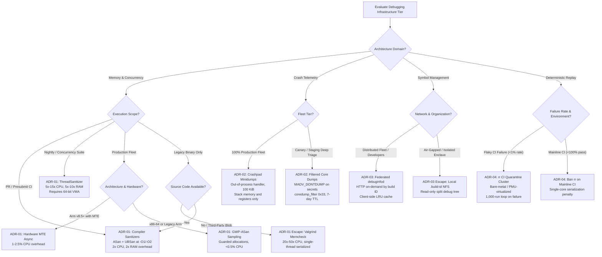
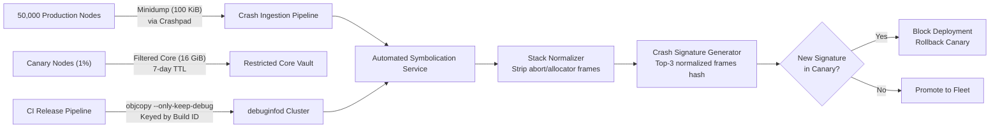

# Debugging Decision Records

> [!summary] Scope
> This playbook owns architectural decision records for debugging infrastructure at engineering organizational scale.
> It evaluates sanitizers versus Valgrind, full core dumps versus minidumps, debuginfod versus centralized symbol storage, and deterministic record-replay in CI.
> It provides default selections, flipping criteria, cost trade-offs, and migration paths across the entire debugging toolchain.

Memory and concurrency sanitizer internals are owned by [[Cpp-AddressSanitizer-and-LeakSanitizer-Internals]], [[Cpp-ThreadSanitizer-and-MemorySanitizer-Internals]], [[Cpp-UndefinedBehaviorSanitizer-and-UB-Field-Guide]], [[Cpp-HWASan-and-Hardware-Memory-Tagging]], and [[Rust-Miri-Sanitizers-Loom-and-Cargo-Fuzz]].
Dynamic binary translation mechanisms are owned by [[Cpp-Valgrind-Memcheck-Helgrind-and-DRD]].
Operating system crash capture mechanisms are owned by [[Core-Dumps-Minidumps-and-Crash-Reporting]], and manual crash triage is owned by [[Debug-a-Production-Crash-From-a-Core-Dump]].
Symbol indexing and client protocols are owned by [[Symbol-Servers-and-debuginfod]].
Deterministic execution recording engines are owned by [[Record-and-Replay-rr-UDB-and-Pernosco]].
This playbook owns the fleet-wide architectural standards, cost models, policy defaults, and operational migration paths across all four domains.

## Trigger and Symptoms

Activate this playbook when an engineering organization scales past fifty engineers, or when existing debugging workflows cause fleet-wide productivity and operational failures:

- Continuous Integration (CI) runtimes balloon because test suites execute under Valgrind, imposing 20x to 50x CPU slowdowns and serializing thread execution across multi-core runners.
- Pull request (PR) merge queues stall because flaky concurrency bugs evade detection during local compilation and trigger non-deterministic test failures in CI.
- Production hosts crash during fatal signal events, triggering unthrottled 64 GiB ELF core dumps that fill root disks, trigger cascading cluster evictions, and saturate cross-datacenter network links.
- Production crashes cannot be triaged or symbolicated because stripped release binaries lack embedded GNU build IDs, or because separate debug files were purged from ad-hoc artifact servers.
- Security and compliance audits flag full core dump storage as a critical vulnerability because raw process memory dumps expose plaintext customer data, session tokens, and cryptographic keys.
- Engineering teams waste thousands of hours attempting to reproduce rare production Heisenbugs through manual log injection rather than deterministic execution traces.

## Decision Tree



## Prerequisites

Before executing the migration steps, verify build system tooling, kernel parameters, and network access:

### Compiler and Build System Requirements

```bash
clang --version || gcc --version
rustc --version
cmake --version
```

- Clang 16.0.0 or higher, GCC 13.0.0 or higher, or Rust 1.75.0 or higher (as of 2026-11).
- Linker support for GNU build ID generation: GNU `ld` (binutils 2.38+) or LLVM `lld` (LLVM 16+).
- Stripping and splitting tools: `objcopy`, `strip`, and `eu-unstrip` (elfutils 0.188+).

### Kernel and Runtime Configuration

```bash
uname -r
cat /proc/sys/kernel/perf_event_paranoid
cat /proc/sys/kernel/core_pattern
```

- Linux kernel 5.15 or higher (x86-64 or AArch64).
- For deterministic replay nodes (rr): Intel Nehalem or newer CPU, or AMD Zen 3 or newer CPU (as of 2026-11).
- On hypervisors hosting replay runners: hardware Performance Monitoring Unit (PMU) virtualization enabled (e.g., KVM `pmu=on` or VMware vSphere virtualized CPU performance counters).
- `kernel.perf_event_paranoid` set to 1 or 0 to allow unprivileged hardware counter access for `perf_event_open`.

### Permissions and Network Egress

- Administrative (`sudo` or container root) access to set host sysctl values on triage and collection runners.
- Internal HTTP ingress to port 8002 for `debuginfod` servers, and egress to upstream distribution symbol servers (`https://debuginfod.ubuntu.com`, `https://debuginfod.fedoraproject.org`).
- S3 or blob storage bucket provisioned for Crashpad minidump ingestion and split DWARF archive storage.

## Commands and Numbers to Know

| Decision Dimension | Tool / Technology | Platform | CPU Overhead `(as of 2026-11)` | Memory Overhead `(as of 2026-11)` | Artifact Size | Enterprise Default Selection |
| :--- | :--- | :--- | :--- | :--- | :--- | :--- |
| Memory Safety | [[Cpp-AddressSanitizer-and-LeakSanitizer-Internals\|AddressSanitizer (ASan)]] | Linux, macOS | 1.5x - 2.5x (avg 1.73x) | 2x - 4x (avg 3.4x) | +30% binary size | Standard for PR presubmit unit/integration gates |
| Memory Safety | [[Cpp-Valgrind-Memcheck-Helgrind-and-DRD\|Valgrind Memcheck]] | Linux, macOS | 20x - 50x slowdown | 2x - 4x bloat | 0% (no recompile) | Banned from automated CI; manual developer fallback only |
| Concurrency | [[Cpp-ThreadSanitizer-and-MemorySanitizer-Internals\|ThreadSanitizer (TSan v2)]] | Linux, macOS | 5x - 15x slowdown | 5x - 10x bloat | +40% binary size | Dedicated nightly / quarantine concurrency suite |
| Memory Safety | [[Cpp-ThreadSanitizer-and-MemorySanitizer-Internals\|MemorySanitizer (MSan)]] | Linux | 2.5x - 4x slowdown | 2x - 3x bloat | +50% binary size | Opt-in for parsers; requires 100% instrumented libc++ |
| Memory Safety | [[Cpp-HWASan-and-Hardware-Memory-Tagging\|GWP-ASan (LLVM Scudo)]] | Linux, macOS | < 0.5% (unmeasurable) | Fixed pool (40-512 KiB) | < 1% binary size | Standard for 100% production fleet |
| Memory Safety | [[Cpp-HWASan-and-Hardware-Memory-Tagging\|Arm MTE (Async Mode)]] | Linux AArch64 | 1.0% - 2.5% | 0% (in-hardware) | 0% | Standard for Arm v8.5+ production fleet |
| Crash Telemetry | [[Core-Dumps-Minidumps-and-Crash-Reporting\|Crashpad Minidump]] | Both | < 10 ms write latency | Negligible | 50 KiB - 500 KiB | Standard for 100% production fleet |
| Crash Telemetry | [[Core-Dumps-Minidumps-and-Crash-Reporting\|Full Kernel ELF Core]] | Linux | 500 ms - 30 s I/O | 100% process RAM | 1 GiB - 256 GiB | Restricted canary and staging deep triage tier only |
| Symbol Delivery | [[Symbol-Servers-and-debuginfod\|Federated debuginfod]] | Linux | On-demand HTTP fetch | Client LRU cache | 0 MB in client repo | Standard across all developer and CI triage nodes |
| Symbol Delivery | Unindexed S3 Tarballs | Both | Manual unpack latency | Full archive unpack | Tens of gigabytes | Anti-pattern; deprecated across fleet |
| Determinism | [[Record-and-Replay-rr-UDB-and-Pernosco\|Mozilla rr]] | Linux x86-64 | 1.2x - 2.0x (compute) | Negligible | 10 MiB - 500 MiB/min | Dedicated flaky quarantine runner queue only |

## Step-by-Step Execution

Each step executes an Architectural Decision Record (ADR) across the engineering toolchain.
Run each step, verify the concrete output, and do not proceed if verification fails.

### Step 1: Establish ADR-01 (Memory and Concurrency Safety Standard)

Enforce compiler-based instrumentation over dynamic binary translation across the CI build system.
Ban Valgrind from presubmit CI matrices and configure ASan, UBSan, and TSan build profiles in the central build definition.

#### 1.1 Configure Clang/GCC Sanitizer Flags

For CMake-based repositories, add standard sanitizer configurations to the root `CMakeLists.txt`:

```bash
cat << 'EOF' > cmake/Sanitizers.cmake
function(enable_sanitizers TARGET_NAME)
  if(ENABLE_ASAN)
    target_compile_options(${TARGET_NAME} PRIVATE
      -fsanitize=address,undefined
      -fno-omit-frame-pointer
      -fno-common
      -g
      -O1
    )
    target_link_options(${TARGET_NAME} PRIVATE
      -fsanitize=address,undefined
    )
  elseif(ENABLE_TSAN)
    target_compile_options(${TARGET_NAME} PRIVATE
      -fsanitize=thread
      -fno-omit-frame-pointer
      -g
      -O2
    )
    target_link_options(${TARGET_NAME} PRIVATE
      -fsanitize=thread
    )
  elseif(ENABLE_MSAN)
    target_compile_options(${TARGET_NAME} PRIVATE
      -fsanitize=memory
      -fsanitize-memory-track-origins=2
      -fno-omit-frame-pointer
      -g
      -O2
    )
    target_link_options(${TARGET_NAME} PRIVATE
      -fsanitize=memory
    )
  endif()
endfunction()
EOF
```

#### 1.2 Configure Standard Runtime Sanitizer Options

Export standard sanitizer runtime flags in the base CI runner environment:

```bash
export ASAN_OPTIONS="detect_leaks=1:abort_on_error=1:fast_unwind_on_malloc=0:quarantine_size_mb=256:symbolize=1"
export UBSAN_OPTIONS="halt_on_error=1:abort_on_error=1:print_stacktrace=1"
export TSAN_OPTIONS="halt_on_error=1:abort_on_error=1:second_deadlock_stack=1"
```

#### 1.3 Audit and Deprecate Valgrind in CI Configurations

Run a repository sweep to ensure no automated workflow invokes Valgrind:

```bash
grep -rn "valgrind" .github/ .gitlab-ci.yml Jenkinsfile Makefile 2>/dev/null || true
```

**Verification:**
Compile a validation test target with `ENABLE_ASAN=ON` and run it:

```bash
clang -fsanitize=address,undefined -fno-omit-frame-pointer -g -O1 -o /tmp/asan_verify - << 'EOF'
#include <stdlib.h>
int main() {
    int *p = (int *)malloc(sizeof(int) * 10);
    free(p);
    return p[0]; // Heap use-after-free
}
EOF
/tmp/asan_verify 2>&1 | grep "AddressSanitizer: heap-use-after-free"
```

Expected output:
```text
==12345==ERROR: AddressSanitizer: heap-use-after-free on address 0x...
```

### Step 2: Establish ADR-02 (Production Crash Telemetry Standard)

Deploy Crashpad out-of-process minidump reporting across production workloads.
Restrict full kernel core dumps to isolated canary tiers with explicit memory filtering.

#### 2.1 Integrate Crashpad Client Initialization

In native C++ services, initialize the `crashpad::CrashpadClient` handler early in `main()`:

```cpp
#include "client/crashpad_client.h"
#include <base/files/file_path.h>
#include <string>
#include <vector>

bool InitCrashReporter() {
    base::FilePath handler("/usr/local/bin/crashpad_handler");
    base::FilePath reports_dir("/var/log/crashes");
    base::FilePath metrics_dir("/var/log/crashes/metrics");
    std::string url = "https://crash-ingest.internal.net/api/v1/minidumps";

    std::map<std::string, std::string> annotations = {
        {"service", "order-matcher"},
        {"env", "production"},
        {"version", "2.14.0"}
    };

    std::vector<std::string> arguments = {
        "--no-rate-limit"
    };

    crashpad::CrashpadClient client;
    return client.StartHandler(
        handler,
        reports_dir,
        metrics_dir,
        url,
        annotations,
        arguments,
        /*restartable=*/true,
        /*asynchronous_start=*/false
    );
}
```

#### 2.2 Configure Sysctl and Systemd for Canary Deep-Triage Nodes

For canary hosts designated for full memory inspection, enforce bounded kernel pipe settings:

```bash
sudo sysctl -w kernel.core_pattern="|/usr/lib/systemd/systemd-coredump %P %u %g %s %t 9223372036854775808 %h %d"
sudo sysctl -w kernel.core_pipe_limit=16
sudo sysctl -w fs.suid_dumpable=2
```

In `/etc/systemd/coredump.conf`, configure storage limits and disk quotas:

```ini
[Coredump]
Storage=external
Compress=yes
ProcessSizeMax=16G
ExternalSizeMax=16G
JournalSizeMax=767M
MaxUse=10%
KeepFree=15%
```

#### 2.3 Protect Customer Secrets via coredump_filter and madvise

Ensure sensitive applications configure memory filters to exclude shared and file-backed mappings:

```bash
# Set coredump_filter to 0x33: private anonymous, shared anonymous, ELF headers
echo 0x33 | sudo tee /proc/self/coredump_filter
```

In application memory pools storing authentication tokens or decryption keys, invoke `madvise`:

```c
#include <sys/mman.h>

void secure_buffer(void *addr, size_t length) {
    madvise(addr, length, MADV_DONTDUMP);
}
```

**Verification:**
Verify that Crashpad handler runs out-of-process and responds to signal dispatch:

```bash
ps aux | grep "[c]rashpad_handler"
cat /proc/sys/kernel/core_pattern
```

Expected output:
```text
root  4092  0.0  0.1  25480  8120 ?  Sl  10:00  0:00 /usr/local/bin/crashpad_handler ...
|/usr/lib/systemd/systemd-coredump %P %u %g %s %t 9223372036854775808 %h %d
```

### Step 3: Establish ADR-03 (Enterprise Symbol Distribution via debuginfod)

Configure the CI artifact pipeline to generate split DWARF binaries indexed by GNU build ID, and stand up a central `debuginfod` federation service.

#### 3.1 Build with Unique Build IDs and Extract Split Debug Information

Update production linker flags to emit 160-bit SHA-1 build identifiers:

```bash
# Link with build ID
gcc -O2 -g -Wl,--build-id=sha1 -o order_matcher order_matcher.c

# Extract debug information to standalone debug file
objcopy --only-keep-debug order_matcher order_matcher.debug

# Strip non-debug and debug symbols while preserving build-id note
strip --strip-debug order_matcher

# Add debuglink back to stripped binary
objcopy --add-gnu-debuglink=order_matcher.debug order_matcher
```

#### 3.2 Index and Organize Debug Files by Build ID

Verify the build ID and install the debug artifact into the local symbol repository:

```bash
BUILD_ID=$(eu-readelf -n order_matcher | grep "Build ID" | awk '{print $3}')
echo "Generated Build ID: ${BUILD_ID}"

DEBUG_DIR="/var/symbols/debuginfo/.build-id/${BUILD_ID:0:2}"
mkdir -p "${DEBUG_DIR}"
cp order_matcher.debug "${DEBUG_DIR}/${BUILD_ID:2}.debug"
```

#### 3.3 Deploy Federated debuginfod Server Daemon

Run the `debuginfod` server, pointing to the local symbol directory and federating with upstream distro mirrors:

```bash
export DEBUGINFOD_URLS="https://debuginfod.ubuntu.com https://debuginfod.fedoraproject.org"

debuginfod \
    -F \
    -d /var/symbols/debuginfod.sqlite \
    -p 8002 \
    -c "cache_clean_interval_s=86400,max_unused_age_s=604800" \
    /var/symbols/debuginfo &
```

#### 3.4 Configure Global Client Environment

Distribute `/etc/profile.d/debuginfod.sh` across all developer laptops, CI workers, and triage hosts:

```bash
cat << 'EOF' | sudo tee /etc/profile.d/debuginfod.sh
export DEBUGINFOD_URLS="https://debuginfod.internal.net:8002 https://debuginfod.ubuntu.com"
export DEBUGINFOD_TIMEOUT=60
export DEBUGINFOD_CACHE_PATH="${HOME}/.cache/debuginfod_client"
EOF
source /etc/profile.d/debuginfod.sh
```

In GDB configuration (`~/.gdbinit`), enable debuginfod client querying non-interactively:

```text
set debuginfod enabled on
```

**Verification:**
Query the standalone build ID using `debuginfod-find`:

```bash
debuginfod-find debuginfo "${BUILD_ID}"
```

Expected output:
```text
/home/runner/.cache/debuginfod_client/a73912f85f2bf7003f6d41b12c830c6c45e55c76/debuginfo
```

### Step 4: Establish ADR-04 (Deterministic Record-Replay CI Quarantine Pipeline)

Provision a dedicated, bare-metal CI execution pool for Mozilla `rr` deterministic replay, targeted strictly at flaky tests.

#### 4.1 Validate PMU Counter Capabilities on the Replay Host

Verify that the runner host supports retired conditional branch performance counters:

```bash
sudo sysctl -w kernel.perf_event_paranoid=1

# Verify perf counter access for retired conditional branches
perf stat -e r5101c4 true 2>&1 | grep "r5101c4"
```

#### 4.2 Configure the Automated Flaky Test Replay Harness

In the CI pipeline runner, trigger `rr record` in a loop when a quarantined flaky test fails:

```bash
cat << 'EOF' > run_flaky_quarantine.sh
#!/usr/bin/env bash
set -euo pipefail

TEST_BINARY="$1"
MAX_ATTEMPTS=500
RUN_COUNT=0

echo "Starting flaky reproduction loop for ${TEST_BINARY} under rr..."

while [ ${RUN_COUNT} -lt ${MAX_ATTEMPTS} ]; do
    RUN_COUNT=$((RUN_COUNT + 1))
    
    # Run under rr recording
    if ! rr record --num-cores=1 "${TEST_BINARY}" > /tmp/test_output.log 2>&1; then
        echo "Flaky bug reproduced on attempt ${RUN_COUNT}!"
        
        # Identify the latest rr trace directory
        LATEST_TRACE=$(ls -td ~/.local/share/rr/* | head -n 1)
        
        # Pack the trace so it is portable across machines
        rr pack "${LATEST_TRACE}"
        
        # Compress and upload to trace vault
        tar -czf "/tmp/flaky_trace_${RUN_COUNT}.tar.gz" -C "$(dirname "${LATEST_TRACE}")" "$(basename "${LATEST_TRACE}")"
        echo "Trace packed and saved: /tmp/flaky_trace_${RUN_COUNT}.tar.gz"
        exit 0
    fi
done

echo "Test passed ${MAX_ATTEMPTS} times without reproducing."
exit 1
EOF
chmod +x run_flaky_quarantine.sh
```

**Verification:**
Record and replay a test crash with `rr`:

```bash
rr record /tmp/asan_verify 2>&1 | grep "Record done" || true
rr replay -q -x /dev/null -ex "bt" -ex "q"
```

Expected output:
```text
#0  0x... in main ()
Program received signal SIGSEGV, Segmentation fault.
```

### Step 5: Audit and Enforce Fleet Migration Compliance

Deploy an automated CI policy checker to validate that all repository pull requests adhere to ADR-01 through ADR-04.

```bash
cat << 'EOF' > scripts/check_debug_compliance.sh
#!/usr/bin/env bash
set -euo pipefail

BIN="$1"

# Check 1: Ensure GNU Build ID is present
if ! eu-readelf -n "${BIN}" | grep -q "Build ID"; then
    echo "FAIL: Binary ${BIN} missing GNU Build ID!"
    exit 1
fi

# Check 2: Ensure binary is stripped of heavy debuginfo
if eu-readelf -S "${BIN}" | grep -q "\.debug_info"; then
    echo "FAIL: Binary ${BIN} contains unstripped .debug_info sections!"
    exit 1
fi

# Check 3: Ensure build ID is queryable in debuginfod
BUILD_ID=$(eu-readelf -n "${BIN}" | grep "Build ID" | awk '{print $3}')
if ! debuginfod-find debuginfo "${BUILD_ID}" >/dev/null 2>&1; then
    echo "FAIL: Debug info for build ${BUILD_ID} not published to debuginfod!"
    exit 1
fi

echo "SUCCESS: Binary ${BIN} meets all enterprise debugging standards."
exit 0
EOF
chmod +x scripts/check_debug_compliance.sh
```

**Verification:**
Run the compliance script against the built artifact:

```bash
./scripts/check_debug_compliance.sh order_matcher
```

Expected output:
```text
SUCCESS: Binary order_matcher meets all enterprise debugging standards.
```

## Rollback Procedure

If any architectural decision introduces unexpected operational regressions, execute these rollback protocols:

### Rollback ADR-01 (Sanitizer Build Reversion)

If ASan or TSan causes excessive memory exhaustion on CI runners or conflicts with custom virtual memory allocators:
1. Revert CI pipeline flags by unsetting `ENABLE_ASAN=ON` and `ENABLE_TSAN=ON` in the pipeline environment.
2. In CMake configurations, set `-DENABLE_ASAN=OFF -DENABLE_TSAN=OFF`.
3. If an emergency allocator collision occurs in staging, disable ASan leak detection and quarantine via runtime options:
   ```bash
   export ASAN_OPTIONS="detect_leaks=0:quarantine_size_mb=0"
   ```
4. Verification: Run `objdump -p <binary> | grep asan` and ensure `libclang_rt.asan` is not linked.

### Rollback ADR-02 (Crashpad to Kernel Core Dump Fallback)

If the out-of-process `crashpad_handler` crashes, deadlocks, or fails to initialize:
1. Disable in-app Crashpad initialization via feature flag or environment variable `DISABLE_CRASHPAD=1`.
2. Restore standard systemd kernel core pattern on the host:
   ```bash
   sudo sysctl -w kernel.core_pattern="|/usr/lib/systemd/systemd-coredump %P %u %g %s %t 9223372036854775808 %h %d"
   ```
3. Remove systemd coredump storage caps if core truncation occurs:
   ```bash
   sudo sed -i 's/ProcessSizeMax=16G/ProcessSizeMax=32G/' /etc/systemd/coredump.conf
   sudo systemctl daemon-reload
   ```
4. Verification: Send `kill -SIGSEGV $$` in a test subshell and confirm entry in `coredumpctl list`.

### Rollback ADR-03 (debuginfod Server Outage Fallback)

If the internal `debuginfod` cluster suffers a database lockup, outage, or network partition:
1. Temporarily unset client environment variables across developer workstations:
   ```bash
   unset DEBUGINFOD_URLS
   ```
2. In GDB, disable debuginfod client requests to prevent CLI hang:
   ```text
   (gdb) set debuginfod enabled off
   ```
3. Fall back to manual local `.build-id` symbol root:
   ```bash
   gdb -iex "set debug-file-directory /var/symbols/backup_debug_root:/usr/lib/debug" ./app
   ```
4. Verification: Confirm GDB starts without querying network endpoints or hanging on HTTP connect.

### Rollback ADR-04 (rr Runner Deprovisioning)

If hypervisor migrations break PMU performance counter virtualization:
1. Evict the affected test runner from the `rr-quarantine` pool in the CI orchestrator configuration.
2. Re-enable standard multi-threaded testing on the runner by disabling `rr record`.
3. Verification: Verify that `perf stat -e instructions true` runs without returning `EOPNOTSUPP` or `ENOENT`.

## Failure Modes of the Procedure

| Failure Mode | Root Cause Mechanism | Observable Symptom | Remediation Runbook |
| :--- | :--- | :--- | :--- |
| ASan Shadow Memory Collision | Custom allocator (e.g., jemalloc) maps fixed virtual memory in ASan shadow range (`0x00007fff8000` to `0x10007fff8000`). | Immediate crash on startup with `AddressSanitizer: CHECK failed: ... AddressSanitizer shadow memory range overlaps with an existing mapping`. | Link custom allocators with ASan hooks enabled, or configure `mmap` base addresses above `0x10007fff8000`. |
| TSan 48-bit VMA Exhaustion | TSan v2 requires 48-bit virtual address space; running on older kernels with 39-bit or 57-bit 5-level paging fails. | Process aborts immediately: `FATAL: ThreadSanitizer: unexpected memory layout 0x...`. | Upgrade host kernel to 5.15+ with standard 48-bit VMA, or compile with `-fsanitize=thread` using Clang 18+ supporting 5-level paging. |
| MSan False Positives from Uninstrumented Libraries | Application links against dynamic system `libc++` or `libcrypto` built without MSan instrumentation. | Uninitialized memory read errors reported deep inside standard library containers: `MemorySanitizer: use-of-uninitialized-value`. | Rebuild all transitive dependencies and `libc++` from source using `clang++ -fsanitize=memory`, or switch to ASan. |
| Minidump Stack Truncated | Stack pointer was corrupted or pushed past the registered thread stack boundary at time of crash. | Stackwalk displays only `#0 0x0000000000000000 in ?? ()` with zero caller frames. | Configure Crashpad to capture auxiliary memory ranges, or promote service to Canary Full Core tier for deep triage. |
| debuginfod Database Lock Contention | Multiple CI pipelines execute bulk concurrent writes to `debuginfod.sqlite` without Write-Ahead Logging (WAL). | Server responds with HTTP 500; log shows `sqlite3_step failed: database is locked`. | Enable SQLite WAL mode: `sqlite3 /var/symbols/debuginfod.sqlite 'PRAGMA journal_mode=WAL;'`, or use separate read-replicas. |
| debuginfod Build ID Collision | Build systems use non-deterministic timestamps or zero-salted hash algorithms for `.note.gnu.build-id`. | Mismatched source lines and wrong disassembly displayed in GDB during symbol lookup. | Force cryptographic hash algorithm in linker: `-Wl,--build-id=sha1` or `-Wl,--build-id=0x...` derived from git tree hash. |
| rr PMU Counter Virtualization Missing | Cloud VM hypervisor does not pass through Intel/AMD hardware performance counters to guest OS. | `rr record` fails on launch: `FATAL: Could not open perf event for retired conditional branches: Permission denied (errno 13)`. | Migrate rr quarantine workers to bare-metal instances (e.g., AWS `.metal` instances) or enable `nested_virtualization` with PMU counters. |
| rr Recording Spinlock Hang | Multi-threaded code uses busy-waiting spinlocks; rr single-core serialization starves the lock-holding thread. | Test execution times out; recording never terminates. | Replace bare spinlocks with futex-backed primitives (`std::mutex`), or set `rr record --bind-cpu` with yield timeouts. |

## Pitfalls

> [!warning] The Valgrind in CI Anti-Pattern
> Running Valgrind Memcheck in automated CI pipelines is the single largest source of test queue inflation in legacy systems.
> Valgrind translates machine instructions to VEX IR and serializes all threads under a single global mutex lock.
> This imposes a 20x to 50x CPU execution penalty and completely eliminates multi-core concurrency bugs, masking real race conditions that appear in production.
> Compiler sanitizers (ASan, TSan, UBSan) execute at native multi-core speeds with only 1.5x to 2.5x overhead, catching vastly more defects per dollar of compute.

> [!warning] Storing Unindexed Full Core Dumps in S3
> Uploading raw 32 GiB to 128 GiB kernel ELF core dumps to cloud storage buckets without indexing by GNU build ID creates massive storage invoices with zero triage utility.
> A full core dump without its matching split debug file cannot resolve function names, arguments, or source code lines.
> Furthermore, un-redacted core dumps violate data privacy compliance (GDPR, SOC2, PCI-DSS) by persisting plaintext secrets.
> Enforce Crashpad minidumps (100 KiB) as the corporate standard, and restrict full cores to canary clusters with mandatory `MADV_DONTDUMP` annotations and 7-day lifecycle deletion rules.

> [!warning] Rebuilding From Source Instead of Archiving Symbols
> Never attempt to debug a production crash by checking out "the same git commit" and recompiling locally.
> Compiler version differences, build path variations, macro expansions, and timestamps alter the resulting binary layout, producing a completely different GNU build ID or Mach-O UUID.
> GDB and LLDB will reject the resulting debug file or display corrupted stack frames.
> Symbols must be extracted and archived at the exact moment the release artifact is linked in CI, keyed strictly by the binary's embedded build ID.

> [!warning] Attempting rr Replay on Virtualized Cloud Instances
> Mozilla `rr` requires access to the CPU's hardware performance monitoring unit via `perf_event_open` to count retired conditional branches (`BR_INST_RETIRED.CONDITIONAL`).
> Standard virtual machines on AWS EC2, Google Cloud, or Azure do not virtualize PMU registers by default, causing `rr` to fail immediately.
> Do not schedule `rr` replay jobs across general-purpose cloud VM pools; route them to bare-metal worker nodes or specifically configured hypervisors with PMU pass-through.

> [!warning] Deploying MSan Without Recompiling Dependencies
> MemorySanitizer tracks uninitialized memory at bit-level precision across all registers and memory locations.
> If an MSan-instrumented binary calls into an uninstrumented shared library (such as system `glibc` or dynamic `libcrypto.so`), memory written by the uninstrumented code is not marked as initialized in shadow memory.
> The next time your application reads that memory, MSan will report a false-positive `use-of-uninitialized-value` fatal error.
> MSan must only be used in hermetic environments where all linked libraries are compiled from source with `-fsanitize=memory`.

## At Scale

At 1,000 to 50,000 engineers, debugging ceases to be a local developer workstation activity and becomes a distributed data processing problem governed by compute economics, storage budgets, and automated gate enforcement.



### Compute and Storage Economics Formula

Consider an organization running 10,000 CI test runs per day and managing 5,000 production microservice containers:

#### CI Memory Validation Economics

- **Valgrind Strategy:** 10,000 test runs x 10 minutes average native runtime x 30x Valgrind slowdown = 3,000,000 compute minutes (50,000 core-hours daily).
- **AddressSanitizer Strategy:** 10,000 test runs x 10 minutes native runtime x 1.7x ASan slowdown = 170,000 compute minutes (2,833 core-hours daily).
- **Economic Differential:** Eliminating Valgrind in favor of ASan saves over 47,000 core-hours per day in CI infrastructure spend, while restoring multi-core concurrency detection.

#### Production Crash Storage Economics

- **Unthrottled Full Core Strategy:** 50 daily service crashes across fleet x 32 GiB average memory footprint = 1,600 GiB (1.6 TiB) daily storage ingress.
  Over 30 days, unindexed core storage accumulates 48 TiB of unstructured data, costing substantial cloud storage budgets while generating severe disk I/O penalties during service death.
- **Crashpad Minidump Strategy:** 50 daily crashes x 200 KiB minidump size = 10 MiB daily storage ingress.
  Over 30 days, total crash storage consumes 300 MiB.
- **Economic Differential:** Minidump capture reduces fleet crash telemetry storage by a factor of 160,000x, while reducing crash capture latency from 15 seconds to under 10 milliseconds.

### Automated Crash Signature Normalization and Rollout Gates

At scale, crash reports must not be triaged manually by humans.
The crash ingestion pipeline must automate signature generation:
1. Ingest the minidump and resolve symbols via the internal `debuginfod` cluster using the module's GNU build ID.
2. Strip non-informative top frames from the unwound call stack:
   - Kernel entry and signal delivery frames: `__restore_rt`, `_sigtramp`.
   - Abort and termination helpers: `abort`, `raise`, `__assert_fail`, `std::terminate`.
   - Memory allocator wrappers: `malloc`, `free`, `operator new`, `__asan_report_error`.
3. Concatenate the top three remaining application function signatures (function name, relative instruction offset bucket, and source file stem).
4. Compute an MD5 or SHA-256 hash over this normalized tuple:
   $$\text{CrashSignature} = \text{SHA256}(F_0 \,\|\, F_1 \,\|\, F_2)$$
5. Track signature occurrence rates in canary deployments: if a canary deployment emits a crash signature that has never been recorded in the baseline production fleet, the CD orchestrator immediately halts rollout and triggers an automatic rollback.

## Practice Drill

> [!tip] Practice Drill: Audit and Transition a Toy Toolchain
> Construct a local scratch repository containing an intentionally buggy C++ program with a heap-use-after-free and a multi-threaded data race.
> 1. Set up a legacy Makefile that executes the test target under Valgrind Memcheck.
>    Time the execution with `time make test` and note the wall-clock time and the single-core CPU utilization in `top`.
> 2. Refactor the Makefile to compile the target under `-fsanitize=address,undefined` for the unit test target, and `-fsanitize=thread` for the concurrency test target.
> 3. Measure the execution time of the sanitizer suite: verify that runtime overhead drops by at least 10x compared to Valgrind, and observe the exact ASan error trace identifying the allocation and free stack frames.
> 4. Split debug info from the binary using `objcopy --only-keep-debug` and `strip --strip-debug`, ensuring the binary retains `.note.gnu.build-id`.
> 5. Launch a local `debuginfod` server indexing the split debug artifact on port 8002.
> 6. Configure `DEBUGINFOD_URLS="http://localhost:8002"` and run GDB against the stripped binary in batch mode; prove that GDB retrieves debug symbols on-demand and displays full source lines.
> Target completion time: 30 minutes.

## Interview Questions

> [!question] L5
> An engineering team proposes running Valgrind Memcheck on every commit in continuous integration to catch memory bugs.
> What are the primary technical and operational reasons to reject this proposal in favor of compiler sanitizers?
>
> > [!success]- Answer
> > Valgrind uses Dynamic Binary Translation (VEX IR) to instrument machine instructions at runtime, incurring a 20x to 50x CPU slowdown and 2x to 4x memory bloat.
> > More critically, Valgrind serializes execution across all threads under a single internal mutex lock, preventing true simultaneous multi-core execution and masking race conditions.
> > Compiler-based AddressSanitizer (ASan) instruments memory accesses at compile time, operating with only 1.5x to 2.5x CPU slowdown, which is fast enough to run on every presubmit pull request.
> > ASan preserves multi-threaded scheduling interleavings and integrates cleanly with ThreadSanitizer (TSan) for dedicated concurrency verification.

> [!question] L5
> What is the architectural difference between a Linux kernel ELF core dump and a Crashpad minidump, and why does a fleet default to minidumps?
>
> > [!success]- Answer
> > A Linux kernel ELF core dump captures the entire mapped address space of the process (subject to `coredump_filter`), resulting in file sizes ranging from gigabytes to hundreds of gigabytes.
> > Capturing full cores causes heavy disk I/O, potential disk exhaustion, process suspension delays, and privacy risks by storing plaintext secrets in heap memory.
> > A Crashpad minidump is written out-of-process by a monitoring daemon and captures only thread registers, thread stack frames (8 to 32 KiB per thread), loaded module metadata with build IDs, and exception records.
> > Minidump generation takes less than 10 milliseconds, produces 50 to 500 KiB artifacts suitable for central HTTP telemetry, and protects customer data by omitting the general heap.

> [!question] L6
> Why must an organization use `debuginfod` rather than downloading tarballs of debug symbols from an artifact repository, and how does `debuginfod` resolve symbols?
>
> > [!success]- Answer
> > Traditional artifact repositories require developers and CI triage pipelines to manually locate, download, and extract multi-gigabyte symbol tarballs for every service version.
> > `debuginfod` operates over standard HTTP/HTTPS using the binary's unique cryptographic GNU build ID (from `.note.gnu.build-id`).
> > Debuggers (GDB, LLDB) and profilers (`perf`) transparently query endpoints such as `/buildid/<HEX>/debuginfo` and `/buildid/<HEX>/source/<PATH>` on demand.
> > It fetches only the specific debug ELF or source files required for the current backtrace, caches them locally in `~/.cache/debuginfod_client` using LRU eviction, and federates requests across upstream distribution mirrors.

> [!question] L6
> Predict the output: A release binary was compiled with `-O2 -g -Wl,--build-id=sha1` and stripped using `strip --strip-all`.
> You inspect the binary using `eu-unstrip -n` and GDB batch mode, both with and without `DEBUGINFOD_URLS` configured.
> What does each command output?
>
> > [!success]- Answer
> > Running `eu-unstrip -n -e ./app` outputs:
> > `0x... 40-digit-hex-build-id@0x... . - app`
> > The period indicates the binary is present, but the dash indicates no debug information was found locally on disk.
> > Without `DEBUGINFOD_URLS`, running `gdb -batch -ex "file ./app" -ex "info functions"` outputs:
> > `All defined functions:` followed by `None` or dynamic symbols only, and backtraces show `?? ()` because `.symtab` and `.debug_info` are absent.
> > With `DEBUGINFOD_URLS` set and debuginfod enabled, GDB prints:
> > `Downloading separate debug info for ./app...`
> > GDB downloads the file to `~/.cache/debuginfod_client/<build-id>/debuginfo`, reads DWARF data, and displays complete function signatures and source line numbers.

> [!question] L6
> Debug this: A team enables MemorySanitizer (`-fsanitize=memory`) on a backend C++ application.
> The program immediately crashes on startup with:
> `==1042==WARNING: MemorySanitizer: use-of-uninitialized-value`
> The backtrace points inside `std::string::operator=` within standard library code, even though the application explicitly initialized all local variables.
> What is the root cause and how must the architecture be corrected?
>
> > [!success]- Answer
> > The application was compiled with MSan, but it dynamically linked against the system's uninstrumented `libc++.so` or `libstdc++.so`.
> > MemorySanitizer relies on shadow memory to track every initialized bit of memory.
> > When uninstrumented standard library functions allocate or write memory, they do not update MSan's shadow memory table.
> > When the instrumented application code subsequently reads that memory, MSan detects the shadow bits as uninitialized and reports a false positive.
> > To fix this, the team must rebuild the entire C++ runtime library (`libc++` and `libc++abi`) from source using `-fsanitize=memory` and link against that instrumented runtime, or switch the presubmit gate to AddressSanitizer.

> [!question] L7
> Design an enterprise-wide automated crash reporting and symbolication pipeline for a fleet of 25,000 microservices running in Kubernetes.
> Detail client capture, telemetry transport, symbol retrieval, signature clustering, and deployment gating.
>
> > [!success]- Answer
> > 1. Client Capture: Link each service with the Crashpad client; a companion container or node daemon runs `crashpad_handler`.
> > On fatal signals, the handler writes a 100 KiB minidump containing registers, stack memory, and module build IDs.
> > 2. Transport: The handler uploads minidumps over HTTPS to an internal crash ingestion gateway with rate-limiting and token authentication.
> > 3. Symbol Storage: CI release builds split symbols with `objcopy --only-keep-debug`, upload debug files to object storage keyed by GNU build ID, and register them with an internal `debuginfod` cluster.
> > 4. Symbolication: Central symbolication workers run `minidump_stackwalk` or LLVM symbolizers, fetching DWARF symbols on-demand from `debuginfod`.
> > 5. Clustering: The stackwalker extracts the top application frames, discards abort/signal/allocator frames, and hashes the top three normalized frames into an MD5/SHA-256 crash signature.
> > 6. Deployment Gating: Continuous delivery pipelines query the crash telemetry database during canary rollout.
> > If a canary instance registers a novel crash signature, the deployment pipeline halts and triggers an immediate rollback.

> [!question] L7
> Why is Mozilla `rr` unsuited for 100% of mainline CI test executions, and how should an organization architect a deterministic replay service for flaky tests?
>
> > [!success]- Answer
> > Mozilla `rr` achieves deterministic record-and-replay by serializing multi-threaded execution onto a single logical CPU core and intercepting all asynchronous events via PMU counters (`perf_event_open`).
> > Enforcing single-core execution on all CI tests would multiply total fleet test duration by 4x to 10x, bottlenecking developer productivity and inflating cloud compute costs.
> > Furthermore, `rr` requires hardware PMU counter virtualization, which standard cloud VMs lack.
> > The correct architectural design is a quarantined replay pipeline: mainline CI runs uninstrumented or under ASan at full multi-core speed.
> > When a test is flagged as flaky (<1% failure rate), it is quarantined to a dedicated pool of bare-metal runners equipped with PMU access.
> > The runner executes the flaky test in an automated 500-iteration `rr record` loop until failure occurs, packs the trace with `rr pack`, and uploads the artifact for developer inspection.

> [!question] L8+
> A high-frequency trading matching engine requires sub-microsecond latency and cannot tolerate the 1.7x CPU overhead of ASan or the 100 KiB stack dump pause of Crashpad in production.
> Formulate a multi-tier memory safety and crash diagnostic strategy across development, canary, and production trading nodes.
>
> > [!success]- Answer
> > 1. Development & PR Gates: Compile full unit and algorithmic test suites with Clang ASan + UBSan and TSan in CI.
> > Enforce 100% pass rates prior to merging code to trunk.
> > 2. Staging / Replay Simulation: Execute matching engines under high-throughput simulated market data feeds using hardware Arm Memory Tagging Extension (MTE) in synchronous mode (10-20% overhead) or Clang HWASan to validate zero memory corruption under heavy load.
> > 3. Production Canary Tier: Deploy Arm v8.5+ hardware using MTE in Asynchronous Mode.
> > Async MTE incurs only 1% to 2.5% CPU overhead and catches use-after-free and buffer overflows at context-switch boundaries, terminating the process with `SEGV_MTEAERR`.
> > 4. Production Trading Core: For ultra-low-latency nodes where even 1% overhead is unacceptable, deploy GWP-ASan sampling inside the memory allocator (e.g., TCMalloc or Scudo) with a low sampling frequency (e.g., 1 in 10,000 allocations guarded).
> > Overhead is unmeasurable (<0.1%).
> > 5. Crash Telemetry: Disable in-process crash hooks.
> > Configure the Linux kernel with `core_pattern` piping to a memory-mapped ring buffer or low-priority background collector, using `coredump_filter 0x1` (anonymous private mappings only) and tagging high-frequency memory buffers with `MADV_DONTDUMP`.

## Further Reading

- Konstantin Serebryany et al., AddressSanitizer: A Fast Address Sanity Checker (USENIX ATC 12), https://www.usenix.org/conference/atc12/technical-sessions/presentation/serebryany.
  Foundational research establishing compile-time shadow memory instrumentation and the 1.7x execution slowdown benchmark.
- Nicholas Nethercote and Julian Seward, Valgrind: A Framework for Heavyweight Dynamic Binary Instrumentation (PLDI 07), https://doi.org/10.1145/1250734.1250746.
  The design and performance trade-offs of dynamic binary translation and VEX IR shadow memory.
- Robert O'Callahan et al., Engineering Record And Replay For Deployability (arXiv:1705.05937), https://arxiv.org/abs/1705.05937.
  Detailed technical design of Mozilla rr, hardware performance counters, and replay determinism.
- elfutils debuginfod Documentation, https://sourceware.org/elfutils/Debuginfod.html.
  Reference architecture for HTTP-based build ID symbol federation and client caching.
- The Chromium Projects, Crashpad Overview Design, https://chromium.googlesource.com/crashpad/crashpad/+/HEAD/doc/overview_design.md.
  Architectural specification for out-of-process minidump crash reporting on modern desktop and server platforms.
- Google LLC, GWP-ASan Documentation, https://llvm.org/docs/GwpAsan.html.
  Design and deployment parameters for sampling-based allocation sanity checks in production fleets.
- Free Software Foundation, Debugging with GDB: Separate Debug Files, https://sourceware.org/gdb/current/onlinedocs/gdb.html/Separate-Debug-Files.html.
  Technical specification for `.note.gnu.build-id` and `.gnu_debuglink` symbol matching.

## Related

- Prerequisites: [[Core-Dumps-Minidumps-and-Crash-Reporting]], [[Symbol-Servers-and-debuginfod]], [[Record-and-Replay-rr-UDB-and-Pernosco]]
- Next: [[Debugging-Expert-Defaults-gdbinit-and-lldbinit]]
- See also: [[Debug-a-Production-Crash-From-a-Core-Dump]], [[Cpp-AddressSanitizer-and-LeakSanitizer-Internals]], [[Cpp-Valgrind-Memcheck-Helgrind-and-DRD]]
