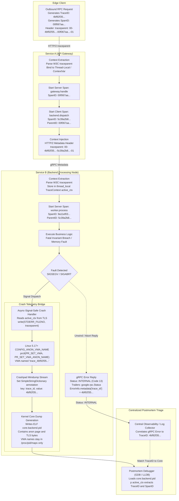
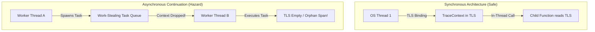
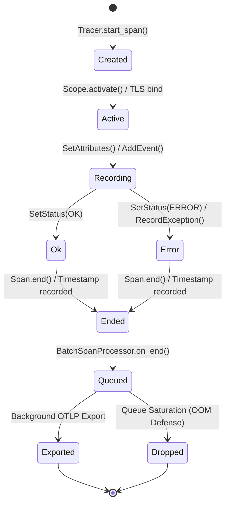
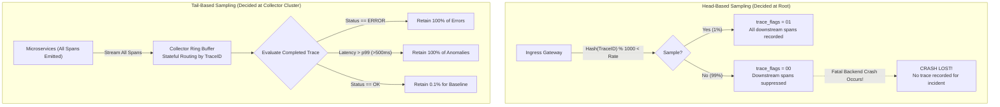
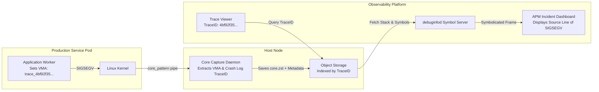

# Debugging Distributed Systems with Traces and Correlation

> [!summary] Scope
> This note owns cross-process debugging methodologies using W3C Trace Context, distributed span propagation, and log correlation IDs.
> It reaches the Use, Explain, and Decide rungs by tracing causality across RPC boundaries and linking distributed transaction failures to local process core dumps.
> It connects local crash analysis in Core-Dumps-Minidumps-and-Crash-Reporting with system design observability in existing vault notes.

> [!summary] Claim:
> Distributed tracing preserves causal graphs across RPC boundaries by injecting and extracting standardized 128-bit trace identifiers and 64-bit parent span identifiers using the W3C `traceparent` wire specification.
> Inside a single process, context must survive asynchronous continuation boundaries via thread-local storage, Python context variables, or Tokio task-local state, while batch span processors decouple recording from the hot request path.
> Production postmortem debugging bridges distributed transactions to local process core dumps by embedding active trace identifiers into async-signal-safe crash logs, Linux anonymous VMA names via `prctl(PR_SET_VMA_ANON_NAME)` (visible in `/proc/<pid>/maps`, which a `core_pattern` pipe handler must save, because the ELF core does not record them), and Crashpad minidump annotations.
> At scale, tail-based sampling and deterministic trace hashing prevent telemetry data explosions while ensuring that every transaction failure and tail-latency excursion retains complete end-to-end diagnostic visibility.



## The Mechanism

Distributed debugging differs fundamentally from single-node debugging.
In a monolithic application running under a debugger, causality is preserved directly by the operating system thread stack and memory address space.
When a transaction spans multiple networked processes, asynchronous event loops, message queues, and physical machines, the call stack is fragmented across operating system boundaries.
Without explicit causal propagation, an HTTP 500 error or gRPC `DEADLINE_EXCEEDED` observed at an edge gateway cannot be linked to the backend service that timed out, panicked, or dumped core.
Solving this failure mode requires three tightly integrated toolchain mechanisms:
1. Standardized wire context propagation across network boundaries using the W3C Trace Context and Baggage specifications.
2. In-process context propagation that preserves causal tokens across asynchronous tasks, thread pools, and event loops.
3. Postmortem crash correlation mechanisms that bridge high-level distributed span contexts to low-level operating system artifacts, including Linux ELF core dumps and Crashpad minidumps.

### 1. The W3C Trace Context Specification and Wire Representation

Historical distributed tracing implementations relied on mutually incompatible, vendor-specific HTTP headers.
Zipkin introduced the `X-B3-TraceId` and `X-B3-SpanId` B3 specification.
Jaeger utilized `uber-trace-id`.
AWS deployed `X-Amzn-Trace-Id`.
When a request traversed microservices instrumented with disparate vendor libraries, context propagation broke immediately.
The World Wide Web Consortium (W3C) resolved this incompatibility with the W3C Trace Context Recommendation (finalized November 2021).
The standard defines two mandatory HTTP/2 and HTTP/1.1 headers: `traceparent` and `tracestate`.

#### The `traceparent` Header Grammar and Binary Semantics

The `traceparent` header is a 55-character, hyphen-delimited ASCII string consisting of four positional fields:

$$\text{traceparent} = \text{version} \text{ "-"} \text{ trace-id} \text{ "-"} \text{ parent-id} \text{ "-"} \text{ trace-flags}$$

The layout enforces strict field lengths and character constraints:
- `version` (2 hexadecimal characters): Defines the specification version.
  Version `00` is the current normative standard.
  If a parser encounters version `ff`, it must reject the header as invalid.
  If a parser encounters a version higher than `00` (for example, `01`), it must not parse a header shorter than 55 characters; otherwise it parses the three known fields, checking that `trace-id` and `parent-id` are hex and each followed by a dash and that the two flag characters are followed by either the end of the string or a dash, and uses those values while ignoring anything after them (W3C Trace Context Level 1, versioning of `traceparent`).
  For version `00`, the header length must be exactly 55 characters; any deviation requires immediate rejection.
- `trace-id` (32 hexadecimal characters): A 16-byte (128-bit) array representing the globally unique transaction identifier.
  Every span belonging to the same distributed transaction shares this exact identifier.
  The specification strictly forbids an all-zero trace identifier (`00000000000000000000000000000000`); parsers must reject it as invalid.
- `parent-id` (16 hexadecimal characters): An 8-byte (64-bit) array representing the identifier of the caller's span (the parent span of the receiving service).
  The specification strictly forbids an all-zero parent identifier (`0000000000000000`).
- `trace-flags` (2 hexadecimal characters): An 8-bit bitmap controlling downstream tracing behavior.
  Bit 0 (`0x01`) is the `sampled` flag (also termed the `recorded` flag).
  When set to `1`, the caller has marked the trace for recording and export, instructing downstream services to preserve and export their child spans.
  When set to `0`, the trace is not sampled, and downstream services should suppress trace generation unless an independent local sampling rule overrides it.
  Bits 1 through 7 are reserved in Level 1: vendors MUST set them to `0`, and set unknown flags to `0` on outgoing requests.
  Trace Context Level 2 (W3C Candidate Recommendation Draft, 28 March 2024, as of 2026-11) assigns bit 1 (`0x02`) to the `random-trace-id` flag, which asserts that the right-most 7 bytes of the `trace-id` are random.

An example compliant `traceparent` header is:

```http
traceparent: 00-4bf92f3577b34da6a3ce929d0e0e4736-00f067aa0ba902b7-01
```

#### The `tracestate` Header

While `traceparent` enforces universal tracing invariants, `tracestate` provides a standard mechanism for vendor-specific metadata propagation.
It consists of a comma-separated list of opaque key-value pairs (`vendor1=opaqueValue,vendor2=opaqueValue`).
The specification sets one hard limit and one propagation floor:
1. A maximum of 32 key-value list members.
2. Vendors SHOULD propagate at least 512 characters of the combined header, counting commas and optional whitespace; 512 is a minimum to propagate, not a maximum length.

Keys are either simple identifiers (such as `congo`) or multi-tenant keys of the form `tenant-id@system-id`.
When a proxy or service receives `tracestate`, it must preserve all entries belonging to upstream vendors.
If the service modifies its own vendor entry, it SHOULD move that entry to the front (left-most position) of the list to establish recency.

#### W3C Baggage vs Trace Context

The W3C Baggage specification (W3C Candidate Recommendation Snapshot, 30 May 2024, as of 2026-11) defines an independent companion header (`baggage: userId=alice,serverNode=iad-04`).
Platforms must propagate all list members when the header holds at most 64 members and 8192 bytes; beyond that they may drop whole members.
Unlike `traceparent`, which is reserved strictly for distributed tracing infrastructure, Baggage carries user-defined, cross-cutting application metadata.
Baggage travels alongside the trace context across RPC hops and is readable by application business logic.
Baggage key-value pairs do not alter span causality, do not trigger sampling decisions, and must never be conflated with span attributes.

### 2. In-Process Context Propagation and Asynchronous Continuations

Once an incoming RPC arrives, the server must extract the W3C `traceparent` header from the transport carrier (HTTP headers, gRPC metadata, or Kafka message headers) and store it in execution context.
In traditional synchronous, thread-per-request architectures, context storage is straightforward: the application binds the active span context to Thread-Local Storage (TLS).
In modern high-performance architectures, however, concurrency is decoupled from operating system threads through asynchronous event loops, coroutines, thread pools, and work-stealing schedulers.
This architectural shift introduces the most prevalent failure mode in distributed telemetry: context loss across asynchronous continuation boundaries.



#### Synchronous Thread-Local Storage

In C++ and POSIX systems, synchronous thread-local variables are declared via `thread_local` (C++11) or `__thread` (GNU C).
The compiler assigns thread-local symbols to specific ELF sections (`.tbss` and `.tdata`).
When accessing a `thread_local` variable, the runtime calculates the address by adding an offset to the thread pointer register (`%fs:0` on x86-64 Linux, `TPIDR_EL0` on AArch64 Linux, or `%gs:0` / `TPIDRRO_EL0` on macOS).
While synchronous execution guarantees that any nested subroutine on that thread can read the active `TraceContext` cheaply, this guarantee evaporates as soon as a task is dispatched to an executor thread pool (`std::async`, `boost::asio::post`, or a thread pool worker queue).
Unless the dispatch wrapper explicitly copies the `TraceContext` struct into the queued task closure, the worker thread executes the task with either an empty context or the stale context of a previous request.

#### Python PEP 567 Context Variables

Python historically used thread-local storage (`threading.local()`).
When asynchronous coroutines (`asyncio`) were introduced, multiple independent coroutines interleaved execution on a single operating system thread.
Storing trace context in `threading.local()` caused catastrophic cross-talk: Coroutine B overwrote the active span of Coroutine A while Coroutine A was awaiting an I/O operation.
Python solved this with PEP 567 by introducing `contextvars`.
A `ContextVar` stores state in a copy-on-write Hash Array Mapped Trie (HAMT) attached directly to the `PyThreadState` structure.
When an `asyncio.create_task()` call schedules a new coroutine without an explicit `context=` argument, the Task copies the current context (a cheap copy of the HAMT reference) and runs the coroutine in that copy.
Child coroutines can mutate their local context (for example, creating a child span) without corrupting the context of sibling or parent tasks.
`asyncio.to_thread()` propagates the current context to the worker thread.
However, context loss still occurs if an engineer invokes `loop.run_in_executor(None, sync_func)` without wrapping the target callable in `contextvars.copy_context().run`, because `run_in_executor` takes no context argument (Python 3.15.2 documentation, as of 2026-11).

#### Rust Tokio Task-Local Storage and Tracing Instruments

In Rust, asynchronous tasks multiplex over a multithreaded work-stealing scheduler (`tokio`).
Standard thread-local variables (`thread_local!`) are unsuitable for task context because an asynchronous task can pause at an `.await` point on Thread 1 and resume execution on Thread 2.
Tokio provides `tokio::task_local!`: the value lives in the `TaskLocalFuture` returned by `LocalKey::scope`, which swaps it into a backing `std::thread_local!` slot for the duration of each poll and back out afterwards, so it follows that future across worker threads (tokio 1.54.1 source, as of 2026-11).
A task started with `tokio::spawn` polls a different future, so it does not inherit the value unless the spawned future is itself wrapped in `scope`.
The `tracing` crate provides the industry-standard instrumentation layer for Rust.
To prevent context loss across task spawn boundaries, asynchronous futures must be wrapped with the `Instrument` trait:

```rust
use tracing::Instrument;

let span = tracing::info_span!("worker_task", trace_id = %trace_id);
tokio::spawn(async move {
    // Execution retains span causality
}.instrument(span));
```

Omitting `.instrument(span)` drops the parent span context, causing all telemetry emitted inside the spawned task to appear as an unparented root trace.

### 3. Span Lifecycle, Span Kinds, and In-Memory Data Structures

An OpenTelemetry span represents an individual contiguous block of execution within a distributed trace.
Spans form a directed acyclic graph (DAG) where edges represent causal parent-child relationships.

#### Span Kinds and Topology

The OpenTelemetry specification defines five distinct span kinds:
1. `INTERNAL`: Denotes an internal operation that does not cross a process or network boundary (default).
2. `SERVER`: Denotes the synchronous handling of an incoming network request (e.g., HTTP server route or gRPC handler).
3. `CLIENT`: Denotes an outbound synchronous RPC request or database query.
4. `PRODUCER`: Denotes the creation and dispatch of an asynchronous message to a broker (e.g., Apache Kafka or RabbitMQ).
5. `CONSUMER`: Denotes the receipt and processing of an asynchronous message from a message broker.

In a synchronous RPC hop, the caller starts a `CLIENT` span, injects the W3C `traceparent` header into the outgoing payload, and awaits the response.
The receiver extracts the header and creates a `SERVER` span whose `parent_id` matches the caller's `CLIENT` span ID.
The two spans share the identical `trace_id`.
In asynchronous message queues, however, a consumer may process a batch of messages produced by dozens of independent traces.
Creating a single parent-child relationship is mathematically impossible.
The specification resolves this via **Span Links**: the consumer span starts with an independent trace identifier and adds explicit causal links (`Link`) containing the `TraceId` and `SpanId` of each message in the batch.

#### In-Memory Span Layout and State Machine

A compiled span struct in memory must be optimized for zero allocation in the hot execution path.
Its internal layout comprises:
- `trace_id`: 16 bytes.
- `span_id`: 8 bytes.
- `parent_span_id`: 8 bytes.
- `start_time_nanos`: 8 bytes (from `CLOCK_REALTIME`).
- `end_time_nanos`: 8 bytes (from `CLOCK_REALTIME`).
- `start_monotonic_nanos`: 8 bytes (from `CLOCK_MONOTONIC_RAW`).
- `status_code`: 1 byte (`0 = UNSET`, `1 = OK`, `2 = ERROR`).
- `span_kind`: 1 byte.
- `attributes_count`: 2 bytes.
- Pre-allocated attribute ring buffer: fixed array of key-value descriptors avoiding dynamic heap allocations.



#### The Batch Span Processor

Exporting spans synchronously over HTTP/gRPC within the application thread destroys request throughput and injects massive network tail latency.
Production toolchains mandate the use of an asynchronous `BatchSpanProcessor`.
When `span.end()` is invoked, the span is placed onto a bounded in-memory queue; the specification does not mandate the data structure.
A dedicated background thread awakes either when the queue reaches `OTEL_BSP_MAX_EXPORT_BATCH_SIZE` (default: 512 spans) or when the export timer exceeds `OTEL_BSP_SCHEDULE_DELAY` (default: 5,000 milliseconds).
If an upstream burst generates spans faster than the export network connection can drain them, the queue reaches `OTEL_BSP_MAX_QUEUE_SIZE` (default: 2,048 spans).
At that threshold, the specification says only that spans are dropped.
`OnEnd` runs synchronously inside `Span.End()` and SHOULD NOT block or throw, which is why a full queue drops spans instead of blocking the caller or growing without bound.

### 4. Bridging Distributed Traces to Local Crash Dumps and Postmortem Artifacts

The ultimate test of distributed systems debugging occurs when an RPC fails because a downstream leaf node crashes catastrophically.
Consider a concrete scenario: an API gateway returns an HTTP 500 error to an end user.
The gateway log records:
`rpc error: code = Unavailable desc = transport: error while writing: broken pipe (TraceID: 4bf92f3577b34da6a3ce929d0e0e4736)`.
Three hops downstream, a backend indexing service executing C++ crashed due to an invalid memory dereference (`SIGSEGV`) or an unhandled panic in Rust.
The operating system kernel generated an ELF core dump file (`/var/cores/core.backend.9821`).
However, on a cluster running 5,000 worker pods processing 300,000 transactions per second, hundreds of core files may exist across the fleet.
How does the engineer definitively correlate the edge TraceID `4bf92f3577b34da6a3ce929d0e0e4736` to the exact core file `core.backend.9821`?
Relying solely on timestamps is insufficient due to clock skew, queueing delays, and concurrency.
Distinguished engineers bridge this gap by stamping the active TraceID directly into the process memory and crash artifacts.

#### Layer 1: Signal-Safe Structured Crash Logging

When a fatal signal (`SIGSEGV`, `SIGBUS`, `SIGFPE`, `SIGILL`, `SIGABRT`) terminates a process, standard logging libraries are completely unusable.
Calling `printf`, formatting strings via `iostream`, allocating heap memory with `malloc`, or acquiring a mutex inside a signal handler causes immediate deadlock if the thread crashed while already holding the heap or allocator lock.
POSIX.1-2008 explicitly defines the set of **async-signal-safe** functions.
To correlate a crash to a trace, the runtime must register a signal handler via `sigaction` that:
1. Reads the active W3C `TraceContext` from a pre-allocated thread-local structure.
2. Formats the traceparent string into a fixed-size stack buffer.
3. Invokes the raw `write(2)` system call directly to `STDERR_FILENO`.
4. Resets the signal handler to `SIG_DFL` and re-raises the signal to allow the Linux kernel to generate a clean core dump.

As detailed in [[Core-Dumps-Minidumps-and-Crash-Reporting]], the container manager (systemd-coredump or Kubernetes log forwarder) captures this stderr crash breadcrumb, indexing the core dump path directly against the printed W3C TraceID.

#### Layer 2: Kernel Virtual Memory Area (VMA) Tagging via `PR_SET_VMA_ANON_NAME`

In Linux 5.17 and newer kernels built with `CONFIG_ANON_VMA_NAME`, user space can assign custom, human-readable names to anonymous memory ranges using the `prctl(2)` system call.
Without that option, `set_anon_vma_name` is a stub that returns `-EINVAL`, so the call fails with `EINVAL` (observed on a 7.2 OrbStack kernel, 2026-11-08):

```c
#include <sys/prctl.h>
#include <linux/prctl.h>

int prctl(PR_SET_VMA, PR_SET_VMA_ANON_NAME, unsigned long addr, unsigned long size, const char *name);
```

The `name` parameter can be up to 80 bytes long (including the null terminator) and permits printable ASCII characters (excluding `[`, `]`, `\`, `$`, and ``` ` ```).
When an RPC worker begins processing a request, it maps a dedicated 4096-byte anonymous page (or selects a pre-allocated per-thread buffer) and executes:

```c
char vma_name[80];
snprintf(vma_name, sizeof(vma_name), "trace_4bf92f3577b34da6a3ce929d0e0e4736");
prctl(PR_SET_VMA, PR_SET_VMA_ANON_NAME, (unsigned long)trace_page_addr, 4096, vma_name);
```

The name appears as `[anon:<name>]` in `/proc/<pid>/maps` and `/proc/<pid>/smaps` while the process exists (kernel documentation, The /proc Filesystem; `mm/Kconfig`, `config ANON_VMA_NAME`).
The kernel does not write it into the ELF core: `fill_files_note` in `fs/binfmt_elf.c` emits `NT_FILE` entries only for file-backed mappings (`if (!file) continue;`), and no core note carries anonymous VMA names.
GDB's `info proc mappings` on a core file therefore lists only file-backed mappings (checked with GDB 15.1 on linux-aarch64, 2026-11-08).
A `core_pattern` pipe handler runs while `/proc/<pid>` is still readable, so it can save the maps file next to the core; systemd-coredump stores it in the journal as `COREDUMP_PROC_MAPS`.
While the process is alive the name is the pathname column of the mapping line in `/proc/<pid>/maps`, in the form `[anon:<name>]` (kernel documentation, The /proc Filesystem).
This note shows no captured maps line, because the test kernel lacked `CONFIG_ANON_VMA_NAME`; print your own with the Practice Drill on a kernel that has it.

The VMA name binds the W3C TraceID to the crash record only if the capture pipeline keeps the maps file with the core.
To make the core itself self-describing, also write the TraceID into the bytes of the named page: anonymous page contents are dumped, so a string search of the core finds it.

#### Layer 3: Crashpad and Minidump Annotations

On client systems, mobile devices, and server fleets employing Google Crashpad rather than full ELF core dumps (see [[Core-Dumps-Minidumps-and-Crash-Reporting]]), crash reporting relies on compact minidumps.
Crashpad allows applications to register module-level annotations using a `crashpad::SimpleStringDictionary` installed on `crashpad::CrashpadInfo`.
`simple_annotations()` returns `nullptr` until the process installs a dictionary with `set_simple_annotations`, which does not take ownership, so the dictionary must outlive its registration.
Module-level annotations are process-wide: with concurrent requests the last writer wins, so the value names the most recent request, not necessarily the crashing one.
When extracting an incoming trace context, the server sets:

```cpp
static crashpad::SimpleStringDictionary* annotations = new crashpad::SimpleStringDictionary();
crashpad::CrashpadInfo::GetCrashpadInfo()->set_simple_annotations(annotations);
annotations->SetKeyValue("trace_id", "4bf92f3577b34da6a3ce929d0e0e4736");
annotations->SetKeyValue("span_id", "5c39a2b8e1f044d2");
```

Crashpad's out-of-process crash monitor reads this dictionary directly from the target process's memory space when a crash occurs.
The resulting minidump file contains the `trace_id` in its metadata streams.
When the crash collector processes the minidump against symbol servers (see [[Symbol-Servers-and-debuginfod]]), it can hyperlink the crash report to the distributed trace visualization in the APM system.

#### Layer 4: Postmortem Thread-Local Extraction via GDB and LLDB Scripts

If VMA tagging or Crashpad annotations are not enabled, an engineer can extract the active trace context directly from the thread structures inside GDB.
Given a C++ `thread_local TraceContext g_active_context`:
1. In GDB, select the crashing thread: `thread 1`.
2. Inspect the global thread-local structure: `p g_active_context`.
3. If symbol tables are stripped, obtain the thread's thread pointer register (`p/x *(uint64_t*)($fs_base + offset)` on x86-64).
4. Run a GDB Python script that walks all active threads and prints their bound TraceIDs, identifying every in-flight transaction at the moment of the crash.

#### Layer 5: gRPC Rich Error Propagation

When an unhandled exception or abort sequence unwinds cleanly rather than segfaulting instantly, the server must report the TraceID back to the caller over gRPC.
Standard gRPC status codes (e.g., `StatusCode::INTERNAL`) carry only an integer and a basic string message.
gRPC resolves this via the **Rich Error Model** defined in `google/rpc/status.proto`.
The server constructs a `google.rpc.Status` message whose `details` carry a `google.rpc.ErrorInfo` (defined in `google/rpc/error_details.proto`), shown here in protobuf text format:

```text
# google.rpc.ErrorInfo, packed into google.rpc.Status.details
reason: "BACKEND_INVARIANT_VIOLATION"
domain: "storage.database.internal"
metadata { key: "trace_id"  value: "4bf92f3577b34da6a3ce929d0e0e4736" }
metadata { key: "span_id"   value: "5c39a2b8e1f044d2" }
metadata { key: "host_id"   value: "prod-worker-iad-84" }
metadata { key: "core_file" value: "/var/cores/core.backend.9821.zst" }
```

The `Status` protobuf is serialized and sent in the HTTP/2 trailers as the base64-encoded binary header `grpc-status-details-bin`, which gRPC allows only when the status is not `OK` (gRPC `PROTOCOL-HTTP2.md`).
The upstream client extracts the error metadata, logging the exact host and core dump path alongside the client-side RPC failure log.

### 5. Sampling Architectures and Information Theory

A common operational misconception is that a distributed tracing system should record 100% of all requests.
In a system handling 500,000 requests per second, where each transaction touches 40 microservices and each microservice generates 5 spans, 100% instrumentation generates:

$$\text{Telemetry Volume} = 500{,}000 \times 40 \times 5 = 100{,}000{,}000 \text{ spans/second}$$

At an average serialized span size of 500 bytes, this equates to 50 GB/second (400 Gbps) of pure network egress, rapidly exceeding the bandwidth and storage budget of the production cluster.
Sampling is an absolute mathematical necessity.
The architectural decision between **Head-Based Sampling** and **Tail-Based Sampling** dictates what failure modes can be diagnosed.



#### Head-Based Sampling Mechanics

In head-based sampling, the sampling decision is evaluated once at the ingress root service before any work is performed.
The root sampler evaluates a deterministic algorithm, such as `TraceIdRatioBased`:
1. It derives a value from the generated `TraceId`; the specification requires a deterministic hash of the `TraceId` but states that the exact algorithm was never specified, so SDKs differ.
2. It compares that value against the sampling ratio; `TraceIdRatioBased` is deprecated in favor of `ProbabilitySampler`, which compares the 56 low-order random bits (typically the 7 rightmost bytes of the `TraceId`) against a threshold (OpenTelemetry trace SDK specification, as of 2026-11).
3. If the trace is sampled, it sets bit 0 of `trace_flags` to `01` (`sampled`).
4. Every downstream service inspects the incoming `traceparent` and respects the parent decision (`ParentBased`).

The operational benefit of head-based sampling is minimal overhead: non-sampled requests bypass the `BatchSpanProcessor` entirely, saving memory and network bandwidth.
The fatal diagnostic defect of head-based sampling is that it is blind to rare anomalies.
If a critical memory corruption bug or deadlocked database query occurs on 1 out of 10,000 requests (0.01%), and the head-based sampling rate is set to 1% (0.01), each occurrence of the failure is captured with probability 0.01, and the per-request probability of a captured failure is:

$$P(\text{Failure} \cap \text{Sampled}) = 0.0001 \times 0.01 = 0.000001 \quad (1 \text{ in a million requests})$$

In expectation 99 of every 100 occurrences leave no trace record, so the specific crash under investigation almost certainly has none.

#### Tail-Based Sampling Mechanics

Tail-based sampling resolves this failure mode by deferring the sampling decision until the entire distributed transaction has completed.
Every microservice emits telemetry for all spans to an intermediate OpenTelemetry Collector cluster.
The collector cluster employs a **TraceID-Aware Load Balancer**: it computes a consistent hash of the `TraceId` to route all spans sharing that ID to the exact same collector node.
The collector node buffers spans in memory for an evaluation window (the Collector `tail_sampling` processor's `decision_wait` defaults to 30 seconds, as of 2026-11; its README recommends a first tier running the load-balancing exporter in front of the sampling tier).
When the root span finishes or the window expires, a rule engine evaluates the completed trace DAG against explicit policies:
1. `ErrorPolicy`: If any span within the trace contains `StatusCode::ERROR` or an unhandled exception event, sample 100%.
2. `LatencyPolicy`: If the root transaction duration exceeds the p99 threshold (for example, $> 500$ ms), sample 100%.
3. `RoutePolicy`: If the trace touched a critical path (for example, `/checkout` or `/order/commit`), sample 100%.
4. `SuccessPolicy`: For completely healthy, low-latency traces, sample 0.1% to preserve baseline comparative metrics.

These policy names are illustrative; the Collector `tail_sampling` processor implements them with its `status_code`, `latency`, `string_attribute`, and `probabilistic` policy types.

The trade-off of tail-based sampling is infrastructural cost: the collector cluster requires significant memory to buffer millions of in-flight spans and introduces stateful routing complexity.

### 6. Clock Skew, Timestamp Monotonicity, and Distributed Causality

A distributed trace represents causality, not absolute physical time.
However, because trace visualization user interfaces render spans along a linear horizontal time axis, physical clock skew across distributed servers produces bizarre, misleading failure modes during incident triage.

#### The Origin of Causality Inversion

Each server node synchronizes its system wall-clock (`CLOCK_REALTIME`) via the Network Time Protocol (NTP) or PTP (Precision Time Protocol).
How far two hosts disagree depends on their time source.
NTPv4 in general is precise within a few tens of milliseconds, and clients on fast LANs within a few hundred microseconds (RFC 5905, section 1).
The cloud-local sources are tighter: the chrony samples in the Amazon EC2 documentation report error bounds of 91 to 401 microseconds for the Amazon Time Sync Service NTP source and about 5 microseconds for the PTP hardware clock, and Google documents sub-millisecond NTP accuracy for `metadata.google` on Windows VMs with the gVNIC driver (as of 2026-11).
A host on a distant public pool, with a lost sync source, or after a clock step can still be tens of milliseconds off, and even sub-millisecond skew can invert a fast RPC whose real network transfer is a fraction of a millisecond.
Now consider a synchronous RPC call taking 2 milliseconds of physical network transfer between hosts whose sync has degraded:
1. Service A on Host 1 (whose clock is skewed +15 ms fast, a hypothetical value chosen to make the inversion visible) starts a client span at $t = 100$ ms (local clock reads $115$ ms).
2. Service B on Host 2 (whose clock is perfectly synchronized) receives the RPC at $t = 102$ ms (local clock reads $102$ ms).
3. Service B executes for 1 ms and returns at $t = 103$ ms (local clock reads $103$ ms).
4. Service A receives the reply at $t = 105$ ms (local clock reads $120$ ms).

When the trace aggregator plots this transaction on a single timeline, Service B appears to have started executing at $102$ ms, which is **13 milliseconds before** Service A even sent the request ($115$ ms).
The child span appears to precede the parent span, or displays a negative network latency.
During an incident, engineers waste hours investigating whether Service B received a ghost request or suffered a causality reversal.

#### Clock Monotonicity Invariants

To avoid internal duration corruption on a single host, span instrumentation must never compute elapsed duration by subtracting two wall-clock timestamps (`CLOCK_REALTIME`).
If an NTP synchronization step adjusts the host clock backwards by 500 ms while a database query is running, subtracting start from end yields a negative span duration ($\Delta t < 0$).
Instrumentation must calculate duration using the monotonic clock (`CLOCK_MONOTONIC_RAW` on Linux, `mach_continuous_time` on macOS).
The monotonic clock is guaranteed never to jump backwards, regardless of NTP adjustments.
The span records:
- `start_time`: Wall-clock UTC timestamp (`CLOCK_REALTIME`) for global timeline positioning.
- `duration`: Calculated strictly via `end_monotonic - start_monotonic`.
- `end_time`: Computed mathematically as `start_time + duration`.

#### Trace Reconstruction and Clock Skew Correction Algorithms

Trace backends such as Jaeger (its `CorrectClockSkew` adjuster) apply an automated causality repair algorithm during trace DAG assembly.
The algorithm traverses the span tree from the root downwards:
1. For every parent span $P$ and child span $C$ connected by a synchronous RPC edge:
2. The network transfer delay cannot be negative: $\text{StartTime}(C) \ge \text{StartTime}(P)$.
3. The child span cannot outlive the parent span: $\text{EndTime}(C) \le \text{EndTime}(P)$.
4. If $C$ runs on a different host and does not fit inside $P$, Jaeger assumes network latency splits evenly between request and response and computes $\delta = \text{StartTime}(P) + \frac{\text{Duration}(P) - \text{Duration}(C)}{2} - \text{StartTime}(C)$, skipping any adjustment larger than a configured maximum.
5. The algorithm shifts all timestamps within span $C$ and its descendants by $\delta$, restoring causal alignment on the timeline.

## Commands and Numbers to Know

The following reference numbers, protocol limits, flag defaults, and environment variables govern distributed tracing and correlation implementations.

| Parameter / Command | Value / Default | Platform | Technical Notes |
| :--- | :--- | :--- | :--- |
| W3C `traceparent` length | `55` characters (as of 2026-11) | Both | Exact string length for version `00`; any other length is invalid. |
| W3C `trace-id` length | `32` hex chars (16 bytes) (as of 2026-11) | Both | 128-bit globally unique identifier; all-zero is forbidden. |
| W3C `parent-id` length | `16` hex chars (8 bytes) (as of 2026-11) | Both | 64-bit span identifier; all-zero is forbidden. |
| W3C `trace-flags` bitmask | `2` hex chars (1 byte) (as of 2026-11) | Both | Bit 0 (`0x01`) is sampled; bits 1-7 reserved (must be zero). |
| W3C `tracestate` limits | Max `32` members; propagate at least `512` chars (as of 2026-11) | Both | Opaque vendor key-value pairs; comma-separated; 512 is a floor, not a cap. |
| `OTEL_TRACES_SAMPLER` | `parentbased_always_on` (as of 2026-11) | Both | Default OpenTelemetry SDK sampler. |
| `OTEL_BSP_MAX_QUEUE_SIZE` | `2048` spans (as of 2026-11) | Both | Capacity of BatchSpanProcessor in-memory ring buffer. |
| `OTEL_BSP_MAX_EXPORT_BATCH_SIZE` | `512` spans (as of 2026-11) | Both | Maximum spans sent per OTLP export network payload. |
| `OTEL_BSP_SCHEDULE_DELAY` | `5000` ms (as of 2026-11) | Both | Background export flush interval. |
| `OTEL_BSP_EXPORT_TIMEOUT` | `30000` ms (as of 2026-11) | Both | Maximum network timeout for export RPC before aborting. |
| `PR_SET_VMA_ANON_NAME` limit | Max `80` bytes (as of 2026-11) | Linux | Max string length including `\0`; requires Linux 5.17+ built with `CONFIG_ANON_VMA_NAME`, else `EINVAL`. |
| `prctl(PR_SET_NAME)` limit | Max `16` bytes (as of 2026-11) | Linux | Thread name limit including `\0`; visible in top and `/proc`. |
| Crashpad `SimpleStringDictionary` | `256` B key, `256` B val, `64` entries (as of 2026-11) | Both | Sizes include the trailing NUL, so at most 255 characters each. |
| gRPC Status Codes | `0` (`OK`) to `16` (`UNAUTHENTICATED`) (as of 2026-11) | Both | Core gRPC status enum; code 13 is `INTERNAL`. |
| `grpc-status-details-bin` | Base64 protobuf (as of 2026-11) | Both | HTTP/2 trailer carrying serialized `google.rpc.Status`. |
| Clock-sync accuracy | NTPv4 "a few tens of ms" in general; `91` to `401` us bounds in AWS chrony samples (as of 2026-11) | Both | RFC 5905 section 1; Amazon Time Sync Service NTP samples; the PTP hardware clock sample shows about `5` us. |

## Multi-Language Comparison: C++ / Python / Rust

The mechanics of in-process context storage, continuation propagation, and crash correlation vary across toolchains.

| Diagnostic Concern | C++ (OpenTelemetry C++ / POSIX) | Python (OpenTelemetry Python / asyncio) | Rust (tracing / tokio) |
| :--- | :--- | :--- | :--- |
| **In-Process Context Storage** | `thread_local TraceContext active_ctx` in `.tbss`; accessed via thread pointer register (`%fs:0` on Linux x86-64). | `contextvars.ContextVar("active_ctx")`; backed by immutable HAMT on `PyThreadState`. | `tokio::task_local!` scoped to a future by `LocalKey::scope`, or `tracing::Span::current()`. |
| **Continuation Propagation** | Manual capture in task lambda; custom executor wrapper restoring context on worker thread. | Automatic across `asyncio` task spawn; manual `context.run` for `run_in_executor`. | `Future::instrument(span)` moving `Instrumented` wrapper across `tokio::spawn`. |
| **Crash Signal / Panic Hook** | Custom `sigaction` handler reading TLS via `write(STDERR_FILENO)` with zero heap allocation. | `sys.excepthook` logging the current `ContextVar` trace ID for unhandled exceptions; `faulthandler.enable()` dumps Python tracebacks on fatal signals but cannot print context values. | Custom `std::panic::set_hook` extracting task-local or thread-local trace context before exit. |
| **Core Dump / Minidump Bridge** | `prctl(PR_SET_VMA, PR_SET_VMA_ANON_NAME)` tagging anonymous page; Crashpad annotations. | Postmortem GDB inspection of CPython `_PyRuntime` or [[Python-faulthandler-and-Crash-Diagnostics\|faulthandler]] logs. | Crashpad annotations through FFI bindings, or the trace ID written into a named anonymous page. |
| **Context Leak Failure Mode** | Worker thread reuses stale TLS context from prior completed transaction in thread pool. | Coroutine awaiting in thread pool loses context if submitted without `copy_context()`. | Spawning detached future via `tokio::spawn` without `.instrument()` drops parent span. |
| **Zero-Overhead Hot Path** | Static preallocated span pool; no dynamic memory allocations on hot request path. | Difficult due to object allocations; use integer flags and avoid string formatting. | Compile-time span disabling via `max_level_off` or static dispatch in [[Rust-Async-Debugging-tokio-console-and-tracing\|tokio-tracing]]. |

## Worked Example: End-to-End Trace Propagation and Crash Correlation

The program below is the lab file `code/03-Debugging/trace_context_crash/trace_crash.cpp`, verbatim.
It implements the complete distributed tracing and crash correlation toolchain:
1. Parsing and validation of an incoming W3C `traceparent` header: version `00` must be exactly 55 characters, a higher version (not `ff`) follows the forward-compatibility rule, and the 32-hex TraceID, 16-hex ParentID, and 2-hex flags must be lowercase hex with non-zero IDs.
2. Binding the active trace context to thread-local storage (`thread_local TraceContext`).
3. Generating a downstream child span with a new 64-bit span identifier and formatting the outgoing W3C `traceparent` header.
4. Installing an async-signal-safe crash handler via `sigaction` that intercepts fatal signals (`SIGABRT`/`SIGSEGV`).
5. Simulating a catastrophic backend invariant breach that triggers `raise(SIGABRT)`.
6. Extracting the active W3C TraceID and SpanID directly from thread-local storage inside the signal handler and emitting a postmortem correlation breadcrumb to standard error using the raw `write(2)` system call.

```cpp
#include <cstdint>
#include <cstring>
#include <iostream>
#include <signal.h>
#include <sys/types.h>
#include <unistd.h>

// 1. Binary representation of W3C Trace Context
struct TraceContext {
    uint8_t version;
    uint8_t trace_id[16];
    uint8_t parent_id[8];
    uint8_t flags;
};

// 2. Thread-local storage for the active execution context
static thread_local TraceContext g_active_context = {};
static thread_local bool g_has_active_context = false;

// Convert binary bytes to lowercase hex (no terminator is written)
static void to_hex(const uint8_t* src, size_t len, char* dst) {
    static const char hex_digits[] = "0123456789abcdef";
    for (size_t i = 0; i < len; ++i) {
        dst[i * 2]     = hex_digits[(src[i] >> 4) & 0x0F];
        dst[i * 2 + 1] = hex_digits[src[i] & 0x0F];
    }
}

// Convert two lowercase hex characters to a single byte; uppercase is rejected
static bool hex_to_byte(char hi, char lo, uint8_t& out) {
    auto val = [](char c) -> int {
        if (c >= '0' && c <= '9') return c - '0';
        if (c >= 'a' && c <= 'f') return c - 'a' + 10;
        return -1;
    };
    int h = val(hi);
    int l = val(lo);
    if (h < 0 || l < 0) return false;
    out = static_cast<uint8_t>((h << 4) | l);
    return true;
}

// Parse a W3C traceparent header: 00-4bf92f3577b34da6a3ce929d0e0e4736-00f067aa0ba902b7-01
// Version 00 must be exactly 55 characters. A higher version (not ff) is parsed with the
// forward-compatibility rule: at least 55 characters, the three known fields, and the flags
// followed by the end of the string or a dash. Anything after them is ignored.
// On success ctx.version is set to 00, the version this code speaks, for outgoing headers.
static bool parse_traceparent(const char* header, TraceContext& ctx) {
    if (!header) return false;
    const size_t len = std::strlen(header);
    if (len < 55) return false;
    if (header[2] != '-' || header[35] != '-' || header[52] != '-') return false;

    uint8_t version = 0;
    if (!hex_to_byte(header[0], header[1], version)) return false;
    if (version == 0xff) return false;
    if (version == 0x00 && len != 55) return false;
    if (version != 0x00 && len > 55 && header[55] != '-') return false;

    // TraceID: 16 bytes (32 hex characters); cannot be all zeros
    TraceContext parsed = {};
    bool all_zero_trace = true;
    for (size_t i = 0; i < 16; ++i) {
        if (!hex_to_byte(header[3 + i * 2], header[4 + i * 2], parsed.trace_id[i])) return false;
        if (parsed.trace_id[i] != 0) all_zero_trace = false;
    }
    if (all_zero_trace) return false;

    // ParentID: 8 bytes (16 hex characters); cannot be all zeros
    bool all_zero_parent = true;
    for (size_t i = 0; i < 8; ++i) {
        if (!hex_to_byte(header[36 + i * 2], header[37 + i * 2], parsed.parent_id[i])) return false;
        if (parsed.parent_id[i] != 0) all_zero_parent = false;
    }
    if (all_zero_parent) return false;

    if (!hex_to_byte(header[53], header[54], parsed.flags)) return false;

    parsed.version = 0x00;
    ctx = parsed;
    return true;
}

// Format a TraceContext into the standard 55-character W3C string plus a NUL.
// The array reference makes a too-small buffer a compile error instead of a runtime assert.
static void format_traceparent(const TraceContext& ctx, char (&buf)[56]) {
    to_hex(&ctx.version, 1, buf);
    buf[2] = '-';
    to_hex(ctx.trace_id, 16, buf + 3);
    buf[35] = '-';
    to_hex(ctx.parent_id, 8, buf + 36);
    buf[52] = '-';
    to_hex(&ctx.flags, 1, buf + 53);
    buf[55] = '\0';
}

// write(2) wrapper for the handler: the result is read so -Wunused-result stays quiet.
// Nothing useful can be done about a short write while crashing.
static void emit(const char* s, size_t n) {
    const ssize_t written = write(STDERR_FILENO, s, n);
    (void)written;
}

template <size_t N>
static void emit(const char (&literal)[N]) {
    emit(literal, N - 1);
}

// 3. Async-signal-safe crash handler: only write(2), signal(2), and raise(3) are called.
static void signal_safe_crash_handler(int sig, siginfo_t* info, void* ucontext) {
    (void)info;
    (void)ucontext;
    emit("\n[CRASH DETECTED] Process caught fatal signal: ");

    if (sig == SIGSEGV) {
        emit("SIGSEGV (Invalid Memory Reference)\n");
    } else if (sig == SIGABRT) {
        emit("SIGABRT (Aborted / Invariant Violation)\n");
    }

    if (g_has_active_context) {
        emit("[CORRELATION] Active W3C traceparent: ");
        char header[56];
        format_traceparent(g_active_context, header);
        emit(header, 55);
        emit("\n");
        emit("[CORRELATION] Emitting post-mortem breadcrumb linking distributed trace to core dump.\n");
    } else {
        emit("[CORRELATION] No active W3C trace context bound to crashing thread.\n");
    }

    // Re-raise with the default action so the kernel still terminates the process by the
    // signal and can write a core dump; signal and raise are async-signal-safe.
    signal(sig, SIG_DFL);
    raise(sig);
}

static void install_crash_handler() {
    struct sigaction sa;
    std::memset(&sa, 0, sizeof(sa));
    sa.sa_sigaction = signal_safe_crash_handler;
    sa.sa_flags = SA_SIGINFO | SA_RESETHAND;
    sigemptyset(&sa.sa_mask);
    sigaction(SIGABRT, &sa, nullptr);
}

int main() {
    // 1. Install the signal-safe crash handler for fatal aborts
    install_crash_handler();

    // 2. Incoming RPC carrying a W3C traceparent header
    const char incoming_traceparent[] = "00-4bf92f3577b34da6a3ce929d0e0e4736-00f067aa0ba902b7-01";
    TraceContext req_ctx;
    if (!parse_traceparent(incoming_traceparent, req_ctx)) {
        std::cerr << "Failed to parse traceparent\n";
        return 1;
    }

    // 3. Bind context to thread-local storage for the current worker thread
    g_active_context = req_ctx;
    g_has_active_context = true;

    char formatted[56];
    format_traceparent(g_active_context, formatted);
    char trace_hex[33];
    char parent_hex[17];
    to_hex(g_active_context.trace_id, 16, trace_hex);
    trace_hex[32] = '\0';
    to_hex(g_active_context.parent_id, 8, parent_hex);
    parent_hex[16] = '\0';
    std::cout << "Ingested RPC span context: " << formatted << "\n";
    std::cout << "Trace ID: " << trace_hex << "\n";
    std::cout << "Parent Span ID: " << parent_hex << "\n";
    std::cout << "Sampled Flag: " << ((g_active_context.flags & 0x01) ? "1 (RECORDED)" : "0 (NOT RECORDED)") << "\n";

    // 4. Generate a downstream client span (propagate context across the next RPC hop)
    TraceContext client_ctx = g_active_context;
    const uint8_t next_span_id[8] = {0x5c, 0x39, 0xa2, 0xb8, 0xe1, 0xf0, 0x44, 0xd2};
    std::memcpy(client_ctx.parent_id, next_span_id, 8);

    char outgoing_header[56];
    format_traceparent(client_ctx, outgoing_header);
    std::cout << "Outgoing client span traceparent: " << outgoing_header << "\n";

    std::cout << "Simulating downstream backend fault dispatch...\n";
    std::cout.flush();

    // 5. Trigger a fatal signal to demonstrate postmortem correlation
    raise(SIGABRT);

    return 0;
}
```

### Verified Output

`make verify LAB=03-Debugging/trace_context_crash/` compiles the program with `c++ -std=c++17 -O2 -Wall -Wextra -Werror`, runs it with standard output and standard error on one pipe, and requires that the process died by `SIGABRT` (a negative return code in Python, which `exit(134)` cannot fake).
The block below is `expected/darwin-arm64.txt` (macOS, Apple clang 21.0.0) byte for byte; `expected/linux-aarch64.txt` (ubuntu:24.04 lab container, GCC 13.3.0) is identical (re-run 2026-11-08):

```text
Ingested RPC span context: 00-4bf92f3577b34da6a3ce929d0e0e4736-00f067aa0ba902b7-01
Trace ID: 4bf92f3577b34da6a3ce929d0e0e4736
Parent Span ID: 00f067aa0ba902b7
Sampled Flag: 1 (RECORDED)
Outgoing client span traceparent: 00-4bf92f3577b34da6a3ce929d0e0e4736-5c39a2b8e1f044d2-01
Simulating downstream backend fault dispatch...

[CRASH DETECTED] Process caught fatal signal: SIGABRT (Aborted / Invariant Violation)
[CORRELATION] Active W3C traceparent: 00-4bf92f3577b34da6a3ce929d0e0e4736-00f067aa0ba902b7-01
[CORRELATION] Emitting post-mortem breadcrumb linking distributed trace to core dump.
```

The lab also builds `negatives.cpp`, which compiles the same source with `main` renamed and checks, silently, that the parser rejects short, long, uppercase, all-zero, version `ff`, bad-separator, and non-hex headers, accepts the higher-version forms, and that the handler in a forked child prints the right branch and then dies by `SIGABRT` with and without a bound context.

### Reading the Result

The output demonstrates the complete causal lifecycle:
1. In Step 2, the parser ingested `00-4bf92f3577b34da6a3ce929d0e0e4736-00f067aa0ba902b7-01`, validating the 16-byte TraceID, 8-byte ParentID, and sampled bit flag.
2. In Step 3, the runtime bound this state to thread-local storage (`g_active_context`).
   Any nested function on this worker thread can access the transaction context without passing explicit parameters through every signature.
3. In Step 4, when preparing an outbound RPC to an external database, the runtime created a child span: it preserved the TraceID `4bf92f3577b34da6a3ce929d0e0e4736` while advancing the `parent_id` to `5c39a2b8e1f044d2`.
4. In Step 5, when `raise(SIGABRT)` fired, the signal was delivered and invoked `signal_safe_crash_handler`, which then re-raised the signal with the default action so the process still dumps core.
   The handler allocated zero heap memory, acquired zero mutexes, and used `write(STDERR_FILENO)` to output the exact active W3C traceparent directly from TLS.
5. In an automated production environment, the container log forwarder (such as Fluentbit or Vector) matches the line `[CORRELATION] Active W3C traceparent` to the kernel core dump generated by the abort, instantly correlating the distributed APM trace to the crash dump.

## Pitfalls

> [!warning] Pitfall 1: Context loss across thread pool worker dispatch
> Dispatching a task to a background thread pool without explicitly capturing and restoring the active trace context is the most common cause of broken distributed traces.
> The worker thread executes with either an uninitialized context or the stale context of an earlier, unrelated transaction that ran on that thread.
> In C++, wrap the task callable in a context-carrying functor.
> In Python, pass `contextvars.copy_context()` to the executor.
> In Rust, instrument the future with `tracing::Instrument`.

> [!warning] Pitfall 2: Non-async-signal-safe logging inside crash handlers
> Invoking `printf`, `std::cout`, `malloc`, or standard logging libraries inside a crash signal handler (`SIGSEGV`, `SIGABRT`) causes intermittent, unrecoverable deadlocks.
> If the thread crashed while holding an internal libc allocator or stream lock, calling those functions deadlocks the process before the crash telemetry or core dump can be generated.
> Crash handlers must strictly restrict logging to the `write(2)` system call using fixed-size stack buffers.

> [!warning] Pitfall 3: Rejecting uppercase hex in W3C Trace Context headers
> The W3C Trace Context specification mandates that all hex characters in `traceparent` must be strictly lowercase (`[0-9a-f]`).
> Certain legacy or home-grown tracing libraries format TraceIDs using uppercase hex (`%02X`), producing strings like `00-4BF92F35...`.
> Compliant W3C parsers reject these headers immediately as malformed, dropping trace continuity at the service boundary.
> Ensure all serializers enforce lowercase hex conversion.

> [!warning] Pitfall 4: Relying on head-based sampling to debug low-frequency crashes
> Setting a 1% head-based sampling rate means that, in expectation, 99% of rare, intermittent backend crashes will have zero trace telemetry.
> Head-based sampling makes the sampling decision before the request executes, making it fundamentally incapable of capturing unexpected exceptions or tail-latency spikes.
> Critical distributed microservices must use tail-based sampling at the collector tier or configure dynamic anomaly sampling that forces trace recording upon detecting an unhandled exception or non-200 status code.

> [!warning] Pitfall 5: Causality inversion from wall-clock step adjustments
> Subtracting wall-clock timestamps (`CLOCK_REALTIME`) to measure span durations causes negative durations ($\Delta t < 0$) whenever NTP steps the system clock backwards.
> Furthermore, clock drift between two hosts causes child spans to appear on trace visualizers before their parent spans start.
> Always calculate span duration using monotonic clocks (`CLOCK_MONOTONIC_RAW`), and rely on collector-level clock skew correction algorithms to adjust cross-host timeline alignment.

> [!warning] Pitfall 6: Span memory leaks in long-running coroutines
> Creating a span without explicitly calling `span.end()` means it never reaches the span processor's `OnEnd`, so it is never exported and the operation silently disappears from the trace.
> In Python and Node.js event loops, any long-lived context or processor that still references an unended span keeps it alive, leading to creeping memory usage.
> Always bind span lifecycles to RAII guards in C++ (`std::lock_guard` equivalents), context managers in Python (`with tracer.start_as_current_span(...)`), or scoped span guards in Rust.

> [!warning] Pitfall 7: High-cardinality span attributes blowing up collector memory
> Injecting dynamic, high-cardinality values (such as raw user input, credit card numbers, UUIDs, or SQL query strings with inline literals) into span attribute keys or names causes collector indexing memory to explode.
> Inverted index backends and time-series databases allocate separate index buckets for each unique tag value.
> Restrict span attributes to bounded enumerations and parameterized templates, placing redacted high-cardinality payloads into structured log events; never into Baggage, which is propagated to downstream systems (W3C Baggage privacy considerations).

## At Scale

Scaling distributed tracing and postmortem crash correlation from a single microservice to an enterprise fleet of 1,000 to 50,000 engineers requires strict architectural governance.
Without standardization, telemetry overhead consumes more network bandwidth and storage than the underlying business transactions.

### Telemetry Matrix Economics

Consider an organization operating 2,000 microservices deployed across 50,000 container instances handling an aggregate 1,000,000 requests per second.
If each request traverses an average of 15 service hops and each service generates 4 spans, the fleet produces:

$$\text{Span Ingestion Rate} = 1{,}000{,}000 \times 15 \times 4 = 60{,}000{,}000 \text{ spans/second}$$

At 400 bytes per serialized Protobuf span, the raw telemetry volume is:

$$\text{Raw Bandwidth} = 60{,}000{,}000 \times 400 \text{ bytes} = 24 \text{ GB/second} \quad (192 \text{ Gbps})$$

Storing 24 GB/second uncompressed for 30 days requires over 62 petabytes of high-throughput distributed storage, costing millions of dollars monthly.
An enterprise cannot operate at 100% trace ingestion.

### The Paved Road Architecture

To operate efficiently at enterprise scale, organizations deploy a standardized two-tier observability topology:
1. **Local Agent Sidecars / DaemonSets:**
   Every host runs a lightweight OpenTelemetry Collector sidecar or host daemonset.
   Applications emit spans over local Unix Domain Sockets (UDS) or localhost gRPC, avoiding cross-network traffic on the application worker thread.
   The local agent batches spans and forwards them via compressed OTLP/gRPC to the central collector tier.
2. **Stateful Tail-Based Sampling Collector Cluster:**
   A dedicated cluster of OpenTelemetry Collectors handles tail-based sampling.
   Traffic from the local agents is routed through an intermediate load-balancing proxy that hashes the W3C `TraceId`.
   All spans belonging to the same `TraceId` arrive at the identical collector instance.
   The collector instance buffers spans in an in-memory sliding window (for example, 20 to 30 seconds).
   When the transaction finishes, the sampling processor evaluates the trace:
   - If any span contains an error status (`StatusCode::ERROR`), HTTP 5xx, or gRPC non-zero status: Retain 100%.
   - If the root span latency exceeds the service SLO (p95 or p99): Retain 100%.
   - If the trace touched a high-value canary or payment path: Retain 100%.
   - For all successful, standard-latency traces: Downsample to 0.05% (1 in 2,000) to maintain statistical baseline distributions.

This tail-based sampling topology slashes telemetry network egress and storage costs by 95% to 99% while guaranteeing 100% capture of production errors, crashes, and latency outliers.

### Automated Core Dump Correlation Pipeline

At enterprise scale, manual investigation of core dumps is impossible.
Organizations implement an automated correlation pipeline:
1. When a service crashes, the Linux kernel invokes the pipe handler configured in `/proc/sys/kernel/core_pattern` (e.g., `|/usr/lib/systemd/systemd-coredump %P %u %g %s %t %c %h %d %F %I` in systemd main as of 2026-11; older releases pass fewer specifiers).
2. The core capture utility reads the process metadata while `/proc/<pid>` is still readable, copying `/proc/<pid>/maps` with the anonymous VMA name assigned via `prctl(PR_SET_VMA_ANON_NAME)` (systemd-coredump stores it as `COREDUMP_PROC_MAPS`), or parsing the trailing crash lines from `systemd-journald` containing the W3C TraceID emitted by the async-signal-safe crash handler.
3. The crash ingestion service uploads the core dump (or Crashpad minidump) to object storage, indexing the artifact by `TraceID`, `BuildID`, and hostname.
4. The observability backend automatically cross-links the distributed trace view in the APM UI to the indexed core dump.
5. When an on-call engineer inspects the distributed trace flame graph for a failed transaction, the UI presents a button: "View Core Dump Backtrace".
   Clicking it invokes an automated GDB/LLDB symbolication pipeline (backed by `debuginfod` symbol servers; see [[Symbol-Servers-and-debuginfod]]) that displays the exact source line and thread state responsible for the crash.



### Decision Rules for Engineering Leadership

1. **Mandate W3C Trace Context across all RPC surfaces:**
   Forbid proprietary correlation headers (`X-Request-Id`, `X-B3-TraceId`, `uber-trace-id`).
   Enforce W3C `traceparent` and `tracestate` compliance across all internal gateways, gRPC microservices, and asynchronous event streams.
2. **Decouple tracing from the hot request path:**
   Never allow synchronous span export.
   Enforce the use of `BatchSpanProcessor` with bounded queues (`OTEL_BSP_MAX_QUEUE_SIZE=2048`) and local agent sidecars.
3. **Deploy tail-based sampling for mission-critical tiers:**
   Do not rely on low head-based sampling ratios for backend microservices.
   Implement consistent-hash routing by TraceID at the collector tier to retain 100% of errors and latency excursions.
4. **Enforce async-signal-safe crash correlation:**
   Require C++, Python, and Rust runtime base images to install signal/panic handlers that write the active W3C TraceID directly to standard error before terminating.
5. **Standardize gRPC Rich Error propagation:**
   Ban generic string errors in gRPC services.
   Mandate the return of `google.rpc.Status` with `ErrorInfo` carrying the `trace_id` and originating hostname in `grpc-status-details-bin`.

## Practice Drill

> [!tip] Practice Drill: Tracing and Crash Correlation Triage
> Compile the worked example C++ program with debug symbols enabled: copy `trace_crash.cpp` from the lab directory and run `c++ -std=c++17 -O2 -g trace_crash.cpp -o /tmp/trace_crash`.
> Execute the binary under GDB or LLDB: `lldb /tmp/trace_crash`.
> Set a breakpoint on `signal_safe_crash_handler`: `breakpoint set -n signal_safe_crash_handler`.
> LLDB stops on `SIGABRT` before the handler runs, so launch with `process launch --stop-at-entry`, pass the signal with `process handle SIGABRT -p true -s false`, then `continue` until the breakpoint triggers.
> Inspect the thread-local storage structure: `frame variable g_active_context` (or `p g_active_context` in GDB); add `p/x g_active_context.trace_id` to see the bytes as hex.
> Verify that the extracted 16-byte `trace_id` matches the hexadecimal representation of the incoming request `4bf92f3577b34da6a3ce929d0e0e4736`.
> Step through the execution of `format_traceparent` and verify that the formatted 55-character string is written directly to standard error via the `write(2)` system call.
> As an advanced extension on Linux 5.17+, modify the code to map an anonymous page with `mmap(NULL, 4096, PROT_READ|PROT_WRITE, MAP_ANONYMOUS|MAP_PRIVATE, -1, 0)` and tag it with `prctl(PR_SET_VMA, PR_SET_VMA_ANON_NAME, addr, 4096, "trace_4bf92f3577b34da6a3ce929d0e0e4736")`.
> On a kernel built with `CONFIG_ANON_VMA_NAME`, print the `[anon:trace_...]` line from `/proc/self/maps` before the abort, then allow the program to dump core (`ulimit -c unlimited`), load the core file into GDB, and confirm that `info proc mappings` lists only file-backed mappings: the name is not in the core, which is why the capture pipeline must save the maps file.

## Interview Questions

> [!question] L5: Predict the output: A service receives the header `traceparent: 01-4bf92f3577b34da6a3ce929d0e0e4736-00f067aa0ba902b7-01-extra-data-00`.
> Does a compliant W3C parser accept or reject it, and why?
>
> > [!success]- Answer
> > The parser accepts the header.
> > Under the W3C Trace Context specification, version `00` requires an exact length of 55 characters with no trailing fields.
> > However, when the version is higher than `00` (here version `01`), the forward compatibility rule applies.
> > The header is at least 55 characters, the 32-hex trace-id and 16-hex parent-id are each followed by a dash, and the 2-hex flags are followed by a dash, so the parser parses those three fields and uses them, ignoring the trailing data.
> > It rejects a higher-version header only if the version is `ff`, the header is shorter than 55 characters, or the known fields violate that grammar.

> [!question] L5: What is the architectural difference between `traceparent`, `tracestate`, and `baggage`?
>
> > [!success]- Answer
> > `traceparent` carries universal, vendor-agnostic distributed tracing identifiers: version, 128-bit TraceID, 64-bit Parent SpanID, and 8-bit trace flags.
> > `tracestate` carries opaque, vendor-specific key-value pairs (up to 32 entries; vendors SHOULD propagate at least 512 characters) allowing multiple APM vendors to pass proprietary state across intermediary hops without mutating `traceparent`.
> > `baggage` carries application-defined business metadata (such as `userId` or `datacenter`) across network hops; it is accessible to application business logic, does not alter span causality, and does not govern tracing sampling decisions.

> [!question] L6: Debug this issue: A high-throughput Rust backend using Tokio exhibits broken distributed traces where child spans are recorded as independent root traces.
> You discover that tasks are spawned via `tokio::spawn(async move { do_work().await });`.
> Identify the bug and provide the fix.
>
> > [!success]- Answer
> > In Rust's Tokio runtime, tasks scheduled via `tokio::spawn` run independently on a multi-threaded work-stealing thread pool.
> > The active span context managed by the `tracing` crate is stored in thread-local or task-local storage.
> > Calling `tokio::spawn` without explicitly attaching the span drops the ambient span context; when the task executes on another worker thread, its parent span is empty, causing it to emit an unparented root trace.
> > The fix is to instrument the future using the `tracing::Instrument` trait:
> > ```rust
> > use tracing::Instrument;
> > let span = tracing::Span::current();
> > tokio::spawn(async move {
> >     do_work().await;
> > }.instrument(span));
> > ```
> > This captures the current span and enters it whenever the spawned task is polled by the executor.

> [!question] L6: Why is calling `printf` or acquiring a mutex inside a C++ signal handler that catches `SIGSEGV` dangerous, and how do you safely extract a TraceID during a crash?
>
> > [!success]- Answer
> > `printf`, `malloc`, and `pthread_mutex_lock` are not async-signal-safe according to POSIX.1-2008.
> > If the application crashed due to a heap corruption bug or memory fault while a thread was already holding an internal libc allocator lock or stdio buffer mutex, invoking those routines inside the signal handler causes an immediate, unrecoverable deadlock.
> > The signal handler hangs indefinitely, preventing crash reporting and core dump generation.
> > To safely extract a TraceID, the runtime must read the active context from a pre-allocated thread-local structure, format the string into a fixed stack buffer using basic bitwise arithmetic, and emit it using the raw `write(2)` system call directly to `STDERR_FILENO`.

> [!question] L7: Compare head-based and tail-based sampling architectures.
> Design a sampling topology for a payments platform processing 1,000,000 RPS that guarantees 100% capture of errors and tail latency while capping telemetry costs.
>
> > [!success]- Answer
> > Head-based sampling makes the sampling decision at the ingress gateway before transaction execution.
> > It incurs minimal collector overhead but is statistically blind to low-frequency backend failures (a 1% sampling rate misses 99% of rare crashes).
> > Tail-based sampling buffers all spans across an entire transaction in collector memory until completion, making decisions based on the full trace outcome.
> > For 1,000,000 RPS:
> > 1. Ingress and microservices run local OpenTelemetry Collector sidecars emitting 100% of spans over localhost UDS.
> > 2. Local collectors forward spans to a centralized collector cluster using a consistent-hash routing proxy keyed on `TraceId`.
> > 3. Central collectors maintain an in-memory sliding buffer of 30 seconds per trace.
> > 4. Tail sampling rules:
> >    - Sample 100% of traces where any span has `StatusCode::ERROR` or an HTTP 5xx / gRPC non-zero status.
> >    - Sample 100% of traces whose end-to-end duration exceeds 500 ms (p99 latency SLO).
> >    - Sample 100% of traces touching critical paths (`/checkout`, `/refund`).
> >    - Downsample healthy, sub-500ms traces to 0.05% (1 in 2,000) for baseline metrics.
> > This guarantees complete diagnostic capture for all incidents while reducing data volume by over 98%.

> [!question] L7: Explain how distributed clock skew causes causality inversion in trace visualizations, and describe the algorithm used by tracing engines to correct it.
>
> > [!success]- Answer
> > Hosts with a degraded or distant time source can disagree by tens of milliseconds, and even well-synchronized cloud hosts differ by up to hundreds of microseconds, which exceeds the real network latency of a fast RPC.
> > If Service A starts an RPC at $t = 100$ ms on a clock running 15 ms fast (local time 115 ms), and Service B receives it at $t = 102$ ms on a synchronized clock (local time 102 ms), plotting spans on a global timeline shows Service B starting 13 ms before Service A made the call.
> > To correct this:
> > 1. Spans must calculate their duration strictly using monotonic clocks (`CLOCK_MONOTONIC_RAW`), ensuring $\Delta t > 0$.
> > 2. The trace aggregation backend traverses the span DAG from parent to child.
> > 3. For any synchronous child span $C$ of parent $P$, the backend checks the invariant: $\text{StartTime}(C) \ge \text{StartTime}(P)$ and $\text{EndTime}(C) \le \text{EndTime}(P)$.
> > 4. If violated and the spans run on different hosts, it assumes network latency splits evenly and calculates $\delta = \text{StartTime}(P) + \frac{\text{Duration}(P) - \text{Duration}(C)}{2} - \text{StartTime}(C)$ (Jaeger `CorrectClockSkew`).
> > 5. It shifts the start and end timestamps of $C$ and all its downstream descendants by $\delta$, restoring causal alignment on the flame graph.

> [!question] L8+: Design an automated, zero-touch correlation pipeline that connects edge RPC errors, distributed traces, and backend Linux core dumps across a fleet of 10,000 microservices.
>
> > [!success]- Answer
> > 1. **Context Ingestion and Tagging:** Standardize all services on W3C Trace Context.
> >    When a worker thread begins processing an RPC, it uses `prctl(PR_SET_VMA, PR_SET_VMA_ANON_NAME)` to tag an anonymous 4096-byte page with `trace_<trace_id>`.
> > 2. **Kernel Crash Capture:** Configure `/proc/sys/kernel/core_pattern` to pipe core dumps to a host agent (`|/opt/telemetry/dump_handler %P %u %s %t %h`).
> >    The handler reads `/proc/[pid]/maps` before teardown to extract the named VMA; the core's `NT_FILE` note lists only file-backed mappings, so the name cannot be recovered from the core, but the TraceID bytes written into the named page can.
> > 3. **Crash Storage and Indexing:** The dump handler compresses the core with zstd and uploads it to an S3-compatible store under the key `cores/{trace_id}/{host_id}_{pid}.core.zst`.
> > 4. **gRPC Rich Error Model:** If the service aborted cleanly or panicked in Rust, a top-level interceptor emits `google.rpc.Status` with `ErrorInfo` metadata containing the `trace_id` and core storage URI in `grpc-status-details-bin`.
> > 5. **Automated Triage UI:** The APM trace visualizer links the TraceID to the core index.
> >    When an on-call engineer inspects a failed trace, a "View Crash Core" button queries a headless GDB worker that pulls the core file, fetches debug symbols via `debuginfod`, and renders a symbolicated stack backtrace alongside the distributed span flame graph.

> [!question] L8+: How would you implement zero-allocation distributed tracing in an ultra-low-latency C++ matching engine where the hot path has an execution budget of under 50 nanoseconds?
>
> > [!success]- Answer
> > Standard OpenTelemetry SDKs perform heap allocations for span objects, string attributes, and dynamic vector resizing, which is unacceptable in sub-microsecond trading engines.
> > Zero-allocation design:
> > 1. **Binary Context Passing:** Do not parse or format ASCII W3C strings on the hot path.
> >    Pass the 24-byte binary tuple (`uint64_t trace_id_hi, trace_id_lo, span_id`) directly in internal IPC struct headers.
> > 2. **Pre-allocated Lockless Ring Buffers:** Each engine worker thread writes to a dedicated single-producer, single-consumer (SPSC) lock-free ring buffer backed by hugepages (`mmap(MAP_HUGETLB)`).
> > 3. **Fixed-Size Event Descriptors:** Define a fixed 64-byte `TraceEvent` struct aligned to cache line boundaries (`alignas(64)`): 16-byte TraceID, 8-byte SpanID, 8-byte ParentID, 8-byte TSC start tick, 8-byte TSC end tick, 8-byte event tag, 8-byte integer argument.
> > 4. **Hardware TSC Timestamping:** Use the `__rdtsc()` intrinsic (or `rdtscp`) on x86 to capture CPU cycles instead of calling `clock_gettime`.
> >    The per-read cost varies by microarchitecture, so benchmark it on the target hardware rather than assuming a figure.
> > 5. **Off-Thread Drain and OTLP Formatting:** A dedicated background thread pinned to an isolated housekeeping core polls the SPSC rings, converts TSC cycles to nanoseconds, constructs W3C string representations, and batches OTLP exports to the network outside the trading path.
> > The hot-path cost per span is then a few stores into the ring plus one timestamp read; measure it with a microbenchmark on the target machine and compare it to the 50 ns budget before claiming the design fits.

## Further Reading

- World Wide Web Consortium, *W3C Trace Context Recommendation* (2021): The authoritative specification defining the `traceparent` and `tracestate` headers and forward-compatibility rules.
- World Wide Web Consortium, *W3C Baggage Specification* (Candidate Recommendation Snapshot, 2024): Defines user-defined cross-cutting context propagation across distributed boundaries.
- OpenTelemetry Authors, *OpenTelemetry Tracing Specification* (2026): The normative specification for span data models, span kinds, context propagators, and batch span processors.
- Benjamin H. Sigelman et al., *Dapper, a Large-Scale Distributed Systems Tracing Infrastructure* (Google, 2010): The landmark systems paper that established modern distributed tracing architecture and sampling economics.
- Linux man-pages project, *PR_SET_VMA(2const) Manual Page: PR_SET_VMA_ANON_NAME* (Linux Kernel 5.17+): Linux kernel documentation for naming anonymous memory areas for postmortem core dump inspection.
- The Chromium Projects, *Crashpad Architecture and Design Overview*: Comprehensive documentation of out-of-process crash reporting, minidump user streams, and dictionary annotations.
- gRPC Authors, *gRPC Error Handling and google.rpc.Status*: Normative guide on rich error model propagation using HTTP/2 metadata trailers.
- Raja R. Sambasivan et al., *So, You Want To Trace Your Distributed System? Key Design Insights from Years of Practical Experience* (CMU-PDL-14-102, April 2014): Rigorous academic analysis of distributed tracing failure modes, workflows, and sampling trade-offs.

## Related

- Prerequisites: [[Core-Dumps-Minidumps-and-Crash-Reporting]]
- Next: [[Debugging-Decision-Records]]
- Lab: `code/03-Debugging/trace_context_crash/`
- See also: [[04-System-Design/00-Concepts/SLOs-and-Observability|SLOs and Observability]], [[17-Cloud-AI-Engineering/Volume_03_GCP_Deep_Dive/Chapter_16_Observability_Cloud_Monitoring_Logging_and_Trace|Chapter_16_Observability_Cloud_Monitoring_Logging_and_Trace]]
