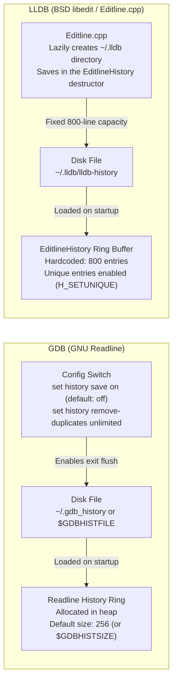
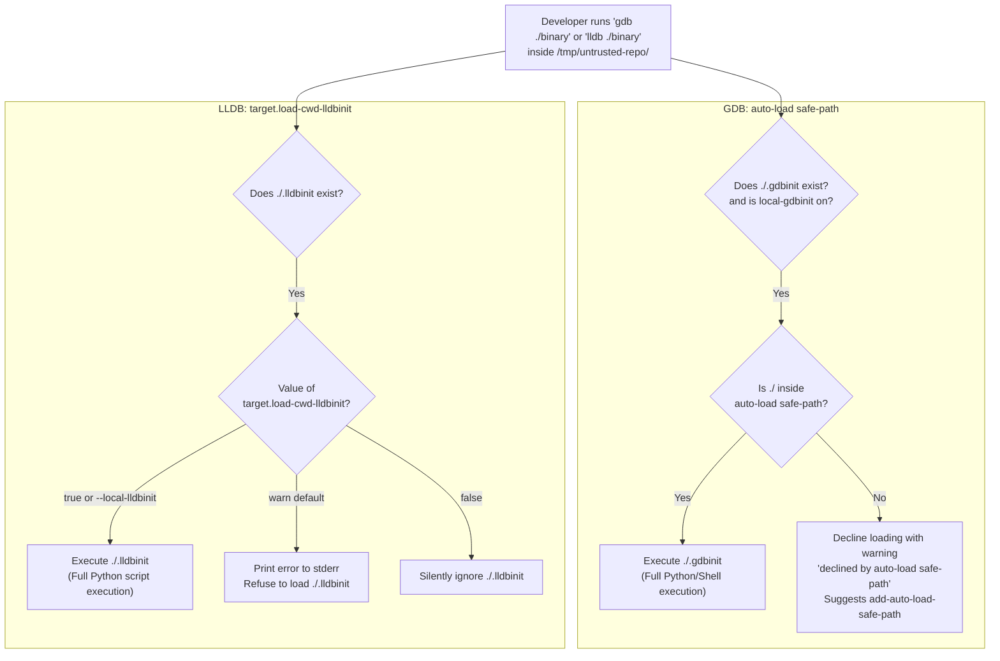
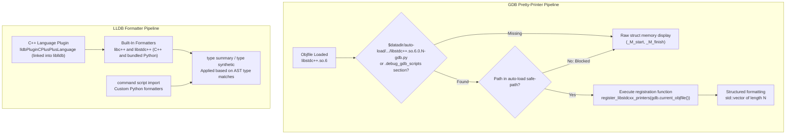

# Debugging Expert Defaults: gdbinit and lldbinit

> [!summary] Claim:
> Default installations of GDB and LLDB discard command history on exit, page terminal outputs interactively, format aggregate structures as unreadable flat memory dumps, and default to architecture-specific disassembler flavors.
> Both debuggers enforce security boundaries against executing arbitrary scripts from current working directories (the `auto-load safe-path` added after CVE-2011-4355 in GDB, and `target.load-cwd-lldbinit` plus the `--local-lldbinit` opt-in from D61578 in LLDB) that refuse untrusted configuration files with an explicit warning.
> A production-grade `.gdbinit` and `.lldbinit` baseline configures persistent command histories, activates dynamic type resolution via vtables, suppresses interactive paging, establishes defensive Python guards for cross-architecture portability, and registers automated pretty-printers without opening remote code execution vectors.


## The Mechanism

The interactive debugger is the primary lens through which an engineer diagnoses running software, evaluates memory corruption, and reconstructs execution state as analyzed in [[How-Debuggers-Work-ptrace-Mach-and-Breakpoints]] and [[Debug-a-Production-Crash-From-a-Core-Dump]].
However, the out-of-the-box defaults for both GNU GDB and LLVM LLDB prioritize backward compatibility and conservative isolation over engineering productivity.
By default, command history is completely lost across sessions in GDB, pagination breaks automated scripts, disassembly syntax mismatches hardware vendor documentation, polymorphic objects display only their base-class fields in GDB (LLDB resolves dynamic types by default), and project-level `.gdbinit` or `.lldbinit` files are rejected.
Achieving a distinguished level of debugging ergonomics requires understanding the underlying configuration engines, initialization lifecycles, and security sandboxes of both tools.

### 1. Initialization Lifecycle and Discovery Precedence

Both GDB and LLDB implement a multi-stage startup lifecycle that executes configuration files in a rigid, hierarchical sequence.
Misunderstanding this sequence causes settings to be silently overwritten or commands to fail because the target binary or symbols have not yet loaded.

#### GDB Startup Sequence

GDB parses configuration files and command-line flags in the following explicit order (documented in GDB Manual, Section 2.1.3):

1. **Early Initialization Files:**
   Beginning with GDB 11 (released September 2021; gdb/NEWS "Changes in GDB 11"), GDB reads `$XDG_CONFIG_HOME/gdb/gdbearlyinit`, falling back to `~/.config/gdb/gdbearlyinit` and then `~/.gdbearlyinit`.
   This stage executes before the command interpreter or terminal user interface (TUI) initializes.
   Only commands that configure startup parameters, such as `set startup-quietly on`, are permitted here.
2. **Early Command-Line Flags:**
   GDB executes commands passed via `-eiex` (`--early-init-eval-command`) and scripts passed via `-eix` (`--early-init-command`) in command-line order.
3. **Interpreter Initialization:**
   GDB sets up the UI specified by `--interpreter` (such as `mi3` or `console`).
4. **System-Wide Initialization Files:**
   GDB executes the system configuration file `/etc/gdb/gdbinit` (or the path defined by `--with-system-gdbinit` at build time) and then sources scripts in `/etc/gdb/gdbinit.d/` (`--with-system-gdbinit-dir`).
5. **User Home Initialization File:**
   GDB searches for `$XDG_CONFIG_HOME/gdb/gdbinit`, falling back to `~/.config/gdb/gdbinit` and `~/.gdbinit`.
   The CLI option `-nh` (`--no-home-init`) suppresses this file while preserving system-wide files.
   The CLI option `-nx` (`-n`) suppresses all `.gdbinit` files across all directories.
6. **Pre-Inferior Command-Line Flags:**
   GDB executes `-iex` (`--init-eval-command`) and `-ix` (`--init-command`) options.
   These run before the inferior program, core file, or symbol files load into memory.
7. **Command-Line Options and Operands:**
   GDB processes the remaining options and operands: the executable specified on the command line, the target process (`-p`), or the core dump (`-c`).
8. **Local Working Directory Initialization File:**
   If `./.gdbinit` exists and the current directory differs from your home directory, GDB executes it if and only if `set auto-load local-gdbinit` is `on` (the default) AND the file is covered by `auto-load safe-path`.
9. **Auto-Loaded Scripts:**
   If a program, process, or core file was specified, GDB loads the auto-load scripts for it and its shared libraries: embedded `.debug_gdb_scripts` sections and companion `objfile-gdb.py` / `objfile-gdb.gdb` files on disk.
   These are executed only if their paths pass the `auto-load safe-path` check; disabling them needs `-iex "set auto-load python-scripts off"` because `-ex` runs too late.
10. **Post-Inferior Command-Line Flags:**
    GDB processes standard `-ex` (`--eval-command`) and `-x` (`--command`) options in the order they were supplied.
11. **History Loading:**
    GDB reads the command history from the history file (`init_history()` in `gdb/top.c`); reading happens whether or not `set history save on` is set, which only controls writing on exit.

#### LLDB Startup Sequence

LLDB's driver (`lldb/tools/driver/Driver.cpp`, `Driver::MainLoop`) executes a parallel startup sequence using driver flags and settings:

1. **Global Initialization File:**
   Only when LLDB was built with `LLDB_GLOBAL_INIT_DIRECTORY`, it sources `<LLDB_GLOBAL_INIT_DIRECTORY>/lldbinit`, a relative directory being resolved against the LLDB shared library directory (`CommandInterpreter::SourceInitFileGlobal`); there is no hardcoded `/etc/lldbinit`.
2. **Application-Specific User Initialization File:**
   LLDB looks in `~/.lldbinit-<program-name>`, where `<program-name>` matches the driver binary name.
   When running the command-line driver, it probes `~/.lldbinit-lldb`.
   When launched inside an IDE like Xcode, it probes `~/.lldbinit-Xcode`: the file name is `~/.lldbinit-` plus the host program's file name (`SourceInitFileHome` in `CommandInterpreter.cpp`), and LLDB's man page names `~/.lldbinit-lldb` for the command-line driver and `~/.lldbinit-Xcode` for Xcode (`lldb/docs/man/lldb.rst`, as of 2026-11).
3. **Global User Initialization File:**
   If no application-specific init file was found, LLDB sources `~/.lldbinit`.
   The `-x` (or `--no-lldbinit`) command-line flag disables stages 1 through 4; it does not affect `-O`, `-S`, `-o`, or `-s`.
4. **Current Working Directory Initialization File:**
   Immediately after the home init file, and before any command-line command or target, LLDB checks for `./.lldbinit` in the directory where `lldb` was invoked.
   Loading is controlled by the enum setting `target.load-cwd-lldbinit`, which defaults to `warn`.
   The command-line flag `--local-lldbinit` explicitly allows loading this file by setting `target.load-cwd-lldbinit` to `true`.
   The flag is applied before the home init file runs, so a `settings set target.load-cwd-lldbinit false` in `~/.lldbinit` still wins over the flag (macOS lab, `lldb-2103.0.34.407`, as of 2026-11).
5. **Pre-Target Command-Line Flags:**
   LLDB executes commands provided via `-O` (`--one-line-before-file`) and sources scripts passed via `-S` (`--source-before-file`).
6. **Target Loading:**
   LLDB creates the target from the positional executable, core file (`-c`), or process attachment flags (`-p`, `-n`).
7. **Post-Target Command-Line Flags:**
   LLDB executes commands provided via `-o` (`--one-line`) and sources files passed via `-s` (`--source`).
8. **Crash Hooks:**
   If running in batch mode (`-b`) and the target process terminates with a crash, LLDB executes `-k` (`--one-line-on-crash`) and `-K` (`--source-on-crash`).

### 2. History Persistence: GNU Readline vs BSD Editline

A major frustration for engineers using default debugger configurations is the immediate loss of all command history upon exiting a session.
The two debuggers solve terminal interaction and line editing with two entirely different libraries: GDB uses GNU Readline, while LLDB uses BSD `libedit` (Editline).



#### GDB and GNU Readline

GDB embeds or dynamically links against GNU Readline.
By default, GDB configures `history save off`.
When GDB terminates, `readline` history buffer memory is freed without writing anything to disk.
To persist history, GDB requires four explicit configuration directives:

1. `set history save on`: Makes `quit_force()` in `gdb/top.c` call `gdb_safe_append_history()`, which appends this session's entries with Readline's `append_history()` to a temporary copy, truncates it with `history_truncate_file()`, and renames it over the history file.
2. `set history size unlimited`: The default size is 256 entries, or the value of `$GDBHISTSIZE` (`init_history()` in `gdb/top.c`; verified `show history size` prints 256 on GDB 15.1, Linux, as of 2026-11).
   The internal variable starts at the sentinel `-2` meaning "not yet set", which is what `show history size` prints from `-ex` or `--batch`, because history initialization runs after those commands.
   Setting this explicitly to `unlimited` or an integer like `50000` overrides `$GDBHISTSIZE`.
3. `set history remove-duplicates unlimited`: Added in GDB 7.10 (gdb/NEWS "Changes in GDB 7.10"), this setting controls how GDB handles duplicate commands.
   The default value is `0` (duplicates are retained).
   In intensive debugging sessions where an engineer repeats `next`, `step`, `finish`, or `bt` dozens of times, an unconfigured history file becomes bloated with identical tokens.
   Setting `remove-duplicates unlimited` makes GDB itself (not Readline) look back through the whole history when a command is entered and remove the older duplicate, ensuring that meaningful diagnostic commands remain accessible via `Ctrl-R`.
   A pty-driven GDB 15.1 session that entered `print 100`, `print 100`, `print 200`, `print 100`, `quit` saved only `print 200`, `print 100`, `quit`.
4. `set history filename ~/.config/gdb/history`: Prevents GDB from littering `./.gdb_history` in every working directory where the debugger is invoked.
   GDB honors the `$GDBHISTFILE` environment variable if defined in the parent shell.

#### LLDB and BSD Editline

LLDB implements its command-line editing interface using NetBSD's `libedit` library inside `lldb/source/Host/common/Editline.cpp`.
Unlike GDB, LLDB's source saves history to disk with no setting needed when it is built with libedit.
This was read from the source, not observed: on Apple `lldb-2103.0.34.407` driven through a pseudo-terminal with `HOME` pointing at an empty directory, no `~/.lldb` directory appeared after a session ended by `quit` or by end of input (macOS, as of 2026-11), so confirm on your own build before relying on it.

Inside `Editline.cpp`, the `EditlineHistory` wrapper class initializes history persistence via `EditlineHistory::GetHistory()`:

```cpp
// lldb/source/Host/common/Editline.cpp
history_sp.reset(new EditlineHistory(prefix, 800, true));
```

This constructor establishes three concrete operational facts:

1. **File Location:** LLDB writes its history to `~/.lldb/lldb-history` (or `~/.lldb/lldb-widehistory` when built with wide character support).
   `GetHistoryFilePath()` creates the `~/.lldb/` directory with `llvm::sys::fs::create_directory()` if it does not already exist, using that function's default permissions (`owner_all | group_all`, 0770 before the umask), and disables history if the directory cannot be created.
   History is written by `Save()` in the `EditlineHistory` destructor, so it reaches disk when the session ends.
2. **Fixed Buffer Size:** The size parameter passed to `H_SETSIZE` in `libedit` is hardcoded to `800` lines.
   When the history reaches 800 entries, `libedit` silently purges the oldest commands on a FIFO basis.
   LLDB does not provide a `settings set` command to expand this 800-line limit.
3. **Duplicate Suppression:** The boolean flag `true` passes `H_SETUNIQUE, 1` to `libedit`, automatically preventing adjacent identical commands from consuming multiple history slots.

To configure line editing behavior (such as enabling Vi keybindings instead of Emacs keybindings), LLDB reads NetBSD's `~/.editrc` rather than `~/.inputrc`.
An engineer can bind Vi mode for LLDB specifically by adding:

```text
lldb:bind -v
```

Additionally, LLDB can record session transcripts.
Both settings default to `false` (`lldb/source/Interpreter/InterpreterProperties.td`); `interpreter.save-transcript true` records commands and their output in a transcript buffer, and `interpreter.save-session-on-quit true` writes that transcript to a file on quit, but only when `save-transcript` is also `true`.

### 3. Disassembly Flavor and Architecture-Specific Setting Traps

When inspecting crash sites without source code or debugging low-level concurrency primitives, assembly instruction syntax is paramount.
On x86 and x86_64 processors, assembly is rendered in either AT&T syntax (the traditional GNU toolchain default, where operands are ordered `source, destination` and registers are prefixed with `%`) or Intel syntax (standardized by Intel and AMD, where operands are ordered `destination, source`).

#### The GDB Architecture Evaluation Trap

In GDB, the disassembly syntax is configured via:

```gdb
set disassembly-flavor intel
```

Under x86 and x86_64, GDB then disassembles instructions in the objdump Intel style, such as `mov eax,DWORD PTR [rbp-0x4]` (the spaced lowercase `mov eax, dword ptr [rbp - 4]` form is LLVM's, as printed by LLDB).
However, placing this command bare at the top of a portable `~/.gdbinit` introduces a severe failure mode when transitioning to non-x86 architectures (such as Apple Silicon running Linux in a VM, AWS Graviton AArch64 servers, or embedded RISC-V targets).

The GDB manual states that this command "is only defined for the Intel x86 family"; it is registered by `gdb/i386-tdep.c`, so it exists only in GDB builds that compile in x86 target support (native x86 builds, or builds configured with `--enable-targets=all`), whatever the runtime target is.
In a native AArch64 or ARM build, such as Ubuntu 24.04's `gdb` 15.1 on AArch64 (verified, as of 2026-11), `disassembly-flavor` does not exist as a registered setting; `show disassembly-flavor` there answers `Undefined show command: "disassembly-flavor".`, which makes a quick probe.
GDB's command parser treats any unrecognized token following `set` as an inferior program variable assignment (`set VAR = VAL`).
Because `.gdbinit` executes before any executable or symbol table is loaded into the debugger, GDB attempts to resolve `disassembly-flavor` against nonexistent debug symbols, printing:

```text
/home/user/.gdbinit:1: Error in sourced command file:
No symbol table is loaded.  Use the "file" command.
```

Because GDB stops reading any sourced command file at its first error, it halts execution of `.gdbinit` at line 1 (`stop-command-source-on-error` is the LLDB name for the equivalent LLDB behavior, not a GDB setting).
All subsequent directives in the file - history persistence, pagination disabling, pretty-printers, and auto-load safe paths - are skipped, with only the one error line as a clue.
The debugger launches in an unconfigured, default state.

To prevent this abort, a production `.gdbinit` must guard architecture-specific settings using embedded Python:

```gdb
python
try:
    gdb.execute("set disassembly-flavor intel")
except gdb.error:
    pass
end
```

If GDB runs on AArch64, `gdb.execute()` raises `gdb.error`, which the Python block catches and ignores, allowing `.gdbinit` execution to proceed smoothly.

#### The LLDB Namespace Isolation

LLDB avoids this pitfall through explicit setting namespacing.
In LLDB, the setting is defined as:

```text
settings set target.x86-disassembly-flavor intel
```

Because the setting is explicitly scoped with `x86-`, LLDB's configuration schema registers it globally across all host platforms.
Setting `target.x86-disassembly-flavor intel` on an ARM64 macOS host or AArch64 Linux machine succeeds without error.
The setting remains dormant, applying automatically whenever an x86/x86_64 binary or core dump is loaded.

Additionally, LLDB provides fine-grained control over automatic disassembly display when inferior execution stops:

* `settings set stop-disassembly-display no-debuginfo`: Displays disassembly only when debug information is missing, avoiding redundant output during source-level stepping; `no-debuginfo` is already the default (verified with `lldb-2103.0.34.407`, macOS, as of 2026-11), so the line only documents intent.
* `settings set stop-disassembly-count 8`: Sets "the number of disassembly lines to show when displaying a stopped context" to 8 (default 4, verified as above).

### 4. Auto-Loading Security Boundaries and Arbitrary Code Execution (CVE-2011-4355)

The most critical operational boundary governing `.gdbinit` and `.lldbinit` is the defense against arbitrary code execution when debugging binaries in untrusted directories.



#### The Attack Vector

Debuggers provide native scripting facilities:
GDB supports embedded Python (`python ... end`) and shell escapes (`shell <cmd>`).
LLDB supports Python execution (`script ...`) and command script imports (`command script import`).
If a debugger automatically executes configuration files discovered in the current working directory, an attacker can place a crafted `.gdbinit` or `.lldbinit` in a public Git repository or a shared directory like `/tmp`.
When an unsuspecting developer clones the repository and starts a debugging session (`gdb ./exploit_target`), the debugger automatically runs the initialization file, executing arbitrary shell commands with the developer's user permissions.

#### CVE-2011-4355 and GDB's `auto-load safe-path`

In 2011, this vulnerability was formally documented as CVE-2011-4355.
GDB versions prior to 7.5 automatically loaded extension scripts from the `.debug_gdb_scripts` ELF section and companion Python scripts from the current working directory without checking filesystem ownership or trust.

In response, GDB 7.5 introduced the **`auto-load safe-path`** security architecture:

1. **The Safe Path Directory List:**
   GDB maintains an internal colon-separated list of trusted directories:
   ```text
   show auto-load safe-path
   ```
   The default is fixed at build time (`--with-auto-load-dir`, overridable by `--with-auto-load-safe-path`); on Ubuntu 24.04's GDB 15.1 it is `$debugdir:$datadir/auto-load` (verified, Linux, as of 2026-11), typically `/usr/lib/debug` and `/usr/share/gdb/auto-load`.
2. **Evaluation Logic:**
   Before loading any local `./.gdbinit` or auto-loaded script associated with an objfile, GDB checks that the file lies in or under an entry in `safe-path`, first comparing the names as entered and, if nothing matches, comparing canonical (symlink-resolved) forms.
   Entries may be shell wildcard patterns matched with `fnmatch` `FNM_PATHNAME`, so `*` never crosses a `/`.
3. **Rejection Behavior:**
   If the path is not in `safe-path`, GDB blocks execution and prints a diagnostic warning:
   ```text
   warning: File "/path/to/project/.gdbinit" auto-loading has been declined by your `auto-load safe-path' set to "$debugdir:$datadir/auto-load".
   To enable execution of this file add
       add-auto-load-safe-path /path/to/project/.gdbinit
   line to your configuration file "/home/user/.config/gdb/gdbinit".
   To completely disable this security protection add
       set auto-load safe-path /
   line to your configuration file "/home/user/.config/gdb/gdbinit".
   For more information about this security protection see the
   "Auto-loading safe path" section in the GDB manual.  E.g., run from the shell:
       info "(gdb)Auto-loading safe path"
   ```
   This is the full text GDB 15.1 printed for an untrusted `./.gdbinit` (Linux, as of 2026-11); GDB indents the command lines with a tab.
4. **Security Anti-Pattern:**
   Engineers frustrated by this warning often add `set auto-load safe-path /` to their global `~/.gdbinit`.
   This completely disables the security sandbox, trusting the entire root filesystem and reopening the full arbitrary code execution vulnerability of CVE-2011-4355.
   The secure baseline is to add specific trusted development trees:
   ```gdb
   add-auto-load-safe-path ~/src
   add-auto-load-safe-path ~/work
   ```
   GDB 15.1 stores the entry literally (`show auto-load safe-path` prints `~/src`) but still matches `~/src/proj/.gdbinit` against it, so the tilde form works (verified, Linux, as of 2026-11).

#### LLDB's `target.load-cwd-lldbinit` (D61578)

The `target.load-cwd-lldbinit` setting already existed when Phabricator review D61578 ("[Driver] Add command line option to allow loading local lldbinit file", Jonas Devlieghere, committed May 2019 as r360172, so in LLVM 9.0) added the `--local-lldbinit` driver flag, which sets that setting to `true` and is overridden by `--no-lldbinit`.

LLDB manages this via `target.load-cwd-lldbinit`, which is an enumeration taking one of three values:

* `warn` (Default): If an `.lldbinit` file exists in the current working directory (and that directory is not the home directory), LLDB prints a message explaining that the file was not read and warns the user of the security risks; `lldb-2103.0.34.407` prefixes it with `error:`.
* `false`: Silently ignores any `./.lldbinit` file in the current working directory without printing a warning.
* `true`: Automatically executes `./.lldbinit`.
  Enabling this globally in `~/.lldbinit` introduces an immediate local code execution vulnerability when analyzing untrusted workspaces.

For secure and ergonomic project-specific workflows, engineers should keep `target.load-cwd-lldbinit` at `warn` or `false` in `~/.lldbinit`, and use the explicit command-line flag when working in trusted repositories:

```bash
lldb --local-lldbinit ./build/bin/engine
```

### 5. Pretty-Printer and Type Summary Registration Pipeline

Standard template library (STL) containers in C++ (`std::vector`, `std::map`, `std::string`, `std::unordered_map`) and standard collections in Rust (`Vec`, `HashMap`, `String`) are implemented as complex pointer-based data structures.
Without pretty-printers, inspecting a two-element `std::vector<int>` prints internal allocator bookkeeping structures:

```text
(gdb) print vec
$1 = {
  <std::_Vector_base<int, std::allocator<int> >> = {
    _M_impl = {
      <std::allocator<int>> = {<std::__new_allocator<int>> = {<No data fields>}, <No data fields>}, 
      _M_start = 0x5555555592a0, 
      _M_finish = 0x5555555592a8, 
      _M_end_of_storage = 0x5555555592a8
    }
  }, <No data fields>
}
```

Pretty-printers transform this raw layout into a human-readable representation: `std::vector of length 2, capacity 2 = {10, 20}`.
The mechanics of authoring custom printers are owned by [[Cpp-Debugger-Scripting-and-Pretty-Printers]]; this note owns their initialization and registration within `.gdbinit` and `.lldbinit`.



#### GDB and libstdc++ Pretty-Printers

In GDB, pretty-printers are written in Python and registered in GDB's lookup dictionary: `gdb.printing.register_pretty_printer()`.
Modern GCC installations bundle pretty-printers for `libstdc++`.
GDB loads them using one of two automated paths:

1. **Auto-Loaded Objfile Scripts:** GCC does not embed a `.debug_gdb_scripts` section for libstdc++; instead the distribution ships an `objfile-gdb.py` companion script under `$datadir/auto-load` named after the real library file.
   On Ubuntu 24.04 (AArch64) that is `/usr/share/gdb/auto-load/usr/lib/aarch64-linux-gnu/libstdc++.so.6.0.33-gdb.py`, which imports `libstdcxx.v6` from `/usr/share/gcc/python` (verified, Linux, as of 2026-11); GDB runs it when it loads `libstdc++.so.6.0.33`, because `$datadir/auto-load` is in the default safe-path.
2. **Explicit Fallback in `.gdbinit`:** On minimal distribution images, container environments, or cross-toolchains where auto-loading fails or debug packages are stripped, manual registration is required in `~/.gdbinit`:

```gdb
python
import sys
import os

# Probe standard distribution locations for GCC Python helpers
gcc_python_dirs = [
    "/usr/share/gcc/python",
    "/usr/share/gdb/auto-load/usr/lib",
    "/usr/share/gdb/auto-load/usr/lib64"
]
for p in gcc_python_dirs:
    if os.path.isdir(p) and p not in sys.path:
        sys.path.insert(0, p)

try:
    from libstdcxx.v6.printers import register_libstdcxx_printers
    register_libstdcxx_printers(None)
except ImportError:
    pass
end
```

Passing `None` as the first argument registers the printers globally across all loaded object files, ensuring that static binaries and dynamically loaded libraries both benefit from formatting; with this block, `info pretty-printer` on GDB 15.1 lists `libstdc++-v6` under `global pretty-printers` (verified, Linux, as of 2026-11).

#### LLDB Built-In Formatters and Synthetic Children

LLDB takes a fundamentally different architectural approach.
Rather than relying on user-installed Python scripts to format standard library types, LLDB registers its standard library formatters itself in the C++ language plugin `lldbPluginCPlusPlusLanguage` (`lldb/source/Plugins/Language/CPlusPlus/`), which is linked into liblldb.
For LLVM's `libc++` most summaries and synthetic child providers are native C++; for GNU's `libstdc++` the plugin mixes native C++ providers with Python classes bundled with LLDB, such as `lldb.formatters.cpp.gnu_libstdcpp.StdMapLikeSynthProvider` (`LoadLibStdcppFormatters()` in `CPlusPlusLanguage.cpp`), so those need LLDB's Python support.

Custom formatters (for internal project types or third-party libraries like Abseil or Boost) are loaded in `~/.lldbinit` using:

```text
command script import /path/to/custom_formatters.py
```

Inside the imported module, LLDB executes the registration hook `__lldb_init_module(debugger, internal_dict)`, registering summaries via `debugger.HandleCommand("type summary add ...")` or `debugger.HandleCommand("type synthetic add ...")`.

### 6. Interactive Ergonomics and Diagnostic Execution Controls

Beyond history and formatters, expert debugging baselines configure specific operational behaviors that prevent terminal lockups, resolve C++ polymorphism, and filter asynchronous operating system noise.

#### 1. Pagination Suppression

Default GDB pauses output after filling the terminal window, displaying `--Type <RET> for more, q to quit, c to continue without paging--`.
GDB already disables paging in `--batch` mode (GDB manual, Mode Options) and when stdin or stdout is not a terminal: GDB 15.1 reports an unlimited page height both with stdin piped and with stdout piped through `cat` (verified, Linux, as of 2026-11).
The pager therefore bites in sessions that do run on a terminal, which several common development contexts do:

* Sourcing automated diagnostics or scripts (`-x script.gdb`) in an interactive session.
* Capturing stack traces across thousands of threads (`thread apply all bt`).
* Driving GDB through a pty, as `expect`, `tmux send-keys`, or an agent harness do.

A production `.gdbinit` must explicitly disable pagination:

```gdb
set pagination off
```

LLDB has no output pager and no pagination setting: `settings list` contains neither (checked by the macOS lab), and the only use of the word `pager` in the LLDB sources is the Python plugin forcing `pydoc` to its plain pager (`ScriptInterpreterPython.cpp`, found with `gh search code "pager" --repo llvm/llvm-project`, as of 2026-11).

#### 2. Dynamic Type Resolution (Polymorphism / RTTI)

When inspecting a pointer or reference to a base class (`Base* ptr`), GDB defaults to displaying only the fields declared on `Base`, ignoring the derived object layout, while LLDB already resolves the dynamic type by default:

* **In GDB:** `set print object on` (default `off`) directs GDB to inspect the object's virtual table pointer (`_vptr`) and use Run-Time Type Information (RTTI) to resolve and print the actual derived type and its derived member variables.
* **In LLDB:** `target.prefer-dynamic-value` takes `no-dynamic-values`, `run-target`, or `no-run-target`, and defaults to `no-run-target`, "Calculate the dynamic type of values, but don't run the target" (`lldb/source/Target/Target.cpp`, `TargetProperties.td`).
  `run-target` additionally lets LLDB "calculate the dynamic type of values even if you have to run the target", that is, execute code in the inferior; for a class pointer with a vtable the default already suffices: the macOS lab prints `(Derived *)` and the derived member under `no-run-target` and `run-target` alike, and `(Base *)` only under `no-dynamic-values` (macOS, `lldb-2103.0.34.407`, as of 2026-11).

#### 3. Aggregate Formatting and Array Indexing

By default, GDB prints nested structs and arrays in a dense, unformatted single line.
The following options establish readable inspection:

* `set print pretty on`: Formats C and C++ structs with indentation and line breaks.
* `set print array-indexes on`: Annotates array members with their bracketed index (`[0] = 10, [1] = 20`), preventing off-by-one errors when scanning large buffers.
* `set print elements 500`: Increases the threshold of array elements displayed before truncation from the default of 200.
* `set print null-stop on`: Halts character array printing at the first null byte rather than dumping the full remaining uninitialized buffer capacity.

In LLDB, equivalent controls are managed through:

* `settings set target.max-children-count 256`: Increases the number of children expanded for synthetic types (default: 24).
* `settings set target.max-string-summary-length 2048`: Prevents string summaries from being truncated prematurely (default: 1024).

#### 4. Signal Handling Hygiene (`SIGPIPE`)

Networked servers, message queues, and low-latency trading engines routinely encounter closed client sockets, generating `SIGPIPE`.
By default, GDB stops on `SIGPIPE`, prints it, and passes it to the program (`info signals SIGPIPE`: Stop Yes, Print Yes, Pass Yes on GDB 15.1, Linux, as of 2026-11).
LLDB on Linux also stops, notifies, and passes (`LinuxSignals.cpp`), while LLDB's generic Unix signal table used for other hosts such as macOS passes `SIGPIPE` without stopping or notifying (`UnixSignals.cpp`).
An expert configuration instructs the debugger to pass the signal to the application runtime without pausing execution:

* **In GDB:**
  ```gdb
  handle SIGPIPE nostop noprint pass
  ```
* **In LLDB:**
  ```text
  process handle -s false -n false -p true SIGPIPE
  ```
  `-n` is notify, so `-n false` is the equivalent of GDB's `noprint`; `-n true` would still print every `SIGPIPE`.
  In LLDB, configuring this in `~/.lldbinit` applies to the "dummy target" (`process handle` is `eCommandAllowsDummyTarget` and stores "dummy signals" in `CommandObjectProcess.cpp`), which propagates the signal policy to targets created later in the session; with no target, `lldb-2103.0.34.407` accepts it and lists `SIGPIPE true false false` for PASS, STOP, NOTIFY (verified, macOS, as of 2026-11).

#### 5. Stop Hooks

Stop hooks allow an engineer to define commands that execute automatically whenever the inferior stops (e.g. hitting a breakpoint, watchpoint, or trap):

* **In GDB:** Defined via the `hook-stop` user command:
  ```gdb
  define hook-stop
      # Commands run on every stop
  end
  ```
* **In LLDB:** Configured via `target stop-hook`:
  ```text
  target stop-hook add -o "frame select 0"
  ```

---

## Commands and Numbers to Know

The following reference table documents the critical defaults, limits, and configuration commands across GDB and LLDB.

| Subsystem / Setting | GDB Directive and Default | LLDB Directive and Default | Platform | Engineering Significance |
| :--- | :--- | :--- | :--- | :--- |
| **History Persistence** | `set history save on`<br/>(Default: `off`, as of 2026-11) | Saved by `Editline.cpp` through BSD libedit per the source; not reproduced on Apple `lldb-2103.0.34.407` (as of 2026-11) | Both | GDB loses history upon exit unless `save on` is configured in `~/.gdbinit`. |
| **History File Location** | `set history filename <path>`<br/>(Default: `./.gdb_history`, as of 2026-11) | Fixed path: `~/.lldb/lldb-history`<br/>(Configured in `Editline.cpp`, as of 2026-11) | Both | Default GDB drops `.gdb_history` into the current working directory. |
| **History Buffer Size** | `set history size <N>`<br/>(Default: `256` or `$GDBHISTSIZE`, as of 2026-11) | Hardcoded: `800` lines<br/>(In `EditlineHistory`, as of 2026-11) | Both | LLDB silently purges commands past 800 entries; GDB keeps 256 by default and supports `unlimited`. |
| **Duplicate History Suppression** | `set history remove-duplicates unlimited`<br/>(Default: `0`, as of 2026-11) | `H_SETUNIQUE, 1` enabled<br/>(Default: `true`, as of 2026-11) | Both | GDB retains consecutive duplicate commands by default, polluting history navigation. |
| **Disassembly Syntax** | `set disassembly-flavor intel`<br/>(Default: `att`, as of 2026-11) | `settings set target.x86-disassembly-flavor intel`<br/>(Default: `default`, as of 2026-11) | Both | GDB setting errors on non-x86 architectures; LLDB setting is safely namespaced. |
| **Terminal Pagination** | `set pagination off`<br/>(Default: `on`, as of 2026-11) | No pager and no pagination setting<br/>(`settings list`, as of 2026-11) | Both | Pagination interrupts automated scripts, background runners, and multi-thread backtraces. |
| **Interactive Confirmations** | `set confirm off`<br/>(Default: `on`, as of 2026-11) | `settings set interpreter.prompt-on-quit false`<br/>(Default: `true`, as of 2026-11) | Both | Eliminates interactive prompts when quitting or restarting active execution targets. |
| **Dynamic Polymorphism (RTTI)** | `set print object on`<br/>(Default: `off`, as of 2026-11) | `settings set target.prefer-dynamic-value run-target`<br/>(Default: `no-run-target`, which already resolves dynamic types without running code, as of 2026-11) | Both | Uses vtable pointers to resolve derived types rather than static base class definitions; only GDB needs the change. |
| **Struct Formatting** | `set print pretty on`<br/>(Default: `off`, as of 2026-11) | Multi-line by default (`frame variable` output in the macOS lab, as of 2026-11) | Both | Unconfigured GDB outputs complex nested structures as unreadable single-line strings. |
| **Array Element Limits** | `set print elements 500`<br/>(Default: `200`, as of 2026-11) | `settings set target.max-children-count 256`<br/>(Default: `24`, as of 2026-11) | Both | Prevents premature truncation when inspecting large data buffers and collections. |
| **String Summary Limits** | `set print characters <N>` (GDB 14+)<br/>(Default: `elements`, i.e. follows `print elements` = `200`, as of 2026-11) | `settings set target.max-string-summary-length 2048`<br/>(Default: `1024`, as of 2026-11) | Both | Sets the maximum character threshold before string summaries display ellipsis. |
| **Array Index Annotations** | `set print array-indexes on`<br/>(Default: `off`, as of 2026-11) | Always shown: `frame variable` on an `int[3]` prints `[0] = ..., [1] = ..., [2] = ...`<br/>(macOS, `lldb-2103.0.34.407`, as of 2026-11) | Both | Annotates array members with their index numbers to eliminate manual counting. |
| **CWD Init Security** | `set auto-load local-gdbinit on`<br/>(Gated by `safe-path`, as of 2026-11) | `settings set target.load-cwd-lldbinit warn`<br/>(Default: `warn`, as of 2026-11) | Both | Mitigates arbitrary code execution (CVE-2011-4355 / D61578) from untrusted project roots. |
| **Auto-Load Safe Path** | `show auto-load safe-path`<br/>(Default: `$debugdir:$datadir/auto-load`, as of 2026-11) | Explicit flag `--local-lldbinit`<br/>(Overrides warning, as of 2026-11) | Both | Authorizes trusted development directories to execute project-local initialization scripts. |
| **Network Signal Filtering** | `handle SIGPIPE nostop noprint pass`<br/>(Default: `stop print pass`, as of 2026-11) | `process handle -s false -n false -p true SIGPIPE`<br/>(Default: Linux `stop`, `notify`, `pass` all `true`; generic Unix table used on macOS: `pass` only, as of 2026-11) | Both | Prevents normal socket disconnects in server applications from pausing the debugger. |
| **Session Transcripts** | Output logging via `set logging enabled on` (`set logging on` is a deprecated alias since GDB 12)<br/>(Default: `off`, as of 2026-11) | `settings set interpreter.save-transcript true`<br/>(Default: `false`, as of 2026-11) | Both | Preserves complete diagnostic output, commands, and backtraces for post-incident reviews. |

---

## Multi-Language Comparison: C++ / Python / Rust Debugger Baselines

The table below contrasts how GDB and LLDB interact with the runtimes, symbol demanglers, and formatters across C++, Python, and Rust.

| Concern | C++ (GCC / Clang) | Python (CPython C-API / Extension) | Rust (rustc / Cargo) |
| :--- | :--- | :--- | :--- |
| **Pretty-Printer Mechanism** | GDB loads libstdc++ Python printers (`register_libstdcxx_printers`); LLDB uses native `libc++` plugin formatters. | GDB imports `Tools/gdb/libpython.py` (adds `py-bt`, `py-print`, `py-locals`); LLDB uses Python scripting bridge. | `rust-gdb` adds `<sysroot>/lib/rustlib/etc` to the safe-path and source directories so `gdb_load_rust_pretty_printers.py` can load; `rust-lldb` loads `lldb_lookup.py` via `command script import`. |
| **Polymorphic Type Resolution** | GDB `set print object on` reads `_vptr`; LLDB `settings set target.prefer-dynamic-value run-target`. | Inspects `ob_type->tp_name` in `PyObject*` to determine the concrete runtime class. | Trait objects (`&dyn Trait`) use fat pointers `(data_ptr, vtable_ptr)`; printers read the vtable metadata. |
| **Symbol Demangling** | GDB `set print demangle on` (Itanium ABI); LLDB demangles natively via LLVM `ItaniumDemangle`. | C-API functions use C ABI (`_PyEval_EvalFrameDefault`); Python frames are recovered from interpreter state. | Rust legacy and v0 symbol mangling (`_R...`); both GDB and LLDB demangle v0 natively in modern builds. |
| **Wrapper Driver Scripts** | Invoked directly as `gdb` or `lldb`. | Invoked via `gdb python3` or `lldb python3`; debug symbols require `python3-dbg`. | Invoked via `rust-gdb` or `rust-lldb`, which wrap the native debuggers and inject sysroot printers. |
| **CWD Security Boundary** | Gated by `auto-load safe-path` and `target.load-cwd-lldbinit`. | Same debugger security boundaries apply; untrusted `.gdbinit` can inspect CPython memory buffers. | `rust-gdb` passes `-iex "add-auto-load-safe-path <sysroot>/lib/rustlib/etc"` and `rust-lldb` passes `--one-line-before-file "command script import .../lldb_lookup.py"` (rustup stable and nightly, as of 2026-11), injecting printers without relaxing CWD security. |
| **Thread Naming and Concurrency** | Reads thread names set by `pthread_setname_np()`; GDB shows `LWP N`, LLDB shows thread names. | Python thread identifiers mapped to OS threads; the GIL is `struct _gil_runtime_state` (`locked`, `last_holder`), reached as `_PyRuntime.ceval.gil` in CPython 3.11 and as `interp->ceval.gil` in 3.12 and later, so the layout depends on the CPython version (`_PyRuntime.gilstate` exists in 3.11 to 3.14 but does not hold the GIL; `Include/internal/pycore_runtime.h`, `pycore_ceval_state.h`, `pycore_gil.h`, as of 2026-11). | Tokio / async task debugging requires external tracers; native threads show Rust names set via `Builder::name()`. |
| **Typical Initialization Defect** | Sourcing `libstdc++` printers fails because debug packages are missing, dumping raw struct offsets. | Sourcing `libpython.py` fails if Python version in GDB mismatches CPython target ABI. | Running plain `gdb` instead of `rust-gdb` causes `Vec<T>` to display as raw 24-byte pointer triples. |

---

## Worked Lab Example: Production .gdbinit and .lldbinit Baselines

This section provides complete, production-hardened baseline configuration files for `~/.gdbinit` and `~/.lldbinit`, followed by a systematic verification walkthrough that demonstrates their behavioral impact and proves their defensive failure modes.

### 1. Production-Hardened `.gdbinit` (`~/.config/gdb/gdbinit` or `~/.gdbinit`)

```gdb
# ==============================================================================
# Production GDB Configuration Baseline
# Target: GDB 12+ on Linux and macOS
# ==============================================================================

# ------------------------------------------------------------------------------
# 1. Terminal Ergonomics and Confirmation Controls
# ------------------------------------------------------------------------------
# Disable terminal paging so long backtraces and automated scripts do not block
set pagination off

# Disable interactive confirmations on quit, process restart, or breakpoint deletion
set confirm off

# ------------------------------------------------------------------------------
# 2. Persistent Command History
# ------------------------------------------------------------------------------
# Persist command history across sessions
set history save on

# Configure unlimited history buffer size in memory
set history size unlimited

# Eliminate duplicate commands from bloating the history ring
set history remove-duplicates unlimited

# Store history in a central XDG-compliant location rather than polluting CWD.
# The directory must already exist: otherwise GDB only warns at exit and the history is lost.
set history filename ~/.config/gdb/history

# ------------------------------------------------------------------------------
# 3. Memory Display, Aggregate Pretty-Printing, and Dynamic Types
# ------------------------------------------------------------------------------
# Print C/C++ structs with clean indentation and newlines
set print pretty on

# Display array indexes when inspecting array elements
set print array-indexes on

# Stop printing character arrays at the first null byte
set print null-stop on

# Expand maximum array and string elements before truncating
set print elements 500

# Resolve C++ polymorphic types dynamically via vtable inspection (RTTI)
set print object on

# Print demangled C++ and Rust symbol names
set print demangle on
set print asm-demangle on

# ------------------------------------------------------------------------------
# 4. Architecture-Specific Disassembly Flavor (Defensively Guarded)
# ------------------------------------------------------------------------------
# On x86/x86_64, set disassembly to Intel syntax.
# In GDB builds without x86 support (native AArch64/ARM/RISC-V), this setting
# does not exist; bare execution raises "No symbol table is loaded" and
# terminates .gdbinit. Any unknown "set" name does the same.
# We wrap it in Python to ensure portable cross-architecture execution.
python
try:
    gdb.execute("set disassembly-flavor intel")
except gdb.error:
    pass
end

# ------------------------------------------------------------------------------
# 5. Signal Filtering for Production Services
# ------------------------------------------------------------------------------
# Pass SIGPIPE to the inferior without stopping execution or logging
handle SIGPIPE nostop noprint pass

# ------------------------------------------------------------------------------
# 6. Safe Path and Auto-Loading Configuration
# ------------------------------------------------------------------------------
# Authorize trusted engineering workspaces to execute project-specific scripts
# Never use "set auto-load safe-path /" as it permits arbitrary code execution
add-auto-load-safe-path ~/src
add-auto-load-safe-path ~/work

# ------------------------------------------------------------------------------
# 7. Pretty-Printer Automated Registration Fallback
# ------------------------------------------------------------------------------
python
import sys
import os

# Ensure system GCC Python helper directories are probed
gcc_dirs = [
    "/usr/share/gcc/python",
    "/usr/share/gdb/auto-load/usr/lib",
    "/usr/share/gdb/auto-load/usr/lib64"
]
for p in gcc_dirs:
    if os.path.isdir(p) and p not in sys.path:
        sys.path.insert(0, p)

try:
    from libstdcxx.v6.printers import register_libstdcxx_printers
    register_libstdcxx_printers(None)
except ImportError:
    pass
end
```

Installed as `~/.gdbinit`, this file loads on GDB 15.1 (AArch64 Linux, as of 2026-11) without any message: `history save` and the history filename `~/.config/gdb/history` take effect, `print pretty`, `print elements`, and `print object` hold their configured values, `info signals SIGPIPE` shows `No No Yes`, and `info pretty-printer` lists the global `libstdc++-v6` printers (all checked by `code/03-Debugging/gdbinit_baseline/`).

### 2. Production-Hardened `.lldbinit` (`~/.lldbinit`)

```text
# ==============================================================================
# Production LLDB Configuration Baseline
# Target: LLDB 15+ on macOS and Linux
# ==============================================================================

# ------------------------------------------------------------------------------
# 1. UI Ergonomics and Prompt Controls
# ------------------------------------------------------------------------------
# Clean, non-intrusive prompt
settings set prompt "(lldb) "

# Disable confirmation prompt on quit when processes are live
settings set interpreter.prompt-on-quit false

# Stop execution script sourcing immediately if a command raises an error
settings set interpreter.stop-command-source-on-error true

# ------------------------------------------------------------------------------
# 2. Disassembly Syntax and Display Controls
# ------------------------------------------------------------------------------
# Set x86/x86_64 disassembly syntax to Intel (safely namespaced on ARM)
settings set target.x86-disassembly-flavor intel

# Show disassembly only when debug info is absent (already the default)
settings set stop-disassembly-display no-debuginfo

# Show 8 disassembly lines in a stopped context (default 4)
settings set stop-disassembly-count 8

# ------------------------------------------------------------------------------
# 3. Dynamic Type Resolution and Synthetic Children
# ------------------------------------------------------------------------------
# Resolve dynamic types even if LLDB must run code in the target
# (the default no-run-target already resolves C++ types from vtables)
settings set target.prefer-dynamic-value run-target

# Increase synthetic child expansion limits for collections
settings set target.max-children-count 256

# Expand maximum string summary length before truncation
settings set target.max-string-summary-length 2048

# ------------------------------------------------------------------------------
# 4. Signal Handling Hygiene
# ------------------------------------------------------------------------------
# Pass SIGPIPE to target without pausing execution or notifying
process handle -s false -n false -p true SIGPIPE

# ------------------------------------------------------------------------------
# 5. Security Boundary for Current Working Directory
# ------------------------------------------------------------------------------
# Maintain default 'warn' or 'false' to prevent arbitrary code execution
# from cloned repositories. Use --local-lldbinit explicitly for trusted projects.
settings set target.load-cwd-lldbinit warn

# ------------------------------------------------------------------------------
# 6. Session Transcript Persistence
# ------------------------------------------------------------------------------
# Record complete command and output transcripts for diagnostic records
settings set interpreter.save-transcript true
settings set interpreter.save-session-on-quit true
```

Sourced with `lldb -x --batch -S`, every line is accepted without an error and each setting reads back with its configured value on `lldb-2103.0.34.407` (macOS, as of 2026-11; checked by `code/03-Debugging/lldbinit_baseline/`).

### 3. Verification Walkthrough

Two labs under `code/03-Debugging/` hold the baseline files above byte for byte and check every behavior this note claims about them.
Each check prints `ok` or `FAIL`, and any `FAIL` makes the lab exit non-zero:

* `code/03-Debugging/gdbinit_baseline/` (`# requires: linux`; off Linux it runs in the pinned container): the unguarded `set disassembly-flavor intel` abort and its Python guard, the baseline file loading without a message, history save with duplicate removal through a pseudo-terminal, history read at startup with `save` off, the missing history directory, the safe-path boundary, startup order, the pager on a pipe and on a pseudo-terminal, and `print object` on a real C++ binary.
* `code/03-Debugging/lldbinit_baseline/` (`# requires: macos`): every default quoted in this note, the baseline file sourcing without an error, startup order and `-x`, the `./.lldbinit` boundary in all of its settings, the three `prefer-dynamic-value` modes on a real C++ binary, and the `SIGPIPE` flag combinations on a live process.

Run them from `18-Developer-Toolchain/code/`:

```bash
make verify LAB=03-Debugging/gdbinit_baseline/
make verify LAB=03-Debugging/lldbinit_baseline/
```

The lab drives GDB through `pty_session.py` because GDB records history only for lines it reads from a terminal, so `--batch`, `-ex`, and piped stdin never reach the history file.
The GDB lab expects a GDB build without x86 support, as on AArch64 Ubuntu 24.04; its recording exists for `linux-aarch64` only.

### 4. Observed Verification Output

The following blocks are the contents of `expected/linux-aarch64.txt` and `expected/darwin-arm64.txt`, copied unchanged; `make verify` fails when a run differs from them.
Addresses are scrubbed to `ADDR` by the lab, and the GDB lab prints `<cwd>` for its temporary directory.

GDB lab, `code/03-Debugging/gdbinit_baseline/expected/linux-aarch64.txt` (Linux AArch64, GDB 15.1, as of 2026-11):

```text
GNU gdb 15.1
== 1. The non-x86 build lacks disassembly-flavor, and the unguarded line aborts the init file
ok   show disassembly-flavor is an undefined command in this build
broken.gdbinit:1: Error in sourced command file:
No symbol table is loaded.  Use the "file" command.
State of pagination is on.
ok   unguarded line reports the sourced-file error at line 1
ok   unguarded line leaves pagination on (set pagination off never ran)
State of pagination is off.
ok   guarded line lets the file finish
== 2. The baseline gdbinit loads without a message and applies its settings
Saving of the history record on exit is on.
Pretty formatting of structures is on.
Printing of object's derived type based on vtable info is on.
Limit on string chars or array elements to print is 500.
Whether to confirm potentially dangerous operations is off.
State of pagination is off.
Signal        Stop	Print	Pass to program	Description
SIGPIPE       No	No	Yes		Broken pipe
global pretty-printers:
  builtin
    mpx_bound128
  libstdc++-v6
ok   history save is on
ok   print pretty is on
ok   print object is on
ok   print elements is 500
ok   confirm is off
ok   pagination is off
ok   SIGPIPE is nostop noprint pass
ok   libstdc++ printers are registered globally
ok   the tilde entry is stored literally in the safe-path
ok   the distribution ships a libstdc++ objfile script under $datadir/auto-load
ok   no error anywhere in the load
ok   no warning anywhere in the load
Signal        Stop	Print	Pass to program	Description
SIGPIPE       Yes	Yes	Yes		Broken pipe
Saving of the history record on exit is off.
State of pagination is on.
Printing of object's derived type based on vtable info is off.
The size of the command history is -2.
The number of history entries to look back at for duplicates is 0.
Limit on string chars or array elements to print is 200.
Auto-loading of .gdbinit script from current directory is on.
List of directories from which it is safe to auto-load files is $debugdir:$datadir/auto-load.
The filename in which to record the command history is "<cwd>/.gdb_history".
ok   default history size is the unset sentinel -2 before history is initialised
ok   default remove-duplicates is 0
ok   default print elements is 200
ok   default local-gdbinit is on
ok   default safe-path is $debugdir:$datadir/auto-load
ok   default history file is .gdb_history in the current directory
ok   default SIGPIPE is stop print pass
ok   default history save is off
ok   default print object is off
== 3. History: save writes with duplicates removed; an existing file is read even with save off
ok   history file holds the deduplicated commands
ok   the next session read the saved history at startup
ok   plain gdb -nx has history save off
ok   history size is 256 once history is initialised
ok   yet it loaded the existing history file
ok   and left the file unwritten
ok   a history filename in a missing directory only warns at exit
ok   and writes no history
== 4. Safe path: a trusted tree loads ./.gdbinit, any other tree is declined
ok   ~/src/proj/.gdbinit runs (add-auto-load-safe-path ~/src)
ok   elsewhere/proj/.gdbinit does not run
ok   the refusal names the safe-path
ok   the refusal suggests add-auto-load-safe-path
ok   set auto-load safe-path / reopens the hole
== 5. Startup order: early -eiex, home file, -iex, local ./.gdbinit, then -ex
ok   order is EIEX HOME IEX LOCAL EX
== 6. The pager is off when stdout or stdin is not a terminal, and live on a pty
ok   height is unlimited with stdout piped
ok   height is unlimited with stdin and stdout piped
ok   on a terminal the page height is a number, so the pager can stop output
== 7. Dynamic types: GDB shows the base class until print object is on
$1 = (Base *) ADDR
$2 = {_vptr.Base = ADDR <vtable for Derived+16>, base_field = 1}
ok   default: p is a Base pointer
ok   default: derived_only is hidden
$1 = (Derived *) ADDR
$2 = (Derived) {<Base> = {_vptr.Base = ADDR <vtable for Derived+16>, base_field = 1}, derived_only = 42}
ok   print object on: p is a Derived pointer
ok   print object on: derived_only is shown

all checks passed
```

LLDB lab, `code/03-Debugging/lldbinit_baseline/expected/darwin-arm64.txt` (macOS arm64, `lldb-2103.0.34.407`, as of 2026-11):

```text
lldb-2103.0.34.407
== 1. Defaults with no init file
target.x86-disassembly-flavor (enum) = default
target.prefer-dynamic-value (enum) = no-run-target
target.max-children-count (unsigned) = 24
target.max-string-summary-length (unsigned) = 1024
target.load-cwd-lldbinit (enum) = warn
stop-disassembly-display (enum) = no-debuginfo
stop-disassembly-count (unsigned) = 4
interpreter.prompt-on-quit (boolean) = true
interpreter.save-transcript (boolean) = false
interpreter.save-session-on-quit (boolean) = false
ok   x86-disassembly-flavor is default
ok   prefer-dynamic-value is no-run-target
ok   max-children-count is 24
ok   max-string-summary-length is 1024
ok   load-cwd-lldbinit is warn
ok   stop-disassembly-display is no-debuginfo
ok   stop-disassembly-count is 4
ok   prompt-on-quit is true
ok   save-transcript is false
ok   save-session-on-quit is false
ok   settings list has no pager setting
ok   settings list has no pagination setting
ok   settings list does list the prompt setting (so the listing is real)
== 2. The baseline lldbinit sources without an error and applies its settings
NAME         PASS     STOP     NOTIFY
===========  =======  =======  =======
SIGPIPE      true     false    false  
target.x86-disassembly-flavor (enum) = intel
target.prefer-dynamic-value (enum) = run-target
target.max-children-count (unsigned) = 256
target.max-string-summary-length (unsigned) = 2048
target.load-cwd-lldbinit (enum) = warn
stop-disassembly-count (unsigned) = 8
interpreter.prompt-on-quit (boolean) = false
interpreter.save-transcript (boolean) = true
NAME         PASS     STOP     NOTIFY
===========  =======  =======  =======
SIGPIPE      true     false    false  
ok   no error while sourcing
ok   x86-disassembly-flavor is intel on this arm64 host
ok   prefer-dynamic-value is run-target
ok   max-children-count is 256
ok   max-string-summary-length is 2048
ok   load-cwd-lldbinit stays warn
ok   stop-disassembly-count is 8
ok   prompt-on-quit is false
ok   save-transcript is true
ok   SIGPIPE is pass only, no stop, no notify (dummy target)
ok   save-session-on-quit wrote a transcript
== 3. A misspelled setting in the file is reported
ok   an unknown setting is an error
== 4. Order: global user file, then ./.lldbinit, then -O, then the target, then -o
ok   order is HOME CWD -O (0 targets) -o (1 target)
ok   -x skips both init files but not -O or -o
== 5. ./.lldbinit boundary: warn refuses, --local-lldbinit and true run, false is silent
ok   default warn names the unread file
ok   default warn does not run it
ok   --local-lldbinit runs it
ok   --no-lldbinit overrides --local-lldbinit
ok   false is silent
ok   false does not run it
ok   the home file ran
ok   a ~/.lldbinit that sets false beats --local-lldbinit
ok   load-cwd-lldbinit true in ~/.lldbinit runs it with no flag
== 6. Dynamic types: only no-dynamic-values shows the base class
-- prefer-dynamic-value: <unset>
(Derived *) p = ADDR
(Derived) *p = {
  (Base) Base = {
    (int) base_field = 1
  }
  (int) derived_only = 42
}
ok   [default] pointer is typed Derived
ok   [default] derived_only is shown
-- prefer-dynamic-value: no-dynamic-values
(Base *) p = ADDR
(Base) *p = {
  (int) base_field = 1
}
ok   [no-dynamic-values] pointer is typed Base
ok   [no-dynamic-values] derived_only is hidden
-- prefer-dynamic-value: no-run-target
(Derived *) p = ADDR
(Derived) *p = {
  (Base) Base = {
    (int) base_field = 1
  }
  (int) derived_only = 42
}
ok   [no-run-target] pointer is typed Derived
ok   [no-run-target] derived_only is shown
-- prefer-dynamic-value: run-target
(Derived *) p = ADDR
(Derived) *p = {
  (Base) Base = {
    (int) base_field = 1
  }
  (int) derived_only = 42
}
ok   [run-target] pointer is typed Derived
ok   [run-target] derived_only is shown
== 7. SIGPIPE on a live macOS process, with and without the baseline line
SIGPIPE      true   false  false   write on a pipe with no one to read it
ok   generic default: pass only
SIGPIPE      true   true   true    write on a pipe with no one to read it
ok   -s true -n true -p true: pass, stop, notify
SIGPIPE      true   false  true    write on a pipe with no one to read it
ok   -n true keeps notify on
SIGPIPE      true   false  false   write on a pipe with no one to read it
ok   -s false -n false -p true: pass, no stop, no notify

all checks passed
```

The output proves that:
1. The unguarded `set disassembly-flavor intel` aborts `.gdbinit` at line 1 on this build, leaving `pagination on`, while the Python-guarded version finishes and turns it off.
2. LLDB refuses `./.lldbinit` under the default `warn`, runs it with `--local-lldbinit` or `true`, is silent under `false`, and lets a `~/.lldbinit` that sets `false` beat the flag because the home file runs after the flag is applied.
3. GDB declines a `./.gdbinit` outside the safe-path, runs one under `~/src` after `add-auto-load-safe-path ~/src`, and runs any of them after `set auto-load safe-path /`.
4. With `print object` off GDB shows `(Base *)`; LLDB shows `(Base *)` only under `no-dynamic-values`.
5. A `history filename` in a directory that does not exist produces only a warning at exit and no history.

---

## Pitfalls

> [!warning] Pitfall 1: The Unguarded Architecture Abort in `.gdbinit`
> Placing `set disassembly-flavor intel` at the top of a shared or personal `.gdbinit` without a Python wrapper aborts the rest of the initialization file, with a single easily missed error line, when executed by a GDB built without x86 support (a native ARM, AArch64, or RISC-V build).
> Because `disassembly-flavor` is an x86-only setting, GDB attempts to evaluate it as an inferior variable, prints the "No symbol table is loaded" error, and stops sourcing the file immediately.
> Always wrap architecture-specific commands in a Python `try...except gdb.error:` block; the same abort follows any misspelled or nonexistent `set` name, so check a new `.gdbinit` with `gdb -q -nx -x <file> --batch` on every target platform.

> [!warning] Pitfall 2: The Root Safe-Path Code Execution Hazard
> Adding `set auto-load safe-path /` to `~/.gdbinit` or `settings set target.load-cwd-lldbinit true` to `~/.lldbinit` neutralizes the primary security defense against malicious repositories (CVE-2011-4355).
> If you clone an untrusted repository or investigate an incident in `/tmp`, launching `gdb` or `lldb` automatically executes whatever Python or shell payload an attacker placed in `./.gdbinit` or `./.lldbinit`.
> Maintain explicit path whitelists (`add-auto-load-safe-path ~/work`) or invoke local configs explicitly using `lldb --local-lldbinit`.

> [!warning] Pitfall 3: Missing `set history save on` in GDB
> Setting `set history size unlimited` and `set history filename ~/.gdb_history` without `set history save on` has zero effect.
> GDB does not enable history persistence by default; Readline will allocate the memory buffer during the session but discard all commands when `quit` is called.
> `save on` is the only mandatory directive; `size` and `filename` only tune it, and GDB still reads an existing history file at startup without it (the GDB lab seeds a file through `GDBHISTFILE` and finds it loaded with `save` off).
> The directory of `history filename` must already exist: GDB 15.1 then prints `warning: Could not rename` once, at exit, and keeps no history.

> [!warning] Pitfall 4: Relying on LLDB's History Buffer for Auditability
> LLDB hardcodes its history capacity to 800 entries inside `Editline.cpp` (`H_SETSIZE, 800`).
> During prolonged debugging sessions or automated script execution, earlier commands are permanently pruned without warning.
> For complete auditability and incident records, enable structured session transcripts via `settings set interpreter.save-transcript true` and `settings set interpreter.save-session-on-quit true`.

> [!warning] Pitfall 5: Interactive Pagination in Automated Diagnostic Pipelines
> Failing to set `set pagination off` causes GDB to block indefinitely when driven through a pseudo-terminal by background agents (such as `expect`-based core dump triage scripts, `tmux send-keys` automation, or agent harnesses).
> The debugger waits at the `--Type <RET> for more, q to quit, c to continue without paging--` prompt until killed by a timeout; plain pipes and `--batch` are not affected, because GDB disables the pager when stdin or stdout is not a terminal and in batch mode.

---

## At Scale

Standardizing debugger environments across an engineering organization of 1,000 to 50,000 engineers shifts the operational problem from individual convenience to fleet consistency, security sandboxing, and performance economics.

### 1. Paved Road Dotfiles vs. Centralized System Defaults

Engineering fleets should never mandate that developers manually edit personal `~/.gdbinit` or `~/.lldbinit` files.
Instead, organizations deploy standardized defaults via the system configuration directories:

* **On Linux (GDB):**
  Platform teams provision `/etc/gdb/gdbinit.d/10-corporate-defaults.gdb` via configuration management (Chef, Puppet, Ansible, Salt) or base container images.
  This file configures global signal handling (`SIGPIPE`), pagination suppression, and history directories.
  GDB reads `/etc/gdb/gdbinit.d/` automatically for every developer on the machine, leaving `~/.gdbinit` available for user customizations without configuration drift.
* **On macOS and Linux (LLDB):**
  LLDB reads a fleet-wide file only when it was built with `LLDB_GLOBAL_INIT_DIRECTORY` (then `<dir>/lldbinit`, relative paths resolved against the LLDB library directory); there is no `/etc/lldbinit`.
  Platform teams that build their own LLDB set that option; otherwise they ship baseline settings for `target.x86-disassembly-flavor`, `target.prefer-dynamic-value`, and `target.load-cwd-lldbinit warn` through managed dotfiles (`~/.lldbinit`) or a wrapper that passes `-S <file>`; check whether your LLDB build sets it before relying on a global file.

### 2. Fleet Security and Workspace Whitelisting

Large organizations utilizing monorepos (such as a multi-gigabyte corporate repository checked out under `/work/monorepo`) frequently require repository-specific debugging scripts (pretty-printers for internal RPC formats, thread pool inspection macros, allocator inspectors).

* **The Security Rule:**
  Never set `auto-load safe-path /` or `target.load-cwd-lldbinit true` in base container images or corporate developer workstations.
  Doing so exposes every developer to arbitrary code execution if they clone third-party open-source code.
* **The Whitelist Paved Road:**
  In `/etc/gdb/gdbinit.d/20-security.gdb`, configure:
  ```gdb
  add-auto-load-safe-path /work/monorepo
  add-auto-load-safe-path /home/*/src
  ```
  This authorizes the corporate codebase while keeping `/tmp`, `/var/tmp`, and untrusted download directories completely sandboxed.

### 3. debuginfod Integration at Scale

As documented in [[Symbol-Servers-and-debuginfod]], release binaries are stripped of debug sections to minimize binary size.
In a large organization, requiring engineers to manually locate and download multi-gigabyte debug packages (`.debug` files or dSYM bundles) wastes developer time and saturates network pipes.

System-wide debugger configurations inject automated symbol server endpoints:

* **In GDB (`/etc/gdb/gdbinit.d/30-debuginfod.gdb`):**
  ```gdb
  set debuginfod enabled on
  set debuginfod urls https://symbols.internal.corp
  ```
* **In LLDB (the global or managed `lldbinit`):**
  ```text
  settings set plugin.symbol-locator.debuginfod.server-urls https://symbols.internal.corp
  ```

This ensures that any engineer inspecting a production crash core dump via [[Debug-a-Production-Crash-From-a-Core-Dump]] automatically resolves symbols and source lines on demand.

### 4. Decision Rules: When to Customize

To avoid configuration bloat, apply the following decision framework:

1. **Personal `~/.gdbinit` / `~/.lldbinit`:**
   Configure personal UI preferences: prompt style, syntax color themes, Vi vs. Emacs keybindings, and disassembler flavor.
2. **System `/etc/gdb/gdbinit.d/` / global or managed `lldbinit`:**
   Configure non-negotiable operational hygiene: `pagination off`, `confirm off`, `SIGPIPE` filtering, debuginfod URLs, and corporate safe-path whitelisting.
3. **Project `.gdbinit` / `.lldbinit`:**
   Configure project-specific pretty-printers, synthetic child providers, custom triage macros, and module-specific stop hooks.
   Distribute them via the repository root, and instruct engineers to launch with `lldb --local-lldbinit` or whitelist the project directory in GDB.

---

## Practice Drill

> [!tip] Practice Drill:
> Break each baseline on purpose and watch the lab name the mechanism you removed.
> Work in a clean checkout of `18-Developer-Toolchain/code/` and restore every file with `git restore` afterwards.

```bash
cd 18-Developer-Toolchain/code
make verify LAB=03-Debugging/gdbinit_baseline/     # PASS

# 1. Remove the history switch: the lab reports "FAIL history save is on".
sed -i.bak '/^set history save on$/d' 03-Debugging/gdbinit_baseline/gdbinit
make verify LAB=03-Debugging/gdbinit_baseline/
git restore 03-Debugging/gdbinit_baseline/gdbinit && rm -f 03-Debugging/gdbinit_baseline/gdbinit.bak

# 2. Trust the whole filesystem: the lab reports "FAIL elsewhere/proj/.gdbinit does not run".
sed -i.bak 's|^add-auto-load-safe-path ~/work$|set auto-load safe-path /|' 03-Debugging/gdbinit_baseline/gdbinit
make verify LAB=03-Debugging/gdbinit_baseline/
git restore 03-Debugging/gdbinit_baseline/gdbinit && rm -f 03-Debugging/gdbinit_baseline/gdbinit.bak

# 3. (macOS) Turn SIGPIPE notification back on: the lab reports a FAIL on the SIGPIPE line.
sed -i.bak 's|-s false -n false -p true|-s false -n true -p true|' 03-Debugging/lldbinit_baseline/lldbinit
make verify LAB=03-Debugging/lldbinit_baseline/
git restore 03-Debugging/lldbinit_baseline/lldbinit && rm -f 03-Debugging/lldbinit_baseline/lldbinit.bak
```

Then write down, for each failure, which line of the startup sequence in this note owns the setting that broke.

---

## Interview Questions

> [!question] L5: Why does GDB refuse to persist command history by default across sessions, and what exact Readline settings enable it?
>
> > [!success]- Answer
> > By default, GDB configures `history save off`.
> > The default history file is `.gdb_history` in the current working directory, so a default-on save would drop a file holding every inspected value and expression into each directory where GDB runs (the lab shows the default path is `<cwd>/.gdb_history`); GDB's documentation gives no design rationale for the default, so treat this as a consequence, not a recorded reason.
> > To enable persistent history safely, an engineer must configure:
> > 1. `set history save on`: Makes `quit_force()` append the session's entries with Readline's `append_history()` (via `gdb_safe_append_history()`) during GDB exit.
> > 2. `set history size unlimited`: Lifts the default 256-entry limit so the in-memory history ring does not truncate commands.
> > 3. `set history remove-duplicates unlimited`: Eliminates repetitive navigation commands (`next`, `step`, `bt`) from filling history slots.
> > 4. `set history filename ~/.config/gdb/history`: Directs output to a secure, private user directory rather than dropping un-sandboxed history files into arbitrary working directories.

> [!question] L5: What causes `target.load-cwd-lldbinit` to emit an error in LLDB, and what security vector does this behavior mitigate?
>
> > [!success]- Answer
> > `target.load-cwd-lldbinit` defaults to `warn`.
> > When LLDB detects an `.lldbinit` file in the current working directory, it halts processing of that file, prints an error message to standard error explaining that the file was not read, and instructs the user to configure the setting if they wish to allow it.
> > This behavior mitigates arbitrary code execution (Phabricator review D61578).
> > If LLDB loaded `./.lldbinit` automatically, an attacker could place a malicious `.lldbinit` containing embedded Python commands (`script import os; os.system("...")`) inside a public Git repository.
> > When a developer clones the repository and runs `lldb ./target`, the debugger would execute the attacker's script under the developer's user credentials.

> [!question] L6: Predict the Output: you add `set disassembly-flavor intel` to the first line of `~/.gdbinit` and launch GDB on an AArch64 Linux host with a binary that has no symbols. What is the exact failure mode and why does it occur?
>
> > [!success]- Answer
> > GDB prints the following error and aborts reading `.gdbinit`:
> > ```text
> > /home/user/.gdbinit:1: Error in sourced command file:
> > No symbol table is loaded.  Use the "file" command.
> > ```
> > This failure occurs because `set disassembly-flavor` is registered by `gdb/i386-tdep.c`, which is compiled only into GDB builds with x86 target support.
> > In a native AArch64 build (verified with Ubuntu 24.04 GDB 15.1), `disassembly-flavor` is not a recognized configuration command; a `--enable-targets=all` build would accept it.
> > GDB's parser falls back to treating any unknown token following `set` as an inferior variable assignment (`set VAR = VAL`).
> > Because `.gdbinit` executes before any executable or symbol table is loaded, GDB fails to find any symbol named `disassembly-flavor`, emits the "No symbol table is loaded" error, and immediately stops sourcing `.gdbinit`.
> > Any subsequent lines in `.gdbinit` (pagination, history, pretty-printers) are never executed.

> [!question] L6: Debug This: a developer reports that their custom Python pretty-printers for C++ types in a monorepo work when running GDB manually from the repository root, but display raw memory structures when GDB is invoked from a subfolder. What is the root cause?
>
> > [!success]- Answer
> > The root cause is that GDB reads a local `.gdbinit` only from the current working directory, with no search of parent directories, combined with the `auto-load safe-path` check.
> > When GDB is invoked from the repository root, the root `.gdbinit` that registers the printers is `./.gdbinit` and its directory is trusted in `auto-load safe-path`.
> > When the developer invokes GDB from a subfolder (e.g. `tests/unit/`), there is no `./.gdbinit` to read, so the registration never runs; objfile scripts (`.debug_gdb_scripts` or `libfoo.so-gdb.py`) are located relative to the objfile, not the working directory, so they are not the cause.
> > If the subfolder has its own `.gdbinit` outside the trusted path, GDB declines it and prints the `auto-load safe-path` warning.
> > Without the Python script registering the printer classes via `gdb.printing.register_pretty_printer()`, GDB falls back to printing the raw internal struct fields (`_M_start`, `_M_finish`).
> > The resolution is to add the absolute repository root path to `~/.gdbinit` via `add-auto-load-safe-path /path/to/monorepo`.

> [!question] L6: How does LLDB's `Editline.cpp` manage command history under BSD libedit compared to GDB's GNU Readline, and why can history entries silently vanish?
>
> > [!success]- Answer
> > LLDB uses NetBSD's `libedit` library rather than GNU Readline.
> > Inside `lldb/source/Host/common/Editline.cpp`, the `EditlineHistory` class initializes the history buffer with a hardcoded capacity of 800 entries:
> > `history_sp.reset(new EditlineHistory(prefix, 800, true));`
> > It writes commands to `~/.lldb/lldb-history`.
> > History entries silently vanish because `libedit` enforces a strict 800-line ring buffer.
> > Once 800 commands are recorded, each new command silently purges the oldest command from the history file.
> > The history path is computed lazily, and `GetHistoryFilePath()` returns no path (so nothing is loaded or saved) when `~/.lldb` cannot be created.

> [!question] L7: Walk through the complete startup lifecycle of GDB from early initialization through history loading, and why did GDB 11 introduce `.gdbearlyinit`?
>
> > [!success]- Answer
> > GDB executes the following lifecycle:
> > 1. Early init file (`~/.config/gdb/gdbearlyinit` or `~/.gdbearlyinit`).
> > 2. Early CLI flags (`-eiex`, `-eix`).
> > 3. Command interpreter / TUI setup.
> > 4. System init file (`/etc/gdb/gdbinit` and `/etc/gdb/gdbinit.d/`).
> > 5. User home init file (`~/.config/gdb/gdbinit` or `~/.gdbinit`).
> > 6. Pre-inferior CLI flags (`-iex`, `-ix`).
> > 7. Remaining command-line options and operands (program, core dump, attach target).
> > 8. Local directory init file (`./.gdbinit`), gated by `auto-load safe-path` and `local-gdbinit`.
> > 9. Auto-loaded objfile scripts (`.debug_gdb_scripts`, `libfoo.so-gdb.py`).
> > 10. Post-inferior CLI flags (`-ex`, `-x`).
> > 11. Readline history loading.
> > GDB 11 introduced `.gdbearlyinit` because standard `.gdbinit` files execute *after* the command interpreter and terminal UI are already initialized.
> > Settings that alter how GDB boots (such as `set startup-quietly on` or selecting alternative interpreters before UI initialization) had no declarative configuration home and previously required passing manual `-eiex` flags on every CLI invocation.

> [!question] L7: How does LLDB's `target.prefer-dynamic-value run-target` interact with C++ RTTI and vtables, and how does its evaluation overhead compare to GDB's `set print object on`?
>
> > [!success]- Answer
> > In C++, an object with virtual methods embeds a virtual method table pointer (`_vptr`) pointing to a table of function pointers and RTTI metadata (`std::type_info`).
> > When an engineer inspects a base pointer (`Base* b`), static DWARF type inspection resolves only `Base` member variables.
> > Setting `set print object on` (GDB), or leaving `target.prefer-dynamic-value` at its default `no-run-target` (LLDB; `run-target` additionally permits running code in the inferior), makes the debugger dereference `_vptr`, read the RTTI descriptor, match it against loaded DWARF debug information, and cast the object reference to its concrete derived class (`Derived`).
> > In terms of overhead:
> > In GDB, `set print object on` executes an in-memory dereference of `_vptr` on every pointer print.
> > In LLDB, dynamic type resolution for C++ is done by the C++ language runtime plugin (`lldb/source/Plugins/LanguageRuntime/CPlusPlus/`, Itanium ABI code in `ItaniumABIRuntime.cpp` on LLVM main as of 2026-11), which reads the vtable pointer and its symbol from process or core memory; `run-target` versus `no-run-target` only decides whether LLDB may also execute code in the inferior to compute the type.
> > The overhead is negligible for local debugging (a few memory reads), but over high-latency Remote Serial Protocol (RSP) connections or on core dumps with incomplete memory pages, dynamic type resolution can introduce noticeable latency or fail if the vtable memory page is missing from the core dump.

> [!question] L8+: An engineering organization of 10,000 developers wants to deploy uniform debugger configurations across macOS and Linux without introducing remote code execution vulnerabilities from untrusted third-party repositories: design the fleet deployment architecture.
>
> > [!success]- Answer
> > A distinguished infrastructure architecture separates configuration into three immutable layers:
> > 1. **System Paved Road Layer:**
> >    - Linux: Provision `/etc/gdb/gdbinit.d/10-corp.gdb` containing non-negotiable operational baselines: `set pagination off`, `set confirm off`, `set history save on`, `handle SIGPIPE nostop noprint pass`, debuginfod endpoints (`set debuginfod urls https://symbols.corp`), and whitelisted corporate roots (`add-auto-load-safe-path /work/monorepo`).
> >    - macOS/Linux: Provision the global `lldbinit` (LLDB built with `LLDB_GLOBAL_INIT_DIRECTORY`) or a managed `~/.lldbinit` containing `settings set target.x86-disassembly-flavor intel`, `settings set target.prefer-dynamic-value run-target`, `settings set interpreter.prompt-on-quit false`, and `settings set target.load-cwd-lldbinit warn`.
> > 2. **Security Sandbox Integrity:**
> >    - Prohibit `auto-load safe-path /` and `target.load-cwd-lldbinit true` via static linter rules and continuous integration checks on developer dotfile repositories.
> >    - Ensure `/tmp`, `/var/tmp`, and developer download directories remain excluded from the safe path, preventing drive-by exploits from cloned open-source projects.
> > 3. **Repository Tooling and Developer Customization:**
> >    - Distribute project-specific pretty-printers inside the repository tree (`/work/monorepo/tools/debug/`).
> >    - Provide wrapper alias scripts (`corp-gdb`, `corp-lldb`) that pass `--local-lldbinit` or `-ix /work/monorepo/tools/debug/init.py` explicitly, keeping local execution opt-in and authenticated by the developer rather than automated.

> [!question] L8+: You are diagnosing a deadlocked multi-threaded production service: how do `handle SIGPIPE nostop noprint pass` in GDB and `process handle -s false -n false -p true SIGPIPE` in LLDB prevent artificial debugger halts, and how do you configure non-intrusive stop hooks for thread triage?
>
> > [!success]- Answer
> > In high-throughput network services, client socket disconnections trigger `SIGPIPE` when write operations are attempted on severed TCP connections.
> > By default, GDB and LLDB on Linux intercept `SIGPIPE`, halting execution (`stop`) and logging to the terminal (`print` / notify), but they still pass the signal on when the program resumes (`pass`); LLDB's generic table used on macOS already passes it without stopping.
> > When attaching to a deadlocked server with thousands of active connections, unconfigured debuggers are immediately flooded with `SIGPIPE` interrupts, pausing all threads and obscuring the real synchronization deadlock under debugger-induced latency (Heisenbugs).
> > Configuring `nostop noprint pass` (GDB) or `-s false -n false -p true` (LLDB) instructs the kernel tracing harness (`ptrace` / Mach task ports) to forward `SIGPIPE` directly to the inferior's signal handlers without interrupting threads or polluting terminal stdout.
> > For thread triage, stop hooks automate state dumps without perturbing thread scheduling:
> > In GDB:
> > ```gdb
> > define hook-stop
> >     echo \n--- Thread State Dump on Stop ---\n
> >     thread apply all bt 3
> > end
> > ```
> > In LLDB:
> > ```text
> > target stop-hook add -o "thread backtrace all -c 3"
> > ```
> > This prints the top 3 frames of all threads immediately upon hitting a deadlock breakpoint, providing instantaneous lock-wait visibility without requiring interactive inspection.

---

## Further Reading

- Free Software Foundation, *Debugging with GDB: What GDB Does During Startup* (2026): The normative specification for GDB initialization files, search order, and CLI flag precedence.
- Free Software Foundation, *Debugging with GDB: Auto-loading safe path* (2026): Detailed security documentation governing directory whitelisting and auto-load script execution.
- LLVM Project, *LLDB Settings Reference* (2026): Comprehensive documentation of all LLDB driver and target settings, types, and default values.
- LLVM Project, `lldb/source/Host/common/Editline.cpp` (2026): Ground truth implementation of LLDB's terminal line editing, history persistence, and the 800-entry buffer limit.
- NIST, *CVE-2011-4355 Detail* (2011): The definitive security advisory detailing arbitrary code execution vulnerabilities in GDB script auto-loading.
- GNU Project, *GNU Readline Library Documentation* (2026): Architectural manual for Readline history rings, duplicate suppression, and file serialization.

---

## Related

- Prerequisites: [[How-Debuggers-Work-ptrace-Mach-and-Breakpoints]]
- Next: [[Debug-a-Production-Crash-From-a-Core-Dump]]
- See also: [[19-Shell-and-Unix-Engineering/05-Bash-Internals/Debugging-Bash-with-lldb|Debugging Bash with lldb]]
- Lab: `code/03-Debugging/gdbinit_baseline/` (requires: linux), `code/03-Debugging/lldbinit_baseline/` (requires: macos)
- Sibling notes: [[Cpp-GDB-and-LLDB-Expert-Guide]], [[Cpp-Debugger-Scripting-and-Pretty-Printers]], [[Core-Dumps-Minidumps-and-Crash-Reporting]], [[Symbol-Servers-and-debuginfod]], [[Rust-GDB-LLDB-Panics-and-Backtraces]]
