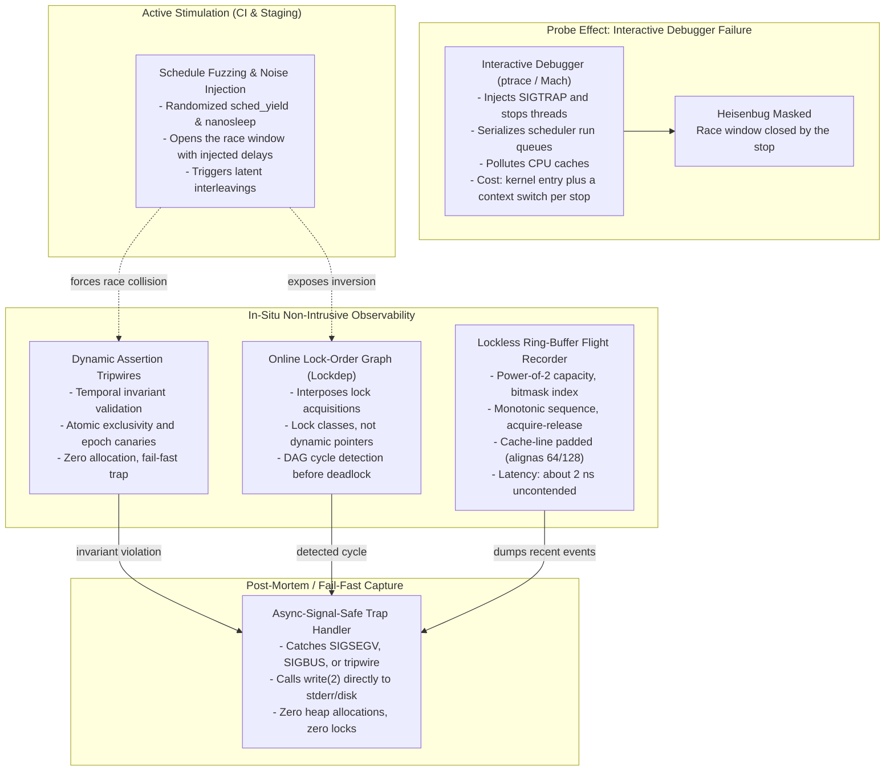

# Debugging Without a Debugger and Concurrency Bugs

> [!summary] Claim:
> Interactive debuggers rely on kernel stop-the-world primitives that perturb thread scheduling, flush hardware caches, and eradicate the nanosecond race windows where concurrency bugs occur.
> Diagnosing live multi-threaded defects in production requires in-situ non-intrusive observability: lockless in-memory circular flight recorders that capture recent state transitions at a cost of a few nanoseconds per event, dynamic assertion tripwires that detect broken temporal invariants before memory corruption propagates, and online lock-order dependency graphs that catch circular wait cycles proactively.
> When combined with deterministic schedule fuzzing to systematically widen race windows during testing, these techniques expose and isolate Heisenbugs without attaching ptrace, altering binary layout, or stopping inferior threads.



## The Mechanism

Concurrency bugs reside in the temporal domain: they manifest when non-deterministic operating system scheduling, store buffer delays, and multi-core cache coherency protocols interleave operations in an unexpected sequence.
Standard interactive debuggers cannot capture these faults because their core observation mechanism alters the temporal dynamics of the inferior process.
Diagnosing concurrency defects in production requires replacing intrusive external breakpoints with low-overhead, in-process diagnostic mechanisms.

### The Probe Effect and Debugger Intrusion

The term probe effect was formalized by Jason Gait in 1986 and expanded by Charles E. McDowell and David P. Helmbold in 1989 to describe how observing a concurrent system inherently alters its execution behavior.
Attaching an interactive debugger such as GDB or LLDB requires the kernel to stop the target process: on Linux `ptrace(PTRACE_ATTACH, ...)` sends the tracee a `SIGSTOP` and the tracee then stops on every signal delivered to it (see [ptrace(2)](https://man7.org/linux/man-pages/man2/ptrace.2.html)), and on Darwin debuggers use the Mach task and exception-port interfaces.
When an interactive breakpoint instruction (`INT3` with opcode `0xCC` on x86-64, or `BRK #0` on AArch64) executes, the CPU traps into the kernel, which stops the inferior and notifies the debugger (a `SIGTRAP` stop reported through `waitpid(2)` on Linux, a Mach exception on Darwin), so every breakpoint hit costs a kernel entry and a context switch to another process.

This stop-the-world intervention incurs severe architectural side effects:
1. It stops the target and hands control to another process: a kernel entry, a context switch to the debugger, and a resume.
   A race window is typically only the few instructions between a shared memory read and the write that depends on it, so any stop of that kind is orders of magnitude longer than the window it is meant to observe.
   This note gives no nanosecond figure for the stop because none was measured; the cost depends on the kernel, the debugger, and the machine.
2. It serializes the operating system scheduler run queues, forcing threads that were executing in parallel on distinct physical CPU cores into sequential scheduling epochs.
3. The trap, the kernel entry, and the debugger's own execution pollute the L1 instruction, L1 data, and L2 caches and the TLB of the trapped core.
   While the thread is stopped, its cache lines can migrate to other cores through ordinary coherency traffic (MESI or MOESI invalidation transitions).

As a result, intermittent race conditions, memory visibility bugs, and timing-dependent deadlocks vanish whenever an interactive debugger attaches, producing classic Heisenbugs.
The architectural mechanics of interactive breakpoints are detailed in [[How-Debuggers-Work-ptrace-Mach-and-Breakpoints]], while hypothesis testing protocols for isolating non-deterministic behavior appear in [[Scientific-Debugging-Delta-Debugging-and-Heisenbugs]].
To observe concurrency defects without masking them, diagnostic instrumentation must execute in-process with predictable, single-digit-nanosecond overhead when uncontended and zero blocking synchronization.

### Lockless In-Memory Flight Recorders

A flight recorder is a continuously updated, in-memory circular buffer that records thread execution events, state machine transitions, and lock acquisitions without performing disk or network I/O on the critical path.
The design draws on the LMAX Disruptor pattern (Martin Thompson et al., 2011), the Linux kernel lockless tracing ring buffer (Steven Rostedt, 2009), and OpenJDK Flight Recorder (JEP 328).

```text
+-----------------------------------------------------------------------------------------------+
| Cache Line 0 (64 B / 128 B) | Cache Line 1 (64 B / 128 B) | Cache Line 2..N (Ring Slots)      |
| alignas(64/128)             | alignas(64/128)             | alignas(64/128)                   |
| atomic<uint64_t>            | atomic<uint64_t>            | struct Event slots[CAPACITY]      |
| write_cursor                | read_cursor                 | [seq | tid | event_id | arg]      |
+-----------------------------------------------------------------------------------------------+
```

The flight recorder architecture enforces five concrete design constraints:
1. **Power-of-Two Sizing:** The buffer capacity $N$ is strictly configured as a power of two ($N = 2^k$).
   Computing the ring index uses a bitwise AND mask (`index = sequence & (N - 1)`), a single ALU instruction, which avoids an integer division instruction (`div`/`idiv` on x86-64, `udiv` on AArch64) whose latency varies by microarchitecture.
   When $N$ is a compile-time constant the compiler already emits the AND for unsigned `%` (Apple clang 21 at `-O2` compiles `s % 16` to `and x0, x0, #0xf` but a runtime divisor to `udiv` plus `msub`), so the explicit mask matters most when capacity is chosen at run time.
2. **Monotonic 64-Bit Sequencing:** Slot reservations increment a 64-bit atomic sequence ticket monotonically.
   At a write rate of 10 million events per second, a 64-bit integer requires about 58,000 years to wrap around ($2^{64} / 10^7$ s is 58,494 years of 365 days), preventing sequence ambiguity.
3. **Cache-Line Alignment:** Independent atomic cursors (`write_cursor` and `read_cursor`) are separated by `alignas(64)` padding directives (or 128 bytes on Apple Silicon M-series, where `sysctl hw.cachelinesize` reports 128 on an M3 Pro (as of 2026-11)).
   This eliminates false sharing, preventing CPU cores from ping-ponging modified cache lines across the interconnect fabric.
4. **Acquire-Release Memory Ordering:** Slot reservation uses relaxed atomic ticketing (`write_cursor.fetch_add(1, std::memory_order_relaxed)`).
   Publishing the written payload requires release semantics (`std::memory_order_release`) or an explicit store fence, ensuring the event payload is fully committed to memory before consumers or signal handlers read the advance.
5. **Async-Signal-Safe Post-Mortem Dumping:** When a crash occurs, a registered signal handler (`SIGSEGV`, `SIGBUS`, `SIGABRT`) extracts the circular buffer and writes its raw contents directly to standard error using the `write(2)` system call.
   Calling `printf`, `malloc`, or acquiring application mutexes inside a signal handler causes deadlock if the thread crashed while holding an internal allocator lock.
   `snprintf` is not on the async-signal-safe list either (signal-safety(7)), so a real handler formats integers by hand into a stack buffer before calling `write(2)`.

### Dynamic Assertion Tripwires and Temporal Invariants

Standard unit tests and static assertions check spatial invariants: pointer non-nullness, array bounds, and structural data invariants.
Concurrency bugs, however, violate temporal invariants: conditions that define legal state transitions across time and relative thread execution ordering.

Common temporal invariants in concurrent systems include:
- Single-writer exclusivity on lock-free or thread-confined structures.
- Monotonic version increments across state updates.
- Strictly ordered state machine progressions (for example, a network socket cannot transition from `DISCONNECTED` to `PROCESSING` without passing through `AUTHENTICATED`).
- State stability across non-atomic read-modify-write intervals.

A dynamic assertion tripwire is an in-situ trap embedded directly into synchronization paths.
Unlike heavy validation passes that lock data structures, a tripwire uses low-overhead atomic primitives to verify invariants inline.

```text
Thread A: enter() -> active_writers.fetch_add(1) -> returns 0 (Valid, enters critical section)
Thread B: enter() -> active_writers.fetch_add(1) -> returns 1 (TRIPWIRE FIRES: Concurrent Writer Detected!)
                   -> rolls back active_writers  -> dumps flight recorder -> abort()
```

If a tripwire fails, it immediately triggers an intentional fail-fast trap (`__builtin_trap()` or `abort()`) before corrupted memory can propagate across other threads or write corrupt records to persistent storage.
The immediate trap captures the exact interleaving in the in-memory flight recorder and generates a deterministic crash report for analysis under [[Core-Dumps-Minidumps-and-Crash-Reporting]].

### Online Lock-Order Acquisition Graphs (GoodLock and Lockdep)

Deadlocks in multi-threaded programs commonly satisfy the four Coffman conditions: mutual exclusion, hold-and-wait, no preemption, and circular wait.
Hierarchical locking models eliminate deadlocks by enforcing a strict partial order on lock acquisitions: if lock $L_A$ precedes lock $L_B$ in the hierarchy, no thread may acquire $L_A$ while holding $L_B$.

Deadlock detection strategies divide into two distinct paradigms:
1. **Reactive Wait-For Graphs (WFG):** The system inspects threads that are currently blocked.
   Nodes in the graph represent threads and locks; directed edges represent allocation and blocking states.
   A cycle in a WFG indicates that a deadlock has already frozen the process.
2. **Proactive Lock Dependency Graphs (LDG):** The system tracks historical lock acquisition order across all threads.
   If Thread 1 acquires lock $A$ and then lock $B$ at time $t_1$, the system records a directed dependency $A \rightarrow B$.
   If Thread 2 later acquires lock $B$ and attempts to acquire lock $A$ at time $t_2$, the system detects a cycle ($A \rightarrow B \rightarrow A$) and alerts immediately, even if Thread 1 is not running and no physical deadlock has occurred.

The foundation of proactive lock dependency analysis was established by Klaus Havelund in 2000 with the GoodLock algorithm and expanded into the Linux kernel by Ingo Molnar (with the initial idea credited to Arjan van de Ven in `kernel/locking/lockdep.c`) in 2006 as Lockdep (`CONFIG_PROVE_LOCKING`), merged in Linux 2.6.18.

To prevent memory exhaustion, Lockdep groups synchronization objects into **lock classes** rather than tracking individual memory addresses.
All mutex instances initialized at the same static program site share a single `lock_class_key`.
When a thread attempts to acquire lock class $B$ while holding lock class $A$, Lockdep traverses its internal directed acyclic graph (DAG) using breadth-first search (`check_noncircular()` calls `__bfs_forwards()` through `check_path()` in `kernel/locking/lockdep.c`).
If a directed path $B \rightarrow^* A$ already exists in the graph, adding the edge $A \rightarrow B$ creates a cycle.
Lockdep immediately turns the validator off for the rest of the boot (`print_circular_bug()` first calls `debug_locks_off_graph_unlock()`, which calls `debug_locks_off()`), then prints a `WARNING: possible circular locking dependency detected` report with the conflicting stack traces.
FreeBSD provides a comparable kernel facility through `witness(4)`, whose manual calls these events lock order violations (the FreeBSD community colloquially calls them LOR, lock order reversal).
In user space, the same idea shipped as liblockdep (`tools/lib/lockdep`, loaded with `LD_PRELOAD` to intercept `pthread_mutex_lock` and `pthread_mutex_unlock`), which is no longer in the Linux tree (gone since 2021 at the latest, when commit `3a49cc22d31e` dropped its leftover headers; absent as of 2026-11); custom RAII wrappers are the common replacement.

### Schedule Fuzzing and Deterministic Interleaving Perturbation

A concurrency defect that eludes testing often has a vulnerability window of only a few CPU clock cycles.
Under normal execution, the operating system scheduler time-slice (under Linux EEVDF a 0.7 ms `sysctl_sched_base_slice` scaled by 1 + ilog2 of the online CPU count capped at 8, so at most 2.8 ms (as of 2026-11, `kernel/sched/fair.c`)) rarely preempts a thread inside that window.
Consequently, running a test suite millions of times under standard scheduling may never trigger the defect.

Schedule fuzzing (also known as noise injection or active testing) was pioneered by Orit Edelstein et al. at IBM in 2002 with ConTest, and expanded by Madanlal Musuvathi et al. at Microsoft Research in 2008 with CHESS.
Schedule fuzzing instruments synchronization primitives, memory barriers, and state transitions with randomized micro-delays and yield requests:
- `sched_yield()`: Voluntarily yields the processor core, forcing the operating system scheduler to dispatch another runnable thread.
- `nanosleep()`: Suspends execution for randomized microsecond durations (for example, 10 to 50 microseconds), allowing concurrent worker threads to advance through their critical sections.
- CPU spin pauses: Inserted spin loops using `_mm_pause()` (x86-64) or `yield` (ARM64) to stall the pipeline without relinquishing the thread context.

Musuvathi and Qadeer introduced **preemption bounding** (PLDI 2007), and the OSDI 2008 CHESS paper states its premise: many bugs are exposed by a few preemptions at particular places, and the authors "have been able to reproduce very serious bugs using just two preemptions" ($k \le 2$); the paper gives no percentage of bugs within that bound.
A delay placed inside the window between a read and the write that depends on it lets another thread finish its own update in that gap.
The lab opens such a window on purpose and loses exactly one update.
How much a random fuzzer widens the window depends on the workload, and this note reports no factor because none was measured.

## Commands and Numbers to Know

The following reference numbers, configuration flags, and kernel parameters govern non-intrusive concurrency debugging and lock validation across modern systems.

| Parameter or Primitive | Value / Scope | Target Platform | Description and Operational Impact |
| :--- | :--- | :--- | :--- |
| Interactive stop cost (`ptrace` on Linux, Mach task and exception ports on Darwin) | No figure: one kernel entry plus a context switch to the tracer per stop; not measured here `(as of 2026-11)` | Both | Masks race windows that are a few instructions long; measure on your own kernel and debugger. |
| Lockless ring buffer append cost | About 2.2 ns single thread and 10.1 to 10.3 ns per event with 4 threads on one cursor (3 runs, Apple M3 Pro, macOS); not measured on Linux here `(as of 2026-11)` | Both | In-memory event record cost using a relaxed `fetch_add` sequence ticket; sharing one cursor across cores is several times dearer than a private ring. |
| CPU Cache Line Alignment | 64 B (x86-64, most AArch64), 128 B (Apple M-series, `sysctl hw.cachelinesize`) `(as of 2026-11)` | Both | Required alignment (`alignas(64)`, or 128 on Apple Silicon) to prevent false sharing on cursor atomics. |
| `CONFIG_PROVE_LOCKING` (Lockdep) | Kernel config `(as of 2026-11)` | Linux | Enables runtime lock dependency validator; has a real CPU cost that the Kconfig help does not quantify, so measure it before enabling it on a canary. |
| `MAX_LOCKDEP_ENTRIES` | 32,768 = `1 << CONFIG_LOCKDEP_BITS` (default 15, range 10-24; 16,384 with `CONFIG_LOCKDEP_SMALL`) `(as of 2026-11)` | Linux | Maximum lock dependency list entries in the kernel Lockdep graph; overflow prints `BUG: MAX_LOCKDEP_ENTRIES too low!`. |
| `MAX_LOCKDEP_CHAINS` | 65,536 = `1 << CONFIG_LOCKDEP_CHAINS_BITS` (default 16, range 10-21; 32,768 with `CONFIG_LOCKDEP_SMALL`) `(as of 2026-11)` | Linux | Maximum unique lock acquisition sequences stored in the kernel hash table. |
| `debug_locks` (read in `/proc/lockdep_stats`); sysctl `/proc/sys/kernel/prove_locking` | `debug_locks` 1 (active), 0 (off) `(as of 2026-11)` | Linux | `debug_locks_off()` clears `debug_locks` after the first report, disabling further validation; `prove_locking` is the runtime switch. |
| `debug.witness.kdb` | 0 (do not enter debugger), non-zero (enter kernel debugger on a lock order violation); defaults on with `WITNESS_KDB` `(as of 2026-11)` | FreeBSD (neither Linux nor macOS) | FreeBSD witness sysctl and loader tunable; Darwin has no witness(4). |
| `sched_yield(2)` with no other runnable thread | No figure: one syscall plus a scheduler pass; not measured on Linux here, so measure it on your kernel (the macOS row below was measured) `(as of 2026-11)` | Linux | Syscall cost to yield the CPU; used to inject preemption noise. |
| `sched_yield(2)` on Apple Silicon | About 100 to 500 ns (104 ns in 3 quiet runs, 118 to 122 ns in 3 independent reruns; 245 to 497 ns in 3 runs while other work was running), Apple M3 Pro `(as of 2026-11)` | macOS | Darwin thread yield cost depends on machine load; perturbs Mach scheduler run queues. |
| 64-bit sequence overflow threshold | > 58,000 years `(as of 2026-11)` | Both | Time required to overflow 64-bit sequence counter at 10,000,000 events/sec ($2^{64} / 10^7$ s). |
| 32-bit sequence overflow threshold | ~429.5 seconds `(as of 2026-11)` | Both | Time required to overflow 32-bit counter at 10,000,000 events/sec (about 7.2 minutes). |
| Lab noise schedule, seed 1 | 1,000 points give 250 yields, 238 spins, 512 no-ops, hash `9d08890d1d417f35`; identical on macOS and Linux `(as of 2026-11)` | Both | A seed names one schedule, so a failing fuzz run can be replayed exactly. |

## Multi-Language Comparison: C++ / Python / Rust

Different language runtimes provide distinct primitives for lockless tracing, dynamic assertions, and lock order validation.

| Capability / Concern | C++ (C++17 / C++20 / C++23) | Python (CPython 3.12 / 3.13 / 3.14) | Rust (1.85+ / 2024 Edition) |
| :--- | :--- | :--- | :--- |
| **In-Memory Flight Recorder** | `std::atomic<uint64_t>` sequence ticketing over pre-allocated array; `alignas(64)` padding; `memory_order_release` publishing. | `collections.deque(maxlen=N)` for GIL runtimes; pre-allocated shared memory, or `sys.monitoring` (PEP 669) callbacks writing into a pre-allocated buffer, in free-threaded builds. | `std::sync::atomic::AtomicU64` over uninitialized buffer; `#[repr(align(64))]` structs; `Ordering::Release` sequence updates. |
| **Dynamic Assertion Tripwires** | Inline atomic CAS exchange (`std::atomic<uint32_t>`); calls `__builtin_trap()` or `abort()` immediately on invariant breach. | Invariant check asserting state variables; calls `os.abort()` or triggers `faulthandler.dump_traceback()` via background thread. | Atomic state CAS check; calls `std::process::abort()` on invariant failure to prevent stack unwinding and preserve memory state. |
| **Lock-Order Graph Validation** | `LD_PRELOAD` interception of `pthread_mutex_lock` or custom RAII lock wrapper (`std::unique_lock`) executing DFS cycle checks. | Custom context manager wrapping `threading.Lock`; builds adjacency graph in TLS; raises `RuntimeError` on detected inversion. | Custom RAII lock guard wrapping `std::sync::Mutex` or the experimental `parking_lot::deadlock` module (Cargo feature `deadlock_detection`), whose `check_deadlock()` a background thread polls to find wait cycles; it ignores waits with a deadline and its reporting is destructive, so use it for diagnosis only (as of 2026-11). |
| **Schedule Fuzzing Primitives** | Injected `sched_yield()` or `std::this_thread::sleep_for()` within synchronization hooks or macro wrappers. | Injected `time.sleep(0)` or programmatic tuning of `sys.setswitchinterval(0.00001)` to maximize thread preemption. | Injected `std::thread::yield_now()` or permutation testing under `loom` model checking in test environments. |
| **Signal-Safe Post-Mortem Dump** | Registered `sigaction` calling raw `write(2)` syscalls directly to `STDERR_FILENO`; zero heap allocations or mutex locks. | `faulthandler.enable()` installs C-level handlers for `SIGSEGV`, `SIGFPE`, `SIGABRT`, `SIGBUS`, and `SIGILL` that write Python tracebacks directly to a file descriptor; `faulthandler.register(signal.SIGSEGV)` raises `RuntimeError: signal 11 cannot be registered, use enable() instead` (verified on CPython 3.15.2). | Custom panic hook or `libc::sigaction` handler calling `libc::write` directly from raw static buffers. |
| **Loom / Sanitizer Handoff** | Hands dynamic race detection to [[Cpp-ThreadSanitizer-and-MemorySanitizer-Internals\|ThreadSanitizer]]. | Hands GIL-free race detection to [[Python-Concurrency-Asyncio-Multiprocessing-and-Free-Threading-Bugs\|Python Concurrency]]. | Hands formal interleaving permutation checks to [[Rust-Miri-Sanitizers-Loom-and-Cargo-Fuzz\|Rust Loom]]. |

## Worked Lab Example

The lab `code/03-Debugging/concurrency_tripwire/` (files `run.sh`, `lab.cpp`, and `expected/<platform>.txt`) runs the whole in-situ toolchain in one deterministic C++17 program.
It is deterministic by construction: where a real race would depend on the scheduler, the lab scripts the interleaving with release/acquire flags, and it checks every claim with `require()` so a broken mechanism exits non-zero.
1. A power-of-two circular flight recorder with a cache-line-aligned cursor and a dump that uses only `write(2)` and hand-formatted integers, also run from a real `SIGUSR1` handler.
2. A lock-order graph (a miniature lockdep, breadth-first like the kernel) behind a real `std::mutex` wrapper that refuses a violating acquisition instead of deadlocking.
3. An atomic exclusivity tripwire fired by a scripted overlap of two writers, with the recorder dumped at the moment of the breach.
4. A seeded noise schedule that replays exactly, and a lost update produced by holding the race window open.

Run it with `make verify LAB=03-Debugging/concurrency_tripwire/` from `code/`.
`run.sh` also rebuilds the program with `-fsanitize=thread` and fails if ThreadSanitizer reports a data race, so the scripted handshakes are known to be race-free.

The core excerpts follow, copied from `lab.cpp`.

```cpp
template <size_t N>
struct FlightRecorder {
    static_assert(N != 0 && (N & (N - 1)) == 0, "capacity must be a power of two");
    static constexpr size_t kMask = N - 1;

    struct Event {
        uint64_t seq;
        uint32_t tid;
        uint32_t id;
        uint64_t arg;
    };

    // The cursor gets its own cache line (64 B here; Apple M-series reports 128 B).
    alignas(64) std::atomic<uint64_t> cursor{0};
    Event ring[N];

    // Relaxed ticketing hands every caller a unique slot; the payload is read only after a
    // happens-before edge (thread join, or the same thread), never concurrently with this write.
    void record(uint32_t tid, uint32_t id, uint64_t arg) {
        uint64_t s = cursor.fetch_add(1, std::memory_order_relaxed);
        ring[s & kMask] = Event{s, tid, id, arg};
    }

    // Prints the last min(count, N) events, oldest first, with write(2) and a stack buffer only.
    void dump(const char* title) const {
        uint64_t end = cursor.load(std::memory_order_relaxed);
        uint64_t begin = end > N ? end - N : 0;
        out(title, cstrlen(title));
        for (uint64_t i = begin; i < end; ++i) {
            const Event& e = ring[i & kMask];
            char line[96];
            char* p = line;
            put_literal(p, "  [seq=");
            put_u64(p, e.seq, 4);
            put_literal(p, "] tid=");
            put_u64(p, e.tid);
            put_literal(p, " event=");
            put_u64(p, e.id);
            put_literal(p, " arg=");
            put_u64(p, e.arg);
            *p++ = '\n';
            out(line, static_cast<size_t>(p - line));
        }
    }

    static size_t cstrlen(const char* s) {
        size_t n = 0;
        while (s[n] != '\0') ++n;
        return n;
    }
};
```

```cpp
class ExclusiveGuard {
public:
    // False means a second writer got in: the tripwire. The failed entry undoes its own increment.
    bool enter() {
        if (writers_.fetch_add(1, std::memory_order_acq_rel) != 0) {
            writers_.fetch_sub(1, std::memory_order_acq_rel);
            return false;
        }
        return true;
    }
    void leave() { writers_.fetch_sub(1, std::memory_order_acq_rel); }

private:
    std::atomic<uint32_t> writers_{0};
};
```

```cpp
// The unsafe read-modify-write. `window` runs between the read and the write: the race window.
template <typename Window>
void racy_increment(std::atomic<int>& x, Window window) {
    int v = x.load(std::memory_order_relaxed);
    window();
    x.store(v + 1, std::memory_order_relaxed);
}
```

### Verified Output

This block is byte-identical to `expected/darwin-arm64.txt` (Apple clang 21.0.0, `c++ -std=c++17 -O2`, as of 2026-11).
The file `expected/linux-aarch64.txt` is byte-identical to it: the lab was run in the pinned Ubuntu 24.04 g++ container as well.
Forty consecutive runs on the macOS host matched the file exactly.

```text
== 1. flight recorder ==
capacity 16, alignof(recorder) = 64
22 events into 16 slots; the dump keeps the newest 16:
  [seq=0006] tid=1 event=100 arg=6
  [seq=0007] tid=1 event=100 arg=7
  [seq=0008] tid=1 event=100 arg=8
  [seq=0009] tid=1 event=100 arg=9
  [seq=0010] tid=1 event=100 arg=10
  [seq=0011] tid=1 event=100 arg=11
  [seq=0012] tid=1 event=100 arg=12
  [seq=0013] tid=1 event=100 arg=13
  [seq=0014] tid=1 event=100 arg=14
  [seq=0015] tid=1 event=100 arg=15
  [seq=0016] tid=1 event=100 arg=16
  [seq=0017] tid=1 event=100 arg=17
  [seq=0018] tid=1 event=100 arg=18
  [seq=0019] tid=1 event=100 arg=19
  [seq=0020] tid=1 event=100 arg=20
  [seq=0021] tid=1 event=100 arg=21
4 threads x 50000 events: tickets=200000 unique-slots=yes per-thread=50000 per-thread-order=yes
== 2. lock-order graph ==
T1 book then account  : ok
T2 account then book  : VIOLATION cycle 1 -> 0 -> 1
T3 account then risk  : ok
T4 risk then book     : VIOLATION cycle 2 -> 0 -> 1 -> 2
T5 book then risk     : ok
== 3. exclusivity tripwire ==
tripwire fired; recorder at that moment:
  [seq=0000] tid=1 event=1 arg=0
  [seq=0001] tid=1 event=2 arg=0
  [seq=0002] tid=2 event=1 arg=0
  [seq=0003] tid=2 event=99 arg=0
control, writers one after the other: tripwire fired = no
== 4. schedule noise ==
seed 1: 1000 points yield=250 spin=238 none=512 hash=9d08890d1d417f35
seed 1 again: hash=9d08890d1d417f35 (replays exactly)
seed 2: hash=3adfa980e45bd0b5 (a different schedule)
noise on 4 threads x 200 atomic increments: sum=800 (correct code stays correct)
two increments, no delay in the window: x=2
two increments, delay held open in the window: x=1 (one update lost)
== 5. signal-safe dump ==
signal handler dump (write(2) only):
  [seq=0003] tid=3 event=200 arg=9
  [seq=0004] tid=3 event=200 arg=16
  [seq=0005] tid=3 event=200 arg=25
  [seq=0006] tid=3 event=200 arg=36
  [seq=0007] tid=3 event=200 arg=49
  [seq=0008] tid=3 event=200 arg=64
  [seq=0009] tid=3 event=200 arg=81
  [seq=0010] tid=3 event=200 arg=100
handler returned, process still alive
lab complete
```

### Reading the Result

1. The recorder keeps the newest 16 of 22 events, sequence numbers 6 to 21, and the 4-thread run proves the relaxed `fetch_add` ticket hands out 200,000 unique slots with each thread's own events in order.
   The dump formats its integers by hand, so the same code ran inside a real signal handler (`snprintf` is not async-signal-safe).
2. The lock-order graph convicts `account then book` because `book then account` ran earlier, although the two never ran at the same time.
   The longer cycle `risk then book` is found through the recorded path `0 -> 1 -> 2`, and `book then risk` is accepted because it agrees with that path.
3. The tripwire fired on the overlap and the dump, taken at the moment of the breach, shows exactly the four events that led to it.
   Dumping at that moment matters because a dump taken after the threads join would show only the newest 16 events, and later activity may have overwritten the ones that mattered.
   The failed entry rolled itself back, so the same guard accepted two writers taking turns.
4. The same seed replayed the same 1,000-point schedule (hash `9d08890d1d417f35`) and seed 2 gave a different one.
   Correct atomic code stayed correct under noise, while the racy read-modify-write lost exactly one update once something held its window open.
   The lab does not claim a rate: a real fuzzer finds such windows by chance, and the lab only shows what happens when one is found.

### Mutation Checks

Each row below was applied to a copy of the lab, run with `python3 -m _harness.verify`, and failed as shown; the file was then restored.

| Mutation | Result |
| :--- | :--- |
| `fetch_add` ticket replaced by a relaxed load then store | FAIL: lost increments detected |
| Ring mask changed to `(N - 1) >> 1` | FAIL: slot written twice or never |
| Dump padding width 4 changed to 1 | FAIL: output differs |
| Lock-order cycle check disabled | FAIL: violations not reported |
| Tripwire test `!= 0` changed to `> 100` | FAIL: tripwire did not fire |
| Failed tripwire entry no longer rolls back | FAIL: control run trips |
| Seed made non-replayable | FAIL: replay check |
| Window read moved after the window | FAIL: no lost update |
| `sigaction` call removed | FAIL: process killed by `SIGUSR1` |
| Handshake loads weakened to relaxed | FAIL: ThreadSanitizer data race |
| Expected file edited (`x=1` to `x=2`) | FAIL: output differs |

## Pitfalls

> [!warning] Pitfall: False sharing on flight recorder sequence cursors
> Placing independent write and read sequence counters in adjacent memory without cache-line padding causes cache lines to bounce between CPU cores on every append.
> Measured on an Apple M3 Pro (as of 2026-11): two threads each incrementing their own atomic counter cost several times more per operation when the counters share a cache line than when they sit 128 B apart, a slowdown of 3.91x to 3.97x over 3 runs on macOS.
> Other CPUs and multi-socket machines will differ, so measure before quoting a factor.
> Always separate atomic cursors with `alignas(64)` on x86-64 and AArch64, or `alignas(128)` on Apple Silicon performance clusters.

> [!warning] Pitfall: Invoking non-async-signal-safe routines in crash dumps
> Extracting a flight recorder inside a signal handler using `printf`, `std::cout`, `malloc`, or logger mutexes causes immediate deadlock if the thread crashed while holding an internal libc or allocator lock.
> Signal handlers must strictly use async-signal-safe system calls defined by POSIX.1-2008, specifically `write(2)` with fixed-size stack buffers.
> `snprintf`, `exit`, and `vfork` are not on that list either (signal-safety(7)); `_exit` and `abort` are.

> [!warning] Pitfall: Relaxed ordering on flight recorder event publication
> Reserving a slot with `cursor.fetch_add(1, std::memory_order_relaxed)` and writing payload fields without an acquire-release fence allows the compiler and hardware out-of-order execution engine to reorder the payload stores past the cursor publication.
> A concurrent dump reader or signal handler may read uninitialized garbage or torn values from the slot.
> Publish slot updates with `std::memory_order_release` or an explicit memory barrier.

> [!warning] Pitfall: Lock instance explosion in userspace lockdep
> Tracking individual lock memory addresses rather than static lock classes causes memory consumption to grow quadratically with the number of allocated data structures.
> If a system instantiates 1,000,000 account objects, an address-based graph requires millions of nodes and edges, exhausting memory and stalling lookups.
> Group locks into static lock classes initialized once per type or subsystem, matching the Linux kernel Lockdep design.

> [!warning] Pitfall: 32-bit sequence counter wraparound
> Using a 32-bit unsigned integer (`uint32_t`) for the monotonic sequence counter causes the ticket to overflow and wrap to zero after 4,294,967,296 events.
> In high-throughput trading or telemetry engines recording 10,000,000 events per second, a 32-bit counter wraps in 429 seconds (about 7.2 minutes), leading to slot corruption and inverted buffer calculations.
> Always allocate 64-bit sequence counters (`uint64_t`).

> [!warning] Pitfall: Testing schedule fuzzing exclusively on strongly ordered (TSO) hardware
> Testing multithreaded code only on x86-64 (which provides strong hardware memory ordering with Total Store Order, though not sequential consistency: stores can still be reordered after later loads) masks missing memory fences and acquire-release bugs.
> When deployed to weakly ordered architectures like AArch64, independent store operations are freely reordered by the CPU pipeline.
> Always execute concurrency schedule fuzzing on both x86-64 and AArch64 hardware.

> [!warning] Pitfall: Blocking synchronization inside assertion tripwires
> Implementing dynamic assertion tripwires using heavy synchronization primitives (such as `std::mutex` or file logging) reintroduces the probe effect by serializing the very operations under observation.
> A tripwire must consist strictly of atomic operations (`fetch_add`, `compare_exchange`), epoch validations, and memory barriers.

## At Scale

Operational strategies for concurrency debugging shift dramatically as an engineering organization scales from an individual developer to a large production fleet.

```text
Local Dev (1-10 cores):      ThreadSanitizer, interactive reproduction, unit stress loops.
CI Pipeline (100-1,000 cores): Schedule fuzzing, noise injection, randomized seed exploration.
Canary Fleet (10-100 nodes):   Userspace Lockdep sampling, dynamic assertion tripwires enabled.
Fleet Prod (10,000+ nodes):   Lockless circular flight recorders, zero-allocation signal dumpers.
```

- **Single Developer (1-10 cores):** An engineer diagnoses reproducible race conditions using dynamic binary instrumentation like ThreadSanitizer ([[Cpp-ThreadSanitizer-and-MemorySanitizer-Internals]]) or Valgrind Helgrind ([[Cpp-Valgrind-Memcheck-Helgrind-and-DRD]]).
  However, these tools impose heavy overhead (ThreadSanitizer documents a typical 5x to 15x slowdown and 5x to 10x memory overhead; Valgrind tools are slower still), making them unsuitable for real-time services.
- **Continuous Integration Pipeline (100-1,000 cores):** CI environments cannot attach interactive debuggers but can run automated stress suites.
  Integrating schedule fuzzing (randomized `sched_yield` and sleep injection) into multi-threaded integration tests exposes latent race conditions within standard test runs, catching Heisenbugs before code merge.
- **Canary and Staging Deployments (10-100 nodes):** Canary instances can tolerate a larger overhead budget than production, set per team.
  Deploying userspace Lockdep via `LD_PRELOAD` or enabling kernel `CONFIG_PROVE_LOCKING` on canary nodes validates lock acquisition orders against real production traffic without risking whole-fleet degradation.
- **Production Fleet (10,000-50,000 nodes):** Production environments cannot tolerate performance degradation or interactive halts.
  Always-on lockless circular flight recorders (consuming less than 1% CPU and bounded memory, the same budget JEP 328 sets for JDK Flight Recorder: at most 1% overhead on SPECjbb2015) run continuously on all nodes.
  When an assertion tripwire or panic occurs, the node dumps its in-memory flight recorder to disk, emits a metric, and restarts cleanly, allowing engineers to diagnose production concurrency defects post-mortem without debugger attachment.

The overhead rows in the next table are budgets chosen for this note, not measurements; the TSan factors are the documented ones.

| Operational Dimension | Local Workstation (1-10 cores) | CI Test Farm (100-1,000 cores) | Production Fleet (10,000-50,000 cores) |
| :--- | :--- | :--- | :--- |
| **Primary Tool** | ThreadSanitizer, GDB, LLDB | Schedule fuzzing, test loops | Lockless flight recorder, tripwires |
| **CPU Overhead Budget** | 400% - 1,400% (Acceptable; TSan 5x-15x) | 20% - 50% (Bounded) | < 1% - 2% (Strict SLA) |
| **Memory Overhead Budget** | 5x - 10x baseline memory (TSan) | 1.5x - 2x baseline memory | Fixed pre-allocated buffer (e.g. 16 MB) |
| **Instrumentation Method** | Compiler instrumentation (`-fsanitize=thread`) | Macro wrappers, runtime yield injection | Pre-allocated in-memory ring buffers |
| **Failure Detection Mode** | Immediate debugger stop or TSan report | Test failure assertions, tripwire traps | Core dump generation, flight recorder log |
| **Production Safety** | Unsafe (halts process, massive latency) | Unsafe (delays throughput) | Safe (lock-free, zero allocation, non-blocking) |

## Practice Drill

> [!tip] Practice Drill:
> Work inside a scratch copy of `code/03-Debugging/concurrency_tripwire/`.
> 1. Run `bash run.sh` and read the output against `expected/`.
> 2. Break one mechanism at a time (for example the `fetch_add` ticket, the lock-order cycle check, or the tripwire test) and confirm the lab fails each time, as in the mutation table.
> 3. Extend the lock-order scenario with a fourth class and an `A -> B -> C -> D` chain, then predict which of the six possible reverse acquisitions the graph rejects before running it.
> 4. Write a variant of the race window in which a seeded `NoiseSchedule` decides, per run, whether the window is held open, and count how often over 1,000 seeds the update is lost; the count is yours to measure and is not a number this note provides.

## Interview Questions

> [!question] L5: Why does attaching an interactive debugger like GDB or LLDB frequently cause intermittent multi-threaded concurrency bugs to disappear?
>
> > [!success]- Answer
> > Attaching an interactive debugger relies on kernel-level stop-the-world mechanisms like `ptrace(2)` or Mach exception ports.
> > When a breakpoint or trace point triggers, the kernel halts inferior threads and initiates a context switch to notify the debugger.
> > The stop costs a kernel entry, a context switch to the debugger, and a resume, whereas a race window is only the few instructions between a read and its dependent write.
> > Furthermore, stopping threads serializes the OS scheduling run queues, and the trap and debugger execution pollute the stopped core's L1/L2 caches and TLB.
> > This is the classic probe effect (Jason Gait, 1986): the act of observing the system alters its temporal dynamics, causing timing-sensitive Heisenbugs to vanish.

> [!question] L5: In a multi-producer lockless circular buffer, why must the buffer capacity be strictly a power of two, and why is `std::memory_order_relaxed` sufficient for slot reservation but insufficient for payload publication?
>
> > [!success]- Answer
> > Power-of-two sizing allows the ring index calculation to execute via a bitwise AND mask (`seq & (CAPACITY - 1)`), a single ALU instruction, avoiding integer division (`div`/`idiv`, or `udiv` on AArch64) whose latency varies by microarchitecture; with a compile-time constant capacity the compiler emits the AND for unsigned `%` anyway, so the gain is for run-time capacities.
> > Reserving a slot with `cursor.fetch_add(1, std::memory_order_relaxed)` is sufficient because the atomic operation itself guarantees a unique, monotonically increasing ticket without requiring cross-variable memory synchronization.
> > However, publishing the written event payload requires `std::memory_order_release` (or an acquire-release commit counter).
> > Relaxed ordering would allow the compiler and CPU out-of-order execution pipeline to reorder payload writes past the cursor update, allowing concurrent readers to consume uninitialized memory or torn data.

> [!question] L6: Predict the output: A producer writes an event to a lockless ring buffer using `memory_order_relaxed` for both payload and cursor store; what does a consumer reading with `memory_order_acquire` observe on x86-64 versus ARM64?
>
> > [!success]- Answer
> > On x86-64 hardware, the processor enforces Total Store Order (TSO), which guarantees that stores are not reordered with other stores (Store-Store ordering is preserved in hardware).
> > As long as the compiler does not reorder the instructions, the consumer on x86-64 will consistently read the correct payload before observing the updated cursor.
> > On ARM64 (a weakly ordered memory architecture), the hardware allows independent stores to retire and propagate to cache coherency interconnects out of order.
> > Consequently, on ARM64, the consumer can intermittently observe the updated cursor while reading stale, uninitialized, or partially written payload bytes, resulting in data corruption.
> > On either architecture the C++ program has a data race on the payload, which is undefined behavior, so the compiler may also reorder the stores; the x86-64 result is luck, not a guarantee.

> [!question] L6: What is the architectural difference between reactive Wait-For Graph (WFG) deadlock detection and proactive Lock Dependency Graph (lockdep) cycle validation, and why does lockdep track lock classes instead of individual lock pointers?
>
> > [!success]- Answer
> > A Wait-For Graph (WFG) is reactive: it inspects threads that are currently blocked, where a cycle indicates an active, frozen deadlock.
> > Lockdep is proactive: it records the historical order of all lock acquisitions ($A \rightarrow B$) regardless of whether threads executed concurrently.
> > If a code path later attempts to acquire $A$ while holding $B$, Lockdep detects the cycle via breadth-first search (`__bfs_forwards()`) and emits a warning immediately, even if no thread blocked.
> > Lockdep tracks static lock classes (groups of locks initialized at the same call site) rather than dynamic lock pointers to prevent an $O(N^2)$ memory explosion.
> > In systems with millions of dynamic data objects (such as inode or socket mutexes), tracking pointers would exhaust kernel memory, whereas lock classes bound graph complexity to static call sites.

> [!question] L6: Debug this: The following signal handler is registered to catch `SIGSEGV` and dump an in-memory flight recorder, but in production incidents the process hangs indefinitely instead of terminating.
>
> Identify the two fatal flaws in this implementation:
> ```cpp
> void crash_handler(int sig) {
>     std::lock_guard<std::mutex> lock(recorder_mutex);
>     printf("Process received signal %d! Dumping events:\n", sig);
>     for (const auto& ev : event_log) {
>         std::cout << "Event: " << ev.id << " Data: " << ev.data << std::endl;
>     }
>     exit(1);
> }
> ```
>
> > [!success]- Answer
> > Flaw 1: Acquiring `recorder_mutex` inside a signal handler is fatal.
> > If the thread crashed while holding `recorder_mutex`, attempting to acquire it again causes an immediate self-deadlock.
> > Flaw 2: Functions like `printf`, `std::cout`, and `exit` are not async-signal-safe according to POSIX.1.
> > Standard I/O streams internally acquire locks on `FILE*` buffers and allocate memory via `malloc`.
> > If the crash occurred while an allocator or I/O lock was held, the signal handler hangs indefinitely.
> > The fix is to use lock-free ring buffers and write directly to `STDERR_FILENO` using the `write(2)` system call.

> [!question] L7: How do you design an assertion tripwire for a concurrent lock-free queue that detects ABA violations and memory corruption with zero cache coherency traffic overhead in the happy path?
>
> > [!success]- Answer
> > A zero-overhead tripwire couples 64-bit monotonic sequence tags (tagged pointers or epoch counters) directly inside the pointer representation or adjacent cache-line metadata.
> > In the happy path, worker threads read the local generation tag and execute their atomic compare-and-swap (CAS) using standard cache-line invalidation.
> > The tripwire check is purely local: before retiring an operation, the thread verifies that the acquired node tag matches the expected generation count.
> > Because the check reads cache lines that are already loaded in L1 cache by the CAS operation, it introduces zero additional inter-socket interconnect traffic.
> > If a thread detects that a node pointer matches but its epoch tag has advanced unexpectedly, the tripwire fires a fail-fast trap (`__builtin_trap()`), freezing the execution state for core dump analysis before invalid memory is accessed.

> [!question] L7: Why is preemption bounding effective in schedule fuzzing, and how does the theoretical bound $k \le 2$ guide testing infrastructure design?
>
> > [!success]- Answer
> > Preemption bounding (introduced by Musuvathi and Qadeer at PLDI 2007 and applied at scale in CHESS, OSDI 2008) rests on the observation that many real-world concurrency bugs depend on a very small number of context switches occurring at critical execution points.
> > A bug requiring $k$ preemptions means that under an adversarial schedule, forcing at most $k$ specific context switches will trigger the race condition.
> > The CHESS authors report reproducing "very serious bugs using just two preemptions"; they give no percentage, so a figure such as "over 90% of bugs have $k \le 2$" is folklore, not a published result.
> > This principle guides testing infrastructure: with $n$ threads executing $k$ steps the full interleaving count grows as $n^k$ (exponential state-space explosion), while interleavings with $c$ preemptions grow only as $k^c$, polynomial for a fixed bound, so harnesses systematically explore schedules with at most 2 preemptions and achieve high bug-finding coverage at tractable cost.

> [!question] L8+: At scale across 50,000 servers running an ultra-low-latency financial matching engine with sub-500 nanosecond SLAs, how do you architect continuous crash telemetry and lock validation without violating latency budgets?
>
> > [!success]- Answer
> > First, eliminate all shared atomic cursors on the hot path: provide each worker thread with a dedicated, thread-local single-producer single-consumer (SPSC) circular flight recorder buffer pinned to isolated huge pages (`MAP_HUGETLB`).
> > Appending an event uses relaxed 64-bit sequence increments and direct structure writes, costing about 2 ns on an Apple M3 Pro when measured on a private ring (this note's measurement), with no cross-core cache invalidation.
> > Second, separate lock validation into canary environments: run userspace Lockdep or kernel `CONFIG_PROVE_LOCKING` on 1% of staging and canary nodes using simulated traffic, completely omitting online lock validation graphs from the 500-nanosecond production path.
> > Third, configure asynchronous out-of-process crash extractors: register a minimal, assembly-level `sigaction` handler that issues an atomic flag store and signals a pre-spawned external crash handler process (the Crashpad model; `vfork()` is not async-signal-safe per signal-safety(7)) to extract the in-memory flight recorders from outside the process, streaming telemetry to central symbol servers ([[Symbol-Servers-and-debuginfod]]) without adding jitter to peer production engines.

## Further Reading

- Jason Gait, *A Probe Effect in Concurrent Programs*, Software: Practice and Experience, 1986: primary paper defining how observation probes and interactive debuggers alter concurrent execution timing.
- Charles E. McDowell and David P. Helmbold, *Debugging Concurrent Programs*, ACM Computing Surveys, 1989: foundational survey detailing breakpoints, event monitoring, and probe effects in parallel software.
- Klaus Havelund, *Using Runtime Analysis to Guide Model Checking of Java Programs*, SPIN 2000: seminal paper introducing the GoodLock algorithm for proactive lock-order cycle detection.
- Orit Edelstein, Eitan Farchi, Yarden Nir, Gil Ratsaby, and Shmuel Ur, *Multithreaded Java program test generation*, IBM Systems Journal, 2002: introduces ConTest and randomized schedule noise injection to expose concurrency bugs.
- Madanlal Musuvathi et al., *Finding and Reproducing Heisenbugs in Concurrent Programs*, OSDI 2008: the seminal paper on systematic concurrency testing, preemption bounding, and the CHESS tool.
- Martin Thompson et al., *LMAX Disruptor: High performance alternative to bounded queues for exchanging data between concurrent threads*, 2011: definitive technical paper on lockless circular ring buffers, cache-line separation, and sequence gating.
- Ingo Molnar and Arjan van de Ven, *Runtime locking correctness validator (lockdep)*, Linux Kernel Documentation, `Documentation/locking/lockdep-design.rst`: authoritative architecture reference for lock classes and online DAG cycle detection in Linux.
- FreeBSD Project, *witness(4) - lock validation facility*, FreeBSD Kernel Interfaces Manual: primary reference for BSD Lock Order Reversal (LOR) detection and DDB integration.
- Jake Edge, *A lockless ring-buffer*, LWN.net, 2009, on Steven Rostedt's design: comprehensive architectural breakdown of the lockless circular buffer design powering the Linux ftrace subsystem.

## Related

- Prerequisites: [[Scientific-Debugging-Delta-Debugging-and-Heisenbugs]]
- Next: [[How-Debuggers-Work-ptrace-Mach-and-Breakpoints]]
- See also: [[14-Low-Latency-Systems/13 - Reliability, Ops & Testing/Observability Without Perturbation|Observability Without Perturbation]]
- Lab: `code/03-Debugging/concurrency_tripwire/`
