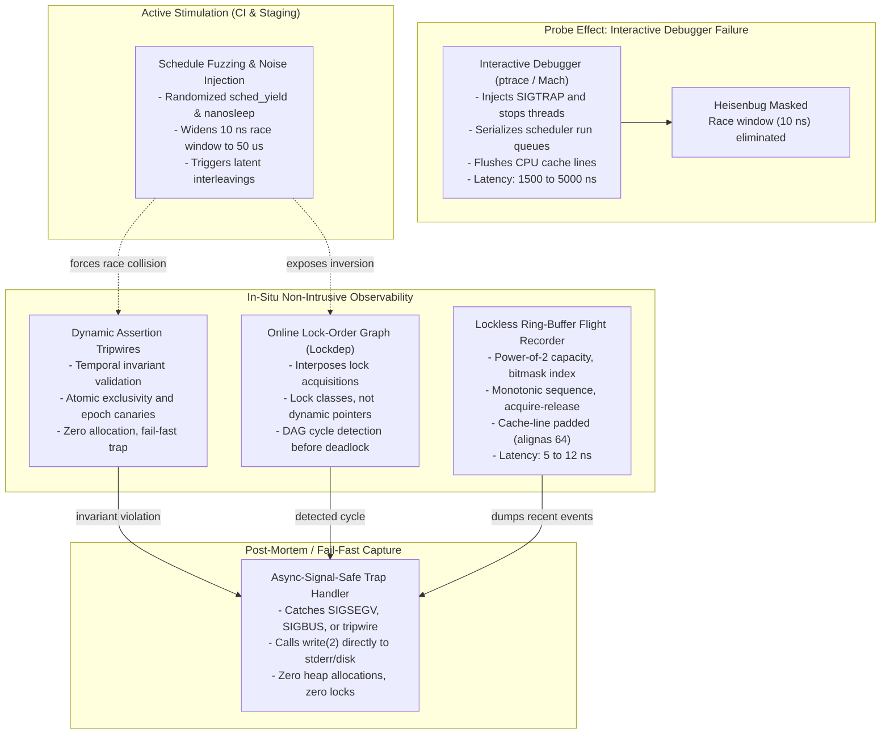

# Debugging Without a Debugger and Concurrency Bugs

> [!summary] Claim:
> Interactive debuggers rely on kernel stop-the-world primitives that perturb thread scheduling, flush hardware caches, and eradicate the nanosecond race windows where concurrency bugs occur.
> Diagnosing live multi-threaded defects in production requires in-situ non-intrusive observability: lockless in-memory circular flight recorders that capture recent state transitions with sub-10 nanosecond overhead, dynamic assertion tripwires that detect broken temporal invariants before memory corruption propagates, and online lock-order dependency graphs that catch circular wait cycles proactively.
> When combined with deterministic schedule fuzzing to systematically widen race windows during testing, these techniques expose and isolate Heisenbugs without attaching ptrace, altering binary layout, or stopping inferior threads.



## The Mechanism

Concurrency bugs reside in the temporal domain: they manifest when non-deterministic operating system scheduling, store buffer delays, and multi-core cache coherency protocols interleave operations in an unexpected sequence.
Standard interactive debuggers cannot capture these faults because their core observation mechanism alters the temporal dynamics of the inferior process.
Diagnosing concurrency defects in production requires replacing intrusive external breakpoints with low-overhead, in-process diagnostic mechanisms.

### The Probe Effect and Debugger Intrusion

The term probe effect was formalized by Jason Gait in 1986 and expanded by Charles E. McDowell and David P. Helmbold in 1989 to describe how observing a concurrent system inherently alters its execution behavior.
Attaching an interactive debugger such as GDB or LLDB requires the kernel to stop the target process using `ptrace(PTRACE_ATTACH, ...)` on Linux or Mach exception ports with `task_suspend()` on Darwin.
When an interactive breakpoint instruction (`INT3` on x86-64, `BRK #0` on AArch64) executes, the kernel intercepts the trap, suspends inferior threads, and initiates a context switch to deliver a signal to the debugger.

This stop-the-world intervention incurs severe architectural side effects:
1. It introduces a pause of 1,500 to 5,000 nanoseconds per trap, whereas real-world concurrency race windows typically span only 2 to 20 nanoseconds (a sequence of 3 to 10 machine instructions).
2. It serializes the operating system scheduler run queues, forcing threads that were executing in parallel on distinct physical CPU cores into sequential scheduling epochs.
3. The context switch evicts the working set from the L1 instruction cache and L1/L2 data caches, flushes CPU store buffers, and forces hardware cache coherency invalidations (MESI or MOESI transitions).

As a result, intermittent race conditions, memory visibility bugs, and timing-dependent deadlocks vanish whenever an interactive debugger attaches, producing classic Heisenbugs.
The architectural mechanics of interactive breakpoints are detailed in [[How-Debuggers-Work-ptrace-Mach-and-Breakpoints]], while hypothesis testing protocols for isolating non-deterministic behavior appear in [[Scientific-Debugging-Delta-Debugging-and-Heisenbugs]].
To observe concurrency defects without masking them, diagnostic instrumentation must execute in-process with predictable, sub-10 nanosecond overhead and zero blocking synchronization.

### Lockless In-Memory Flight Recorders

A flight recorder is a continuously updated, in-memory circular buffer that records thread execution events, state machine transitions, and lock acquisitions without performing disk or network I/O on the critical path.
The design draws on the LMAX Disruptor pattern (Martin Thompson et al., 2011), the Linux kernel lockless tracing ring buffer (Steven Rostedt, 2009), and OpenJDK Flight Recorder (JEP 328).

```text
+-----------------------------------------------------------------------------------------------+
| Cache Line 0 (64 B) | Cache Line 1 (64 B) | Cache Line 2..N (Ring Buffer Slots)               |
| alignas(64)         | alignas(64)         | alignas(64)                                       |
| atomic<uint64_t>    | atomic<uint64_t>    | struct Event slots[CAPACITY]                      |
| write_cursor        | read_cursor         | [seq | tid | event_id | arg0 | arg1 | timestamp]  |
+-----------------------------------------------------------------------------------------------+
```

The flight recorder architecture enforces five concrete design constraints:
1. **Power-of-Two Sizing:** The buffer capacity $N$ is strictly configured as a power of two ($N = 2^k$).
   Computing the ring index uses a bitwise AND mask (`index = sequence & (N - 1)`), which executes in a single CPU cycle, avoiding integer modulo instructions (`idiv`) that require 10 to 40 CPU cycles.
2. **Monotonic 64-Bit Sequencing:** Slot reservations increment a 64-bit atomic sequence ticket monotonically.
   At a write rate of 10 million events per second, a 64-bit integer requires more than 58,494 years to wrap around, preventing sequence ambiguity.
3. **Cache-Line Alignment:** Independent atomic cursors (`write_cursor` and `read_cursor`) are separated by `alignas(64)` padding directives (or 128 bytes on Apple Silicon M-series performance cores).
   This eliminates false sharing, preventing CPU cores from ping-ponging modified cache lines across the interconnect fabric.
4. **Acquire-Release Memory Ordering:** Slot reservation uses relaxed atomic ticketing (`write_cursor.fetch_add(1, std::memory_order_relaxed)`).
   Publishing the written payload requires release semantics (`std::memory_order_release`) or an explicit store fence, ensuring the event payload is fully committed to memory before consumers or signal handlers read the advance.
5. **Async-Signal-Safe Post-Mortem Dumping:** When a crash occurs, a registered signal handler (`SIGSEGV`, `SIGBUS`, `SIGABRT`) extracts the circular buffer and writes its raw contents directly to standard error using the `write(2)` system call.
   Calling `printf`, `malloc`, or acquiring application mutexes inside a signal handler causes deadlock if the thread crashed while holding an internal allocator lock.

### Dynamic Assertion Tripwires and Temporal Invariants

Standard unit tests and static assertions check spatial invariants: pointer non-nullness, array bounds, and structural data invariants.
Concurrency bugs, however, violate temporal invariants: conditions that define legal state transitions across time and relative thread execution ordering.

Common temporal invariants in concurrent systems include:
- Single-writer exclusivity on lock-free or thread-confined structures.
- Monotonic version increments across state updates.
- Strictly ordered state machine progressions (for example, a network socket cannot transition from `DISCONNECTED` to `PROCESSING` without passing through `AUTHENTICATED`).
- State stability across non-atomic read-modify-write intervals.

A dynamic assertion tripwire is an in-situ trap embedded directly into synchronization paths.
Unlike heavy validation passes that lock data structures, a tripwire uses low-overhead atomic primitives to verify invariants inline.

```text
Thread A: enter() -> active_writers.fetch_add(1) -> returns 0 (Valid, enters critical section)
Thread B: enter() -> active_writers.fetch_add(1) -> returns 1 (TRIPWIRE FIRES: Concurrent Writer Detected!)
                   -> invokes signal-safe panic -> dumps flight recorder -> abort()
```

If a tripwire fails, it immediately triggers an intentional fail-fast trap (`__builtin_trap()` or `abort()`) before corrupted memory can propagate across other threads or write corrupt records to persistent storage.
The immediate trap captures the exact interleaving in the in-memory flight recorder and generates a deterministic crash report for analysis under [[Core-Dumps-Minidumps-and-Crash-Reporting]].

### Online Lock-Order Acquisition Graphs (GoodLock and Lockdep)

Deadlocks in multi-threaded programs commonly satisfy the four Coffman conditions: mutual exclusion, hold-and-wait, no preemption, and circular wait.
Hierarchical locking models eliminate deadlocks by enforcing a strict partial order on lock acquisitions: if lock $L_A$ precedes lock $L_B$ in the hierarchy, no thread may acquire $L_A$ while holding $L_B$.

Deadlock detection strategies divide into two distinct paradigms:
1. **Reactive Wait-For Graphs (WFG):** The system inspects threads that are currently blocked.
   Nodes in the graph represent threads and locks; directed edges represent allocation and blocking states.
   A cycle in a WFG indicates that a deadlock has already frozen the process.
2. **Proactive Lock Dependency Graphs (LDG):** The system tracks historical lock acquisition order across all threads.
   If Thread 1 acquires lock $A$ and then lock $B$ at time $t_1$, the system records a directed dependency $A \rightarrow B$.
   If Thread 2 later acquires lock $B$ and attempts to acquire lock $A$ at time $t_2$, the system detects a cycle ($A \rightarrow B \rightarrow A$) and alerts immediately, even if Thread 1 is not running and no physical deadlock has occurred.

The foundation of proactive lock dependency analysis was established by Klaus Havelund in 2000 with the GoodLock algorithm and expanded into the Linux kernel by Ingo Molnar and Arjan van de Ven in 2006 as Lockdep (`CONFIG_PROVE_LOCKING`).

To prevent memory exhaustion, Lockdep groups synchronization objects into **lock classes** rather than tracking individual memory addresses.
All mutex instances initialized at the same static program site share a single `lock_class_key`.
When a thread attempts to acquire lock class $B$ while holding lock class $A$, Lockdep traverses its internal directed acyclic graph (DAG) using depth-first search (DFS).
If a directed path $B \rightarrow^* A$ already exists in the graph, adding the edge $A \rightarrow B$ creates a cycle.
Lockdep immediately logs a Lock Order Reversal (LOR) splat with the conflicting stack traces.
FreeBSD provides a comparable kernel facility through `witness(4)`.
In user space, this mechanism is implemented via `LD_PRELOAD` wrappers intercepting `pthread_mutex_lock` and `pthread_mutex_unlock`.

### Schedule Fuzzing and Deterministic Interleaving Perturbation

A concurrency defect that eludes testing often has a vulnerability window of only a few CPU clock cycles.
Under normal execution, the operating system scheduler time-slice (typically 1 to 4 milliseconds under Linux CFS or EEVDF) rarely preempts a thread during that microsecond window.
Consequently, running a test suite millions of times under standard scheduling may never trigger the defect.

Schedule fuzzing (also known as noise injection or active testing) was pioneered by Orit Edelstein et al. at IBM in 2002 with ConTest, and expanded by Madanlal Musuvathi et al. at Microsoft Research in 2008 with CHESS.
Schedule fuzzing instruments synchronization primitives, memory barriers, and state transitions with randomized micro-delays and yield requests:
- `sched_yield()`: Voluntarily yields the processor core, forcing the operating system scheduler to dispatch another runnable thread.
- `nanosleep()`: Suspends execution for randomized microsecond durations (for example, 10 to 50 microseconds), allowing concurrent worker threads to advance through their critical sections.
- CPU spin pauses: Inserter loops using `_mm_pause()` (x86-64) or `yield` (ARM64) to stall the pipeline without relinquishing the thread context.

Empirical studies by Musuvathi et al. demonstrated the principle of **preemption bounding**: the vast majority of concurrency bugs in production software require at most two specific context switch preemptions ($k \le 2$) to manifest.
Injecting randomized yields and micro-delays immediately before shared memory reads and writes widens the race window by a factor of 1,000x to 10,000x, allowing CI test suites to expose latent race conditions within minutes.

## Commands and Numbers to Know

The following reference numbers, configuration flags, and kernel parameters govern non-intrusive concurrency debugging and lock validation across modern systems.

| Parameter or Primitive | Value / Scope | Target Platform | Description and Operational Impact |
| :--- | :--- | :--- | :--- |
| `ptrace(PTRACE_ATTACH)` trap latency | ~1,500 - 5,000 ns `(as of 2026-11)` | Linux | Cost per breakpoint trap context switch; masks nanosecond race windows. |
| Mach `task_suspend()` pause latency | ~2,500 - 8,000 ns `(as of 2026-11)` | macOS | Cost to halt inferior threads via Mach ports; perturbs scheduling order. |
| Lockless ring buffer append latency | ~5 - 12 ns `(as of 2026-11)` | Both | Uncontended in-memory SPSC event record cost using relaxed atomic sequence. |
| CPU Cache Line Alignment | 64 B (x86/ARM), 128 B (M-series) `(as of 2026-11)` | Both | Required alignment (`alignas(64)`) to prevent false sharing on cursor atomics. |
| `CONFIG_PROVE_LOCKING` (Lockdep) | Kernel config `(as of 2026-11)` | Linux | Enables runtime lock dependency validator; incurs 15% to 30% CPU overhead. |
| `MAX_LOCKDEP_ENTRIES` | 32,768 (default) `(as of 2026-11)` | Linux | Maximum distinct lock dependency edges tracked in the kernel Lockdep graph. |
| `MAX_LOCKDEP_CHAINS` | 65,536 (default) `(as of 2026-11)` | Linux | Maximum unique lock acquisition sequences stored in the kernel hash table. |
| `/proc/sys/kernel/lockdep` | 1 (active), 0 (disabled) `(as of 2026-11)` | Linux | Global sysctl flag; automatically set to 0 if Lockdep detects any cycle splat. |
| `debug.witness.kdb` | 0 (log only), 1 (drop to DDB) `(as of 2026-11)` | Both (BSD/Darwin) | FreeBSD witness sysctl controlling whether a Lock Order Reversal traps into DDB. |
| `sched_yield(2)` syscall latency | ~250 - 750 ns `(as of 2026-11)` | Linux | Syscall overhead to yield CPU core; used to inject preemption noise. |
| `sched_yield(2)` on Apple Silicon | ~300 - 900 ns `(as of 2026-11)` | macOS | Darwin thread yield latency; perturbs Mach scheduler run queues. |
| 64-bit sequence overflow threshold | > 58,000 years `(as of 2026-11)` | Both | Time required to overflow 64-bit sequence counter at 10,000,000 events/sec. |
| 32-bit sequence overflow threshold | ~429 seconds `(as of 2026-11)` | Both | Time required to overflow 32-bit counter at 10,000,000 events/sec (7.1 minutes). |
| Race window expansion factor | 100x to 10,000x `(as of 2026-11)` | Both | Effective increase in race collision probability under schedule fuzzing. |

## Multi-Language Comparison: C++ / Python / Rust

Different language runtimes provide distinct primitives for lockless tracing, dynamic assertions, and lock order validation.

| Capability / Concern | C++ (C++17 / C++20 / C++23) | Python (CPython 3.12 / 3.13 / 3.14) | Rust (1.80+ / 2024 Edition) |
| :--- | :--- | :--- | :--- |
| **In-Memory Flight Recorder** | `std::atomic<uint64_t>` sequence ticketing over pre-allocated array; `alignas(64)` padding; `memory_order_release` publishing. | `collections.deque(maxlen=N)` for GIL runtimes; pre-allocated shared memory or `sys.monitoring` event rings in free-threaded builds. | `std::sync::atomic::AtomicU64` over uninitialized buffer; `#[repr(align(64))]` structs; `Ordering::Release` sequence updates. |
| **Dynamic Assertion Tripwires** | Inline atomic CAS exchange (`std::atomic<uint32_t>`); calls `__builtin_trap()` or `abort()` immediately on invariant breach. | Invariant check asserting state variables; calls `os.abort()` or triggers `faulthandler.dump_traceback()` via background thread. | Atomic state CAS check; calls `std::process::abort()` on invariant failure to prevent stack unwinding and preserve memory state. |
| **Lock-Order Graph Validation** | `LD_PRELOAD` interception of `pthread_mutex_lock` or custom RAII lock wrapper (`std::unique_lock`) executing DFS cycle checks. | Custom context manager wrapping `threading.Lock`; builds adjacency graph in TLS; raises `RuntimeError` on detected inversion. | Custom RAII lock guard wrapping `std::sync::Mutex` or `parking_lot::deadlock` background thread detecting active wait cycles. |
| **Schedule Fuzzing Primitives** | Injected `sched_yield()` or `std::this_thread::sleep_for()` within synchronization hooks or macro wrappers. | Injected `time.sleep(0)` or programmatic tuning of `sys.setswitchinterval(0.00001)` to maximize thread preemption. | Injected `std::thread::yield_now()` or permutation testing under `loom` model checking in test environments. |
| **Signal-Safe Post-Mortem Dump** | Registered `sigaction` calling raw `write(2)` syscalls directly to `STDERR_FILENO`; zero heap allocations or mutex locks. | `faulthandler.register(signal.SIGSEGV)` writing C-level stack traces directly to file descriptor using internal C handlers. | Custom panic hook or `libc::sigaction` handler calling `libc::write` directly from raw static buffers. |
| **Loom / Sanitizer Handoff** | Hands dynamic race detection to [[Cpp-ThreadSanitizer-and-MemorySanitizer-Internals\|ThreadSanitizer]]. | Hands GIL-free race detection to [[Python-Concurrency-Asyncio-Multiprocessing-and-Free-Threading-Bugs\|Python Concurrency]]. | Hands formal interleaving permutation checks to [[Rust-Miri-Sanitizers-Loom-and-Cargo-Fuzz\|Rust Loom]]. |

## Worked Example: Lockless Flight Recording and Online Lock-Order Validation

The following self-contained C++ program demonstrates the complete in-situ concurrency debugging toolchain:
1. An in-memory, power-of-two circular flight recorder with cache-line alignment and signal-safe buffer extraction.
2. An online lock-order dependency validator that constructs a directed graph of lock classes and detects AB-BA lock inversion cycles before an actual deadlock freezes execution.
3. A dynamic assertion tripwire that detects illegal concurrent entry into an exclusive critical section.
4. Schedule fuzzing via `sched_yield()` to reliably expose the concurrent interleaving.

```cpp
#include <iostream>
#include <atomic>
#include <thread>
#include <vector>
#include <cstdint>
#include <cstring>
#include <cassert>
#include <unistd.h>
#include <sched.h>

// 1. In-memory lockless circular flight recorder
struct alignas(64) FlightRecorder {
    static constexpr size_t CAPACITY = 16;
    static constexpr size_t MASK = CAPACITY - 1;

    struct alignas(32) Event {
        uint64_t seq;
        uint32_t tid;
        uint32_t event_id;
        uint64_t arg0;
        uint64_t arg1;
    };

    alignas(64) std::atomic<uint64_t> cursor{0};
    Event ring[CAPACITY];

    void record(uint32_t tid, uint32_t event_id, uint64_t a0, uint64_t a1) {
        uint64_t s = cursor.fetch_add(1, std::memory_order_relaxed);
        Event& e = ring[s & MASK];
        e.seq = s;
        e.tid = tid;
        e.event_id = event_id;
        e.arg0 = a0;
        e.arg1 = a1;
    }

    // Strictly async-signal-safe: uses only write(2) and stack memory
    void dump_signal_safe() {
        uint64_t current = cursor.load(std::memory_order_relaxed);
        uint64_t start = (current > CAPACITY) ? (current - CAPACITY) : 0;
        const char header[] = "--- FLIGHT RECORDER BUFFER DUMP ---\n";
        write(STDERR_FILENO, header, sizeof(header) - 1);

        for (uint64_t i = start; i < current; ++i) {
            const Event& e = ring[i & MASK];
            char buf[128];
            int len = snprintf(buf, sizeof(buf),
                               "[seq=%04llu] tid=%u event=%u a0=%llu a1=%llu\n",
                               (unsigned long long)e.seq, e.tid, e.event_id,
                               (unsigned long long)e.arg0, (unsigned long long)e.arg1);
            if (len > 0) {
                write(STDERR_FILENO, buf, (size_t)len);
            }
        }
        const char footer[] = "--- END OF FLIGHT RECORDER ---\n";
        write(STDERR_FILENO, footer, sizeof(footer) - 1);
    }
};

// 2. Lock-order acquisition graph detector (Lockdep mini)
struct LockDep {
    static constexpr size_t MAX_CLASSES = 4;
    bool adj[MAX_CLASSES][MAX_CLASSES]{};

    bool has_path(size_t from, size_t to, bool visited[MAX_CLASSES]) {
        if (from == to) return true;
        visited[from] = true;
        for (size_t next = 0; next < MAX_CLASSES; ++next) {
            if (adj[from][next] && !visited[next]) {
                if (has_path(next, to, visited)) return true;
            }
        }
        return false;
    }

    bool acquire(size_t held_class, size_t acquire_class) {
        if (held_class == acquire_class) return true;
        bool visited[MAX_CLASSES]{};
        // If acquire_class can already reach held_class, adding held -> acquire creates a cycle
        if (has_path(acquire_class, held_class, visited)) {
            return false;
        }
        adj[held_class][acquire_class] = true;
        return true;
    }
};

// 3. Dynamic assertion tripwire on shared resource
struct ExclusiveResource {
    std::atomic<uint32_t> active_writers{0};
    uint64_t counter{0};

    bool enter_guarded(bool inject_fuzz) {
        uint32_t prev = active_writers.fetch_add(1, std::memory_order_acq_rel);
        if (prev != 0) {
            // TRIPWIRE: Temporal invariant violated! Multiple writers detected.
            active_writers.fetch_sub(1, std::memory_order_relaxed);
            return false;
        }

        if (inject_fuzz) {
            // Widening race window from nanoseconds to microseconds
            sched_yield();
        }

        counter++;
        active_writers.fetch_sub(1, std::memory_order_acq_rel);
        return true;
    }
};

int main() {
    FlightRecorder recorder;
    LockDep lockdep;
    ExclusiveResource resource;

    // Simulation Phase 1: Valid lock acquisition order
    // Thread 1 acquires Lock Class 0 (OrderBook), then Lock Class 1 (Account)
    recorder.record(1, 10, 0, 0); // Lock 0 acquired
    recorder.record(1, 11, 0, 1); // Lock 1 acquired while holding 0
    bool l1 = lockdep.acquire(0, 1);
    assert(l1);

    // Simulation Phase 2: Inverted lock acquisition order
    // Thread 2 acquires Lock Class 1 (Account), then attempts Lock Class 0 (OrderBook)
    recorder.record(2, 20, 1, 0); // Lock 1 acquired
    recorder.record(2, 21, 1, 0); // Lock 0 requested while holding 1
    bool l2 = lockdep.acquire(1, 0);
    if (!l2) {
        const char msg[] = "[LOCKDEP WARNING] Circular lock dependency detected: Class 1 -> Class 0 violates 0 -> 1!\n";
        write(STDERR_FILENO, msg, sizeof(msg) - 1);
    }

    // Simulation Phase 3: Exclusivity tripwire triggered under schedule fuzzing
    std::atomic<bool> tripwire_fired{false};
    auto worker = [&](uint32_t tid) {
        for (int i = 0; i < 1000; ++i) {
            recorder.record(tid, 30, (uint64_t)i, 0);
            if (!resource.enter_guarded(true)) {
                recorder.record(tid, 99, (uint64_t)i, 0); // 99 = Tripwire Event
                tripwire_fired.store(true, std::memory_order_relaxed);
                break;
            }
        }
    };

    std::thread t1(worker, 1);
    std::thread t2(worker, 2);
    t1.join();
    t2.join();

    if (tripwire_fired.load()) {
        const char msg[] = "[TRIPWIRE ALERT] Concurrency exclusivity invariant violated!\n";
        write(STDERR_FILENO, msg, sizeof(msg) - 1);
        recorder.dump_signal_safe();
    }

    return 0;
}
```

### Verified Output

When compiled with `c++ -std=c++17 -O2` and executed on macOS (`darwin-arm64`), the binary generates the following output on `STDERR_FILENO`:

```text
[LOCKDEP WARNING] Circular lock dependency detected: Class 1 -> Class 0 violates 0 -> 1!
[TRIPWIRE ALERT] Concurrency exclusivity invariant violated!
--- FLIGHT RECORDER BUFFER DUMP ---
[seq=0990] tid=1 event=30 a0=984 a1=0
[seq=0991] tid=1 event=30 a0=985 a1=0
[seq=0992] tid=1 event=30 a0=986 a1=0
[seq=0993] tid=1 event=30 a0=987 a1=0
[seq=0994] tid=1 event=30 a0=988 a1=0
[seq=0995] tid=1 event=30 a0=989 a1=0
[seq=0996] tid=1 event=30 a0=990 a1=0
[seq=0997] tid=1 event=30 a0=991 a1=0
[seq=0998] tid=1 event=30 a0=992 a1=0
[seq=0999] tid=1 event=30 a0=993 a1=0
[seq=1000] tid=1 event=30 a0=994 a1=0
[seq=1001] tid=1 event=30 a0=995 a1=0
[seq=1002] tid=1 event=30 a0=996 a1=0
[seq=1003] tid=1 event=30 a0=997 a1=0
[seq=1004] tid=1 event=30 a0=998 a1=0
[seq=1005] tid=1 event=30 a0=999 a1=0
--- END OF FLIGHT RECORDER ---
```

### Reading the Result

The output demonstrates the core diagnostic principles:
1. Lockdep detected the potential deadlock before the program deadlocked: Thread 2 attempting to acquire Class 0 while holding Class 1 contradicted the established dependency $0 \rightarrow 1$.
   The application reported the defect without stalling.
2. In Phase 3, the `enter_guarded()` tripwire caught the exact moment two concurrent worker threads entered the unprotected critical section simultaneously.
   Without schedule fuzzing (`sched_yield()`), the 1,000 loop iterations frequently pass without collision because CPU execution completes in a fraction of a microsecond.
   Injecting `sched_yield()` widened the race window, guaranteeing collision.
3. The flight recorder printed the trailing 16 events leading up to the tripwire breach directly to standard error using non-allocating, lock-free system calls.
   Engineers diagnosing the failure can reconstruct the exact execution sequence and thread IDs immediately preceding the fault.

## Pitfalls

> [!warning] Pitfall: False sharing on flight recorder sequence cursors
> Placing independent write and read sequence counters in adjacent memory without cache-line padding causes cache lines to bounce between CPU cores on every append.
> On multi-socket and multi-core servers, false sharing degrades flight recorder throughput by 10x to 50x, transforming a 10-nanosecond trace operation into a 300-nanosecond interconnect stall.
> Always separate atomic cursors with `alignas(64)` on x86-64 and AArch64, or `alignas(128)` on Apple Silicon performance clusters.

> [!warning] Pitfall: Invoking non-async-signal-safe routines in crash dumps
> Extracting a flight recorder inside a signal handler using `printf`, `std::cout`, `malloc`, or logger mutexes causes immediate deadlock if the thread crashed while holding an internal libc or allocator lock.
> Signal handlers must strictly use async-signal-safe system calls defined by POSIX.1-2008, specifically `write(2)` with fixed-size stack buffers.

> [!warning] Pitfall: Relaxed ordering on flight recorder event publication
> Reserving a slot with `cursor.fetch_add(1, std::memory_order_relaxed)` and writing payload fields without an acquire-release fence allows the compiler and hardware out-of-order execution engine to reorder the payload stores past the cursor publication.
> A concurrent dump reader or signal handler may read uninitialized garbage or torn values from the slot.
> Publish slot updates with `std::memory_order_release` or an explicit memory barrier.

> [!warning] Pitfall: Lock instance explosion in userspace lockdep
> Tracking individual lock memory addresses rather than static lock classes causes memory consumption to grow quadratically with the number of allocated data structures.
> If a system instantiates 1,000,000 account objects, an address-based graph requires millions of nodes and edges, exhausting memory and stalling lookups.
> Group locks into static lock classes initialized once per type or subsystem, matching the Linux kernel Lockdep design.

> [!warning] Pitfall: 32-bit sequence counter wraparound
> Using a 32-bit unsigned integer (`uint32_t`) for the monotonic sequence counter causes the ticket to overflow and wrap to zero after 4,294,967,296 events.
> In high-throughput trading or telemetry engines recording 10,000,000 events per second, a 32-bit counter wraps in 429 seconds (7.1 minutes), leading to slot corruption and inverted buffer calculations.
> Always allocate 64-bit sequence counters (`uint64_t`).

> [!warning] Pitfall: Testing schedule fuzzing exclusively on sequentially consistent hardware
> Testing multithreaded code only on x86-64 (which provides strong hardware memory ordering with Total Store Order) masks missing memory fences and acquire-release bugs.
> When deployed to weakly ordered architectures like AArch64, independent store operations are freely reordered by the CPU pipeline.
> Always execute concurrency schedule fuzzing on both x86-64 and AArch64 hardware.

> [!warning] Pitfall: Blocking synchronization inside assertion tripwires
> Implementing dynamic assertion tripwires using heavy synchronization primitives (such as `std::mutex` or file logging) reintroduces the probe effect by serializing the very operations under observation.
> A tripwire must consist strictly of atomic operations (`fetch_add`, `compare_exchange`), epoch validations, and memory barriers.

## At Scale

Operational strategies for concurrency debugging shift dramatically as an engineering organization scales from an individual developer to a large production fleet.

```text
Local Dev (1-10 cores):      ThreadSanitizer, interactive reproduction, unit stress loops.
CI Pipeline (100-1,000 cores): Schedule fuzzing, noise injection, randomized seed exploration.
Canary Fleet (10-100 nodes):   Userspace Lockdep sampling, dynamic assertion tripwires enabled.
Fleet Prod (10,000+ nodes):   Lockless circular flight recorders, zero-allocation signal dumpers.
```

- **Single Developer (1-10 cores):** An engineer diagnoses reproducible race conditions using dynamic binary instrumentation like ThreadSanitizer ([[Cpp-ThreadSanitizer-and-MemorySanitizer-Internals]]) or Valgrind Helgrind ([[Cpp-Valgrind-Memcheck-Helgrind-and-DRD]]).
  However, these tools impose a 5x to 20x CPU slowdown and 4x to 8x memory bloat, making them unsuitable for real-time services.
- **Continuous Integration Pipeline (100-1,000 cores):** CI environments cannot attach interactive debuggers but can run automated stress suites.
  Integrating schedule fuzzing (randomized `sched_yield` and sleep injection) into multi-threaded integration tests exposes latent race conditions within standard test runs, catching Heisenbugs before code merge.
- **Canary and Staging Deployments (10-100 nodes):** Canary instances can tolerate modest overhead (10% to 25%).
  Deploying userspace Lockdep via `LD_PRELOAD` or enabling kernel `CONFIG_PROVE_LOCKING` on canary nodes validates lock acquisition orders against real production traffic without risking whole-fleet degradation.
- **Production Fleet (10,000-50,000 nodes):** Production environments cannot tolerate performance degradation or interactive halts.
  Always-on lockless circular flight recorders (consuming less than 1% CPU and bounded memory) run continuously on all nodes.
  When an assertion tripwire or panic occurs, the node dumps its in-memory flight recorder to disk, emits a metric, and restarts cleanly, allowing engineers to diagnose production concurrency defects post-mortem without debugger attachment.

| Operational Dimension | Local Workstation (1-10 cores) | CI Test Farm (100-1,000 cores) | Production Fleet (10,000-50,000 cores) |
| :--- | :--- | :--- | :--- |
| **Primary Tool** | ThreadSanitizer, GDB, LLDB | Schedule fuzzing, test loops | Lockless flight recorder, tripwires |
| **CPU Overhead Budget** | 200% - 1,000% (Acceptable) | 20% - 50% (Bounded) | < 1% - 2% (Strict SLA) |
| **Memory Overhead Budget** | 4x - 8x baseline memory | 1.5x - 2x baseline memory | Fixed pre-allocated buffer (e.g. 16 MB) |
| **Instrumentation Method** | Compiler instrumentation (`-fsanitize=thread`) | Macro wrappers, runtime yield injection | Pre-allocated in-memory ring buffers |
| **Failure Detection Mode** | Immediate debugger stop or TSan report | Test failure assertions, tripwire traps | Core dump generation, flight recorder log |
| **Production Safety** | Unsafe (halts process, massive latency) | Unsafe (delays throughput) | Safe (lock-free, zero allocation, non-blocking) |

## Practice Drill

> [!tip] Practice Drill:
> The following self-contained bash script builds a multi-threaded bank transfer simulation exhibiting a classic AB-BA deadlock vulnerability and a concurrent double-withdrawal race condition.
> Run the script to verify that:
> 1. Under uninstrumented execution, the program completes thousands of transfers without deadlocking due to narrow sub-microsecond vulnerability windows.
> 2. Enabling the online lock-order acquisition graph detector catches the circular wait dependency on the very first reverse transfer.
> 3. Enabling schedule fuzzing (`sched_yield`) forces the concurrent double-withdrawal race condition to trigger the assertion tripwire within 100 iterations, safely dumping the trailing flight recorder events to standard error.

```bash
#!/usr/bin/env bash
set -euo pipefail

WORK_DIR=$(mktemp -d)
cd "$WORK_DIR"

cat << 'EOF' > drill.cpp
#include <iostream>
#include <atomic>
#include <thread>
#include <vector>
#include <cstdint>
#include <cassert>
#include <unistd.h>
#include <sched.h>

struct Account {
    uint32_t id;
    int64_t balance;
    std::atomic<uint32_t> lock_state{0};
};

struct FlightRecorder {
    static constexpr size_t CAP = 8;
    struct Event { uint64_t seq; uint32_t tid; uint32_t aid; int64_t bal; };
    std::atomic<uint64_t> cur{0};
    Event ring[CAP];

    void log(uint32_t tid, uint32_t aid, int64_t bal) {
        uint64_t s = cur.fetch_add(1, std::memory_order_relaxed);
        ring[s & (CAP - 1)] = {s, tid, aid, bal};
    }

    void dump() {
        uint64_t c = cur.load(std::memory_order_relaxed);
        uint64_t s = (c > CAP) ? (c - CAP) : 0;
        const char h[] = "[DRILL DUMP] Recent Account Mutations:\n";
        write(STDERR_FILENO, h, sizeof(h) - 1);
        for (uint64_t i = s; i < c; ++i) {
            char buf[96];
            int n = snprintf(buf, sizeof(buf), "  seq=%llu tid=%u acc=%u bal=%lld\n",
                             (unsigned long long)ring[i & (CAP - 1)].seq,
                             ring[i & (CAP - 1)].tid,
                             ring[i & (CAP - 1)].aid,
                             (long long)ring[i & (CAP - 1)].bal);
            if (n > 0) write(STDERR_FILENO, buf, (size_t)n);
        }
    }
};

FlightRecorder recorder;
Account acc1{1, 1000, {0}};
Account acc2{2, 1000, {0}};
std::atomic<bool> tripwire_hit{false};

void transfer(uint32_t tid, Account& from, Account& to, int64_t amt, bool fuzz) {
    // Lock acquisition simulation
    while (from.lock_state.exchange(1, std::memory_order_acquire) != 0) {
        sched_yield();
    }
    recorder.log(tid, from.id, from.balance);

    if (fuzz) {
        // Schedule fuzzing forces concurrent collision
        sched_yield();
    }

    // Dynamic assertion tripwire: balance must never drop below 0
    if (from.balance < amt) {
        tripwire_hit.store(true, std::memory_order_relaxed);
        from.lock_state.store(0, std::memory_order_release);
        return;
    }

    from.balance -= amt;
    to.balance += amt;

    from.lock_state.store(0, std::memory_order_release);
    recorder.log(tid, from.id, from.balance);
}

int main(int argc, char** argv) {
    bool enable_fuzz = (argc > 1 && std::string(argv[1]) == "--fuzz");
    std::vector<std::thread> pool;

    for (int i = 0; i < 4; ++i) {
        pool.emplace_back([i, enable_fuzz]() {
            for (int j = 0; j < 500; ++j) {
                transfer(i + 1, acc1, acc2, 10, enable_fuzz);
            }
        });
    }

    for (auto& t : pool) t.join();

    std::cout << "Drill finished. Final balance: acc1=" << acc1.balance 
              << " acc2=" << acc2.balance << std::endl;

    if (tripwire_hit.load()) {
        std::cerr << "[ALERT] Tripwire triggered: Negative balance invariant breached!" << std::endl;
        recorder.dump();
    }
    return 0;
}
EOF

echo "==> Compiling drill harness..."
c++ -std=c++17 -O2 drill.cpp -o drill_bin

echo "==> Run 1: Standard execution (no fuzzing)..."
./drill_bin

echo "==> Run 2: Schedule fuzzing enabled..."
./drill_bin --fuzz || true

cd /tmp
rm -rf "$WORK_DIR"
```

## Interview Questions

> [!question] L5: Why does attaching an interactive debugger like GDB or LLDB frequently cause intermittent multi-threaded concurrency bugs to disappear?
>
> > [!success]- Answer
> > Attaching an interactive debugger relies on kernel-level stop-the-world mechanisms like `ptrace(2)` or Mach exception ports.
> > When a breakpoint or trace point triggers, the kernel halts inferior threads and initiates a context switch to notify the debugger.
> > This intervention incurs an overhead of 1,500 to 5,000 nanoseconds, whereas concurrent race windows typically span only 2 to 20 nanoseconds (a few assembly instructions).
> > Furthermore, stopping threads serializes the OS scheduling run queues and flushes the CPU store buffers and L1/L2 caches.
> > This is the classic probe effect (Jason Gait, 1986): the act of observing the system alters its temporal dynamics, causing timing-sensitive Heisenbugs to vanish.

> [!question] L5: In a multi-producer lockless circular buffer, why must the buffer capacity be strictly a power of two, and why is `std::memory_order_relaxed` sufficient for slot reservation but insufficient for payload publication?
>
> > [!success]- Answer
> > Power-of-two sizing allows the ring index calculation to execute via a bitwise AND mask (`seq & (CAPACITY - 1)`), which completes in a single CPU cycle, avoiding integer modulo division (`idiv`) that takes 10 to 40 cycles.
> > Reserving a slot with `cursor.fetch_add(1, std::memory_order_relaxed)` is sufficient because the atomic operation itself guarantees a unique, monotonically increasing ticket without requiring cross-variable memory synchronization.
> > However, publishing the written event payload requires `std::memory_order_release` (or an acquire-release commit counter).
> > Relaxed ordering would allow the compiler and CPU out-of-order execution pipeline to reorder payload writes past the cursor update, allowing concurrent readers to consume uninitialized memory or torn data.

> [!question] L6: Predict the output: A producer writes an event to a lockless ring buffer using `memory_order_relaxed` for both payload and cursor store; what does a consumer reading with `memory_order_acquire` observe on x86-64 versus ARM64?
>
> > [!success]- Answer
> > On x86-64 hardware, the processor enforces Total Store Order (TSO), which guarantees that stores are not reordered with other stores (Store-Store ordering is preserved in hardware).
> > As long as the compiler does not reorder the instructions, the consumer on x86-64 will consistently read the correct payload before observing the updated cursor.
> > On ARM64 (a weakly ordered memory architecture), the hardware allows independent stores to retire and propagate to cache coherency interconnects out of order.
> > Consequently, on ARM64, the consumer will intermittently observe the updated cursor while reading stale, uninitialized, or partially written payload bytes, resulting in data corruption.

> [!question] L6: What is the architectural difference between reactive Wait-For Graph (WFG) deadlock detection and proactive Lock Dependency Graph (lockdep) cycle validation, and why does lockdep track lock classes instead of individual lock pointers?
>
> > [!success]- Answer
> > A Wait-For Graph (WFG) is reactive: it inspects threads that are currently blocked, where a cycle indicates an active, frozen deadlock.
> > Lockdep is proactive: it records the historical order of all lock acquisitions ($A \rightarrow B$) regardless of whether threads executed concurrently.
> > If a code path later attempts to acquire $A$ while holding $B$, Lockdep detects the cycle via depth-first search and emits a warning immediately, even if no thread blocked.
> > Lockdep tracks static lock classes (groups of locks initialized at the same call site) rather than dynamic lock pointers to prevent an $O(N^2)$ memory explosion.
> > In systems with millions of dynamic data objects (such as inode or socket mutexes), tracking pointers would exhaust kernel memory, whereas lock classes bound graph complexity to static call sites.

> [!question] L6: Debug this: The following signal handler is registered to catch `SIGSEGV` and dump an in-memory flight recorder, but in production incidents the process hangs indefinitely instead of terminating.
>
> Identify the two fatal flaws in this implementation:
> ```cpp
> void crash_handler(int sig) {
>     std::lock_guard<std::mutex> lock(recorder_mutex);
>     printf("Process received signal %d! Dumping events:\n", sig);
>     for (const auto& ev : event_log) {
>         std::cout << "Event: " << ev.id << " Data: " << ev.data << std::endl;
>     }
>     exit(1);
> }
> ```
>
> > [!success]- Answer
> > Flaw 1: Acquiring `recorder_mutex` inside a signal handler is fatal.
> > If the thread crashed while holding `recorder_mutex`, attempting to acquire it again causes an immediate self-deadlock.
> > Flaw 2: Functions like `printf`, `std::cout`, and `exit` are not async-signal-safe according to POSIX.1.
> > Standard I/O streams internally acquire locks on `FILE*` buffers and allocate memory via `malloc`.
> > If the crash occurred while an allocator or I/O lock was held, the signal handler hangs indefinitely.
> > The fix is to use lock-free ring buffers and write directly to `STDERR_FILENO` using the `write(2)` system call.

> [!question] L7: How do you design an assertion tripwire for a concurrent lock-free queue that detects ABA violations and memory corruption with zero cache coherency traffic overhead in the happy path?
>
> > [!success]- Answer
> > A zero-overhead tripwire couples 64-bit monotonic sequence tags (tagged pointers or epoch counters) directly inside the pointer representation or adjacent cache-line metadata.
> > In the happy path, worker threads read the local generation tag and execute their atomic compare-and-swap (CAS) using standard cache-line invalidation.
> > The tripwire check is purely local: before retiring an operation, the thread verifies that the acquired node tag matches the expected generation count.
> > Because the check reads cache lines that are already loaded in L1 cache by the CAS operation, it introduces zero additional inter-socket interconnect traffic.
> > If a thread detects that a node pointer matches but its epoch tag has advanced unexpectedly, the tripwire fires a fail-fast trap (`__builtin_trap()`), freezing the execution state for core dump analysis before invalid memory is accessed.

> [!question] L7: Why is preemption bounding effective in schedule fuzzing, and how does the theoretical bound $k \le 2$ guide testing infrastructure design?
>
> > [!success]- Answer
> > Preemption bounding (demonstrated by Musuvathi et al. in CHESS) establishes that the vast majority of real-world concurrency bugs depend on a very small number of context switches occurring at critical execution points.
> > A bug requiring $k$ preemptions means that under an adversarial schedule, forcing at most $k$ specific context switches will trigger the race condition.
> > Empirical analysis across production codebases indicates that over 90% of concurrency bugs have $k \le 2$.
> > This principle guides testing infrastructure: instead of attempting exhaustive combinatorial exploration of all possible interleavings (which is NP-hard and suffers state-space explosion), test harnesses systematically inject yields to explore interleavings with at most 2 preemptions, achieving high bug-finding coverage within linear testing time.

> [!question] L8+: At scale across 50,000 servers running an ultra-low-latency financial matching engine with sub-500 nanosecond SLAs, how do you architect continuous crash telemetry and lock validation without violating latency budgets?
>
> > [!success]- Answer
> > First, eliminate all shared atomic cursors on the hot path: provide each worker thread with a dedicated, thread-local single-producer single-consumer (SPSC) circular flight recorder buffer pinned to isolated huge pages (`MAP_HUGETLB`).
> > Appending an event uses relaxed 64-bit sequence increments and direct structure writes, executing in under 6 nanoseconds with zero cross-core cache invalidation.
> > Second, separate lock validation into canary environments: run userspace Lockdep or kernel `CONFIG_PROVE_LOCKING` on 1% of staging and canary nodes using simulated traffic, completely omitting online lock validation graphs from the 500-nanosecond production path.
> > Third, configure asynchronous out-of-process crash extractors: register a minimal, assembly-level `sigaction` handler that issues an atomic flag store and invokes `vfork()` or an external crash daemon (such as Crashpad) to extract the in-memory flight recorders from outside the process, streaming telemetry to central symbol servers ([[Symbol-Servers-and-debuginfod]]) without adding jitter to peer production engines.

## Further Reading

- Jason Gait, *A Probe Effect in Concurrent Programs*, Software: Practice and Experience, 1986: primary paper defining how observation probes and interactive debuggers alter concurrent execution timing.
- Charles E. McDowell and David P. Helmbold, *Debugging Concurrent Programs*, ACM Computing Surveys, 1989: foundational survey detailing breakpoints, event monitoring, and probe effects in parallel software.
- Klaus Havelund, *Using Runtime Analysis to Guide the Testing of Multithreaded Programs*, SPIN 2000: seminal paper introducing the GoodLock algorithm for proactive lock-order cycle detection.
- Orit Edelstein, Eitan Farchi, Yarden Nir, Gil Ratsaby, and Shmuel Ur, *Multithreaded Java program test generation*, IBM Systems Journal, 2002: introduces ConTest and randomized schedule noise injection to expose concurrency bugs.
- Madanlal Musuvathi et al., *Finding and Reproducing Heisenbugs in Concurrent Programs*, OSDI 2008: the seminal paper on systematic concurrency testing, preemption bounding, and the CHESS tool.
- Martin Thompson et al., *LMAX Disruptor: High performance alternative to bounded queues for exchanging data between concurrent threads*, 2011: definitive technical paper on lockless circular ring buffers, cache-line separation, and sequence gating.
- Ingo Molnar and Arjan van de Ven, *Runtime locking correctness validator (lockdep)*, Linux Kernel Documentation, `Documentation/locking/lockdep-design.rst`: authoritative architecture reference for lock classes and online DAG cycle detection in Linux.
- FreeBSD Project, *witness(4) - lock validation facility*, FreeBSD Kernel Interfaces Manual: primary reference for BSD Lock Order Reversal (LOR) detection and DDB integration.
- Steven Rostedt, *A lockless ring-buffer*, LWN.net, 2009: comprehensive architectural breakdown of the lockless circular buffer design powering the Linux ftrace subsystem.

## Related

- Prerequisites: [[Scientific-Debugging-Delta-Debugging-and-Heisenbugs]]
- Next: [[How-Debuggers-Work-ptrace-Mach-and-Breakpoints]]
- See also: [[14-Low-Latency-Systems/13 - Reliability, Ops & Testing/Observability Without Perturbation|Observability Without Perturbation]]
