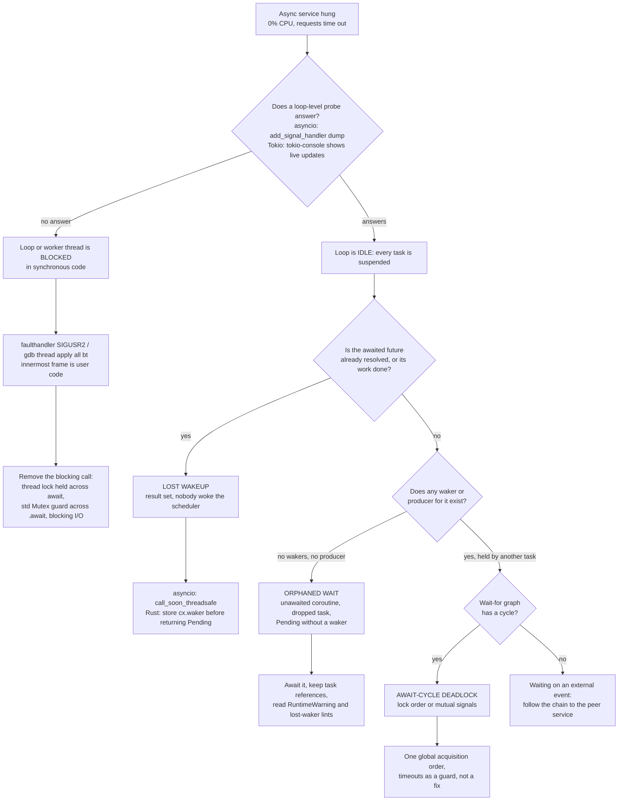

# Drill: Debugging Asyncio and Tokio Deadlock

> [!summary] Scope
> This problem note presents a guided-to-blind scenario diagnosing a live task deadlock across Python asyncio and Rust Tokio services without restarting the process.
> It tests inspection of pending tasks, detection of unawaited futures, and identification of lost wakers using live diagnostic tools.
> It validates mastery of concepts taught in Python-Concurrency-Asyncio-Multiprocessing-and-Free-Threading-Bugs and Rust-Async-Debugging-tokio-console-and-tracing.

A hung async service is one of four different bugs that look identical from outside: zero CPU, no log lines, requests timing out.
The first question is never "where is the deadlock" but "is the event loop thread free or blocked", because that answer decides which tool can see anything at all.
This drill owns the triage procedure across both runtimes.
The asyncio mechanisms (the event loop, `Task`, `Future`, locks) are owned by [[Python-Concurrency-Asyncio-Multiprocessing-and-Free-Threading-Bugs]], and the Tokio instrumentation (`console-subscriber`, `tracing`, task states) by [[Rust-Async-Debugging-tokio-console-and-tracing]].
Thread-level hangs in C extensions belong to [[Python-Debugging-Hung-Processes-and-C-Extensions]], and mutex graphs in native code to [[Cpp-Playbook-Deadlocks-and-Livelocks]].

## Reproduction

The lab lives in `code/03-Debugging/drill_async_deadlock/` and runs with `bash run.sh`.
It needs Python 3.14 or newer (for `asyncio.capture_call_graph`) and `cargo`; it uses no crates and no network, so it has no `# requires:` tag.
It was run only on darwin-arm64; no Linux run exists, and a Linux host with a system Python older than 3.14 (Ubuntu 24.04 ships 3.12) stops with `FAIL: needs Python 3.14+`.
It was recorded on darwin-arm64 (macOS 27.2) with Python 3.15.2 and cargo 1.99.0 (as of 2026-11, macOS).

Part 1 starts `service.py` as a child process in six modes and plays the on-call engineer from `drive.py`.
The service installs two probes before it starts, which is the whole point: a probe that is not installed before the hang cannot be added without a restart, unless the platform allows external attach.
- SIGUSR1 goes to `loop.add_signal_handler(signal.SIGUSR1, dump_tasks)`, which runs `dump_tasks` as an ordinary loop callback; it prints every task, its await chain from `asyncio.capture_call_graph`, and the lock it waits on.
- SIGUSR2 goes to `faulthandler.register(signal.SIGUSR2, all_threads=True)`, which dumps the Python stack of every thread from a C signal handler and needs no cooperation from the loop.

Part 2 builds `rust/`, a single-threaded executor of about 300 lines that counts waker clones, drops, and wakes per task, the same events Tokio emits on its `tokio::task::waker` tracing target, and prints an audit when it stalls.
Tokio itself is not built, because the crate download would add a `network` requirement; the commands for the real runtime are in the Model Solution and are documentation, not lab output.

## Observed Symptom

Four services hang.
From outside, each shows the same thing: the process is alive, it uses no CPU, and nothing is logged.
The only lab output the operator has before investigating is the hang itself (lab output, darwin-arm64):

```text
=== Scenario 1: lock-order deadlock (asyncio.Lock) ===
hung after 0.5 s: yes
```

For Scenario 3, the external symptom before triage is (lab output, darwin-arm64):

```text
=== Scenario 3: lost wakeup (Future resolved from another thread) ===
producer: result delivered
consumer still hung 0.5 s after the result was set: yes
```

Scenario 3 is the nasty one: the producer reports success, and the consumer still never runs.
Scenario 2 does not hang forever only because its waiter has an `asyncio.timeout(0.3)` guard; without the guard it would wait forever with nothing pending.
Scenario 4 hangs in a way that makes the first probe silent.
The Rust executor in Part 2 simply stops with three of four tasks unfinished and an empty run queue.

Your task: without restarting any process, classify each hang, name the line that causes it, and give the fix.

## Progressive Hint Ladder

> [!tip]- Hint 1: Ask the loop before you ask the code
> Send SIGUSR1 first.
> If the task dump appears, the loop thread is free and every task is parked on an `await`; the bug is in who should wake whom.
> If nothing appears within a second, the loop thread itself is stuck in synchronous code, and only a thread-level tool (faulthandler, gdb, lldb) can see it.

> [!tip]- Hint 2: Read the whole await chain, not one frame
> `Task.get_stack()` returns only one frame for a suspended coroutine, and it is the task's own outermost coroutine (`transfer`), not the inner await point, so it does not even tell you the task is in `Lock.acquire`, let alone why (asyncio-task docs; checked on Python 3.15.2, as of 2026-11, Both).
> `asyncio.capture_call_graph(task)` (Python 3.14+) walks the chain of awaiting coroutines and also reports which task awaits this one (`awaited_by`).
> In the lab the `call_stack` tuple printed innermost first: `Lock.acquire -> OwnedLock.acquire -> _ContextManagerMixin.__aenter__ -> transfer`.

> [!tip]- Hint 3: asyncio.Lock has no owner
> `asyncio.Lock` stores only `_locked` and a deque of waiter futures (`Lib/asyncio/locks.py`); it never records which task holds it.
> A wait-for graph needs both edges, "task waits on lock" and "lock is held by task".
> The first edge is in the frame locals of the suspended `acquire` frame (`frame.f_locals["self"]`); the second needs an owner-tracking lock, which the lab's `OwnedLock` subclass provides.

> [!tip]- Hint 4: A future can be done while its waiter sleeps
> `Future.set_result` does not resume the awaiting task; it schedules the task's wakeup callback with `loop.call_soon`.
> `call_soon` only appends to the loop's ready queue, and the loop is asleep in `select()` with no timeout.
> Ask what writes to the loop's self-pipe, and notice which of your two signals changes the outcome.

> [!tip]- Hint 5: Count the wakers
> A Rust future that returns `Poll::Pending` promises that something holds a clone of `cx.waker()` and will call `wake`.
> If a pending, non-running, non-scheduled task has zero live wakers, nothing in the program can ever poll it again; that is the condition tokio-console's lost-waker lint checks.
> If it has live wakers, find who holds them and what that holder is waiting for.

## Model Solution

> [!success]- Solution
> **Scenario 1: an await cycle on two `asyncio.Lock`s.**
> SIGUSR1 answers, so the loop is idle.
> The dump (lab output, darwin-arm64) shows both workers suspended in `Lock.acquire`, each waiting on the lock the other holds:
>
> ```text
> SIGUSR1 dump answered: yes
> task Task-1: awaited by -; stack: TaskGroup._aexit -> TaskGroup.__aexit__ -> lockorder -> main.<locals>.entry
> task transfer-ab: awaited by Task-1; stack: Lock.acquire -> OwnedLock.acquire -> _ContextManagerMixin.__aenter__ -> transfer
>   waits on lock B, held by transfer-ba
> task transfer-ba: awaited by Task-1; stack: Lock.acquire -> OwnedLock.acquire -> _ContextManagerMixin.__aenter__ -> transfer
>   waits on lock A, held by transfer-ab
> wait-for cycle: transfer-ab -> transfer-ba -> transfer-ab
> terminated with SIGTERM: yes
> fix (one global lock order): exit 0, transfers completed: 2
> ```
>
> `transfer(first, second)` takes `first`, awaits `asyncio.sleep(0.05)`, then takes `second`; the two tasks pass `(A, B)` and `(B, A)`.
> The fix sorts each pair by lock name, so every task acquires in one global order and a cycle cannot form.
> `Task-1` is not part of the cycle; it is the `TaskGroup` owner waiting in `TaskGroup._aexit` for its children, which `awaited by Task-1` confirms.
> This is a classic Coffman deadlock (mutual exclusion, hold and wait, no preemption, circular wait) on a single thread: concurrency without parallelism is still enough.
>
> **Scenario 2: an unawaited coroutine leaves an orphaned wait.**
> `notify(event)` creates a coroutine object and discards it, so `event.set()` never runs and `waiter` waits until its guard fires.
> CPython emits the warning when the coroutine object is destroyed unstarted; asyncio debug mode, which `-X dev` enables, also turns on coroutine origin tracking (`sys.set_coroutine_origin_tracking_depth` with `DEBUG_STACK_DEPTH = 10` in `Lib/asyncio/constants.py`), so the warning names where the coroutine was created (lab output, darwin-arm64):
>
> ```text
> [default] exit 0; waiter: TimeoutError after the 0.3 s guard; the event was never set
> [default] warning: service.py:124: RuntimeWarning: coroutine 'notify' was never awaited
> [default] creation traceback: no
> [-X dev] exit 0; waiter: TimeoutError after the 0.3 s guard; the event was never set
> [-X dev] warning: service.py:124: RuntimeWarning: coroutine 'notify' was never awaited
> [-X dev] creation traceback: yes, innermost frame unawaited
> ```
>
> Live, the dump would show `waiter` suspended in `Event.wait` and no task anywhere whose stack contains `notify`: the producer does not exist.
> The evidence for this class is in stderr or the log pipeline, not in the task list, so check that `RuntimeWarning`s are not filtered out in production.
> The fix is `await notify(event)`, or `asyncio.create_task(notify(event))` with the task reference kept.
>
> **Scenario 3: a lost wakeup from a thread.**
> The producer thread calls `fut.set_result(42)` directly.
> `set_result` schedules the waiter's wakeup with `loop.call_soon`, which in production mode only appends a handle to `loop._ready`; `call_soon_threadsafe` does the same and then calls `loop._write_to_self()`, which writes to the loop's self-pipe and wakes `select()` (`Lib/asyncio/base_events.py`, `call_soon` and `call_soon_threadsafe`).
> So the result is set, the callback is queued, and the loop sleeps in `select()` with no timeout because nothing else is scheduled (lab output, darwin-arm64):
>
> ```text
> producer: result delivered
> consumer still hung 0.5 s after the result was set: yes
> consumer still hung 0.3 s after SIGUSR2: yes
> SIGUSR2 faulthandler, main thread innermost frames: select (selectors.py) <- _run_once (base_events.py)
> after SIGUSR1: woke with 42, exit 0
> order after SIGUSR1: consumer: woke with 42 | === SIGUSR1 task dump (ran as an event loop callback) === | === end dump ===
> [-X dev] producer: RuntimeError: Non-thread-safe operation invoked on an event loop other than the current one
> fix (call_soon_threadsafe): exit 0, woke with 42
> ```
>
> The faulthandler dump shows the main thread idle inside the selector, not in user code.
> SIGUSR2 changes nothing, because faulthandler installs its own C handler and never touches the loop.
> SIGUSR1 un-sticks the process: `add_signal_handler` routes signals through `signal.set_wakeup_fd` on a socketpair (`Lib/asyncio/unix_events.py`), so the signal's byte wakes `select()`, the loop drains `_ready`, and the stale wakeup runs before the dump callback, which is exactly the order the lab prints.
> A hang that a harmless signal "fixes" is the signature of a lost wakeup on the loop's self-pipe; it also means your first probe destroyed the evidence, which is why the procedure takes the faulthandler dump first.
> Debug mode turns the silent bug into a loud one: in debug mode `call_soon` calls `_check_thread()`, which raises `RuntimeError` when the calling thread is not the loop's thread.
> The fix is `loop.call_soon_threadsafe(fut.set_result, 42)`, or `asyncio.run_coroutine_threadsafe` for whole coroutines.
>
> **Scenario 4: the loop thread is blocked.**
> `holder` takes a `threading.Lock` and then awaits; `contender` runs, calls the same lock's blocking `acquire`, and blocks the only thread the loop has, so `holder` can never resume to release it (lab output, darwin-arm64):
>
> ```text
> SIGUSR1 dump answered within 1 s: no
> SIGUSR2 faulthandler, main thread innermost frames: contender (service.py) <- _run (events.py)
> terminated with SIGTERM: yes
> ```
>
> The loop-level dump is silent because its callback can only run when the loop gets control back.
> faulthandler answers from the signal handler and shows a user coroutine, `contender`, as the innermost frame under `events.py` `Handle._run`: the loop thread is executing user code, not waiting in `select()`.
> The fix is an `asyncio.Lock` (or never holding a thread lock across `await`); this is the asyncio twin of holding a `std::sync::MutexGuard` across `.await` in Rust, which the Tokio docs say "virtually never leads to correct concurrent code in practice as it can easily lead to deadlocks" (tokio 1.54.1, as of 2026-11, Both).
>
> **Part 2: lost waker versus await cycle in the Rust executor.**
> The executor stalls after 300 ms with an empty run queue and prints a per-task audit (lab output, darwin-arm64):
>
> ```text
> === Executor stalled: 3 of 4 tasks pending, run queue empty ===
> task         polls wakes clones  drops  live  verdict
> lost-waker       1     0      0      0     0  LOST WAKER: no waker exists, nothing can wake this task
> fixed-waker      2     1      2      2     0  completed
> cycle-a          1     0      1      0     1  idle, waker held by b-ready (set by cycle-b)
> cycle-b          1     0      1      0     1  idle, waker held by a-ready (set by cycle-a)
> lost-waker I/O finished anyway: true
> await cycle: cycle-a -> cycle-b -> cycle-a
> ```
>
> `lost-waker` returned `Poll::Pending` without cloning `cx.waker()`; its I/O thread finished 50 ms later and found nobody to wake, so the task was polled once and never again, with zero live wakers.
> That breaks the `Future::poll` contract: a pending future "stores a clone of the Waker copied from the current Context" and wakes it when it can make progress (Rust std docs).
> `fixed-waker` is the same future with the waker stored: its first clone was consumed by the I/O thread's `wake()` (a wake by value is also a drop), the second poll registered a second clone, saw the I/O done, released it, and completed with zero live wakers.
> `cycle-a` and `cycle-b` each hold a live waker inside the other's signal, so neither is "lost"; they are an await cycle, and only the wait-for edges reveal it.
> The live count is clones minus drops; the executor's own poll waker is borrowed in a `ManuallyDrop`, as Tokio's `waker_ref` does, so it is not counted.
>
> **The same diagnosis on real Tokio (documentation; not run in this lab).**
> 1. Build with `RUSTFLAGS="--cfg tokio_unstable"`, enable the `tracing` feature of `tokio`, add `console-subscriber` (0.5.0, as of 2026-11, Both), and call `console_subscriber::init()` at the top of `main`.
> 2. The subscriber listens on `127.0.0.1:6669` by default (`TOKIO_CONSOLE_BIND`); `cargo install --locked tokio-console`, then run `tokio-console`.
> 3. A task with the lost-waker warning ("This task has lost its waker, and will never be woken again.") is the `lost-waker` row: the lint fires when a task is not completed, has a waker count of 0, is not running, and is not awakened (`tokio-console/src/warnings.rs`, `LostWaker`).
> 4. Idle tasks with wakers but no progress are the `cycle-*` rows; use the task's spawn location and fields, `tracing` spans, or a task dump to find the await points.
> 5. On Linux (aarch64, x86, x86_64, s390x), with `tokio_unstable` and the `taskdump` Cargo feature, `Handle::dump()` returns a call trace per task; the docs warn it pauses workers and re-polls every task, and that it may never complete if a worker is blocked for more than 250 ms, so wrap it in a timeout (tokio 1.54.1, as of 2026-11, Linux).
> 6. A blocked worker (the Scenario 4 analog) shows as a task stuck in the running state with growing busy time, which tokio-console's `NeverYielded` lint flags after 1 s for tasks polled at most once; confirm with `gdb -p PID -batch -ex 'thread apply all bt'`.
>
> **Attaching from outside in Python.**
> `python -m asyncio ps PID` and `python -m asyncio pstree PID` (added in 3.14) read another process's task graph without running code in it.
> On the recording host an unprivileged attempt was refused with an insufficient-permissions error, as the remote debugging how-to predicts: macOS needs `sudo` or a Python binary ad-hoc signed with the `get-task-allow` entitlement, and Linux needs ptrace permission (Yama `ptrace_scope`) (as of 2026-11, Both).
> `pstree` refuses to draw a tree when the await graph has a cycle and prints `ERROR: await-graph contains cycles - cannot print a tree!`.
> That cycle check covers tasks awaiting tasks (`Lib/asyncio/tools.py`, `_task_graph`), and Scenario 1's cycle runs through locks, which are not tasks, so `pstree` prints a normal tree without detecting the lock-order cycle (read from the 3.15.2 source, not run: an unprivileged attach is refused, as of 2026-11, Both).

## Core Takeaway

Async deadlocks are scheduling bugs, not CPU bugs, and they come in exactly two shapes: the loop thread is blocked, or every task is parked waiting for a wakeup that will never come.
Probe the loop first, because the answer picks your tool: a loop-level dump when the loop is free, a thread-level dump when it is not.
When the loop is free, the wakeup was either never possible (no waker, no producer: unawaited coroutine, dropped task, `Pending` without registering), lost in transit (a thread bypassed the loop's wakeup channel), or is held hostage by a cycle (lock order, mutual signals).
Install the probes before the incident: a SIGUSR1 task dump and a SIGUSR2 faulthandler in Python, `console-subscriber` in Tokio, because the only alternative is privileged external attach.
The mechanisms behind each shape are owned by [[Python-Concurrency-Asyncio-Multiprocessing-and-Free-Threading-Bugs]] and [[Rust-Async-Debugging-tokio-console-and-tracing]].

## Triage Decision Tree

The procedure behind the model solution, for use on the blind practice drill and on real incidents.



## Commands and Numbers to Know

| Item | Value or command | Platform |
| :--- | :--- | :--- |
| Full await chain of a task | `asyncio.capture_call_graph(task)`, `asyncio.print_call_graph(task)`, added in 3.14 (as of 2026-11) | Both |
| Frames from `Task.get_stack()` for a suspended coroutine | one frame only, the task's outermost coroutine (as of 2026-11) | Both |
| External task table and tree | `python -m asyncio ps PID`, `python -m asyncio pstree PID` (3.14); `--retries N` (3.15) (as of 2026-11) | Both |
| Run a script inside a live interpreter | `sys.remote_exec(pid, script)`, PEP 768, 3.14; same major.minor version required (as of 2026-11) | Both |
| Thread dump on a signal | `faulthandler.register(signal.SIGUSR2, all_threads=True)`; 100 frames per thread, 100 threads by default (`max_threads`, 3.15) (as of 2026-11) | Both |
| Loop-level probe | `loop.add_signal_handler(SIGUSR1, cb)`, runs `cb` as a loop callback (as of 2026-11) | Both |
| asyncio debug mode | `PYTHONASYNCIODEBUG=1`, `-X dev`, `asyncio.run(..., debug=True)`, `loop.set_debug(True)`; `asyncio.run(debug=False)` overrides the first two (as of 2026-11) | Both |
| Slow callback threshold in debug mode | `loop.slow_callback_duration = 0.1` s (as of 2026-11) | Both |
| Coroutine origin depth in debug mode | `DEBUG_STACK_DEPTH = 10` (as of 2026-11) | Both |
| Event loop references to tasks | weak only: keep a reference to every `create_task` result (as of 2026-11) | Both |
| Tokio instrumentation | `RUSTFLAGS="--cfg tokio_unstable"`, `tokio` feature `tracing`, `console_subscriber::init()` (console-subscriber 0.5.0, as of 2026-11) | Both |
| tokio-console endpoint | `127.0.0.1:6669` (`TOKIO_CONSOLE_BIND`); retention `3600s` (`TOKIO_CONSOLE_RETENTION`) (as of 2026-11) | Both |
| Lost-waker lint condition | not completed, waker count 0, not running, not awakened (as of 2026-11) | Both |
| Tokio waker trace ops | target `tokio::task::waker`, ops `waker.clone`, `waker.drop`, `waker.wake`, `waker.wake_by_ref` (as of 2026-11) | Both |
| Tokio task dump | `Handle::dump()`, `tokio_unstable` and feature `taskdump`, Linux on aarch64, x86, x86_64, s390x only (tokio 1.54.1, as of 2026-11) | Linux |

> [!warning] Pitfalls
> - **Probing destroys the evidence.** In Scenario 3 the SIGUSR1 dump woke the loop and the hang vanished; take the passive dumps (faulthandler, `python -m asyncio ps`, gdb) before any probe that writes the wakeup fd.
> - **`asyncio.run(main(), debug=False)` disables `-X dev`.** The lab's first version passed `debug=args.debug` and lost the creation traceback under `-X dev`; pass `None` unless you mean to override.
> - **Timeouts hide deadlocks.** `asyncio.timeout` turned Scenario 2 into a clean `TimeoutError`; without a metric or log on every guard firing, a deadlock becomes a latency tail.
> - **Fire-and-forget tasks can disappear.** The loop keeps only weak references to tasks, so an unreferenced task can be collected mid-flight and its waiters orphaned; asyncio logs `Task was destroyed but it is pending!` when that happens.
> - **"Register then check" is not optional.** The lab's own fixed Rust future first checked the flag and then stored the waker, which leaves a window where the I/O thread sets the flag, finds no waker, and loses the wakeup; store the waker before the final readiness check.
> - **`Task.get_stack()` lies by omission.** It returns one frame for a suspended coroutine, the task's outermost coroutine rather than the await point, which hides the lock wait and makes every waiter in the same function look identical; use `capture_call_graph`.
> - **`asyncio.Lock` is not reentrant and has no owner.** A task that re-acquires its own lock deadlocks alone, and no stock API tells you who holds a lock.
> - **`add_signal_handler` works only for a loop on the main thread.** Called from a loop running in a worker thread, it raised `RuntimeError: set_wakeup_fd only works in main thread of the main interpreter` on the recording host (Python 3.15.2, macOS, run by hand, not in the lab); for such a loop, install the signal handler on the main thread with `signal.signal` and forward the dump with `loop.call_soon_threadsafe`.

## At Scale

At 1,000 to 50,000 services, nobody ssh-es in to send SIGUSR1; the probes become part of the service template and their output becomes telemetry.
- **Paved road for Python services:** the base framework installs the SIGUSR1 task dump and the SIGUSR2 faulthandler, logs `RuntimeWarning`s instead of dropping them, and exports per-loop lag (time between scheduling a callback and running it) as a metric; a loop lag spike with idle CPU is a blocked loop, while flat lag with stalled requests is a parked-task deadlock.
- **Paved road for Tokio services:** `tokio_unstable` and `console-subscriber` cost overhead and change the build, so most fleets enable them in staging and canaries, keep `tracing` spans with task fields in production, and gate `Handle::dump()` behind an authenticated admin endpoint on Linux hosts.
- **External attach is a privilege decision.** `python -m asyncio ps`, `sys.remote_exec`, gdb, and lldb all need ptrace-class rights; in containers that means `CAP_SYS_PTRACE` or a debug sidecar sharing the PID namespace, which the remote debugging docs call equivalent to superuser access, so grant it per incident, not by default.
- **Watchdogs turn hangs into evidence.** A watchdog thread that sees no loop progress for N seconds can trigger the thread dump itself (`faulthandler.dump_traceback_later`), so the first occurrence leaves a stack instead of a restart.
- **Decision rules:** forbid thread locks and `std::sync::MutexGuard` across await points in lint (Clippy's `await_holding_lock` for Rust), require one documented lock order per module that holds two async locks, and require every cross-thread handoff to go through `call_soon_threadsafe`, `run_coroutine_threadsafe`, or a channel.
- **Distributed hangs** where the cycle spans services are found from traces rather than task dumps; see [[Debugging-Distributed-Systems-with-Traces-and-Correlation]].

> [!tip] Practice Drill: go blind
> Copy `code/03-Debugging/drill_async_deadlock/` to a scratch directory, run `bash run.sh`, and confirm the output matches `expected/darwin-arm64.txt`.
> Then edit `service.py` without looking at the model solution, predict the output first, and diagnose each new hang using only SIGUSR1, SIGUSR2, and `-X dev`:
> 1. Make `transfer` re-acquire `first` inside itself (a reentrancy self-deadlock): predict the wait-for cycle the dump prints.
> 2. In `unawaited`, replace `notify(event)` with `asyncio.create_task(notify(event))` and drop the reference; then also force `gc.collect()` before awaiting, and explain why this run may still work.
> 3. In `lostwake`, keep `fut.set_result` but add a 1 s periodic `asyncio.sleep` task: predict the new latency of the consumer, and explain why the bug became a latency bug instead of a hang.
> 4. In `rust/src/main.rs`, move `cycle-b`'s `set.set()` before its await: predict the audit table.
> 5. Stretch on Linux with network access: port the Rust tasks to Tokio with `console-subscriber`, and confirm which rows tokio-console flags with the lost-waker warning.
> Target time: under 25 minutes for steps 1 to 4, then continue with [[Drill-Debugging-Mixed-Python-Rust-FFI-Segfault]].

## Interview Questions

> [!question] L5
> A FastAPI service is hung at 0% CPU.
> What is the first thing you determine, and with what?
>
> > [!success]- Answer
> > Whether the event loop thread is free or blocked.
> > A loop-level probe (a SIGUSR1 handler registered with `loop.add_signal_handler`, or a debug endpoint served by the same loop) answers only if the loop gets control back.
> > A thread-level probe (faulthandler on SIGUSR2, `python -m asyncio ps` with privileges, gdb) answers either way and shows the innermost frame of the loop thread.
> > Innermost frame in `selectors.select` means idle loop and parked tasks; innermost frame in user code means a blocking call on the loop thread.

> [!question] L5
> What does `RuntimeWarning: coroutine 'notify' was never awaited` mean, and how do you find where the coroutine was created?
>
> > [!success]- Answer
> > A coroutine object was created by calling `notify(...)` and destroyed without ever being awaited or wrapped in a task, so its body never ran.
> > The warning names the line where the object died, which is usually the call site.
> > Enable asyncio debug mode (`-X dev`, `PYTHONASYNCIODEBUG=1`, or `debug=True`): it sets coroutine origin tracking, and the warning gains a `Coroutine created at` traceback.
> > Make sure your entry point does not pass `debug=False` to `asyncio.run`, which overrides both.

> [!question] L5
> Why does `tokio::sync::Mutex` exist if the Tokio docs recommend `std::sync::Mutex` for most async code?
>
> > [!success]- Answer
> > A std mutex is cheaper and is correct as long as the guard is released before any `.await`.
> > Tokio's mutex is designed to be held across `.await`: waiting for it suspends the task instead of blocking the worker thread, and it grants the lock in FIFO order.
> > Holding a std guard across `.await` can block a worker while the holder cannot run, which is the Scenario 4 deadlock; the guard is not `Send`, so `tokio::spawn` rejects it, but a single-threaded or local executor accepts it.

> [!question] L6
> Predict the output.
> A thread runs `time.sleep(0.2); fut.set_result(42)` on a future the main coroutine is awaiting, and nothing else is scheduled.
> What happens in production mode, what happens after you send SIGUSR1 to a handler registered with `add_signal_handler`, and what happens in debug mode?
>
> > [!success]- Answer
> > Production mode: the consumer hangs forever even though `fut.done()` is true, because `set_result` scheduled the wakeup with `call_soon`, which appends to `_ready` but does not write the self-pipe, and the loop sleeps in `select()` without a timeout.
> > After SIGUSR1: the signal's byte arrives through `signal.set_wakeup_fd`, `select()` returns, and the loop runs the stale wakeup first, so the lab printed `consumer: woke with 42` before the dump header.
> > Debug mode: `call_soon` runs `_check_thread()`, so the producer gets `RuntimeError: Non-thread-safe operation invoked on an event loop other than the current one` and the future is never resolved.

> [!question] L6
> Debug this.
> A Rust executor stalls; the audit shows a task with `polls 1, wakes 0, clones 0, drops 0, live 0`, and its I/O completion flag is already `true`.
> What is wrong, and what is the fix?
>
> > [!success]- Answer
> > The leaf future returned `Poll::Pending` without storing `cx.waker().clone()`, so when the I/O finished there was no waker to call and the executor will never poll the task again.
> > Zero live wakers on a pending, non-running, non-scheduled task is exactly tokio-console's lost-waker condition.
> > Fix: store the waker before returning `Pending`, and store it before the final readiness check, so a completion racing with the poll cannot slip between the check and the registration.
> > When polled repeatedly, replace the stored waker with the latest one, since only the waker from the most recent poll should receive the wakeup.

> [!question] L6
> Two tasks are deadlocked on two `asyncio.Lock`s.
> How do you build the wait-for graph from a live process, given that `asyncio.Lock` has no owner field?
>
> > [!success]- Answer
> > The "waits on" edge is available: `capture_call_graph(task)` returns the frames of the await chain, and the suspended `Lock.acquire` frame's `f_locals["self"]` is the lock being waited on.
> > The "held by" edge is not stored anywhere in stock asyncio; you either infer it from the other tasks' frames (which locals are already acquired at their await point) or use an owner-tracking lock subclass that records `asyncio.current_task()` after `acquire` and clears it in `release`.
> > With both edges, a cycle in task -> lock -> owner is the deadlock, and the fix is one global acquisition order.

> [!question] L7
> Your Python service hangs once a week in production, and every restart "fixes" it.
> Design the instrumentation so the next hang yields a diagnosis without a restart and without granting ptrace rights by default.
>
> > [!success]- Answer
> > In-process probes installed at startup: a SIGUSR1 loop callback that logs `capture_call_graph` for every task plus lock owners from instrumented primitives, and `faulthandler.register(SIGUSR2)` for every thread.
> > A watchdog thread that measures loop lag by scheduling a timestamped `call_soon_threadsafe` callback each second; if it does not run within N seconds, the watchdog calls `faulthandler.dump_traceback(all_threads=True)` itself, which covers a blocked loop.
> > Order the runbook so the passive thread dump runs before any probe that wakes the loop, because a lost wakeup heals on the first wakeup-fd write.
> > Send dumps to the log pipeline with the build ID, and keep external attach (`python -m asyncio ps`, `sys.remote_exec`) as a break-glass procedure with per-incident privilege.

> [!question] L7
> Compare how Python asyncio and Tokio let you find a task that can never be woken.
>
> > [!success]- Answer
> > Tokio has a precise signal: wakers are reference-counted objects, the runtime emits `waker.clone`, `waker.drop`, and `waker.wake` events under `tokio_unstable` with the `tracing` feature, and tokio-console flags a pending, idle task with zero wakers.
> > asyncio has no waker count: a task suspended on a future is registered as a done-callback on that future, so the question becomes "who will resolve this future", which you answer from the await chain and the frame locals, not from a counter.
> > asyncio's equivalents of "no waker" are an unawaited coroutine (warned at garbage collection), a task with no strong reference (collected, logged as destroyed while pending), and a future nobody holds a reference to.
> > Both share the third failure, the lost wakeup, where the waker or callback exists but the scheduler is never told: a thread bypassing `call_soon_threadsafe`, or a future that checks readiness before registering its waker.

> [!question] L8+
> A distinguished engineer proposes that every async runtime in the company must be able to answer "why is this task not running" for any task, in production, within one minute.
> What does that require from runtimes, libraries, and platform policy?
>
> > [!success]- Answer
> > Runtimes must expose, without a restart, each task's await chain (Python 3.14 call graphs; Tokio task dumps on Linux) and each task's wake capability (waker counts in Tokio; registered callbacks and the future's holders in asyncio).
> > Synchronization libraries must record ownership: async locks, semaphores, and channels need owner and waiter identities, or no tool can draw the wait-for graph.
> > The platform must ship probes in the base image, export loop lag and task counts as metrics, define a passive-first runbook so probes do not heal lost wakeups, and make privileged attach an audited break-glass path.
> > The cost is measurable overhead from instrumentation (Tokio's tracing hooks, owner tracking on every acquire), so the policy should state where it is on by default and where it is enabled per incident, with the overhead measured on each service rather than assumed.

## Further Reading

- asyncio Call Graph Introspection, https://docs.python.org/3/library/asyncio-graph.html.
  `capture_call_graph`, `FutureCallGraph`, and `awaited_by`, the primitives behind the lab's task dump.
- asyncio command-line introspection tools, https://docs.python.org/3.15/library/asyncio-tools.html.
  `ps` and `pstree` output formats and the await-graph cycle error.
- Developing with asyncio, https://docs.python.org/3/library/asyncio-dev.html.
  Debug mode, never-awaited coroutines, never-retrieved exceptions, and thread rules.
- Remote debugging attachment protocol, https://docs.python.org/3/howto/remote_debugging.html.
  Per-platform permission requirements for every external attach tool.
- PEP 768, https://peps.python.org/pep-0768/.
  How `sys.remote_exec` injects code at a safe point and why a blocked thread delays it.
- faulthandler, https://docs.python.org/3/library/faulthandler.html.
  What a signal-safe Python stack dump can and cannot show.
- CPython `Lib/asyncio/base_events.py` and `Lib/asyncio/unix_events.py`, https://github.com/python/cpython/tree/main/Lib/asyncio.
  `call_soon`, `call_soon_threadsafe`, `_check_thread`, and the wakeup-fd signal path, in a few dozen lines.
- `std::future::Future::poll`, https://doc.rust-lang.org/std/future/trait.Future.html.
  The waker contract every lost-waker bug violates.
- tokio-console `warnings.rs`, https://github.com/tokio-rs/console/blob/main/tokio-console/src/warnings.rs.
  The exact conditions behind the lost-waker, self-wake, and never-yielded lints.
- Tokio `runtime/task/waker.rs`, https://github.com/tokio-rs/tokio/blob/master/tokio/src/runtime/task/waker.rs.
  The waker vtable and the trace events tokio-console counts.
- Tokio `Handle::dump`, https://docs.rs/tokio/latest/tokio/runtime/struct.Handle.html.
  Task dumps, their platform limits, and why they need a timeout.
- Rust Clippy `await_holding_lock`, https://rust-lang.github.io/rust-clippy/master/index.html#await_holding_lock.
  Static detection of non-async-aware MutexGuard held across await points.
- CPython `Lib/asyncio/tools.py`, https://github.com/python/cpython/blob/main/Lib/asyncio/tools.py.
  Implementation of pstree task-to-task cycle detection and remote unwinding.

## Related

- Prerequisites: [[Python-Concurrency-Asyncio-Multiprocessing-and-Free-Threading-Bugs]], [[Rust-Async-Debugging-tokio-console-and-tracing]]
- Next: [[Drill-Debugging-Mixed-Python-Rust-FFI-Segfault]]
- See also: [[Python-Debugging-Hung-Processes-and-C-Extensions]], [[Python-faulthandler-and-Crash-Diagnostics]], [[Cpp-Playbook-Deadlocks-and-Livelocks]], [[Debugging-Without-a-Debugger-and-Concurrency-Bugs]]
- Lab: `code/03-Debugging/drill_async_deadlock/`
